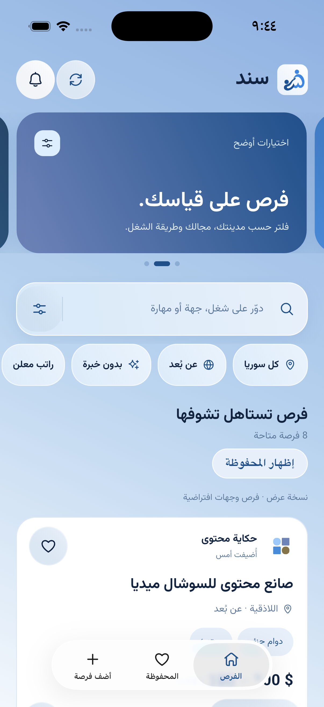

# سند — سندك للخطوة الجاية

تطبيق Flutter عربي لسوريا: اكتشاف فرصة → قراءة التفاصيل → اتصال أو إيميل. دون حساب للباحث أو المعلن. واجهة قراءة بتدرّج أزرق فاتح، بحث مثبت بخلفية محيطة شفافة وأزرار كبسولية، تنقّل دون بوب أب، وRTL وخط محلي. ناف بار iPhone مبني على UITabBar الأصلي بنفس طريقة سورفا.

يتبع المظهر الفاتح/الداكن نظام الجوال تلقائياً، مع لوحة ليلية كحلية وزجاج التنقل الأصلي. [نظام المظهر](docs/system-appearance.md). يرتبط Firebase Core على iOS وAndroid بمشروع `snd-project-8794b`؛ بيانات الوظائف تبقى على خادم REST، ولم تُفعّل Firestore أو إشعارات push. [إعداد Firebase](docs/firebase-setup.md).

## المشروع الحالي

اسم حزمة Flutter `sanad`. افتح مجلد `sanad` في IDE؛ إعداد التشغيل «سند — Sanad» يبدأ من `lib/main.dart`. مسار `fursa` السابق رابط إلى المشروع نفسه لتبقى نافذة IDE القديمة تعمل. أسماء قنوات native وBundle ID ومفاتيح البيانات لم تتغيّر حتى تبقى المحفوظات والفلاتر.

[لوغو سند](assets/images/sanad-logo.png) · [52 أيقونة متجهة](docs/screenshots/sanad-icon-system.png) · [أوامر توليد اللوغو](docs/sanad-logo-prompts.md)

## معاينة



[هوية سند والحركة والتشغيل](docs/sanad-brand-motion.md)

[شاشة البداية](docs/screenshots/sanad-welcome-polish.png) · [الإشعارات الجديدة](docs/screenshots/sanad-notifications-polish.png) · [تفاصيل الفرصة](docs/screenshots/redesign/native-details.png) · [الفلاتر](docs/screenshots/redesign/native-filters.png) · [iPhone الأصلي](docs/screenshots/sanad-home-polish.png)

[تفاصيل النظام البصري](docs/design-reference.md) · [مصادر الرسوم وأوامر توليدها](docs/illustration-assets.md)

## التشغيل الآن

```bash
flutter pub get
flutter run -d chrome
```

أو شغّل محاكي iPhone ثم `flutter run`. التطبيق يتصل افتراضياً بـ `https://snd.avorix.io` ويعرض آخر نسخة محفوظة فوراً ثم يحدّثها بالخلفية. وضع العرض بـ12 فرصة افتراضية يعمل فقط مع `--dart-define=API_BASE_URL=demo`؛ الاتصال التجريبي لا يفتح أرقاماً أو إيميلات حقيقية.

لنشر نسخة ويب عامة ومشاركة الفرص بروابط HTTPS راجع [نشر الويب](docs/web-hosting.md).

## الوضع الحقيقي

الخادم ضمن [server](server) ويستخدم SQLite ومراجعة إعلانات قبل نشرها. اقرأ [دليل تشغيل الخادم](docs/backend.md) لضبط قاعدة البيانات، رمز المشرف وCORS وHTTPS.

تجربة iOS Simulator على نفس جهاز Mac:

```bash
flutter run --dart-define=API_BASE_URL=http://127.0.0.1:8080
```

يسمح HTTP المحلي في debug فقط. لمعاينة الويب على منفذ ثابت استخدم `--web-port=5173` واضبط `ALLOWED_ORIGINS=http://localhost:5173` بالخادم وفق العنوان الذي تفتحه فعلياً. انتبه أن `127.0.0.1` و`localhost` أصلان مختلفان.

بناء حي (استبدل النطاقات بنطاقاتك المنشورة فعلياً):

```bash
flutter build ipa --release \
  --dart-define=API_BASE_URL=https://api.example.com \
  --dart-define=WEB_BASE_URL=https://app.example.com \
  --dart-define=SUPPORT_URL=https://example.com/support \
  --dart-define=PRIVACY_URL=https://example.com/privacy
```

```bash
flutter build web --release \
  --dart-define=API_BASE_URL=https://api.example.com \
  --dart-define=WEB_BASE_URL=https://app.example.com \
  --dart-define=SUPPORT_URL=https://example.com/support \
  --dart-define=PRIVACY_URL=https://example.com/privacy
```

يلزم Apple Developer وتوقيع وBundle ID مملوك. روابط الدعم والخصوصية HTTPS مطلوبة عند تشغيل إصدار release متصل بخدمة حقيقية؛ تظهر داخل صفحة الخصوصية. وضع المعاينة وحده ليس إصدار متجر.

## ما تم تنفيذه

- 14 محافظة، 9 مجالات، دوام وطريقة عمل وخبرة، راتب معلن، نطاق راتب وعملة وفترة وترتيب.
- بحث عربي يتجاهل التشكيل واختلافات الألف والأرقام، ودمج الفلاتر. الرواتب لا تُقارن بين عملات أو فترات مختلفة.
- حفظ الفرص وإخفاء جهة معلنة على الجهاز، حالات فارغة وأخطاء وإعادة محاولة ونسخة محفوظة عند غياب الاتصال.
- تفاصيل، واتساب وبريد عبر `url_launcher`، مشاركة فرصة عبر ورقة النظام، والتحقق من صلاحية الإعلان لدى الخادم قبل التواصل.
- إضافة على خطوتين، موافقة نشر التواصل، رقم أو بريد، مدة 7/14/30 يوماً، إدارة الإعلان دون حساب بمفتاح في Secure Storage.
- اتجاه الحقول بحسب لغة النص، واقتراحات محلية عربية/إنجليزية للمسمّى الوظيفي أثناء الكتابة دون تقييد النص الحر. رابط جهة عمل اختياري يظهر بالتفاصيل ويفتح خارج التطبيق بعد التحقق من توفر الإعلان.
- شعار الرئيسية بلا خلفية بيضاء؛ الفرص المحفوظة تبقى في تبويبها دون خيار «إظهار المحفوظة» في الرئيسية.
- مراجعة/رفض/نشر/حظر/بلاغات وحذف فعلي بالخادم؛ لا تظهر الإعلانات المنتظرة في القائمة العامة.
- iOS MethodChannel لـSF Symbols وhaptics، وUIKit platform view لناف بار زجاجي. UITabBar يقدّم Liquid Glass الأصلي على iOS 26 والمظهر النظامي على الإصدارات الأقدم، مع SF Symbols وقياس ارتفاع من UIKit. Android والويب يستخدمان واجهة Flutter.
- بحث مثبت، بانرات متبدّلة، انتقال من الكارد إلى التفاصيل، حفظ بنبضة موضعية وانكماش الكارد بدل طيرانه، وصفحات بخيارات تتوسع داخل المحتوى وتوجّه لأول خطأ. 52 أيقونة متجهة أصلية موحّدة مع UIKit واحترام Reduce Motion.
- بحث وفلاتر محفوظة محلياً ومركز إشعارات بملخص المتابعة وفلاتر الكل وغير المقروء وحالات الإعلانات داخل التطبيق؛ ليس خدمة push.
- ترحيب بروبوت وعناصر صغيرة عائمة حوله، وزر «بلّش هلّق» دون تخطي أو سهم مائل؛ تتوقف الحركات المستمرة بالخلفية ومع Reduce Motion.
- لوغو سند مولّد بالذكاء الاصطناعي، ومقاساته مجهزة لأيقونات iOS وAndroid والويب. [كتالوج الأيقونات والحركات](docs/icons-and-motion.md).

## حدود الإصدار الحالي

الكود قابل للتشغيل والبناء ويشمل خدمة خلفية، لكنه **لم يُنشر للعامة أو يُرسل إلى المتاجر**. الإطلاق يحتاج استضافة وربط النطاقات وسياسة فعلية ومشغّل مراجعة ودعم وتوقيع. لا يوجد ضمان قبول متجر أو إقبال تجاري.

هذه بنية بداية محدودة على خادم واحد، وليست منصة واسعة مختبرة تحت حمل. يجلب العميل صفحات الفرص ثم يفلتر محلياً (حتى 10,000 إعلان)، ويظهر رسالة عندما يتجاوز البيانات هذا الحد. قبل التوسع انقل الاستعلامات للفلاتر الخادمية مع ترقيم مستمر ومطابقة البحث العربي.

بيانات الديمو لا تختلط بالخدمة الحقيقية. مفاتيح الإدارة لا تذهب إلى SharedPreferences؛ البيانات العامة والإعلانات المحلية والمحفوظات تستخدمه. متصفح الويب على جهاز مشترك لا يقدّم عزل Keychain نفسه. فقدان بيانات الجهاز قد يفقد القدرة على إدارة إعلان دون مساعدة الدعم. لا توجد ملفات CV أو محادثات داخلية أو تسجيل هوية صاحب الرقم.

## الملفات المهمة

- [قواعد التطوير](claude.md)
- [فكرة المنتج وخطة البداية](docs/product.md)
- [الخادم وعقد API](docs/backend.md)
- [القناة الأصلية والتحقق على iOS](docs/native-ios.md)
- [متطلبات الإطلاق](docs/release-checklist.md)
- `lib/features/jobs/domain`: النموذج والفلاتر.
- `lib/features/jobs/data`: مصدر الفرص والكاش والتخزين الآمن.
- `lib/features/jobs/presentation`: القوائم والتفاصيل والفلاتر والإضافة.
- `lib/core`: الهوية البصرية، روابط المشغّل، والقنوات الأصلية.

التحقق: `dart format .` و`flutter analyze` وبناء المنصة المطلوبة. فحص الخادم الموثق موجود في `server/smoke_test.py`. لا يوجد سير عمل PR مفروض.

خط Vazirmatn مضمّن وفق [SIL OFL](assets/fonts/OFL.txt). علامات المجالات وLottie مرسومة برمجياً لهذا المشروع، ورسوم البداية مولّدة محلياً للتطبيق وموثقة في دليل الرسوم. لا شعارات شركات معروفة أو أعداد متقدمين مختلقة داخل الديمو.
