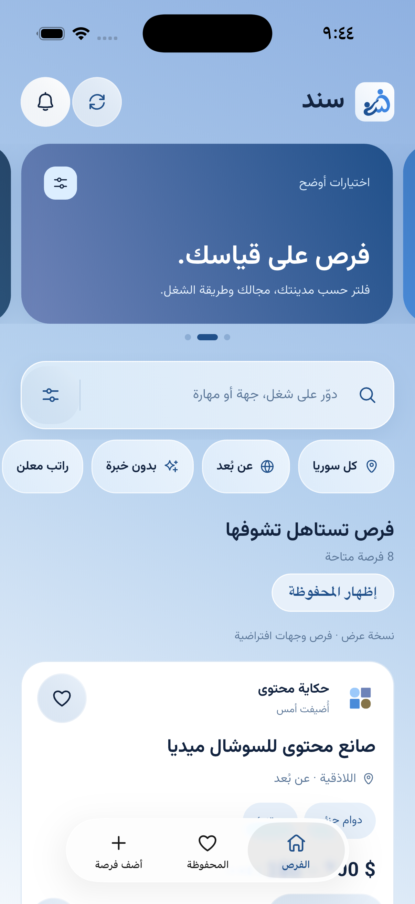

> الإصدار الأول: `1.0.0+1`. البناء التقليدي من الفرع الرئيسي يعمل دون `config/production.json` أو تكامل نشر. راجع [خطوات أول رفع يدوي](docs/first-app-store-release.md). اسم الفرع المحلي الحالي `main`.

> النطاق الحالي: سوريا فقط، دون شاشة اختيار بلد. المحافظات السورية وعملات الباك الأصلية SYP/USD/AED/SAR. لا حسابات أو تقديم داخلي أو شات؛ التصميم وAdMob محفوظان. أي توثيق توسع دولي أدناه تاريخي.

> قرار الإصدار الحالي: إلغاء منصة الحسابات والتقديم والطلبات والشات والشكاوى المرتبطة بالحساب. يعمل الحفظ والنشر والإدارة بالمسار الأصلي دون تسجيل دخول، مع الإبقاء على تحسينات التصميم وAdMob. وثائق منصة `/api/v2` أدناه تاريخية وليست نطاق الإصدار الحالي.

> تحديث 4 نوفمبر2026: [منصة الحسابات والتقديم والشات](docs/backend-handoff-2026-11-03/README.md) جاهزة للتكامل على العميل. يلزم تنفيذ `/api/v2` وإعداد Google/Apple والبريد قبل تفعيل حقيقي أو إصدار متجر. لم تُنشر تغييرات المنصة.

[حزمة الباك الكاملة الجاهزة](docs/snad-backend-handoff-20261104.zip) · [أفكار Bayt المعتمدة وخطة التوسع](docs/backend-handoff-2026-11-03/BAYT-REFERENCE.md) · [رسالة الباك الجاهزة](docs/backend-handoff-2026-11-03/BACKEND-MESSAGE.txt)

[ملف واحد مستقل لأيجنت الباك، مع جميع المرفقات المدمجة](docs/SNAD-BACKEND-AGENT.md) · [دليل رحلات التطبيق PDF](output/pdf/SNAD-APP-FLOWS.pdf). إعادة تجهيزهما محلياً: `python3 tools/create_backend_delivery_documents.py` بعد تحديث حزمة العقد.

# سند — فرص العمل والتواصل المهني

تطبيق Flutter عربي لفرص العمل بكل البلدان: اكتشاف فرصة → قراءة التفاصيل → اتصال أو إيميل. التصفح بلا حساب، والحفظ والنشر والتقديم بحساب بسيط ضمن تحديث المنصة المجهز. واجهة قراءة بتدرّج أزرق فاتح، هيدر ثابت وبحث يختفي بالنزول ويعود بالتمرير للأعلى ويثبت أثناء الكتابة، وأزرار كبسولية، تنقّل دون بوب أب، وRTL وخط محلي. ناف بار iPhone مبني على UITabBar الأصلي بنفس طريقة سورفا.

يتبع المظهر الفاتح/الداكن نظام الجوال تلقائياً، مع لوحة ليلية كحلية وزجاج التنقل الأصلي. [نظام المظهر](docs/system-appearance.md). يرتبط Firebase Core على iOS وAndroid بمشروع `snd-project-8794b`؛ بيانات الوظائف تبقى على خادم REST، مع Firebase Messaging لإشعارات الهاتف؛ يلزم اختبار إرسال فعلي من الخادم وتهيئة APNs لـiOS. لم تُفعّل Firestore. [إعداد Firebase](docs/firebase-setup.md).

## المشروع الحالي

اسم التطبيق الظاهر «سند — Snad»، واسم حزمة Flutter `snad`. افتح مجلد `sanad` في IDE؛ إعداد التشغيل يبدأ من `lib/main.dart`. معرّف المتاجر `com.jobsnad.snad`. قنوات native ومفاتيح التخزين المحلية تستخدم الآن نطاق `com.jobsnad.snad` ومفاتيح `snad.*`.

[لوغو سند](assets/images/sanad-logo.png) · [52 أيقونة متجهة](docs/screenshots/sanad-icon-system.png) · [أوامر توليد اللوغو](docs/sanad-logo-prompts.md)

## معاينة



[هوية سند والحركة والتشغيل](docs/sanad-brand-motion.md)

[شاشة البداية](docs/screenshots/sanad-welcome-polish.png) · [الإشعارات الجديدة](docs/screenshots/sanad-notifications-polish.png) · [تفاصيل الفرصة](docs/screenshots/redesign/native-details.png) · [الفلاتر](docs/screenshots/redesign/native-filters.png) · [iPhone الأصلي](docs/screenshots/sanad-home-polish.png)

[تفاصيل النظام البصري](docs/design-reference.md) · [مصادر الرسوم وأوامر توليدها](docs/illustration-assets.md)

## التشغيل الآن

تتضمن نسخة الهاتف Banner مشترك في تفاصيل الفرصة والإشعارات وNative ضمن قائمة الهوم من AdMob، مع موافقات UMP ومعرّفات اختبار تلقائية في Debug/Profile. إعدادات الحساب والنشر والاختبار موثقة في [إعلانات سند](docs/admob.md). الإعلانات لا تظهر في الويب أو الديمو، والحد الأدنى لـAndroid هو API 24 وفق حزمة الإعلانات الحالية.

البحث والنشر الدولي يدعمان 257 بلداً ومنطقة و153 عملة في كتالوج محلي، مع بحث بالاسم العربي أو الإنكليزي، واختيار المحافظة محلياً، ورمز اتصال مستقل عن بلد العمل. تبدأ التجربة باختيار بلد البحث مرة واحدة، مع إمكانية تغييره لاحقاً. تعرض قائمة الاختيار الدول العربية والأوروبية ووجهات أجنبية مختارة مع الأعلام؛ يبقى الكتالوج الكامل لتحليل البيانات القديمة وأرقام التواصل. الاختيارات محفوظة، والفلاتر السورية القديمة تُرحّل مع نطاقها. يلزم تطبيق [تحديث الخادم الحي](server/production-patches/jobs_20261103_global/README.md) قبل إطلاق النشر الدولي؛ تجهيز Flutter والخادم المحلي لا يعني تفعيله في الإنتاج. تحديث الحسابات والتقديم والشات مجهّز على العميل وفق عقد /api/v2، وينتظر تنفيذ الباك وإعداد المزودين. لا ملفات CV.

للتنفيذ مع مطوّر الباك: [حزمة العقد الكامل](docs/backend-handoff-2026-11-03/README.md) توثّق 70 عملية (16 قديمة و54 للمنصة والإدارة)، والأسماء والأنواع وأمثلة الطلبات والردود، مع OpenAPI وPostman وفحوص قبول وقالب التحديثات التالية. إعادة تجهيز ZIP: `python3 tools/package_backend_handoff.py`.

شبكة الموبايل تستخدم `URLSession` على iOS وCronet مضمّناً على Android، بنفس نهج مشروع ريف دمشق، عبر واجهة `http.Client` الحالية دون نقل التطبيق إلى Dio. يدعم النقل HTTP/2 وHTTP/3 بحسب الخادم والشبكة، مع إعادة استخدام الاتصالات. Cronet لا يحتاج Google Play Services، وعند تعذّر تهيئته يعود العميل إلى Dart قبل إرسال أي طلب. كاش HTTP معطّل؛ يبقى الكاش لدى `JobsStore` والتحقق من توفر الفرصة لدى الخادم. الويب يحتفظ بعميل المتصفح. لا توجد بعد قياسات مقارنة للسرعة على أجهزة فعلية وشبكات سورية.

```bash
flutter pub get
flutter run -d chrome
```

أو شغّل محاكي iPhone ثم `flutter run`. التطبيق يتصل افتراضياً بـ `https://admin.jobsnad.com` ويفحص حالة الخدمة قبل الدخول، ثم يعرض آخر نسخة محفوظة ويحدّثها بالخلفية. موقع المتصفح العام: `https://jobsnad.com`. وضع العرض بـ12 فرصة افتراضية يعمل فقط مع `--dart-define=API_BASE_URL=demo`؛ الاتصال التجريبي لا يفتح أرقاماً أو إيميلات حقيقية.

لنشر نسخة ويب عامة ومشاركة الفرص بروابط HTTPS راجع [نشر الويب](docs/web-hosting.md).

## الوضع الحقيقي

الخادم ضمن [server](server) ويستخدم SQLite ومراجعة إعلانات قبل نشرها. اقرأ [دليل تشغيل الخادم](docs/backend.md) لضبط قاعدة البيانات، رمز المشرف وCORS وHTTPS.

تجربة iOS Simulator على نفس جهاز Mac:

```bash
flutter run --dart-define=API_BASE_URL=http://127.0.0.1:8080
```

يسمح HTTP المحلي في debug فقط. لمعاينة الويب على منفذ ثابت استخدم `--web-port=5173` واضبط `ALLOWED_ORIGINS=http://localhost:5173` بالخادم وفق العنوان الذي تفتحه فعلياً. انتبه أن `127.0.0.1` و`localhost` أصلان مختلفان.

بناء الإنتاج التقليدي يستخدم النطاقات المنشورة افتراضيًا دون ملف إعداد إضافي:

```bash
tools/build_android_store.sh
flutter build apk --split-per-abi
flutter build web --release
flutter build ipa --release
```

نُشرت [سياسة الخصوصية](https://jobsnad.com/privacy/) و[صفحة الدعم](https://jobsnad.com/support/) في 5 أكتوبر 2026، وتظهر روابطهما داخل صفحة «عن سند» عند البناء بهذا الإعداد. يلزم Apple Developer وتوقيع مملوك لبناء IPA للنشر.

إعدادات الإنتاج وروابط الدعم والخصوصية مدمجة كقيم افتراضية؛ البناء العادي يعمل دون ملف إعداد إضافي. يمكن تجاوزها للاختبار فقط. ملف APK الأنسب لأغلب أجهزة Android الحديثة: `build/app/outputs/flutter-apk/app-arm64-v8a-release.apk`.

لرفع Android إلى Google Play استخدم `tools/build_android_store.sh`؛ يتحقق من روابط الإنتاج وملف توقيع Android، ثم ينتج الحزمة الموقعة في `build/app/outputs/bundle/release/app-release.aab`.

للتجربة وقياس السلاسة دون إعدادات الإصدار، استخدم `flutter run --profile` أو إعداد «سند — Profile» في VS Code. وضع Profile لا يتجاوز الصيانة أو التحديث الإجباري الذي يحدده الخادم.

## الصيانة والتحديث وعبارات البداية

تظهر الصيانة في صفحة مستقلة قبل الدخول، مع إعادة التحقق. يفحص Android وiOS رقم النسخة المثبتة فعلياً عبر `package_info_plus` ثم `/api/app/version-check`؛ التحديث الإجباري يمنع الدخول، والاختياري يسمح بـ«بعدين، خلّينا نكمّل». الويب يفحص الصيانة فقط، والديمو لا يطلب الفحص. يُعاد التحقق عند الرجوع إلى التطبيق؛ يبقى أي منع معروف سارياً إذا فشل الاتصال. فشل أول فحص يعرض صفحة إعادة المحاولة، ولا يدّعي أن الخدمة متاحة؛ المحتوى المحفوظ يبقى متاحاً بعد دخول ناجح ولو فشلت إعادة التحقق لاحقاً.

رسائل الصيانة والتحديث وأخطاء الإقلاع تظهر كفقاعة كلام للروبوت؛ الفحص العادي يظهر شعار التحميل فقط. الترحيب نص عادي وصفحة الروبوت على الهاتف تتكيّف مع المساحة دون سكرول، مع حركة دخول قصيرة واحترام تقليل الحركة. لا يوجد نطق صوتي. تفاصيل خطأ إعداد نسخة Release تتمدد داخل الصفحة؛ لا تعالجه إعادة المحاولة.

فحص 4 أكتوبر 2026: الصيانة `false`، وعلى Android وiOS للإصدار `1.0.0` التحديث `false` ورابط المتجر `null`. عند تفعيل تحديث، يأخذ التطبيق `store_url` من جواب المنصة ويراجع أنه صفحة المتجر الصحيحة. [الإشعارات والتنقل والتحقق](docs/notifications-and-navigation.md).

## ما تم تنفيذه

- 14 محافظة، 9 مجالات، دوام وطريقة عمل وخبرة، راتب معلن، نطاق راتب وعملة وفترة وترتيب.
- بحث عربي يتجاهل التشكيل واختلافات الألف والأرقام، ودمج الفلاتر. الرواتب لا تُقارن بين عملات أو فترات مختلفة.
- حفظ الفرص وإخفاء جهة معلنة على الجهاز، حالات فارغة وأخطاء وإعادة محاولة ونسخة محفوظة عند غياب الاتصال.
- تفاصيل، واتساب وبريد عبر `url_launcher`، مشاركة فرصة عبر ورقة النظام، والتحقق من صلاحية الإعلان لدى الخادم قبل التواصل.
- إضافة على خطوتين، موافقة نشر التواصل، رقم أو بريد، مدة 7/14/30 يوماً، إدارة الإعلان دون حساب بمفتاح في Secure Storage.
- اتجاه الحقول بحسب لغة النص، واقتراحات محلية عربية/إنجليزية للمسمّى الوظيفي أثناء الكتابة دون تقييد النص الحر. رابط جهة عمل اختياري يظهر بالتفاصيل ويفتح خارج التطبيق بعد التحقق من توفر الإعلان.
- شعار الرئيسية بلا خلفية بيضاء؛ الفرص المحفوظة تبقى في تبويبها دون خيار «إظهار المحفوظة» في الرئيسية.
- مراجعة/رفض/نشر/حظر/بلاغات وحذف فعلي بالخادم؛ لا تظهر الإعلانات المنتظرة في القائمة العامة.
- iOS MethodChannel لـSF Symbols وhaptics، وUIKit platform view لناف بار زجاجي. UITabBar يقدّم Liquid Glass الأصلي على iOS 26 والمظهر النظامي على الإصدارات الأقدم، مع SF Symbols وقياس ارتفاع من UIKit. Android والويب يستخدمان واجهة Flutter.
- هيدر وبحث عائمان مع اتجاه التمرير وثابتان أثناء الكتابة، بانرات متبدّلة، انتقال من الكارد إلى التفاصيل، حفظ بنبضة موضعية وانكماش الكارد بدل طيرانه، وصفحات بخيارات تتوسع داخل المحتوى وتوجّه لأول خطأ. 52 أيقونة متجهة أصلية موحّدة مع UIKit واحترام Reduce Motion.
- بحث وفلاتر محفوظة محلياً ومركز إشعارات بملخص المتابعة وفلاتر الكل وغير المقروء وحالات الإعلانات داخل التطبيق، مع إذن إشعارات الهاتف وتسجيل رمز FCM لدى الخادم.
- ترحيب بروبوت وعناصر صغيرة عائمة حوله، وزر «بلّش هلّق» دون تخطي أو سهم مائل؛ تتوقف الحركات المستمرة بالخلفية ومع Reduce Motion.
- لوغو سند مولّد بالذكاء الاصطناعي، ومقاساته مجهزة لأيقونات iOS وAndroid والويب. [كتالوج الأيقونات والحركات](docs/icons-and-motion.md).

## حدود الإصدار الحالي

الموقع والخدمة الافتراضية متاحان عبر HTTPS، لكن هذا **لا يعني جاهزية الإطلاق أو قبول المتاجر**. فحص 30 سبتمبر 2026 وجد موانع في الخدمة الحية وربط التطبيقات؛ راجع [نتيجة فحص الخادم](docs/backend.md#نتيجة-فحص-الخدمة-المنشورة--30-سبتمبر-2026) و[قائمة الإطلاق](docs/release-checklist.md). يلزم إغلاق الملاحظات، وسياسة فعلية ومشغّل مراجعة ودعم وتوقيع.

يجلب تطبيق الموبايل والويب كتالوج الخدمة الحية صفحةً صفحة من `/api/filterjob` بحجم 24، ويطلب الصفحة التالية عند الاقتراب من نهاية القائمة. البحث والفلاتر يعيدان تحميل الصفحة الأولى من الخادم، ويعرض العميل العدد الإجمالي من `meta.total`. بيانات الديمو محلية ولا تحتاج ترقيم صفحات. لم يُقَس حمل إنتاجي. خادم Python المحلي المرجعي بنية محدودة على خادم واحد، وهو مختلف عن الخدمة الحية `/api`.

بيانات الديمو لا تختلط بالخدمة الحقيقية. مفاتيح الإدارة لا تذهب إلى SharedPreferences؛ البيانات العامة والإعلانات المحلية والمحفوظات تستخدمه. متصفح الويب على جهاز مشترك لا يقدّم عزل Keychain نفسه. فقدان بيانات الجهاز قد يفقد القدرة على إدارة إعلان دون مساعدة الدعم. لا توجد ملفات CV أو إثبات هوية صاحب رقم؛ المحادثات ضمن تحديث المنصة المجهز وليست خدمة مفعلة على الباك القديم.

## الملفات المهمة

- [قواعد التطوير](claude.md)
- [فكرة المنتج وخطة البداية](docs/product.md)
- [الخادم وعقد API](docs/backend.md)
- [تدقيق API والمتصفح الحي — 2 أكتوبر 2026](docs/api-audit-2026-10-02.md)
- [مراجعة المجموعة وبيانات الخدمة — 3 أكتوبر 2026](docs/api-audit-2026-10-03.md)
- [القناة الأصلية والتحقق على iOS](docs/native-ios.md)
- [متطلبات الإطلاق](docs/release-checklist.md)
- `lib/features/jobs/domain`: النموذج والفلاتر.
- `lib/features/jobs/data`: مصدر الفرص والكاش والتخزين الآمن.
- `lib/features/jobs/presentation`: القوائم والتفاصيل والفلاتر والإضافة.
- `lib/core`: الهوية البصرية، روابط المشغّل، والقنوات الأصلية.

التحقق: `dart format .` و`flutter analyze` وبناء المنصة المطلوبة. فحص الخادم الموثق موجود في `server/smoke_test.py`. لا يوجد سير عمل PR مفروض.

خط Vazirmatn مضمّن وفق [SIL OFL](assets/fonts/OFL.txt)، وخط Roboto الاحتياطي وفق [Apache 2.0](assets/fonts/Roboto_LICENSE.txt) لتشغيل الويب دون تنزيل خط الإقلاع من نطاق خارجي. علامات المجالات وLottie مرسومة برمجياً لهذا المشروع، ورسوم البداية مولّدة محلياً للتطبيق وموثقة في دليل الرسوم. لا شعارات شركات معروفة أو أعداد متقدمين مختلقة داخل الديمو.

تفاصيل آخر تنظيم للواجهة والبلدان والإشعارات والحدود الخادمية في [تحديث التجربة](docs/experience-update-2026-11-03.md).
