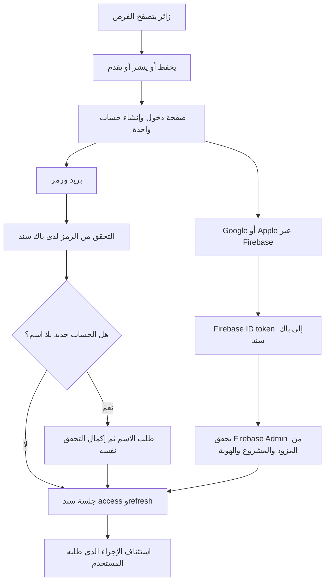
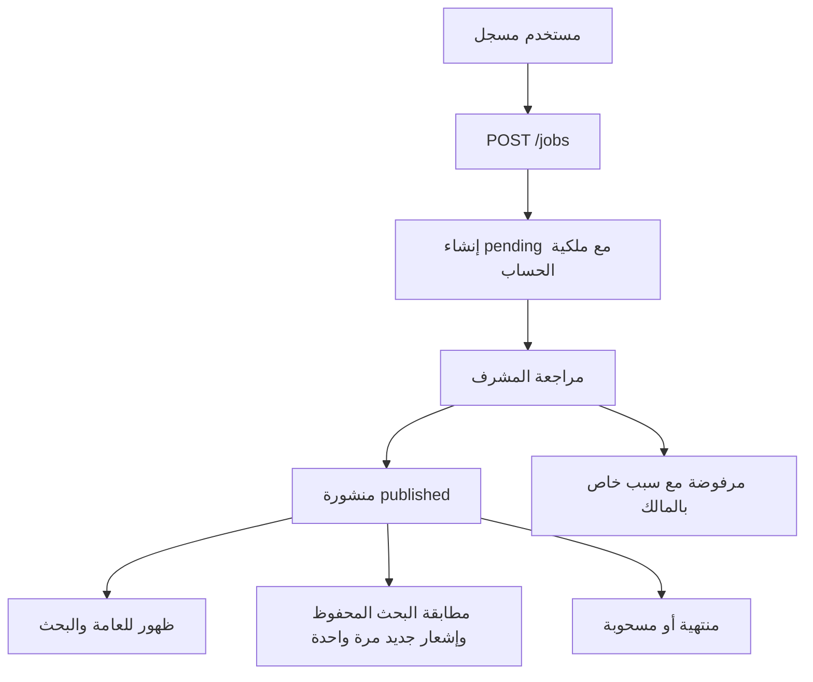
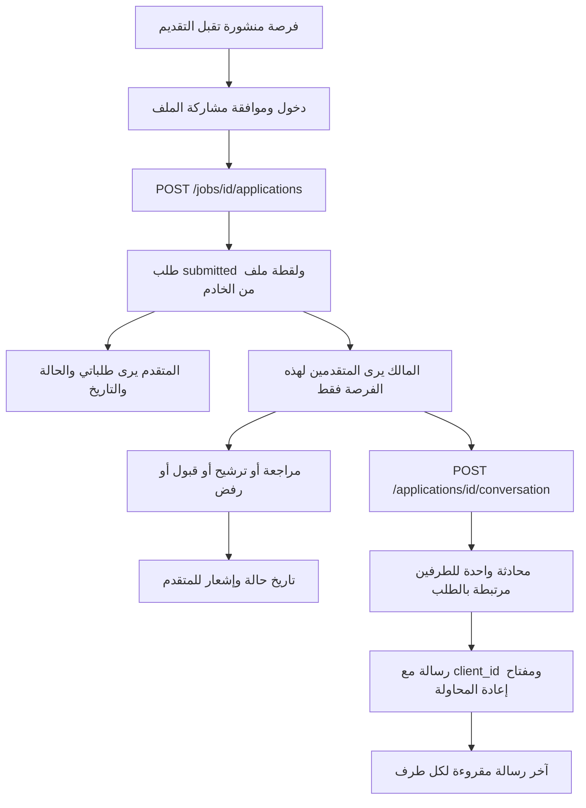

# سند | ملف التنفيذ الكامل لأيجنت الباك إند

تاريخ التجميع: 4 نوفمبر 2026. العقد: 2026-11-03.5.

هذا **ملف واحد مستقل**: التعليمات والفلوات والمواصفات مكتوبة هنا، وفي نهايته نسخة كاملة قابلة للاستخراج من جميع ملفات العقد والأمثلة وOpenAPI وPostman والكتالوج ومراجع Laravel. لا تحتاج ZIP منفصلاً أو مجلد سند عند تسليمه إلى أيجنت الباك.

## 0. المهمة التي تنفذها

أنت أيجنت يعمل داخل مستودع باك سند القائم. افحص قواعده وبنيته ثم نفذ هذا العقد بدقة في الباك القائم. لا تعِد إنشاء المشروع ولا تستبدل قاعدة الإنتاج بخادم Python المرجعي. الواجهة مجهزة محلياً؛ هذا لا يعني أن المنصة الجديدة منشورة أو أن الخدمات الخارجية معدّة.

1. ابدأ بقراءة هذا التمهيد ثم استخرج المرفقات بالبرنامج أدناه، واقرأ PLATFORM وSECURITY وDATA-MODEL وOpenAPI. لا تدخل كتلة Base64 الضخمة كاملة في سياق النموذج؛ استخرجها بأداة الملفات ثم اقرأ الملفات المطلوبة تدريجياً.
2. طبّق 70 عملية: 16 قديمة متوافقة و54 للمنصة، منها 6 للإدارة. لا تستبدل مسارات `/api` القديمة بـ`/api/v2`؛ لكل منها دوره المحدد في العقد.
3. نفذ migrations إضافية آمنة، المصادقة، التفويض، مراجعة النشر، الطلبات، المحادثات، الشكاوى، البحث المحفوظ والإشعارات، بالأنواع والمفاتيح وأكواد HTTP المحددة تماماً.
4. اختبر التدفقات والصلاحيات والتزامن وقطع الاتصال والـidempotency. لا تعد استجابة UI ناجحة دليلاً على عمل البريد أو Google/Apple أو FCM.
5. جهز staging وتقرير التنفيذ والقيم العامة المطلوبة. لا تنشر إنتاجاً ولا ترسل للمتاجر أو تبنِ Android/iOS من هذه المهمة. لا تغيّر تطبيق Flutter لتغطية اختلاف عقد غير معلن.

## 1. أولوية المراجع والنطاق

- PLATFORM وSECURITY وDATA-MODEL وNOTIFICATION-EVENTS تحدد سلوك الأعمال والأمان، وOpenAPI يحدد الطرق والمسارات والأسماء والأنواع والحدود والأمثلة. يجب تحقيقهما معاً. عند تعارض فعلي لا تختر تخميناً: وثق التعارض المحدد قبل تغيير العقد.
- CONTRACT وREGIONS وACCEPTANCE تخص توافق API القديم والبلدان. الإشارات التاريخية إلى غياب الحساب والشات تخص القديم فقط؛ المطلوب الجديد مكتوب في PLATFORM.
- ملفات Laravel المرجعية رقعة دول ومراجع حقول قديمة، وليست باك v2 كاملاً ولا أمراً باستبدال controllers الخاصة بالمشروع دون مراجعة.
- BAYT-REFERENCE يميز ميزات هذا الإصدار عن توسع مستقبلي. أفكار الشركة الموثقة والمقابلات والتوصيات ليست جزءاً مطلوباً من هذا العقد.
- أمثلة الرموز والمعرفات اختبارية، ليست مفاتيح دخول فعلية. لا تضف secrets إلى Flutter أو ملفات التسليم.
- التصفح العام بلا حساب. الحساب الواحد يتقدم وينشر. الدخول مطلوب للمحفوظات والنشر والتقديم والشات والبحث المحفوظ والشكاوى.
- لا CV ولا اختيار دور عند التسجيل ولا محادثات عشوائية. المعلن يبدأ المحادثة من طلب حقيقي؛ المتقدم يسترجع الموجودة.
- حساب الإعلان القديم لا يثبت عبر device_id المكشوف. لا ترحيل ملكية أو بيانات جهاز إلى عضو بلا إثبات وموافقة وفق SECURITY.

## 2. ترتيب التنفيذ والتسليم

| المرحلة | العمل | شرط الإغلاق |
| --- | --- | --- |
| اكتشاف | افحص routes/schema/auth/jobs/queues والإصدارات والتوافق القديم | خطة تغييرات ونسخة احتياطية قابلة للاستعادة على staging |
| أساس | migrations وفهارس وملكية وidempotency وoutbox وأخطاء موحدة | لا تسريب بيانات، ولا تغيير كاسر للقديم |
| دخول | capabilities وOTP وFirebase Admin والجلسات والتجديد والحذف | اختبارات رمز/مزود/replay/logout/حسابين |
| بيانات | ملف وحفظ وبحث محفوظ وبلدان ونشر ومراجعة | بيانات كاملة للمالك، وعدم ظهور pending للعامة |
| توظيف | تقديم وsnapshot وحالات ومتقدمون وبحث وقوائم | uniqueness وصلاحيات وexpected_version وتاريخ ثابت |
| تواصل ودعم | محادثة ورسائل وقراءة وحظر وصورة شكوى خاصة | منع التكرار والتسريب وقيود الصورة والتنظيف |
| إشعارات وتشغيل | أحداث بعد commit وFCM وتفضيلات وجدولة وتنظيف | dedup وlogout/token rotation وworkers قابلة للمراقبة |
| قبول | جميع ACCEPTANCE وACCEPTANCE-PLATFORM وتقرير حقيقي | staging وقيم عامة ونتائج ودليل دون أسرار |

لا تعتبر أي مرحلة مكتملة بمجرد إنشاء routes أو إرجاع fixtures. اشتراطات OAuth/Apple/APNs/SMTP التي تحتاج إعداد حساب خارجي تُسجل بوضوح، وتكون capabilities=false لها حتى تعمل فعلياً.

## 3. طريقة استخراج المرفقات من هذا الملف وحده

احفظ هذا الملف باسم `SNAD-BACKEND-AGENT.md` في مستودع الباك. شغّل الكود التالي باستخدام Python 3 من جذر مستودع الباك. ينشئ مجلد مرجع مستقل ولا يكتب فوق كود التطبيق ولا ينفذ رقعة Laravel تلقائياً. لا حاجة إلى تنزيل حزم Python.

```python
from pathlib import Path, PurePosixPath
from zipfile import ZipFile
import base64, hashlib, io

source = Path('SNAD-BACKEND-AGENT.md')
text = source.read_text(encoding='utf-8')
start = '<!-- SNAD_' + 'PAYLOAD_BASE64_BEGIN -->'
end = '<!-- SNAD_' + 'PAYLOAD_BASE64_END -->'
blob = text.split(start, 1)[1].split(end, 1)[0]
blob = blob.replace('```base64', '').replace('```', '')
raw = base64.b64decode(''.join(blob.split()), validate=True)
assert hashlib.sha256(raw).hexdigest() == '621d2b086e52d047cb032b7732fb3b39b493d8032fecea037cdf6bdc977857a5', 'Payload SHA256 mismatch'
target = Path('snad-backend-reference-20261104')
target.mkdir(exist_ok=False)  # لا تستبدل مجلداً قائماً
with ZipFile(io.BytesIO(raw)) as archive:
    assert archive.testzip() is None
    for entry in archive.infolist():
        path = PurePosixPath(entry.filename)
        assert not path.is_absolute() and '..' not in path.parts
        assert not entry.is_dir()
    archive.extractall(target)
root = target / 'snad-backend-handoff-20261103'
for line in (root / 'FILES.sha256').read_text().splitlines():
    expected, relative = line.split('  ', 1)
    path = PurePosixPath(relative)
    assert not path.is_absolute() and '..' not in path.parts
    assert hashlib.sha256((root / relative).read_bytes()).hexdigest() == expected, relative
print('Verified reference:', root.resolve())
```

المرفق يحوي 45 ملفاً مع فهرس SHA256، يشمل JSON الكامل بكل schemas والأمثلة وجميع المراجع. المسارات النسبية وأسماء الملفات داخل النصوص التالية تشير إلى هذا المرجع المستخرج. لا تتطلب مستودع Flutter أو إرسال ملفات أخرى.

## 4. فهرس جميع العمليات

| # | الطريقة والمسار | العملية | الحماية |
| --- | --- | --- | --- |
| 1 | `GET /api/job-fields` | مجالات العمل | عام |
| 2 | `GET /api/jobs` | قائمة التوافق القديمة | عام |
| 3 | `POST /api/jobs` | إضافة فرصة للمراجعة | DeviceIdentity |
| 4 | `GET /api/filterjob` | القائمة الحالية والبحث والفلاتر | عام |
| 5 | `GET /api/job-locations` | اقتراحات المدن | عام |
| 6 | `GET /api/jobs/{jobId}` | تفاصيل فرصة منشورة | عام |
| 7 | `DELETE /api/jobs/{jobId}` | حذف فرصة الجهاز | DeviceIdentity |
| 8 | `GET /api/my-jobs` | إعلانات الجهاز بكل البلدان والحالات | DeviceIdentity |
| 9 | `GET /api/favorites` | محفوظات الجهاز كاملة | DeviceIdentity |
| 10 | `POST /api/favorites` | تبديل حالة الحفظ | DeviceIdentity |
| 11 | `POST /api/job-reports` | بلاغ على فرصة | DeviceIdentity |
| 12 | `GET /api/notifications` | صندوق متابعة الجهاز | DeviceIdentity |
| 13 | `POST /api/notifications/{noticeId}/read` | تعليم إشعار كمقروء | DeviceIdentity |
| 14 | `POST /api/app/visit` | زيارة أو تحديث رمز FCM | عام |
| 15 | `GET /api/app/maintenance` | حالة صيانة التطبيق | عام |
| 16 | `GET /api/app/version-check` | تحديث اختياري أو إجباري للهاتف | عام |
| 17 | `GET /api/v2/capabilities` | جاهزية المنصة وطرق الدخول | عام |
| 18 | `POST /api/v2/auth/email/challenge` | إرسال رمز الدخول بالبريد | عام |
| 19 | `POST /api/v2/auth/email/verify` | التحقق وإنشاء الحساب أو فتحه | عام |
| 20 | `POST /api/v2/auth/social` | تبادل Firebase ID token الموثق بجلسة سند | عام |
| 21 | `POST /api/v2/auth/refresh` | تدوير رمز التجديد بذات مفتاح المحاولة | عام |
| 22 | `POST /api/v2/auth/logout` | إلغاء الجلسة وربط إشعارها | MemberBearer |
| 23 | `POST /api/v2/auth/reauth/email/challenge` | رمز تحقق جديد لحذف الحساب | MemberBearer |
| 24 | `POST /api/v2/auth/reauth/verify` | إثبات حديث للهوية لا يتجاوز خمس دقائق | MemberBearer |
| 25 | `GET /api/v2/me` | الملف المهني للحساب الحالي | MemberBearer |
| 26 | `PATCH /api/v2/me` | تحديث ملف مهني دون تغيير البريد أو الملكية | MemberBearer |
| 27 | `DELETE /api/v2/me` | حذف الحساب وإلغاء كل الجلسات | MemberBearer |
| 28 | `GET /api/v2/me/favorite-ids` | كل معرّفات المحفوظة لعلامة القلب بلا تكرار الطلبات | MemberBearer |
| 29 | `GET /api/v2/me/favorites` | صفحات المحفوظة بما فيها فرص توقفت | MemberBearer |
| 30 | `PUT /api/v2/me/favorites/{jobId}` | حفظ الفرصة بشكل idempotent | MemberBearer |
| 31 | `DELETE /api/v2/me/favorites/{jobId}` | إزالة الفرصة بشكل idempotent | MemberBearer |
| 32 | `GET /api/v2/me/jobs` | إعلانات المالك بكامل التفاصيل | MemberBearer |
| 33 | `GET /api/v2/me/jobs/{jobId}` | تفاصيل إعلان المالك حتى وهو غير منشور | MemberBearer |
| 34 | `POST /api/v2/jobs` | إنشاء فرصة مملوكة للحساب وقيد المراجعة | MemberBearer |
| 35 | `POST /api/v2/jobs/{jobId}/withdraw` | سحب إعلان ومنع التقديم الجديد | MemberBearer |
| 36 | `GET /api/v2/me/applications` | طلبات المتقدم مع الحالة والتاريخ | MemberBearer |
| 37 | `POST /api/v2/jobs/{jobId}/applications` | التقديم مرة واحدة للفرصة | MemberBearer |
| 38 | `GET /api/v2/jobs/{jobId}/applications` | المتقدمون للمالك فقط | MemberBearer |
| 39 | `GET /api/v2/applications/{applicationId}` | الطلب للطرف المخول فقط | MemberBearer |
| 40 | `PATCH /api/v2/applications/{applicationId}` | تحديث الحالة وفق الدور والانتقالات | MemberBearer |
| 41 | `POST /api/v2/applications/{applicationId}/conversation` | يفتح المالك المحادثة والمتقدم يسترجع الموجودة | MemberBearer |
| 42 | `GET /api/v2/conversations` | قائمة المحادثات حسب آخر رسالة | MemberBearer |
| 43 | `GET /api/v2/conversations/{conversationId}` | الطرفان فقط بلا كشف وجود محادثة أخرى | MemberBearer |
| 44 | `GET /api/v2/conversations/{conversationId}/messages` | آخر 50 رسالة تصاعدياً وcursor للسجل الأقدم | MemberBearer |
| 45 | `POST /api/v2/conversations/{conversationId}/messages` | إرسال مع client_id ثابت يمنع التكرار | MemberBearer |
| 46 | `PUT /api/v2/conversations/{conversationId}/read` | تحديث آخر رسالة مقروءة بشكل تزايدي | MemberBearer |
| 47 | `GET /api/v2/me/blocks` | المستخدمون المحظورون | MemberBearer |
| 48 | `PUT /api/v2/me/blocks/{memberId}` | منع التواصل في الاتجاهين | MemberBearer |
| 49 | `DELETE /api/v2/me/blocks/{memberId}` | إلغاء حظر المستخدم من جهتي | MemberBearer |
| 50 | `POST /api/v2/uploads` | صورة شكوى خاصة حتى 5MiB بعد فك Base64 | MemberBearer |
| 51 | `POST /api/v2/complaints` | شكوى بنص وصورة اختيارية | MemberBearer |
| 52 | `GET /api/v2/me/complaints` | الشكاوى وحالتها ورد الدعم للمبلّغ فقط | MemberBearer |
| 53 | `GET /api/v2/me/notification-preferences` | تفضيلات إشعارات الهاتف | MemberBearer |
| 54 | `PUT /api/v2/me/notification-preferences` | تحديث تفضيلات الهاتف دون إسقاط سجل التنبيهات | MemberBearer |
| 55 | `PUT /api/v2/me/push-device` | ربط رمز FCM بالجلسة الحالية وفصله عن الحساب السابق | MemberBearer |
| 56 | `GET /api/v2/me/saved-searches` | البحث المحفوظ على السيرفر للحساب | MemberBearer |
| 57 | `POST /api/v2/me/saved-searches` | حفظ فلتر وبداية مطابقة صامتة دون اعتبار القديم جديداً | MemberBearer |
| 58 | `DELETE /api/v2/me/saved-searches/{searchId}` | حذف البحث وإيقاف المطابقة المستقبلية | MemberBearer |
| 59 | `GET /api/v2/me/saved-search-matches` | فرص المطابقة غير المقروءة وحالة رسالة العودة | MemberBearer |
| 60 | `PUT /api/v2/me/saved-search-matches/read` | تعليم الفرص التي فتحها المستخدم كمقروءة | MemberBearer |
| 61 | `PUT /api/v2/me/saved-search-matches/acknowledge` | منع تكرار رسالة العودة دون اعتبارها قراءة للتفاصيل | MemberBearer |
| 62 | `GET /api/v2/me/notifications` | صندوق إشعارات السيرفر مع وجهة كل حدث | MemberBearer |
| 63 | `PUT /api/v2/me/notifications/{noticeId}/read` | تحديد إشعار مملوك كمقروء | MemberBearer |
| 64 | `POST /api/v2/me/identities` | ربط Google أو Apple من حساب قائم ببريد مطابق ومثبت | MemberBearer |
| 65 | `GET /api/v2/admin/jobs` | طابور مراجعة الفرص مع بيانات الملكية الخاصة للمشرف | AdminBearer |
| 66 | `POST /api/v2/admin/jobs/{jobId}/approve` | اعتماد الفرصة وإطلاق حدث النشر والمطابقة مرة واحدة | AdminBearer |
| 67 | `POST /api/v2/admin/jobs/{jobId}/reject` | رفض مع سبب خاص للمالك فقط | AdminBearer |
| 68 | `GET /api/v2/admin/complaints` | الشكاوى الخاصة للمشرف المخول | AdminBearer |
| 69 | `PATCH /api/v2/admin/complaints/{complaintId}` | متابعة الشكوى وإرسال الرد | AdminBearer |
| 70 | `POST /api/v2/admin/members/{memberId}/suspend` | تعليق الحساب وسحب محتواه وإبطال جلساته بعد المراجعة | AdminBearer |

## 5. المواصفات والفلوات وقواعد التشغيل كاملة


---

### 5.1 | README.md

#### ابدأ هنا — منصة سند والتسليم الكامل للباك

**العقد 2026-11-03.5، محدّث في 4 نوفمبر 2026: 70 عملية على 58 مساراً**: 16 عملية قديمة للتوافق و54 عملية جديدة تشمل الإدارة. هذا عقد التنفيذ المطلوب، وليس تقريراً بأن الخادم الحي نفّذه. الواجهات والعميل محضّران في Flutter؛ تنفيذ الباك وفحص staging مطلوبان قبل نسخة المتجر الجديدة.

##### رسالة جاهزة للمطوّر

> هذا المجلد مرجع تنفيذ تحديث سند كاملاً. ابدأ بـ PLATFORM.md ثم SECURITY.md وNOTIFICATION-EVENTS.md. استورد openapi.json أو postman_collection.json داخل ZIP؛ فيهما الطلبات والحقول والردود والأخطاء القديمة والجديدة. نفّذ المنصة على /api/v2، واترك /api متوافقاً مع النسخ القديمة. لا تربط ملكية الحساب بمعرّف الجهاز. طبّق الحسابات والمراجعة والتقديم والشات والشكاوى والمحفوظات والبحث والإشعارات بما فيها الملف المهني والبحث والتصفية في الطلبات حسب العقد، ثم سلّم staging ونتائج ACCEPTANCE-PLATFORM.md وDELIVERY-REPORT.md. الحزمة للمراجعة والدمج، وليست أمراً لاستبدال ملفات الباك الحي أو تشغيل أمثلة على بيانات المستخدمين.

##### ترتيب القراءة

1. [FLOWS.md](FLOWS.md): الرحلات من دخول المستخدم حتى النشر والتقديم والمحادثة.
2. [PLATFORM.md](PLATFORM.md): التدفقات، HTTP، قواعد الحقول والحالات والترقيم والتزامن.
3. [SECURITY.md](SECURITY.md): التوكن، OAuth، الملكية، الحذف والمرفقات والترحيل.
4. [DATA-MODEL.md](DATA-MODEL.md): الجداول والقيود والفهارس والمعاملات.
5. [NOTIFICATION-EVENTS.md](NOTIFICATION-EVENTS.md): متى ولمن يرسل كل إشعار ووجهته ومنع تكراره.
6. [CONFIGURATION.md](CONFIGURATION.md): مهام Firebase/Google/Apple والبريد وAPNs والروابط.
7. [BAYT-REFERENCE.md](BAYT-REFERENCE.md): الأفكار المعتمدة، ما جهزناه، وخطة التوسع.
8. [ACCEPTANCE-PLATFORM.md](ACCEPTANCE-PLATFORM.md) ثم [تقرير التسليم](DELIVERY-REPORT.md).

[openapi.json](openapi.json) المرجع الآلي. Postman يُولد داخل ZIP بمتغيرات توكن فارغة وعنوان staging.example.test؛ لا تصدّر توكنات معبأة. [examples/platform.json](examples/platform.json) بيانات اختبار فقط، وأمثلة الطلبات داخل OpenAPI. [CONTRACT.md](CONTRACT.md) و[ACCEPTANCE.md](ACCEPTANCE.md) للعقد القديم؛ وصف «بلا حساب/شات» فيه يخص الإصدار القديم فقط. المنصة الجديدة يحكمها PLATFORM.md. [REGIONS.md](REGIONS.md) للبلدان والمحافظات في النسختين.

داخل ZIP أيضاً reference/global وreference/existing: تصحيحات Laravel السابقة والكتالوج والتراخيص. **لا تنفذ الحسابات أو الشات وليست مشروع الباك كاملاً**. مجلد web يحتوي الخصوصية وapp-ads.txt ومواردها، وFILES.sha256 بصمات الحزمة. لا موافقة أو كود AdSense للويب حالياً.

##### القرار النهائي

التصفح والتواصل الخارجي متاحان دون حساب. الحفظ، إضافة فرصة، حفظ بحث للتنبيهات، التقديم، الطلبات، الشات والشكاوى تتطلب حساباً. الدخول وإنشاء الحساب في صفحة واحدة: Google، Apple، أو بريد ورمز من ستة أرقام. لا كلمة مرور أو CV أو موقع دقيق. الحساب نفسه يستطيع التقديم والنشر؛ لا اختيار دور يفصل الرحلتين.

الخادم مرجع البيانات الشخصية والحالات، والكاش نسخة محدودة لتسريع الفتح. الفرصة تبدأ pending ثم ينشرها المشرف. المتقدم يتابع طلبه، وصاحب الفرصة يبدأ محادثة مرتبطة بطلب حقيقي. لا تنسب فرصة مجهولة المالك لحساب اعتماداً على device_id.

##### التسليم إلى التطبيق

سلّم رابط staging وحسابَي اختبار ومشرف عبر قناة خاصة، نتائج الفحوص، وحالة إعداد البريد وFirebase Admin وGoogle/Apple/APNs. لا أسرار في المجلد. بعد مطابقة staging نضبط نسخة المتجر ونبنيها بطلب المالك. لا نشر تلقائياً للموقع أو الخادم أو المتجر من هذه الحزمة.

إعادة تجهيز محلياً من جذر سند:

```sh
python3 tools/generate_platform_contract.py
python3 tools/validate_platform_handoff.py
python3 tools/package_backend_handoff.py
```

الملف النهائي: `build/review/snad-complete-backend-handoff-20261103.zip`، ونسخة تسليم مستقرة خارج كاش البناء في `docs/snad-backend-handoff-20261104.zip`.

---

### 5.2 | FLOWS.md

#### رحلات التطبيق التي ينفذ الباك خلفها

شرح مختصر للعقد2026-11-03.5. المسارات أدناه على `/api/v2`، باستثناء التصفح العام الحالي على `/api`. التفاصيل والحدود والصلاحيات في PLATFORM.md وOpenAPI؛ لا تنشئ endpoints أخرى اعتماداً على رسم فقط.

##### الدخول واستئناف الإجراء



البريد: challenge ثم verify؛ لا كشف وجود الحساب قبل إثبات الرمز. name_required بعد الإثبات لا يستهلك challenge، حتى يضيف المستخدم الاسم ويعيد نفس التحقق. الدخول الاجتماعي يرسل Firebase ID token وليس Google token خاماً أو access token لسند. الحساب الواحد متقدم ومعلن، بلا اختيار دور أو كلمة مرور أو CV.

##### إضافة الفرصة ومراجعتها



لا تنشر الفرصة فور POST. أرجع للمالك الوصف والمكان والراتب والتواصل والحالة والسبب عند الرفض؛ لا card فارغاً. تاريخ النشر والمدة من الخادم. jobs القديمة بلا owner_user_id لا تُنسب لحساب بمعرّف جهاز؛ تبقى متوافقة مع نسخ المتجر وتقبل التواصل الخارجي حسب حالتها وموافقة المعلن.

##### التقديم والمتقدمون والمحادثة



التقديم فريد `(member_id,job_id)`؛ إعادة الطلب تعيد الموجود. لا يبدأ المتقدم شات عشوائياً، ويسترجع المحادثة الموجودة عندما يبدأها المعلن. حالة الطلب لا تتغير عند قراءة الملف أو بدء المحادثة. PATCH الحالة يتحقق من الدور وexpected_version ويكتب الحدث والإشعار في transaction/outbox. q/status/sort تُطبق قبل cursor pagination؛ تغيير الحالة ينعكس في نتائج التصفية. الحظر يمنع الرسائل بالاتجاهين، ولا يكشف حسابات أخرى.

##### الدعم والإشعارات والبيانات

- الشكوى نص وصورة اختيارية: upload خاص مؤقت → POST /complaints → مراجعة دعم → رد وحالة وإشعار لصاحبها. الرفع وحده ليس شكوى؛ نظّف غير المرتبط بعد24 ساعة.
- الأحداث التي ترسل إشعاراً والمستلم والوجهة والتفضيل ومنع التكرار موثقة بالكامل في NOTIFICATION-EVENTS.md. لا إشعار عند الفرز أو البحث أو rebuild أو إعادة إرسال الطلب بالمفتاح نفسه.
- واجهة التطبيق تقرأ آخر نسخة آمنة بسرعة، ثم تحدثها من الخادم. لا تعتبر الكاش إثبات ملكية أو صلاحية إعلان، ولا تغيّر الحساب اعتماداً على device_id.
- عند ضياع جواب كتابة: المفتاح نفسه لإعادة المحاولة؛ لا إنشاء عنصر جديد آلياً. الرسالة الفاشلة تبقى واضحة ويمكن إعادة إرسالها بنفس client_id. لا يوضع رد خاص في CDN عام.

##### رحلة القبول المشتركة

نفّذ على staging، أنشئ حسابَي مستخدم ومشرف، ثم جرّب: نشر ومراجعة، حفظ وبحث، تقديم ومراجعة ومراسلة وحظر، شكوى ورد، دخول على جهاز ثانٍ، وخروج وحذف. سلّم النتائج في DELIVERY-REPORT.md. بعدها يربط فريق Flutter البيئة ويختبر الأجهزة والتوقيع والخدمات الخارجية، ثم يبني نسخة المتجر بطلب المالك.

---

### 5.3 | PLATFORM.md

#### عقد المنصة الجديدة — 2026-11-03.5

هذه الوثيقة تحكم /api/v2. OpenAPI يحدد كل مسار وحقوله وأمثلته. تبقى عمليات التصفح والبحث والكتالوج والصيانة والتحديث على /api دون كسر نسخ المتجر القديمة. خادم Python المرجعي القديم لا ينفذ المنصة تلقائياً؛ المطلوب تنفيذها في باك سند القائم.

##### قواعد HTTP

- HTTPS وJSON UTF-8. Accept وContent-Type من application/json. التواريخ ISO 8601 UTC من الخادم.
- نجاح v2 دائماً `{data:...}`. القوائم `{data:[],meta:{next_cursor:null}}`، مع unread_count للتنبيهات. قائمة فارغة 200. GET لا ينشئ طلباً أو محادثة أو impression.
- حماية الحساب `Authorization: Bearer <Sanad access_token>`، لا device_id في v2 ولا API key سري في Flutter. التفويض من الجلسة لا من user_id في body.
- الخطأ `{error:{code,message,fields:{field:[message]}},request_id}`؛ fields اختيارية. لا stack traces أو SQL أو أسرار.
- 400 JSON غير صالح؛ 401 جلسة؛ 403 إجراء ممنوع؛ 404 غير موجود/غير مملوك؛ 409 تعارض حالة/نسخة/مفتاح؛ 410 تحدٍّ منتهي؛ 413 حجم؛ 415 صيغة؛ 422 تحقق؛ 429 مع Retry-After ثوانٍ؛ 503 غير مفعل. لا fallback ديمو عند فشل الإنتاج.
- كل كتابة تحمل Idempotency-Key بطول16–128. النطاق `(actor,method,canonical_path,key)` مع hash للـbody. التكرار بنفس البيانات يعيد نفس المورد دون حدث جديد؛ اختلاف البيانات بنفس المفتاح 409 idempotency_conflict. قيد فريد ومعاملة للتوازي، واحتفاظ بالنتيجة 7 أيام على الأقل للوظيفة والتقديم والرسالة والشكوى. لا تعِد كتابة متعذرة تلقائياً بمفتاح جديد.
- per_page افتراضي/أقصى50؛ cursor مبهم مربوط بالحساب والاستعلام والترتيب. الصفحة الأولى الأحدث، والتالية أقدم. الرسائل **داخل** الصفحة تصاعدية `(created_at,id)`، وnext_cursor يشير للسجل الأقدم. meta.can_send مطلوبة في رد الرسائل. لا ترسل السجل كله.
- جسم JSON عادي64KiB، رفع الصورة8MiB على البوابة والتطبيق، رد القائمة أقل من2MiB. العميل يرفض الأكبر.

##### الدخول والجلسة

GET /capabilities عام: platform_enabled وemail_login وgoogle_login وapple_login وterms_version=2026-11-03 وminimum_client_contract. false للمزوّد غير المعد. توفر Firebase Core لا يعني تفعيل المصادقة.

POST /auth/email/challenge {email,locale:ar}: challenge_id عشوائي، retry_after=60، expires_in=300. لا يكشف وجود حساب. رمز6 أرقام،5 محاولات،5 دقائق. ثلاثة إرساليات لكل بريد خلال10 دقائق، وحد IP منفصل؛ لا رمز في API أو السجلات، حتى staging يستعمل صندوق اختبار.

POST /auth/email/verify {challenge_id,code,name,terms_version}: يثبت البريد وينشئ الحساب إن كان جديداً أو يفتحه. لا يعدّل اسم حساب قائم من شاشة الدخول. الاسم2–80 للحساب الجديد فقط. بعد إثبات الرمز، إذا كان الحساب جديداً والاسم غير موجود، أعد422 name_required دون استهلاك التحدي حتى يكمل المستخدم اسمه ضمن نفس مهلة الخمس دقائق؛ لا تكشف وجود الحساب قبل إثبات الرمز. الحساب القائم يدخل بالبريد والرمز فقط. وتسجّل الموافقة وإصدارها وتاريخها. التحدي أحادي الاستخدام؛ إعادة نفس الطلب/المفتاح بعد فقدان الرد تعيد جلسته ضمن مهلة replay محمية.

POST /auth/social {firebase_id_token,provider,terms_version}: **Firebase ID token** من SDK بعد Google/Apple، وليس Google access token أو Apple authorization code. التحقق بـFirebase Admin لمشروع snd-project-8794b، ثم جلسة سند. لا أسرار خدمة Firebase داخل Flutter.

Session: access_token قوي محدود15 دقيقة، token_type=Bearer، access_expires_at، refresh_token عشوائي256-bit صالح30 يوماً مع تدوير، refresh_expires_at، user. Member: id نص ثابت، name، email، headline، phone، country ISO أو فارغ، providers، summary، skills، languages، experience_years. لا دور إداري قابل للتعديل.

POST /auth/refresh {refresh_token} بلا Bearer، بمفتاح محاولة ثابت محفوظ. تدوير access/refresh بمعاملة، وطلبات متزامنة بنفس المفتاح تعيد الزوج نفسه. احتفظ برد replay **مشفّر**5 دقائق على الأقل للرمز السابق والمفتاح لاستعادة جواب ضائع بعد إغلاق التطبيق. إعادة الرمز السابق بمفتاح مختلف تكشف reuse وتلغي عائلة الجلسة. تخزن بصمات الرموز، ولا نص خام سوى replay مشفر محدود العمر. 401/403 نهائي يمسح جلسة العميل والكاش؛ مهلة الشبكة لا تلغي الحساب.

POST /auth/logout {refresh_token}: إبطال access/refresh للجلسة وربط FCM الخاص بها فوراً؛ لا يوقف أجهزة الحساب الأخرى. عند تعذر تأكيد الإلغاء يعرض العميل إعادة المحاولة. لا تعتمد على انتظار انتهاء JWT فقط.

##### الملف والحذف والحظر

GET /me لصاحب الجلسة. PATCH /me {name,headline,phone,summary,skills,languages,experience_years}: المسمى headline≤160، النبذة summary≤1000، هاتف E.164 اختياري أو فارغ. skills مصفوفة حتى20 عنصراً، languages حتى10؛ كل عنصر1–40 حرفاً بعد trim، بلا تكرار. experience_years عدد صحيح0–60 أو null؛ الصفر يعني دون خبرة وليس غياب المعلومة. الحقول المهنية الإضافية اختيارية، وأرجع defaults للحساب القديم: summary فارغ، skills/languages=[]، experience_years=null. واجهة الاكتمال تعد الحقول الفعلية فقط ولا تعني تقييم قابلية التوظيف. لا تعديل بريد أو ملكية أو role. الملف خاص، ويشارك عند التقديم فقط.

POST /me/identities {provider,firebase_id_token}: جلسة قائمة، مزوّد موثق، بريد مطابق موثق، auth_time حديث<5 دقائق، identity غير مرتبطة بحساب آخر. لا دمج تلقائياً بمجرد تساوي البريد في social login. عند وجود حساب سابق أعد account_exists_use_email مع إرشاد الدخول بالبريد ثم الربط. Apple Private Relay لا يربط ببريد مختلف تلقائياً.

POST /auth/reauth/email/challenge يرسل لبريد الحساب الحالي؛ body فارغ. POST /auth/reauth/verify {challenge_id,code} يعيد reauth_ticket أحادية5 دقائق. DELETE /me {reauth_ticket}: يلغي كل الجلسات وFCM، يسحب الفرص، يلغي الطلبات النشطة، ويزيل الملف والصور الخاصة. المحادثات للطرف الآخر للقراءة باسم «حساب محذوف» دون الملف، وفق مدة الاحتفاظ في SECURITY.md. الحذف idempotent حتى عندما تضيع الاستجابة بعد إبطال الجلسة، دون إحياء التوكن. لا كلمة مرور لحساب اجتماعي فقط.

GET /me/blocks، PUT وDELETE /me/blocks/{memberId}. الحظر يمنع الرسائل في الاتجاهين ولا ينبه الطرف المحظور أو يكشف من حظره. إلغاء حظري لا يلغي حظر الطرف الآخر. التفويض يتحقق في كل إرسال، وليس UI فقط.

##### المحفوظات والبحث المحفوظ

GET /me/favorite-ids كل المعرفات كنصوص حتى10000 لتثبيت القلب دون طلب لكل كارد؛ حد الإضافة422. GET /me/favorites صفحات Job كاملة مع الحالات؛ تبقى فرصة توقفت مع علامة غير متاحة، دون كشف pending أو تواصل محذوف. PUT /me/favorites/{jobId} يضمن الحفظ ويعيد **Job كاملة**؛ DELETE يضمن الإزالة ويعيد data.success=true. ليست toggle.

GET/POST /me/saved-searches وDELETE .../{searchId}: حتى20 بحثاً، name1–120، query≤200، filters بأسماء SavedSearchFilters الدقيقة في OpenAPI؛ البلد ISO، المحافظة من الكتالوج، category اسم معتمد، minSalary مع العملة والفترة. طبّع المطابقة مثل /api/filterjob، وامنع تكرار نفس الفلتر.

عند إنشاء البحث يسجل watermark صامتاً: الفرص القديمة ليست جديدة. نشر فرصة بعده ينشئ تطابقاً فريداً `(member_id,job_id)` حتى لو طابق عدة فلاتر. GET /me/saved-search-matches يعيد Job منشورة سارية مع is_new وannounced. PUT .../read {job_ids:["970001"]} للمفتوح، وPUT .../acknowledge يمنع تكرار رسالة العودة دون اعتبار التفاصيل مقروءة. حالات متزامنة بين الأجهزة؛ لا تعتمد على ساعة الهاتف أو أول50 نتيجة محلية.

##### الإعلان والمراجعة

POST /jobs يستقبل CreateAccountJob: النموذج القديم بلا device_id، مع contact_consent=true وaccepts_applications=true. المالك من الجلسة، والحالة pending دائماً؛ ارفض id/status/owner_id/created_at وحقول الخادم الإضافية. البلد ثم المحافظة، مدة7/14/30، العملة مستقلة عن بلد الهاتف، وتطبيع REGIONS.md في القديم والجديد.

GET /me/jobs وGET /me/jobs/{id} يعيدان **كامل** العنوان والوصف والمتطلبات والتواصل والراتب والمكان والحالة حتى pending/rejected، مع applications_count وrejection_reason الخاصين. عنوان فقط أو حذف التفاصيل غير مقبول. POST /jobs/{id}/withdraw يوقف الظهور والتقديم الجديد ويبقي الطلبات والمحادثات السابقة للمراجعة.

GET /admin/jobs طابور المراجعة. POST .../approve ينشر المنتظر غير المنتهي ويسجل published_at من الخادم. POST .../reject {reason} يرفض المنتظر أو يزيل المنشور المخالف بسبب خاص للمالك. إعادة approve لا تعيد إطلاق إشعارات التطابق. لا pending للعامة عبر البحث أو التفاصيل أو المحفوظات. توكن المشرف لا يصل للعميل.

الفرص المستوردة مجهولة المالك تبقى accepts_applications=false وتواصلها خارجياً. تفعيل تقديمها يحتاج ربط ملكية مثبت إدارياً؛ device_id المكشوف سابقاً ليس إثبات ملكية. لا تنشئ شات مع جهة ليست صاحبة حساب.

##### التقديم والحالة

POST /jobs/{id}/applications {note} لفرصة منشورة سارية تقبل التقديم، والمتقدم ليس مالكها. note اختياري≤2000. Unique(member_id,job_id)، ولقطة مصرح بها من الملف من الخادم، لا applicant_id من body. البداية submitted. إعادة التقديم تعيد الموجود200 ولو بمفتاح مختلف. withdrawn نهائية، دون طلب ثانٍ لنفس الفرصة في هذا الإصدار.

GET /me/applications للمتقدم، GET /jobs/{id}/applications للمالك، GET /applications/{id} لأحدهما فقط. الرد: Job، applicant المسموح، note، status، conversation_id أو null، viewer_role من الخادم، version، created_at، updated_at، history. لا ملاحظات إدارة أو ملفات أشخاص آخرين.

PATCH /applications/{id} {status,note,expected_version}: قفل صف/compare-and-swap بمعاملة؛ تزيد version، وتعارض409 version_conflict يتطلب قراءة جديدة. note سبب مرئي≤500. history غير قابل للتحرير. لا تغيير حالة بمجرد فتح الطلب.

| الفاعل والحالة | الانتقالات |
| --- | --- |
| المالك: submitted | under_review، shortlisted، accepted، rejected |
| المالك: under_review | shortlisted، accepted، rejected |
| المالك: shortlisted | accepted، rejected |
| المتقدم: submitted/under_review/shortlisted | withdrawn فقط |
| accepted/rejected/withdrawn | نهائية، لا رجوع |

قبول متقدم لا يغلق الفرصة تلقائياً ولا يمثل عقد توظيف. المعلن يسحب الإعلان عند الانتهاء. إشعار تغيير الحالة للمتقدم، وإشعار سحب الطلب للمالك.

###### البحث وتصفية الطلبات — إضافة مستوحاة من المرجع

GET /me/applications وGET /jobs/{jobId}/applications يقبلان status اختياري من الحالات الست، q≤200 حرف، sort=newest|oldest (افتراضي newest)، مع per_page/cursor الحاليين. الأول يبحث بعنوان الوظيفة واسم الجهة؛ الثاني باسم المتقدم ومسمّاه ومهاراته من profile_snapshot المصرح به. طبّق ملكية السجلات أولاً، ثم البحث والتصفية، ثم pagination، ولا تبحث في حسابات لم تقدم إلى هذه الفرصة. البحث Unicode parameterized دون تركيب SQL، والترتيب `(created_at,id)` في الاتجاه المطلوب. cursor مربوط بالعضو والمسار والفلاتر والترتيب؛ تغييرها مع cursor قديم يعيد422 invalid_cursor. لا تستخدم أول50 نتيجة لتوهم المستخدم أنها كل نتائج البحث. القائمة الفارغة200 طبيعية؛ التاريخ من created_at الخادمي. لا إشعار عند الفرز أو البحث أو قراءة الملف، ولا تغيير حالة الطلب آلياً.

##### المحادثات

POST /applications/{id}/conversation: المالك يبدأ لطلب غير withdrawn، والمتقدم يسترجع الموجودة فقط. Unique(application_id)، الموجود200 والجديد201، وغير المخول404. peer للطرف الآخر، job_title/id، last_message أو null، unread_count، can_send وblocked_by_me.

GET /conversations وGET /conversations/{id} وGET .../messages للمشاركين فقط. الرسالة id/client_id/sender_id/text/created_at/delivery_state. هوية المرسل والتاريخ من الخادم. POST .../messages {client_id,text} بطول1–4000. Unique(conversation_id,sender_id,client_id)، واختلاف النص لنفس المعرف409. لا صور أو صوت أو CV في الشات بهذا الإصدار؛ صورة الشكوى منفصلة. لا «متصل الآن» دون presence فعلية.

PUT .../read {message_id} يتقدم فقط لرسالة حقيقية داخل المحادثة ولا يرجع للخلف. delivered لا تعني قبول FCM؛ إن لم يوجد ACK تسليم فعلي تبقى sent حتى read. لا ادعاء تشفير من طرف لطرف.

العميل يستخدم polling كل8 ثوانٍ للمحادثة الظاهرة فقط،30 ثانية بعد خطأ، ويتوقف بالخلفية. FCM يحدّث المحادثة الظاهرة دون إشعار محلي مكرر. آخر50 رسالة أولاً ثم cursor للأقدم. WebSocket/Pusher ليس شرطاً ولا توجد مفاتيح وهمية له.

##### الشكاوى والمرفقات

POST /uploads {purpose:complaint,mime_type,content_base64} لصورة JPG/PNG/WebP حقيقية≤5MiB بعد فك Base64، body≤8MiB. يرجع id وexpires_at لمدة24 ساعة؛ الرفع خاص بالعضو. افحص البايتات فعلياً وأبعاد≤20MP، أعد الترميز لإزالة EXIF، وامنع SVG/HTML والملفات المؤذية؛ لا تعتمد على الامتداد. نظّف الرفع غير المرتبط بعد24 ساعة.

POST /complaints {text,image_id?,conversation_id?}: نص10–4000؛ الصورة ملكه وللغرض الصحيح وغير مستعملة لشكوى أخرى؛ المحادثة له. معاملة واحدة تربط الشكوى والصورة والحدث. GET /me/complaints الحالة والرد ورابط صورة موقّع قصير العمر للمبلّغ فقط؛ لا Bearer إلى نطاق صورة خارجي ولا مرفق عام. GET/PATCH /admin/complaints لمشرف مخول، response مرئي للمبلّغ.

##### الإشعارات والكاش والتقييم والإعلانات

NOTIFICATION-EVENTS.md مرجع الأحداث. PUT /me/push-device يربط الرمز بالجلسة وينزعه من الحساب السابق؛ لا يعيد ربطه طلب visit قديم غير مصادق. GET /me/notifications مع payload وجهة، PUT .../{id}/read للمالك. تفضيلات GET/PUT /me/notification-preferences للـpush فقط؛ لا تلغي صندوق الحساب.

النقل URLSession على iOS وCronet المضمّن على Android، وعميل المتصفح للويب. HTTP cache معطل. كاش عام في JobsStore، وخاص محدود في PlatformStore بنطاق API+member، آمن على الموبايل حتى7 أيام و768KiB، وoutbox≤50. يمسح عند الخروج؛ المتصفح ليس Keychain. لا تقديم/نشر/تغيير حالة أوفلاين. الرسالة الفاشلة تعاد يدوياً بنفس client_id، والرد القديم بعد تبديل الحساب يتجاهل. 401 متوازية تشترك بطلب refresh واحد.

لا مسار لإعلانات AdMob أو impressions مصطنعة. Native بالهوم وبانر مشترك للتفاصيل/الإشعارات بكاشRAM55 دقيقة ومالك واحد. لا إعلانات بالدخول أو التقديم أو الشات أو الشكوى. AdSense غير مفعل. التقييم SDK أصلي بعد7 أيام و3 إجراءات فعلية، وفاصل120 يوماً؛ دون سؤال رضا أو حافز أو ضمان ظهور النافذة. الموقع يبرز تحميل Android؛ iOS «قريباً» حسب المالك.

---

### 5.4 | SECURITY.md

#### المصادقة والملكية والخصوصية

##### تحقق الهوية

- البريد: تطبيع المسافات وحالة نطاق البريد، وعدم إزالة +tags أو النقاط تعسفاً. OTP آمن cryptographic RNG، HMAC/تخزين محمي للرمز، خمس محاولات، خمس دقائق، قفل ذري بعد الاستعمال. لا رمز أو refresh/access أو Firebase JWT في logs/analytics/URL.
- Google/Apple: Firebase Admin verifyIdToken مع checkRevoked، project/audience snd-project-8794b، issuer الرسمي، exp/iat، sub ثابت، auth_time حديث≤5 دقائق، sign_in_provider يطابق provider المرسل (google.com أو apple.com). البريد صالح وموثوق وفق المزود؛ لا قبول token مفكوك دون توقيع أو من مشروع/تطبيق آخر. قيّد إعدادات OAuth بالـbundle/package والنطاقات المعتمدة وSHA الخاصة بتوقيع المتجر. لا تعتبر displayName أو صورة الحساب هوية شركة موثقة.
- جدول identities فريد(provider,subject) وFirebase UID. لا ربط تلقائي بحساب قائم بمجرد بريد متساوٍ. الربط من جلسة قائمة مع إثبات المزود وبريد مطابق موثق. 409 account_exists_use_email يطلب الدخول بالبريد ثم ربط المزود. لا تجمع بيانات حسابين تلقائياً.
- جلسات مستقلة لكل جهاز؛ بصمات قوية للرموز، access15 دقيقة وrefresh30 يوماً مع family/revoked_at. تدوير refresh ومعالجة replay بالمفتاح نفسه وفق PLATFORM.md. خزّن replay مشفراً لمدة5 دقائق، ولا تسمح لرمز refresh قديم بمفتاح آخر بإنشاء عائلة جديدة. عملية logout تحذف ارتباط push للجلسة وتبطل access فوراً.
- تحقق recent-auth لحذف الحساب؛ reauth_ticket مربوط بالعضو والجلسة والغرض ومدة300 ثانية واستعمال واحد. لا تتطلب كلمة مرور لحساب اجتماعي. خزن أثر قبول شروط2026-11-03.

##### التفويض والبيانات

كل query خاص يضيف user_id من الجلسة. لا تعتمد على ID مسار وحده أو X-Device-ID. غير المشاركين في محادثة/طلب وغير مالكي الإعلان يأخذون404 دون كشف وجود المورد. المشرف يحتاج صلاحيات مستقلة وتدقيقاً، ولا يستطيع مستخدم ترقية role من PATCH /me.

Member في جلسة صاحب الحساب يتضمن بريده الموثق؛ إسقاط الطرف الآخر في peer أو الحساب المحذوف يحجب email=null وphone فارغاً وproviders=[] والحقول المهنية غير المصرح بها. ملف المتقدم يُشارك مع مالك الفرصة من snapshot الموافقة فقط؛ المحادثة لا تكشف بريد أو هاتف المعلن الخاصين لمجرد وجود peer. لا تعدّل snapshot لطلب سابق عند تحديث الملف العام.

أغلق debug mode/trace في الإنتاج، وحدد CORS لـjobsnad.com وwww.jobsnad.com وأصول staging المعتمدة فقط؛ ليست CORS مصادقة. استخدم HSTS وTLS، ولا redirects تحمل Authorization. استجابات auth والخاص Cache-Control:no-store، ولا تحطها في CDN أو service worker. حد مجموع البيانات المعادة بالصفحات والمرفقات.

ملف المتقدم لا يظهر للعامة؛ لقطة مسموحة عند التقديم للمالك فقط. account_id/FCM/refresh/management_token/device_id لا تظهر في Job العام. سبب الرفض خاص للمالك والمشرف. لا CV أو جهات اتصال أو موقع دقيق. لا إدعاء E2EE في المحادثات؛ الوصول لدى الخادم محدود بالصلاحيات والإشراف المبرر.

##### الصور والشكوى

مخزن خاص، اسم عشوائي، دون مسار من إدخال المستخدم، MIME فعلي وإعادة ترميز وإزالة EXIF وحد5MiB/20MP. لا SVG أو HTML أو جلب URL يرسله المستخدم (لا SSRF). الرفع صالح24 ساعة قبل ربطه، رابط القراءة قصير العمر≤5 دقائق للمخوّل. لا تعرض screenshot شكوى للمستخدم المبلّغ عنه. نظف الرفع غير المرتبط، واستعمل Content-Disposition/Content-Type الصحيحين. URLs الموقعة تحجب من السجلات أيضاً.

##### الترحيل من الهوية القديمة

الـ16 عملية القديمة تبقى مستقرة لنسخ المتاجر القديمة مع إصلاح تسريب device_id والأخطاء. لا تحذف بيانات المستخدمين أو تعيد نشر pending. أضف owner_user_id nullable إلى jobs؛ القديم يظل بلا مالك حساب وaccepts_applications=false. لا تمنح حساباً ملكية بناء على device_id ظهر سابقاً في API. استرداد الملكية يحتاج سراً غير مكشوف سابقاً إن ثبت أمانه، وإلا مراجعة دعم/تحقق وسيلة التواصل يدوي. لا تنشئ claim endpoint غير محمي لمجرد تسهيل الترحيل.

المحفوظات والبحث القديمان لا ينقلان إلى حساب آخر على جهاز مشترك تلقائياً. يحتفظ المستخدم بالبيانات القديمة مع نسخته القديمة؛ عند اعتماد استيراد خاص لاحقاً يلزم موافقة صريحة وتحقق ملكية جديد وعقد محدّث. لا تدمج كل device IDs ذات الهاتف نفسه.

##### الحذف والاحتفاظ — سياسة التنفيذ المقترحة المطلوب اعتمادها ونشرها

- جلسات وFCM والملف والصور الخاصة: تبطل/تزال فور حذف الحساب؛ إعلاناته تسحب فوراً من العام والتقديم.
- طلباته النشطة تصبح withdrawn دون كشف ملفه، وحساب مشارك في شات يصبح «حساب محذوف» للقراءة فقط. إزالة بيانات التعريف والمرفقات من نسخ العمل، مع تنظيف الرسائل العادية بعد90 يوماً من حذف الحساب/إغلاق المحادثة.
- رسائل المحادثة للحسابات النشطة تحتفظ حتى180 يوماً بعد آخر نشاط ثم تنبيه/أرشفة/تنظيف وفق السياسة المنشورة؛ لا يعد العميل بأرشيف دائم.
- شكاوى وأدلة مرتبطة بإساءة/نزاع يحتفظ بها فريق محدود حتى180 يوماً بعد إغلاقها، وتحتفظ أي ضرورة قانونية موثقة بالحد الأدنى فقط. لا تمدد آلياً بلا سبب.
- نسخ احتياطية مشفرة≤30 يوماً؛ الحذف من الخدمة لا يمحو نسخة backup فوراً. اختبر الاستعادة ثم إعادة تطبيق سجل الحذف حتى لا يعود حساب محذوف.
- كاش العميل محدود7 أيام و768KiB؛ يمسح عند الخروج أو فشل تجديد401/403، وتفقد الردود القديمة صلاحيتها عند تبديل الحساب. private cache على الهاتف في Secure Storage؛ المتصفح لا يملك العزل نفسه ولا يناسب جهازاً مشتركاً.

هذه مدد العقد المطلوب، وليست ادعاء أن الاستضافة تطبقها الآن. قبل تفعيل المنصة، يؤكد المشغّل سياسة فعلية ووسيلة دعم ويحدث صفحة الخصوصية وApp Privacy وGoogle Data Safety طبقاً لما شُغّل، مع غرض Firebase Authentication/FCM/AdMob ومكان المعالجة.

تحقق من النصوص مع الحفاظ على العربية والإنكليزية: حد المحارف، منع محارف التحكم واتجاه النص المخفية في الأسماء والروابط، وعدم السماح بـHTML فعال. اسم/جهة/بريد لا يحول إلى SQL أو بريد template غير مهرب. الرسائل تسمح بأسطر عادية وتعرض كنص، دون تنفيذ روابط أو شيفرة من محتواها.

---

### 5.5 | DATA-MODEL.md

#### نموذج البيانات والمعاملات

مرجع تصميم migrations على Laravel/قاعدة الباك الحالية، وليس SQL للاستبدال الأعمى. راجع أنواع jobs.id والفهارس الموجودة قبل أي تعديل. توسع بنهج expand/migrate/contract مع backup قابل للاستعادة وstaging؛ لا DROP للقديم ولا reset لقاعدة الإنتاج.

| الجدول | الحقول الأساسية والقيود |
| --- | --- |
| members | id UUID/معرف نصي، normalized_email UNIQUE، name، headline، phone، country، summary (≤1000)، skills JSON (≤20×40)، languages JSON (≤10×40)، experience_years nullable (0–60)، status(active/suspended/deleted)، terms_version/accepted_at، timestamps |
| identities | member_id، provider، provider_subject/Firebase UID؛ UNIQUE(provider,subject)، verified_email، created_at؛ لا JWT خام |
| email_challenges | id عشوائي، email/member_id، purpose(login/reauth)، code_hmac، attempts، expires_at، used_at، rate-limit keys؛ تنظيف قصير |
| sessions | id/family_id/member_id، access_hash UNIQUE، access_expires_at، refresh_hash UNIQUE، refresh_expires_at، revoked_at، created_at |
| refresh_replays | old_refresh_hash، request_key UNIQUE ضمن الجلسة، encrypted_response، expires_at؛ حذف بعد مهلة الاستعادة |
| jobs إضافات | owner_user_id nullable INDEX، accepts_applications=false افتراضياً للقديم، moderation_status، reviewed_by/at، rejection_reason خاص، published_at INDEX؛ حافظ على الحقول والـIDs الموجودة |
| member_favorites | member_id/job_id UNIQUE، created_at؛ حذف الحفظ لا يحذف الوظيفة |
| saved_searches | id/member_id، name/query، normalized_filter_json/hash، watermark/published_cursor، created_at؛ UNIQUE(member_id,filter_hash) |
| search_matches | member_id/job_id UNIQUE، first_matched_at، read_at، announced_at؛ علاقة متعددة بالفلاتر اختياري لمنع فقد تطابق بعد حذف واحد |
| applications | id UUID، job_id/applicant_id UNIQUE، immutable profile_snapshot، note، status، version، created/updated_at؛ INDEX(job_id,created_at,id)، INDEX(applicant_id,updated_at,id) |
| application_events | id/application_id، old/new status، actor_id، public_note، version، created_at؛ append-only |
| conversations | id، application_id UNIQUE، job_id، employer_id، candidate_id، last_message_id/last_activity، status؛ participants من الخادم |
| conversation_reads | conversation_id/member_id UNIQUE، last_read_message_id/sequence، updated_at؛ تقدم فقط |
| messages | id/sequence، conversation_id/sender_id/client_id UNIQUE، body، created_at، moderation_state؛ INDEX(conversation_id,sequence) |
| blocks | blocker_id/blocked_id UNIQUE، created_at؛ CHECK ليست الذات؛ فحص الاتجاهين في إرسال الرسالة |
| uploads | id/member_id، purpose، object_key خاص، mime/size/width/height/hash، expires_at، complaint_id nullable، state |
| complaints | id/member_id، conversation_id اختياري، text، upload_id اختياري، status، response، assigned_admin، created/updated_at |
| notification_preferences | member_id UNIQUE وخمس booleans من OpenAPI |
| push_devices | id/session_id/member_id nullable، fcm_token مشفر أو محمي، token_hash UNIQUE، platform، last_seen_at/revoked_at؛ لا أكثر من مالك فعال للرمز |
| notifications | id/member_id/event_id UNIQUE، category/title/body، destination/entity_id، read_at/created_at؛ INDEX(member_id,created_at,id) |
| domain_outbox | event_id UNIQUE، event_type، entity_id/version، payload_minimal، created_at/attempts/available_at/processed_at؛ لا أسرار |
| idempotency | actor_scope/method/path/key UNIQUE، request_hash، state(in_progress/completed)، resource_id، response_status/encrypted_response، expires_at |
| moderation_audit | id/admin_id/action/entity_id، reason، request_id، time؛ وصول محدود، لا OTP أو توكن |
| deletion_tombstones | member_id/identities_hash، performed_at، retention exceptions، backup replay marker؛ لمنع إحياء المحذوف بالاستعادة |

##### المعاملات المطلوبة

- إنشاء حساب وتحدي: قفل challenge، تحقق/استهلاك، إنشاء أو قراءة الحساب، session وidempotency response في معاملة؛ إرسال البريد عبر queue بعد commit دون تعطيل API أو تسريب الرمز في logs.
- تدوير session: اقفل family/refresh الحالي، اكتب الزوج الجديد وبصماته وreplay المشفر، وابطل القديم. لا تكتب رمزاً جديداً ثم تفشل قبل حفظ الـreplay.
- إضافة وظيفة: تحقق ملكية الجلسة والمدخلات، Job pending، idempotency resource وحدث job.submitted في معاملة.
- النشر: قفل Job pending، تحقق صلاحيتها، published_at وحالة منشورة وoutbox event واحد بمعرّف ثابت مشتق من job/version. المطابقة من published_at/sequence، لا created_at فقط.
- تقديم: قفل/تحقق صلاحية Job، UNIQUE(applicant,job)، snapshot من الملف، application event وoutbox؛ لا ترسل push قبل commit.
- تحديث حالة: expected_version مع قفل وتفويض الفاعل، انتقال مسموح، history وevent؛ تحديث متنافس409.
- محادثة: إنشاء ذري UNIQUE(application_id)، مشاركون مشتقون من الطلب والفرصة. رسالة: فحص membership والحظر وحالة الحساب، unique client_id، last_message وoutbox معاً. لا حدث ثانٍ على إعادة المحاولة.
- شكوى: اربط upload ملك المشتكي ضمن المعاملة، حالتها open، حدث دعم، ثم queue إشعار التأكيد. لا صورة قابلة لإعادة الاستخدام بحساب آخر.
- حذف الحساب: تعطيل سريع للجلسات/المحتوى والـpush فوراً، ثم job تنظيف idempotent للبيانات الثقيلة. أعد نجاح DELETE بعد إبطال الوصول؛ لا تفشل واجهة المستخدم بسبب تنظيف لاحق قابل للاستعادة.

##### تشغيل ومراقبة

Queue workers مع backoff وجداول failed/dead-letter، scheduler للتنظيف/انتهاء الوظائف، Redis أو حدود مشتركة بين العمال؛ لا rate limit ذاكرة عامل واحد. اقتراح مبدئي: قراءات الحساب120/دقيقة، رسائل30/دقيقة، تقديم20/ساعة، إنشاء5/ساعة، صور10/ساعة، شكاوى5/ساعة، وحدود بريد منفصلة. عدّل على القياس مع Retry-After، ولا تعتبر NAT شخصاً واحداً دائماً.

كل تغيير يكتب domain_outbox داخل المعاملة؛ workers يرسلونه at-least-once مع dedup event_id على notifications وFCM jobs. لا يمكن ضمان exactly-once من FCM؛ العميل/الخادم يمنعان إعادة بناء الحدث وتكرار العرض قدر الإمكان. راقب زمن الرد، queue lag، نسب401/429/5xx، فشل البريد/FCM، مساحة الصور، دون محتوى محادثات في monitoring.

##### ترحيل قابل للرجوع

1. استعادة backup في staging ومطابقة counts وحالات jobs والأجهزة والمحفوظات.
2. إضافة الجداول والحقول nullable/defaults دون تغيير القديم؛ backfill آمن للبلدان والمحافظات من REGIONS.md.
3. تفعيل v2 على staging فقط، ثم اختبارات كل الدورين والمشرف.
4. الإنتاج: capabilities=false حتى اكتمال إعدادات الهوية والـqueues، ثم تفعيل بعد اعتماد التسليم.
5. الرجوع يعطل v2 عبر capabilities ولا يسقط الجداول/البيانات الجديدة أو يكسر API القديم. لا تربط التراجع بحذف حسابات أنشأها مستخدمون.

##### فهارس البحث والتصفية في الطلبات

أضف فهارس `(applicant_id,status,created_at,id)` و`(job_id,status,created_at,id)` بحسب خطة استعلام قاعدة الإنتاج. الطلب يحتفظ بلقطة الملف المهنية وقت التقديم؛ تعديل الملف لاحقاً لا يغير الطلبات القديمة أو يعيد ترتيب المرشحين سراً. البحث بالاسم/المهارات محصور بطلبات المالك، مع query plan وميزانية زمنية معقولة. لا public talent search بهذا الإصدار.

---

### 5.6 | NOTIFICATION-EVENTS.md

#### أحداث الإشعارات والروابط

السيرفر ينشئ سجل notifications دائم داخل الحساب ثم يرسل FCM حسب تفضيلات الفئة وصلاحيات النظام. لا يُعتبر طلب الإرسال وصولاً للجهاز. الويب لديه صندوق API فقط؛ Web Push غير منفذ. الرسائل لا تحتوي بيانات توظيف حساسة على شاشة القفل افتراضياً.

| الحدث بعد commit | المستلم | الفئة | مثال النص | destination / entity_id |
| --- | --- | --- | --- | --- |
| job.submitted | المعلن | job_moderation | تم استلام إعلانك وهو قيد المراجعة | own_job / job ID |
| job.approved | المعلن | job_moderation | تم نشر فرصة العمل التي أضفتها | own_job / job ID |
| job.rejected | المعلن | job_moderation | تمت مراجعة إعلانك، يرجى الاطلاع على الملاحظات | own_job / job ID |
| job.expiring، مرة قبل24 ساعة | المعلن | job_moderation | تقترب مدة إعلانك من الانتهاء | own_job / job ID |
| job.expired | المعلن | job_moderation | انتهت مدة عرض إعلانك | own_job / job ID |
| job.published.matches | صاحب البحث المحفوظ | saved_search_matches | توفرت فرص جديدة تطابق بحثك المحفوظ | matches / saved-matches |
| application.submitted | مالك الفرصة | applications | وصل طلب تقديم جديد لفرصتك | application / application ID |
| application.status_changed | المتقدم | applications | تم تحديث حالة طلبك | application / application ID |
| application.withdrawn | مالك الفرصة | applications | سحب أحد المتقدمين طلبه | application / application ID |
| conversation.started | المتقدم | messages | بدأ صاحب الفرصة محادثة بشأن طلبك | conversation / conversation ID |
| message.created | الطرف الآخر فقط | messages | لديك رسالة جديدة بشأن إحدى الفرص | conversation / conversation ID |
| complaint.created | المشتكي، وإشارة داخل لوحة الدعم | complaints | تم استلام شكواك | complaint / complaint ID |
| complaint.updated/replied | المشتكي | complaints | يوجد تحديث على شكواك | complaint / complaint ID |
| account.suspended | صاحب الحساب، بريد خدمة إن لم يمكن الدخول | service | تمت مراجعة حالة حسابك، تواصل مع الدعم | صندوق دعم/بريد، لا وجهة خاصة غير مخول بها |

لا push على: كل فتح شاشة، تحميل كاش، كل refresh، حفظ/إزالة مفضلة، فشل دخول، حظر طرف، تعليم رسالة مقروءة، إعادة إرسال عملية idempotent، أو موافقة مكررة على Job. لا ترسل اسم المشتكي أو لقطة الشكوى للمبلّغ عنه. استثناء الحساب الأمني عبر بريد خدمة مستقل، لا تحشر category غير مدعومة ضمن تفضيلات v2.

##### payload ثابت وآمن

```json
{
  "event_id": "event-test-1",
  "destination": "conversation",
  "entity_id": "conversation-test-1",
  "recipient_id": "member-test-1"
}
```

كل قيم FCM data نصوص. recipient_id مطلوب في push الخاص للمنصة لمنع عرض إشعار حساب سابق بعد تسجيل الخروج أو تبديل الحساب؛ هو معرف مبهم وليس إذن وصول، ويبقى التحقق على الخادم. destination واحدة من job/own_job/application/conversation/complaint/matches. لا URLs عشوائية أو raw HTML أو phone/email/body للمحادثة أو توكن في payload. عنوان/body عامان في notification، والتفاصيل الخاصة تُجلب عبر Bearer بعد فتح التطبيق والتحقق من الحساب. الحقول job_id القديمة مقبولة لنسخ قديمة، لكن إرسال وجهة conversation لجهاز نسخة قديمة يعرضه كمركز متابعة فقط؛ لا تكسرها.

العميل يعيد المستخدم لشاشة الدخول عند الحاجة ثم يجلب الوجهة بالتفويض. مستخدم آخر على الهاتف لا يرى مورد الحساب السابق، حتى لو وصل push متأخر. GET /conversations/{id} وGET /applications/{id} وGET /me/jobs/{id} تتحقق من الملكية. عند حذف/رفض المورد تعرض وجهة قابلة للفهم أو صندوق الإشعارات، لا crash.

##### منع التكرار والضجيج

- معرف حدث ثابت لكل تغيير منطقي/version، UNIQUE(member,event_id) في صندوق التنبيهات، worker يستعمل نفس event_id على retries. FCM messageId/استلام الجهاز ليس حدث أعمال جديداً.
- تطابق البحث فريد member/job حتى لو طابق3 فلاتر. لا إرسال لفرصة قبل published_at أو انتهت/سحبت. تأسيس الفلتر صامت، فلا يعتبر الموجود إعلاناً جديداً.
- جمّع فرص المطابقة لمدة2–5 دقائق في إشعار واحد مع العدد، مع بقاء السجلات الفردية والقائمة كاملة. لا push ذاتي لمالك Job عن تطابق فرصته إلا لو اختارها كبحث وكان ذلك مرغوباً؛ الافتراضي استبعاده.
- رسالة واحدة للطرف الآخر بعد نجاح الحفظ، دون إعادة على retry. collapse_key للمحادثة وthread-id على iOS للمجموعة؛ لا تعتمد عليهما لحذف سجل API أو إثبات القراءة.
- التطبيق يكتم التنبيه المحلي إذا كانت نفس المحادثة ظاهرة ويحدثها؛ الخلفية يستعرضها النظام. لا Notification local ثانٍ لنفس remote message. قراءة المحادثة تقلل unread_count على الخادم.
- سجل token_hash/session_id آخر نشاط. PUT push-device من جلسة جديدة يسحب الرمز من المالك السابق؛ logout/delete/suspend يبطل الربط. UNREGISTERED/INVALID token يحذف من الإرسال. طلب visit القديم لا يعيد ملكية حساب ملغاة.
- Retry أسي مع jitter لأخطاء FCM العابرة و429 مع حد محاولات وطابور ميت. لا تعِد إرسال rejected token أو تكشف توكنات في سجلات الفشل.

اختبار Android وiOS: foreground/background/terminated، حسابان على نفس الهاتف، دخول/خروج، إيقاف فئة واحدة، رفض إذن النظام، تدوير FCM، رسالة في المحادثة المفتوحة، حدث مكرر، وفتح job لم يعد منشوراً. الحساب المجاني لآيفون لا يثبت APNs؛ التسليم يحتاج ملف متجر يدعم push.

---

### 5.7 | REGIONS.md

#### البلد ثم المحافظة — العقد 2026-11-03.3

العميل الحالي يختار البلد ثم المحافظة/الولاية/الإمارة من كتالوج محلي قابل للبحث. لا حقل مدينة أو حي حر. تغيّر تسمية الاختيار حسب البلد؛ لا تغيير بأسماء مفاتيح API ولا إضافة حسابات.

- الطلب والفلتر يبقيان `country` (اسم البلد العربي المعتمد) و`state` (اسم الاختيار الإداري العربي، أو الاسم الرسمي عند غياب ترجمته). مثال: `country=ألمانيا&state=برلين`، أو `country=الإمارات&state=دبي`. لا يرسل العميل رمز التقسيم كقيمة `state`.
- `currency` اقتراح من بلد **الوظيفة** عند فتح النموذج، ويتبدل مع البلد ما لم يعدّل المستخدم العملة صراحةً. يمكن للمعلن اختيار عملة أخرى. بلد الهاتف مستقل.
- غياب `state` في الفلتر يعني كل محافظات البلد. النشر يتطلب اختياره. `job_field_id` لا يتغير؛ بحث المجالات محلي على أسماء `/api/job-fields`.
- الكتالوج الكامل داخل `catalog/job_regions.json`، مع مصادره وبصمات المصدر ورخصته. النسخة القابلة للقراءة هي مصدر توليد Flutter. استخدم `name` للإرسال، و`code/englishName/isoName` كأسماء بديلة محددة **داخل البلد نفسه**. قائمة البلدان التي تعرضها الواجهة موثقة في CLIENT-EXPERIENCE.md.
- كوسوفو والفاتيكان لديهما اختيار صريح باسم البلد لغياب التقسيم في مصدر ISO المستخدم؛ ليس محافظة مستحدثة. بعض البلدان تستخدم بلديات أو أقاليم بدلاً من المحافظات. لا يستنتج العميل تقسيمات من إعلانات موجودة أو من موقع المستخدم.

##### المطلوب من الباك

1. تطبيق دعم البلدان والعملات والفلترة من الحزمة العالمية أولاً؛ وجود القوائم محلياً لا يثبت تفعيل الخادم.
2. قبول `country/state` أعلاه وتخزين/إرجاع الاسم المعتمد. تقييد تطبيع `state` بالبلد. لا تعُد إلى enum المحافظات السورية لكل البلدان.
3. **الحفاظ على قيم المدن والأحياء القديمة** وطلبات النسخ القديمة. لا ترفض كل `state` غير موجود بالكتالوج فجأة. عند ترحيل السجلات القديمة إلى محافظة، استخدم mapping موثقاً ومراجَعاً؛ الاسم مثل «المارينا» لا يكفي لاستنتاج المحافظة. يمكن دعم اسم المحافظة كبادئة مفصولة بفاصلة/مسافة للقيم المعروفة مثل «دبي، المارينا».
4. الكتالوج ثابت قابل للإصدار وليس مرجعاً مضمون الاكتمال للتغييرات الإدارية المستقبلية. أضف الأسماء الجديدة كامتداد متوافق، ولا تعِد كتابة بيانات قديمة دون خطة ترحيل.
5. `/api/job-locations` يبقى متوافقاً مع العقد السابق لإصدارات العميل القديمة. العميل الجديد **لا يطلبه** لاختيار المحافظة؛ انقطاعه لا يُظهر خطأ تحميل في هذه الصفحة ولا يمنع الاختيار.

##### فحوص القبول الإضافية

- A38: اختيار سوريا يعرض 14 محافظة دون اتصال وبدون طلب job-locations؛ الإمارات 7 إمارات وألمانيا 16 ولاية.
- A39: تغيير البلد يمسح المحافظة السابقة. الفلتر يعرض كل المحافظات أو محافظة محددة؛ لا اختلاط بين بلدين أو اعتماد على رقم الهاتف.
- A40: إنشاء فرصة بألمانيا/برلين/EUR ورقم إيطالي يعيد pending؛ GET/filterjob يعيدها بعد اعتمادها فقط وبالبلد والمحافظة الصحيحين.
- A41: قراءة/تحديث سجل قديم بقيمة مدينة حرة يبقى متوافقاً؛ خريطة الترحيل لا تغيّر بلده أو عملته ضمناً.

---

### 5.8 | CONTRACT.md

> **نطاق هذه الوثيقة هو العميل القديم والتوافق.** حسابات وتقديم وشات الإصدار2026-11-03.5 يحكمها [PLATFORM.md](PLATFORM.md) و[SECURITY.md](SECURITY.md). وصف عدم الحاجة لتوكن/حساب هنا لا يطبق على /api/v2.

> تحديث 2026-11-03.3: [REGIONS.md](REGIONS.md) هو المرجع الأحدث لـstate؛ الواجهة تختار محافظة دون حقل مدينة حر. فقرات المدن وjob-locations أدناه تصف أيضاً توافق العملاء الأقدم.

#### عقد API الكامل لتطبيق سند

العقد `2026-11-03.3`. المرجع الآلي وأمثلة كل عملية في [openapi.json](openapi.json). يشمل هذا الملف ما يرسله التطبيق فعلياً، وما يجب أن تعيده الخدمة. الصيغ البديلة القديمة مذكورة للتوافق؛ المطلوب اعتماد صيغة واحدة ثابتة عند التنفيذ.

تحديث الواجهة الأخير لا يضيف مسارات أو مفاتيح: [سلوك البلد والبحث المحفوظ](CLIENT-EXPERIENCE.md) يشرح طلبات متابعة أحدث 50 نتيجة، وخط الأساس والتوقيت الخادمي المطلوبين، ورفض نتائج بلد مختلف. القائمة الحالية للاختيار تضم 81 بلداً، بينما يبقى الكتالوج الدولي الكامل في العقد للتوافق.

##### 1. الاتصال والهوية والأنواع

- Base URL: `https://admin.jobsnad.com` دون `/api` في نهايته؛ العميل يضيف المسار كاملاً. HTTPS مطلوب، ولا يتبع العميل redirects.
- جميع الطلبات ترسل `Accept: application/json`. الطلب ذو الجسم يرسل `Content-Type: application/json; charset=utf-8`. لا ترجع HTML أو صفحة تسجيل دخول.
- لا يرسل التطبيق `Authorization` أو JWT أو API key جديداً. ينشئ `device_id` محلياً ويحفظه في التخزين الآمن. هذا معرّف خاص مستخدم حالياً لصلاحيات الجهاز، وليس اسم مستخدم أو بلد الجهاز أو رمز FCM.
- عمليات المالك والمحفوظات والبلاغات والإشعارات ترسل `X-Device-ID`. كتابات JSON فيها ترسل `device_id` أيضاً بنفس القيمة. حذف الفرصة يرسل الترويسة **دون جسم**. لا تطلب body إجبارياً للحذف.
- `/api/app/visit` يرسل `device_id` في JSON؛ تسجيل رمز Push يرسل الترويسة أيضاً، لكن زيارة عادية قد تأتي دونها. اقبل الشكلين. عند وجود القيمتين ارفض الاختلاف بدلاً من تنفيذ طلب باسم جهاز آخر.
- لا تنشر `device_id` أو رموز الإدارة أو FCM في أي رد عام أو بيانات محفوظة. لا تبدّل آلية الهوية إلى نظام آخر ضمنياً؛ ذلك يتطلب تحديث تطبيق متوافق قبل الإطلاق.
- IDs الفرص والمجالات وعدادات النتائج وأرقام الرواتب أعداد JSON، وليست نصوص أرقام. ID الإشعار نص وقد يكون UUID. booleans قيم `true/false` فعلية. التواريخ ISO 8601 مع منطقة زمنية، ويفضل UTC `Z`.
- غياب راتب أو تواصل اختياري يمثل بـ`null`، لا بنص `"null"`. القائمة الفارغة `[]`، لا `null`. الراتب عدد صحيح غير سالب؛ لا تقريب كسور عملة ضمنياً.
- يخزّن العميل جزءاً من البيانات للعمل دون شبكة؛ يظل الخادم مرجع الصلاحية والملكية وحالة النشر والتاريخ.

##### 2. جرد العمليات الحالية

| العملية | المسار | هوية الجهاز | الاستخدام |
| --- | --- | --- | --- |
| GET | `/api/job-fields` | لا | مجالات العمل الحقيقية للنشر والفلترة |
| GET | `/api/jobs` | لا | مسار القائمة القديم/التوافق، بجميع صفحاته |
| GET | `/api/filterjob` | لا | القائمة الحالية والبحث والفلاتر وعدد النتائج |
| GET | `/api/job-locations` | لا | اقتراحات مدن للنسخ القديمة؛ لا يعتمد عليها اختيار المحافظة الحالي |
| GET | `/api/jobs/{jobId}` | لا في رحلة الجمهور | تفاصيل والتحقق قبل التواصل |
| POST | `/api/jobs` | Header + body | إنشاء فرصة قيد المراجعة |
| GET | `/api/my-jobs` | Header | إعلانات الجهاز بكل حالاتها وبلدانها |
| DELETE | `/api/jobs/{jobId}` | Header | حذف إعلان الجهاز |
| GET | `/api/favorites` | Header | IDs الفرص المحفوظة وتفاصيلها |
| POST | `/api/favorites` | Header + body | تبديل الحفظ/الإزالة |
| POST | `/api/job-reports` | Header + body | إرسال بلاغ |
| GET | `/api/notifications` | Header | صندوق متابعة الجهاز والعدد غير المقروء |
| POST | `/api/notifications/{noticeId}/read` | Header + body | تعليم إشعار كمقروء |
| POST | `/api/app/visit` | body؛ Header عند تسجيل Push | الزيارة وتحديث رمز الجهاز |
| GET | `/api/app/maintenance` | لا | منع الدخول وقت الصيانة |
| GET | `/api/app/version-check` | لا | تحديث اختياري/إجباري للهاتف |

التطبيق لا يرسل حالياً طلب تعديل محتوى فرصة بعد نشرها. إذا كانت لوحة الإدارة/نسخة قديمة تستعمل مسار تحرير، احتفظ بتوافقه؛ لا تعتبره ميزة تحرير جديدة في الواجهة. تعديل المشرف لا يبرر كشف هوية المالك.

##### 3. كائن الفرصة الموحد

يرجع نفس الكائن في القائمة والتفاصيل والإضافة و«إعلاناتي» وداخل `favorites[].job`. المثال الكامل في `examples/responses.json` تحت `jobDetail`.

| المفتاح | النوع | المعنى |
| --- | --- | --- |
| `id` | integer | ID ثابت للفرصة |
| `title`, `company_name` | string | عنوان الفرصة واسم الجهة |
| `country`, `state` | string | اسم البلد العربي المعتمد والمحافظة/الولاية؛ قراءة المدن القديمة متوافقة |
| `job_field` | object | `id` عدد، و`name_ar` و`name_en` و`slug` و`icon` نصوص |
| `job_type`, `work_type`, `experience` | string | قيم الدوام وطريقة العمل والخبرة المعتمدة |
| `description` | string | وصف نصي، لا HTML يعتمد عليه العرض |
| `requirements` | string أو null | متطلبات مفصولة بـ`\n`؛ العميل يقبل array قديمة أيضاً |
| `url` | string أو null | رابط جهة العمل الاختياري |
| `contact` | object | `phone` بصيغة دولية و`email`؛ كل منهما نص أو null |
| `salary` | object | `currency` رمز، `period` فترة، `min` و`max` integer أو null |
| `listing_duration_days` | integer | 7 أو 14 أو 30 |
| `created_at`, `expires_at` | string/date-time | من ساعة الخادم؛ يرجعان صراحةً |
| `status` | string | `pending`, `published`, `rejected`, `closed`، أو `expired` للتعبير عن انتهاء الصلاحية |
| `is_active` | boolean | التفعيل؛ لا ترسل منشوراً غير فعال للعامة |
| `views_count` | integer | عداد المشاهدات |

العام: `published` فقط، مفعل وغير منتهٍ. الحالات الأخرى موجودة في «إعلاناتي» فقط. لا تعتمد على إخفاء Flutter للفرص غير المسموحة؛ المنع واجب على API أيضاً. إن استعمل الخادم `approved/active` قديماً فالعميل يطبعها إلى `published`؛ العقد الجديد يرجع `published`.

العميل يقبل بعض الحقول المسطحة القديمة للراتب والتواصل، لكن **لا تغيّر شكل الرد الموحد** أو ترجع كائن الراتب كنص/أرقام كنصوص. `job_field.id` يجب أن يكون ID الحقيقي من `/api/job-fields`.

##### 4. المجالات والقائمة والتفاصيل

###### GET /api/job-fields

200: `{ "success": true, "data": [{ "id": 1, "name_ar": "تقنية", "name_en": "Technology", "slug": "technology", "icon": "", "is_active": true }] }`.

المثال ID=1 افتراضي للاختبار؛ لا تفترض وجوده في الإنتاج. التطبيق يستعمل الأرقام الراجعة فعلياً، ويعرض المجالات النشطة فقط. لا تعطل الحقل فجأة مع بقاء خيارات قديمة غير قابلة للفهم.

###### GET /api/jobs وGET /api/filterjob

العميل الحالي يستخدم `/api/filterjob` مع `page=1&per_page=24&sort=latest`، ويحمّل التالية عند الاقتراب من نهاية القائمة. يستخدم `per_page=1` لطلب العدد دون تحميل كل النتائج. المسار القديم يطلب `per_page=50` ويقرأ كل الصفحات المعلنة. يجب ألا يكون `last_page` أقل من الواقع أو يختفي عدد النتائج.

200: `{ "success": true, "data": [Job], "meta": { "current_page": 1, "last_page": 2, "per_page": 24, "total": 25 } }`.

كل مفاتيح `meta` أعداد. عند صفر نتائج: `data:[]`, `current_page:1`, `last_page:1`, `total:0`. العدد والترقيم بعد تطبيق **جميع** الفلاتر نفسها. ترتيب ثابت مع حسم تساوي التاريخ بـID لتجنب تكرار/فقد صفوف بسبب اختلاف ترتيب الاستعلامات.

لا ترجع 404 أو رسالة فشل لمجرد عدم مطابقة كلمة البحث. العميل يتسامح مع paginator قديم فيه `data:null` فقط عند وجود total رقمي يساوي صفر ورد HTTP ناجح غير معلن بالفشل؛ الشكل المطلوب من الباك يبقى `data:[]`، ولا يتغير أي مفتاح طلب بهذا الإصلاح.

فلاتر `/api/filterjob` كلها اختيارية:

| المفتاح | ما يرسله العميل |
| --- | --- |
| `search` | نص البحث بعد trim؛ لا يرسل عند الفراغ |
| `country` | اسم عربي من الكتالوج مثل `الإمارات`؛ **يحذف المفتاح كلياً عند «كل البلدان»** |
| `state` | اسم المحافظة/الولاية، حتى 100 حرف؛ لا يستعمل `city` على API الحي، مع قبول قيم المدن القديمة |
| `job_field_id` | ID حقيقي للمجال |
| `job_type` | `دوام كامل`, `دوام جزئي`, `عمل حر`, `تدريب` |
| `work_type` | `في المقر`, `عن بُعد`, `هجين` |
| `experience` | `غير مطلوبة`, `مطلوبة`, `يفضل الخبرة`, `مبتدئ`, `متوسطة`, `خبير` |
| `currency` | مثل `AED`, `EGP`, `JPY` |
| `salary_period` | `شهرياً`, `أسبوعياً`, `يومياً`, `بالساعة`, `للمشروع` |
| `salary_min` | رقم نصي داخل query؛ يرسل فقط مع العملة والفترة |
| `has_salary` | `1` عند تفعيل «راتب معلن» في القائمة الحالية |
| `sort` | `latest`، أو `salary` فقط مع عملة وفترة؛ يمكن إبقاء `oldest` القديم |
| `page`, `per_page` | أعداد داخل query؛ الحد الأقصى 50 |

المقارنة: `COALESCE(salary_max,salary_min) >= salary_min_filter`. الفرص بلا راتب لا تطابقها. لا تحويل عملات ولا ترتيب مالي بين فترات مختلفة. أسماء العرض في Flutter قد تختلف عن النص المخزّن؛ اقبل التطبيع الموضح أدناه.

البحث نصي في العنوان والجهة والوصف بحسب التنفيذ القائم؛ لا يستدعي خدمة ذكاء اصطناعي. يفضل توحيد اختلافات الألف والتشكيل والأرقام كما في العميل. لا تستنتج البلد من IP أو لغة الهاتف أو `device_id`، ولا تفرض سوريا إذا غاب فلتر البلد.

###### GET /api/jobs/{jobId}

200: `{ "success": true, "data": Job }`. العامة لا ترى المنتظر أو المرفوض أو المنتهي؛ تعاد 404. العميل يعيد هذا الفحص قبل فتح واتساب/البريد. يمكن إبقاء قراءة المالك بالهوية حسب التنفيذ القائم، لكن طلب التفاصيل العام لا يرسل هوية. لا تجعل الاتصال قابلاً للفتح اعتماداً على كاش قديم بعد حذف/انتهاء الإعلان.

##### 5. البلدان والمحافظات والعملات والتوافق القديم

الكتالوج الكامل داخل `reference/global/app/Support/job_geography.json` في ZIP: 257 بلداً ومنطقة و153 عملة، مع الأسماء والرموز والأسماء البديلة. Flutter يحمل نفس الكتالوج محلياً؛ **لا ينتظر `/countries` أو `/currencies`**، ولا يوجد هذان الطلبان في هذا الإصدار.

في requests الحالية يرسل Flutter الاسم العربي المعتمد، مثل `الإمارات` وليس بالضرورة `الإمارات العربية المتحدة`. اقبل أيضاً الرمز `AE` والاسم الإنكليزي والبدائل من الكتالوج، وطبعها إلى الاسم العربي قبل التخزين والفلترة. العملة تخزن رمزاً من ثلاثة أحرف.

العميل الحالي يرسل اسم المحافظة/الولاية المختارة محلياً في `state`، من 1 إلى 100 حرف، وفق [REGIONS.md](REGIONS.md). تبقى قيم المدن الحرة في الإعلانات وطلبات العملاء الأقدم مقبولة ومتوافقة. الفلترة تطابق المحافظة نفسها والقيم القديمة ذات البادئة المعروفة بحدود فاصلة أو مسافة، مثل `دبي` و`دبي، المارينا`، ضمن البلد المختار. لا تسمح لشرط OR أن يفلت من شروط البلد والنشر والصلاحية؛ اجمع شروط المدينة داخل مجموعة واحدة. عالج `%` و`_` كنص عند استعمال LIKE.

###### GET /api/job-locations?country=الإمارات — توافق النسخ القديمة

200: `{ "success": true, "data": { "country": "الإمارات", "cities": ["أبوظبي", "دبي"] } }`.

`country` مطلوب؛ اسم/رمز بلد صالح. بلد غير معروف: 422. بلد صالح بلا فرص: 200 مع `cities:[]`. القيم نصوص فريدة من الفرص المنشورة السارية فقط، بحد 100 حرف. يمكن تجميع مناطق سوريا إلى المحافظة ضمن الاقتراحات مع إبقاء المدينة الأصلية في الفرصة. لا تسرب أسماء مدن الإعلانات قيد المراجعة أو هوية أصحابها.

فشل المسار أو عدم وجوده يسمح للعميل بالكتابة اليدوية مع رسالة ضمن الصفحة؛ ليس مبرراً لإهمال تنفيذه. لا يرجع `data` كمصفوفة مباشرة لأن العميل يتوقع `data.cities`.

##### 6. إنشاء الفرصة وإدارتها

###### POST /api/jobs

الترويسة `X-Device-ID`، والجسم الكامل في `examples/requests.json` تحت `createJob`. **النشر يبدأ `pending` دائماً**، و201 يعيد الكائن المحفوظ كاملاً داخل `data`، لا `{id}` وحده. العميل يحفظه في «إعلاناتي» ويعتمد على `created_at` لتحليل الرد.

| المفتاح | التحقق المطلوب |
| --- | --- |
| `device_id` | نص خاص بالجهاز حتى 255؛ يطابق الترويسة |
| `title` | 3–100 حرف |
| `company_name` | 2–100 حرف |
| `country` | الاسم/الرمز الصالح من الكتالوج؛ العميل الجديد يرسله دائماً |
| `state` | 1–100 حرف؛ ليس enum محافظات سوريا |
| `job_field_id` | integer لمجال نشط موجود |
| `job_type`, `work_type`, `experience` | القيم المعتمدة في قسم الفلاتر |
| `description` | 20–5000 حرف |
| `requirements` | اختياري، نص أسطر؛ حتى 12 متطلباً، كل منها 2–200 حرف |
| `phone`, `email` | واحد منهما على الأقل؛ الهاتف الدولي `+` ثم 8–15 رقماً، أو بريد صالح حتى 254 حرفاً |
| `url` | اختياري، رابط HTTP/HTTPS صحيح حتى **2048** حرفاً بما يطابق نموذج Flutter |
| `currency` | رمز صحيح من الكتالوج حتى عند غياب مقدار الراتب |
| `salary_period` | فترة صحيحة؛ الإنشاء قد يرسل `شهري`/`أسبوعي`/`يومي`؛ طبعها إلى الصيغ المخزّنة أعلاه |
| `salary_min`, `salary_max` | اختياريان integer من 0 إلى 1,000,000,000؛ الأعلى لا يقل عن الأدنى إن وجدا |
| `listing_duration_days` | 7 أو 14 أو 30؛ الخادم يحسب انتهاء الصلاحية |

الحقول الاختيارية الفارغة قد **تغيب من الطلب**؛ لا تطلب مفاتيحها إجبارياً. لا يرسل التطبيق `status`, `is_active`, `created_at`, `expires_at` ولا حقل `phone_country`. يطبع الهاتف دولياً قبل الإرسال، وقد تكون وظيفة باليابان ورقم تواصل إيطالياً؛ لا تعد كتابة الرقم بناء على بلد العمل.

موافقة نشر وسيلة التواصل مطلوبة في النموذج والعميل يمنع الإرسال دونها، لكنه **لا يرسل حالياً `contactConsent` أو `contact_consent`**. لا تفرض مفتاحاً جديداً غير موجود. إذا احتجتم توثيق الموافقة خادمياً بحقله وتاريخه، يضاف كعمل متفق عليه للعميل والباك معاً في إصدار لاحق، دون ادعاء أن الحقل يُرسل الآن.

توافق القديم: إنشاء لا يحمل البلد يبقى بسوريا كما سابقاً؛ غياب فلتر البلد يعني جميع البلدان. لا تخلط بين الحالتين. لا تغيّر بلد فرص قديمة معلومة؛ املأ المفقود فقط بعد المراجعة.

###### GET /api/my-jobs

يرسل العميل `X-Device-ID` و`page` و`per_page=50`. يرجع 200 مع `data:[Job]` لكل فرص الجهاز، بكل الحالات والبلدان. يمكن إرجاع القائمة كاملة بلا `meta` كما سابقاً؛ إن طبقت pagination فعلياً، أرجع `meta.last_page` الصحيح ليكمل العميل كل الصفحات. لا تعرض بيانات أجهزة أخرى، ولا تطبق فلتر البلد العام تلقائياً على إدارة المالك.

###### DELETE /api/jobs/{jobId}

الهوية بالترويسة؛ لا body. النجاح 200: `{ "success": true, "message": "تم حذف الوظيفة بنجاح." }`، أو 204 بلا جسم للتوافق. الإعلان غير المملوك 403، والمفقود 404. اختفاء الفرصة من التفاصيل والقائمة وإعلاناتي واجب بعد النجاح. حافظ على تنظيف العلاقات والبيانات وفق سياسة الحذف؛ لا تحذف فرصة غير المالك بمجرد معرفة ID.

##### 7. المحفوظات والبلاغات

###### GET /api/favorites

200: `{ "success": true, "data": [{ "id": 17, "job_id": 970001, "created_at": "2035-01-01T00:00:00Z", "job": Job }] }`.

`job_id` و`job` كلاهما مهمان؛ الأول للحفظ والثاني لعرض المحفوظة دون تحميل كل الكتالوج. يرجع كل محفوظات الجهاز المطلوبة، لا أول صفحة مخفية دون دعم في العميل. عند حذف/انتهاء الفرصة لا تكشف محتوى غير متاح عبر العلاقة؛ يمكن `job:null` مع ID ليحافظ العميل على حالته، أو حذف العلاقة وفق سياسة واضحة.

###### POST /api/favorites

الجسم `{ "device_id": "...", "job_id": 970001 }`. الإضافة 201 (أو 200) مع `{ "success": true, "is_added": true }`، الإزالة 200 مع `is_added:false`. `is_added` **في الجذر وboolean**؛ لا تستبدله بـ`data.saved`. هذه عملية toggle وليست PUT idempotent؛ لا تعاود إرسالها تلقائياً عند مهلة اتصال. جدول المحفوظات فريد على `(device_id,job_id)` ومعالجة التزامن لا تنشئ تكرارات.

###### POST /api/job-reports

الجسم `{ "device_id": "...", "job_id": 970001, "reason": "محتوى غير مناسب" }`. النجاح 201 مع `{ "success": true, "message": "تم استلام البلاغ." }`. 404/422 عند فرصة غير متاحة أو بيانات غير صالحة. لا تجعل البلاغ منشوراً للعامة، ولا تنشئ حظراً عاماً تلقائياً بمجرد ضغط مستخدم. الإخفاء المحلي للجهة في Flutter مختلف عن مراجعة/حظر المشرف.

##### 8. صندوق الإشعارات وPush والزيارات

###### GET /api/notifications

200: `{ "success": true, "data": [{ "id": "notice-test-1", "title": "تحديث الإعلان", "body": "تم نشر الإعلان.", "is_read": false, "read_at": null, "created_at": "2035-01-01T00:00:00Z", "job_id": 970001 }], "unread_count": 1 }`.

ID الإشعار نص ثابت، و`job_id` عدد أو null. `unread_count` في الجذر integer خاص بهذا الجهاز، ويحدث بعد القراءة. العميل يقبل شكل Laravel القديم `data.data` لكنه لا يطلب صفحات للصندوق؛ لا تضف pagination تخفي بقية الإشعارات دون تحديث متفق عليه للعميل.

###### POST /api/notifications/{noticeId}/read

يرسل `X-Device-ID` و`{ "device_id": "..." }`. 200: `{ "success": true }`. كرر القراءة دون أثر إضافي؛ المعرّف غير موجود/غير مملوك 404. لا تعلّم إشعارات جهاز آخر ولا جميع الإشعارات عند طلب واحد.

###### POST /api/app/visit

الزيارة: `{ "device_id": "...", "platform": "web" }`. تسجيل Push: `{ "device_id": "...", "platform": "ios", "fcm_token": "<token>" }` أو `android`. النجاح 200: `{ "success": true }`. يقبل المسار `web` للزيارات رغم أن فحص الإصدار يقبل الهاتف فقط.

احفظ/حدّث FCM token فقط إذا أرسل نصاً غير فارغ. غيابه أو null/فراغه لا يمسح الرمز السابق. عند تجديد الرمز يحدث سجل الجهاز نفسه ولا يربط بجهاز آخر. لا تعيد الرمز في الرد ولا تكتبه في سجلات عامة. قبول التسجيل ليس إثبات تسليم إشعار.

###### الإرسال من الخادم إلى Firebase

ليس endpoint جديداً يستدعيه Flutter. الخادم يرسل إلى FCM المشروع الحالي `snd-project-8794b` باستخدام اعتماد خادمي خاص خارج الويب. مثال الحمولة في `examples/requests.json` تحت `fcmMessage`؛ `notification.title/body` للعرض و`data.job_id` **نص** للانتقال. من دون `job_id` يفتح التطبيق المتابعة. قناة Android الحالية `sanad_updates`. لا ترسل `device_id` ضمن بيانات الإشعار.

عند نشر فرصة أو تغيير حالتها، سجّل إشعار الجهاز في صندوق REST وفق صلاحياته ثم أرسل Push عند توفر رمز صالح. لا تُرسل إشعارات الفرص لكل الأجهزة افتراضياً؛ التنبيهات الذكية بناء على بحث محفوظ ليست اشتراكاً خادمياً منفذاً حالياً. اختبر المقدمة والخلفية والإغلاق على جهازين؛ يلزم APNs صحيح لـiOS. لا تعتبر اختبار `validate_only` ضمان وصول.

##### 9. الصيانة وتحديث التطبيق

###### GET /api/app/maintenance

بلا هوية وبمهلة عميل 8 ثوانٍ: 200 `{ "success": true, "maintenance": false }`. للصيانة 200 أو 503 مع `{ "success": true, "maintenance": true, "message": "صيانة مؤقتة" }`. القرار من boolean، لا من وجود رسالة. العميل يعرض نصوصه العربية المحلية، ولا يعتمد على تخصيص نص الرسالة.

يدعم العميل المفاتيح القديمة `is_maintenance` أو `enabled` والجذر أو `data` و`1/"1"/"true"`، لكن الشكل المعتمد boolean في الجذر. لا ترجع 503 عاماً دون العلم الصريح وتعتبره إعلان صيانة. 404 متسامح معه للمرجع القديم، وليس الاستجابة المستهدفة للخدمة.

###### GET /api/app/version-check?version=1.0.0&platform=android

الهاتف فقط (`ios`/`android`)؛ النسخة من الحزمة المثبتة. 200 يرجع `success`, `update_available`, `force_update`, `latest_version`, `store_url`. يمكن إبقاء `minimum_version` و`message` كحقول إضافية، لكن الواجهة تحكمها flags. لا يطلب الويب هذا المسار.

إذا لا تحديث: `update_available:false`, `force_update:false`, `latest_version:null`, `store_url:null`. الاختياري يسمح بالتأجيل؛ الإجباري يمنع الدخول حتى لو `update_available:false`. لا تفعل الإجباري قبل توفر نسخة فعلية لمستخدمي المنصة المقصودة.

رابط Android المقبول فقط HTTPS إلى `play.google.com/store/apps/details?id=com.jobsnad.snad`. رابط iOS HTTPS إلى صفحة `apps.apple.com` تنتهي بـ`/id<digits>`. **ID متجر Apple الفعلي يحدده المالك، ولم نخترع رقماً له.** لا روابط IPA/APK مباشرة لهذا الحقل. غياب رابط صحيح لا يفك التحديث الإجباري ويترك المستخدم محجوباً؛ اختبر الرابط قبل التفعيل.

##### 10. الأخطاء والمهل والتكرار

422 النموذجي: `{ "message": "بعض البيانات غير مقبولة.", "errors": { "country": ["اختر بلداً صالحاً."] } }`. مفاتيح `errors` نفس مفاتيح الطلب، وكل قيمة array نصوص. العميل يعرض أول خطأ عربياً. لا ترجع 200 مع `success:false` بدلاً من HTTP خطأ؛ عميل الفرص يحكم أساساً بحالة HTTP.

| HTTP | الاستخدام |
| --- | --- |
| 400 | طلب غير صالح/هوية لازمة مفقودة حسب المسار |
| 401/403 | هوية أو ملكية غير مصرح بها |
| 404 | مورد غير متاح أو غير مملوك دون كشفه |
| 413 | جسم طلب يتجاوز الحد المسموح |
| 422 | أخطاء الحقول، بلد/عملة غير صالحة عند النشر |
| 429 | حد الطلبات؛ أرسل `Retry-After` بعدد ثوانٍ |
| 500/502/503/504 | عطل مؤقت؛ رد JSON مختصر دون trace |

طلبات الفرص: مهلة 20 ثانية للإرسال و20 لقراءة الجسم. القراءة والعمليات القابلة للتكرار قد يعيدها العميل حتى ثلاث محاولات. الإنشاء وتبديل الحفظ والبلاغ ترسل **مرة واحدة**؛ فشل الشبكة/5xx بعد commit يعني نتيجة غير مؤكدة، فيتحقق العميل من بياناته قبل إعادة الإرسال. لا يوجد `Idempotency-Key` في هذا الإصدار؛ لا تجعل هذا header الجديد إلزامياً فجأة. الصيانة/الإصدار لهما مهلة إجمالية 8 ثوانٍ.

اضبط `APP_DEBUG=false`، ولا تسرب exception/file/line/trace. اسمح CORS لأصول الويب المعتمدة مع `Accept`, `Content-Type`, `X-Device-ID` وGET/POST/DELETE/OPTIONS؛ لا تعتمد على CORS لمصادقة المالك. سياسات rate-limit لا يجب أن تمنع جلب الصفحات العادي.

##### 11. قاعدة البيانات ولوحة الإدارة

راجع الأعمدة والفهارس والقيم القديمة قبل الترحيل: بلد عربي UTF-8، مدينة حتى 100 حرف، عملة من ثلاثة أحرف، رابط جهة حتى 2048 حرفاً، رواتب عددية وتواريخ خادمية. أزل أي enum أو تحقق يحصر سوريا/المحافظات/أربع عملات. لا تعتمد على اسم مجال نصي بدلاً من FK الحقيقي.

المرجع العالمي يوسع `JobValues` وفلترة الفرص والمدن ونماذج الإدارة. **لا يفترض مخطط قاعدة بيانات بعينه**؛ مطوّر الباك يسلم migration مناسبة لقاعدته. اجعل إنشاء/تحرير لوحة الإدارة يستعمل نفس التحقق والتطبيع، ويتيح البلد والمدينة والعملات كلها. تغييرات محتوى المالك تعود للمراجعة إذا كان مسار التحرير القديم متاحاً؛ حافظ على حالة وملكية ومدة الفرص الحالية.

ملاحظة مهمة للمراجعة: مرجع أكتوبر كان يضع حد `url` عند 255 بينما Flutter يقبل 2048؛ يجب توسيع التحقق والعمود. هذه نقطة مطابقة مطلوبة في هذا التسليم، وليست مفتاحاً جديداً بالعميل.

##### 12. ما لا يحتاج API جديداً

AdMob يتصل بـGoogle عبر SDK وUMP؛ لا يوجد طلب خادمي لجلب الإعلان أو إرسال إيراده. لا تضف إجبار مشاهدة إعلان لفتح فرصة. `app-ads.txt` يوضع في جذر `jobsnad.com`، والسياسة في `/privacy/`؛ تحقق HTTP للموقع ولوحة AdMob منفصل عن نجاح API.

البلدان والعملات والبحث المحفوظ وإخفاء الجهة والمظهر والترحيب وحركة الهيدر بيانات/سلوك محلي في النسخة الحالية. لا يوجد endpoint خادمي للبحث المحفوظ أو ملف CV أو شات أو متابعة تقديم. لا تضف FCM topics أو اشتراكات بلد مفترضة؛ تغيير نطاق Push لاحقاً يحتاج عقداً صريحاً.

##### 13. سياسة التوافق والتغييرات المقبلة

الحقول الإضافية الاختيارية مقبولة، لكن لا تحذف مفتاحاً مستعملاً أو تغير نوعه أو nesting أو معنى غيابه. لا تفرض حساباً/توكن جديداً أو حقل body جديداً على النسخة الحالية. للتغيير الكاسر عرّف عقداً ومساراً أو آلية توافق جديدة، حدّث Flutter وأمثلة الردود واختبارات القبول، وشغّل النسختين أثناء الانتقال حتى يُعتمد إيقاف القديمة. لا يوجد حالياً `X-API-Version` يرسله العميل.

اتبع `NEXT-CHANGE-TEMPLATE.md` لأي تحديث مع تسمية ما هو منفذ وما هو مقترح. لا نعد أن التطبيق سيستقبل تلقائياً طلبات ميزات مستقبلية مجهولة. المطابقة الحالية تسمح بنشر الباك أولاً مع الحفاظ على العملاء القدامى، ثم إصدار العميل الجديد بعد فحص التكامل.

---

### 5.9 | CONFIGURATION.md

#### إعدادات التشغيل خارج شيفرة الواجهات

وجود مكتبة تسجيل دخول لا يعني أن Google/Apple أو البريد مفعلون. لا نسخ جديدة للمتجر قبل نجاح staging والإعدادات التالية. لا تغير مفاتيح الإنتاج أو الاشتراك أو الشهادات بشكل ضمني.

##### الباك

- Firebase Admin SDK لمشروع snd-project-8794b مع credentials في secret manager/بيئة الخادم فقط، تحقق revoked tokens ومزوّد الهوية/aud/iss/auth_time.
- SMTP/مزود بريد مع نطاق إرسال موثوق وSPF/DKIM/DMARC، قالب OTP عربي5 دقائق، rate limits وqueue. staging بصندوق اختبار حقيقي؛ لا رمز ثابت في الإنتاج.
- أسرار access/refresh/HMAC/encryption مستقلة، TLS، قاعدة migrations، queue workers وscheduler ومخزن صور خاص، signed URLs، audit/backup/retention حسب SECURITY.md.
- FCM HTTP v1 credentials وAPNs key على Firebase من حساب Apple المدفوع المالك، صلاحيات Admin محدودة. لا server key داخل Flutter.
- capabilities تعكس الحالة الفعلية لكل مزود. تقديم Google/Apple كمتاحين مع إعداد ناقص ليس تسليماً ناجحاً.

##### Google / Flutter

الحزم المضافة: firebase_auth6.7.1، google_sign_in7.2.0. لا Firestore أو Analytics. Firebase لتوثيق الهوية فقط، ثم POST /api/v2/auth/social للحصول على توكن سند. الجلسة الطويلة عند باك سند؛ يسجل العميل خروج SDK بعد التبادل.

فعّل Google ضمن Firebase Authentication وأضف SHA-1/SHA-256 لتوقيع Android النهائي وpackage com.jobsnad.snad. نزّل google-services.json وGoogleService-Info.plist من المشروع الحقيقي مع OAuth clients؛ ملفات Core الحالية لا تحتوي إعداد Google iOS كامل. لا تولّد OAuth IDs عشوائية.

Dart defines العامة: GOOGLE_SERVER_CLIENT_ID هو Web OAuth client الخاص بالتبادل، وGOOGLE_IOS_CLIENT_ID هو iOS OAuth client. عند iOS حدّث URL Types بالـREVERSED_CLIENT_ID الحقيقي وفق وثائق google_sign_in_ios. لا تعتبر URL scheme غير موجود قابلاً للإصلاح من الباك وحده. لم توضع قيم وهمية في plist.

Google على الويب يحتاج Firebase Web app حقيقية، define FIREBASE_WEB_APP_ID وFIREBASE_WEB_API_KEY وFIREBASE_WEB_AUTH_DOMAIN، وjobsnad.com ضمن authorized domains. لا تستعمل appId الهاتف للويب. إذا لم تضبط، خيار البريد يبقى طريق الدخول، مع رسالة واضحة للدخول السريع. API keys العامة المقيدة ليست credentials خادم.

##### Apple

فعّل Sign in with Apple على App ID com.jobsnad.snad وفي Firebase Authentication: Team/Key/Services ID ومفتاح p8 في موضعه المحمي، وربط redirect المعتمد للويب/Android. استحقاق com.apple.developer.applesignin موجود في مشروع الإنتاج، لكن يلزم provisioning من فريق المالك المدفوع يدعم الميزة. لا تغيّر فريق الإنتاج لإرضاء بناء مجاني ولا تستخدم Ahmed Alkhamsen.

اختبر Apple إخفاء البريد/Private Relay، الاسم الذي قد يعاد مرة واحدة، دخول متكرر، الإلغاء، إعادة توثيق الحساب، ربط مزود آخر وحذف الحساب. Firebase Admin يتحقق من Firebase ID token؛ لا تطلب من الباك تفسير Apple token الخام بينما العميل يرسل Firebase token.

نسخة عبدالرحمن المجانية منفصلة ولا تثبت Apple Sign In أو APNs/Associated Domains. تجهيز الميزات لا يعني أنها تعمل بتوقيع مجاني أو أن حساب المتجر وافق عليها.

##### صورة الشكوى والمتاجر

اختيار الصور system gallery عبر image_picker بلا طلب جهات اتصال أو موقع. NSPhotoLibraryUsageDescription مضافة، وrequestFullMetadata=false. لا كاميرا أو microphone مطلوبة لهذا الإصدار. تحقق من Android process-death/lost picker result قبل متجر نهائي.

التقييم عبر in_app_review: نافذة iOS/Google Play الأصلية، لا widget نجوم مقلد. بعد7 أيام و3 إجراءات، حد مرة في الجلسة وفاصل120 يوماً. المتجر يتحكم بالظهور؛ النسخة الشخصية/Android sideload ليست دليلاً على ظهور production. لا تربط التقييم بمكافأة أو فلترة «راضٍ/غير راضٍ».

Google Play: https://play.google.com/store/apps/details?id=com.jobsnad.snad حسب رابط المالك. iOS غير منشور بعد؛ يظهر «قريباً على App Store» بلا رابط مخترع. الموقع يعرض دعوة تحميل تغطي المحتوى وقابلة للإغلاق مرة لكل تحميل صفحة، ويحفظ مسار الفرصة المطلوبة. لا AdSense حتى موافقة الموقع وكود حساب حقيقي.

##### مراجع أولية رسمية

- [Firebase Flutter federated auth](https://firebase.google.com/docs/auth/flutter/federated-auth)
- [Firebase verify ID tokens](https://firebase.google.com/docs/auth/admin/verify-id-tokens)
- [Google Sign-In Flutter](https://pub.dev/packages/google_sign_in) و[iOS setup](https://pub.dev/packages/google_sign_in_ios)
- [Apple Sign in with Apple](https://developer.apple.com/sign-in-with-apple/)
- [Google Play in-app review](https://developer.android.com/guide/playcore/in-app-review)
- [Apple requestReview](https://developer.apple.com/documentation/storekit/appstore/requestreview(in:))
- [in_app_review](https://pub.dev/packages/in_app_review) و[image_picker](https://pub.dev/packages/image_picker)

مراجعة المصادر بتاريخ3 نوفمبر2026؛ نجاح build لا يثبت إعداد حسابات المزودين أو تسليم البريد/Push.

##### ما يعيده الباك لفريق Flutter

عبّئ [public-client-config.json](examples/public-client-config.json) بالقيم العامة المؤكدة فقط. ليس ملف بناء جاهزاً ولا تحوله إلى config/production.json وهو يحمل null أو عنوان staging الوهمي. لا Firebase service-account أو Apple p8 أو client_secret أو SMTP password أو مفاتيح توقيع فيه. GOOGLE_REVERSED_CLIENT_ID يحتاج إضافته إلى iOS URL Types بعد وصول القيمة الحقيقية؛ Dart define وحده لا يضيف URL scheme إلى تطبيق مثبت.

CORS لـv2 يسمح بالأصول المعتمدة فقط وبـAuthorization وContent-Type وAccept وIdempotency-Key في preflight، والطرق GET/POST/PUT/PATCH/DELETE/OPTIONS. لا wildcard أو cookies مضافة بلا تصميم. Cache-Control:no-store للخاص والمصادقة. استعمل app/version-check الحالي للتحديث الإجباري؛ minimum_client_contract في capabilities يوثق نسخة العقد ولا يغني عن حظر نسخ غير متوافقة عبر آلية تحديث التطبيق القائمة.

##### حزم FlutterFire الأصلية

تحديث محلي4 نوفمبر2026: محاذاة firebase_core4.15.2 وfirebase_auth6.7.1 وfirebase_messaging16.7.1 على Firebase Apple SDK12.19.3؛ الإبقاء على Messaging16.7.0 كان يطلب12.19.0 تحديداً ويسبب تعارض Swift Package Manager. لا تعدل Package.swift داخل pub-cache أو الملفات المولدة لإخفاء التعارض. تُحدّث مجموعة FlutterFire معاً وتُبنى المنصتان بعد أي تغيير. [حزمة Messaging الرسمية16.7.1](https://pub.dev/packages/firebase_messaging/versions/16.7.1).

##### تنزيل مكتبات Android في هذه الشبكة

أعاد dl.google.com خطأ404 لمكتبات منشورة، بينما أعاد نطاق توزيع Google الرسمي redirector.gvt1.com ملفات POM الصحيحة للمكتبات نفسها. أُضيف خيار بناء اختياري `snadGoogleDownloadFallback` في android/build.gradle.kts، محصور بمجموعات Google وAndroidX وعلى HTTPS، ومغلق افتراضياً. عند الحاجة فقط: `ORG_GRADLE_PROJECT_snadGoogleDownloadFallback=true flutter build apk --debug --target-platform android-arm64 --dart-define-from-file=config/production.json`. لا يغيّر اتصال التطبيق أو يضيف مستودع طرف ثالث، ولا يحتاج أي إعداد من Laravel.

لتجاوز تعذر تنزيل أرشيفات iOS في هذه الشبكة، طوبقت بصمات GoogleMobileAds وFirebaseAnalytics وFirebaseFirestoreInternal من manifests الرسمية قبل وضعها في كاش SwiftPM. لا يعني تنزيل تبعيات SDK استعمال Firestore أو Analytics في التطبيق؛ لا يربط التطبيق خدماتهما. لم تعدّل مصادر SDK أو checksums. تظل نتيجة البناء الفعلية في VERIFICATION.md.

وحّدت ملفات Package.resolved في المشروع ومساحة العمل من ناتج حل مساحة العمل الرسمية؛ كانت مرحلة حل المشروع تختار إصدار إعلانات مختلفاً عن مرحلة بناء مساحة العمل. بقي SDK الإعلانات13.11.0 السابق، مع Firebase12.19.3 وGoogleSignIn9.2.0. لا تحديث تلقائي منفرداً لأي ملف lock قبل التحقق من الملف الآخر وبناء التطبيق.

---

### 5.10 | CLIENT-EXPERIENCE.md

> **نطاق هذه الوثيقة هو العميل القديم والتوافق.** حسابات وتقديم وشات الإصدار2026-11-03.5 يحكمها [PLATFORM.md](PLATFORM.md) و[SECURITY.md](SECURITY.md). وصف عدم الحاجة لتوكن/حساب هنا لا يطبق على /api/v2.

#### سلوك العميل — تحديث 2026-11-03.3

لا توجد مسارات أو API keys أو حقول جديدة في هذا التحديث. يستمر البلد في `country` بالاسم العربي وفق العقد، والمحافظة/الولاية في `state`، وبلد هاتف التواصل مستقل. قائمة الدول التي تعرضها الواجهة منتقاة، ولا تعني حذف بلد من قاعدة البيانات أو تغيير عقد النسخ السابقة.

في أول استخدام يختار المستخدم بلد البحث ويحفظه العميل محلياً. تغيير البلد يرسل طلب البحث الحالي بفلتر البلد ويُخلي نتائج البلد السابق فوراً. إذا أعاد الخادم وظائف من بلد آخر، يرفض العميل الصفحة برسالة خطأ بدلاً من عرض وظائف أو عدد غير صحيحين. يجب تطبيق تحديث البلدان والتحقق منها في الباك قبل اعتماد النشر الدولي.

##### متابعة البحث المحفوظ

- عند فتح التطبيق أو العودة إليه، يفحص العميل أحدث صفحة لكل بحث محفوظ، مستقلة عن فلتر الهوم الحالي. الطلب `GET /api/filterjob` مع `page=1&per_page=50&sort=latest` وبقية فلاتر البحث المحفوظ نفسها. لا يرسل طلباً لكل فرصة، ولا ينشئ إشعارات في قاعدة البيانات.
- أول رد ناجح يؤسس خط أساس صامتاً؛ لا يُعلن أن الوظائف القديمة أضيفت حديثاً. يقارن العميل المعرفات وتواريخ الإنشاء الخادمية في الزيارات اللاحقة، ويجمع المطابقات دون تكرار وظيفة تطابق بحثين.
- يظهر عدد الوظائف الجديدة التي رُصدت فعلياً وزر عرض. لا يدّعي هذا العدد أنه إحصاء لجميع الإضافات في الخادم: الفحص محدود بأحدث 50 نتيجة لكل بحث، وليس سجل تغييرات كامل أو Push خادمي. عند نشاط يفوق 50 نتيجة بين زيارتين، قد لا يشمل كل الإضافات. لتغطية كاملة مستقبلاً يلزم عقد منفصل لـ cursor أو created_after أو ملخص إشعارات خادمي؛ هذا غير مطلوب ضمن هذا التحديث.
- مشاهدة القائمة أو إخفاء الرسالة يمنع تكرار الرسالة للوظائف نفسها. فتح وظيفة يتحقق من توفرها عبر الطلب الحالي، ولا يعامل الكاش كدليل على توفرها. فشل التحديث لا يؤسس خط أساس ناجحاً ولا يولد عدداً جديداً وهمياً.
- يجب أن يبقى `id` ثابتاً وفريداً، و`created_at` من وقت إنشاء السجل في الخادم؛ لا تعِد كتابة التاريخ عند كل قراءة. `HTTP 200` مع `data:[]` و`meta.total:0` هو الرد الفارغ الصحيح.

##### ما لا يحتاج تعديلاً خادمياً

نقل البانر من الهوم للتفاصيل، تثبيت الهيدر وتعويم البحث وخطوات النشر، حركة الأزرار، الأعلام، النصوص الرسمية، تقسيم الإشعارات، ومكان مؤشر السحب: تغييرات عميل فقط. لا تؤثر في مفاتيح AdMob أو ملكية الفرص.

##### المحافظة والمجال

[عقد المحافظات](REGIONS.md): بلد ثم محافظة/ولاية من كتالوج محلي قابل للبحث دون job-locations، مع بقاء country/state والعملات كما في العقد. المجال يختار من صفحة بحث بأسماء job-fields ويرسل job_field_id المعتاد.

---

### 5.11 | CLIENT-READINESS.md

#### جاهزية عميل سند — 4 نوفمبر 2026

العقد2026-11-03.5. هذه النتيجة تخص المصدر المحلي والتكامل مع ردود اختبار مطابقة للعقد، ولا تثبت أن الباك الحي يدعم المنصة. لا إصدار متجر جديد أو تثبيت جديد أو نشر موقع لهذا التحديث.

##### الواجهات والتدفقات المحضرة

- الترحيب والتصفح كضيف، صفحة دخول/إنشاء واحدة، واستئناف الفعل المحمي بعد الدخول؛ بريد ورمز مع طلب الاسم للحساب الجديد فقط، وGoogle/Apple عند اكتمال الإعدادات.
- الحساب والملف المهني الاختياري ومؤشر اكتماله، ربط المزودين، إعدادات الإشعارات، المحظورون، خروج وحذف بإعادة توثيق.
- المحفوظات على الحساب، إدارة الإعلان بحالات المراجعة وتفاصيل كاملة، وحالات فارغة تشرح الخطوة التالية.
- التقديم وموافقته، طلبات المتقدم والمتقدمون للمالك، بحث وتصفية وترتيب عبر الخادم، مسار الحالة ومنع تعارض التحديثات بالنسخة.
- قائمة المحادثات، سجل مرتب مع صفحات أقدم، قراءة وإرسال وحالات فشل وإعادة محاولة بالمفتاح نفسه، حظر وإبلاغ.
- الشكاوى بنص وصورة اختيارية مع معاينة، الحالة ورد الدعم.
- الضغط الطويل للمشاركة، مراجعة متجر أصلية مؤهلة فقط، وطبقة تحميل ويب قابلة للإغلاق مع Android الحقيقي وiOS «قريباً».

##### الاتصال والكاش

مصدر PlatformStore واحد يشارك نقل HTTP الأصلي مع JobsStore: URLSession على iOS وCronet على Android. الخادم مرجع البيانات الخاصة، والكاش الآمن مفصول بالحساب وعنوان الخدمة، محدود بالحجم والعمر وعدد الصفحات. طلبات القراءة المتطابقة تندمج، ورد الحساب السابق لا يكتب فوق الحساب الجديد. تغيير حالة طلب يحدّث القوائم المفلترة ويمنع رد قراءة أقدم من إرجاع حالته السابقة. لا إعادة إرسال كتابة مجهولة النتيجة بمفتاح مختلف آلياً. الرسائل الفاشلة قابلة لإعادة محاولة صريحة بنفس client_id؛ لا حفظ لإعلانات AdMob على القرص.

يبقى iOS UITabBar الأصلي، ومخزون الإعلانات المشترك في التفاصيل/الإشعارات وNative ضمن الفرص. لا إعلان داخل الدخول أو التقديم أو المحادثة أو الشكوى.

##### فحوص هذه النسخة

تُحدّث نتائج البناء النهائية في VERIFICATION.md. فحوص Widget تستخدم خطوط وأيقونات التطبيق للمعاينة؛ لا تحل محل تجربة UIKit أو الكيبورد أو قارئ الشاشة أو الصلاحيات على أجهزة حقيقية. فحص Google/Apple وOTP وPush والصور والتقييم الأصلي الحقيقي مطلوب مع staging وتوقيع المتاجر، وليس بالتوكنات الوهمية في fixtures.

##### ما يلزم لإغلاق التحديث

1. تنفيذ الباك للعقد والملكية والمراجعة والإشعارات والـqueues والتخزين الخاص والحدود والحذف والتوافق مع القديم.
2. إعداد البريد وFirebase Authentication/Admin وGoogle OAuth clients وApple وAPNs، وإرجاع القيم العامة في examples/public-client-config.json دون أسرار.
3. حسابا اختبار ومشرف على staging، وتنفيذ ACCEPTANCE-PLATFORM.md وACCEPTANCE.md وإصلاح أي فروق حقيقية.
4. اختبار جوال فعلي لكل منصة، بما فيه Android فقد نتيجة اختيار الصورة عند إعادة تشغيل العملية، خلفية التطبيق وتبديل الحسابات وPush والتقييم وفتح روابط الفرص.
5. بعد المطابقة وطلب المالك فقط: نسخة متجر جديدة، مراجعة بيانات المتجر والخصوصية وروابط iOS، ونشر الويب بالتنسيق مع تفعيل الباك.

---

### 5.12 | ACCEPTANCE-PLATFORM.md

#### فحوص التسليم على staging

نتائج اختبارات Flutter محلية واختبار schemas ليست بديلاً عن هذه الفحوص. املأ النتيجة والدليل الفعلي في DELIVERY-REPORT.md، مع build/commit/hash وصورة أو request_id دون توكنات. كل بيانات الأمثلة اختبارية؛ لا تشغل الطلبات على مستخدمين حقيقيين.

##### الدخول والأمان

1. capabilities يعكس false عند غياب SMTP/Google/Apple؛ التصفح يبقى متاحاً، ولا demo صامت.
2. بريد جديد → OTP → حساب؛ بريد قائم → نفس الحساب دون تغيير اسمه من شاشة الدخول. رمز خطأ/منتهٍ/مستعمل/تخمين5 مرات؛ resend بعد60 ثانية؛ rate limit عبر أكثر من worker.
3. Google وApple على iOS/Android، والبريد على الويب؛ social token مزور/من مشروع آخر/revoked/قديم/provider مختلف مرفوض. لا ربط تلقائي ببريد متساوٍ؛ ربط بعد الدخول وبريد مطابق يعمل، Private Relay لا يدمج حساباً آخر.
4. طلبان401 متزامنان → refresh واحد من العميل؛ تدوير واحد من الباك. إسقاط رد التجديد ثم إعادة نفس refresh/key يعيد الزوج نفسه؛ مفتاح آخر للرمز القديم يلغي family. logout يبطل access الحالي فوراً ويوقف push الخاص بالجلسة.
5. غير مصادق لا يضيف/يحفظ/يقدم/يرسل/يرفع؛ تغيير user_id أو owner_id أو ID المسار لا يتيح حساباً آخر؛ المشرف الوحيد يستطيع approve/reject/suspend.
6. احجب redirects بالتوكن؛ لا توكن في query/logs/JSON العام؛ CORS مقيد، debug=false، no-store للخاص. اختبر مباشرة بعيداً عن UI.

##### الفرصة والطلبات

7. أنشئ فرصة بألمانيا/برلين/EUR وهاتف إيطالي مستقل؛ description/requirements/contact/salary تعود كاملة للمالك وهي pending، ولا تظهر بأي مسار عام.
8. approve مرة واحدة → عامة +إشعار للمالك +مطابقات جديدة؛ approve retry لا يعيد الإشعارات. رفض مع سبب خاص يظهر للمالك فقط.
9. فرصة SY ومحافظة وأخرى DE، صلاحية7/14/30، عملات مختلفة، فلاتر مركبة، بحث فارغ200، body غير صالح422. طبّق فحوص REGIONS.md والقديم أيضاً.
10. المتقدم يقدم برسالة →submitted وsnapshot ثابت للملف. تكرار نفس المفتاح أو POST جديد لنفس user/job يعطي الطلب نفسه دون مضاعفة عدد المتقدمين أو الإشعار. لا تقديم للذات أو pending/expired/withdrawn/imported accepts_applications=false.
11. المتقدم يرى طلباته فقط، المعلن يرى متقدمي فرصته فقط. اسم/ملف متقدم لا يتسرب إلى عامة Job أو شخص ثالث.
12. نفذ انتقالات PLATFORM.md، واختبر انتقالاً ممنوعاً، role غير مخول، وexpected_version قديمة409. طلبان تحديث متنافسان لا يكتبان حالتين مع إشعارين متناقضين. حالات نهائية لا تعود.
13. سحب طلب نشط →withdrawn وإشعار للمالك. سحب إعلان يمنع الجديد ويبقي طلباته السابقة والمحادثات للمخوّل. القديم مجهول المالك لا يكتسب حساباً من device_id.

##### المحادثات والشكاوى

14. المعلن يبدأ محادثة من طلب صحيح؛ unique application/conversation. المتقدم يسترجعها ولا ينشئ عشوائياً. ثالث يحصل404 حتى لو عرف IDs.
15. رسالة: sender/time من الخادم، نص1–4000، unique client_id. اقطع الرد بعدcommit وأعد بنفس client_id/key →رسالة وحدث واحدان. تغيير النص بنفس client_id →409.
16.50 رسالة أحدث أولاً وتصاعدياً داخل الصفحة، cursor للأقدم؛ وصول رسالة خلال قراءة التاريخ لا يفقده ولا يكرر صفاً. read يتقدم فقط ويخفض unread؛ FCM accepted لا يساوي delivered.
17. حظر من أي طرف يمنع الطرفين من الكتابة، ولا push للمحظور. إلغاء حظري لا يلغي حظر الآخر. حساب معلق/محذوف لا يرسل من session قديمة. واجهة لا تعرض online أو تشفيراً وهمياً.
18. صورة شكوى: JPG/PNG/WebP≤5MiB، خاطئة MIME/HTML/SVG/أبعاد كبيرة مرفوضة؛ لا رفع لتملك صورة شخص آخر. كل URL خاصة موقعة≤5 دقائق. تنظيف غير مرتبط بعد24 ساعة.
19. شكوى بنص وصورة →open مرة واحدة رغم إعادة المفتاح. المستخدم يرى شكواه ورد الدعم فقط؛ المشرف يغير الحالة ويرد، وتصل notification للمشتكي دون نشر الأدلة للطرف المبلّغ عنه.

##### المحفوظات والبحث والإشعارات

20. PUT حفظ متكرر يبقى محفوظاً، DELETE متكرر يبقى غير محفوظ؛ GET favorite-ids يطابق كل صفحات favorites. البيانات تتزامن على جهازين لنفس الحساب ولا تختلط بحساب آخر.
21. أنشئ بحثاً محفوظاً وفي القاعدة فرص قديمة: baseline صامت. انشر فرصة جديدة تطابق3 فلاتر لنفس الشخص: تطابق وإشعار واحدان، مع كل النتائج في القائمة.
22. acknowledge يخفي رسالة العودة على جهازين دون تعليم التفاصيل مقروءة؛ read يزيل علامة الجديد. سحب/انتهاء الفرصة يزيلها من المطابقات دون إشعار «جديدة» كاذب.
23. كل حدث بجدول NOTIFICATION-EVENTS.md مرة واحدة بعدcommit، مع prefs وlogout/token rotation ومستخدمين على نفس الهاتف؛ payload بلا أسرار. foreground conversation لا يولد تنبيهاً محلياً إضافياً، والخلفية/terminated يفتحان الوجهة الصحيحة بعد الدخول.
24. لا إشعار على كل refresh أو إعادة محاولة بنفس المفتاح؛ worker يعيد transient FCM بbackoff ويحذف token غير صالح، ولا يضاعف سجل notifications.

##### الأوفلاين والحذف والإطلاق

25. اقرأ كاشاً سابقاً بسرعة ثم حدثه بالخلفية؛ انقطاع النت يعرض stale واضحاً دون ادعاء نجاح تقديم/نشر. رسائل فاشلة تبقى مرئية وتستعيد نفس client_id بعد إغلاق التطبيق. لا طلبات chat بالخلفية ولا على rebuild فقط.
26. تسجيل الخروج وتبديل الحساب وإغلاقه أثناء طلب بطيء: لا رد قديم يعيد بيانات الحساب السابق؛ بيانات cache لا تظهر للحساب التالي.403/404 مورد خاص يزيل نسخته، و401 refresh النهائي يمسح الجلسة.
27. حذف حساب بالبريد وApple وGoogle بعد reauth حديث: جلسات/FCM تبطل، الملف والمرفقات تزال، الفرص تختفي، الطلبات النشطة تلغى، هوية الطرف تتخفى في الشات. replay للحذف يعيد نجاحه دون تكرار، والنسخ الاحتياطية لا تعيد المحذوف عند الاستعادة.
28. نسخ iOS/Android والويب: RTL،320/390px، نص200%، dark/light، keyboard، Reduce Motion، navigation الأصلي. long press →مشاركة، لا حفظ بالسحب. لا إعلان فوق أزرار أو فرص قابلة للضغط.
29. Google/Apple إعداد فعلي، APNs/FCM على توقيع متجر، بريد إرسال فعلي، policy/Data Safety/App Privacy واقعية، support مسؤول، مراجعة محتوى وعمال queue وbackup restore. نسخة7 أيام لا تثبت هذه الخدمات.
30. سلّم URL staging ونتائج الفحوص قبل رفع نسخة جديدة. لا نشر فعلي من حزمة الوثائق ولا توليد معلومات متجر غير موجودة.

31. ملف قديم يعيد defaults المهنية؛ PATCH يحفظ ويمسح النبذة والمهارات واللغات، يقبل experience_years=0 وnull ويرفض61، ويفرض الحدود على الخادم. التقديم يأخذ snapshot من الخادم لا من applicant_id مرسل من العميل.
32. تصفية الطلبات بكل حالة + q عربي/لاتيني + newest/oldest عبر أكثر من50 سجلاً؛ لا تسرب بين الحسابين، ولا تكرار عند تساوي created_at. تغيير الفلاتر مع cursor قديم يعطي422. النتيجة الفارغة200، ولا إشعارات أو تغييرات حالة من القراءة.

---

### 5.13 | ACCEPTANCE.md

> **نطاق هذه الوثيقة هو العميل القديم والتوافق.** حسابات وتقديم وشات الإصدار2026-11-03.5 يحكمها [PLATFORM.md](PLATFORM.md) و[SECURITY.md](SECURITY.md). وصف عدم الحاجة لتوكن/حساب هنا لا يطبق على /api/v2.

#### فحوص قبول التكامل

نفّذ على staging بهوية اختبار مستقلة، دون زرع أمثلة الحزمة في الإنتاج. بدّل IDs الافتراضية بأرقام حقيقية في staging. بعد الفحص احذف الفرص والبلاغات والمحفوظات التجريبية وفق سياسة بيئتك. الأمثلة موجودة في `examples` وOpenAPI وPostman.

| ID | الفحص | النتيجة المطلوبة |
| --- | --- | --- |
| A01 | صيانة false، ثم true مع 200 ثم 503 | الدخول مسموح أولاً، وممنوع في الحالتين الأخريين؛ الرسالة وحدها لا تمنع |
| A02 | فحص إصدار android وios، من دون تحديث ثم اختياري ثم إجباري | flags وURLs صحيحة؛ الويب لا يطلب version-check؛ لا تفعل إجبارياً في الإنتاج أثناء الاختبار |
| A03 | GET job-fields | IDs عددية حقيقية ومجالات نشطة قابلة للإرسال في POST |
| A04 | GET filterjob دون country؛ per_page=24 ثم الصفحة التالية | نتائج جميع البلدان، ترتيب ثابت، meta صحيحة؛ لا تكرار IDs بين صفحتين ثابتتي البيانات |
| A05 | نفس الفلتر مع per_page=1 ثم 24 | meta.total متساوٍ؛ لا يستنتج العدد من طول الصفحة |
| A06 | country باسم عربي/رمز/إنكليزي صالح، ثم بلد مجهول | نفس النطاق للبدائل؛ المجهول 422؛ غياب المفتاح يعني الجميع |
| A07 | مدينتان بالاسم نفسه في بلدين مختلفين | country + state لا يخلطان البلدين؛ بادئة مدينة مع فاصلة/مسافة تطابق امتداداتها |
| A08 | state فيها % أو _، ومدينة حتى 100 حرف | يعامل النص كنص لا wildcard، ويحتفظ بالاسم كاملاً |
| A09 | دمج search + المجال + الدوام + طريقة العمل + الخبرة | جميع الشروط وAND، والعدد والترقيم بعد الفلترة |
| A10 | currency + salary_period + salary_min + has_salary + sort=salary | مطابقة أعلى راتب/الأدنى المتاح، واستبعاد غير المعلن، وعدم خلط العملات والفترات |
| A11 | GET jobs القديم، وGET jobs/{id} | نفس كائن الفرصة ونوع الحقول؛ ترقيم كامل، لا device_id أو FCM token |
| A12 | GET job-locations لبلد صالح بلا فرص، وآخر له فرص | 200 مع [] أو أسماء فريدة؛ لا مدن pending/rejected/expired |
| A13 | POST فرصة باليابان JPY، ورقم +39 مستقل؛ وفرصة بمصر EGP | 201 + data كاملة + pending؛ لا استبدال البلد أو العملة أو الرقم بسوريا |
| A14 | POST ببريد فقط؛ برقم فقط؛ بلا كليهما | الأولان ينجحان، الثالث 422 بمفاتيح الأخطاء الصحيحة |
| A15 | الحقول الاختيارية غائبة، رابط صالح بطول 300–2048، ومتطلبات بأسطر | لا رفض بسبب مفاتيح غائبة؛ حفظ كامل الرابط والمتطلبات؛ لا اقتطاع قاعدة البيانات |
| A16 | قيم غير صالحة: بلد/عملة/مجال/مدة، وصف قصير، راتب أعلى أقل من الأدنى | 422 errors باسم المفتاح؛ لا ينشأ سجل جزئي |
| A17 | إنشاء بحالة published مزوّرة من الطلب | تبقى pending؛ لا يحدد العميل الحالة أو تاريخ الانتهاء |
| A18 | GET my-jobs بهويتين | كل جهاز يرى فرصه بكل البلدان والحالات فقط، مع اكتمال الصفحات إن طبقت pagination |
| A19 | موافقة المشرف ثم انتهاء/رفض/حذف فرصة | تظهر فقط خلال النشر الساري؛ القائمة والتفاصيل والاقتراحات متوافقة |
| A20 | POST favorite ثم GET favorites ثم toggle مرة ثانية | is_added boolean في الجذر، job_id وjob داخل القائمة، ولا صفوف مكررة |
| A21 | فرصة محفوظة أصبحت غير عامة | العلاقة لا تسرب محتوى خاص؛ يمكن job:null؛ باقي المحفوظات سليمة |
| A22 | POST report بهوية اختبار وID فرصة اختبار | 201، ظاهر للمشرف فقط، ولا حظر عام تلقائي |
| A23 | GET notifications بهويتين، ثم POST notice/read مرتين | عزل الجهاز، قراءة idempotent، unread_count عدد صحيح ومتغير |
| A24 | زيارة web دون X-Device-ID، ثم تسجيل ios/android مع Header | قبول الشكلين؛ device_id body مطلوب؛ success:true boolean |
| A25 | FCM token جديد ثم زيارة بلا token ثم null/فارغ ثم تجديده | لا مسح للرمز القديم عند الغياب/الفراغ؛ تحديث نفس الجهاز عند التجديد |
| A26 | Push لجهاز Android وiOS اختباريين: مقدمة/خلفية/إغلاق | وصول فعلي، فتح job_id الصحيح، بقاء الصيانة/التحديث الإجباري حاجزاً؛ validate_only وحده لا يكفي |
| A27 | DELETE يرسل X-Device-ID بلا body؛ ثم GET التفاصيل وmy-jobs | 200/204 للمالك واختفاء السجل؛ 403 لغيره و404 للمفقود |
| A28 | تعارض device_id بين Header وbody، وIDs موارد جهاز آخر | رفض، دون تغيير بيانات جهاز آخر أو كشف هوية المالك |
| A29 | GET/POST خطأ، JSON غير صالح، 429، 5xx | حالات HTTP فعلية، JSON نظيف، Retry-After عند 429؛ لا trace/exception/HTML |
| A30 | مهلة POST بعد commit ثم التحقق عبر my-jobs | العميل لا يرسل إنشاءً ثانياً تلقائياً، ويستطيع العثور على الإعلان المحفوظ |
| A31 | طلبات المتصفح وOPTIONS من jobsnad.com | CORS يسمح بالحقول والطرق اللازمة؛ لا إعادة توجيه لصفحة تسجيل دخول |
| A32 | ترقية قاعدة قديمة ثم rollback على staging | الفرص والملكية والحالات والمحافظات القديمة سليمة؛ لا تحويل للعملات أو البلد المعلوم |
| A33 | اختبار نموذج Flutter الحقيقي للبحث والنشر والحفظ والبلاغ والحذف | تطابق كامل مع API، دون تعديل أسماء مفاتيح في التطبيق |
| A34 | GET jobsnad.com/app-ads.txt و/privacy/ بعد اعتماد نشرهما | 200 ومحتوى نصي/HTML صحيح، لا صفحة Flutter بدل الملف؛ تحقق AdMob منفصل |
| A35 | بحث لا يطابق أي فرصة، ثم تعديل البحث والعودة إلى كل الفرص | HTTP 200 مع data:[] وmeta.total:0، دون 404 أو success:false؛ يعود العميل للنتائج دون بقاء خطأ بحث سابق |
| A36 | GET filterjob لبلد عربي ثم أوروبي مع page=1 وper_page=50 وsort=latest | كل سجل يعود بالبلد المطلوب؛ لا تجاهل صامت لفلتر البلد ولا عدد من بلد آخر |
| A37 | بحثان محفوظان مستقلان عن فلتر الهوم، ثم إضافة وظيفة تطابق كليهما على staging | id وتاريخ الإنشاء الخادمي ثابتان؛ خط أساس أولي صامت، ثم عدّ الوظيفة الجديدة مرة واحدة؛ لا تكرار الرسالة بعد مشاهدتها وإعادة فتح التطبيق |

##### التسليم المقبول

أرفق نتائج كل بند (نجح/فشل/لم ينفذ)، URL ونسخة staging، migrations وخطة الاستعادة، أمثلة طلب/رد منزوعـة الهويات، وأسماء نقاط الاختلاف إن وجدت. لا تضع علامة نجاح لفحص لم يجر فعلياً. أصلح الاختلاف أو اتفق على تحديث العميل قبل نقل التغيير للإنتاج.

طلبات Postman لا تختبر وحدها وصول Push أو صلاحيات Apple أو صلاحية الهجرة على بياناتكم أو شكل الواجهة؛ يلزم تنفيذ البنود الخاصة بها منفصلة.

فحوص A38–A41 لاختيار المحافظة والعملاء الأقدم موثقة في [REGIONS.md](REGIONS.md). فحوص المدن أعلاه تظل مطلوبة للتوافق مع البيانات والنسخ السابقة.

---

### 5.14 | DELIVERY-REPORT.md

#### تقرير تنفيذ الباك إند — يُعبأ عند التسليم

- مرجع العقد: `2026-11-03.5`
- مطوّر التنفيذ:
- رابط staging:
- commit / release:
- تاريخ التنفيذ:
- إصدار Laravel / PHP وقاعدة البيانات:
- قائمة migrations المنفذة وخطة rollback:
- هل طوبق كل مسار وحقول OpenAPI؟ اذكر الفروق:
- فحوص القديم A01–A35 وفحوص المنصة1–32: أرفق جدول النتائج الفعلية:
- اختبار Flutter مع staging: النسخة والمنصات والنتائج:
- Push Android: حفظ الرمز / التسليم / فتح الفرصة:
- Push iOS: APNs / التسليم / فتح الفرصة:
- ملفات الموقع والإعلانات: ما نُشر فعلياً وما بقي:
- نسخة احتياطية ومكانها الخاص لدى فريق الاستضافة:
- البنود غير المنفذة أو الموانع المتبقية:
- بعد اعتماد النشر: رابط الإنتاج ورقم الإصدار ووقت النشر وفحوص ما بعده:

لا ترفق device IDs أو FCM tokens أو مفاتيح حسابات الخدمة أو APNs أو ملفات env. أرسل نتائج منزوعة البيانات الخاصة. لا تعلن التوافق كاملاً إذا كانت بعض البنود غير مجربة.

##### إعدادات المنصة — نتائج فعلية مطلوبة

- الحسابات وSMTP وتسليم OTP:
- Google Android/iOS/Web، client IDs العامة وتوقيع المتجر:
- Apple provider/entitlement/redirect وPrivate Relay:
- access/refresh rotation/replay/logout/delete:
- عزل الحسابين وملكية الموارد واختبارات409:
- المراجعة والتقديم والحالات والمحادثات والصور والشكاوى:
- matches baseline/dedup/acknowledge/read عبر جهازين:
- queue/outbox/FCM foreground/background/terminated وحسابان على هاتف:
- ترحيل القديم دون الاستناد إلى device_id المكشوف:
- سياسة الاحتفاظ والحذف والنسخ الاحتياطية وApp Privacy/Data Safety:

لم ينفذ العميل هذه البنود على الخادم نيابة عن الباك؛ لا تملأها بالنجاح لمجرد وصول هذه الحزمة.

---

### 5.15 | BAYT-REFERENCE.md

#### مرجع Bayt والميزات المعتمدة لسند

مراجعة المصادر العامة في 3–4 نوفمبر 2026. الهدف الاستفادة من ترتيب تجربة التوظيف مع تصميم سند العربي، وليس نسخ هوية أو محتوى Bayt أو ادعاء تكافؤ كامل معه. لم ندخل حساباً في Bayt ولم نفحص لوحة خاصة.

##### ما استفدنا منه

[الصفحة العربية العامة](https://www.bayt.com/ar/) تجعل البحث والمكان نقطة البداية، وتفصل مسار الباحث عن العمل عن احتياجات المعلن. اعتمدنا وضوح الوجهات والأولوية للبحث، مع بقاء حساب سند واحداً يستطيع التقديم والنشر؛ لا خطوة اختيار دور عند التسجيل.

[شرح متابعة الطلبات الرسمي](https://www.bayt.com/en/blog/32432/how-to-track-your-job-applications-on-bayt-com-like-a-pro/) يشرح جمع الطلبات وتواريخها وحالاتها في مكان واحد. استفدنا من الفكرة لتنظيم «طلباتي» ومسار الحالة والتصفية، دون اختلاق مشاهدات للملف أو نسبة تطابق أو وعد بالتوظيف.

##### ما جهزناه في العميل ويجب تنفيذه في الباك بهذا الإصدار

| الميزة | تجربة سند المحضرة | المطلوب من الباك |
| --- | --- | --- |
| ملف مهني مختصر | اسم ومسمى ووسيلة تواصل، مع نبذة ومهارات ولغات وخبرة اختيارية؛ مؤشر اكتمال بيانات فعلي | GET/PATCH /me، تحقق الحدود وdefaults، ولقطة ملف وقت التقديم |
| دخول بأقل خطوات | Google/Apple أو بريد ورمز، تصفح بلا حساب واستئناف الفعل بعد الدخول | Firebase ID token verification وتبادل جلسة سند، OTP وتدوير الجلسات والربط الآمن |
| متابعة الطلبات | حالات واضحة وتاريخ تقديم ومسار تحديثات ورسالة تقديم | Application/history/version وانتقالات بصلاحيات، منع التقديم المكرر |
| البحث والتصفية | الحالة + كلمات البحث + الأحدث/الأقدم للمتقدم وللمعلن | q/status/sort قبل pagination، cursor مربوط بالاستعلام وصلاحيات المالك |
| إدارة الإعلان والمتقدمين | تفاصيل كاملة حتى وهو قيد المراجعة، قائمة متقدمين وملفاتهم وإجراءات الحالة | ملكية الحساب ومراجعة المشرف، لا نشر pending للعامة |
| محادثة بشأن طلب | صاحب الفرصة يبدأ، المتقدم يرد؛ حالات إرسال وقراءة وإعادة محاولة وحظر وإبلاغ | unique application conversation، client_id dedup، read cursor، منع التواصل عند الحظر |
| حفظ وبحث محفوظ | استعادة عبر الأجهزة وتنبيهات فرص جديدة فقط | بيانات على الحساب وbaseline وwatermark ومنع التكرار |
| دعم وخصوصية | شكوى بنص وصورة وحالة ورد الدعم، حذف حساب وربط طرق الدخول | رفع خاص محدود، مراجعة الشكوى، reauth وحذف/احتفاظ وفق SECURITY |
| حالات فارغة مفيدة | شرح الخطوة التالية مع إجراء مباشر بدلاً من مساحة خالية | data=[] مع200، أخطاء منظمة عند الفشل الحقيقي، سجلات كاملة دون فقد الوصف |

هذه رحلات عميل محضرة وليست خدمات مفعلة على الباك القديم. المرجع التنفيذي هو [PLATFORM.md](PLATFORM.md) و[openapi.json](openapi.json)، وحدود التنفيذ والتحقق في [CLIENT-READINESS.md](CLIENT-READINESS.md). لا endpoint مستقل لمؤشر اكتمال الملف؛ يُحسب من البيانات المحفوظة، ولا يمثل فرصة القبول.

##### قرارات التصميم

- مساحة قراءة واضحة، عنوان متمركز، حشوات متسقة، أزرار متباعدة، أيقونات من نظام سند، وRTL ومظهر داكن وخط كبير.
- البحث والتصفية داخل المحتوى دون قوائم منبثقة. تصفية طلبات المعلن تبحث فقط في متقدمي فرصته، لا في قاعدة حسابات عامة.
- ملف اختياري بلا رفع CV، ولا إضافة موقع دقيق أو عمر أو جنس أو صورة هوية. مشاركة بيانات الملف عند التقديم بموافقة واضحة.
- لا نضيف إعلانات إلى الدخول أو التقديم أو الشات أو الشكاوى. يبقى مخزون AdMob مستقلاً عن إعادة بناء هذه الصفحات.
- لا أرقام وظائف أو متقدمين أو شركات أو تقييمات مصطنعة، ولا شارة «موثّق» بلا تحقق تشغيلي.

##### توسع لاحق — أفكار وليست متطلبات هذا العقد أو واجهات مكتملة

1. **صفحة جهة عمل ومتابعتها:** تحتاج ملكية منظمة، فرق وصلاحيات، مراجعة هوية، سياسة شارة التوثيق، وقواعد إشعارات المتابعة. لا تستنتج جهة موثوقة من بريد أو اسم فقط.
2. **فرص مقترحة مع سبب واضح:** بعد توفر بيانات كافية يمكن الاقتراح بالمجال والمكان والمهارات، مع سبب مفهوم وإمكانية إيقاف التخصيص. لا نسبة ذكاء اصطناعي مفترضة أو رفض تلقائي للمرشحين.
3. **مواعيد المقابلات:** دعوة وقبول/اعتذار ومنطقة زمنية وتذكير وإعادة جدولة؛ تتطلب حالات وإشعارات وعقداً إضافياً قبل التنفيذ.
4. **لوحة أرقام فعلية:** إجماليات خادمية ضمن الصلاحيات، مع تاريخ تحديث؛ لا نحسب الإجمالي من أول صفحة. لوحة خاصة للمشرف تحتاج تصميم صلاحيات وتشغيل مستقلين.
5. **فحص الاحتيال والإعلانات المكررة:** queue للمشرف وأسباب قابلة للمراجعة؛ لا حظر آلي غامض أو تحصيل رسوم من الباحث عن العمل.
6. **تقييم جودة التجربة:** قياس مجهول ومحدود بطلب موافقة مناسب قبل إدخال Analytics أو مزود جديد؛ لا تتبع خفي أو استخدام نص المحادثات للإعلانات.

هذه البنود لا تحتاج تنفيذها كي يطابق الباك العقد الحالي. إذا اختير منها شيء لاحقاً نحدّث الإصدار وOpenAPI والواجهات وفحوص القبول معاً.

---

### 5.16 | REFERENCE-NOTES.md

> **نطاق هذه الوثيقة هو العميل القديم والتوافق.** حسابات وتقديم وشات الإصدار2026-11-03.5 يحكمها [PLATFORM.md](PLATFORM.md) و[SECURITY.md](SECURITY.md). وصف عدم الحاجة لتوكن/حساب هنا لا يطبق على /api/v2.

#### ملاحظات ملفات التنفيذ المرفقة

المواصفات الأساسية لهذا التسليم هي CONTRACT.md وOpenAPI. توجد شيفرة Flutter الكاملة في المشروع، لكن شيفرة Laravel الحية الكاملة ليست ضمنه؛ لذلك لا يُقدّم الأرشيف على أنه نسخة كاملة من السيرفر.

`reference/global/` داخل ZIP حزمة تغيير محددة للبلدان والمدن والعملات، مع زيادة حد رابط جهة العمل إلى 2048 حرفاً. تحتوي `apply.php` و`verify.php`؛ اقرأ README الخاصة بها قبل أي تطبيق. سكربت التطبيق لا ينفذ migrations لقاعدة بياناتكم، ولا يطبق كل مسارات المحفوظات والإشعارات والصيانة. عند اختلاف بصمة ملفات السيرفر يتوقف؛ ادمج بنفسك بدلاً من تعطيل الفحص.

`reference/existing/` يضم JobResource وStoreJobRequest وUpdateJobRequest كأمثلة من تحديث سابق محفوظ. ادمج شكل Resource وإخفاء الهوية وربط JobValues؛ لا تستبدل طبقات مصادقة أو تعديلات أحدث بملفات قديمة. JobFieldResource والعلاقات والموديلات وقواعد البيانات مأخوذة من مشروعكم القائم وتحتاج مراجعة مطوّر الباك.

إعدادات خدمة Firebase وAPNs وتوقيع التطبيقات وأي env أو مفاتيح خاصة غير مرفقة. الإعداد الخادمي الحالي خاص بفريق الاستضافة؛ لا ترجع تلك الاعتمادات عبر API. ملفات الويب المرفقة تمثل مصادر محلية جاهزة للمراجعة، ولا تعني أنها منشورة أو أن AdMob اعتمد الحساب.

##### استخدام Postman

استورد postman_collection.json، وحدد baseUrl الخاص بـstaging دون /api في نهايته، وdeviceId اختبار، وjobFieldId نشطاً، وjobId لفرصة اختبار، وnoticeId لإشعار يملكه جهاز الاختبار. استخدم fcmToken من جهاز اختبار تملكه عند فحص التسجيل.

طلبات الكتابة تُنفذ عند إرسالها؛ اخترها بقصد على staging، ولا تشغّل المجموعة كلها على الإنتاج. طلب إضافة الفرصة يحفظ ID الراجع بمتغير jobId، لكن الفرصة تبدأ pending؛ فحوص الجمهور والحفظ تحتاج موافقة المشرف أولاً. لذلك لا تعتبر تشغيل Runner آلياً دون تجهيز البيانات بديلاً عن تسلسل القبول في ACCEPTANCE.md.

الاختبارات المرفقة في Postman تفحص نجاح HTTP وبعض المفاتيح الأساسية فقط؛ لا تثبت وحدها ملكية الموارد أو عزل الأجهزة أو وصول Push أو صحة كل قيود قاعدة البيانات. راجع البنود A01–A35 كاملة، وأرجع تقرير التسليم.

---

### 5.17 | NEXT-CHANGE-TEMPLATE.md

#### قالب أي تحديث لاحق لعقد سند

هذا قالب تخطيط؛ لا يضيف endpoints أو ميزات إلى الإصدار الحالي.

##### تعريف التحديث

- اسم الميزة ونسخة العقد الجديدة:
- المشكلة والسلوك المطلوب للمستخدم:
- الحالة: مقترح / معتمد للتنفيذ / منفذ على staging / منشور ومتحقق:
- نسخة Flutter الدنيا المطلوبة، والمنصات:

##### العقد

لكل عملية حدد method + path، والهوية، وكل query/header/body key ونوعه وحدوده وغيابه/null، وأمثلة نجاح وخطأ وحالات HTTP وpagination وrate limit وidempotency. أضفها إلى OpenAPI وPostman والـfixtures واختبارات العميل والخادم معاً.

إذا تغير كائن موجود، وثّق الحقول المضافة/المحذوفة/متغيرة النوع أو المعنى، وسلوك العملاء القدامى. الإضافة الاختيارية أسهل توافقاً؛ التغيير الكاسر يحتاج مساراً/عقداً أو انتقالاً صريحاً. لا تفترض أن العميل يرسل header نسخة API أو مفتاحاً جديداً قبل تنفيذه فيه.

##### البيانات والإطلاق

حدد migrations، وتحويل البيانات القديمة، والصلاحيات، وأثر الخصوصية والموافقات، واختبارات القبول، ثم ترتيب نشر الباك والعميل وخطة rollback. لا تجعل update إجباري قبل توفر نسخة المتجر فعلياً. أرفق تقرير تنفيذ مماثلاً لـDELIVERY-REPORT.

##### أفكار مؤجلة تحتاج قرار منتج وعقداً مستقلاً

التقديم الداخلي، حسابات الباحث/الجهة، حالات طلب التوظيف، الملفات/CV والشات ليست جزءاً من الإصدار الحالي. لا تنشئ جداول أو JWT أو مسارات لها بناء على مجرد ذكرها. عند اعتمادها، حدد دورة الحالة والصلاحيات والإشعارات وحذف البيانات والتوافق مع التواصل المباشر أولاً.

---

### 5.18 | VERIFICATION.md

#### نتيجة التحقق من حزمة التسليم

فحص محلي في 4 نوفمبر 2026، للعقد `2026-11-03.5`. المرجع الحالي70 عملية على58 مساراً، ولا يعني وجودها على الخادم المنشور.

| الفحص | النتيجة المحلية |
| --- | --- |
| تنسيق Dart | مكتمل |
| Flutter analyze ثم dart analyze النهائي | بلا ملاحظات |
| اختبارات Flutter بروابط إعداد الإنتاج وردود HTTP اختبارية | 174 اختباراً ناجحاً |
| معاينات Widget بخطوط وأيقونات التطبيق | 12 معاينة ناجحة؛ روجعت الشاشات الجديدة بصرياً |
| أمثلة v2 ومرجعها البنيوي | 466 مثال طلب/رد مطابق للـschema، دون اتصال بخادم |
| تطبيع البلدان والعملات في PHP المرجعي | 1444 فحصاً ناجحاً |
| تطبيق/رفض نسخة مختلفة/استعادة patch Laravel بملفات مؤقتة | 3 اختبارات ناجحة |
| Web Release النهائي | ناجح، حزمة محلية20261104a دون نشر |
| Android Debug arm64 | لا نتيجة بناء ناجحة معتمدة؛ أُوقف بناء الجوال بطلب المالك |
| iOS Simulator Debug | لم يكتمل بسبب المساحة؛ أُوقف بناء الجوال بطلب المالك |
| الحزمة | تُفحص مراجع OpenAPI والأعداد وPostman وبصمات SHA-256 وCRC عند التجهيز |

الاختبارات تغطي الدخول واستئناف الإجراء، نموذج التقديم، حدود وحالات الملف، الكاش وعزل الحسابات، تدوير التوكن وإعادة المحاولة، سجل الرسائل، البحث الفارغ، التصفية وتغيير الحالة، RTL والنص200% والشاشة320، والتراجع وعدم تكرار طلبات الإعلانات بسبب rebuild. هذه اختبارات محلية مع mock transport؛ لا تثبت تنفيذ Laravel أو إعداد OAuth أو تسليم OTP/Push.

الويب المعاين يبقى بإعلانات ويب معطلة لغياب موافقة/كود AdSense. لم يُنشر هذا التحديث ولم تُثبت نسخة جديدة منه على آيفون المالك، ولم يتغير حساب توقيع الإنتاج. سجل النسخ الشخصية السابقة لا يثبت تجربة ميزات المنصة الجديدة.

بناء الجوال مؤجل بطلب المالك منذ4 نوفمبر؛ لا تعاود بناء Android/iOS في مرحلة تجهيز الحزمة. نتائج UIKit والتوقيع وSDKs الاجتماعية والصور الأصلية وتقييم المتجر وPush على أجهزة فعلية تُستكمل مع staging. لا نتيجة مؤكدة حالياً لاعتماد AdMob/AdSense أو إعدادات Google optimized أو قبول متجر أو ارتفاع الأرباح. [تفاصيل الجاهزية والحدود](CLIENT-READINESS.md).

إعادة التحقق من المصدر محلياً:

```sh
flutter analyze --no-pub
flutter test --no-pub --dart-define-from-file=config/production.json
python3 tools/generate_platform_contract.py
python3 tools/validate_platform_handoff.py
php server/production-patches/jobs_20261103_global/verify.php
python3 server/production_patch_test.py
python3 tools/package_backend_handoff.py
```

لا يحتاج مطوّر الباك تشغيل Flutter ليبدأ العقد؛ يستورد OpenAPI/Postman ويتبع PLATFORM.md. فحوص ACCEPTANCE.md وACCEPTANCE-PLATFORM.md يجب أن تجري على staging من فريق الباك ثم مع فريق التطبيق قبل الإطلاق.

---

## 6. أمثلة الطلبات والردود لكل عملية

الأمثلة أدناه للقراءة وليست كل حدود الحقول. المرجع الآلي الكامل `openapi.json` داخل المرفق، بما فيه schemas وrequired وenums وأمثلة الأخطاء. بعض العمليات لها أكثر من مثال؛ استعمل الملف الكامل لفحوص القبول. body لا يتضمن أسراراً فعلية.

### 6.1 | GET /api/job-fields

مجالات العمل

HTTP 200: Success

```json
{
  "success": true,
  "data": [
    {
      "id": 1,
      "name_ar": "تقنية",
      "name_en": "Technology",
      "slug": "technology",
      "icon": "",
      "is_active": true
    }
  ]
}
```

Schema: `{"$ref": "#/components/schemas/JobFields"}`

HTTP 400: Error; see CONTRACT.md

Schema: `{"$ref": "#/components/schemas/Error"}`

HTTP 403: Error; see CONTRACT.md

Schema: `{"$ref": "#/components/schemas/Error"}`

HTTP 404: Error; see CONTRACT.md

Schema: `{"$ref": "#/components/schemas/Error"}`

HTTP 422: Error; see CONTRACT.md

Schema: `{"$ref": "#/components/schemas/Error"}`

HTTP 429: Error; see CONTRACT.md

Schema: `{"$ref": "#/components/schemas/Error"}`

HTTP 503: Error; see CONTRACT.md

Schema: `{"$ref": "#/components/schemas/Error"}`

HTTP 401: Authentication or device identity rejected

Schema: `{"$ref": "#/components/schemas/Error"}`


### 6.2 | GET /api/jobs

قائمة التوافق القديمة

معاملات المسار والاستعلام والترويسات:

```json
[
  {
    "name": "page",
    "in": "query",
    "required": false,
    "schema": {
      "type": "integer",
      "minimum": 1
    },
    "example": 1
  },
  {
    "name": "per_page",
    "in": "query",
    "required": false,
    "schema": {
      "type": "integer",
      "minimum": 1,
      "maximum": 50
    },
    "example": 50
  }
]
```

HTTP 200: Success

```json
{
  "success": true,
  "data": [
    {
      "id": 970001,
      "title": "محاسب مالي — مثال اختبار",
      "company_name": "جهة اختبار محلية",
      "country": "الإمارات",
      "state": "دبي",
      "job_field": {
        "id": 1,
        "name_ar": "تقنية",
        "name_en": "Technology",
        "slug": "technology",
        "icon": "",
        "is_active": true
      },
      "job_type": "دوام كامل",
      "work_type": "في المقر",
      "experience": "متوسطة",
      "description": "وصف تجريبي واضح لمسؤوليات الوظيفة وشروط العمل، ليس إعلان إنتاج.",
      "requirements": "معرفة ببرامج المحاسبة\nالتعاون مع الفريق",
      "url": "https://employer.example.test/jobs",
      "contact": {
        "phone": "+390212345678",
        "email": "employer@example.test"
      },
      "salary": {
        "currency": "AED",
        "period": "شهرياً",
        "min": 3000,
        "max": 5000
      },
      "listing_duration_days": 30,
      "created_at": "2035-01-01T00:00:00Z",
      "expires_at": "2035-01-31T00:00:00Z",
      "status": "published",
      "is_active": true,
      "views_count": 0
    }
  ],
  "meta": {
    "current_page": 1,
    "last_page": 1,
    "per_page": 24,
    "total": 1
  }
}
```

Schema: `{"$ref": "#/components/schemas/JobPage"}`

HTTP 400: Error; see CONTRACT.md

Schema: `{"$ref": "#/components/schemas/Error"}`

HTTP 403: Error; see CONTRACT.md

Schema: `{"$ref": "#/components/schemas/Error"}`

HTTP 404: Error; see CONTRACT.md

Schema: `{"$ref": "#/components/schemas/Error"}`

HTTP 422: Error; see CONTRACT.md

Schema: `{"$ref": "#/components/schemas/Error"}`

HTTP 429: Error; see CONTRACT.md

Schema: `{"$ref": "#/components/schemas/Error"}`

HTTP 503: Error; see CONTRACT.md

Schema: `{"$ref": "#/components/schemas/Error"}`

HTTP 401: Authentication or device identity rejected

Schema: `{"$ref": "#/components/schemas/Error"}`


### 6.3 | POST /api/jobs

إضافة فرصة للمراجعة

Full saved Job with pending status. Sent once; no automatic replay.

body:

```json
{
  "device_id": "contract-test-device-only",
  "title": "محاسب مالي — مثال اختبار",
  "company_name": "جهة اختبار محلية",
  "country": "الإمارات",
  "state": "دبي",
  "job_field_id": 1,
  "job_type": "دوام كامل",
  "work_type": "في المقر",
  "experience": "متوسطة",
  "description": "وصف تجريبي واضح لمسؤوليات الوظيفة وشروط العمل، ليس إعلان إنتاج.",
  "requirements": "معرفة ببرامج المحاسبة\nالتعاون مع الفريق",
  "url": "https://employer.example.test/jobs",
  "phone": "+390212345678",
  "email": "employer@example.test",
  "currency": "AED",
  "salary_period": "شهري",
  "salary_min": 3000,
  "salary_max": 5000,
  "listing_duration_days": 30
}
```

Schema: `{"$ref": "#/components/schemas/CreateJob"}`

HTTP 201: Success

```json
{
  "success": true,
  "message": "تم إرسال الوظيفة للمراجعة.",
  "data": {
    "id": 970001,
    "title": "محاسب مالي — مثال اختبار",
    "company_name": "جهة اختبار محلية",
    "country": "الإمارات",
    "state": "دبي",
    "job_field": {
      "id": 1,
      "name_ar": "تقنية",
      "name_en": "Technology",
      "slug": "technology",
      "icon": "",
      "is_active": true
    },
    "job_type": "دوام كامل",
    "work_type": "في المقر",
    "experience": "متوسطة",
    "description": "وصف تجريبي واضح لمسؤوليات الوظيفة وشروط العمل، ليس إعلان إنتاج.",
    "requirements": "معرفة ببرامج المحاسبة\nالتعاون مع الفريق",
    "url": "https://employer.example.test/jobs",
    "contact": {
      "phone": "+390212345678",
      "email": "employer@example.test"
    },
    "salary": {
      "currency": "AED",
      "period": "شهرياً",
      "min": 3000,
      "max": 5000
    },
    "listing_duration_days": 30,
    "created_at": "2035-01-01T00:00:00Z",
    "expires_at": "2035-01-31T00:00:00Z",
    "status": "pending",
    "is_active": true,
    "views_count": 0
  }
}
```

Schema: `{"$ref": "#/components/schemas/JobEnvelope"}`

HTTP 400: Error; see CONTRACT.md

Schema: `{"$ref": "#/components/schemas/Error"}`

HTTP 403: Error; see CONTRACT.md

Schema: `{"$ref": "#/components/schemas/Error"}`

HTTP 404: Error; see CONTRACT.md

Schema: `{"$ref": "#/components/schemas/Error"}`

HTTP 422: Error; see CONTRACT.md

Schema: `{"$ref": "#/components/schemas/Error"}`

HTTP 429: Error; see CONTRACT.md

Schema: `{"$ref": "#/components/schemas/Error"}`

HTTP 503: Error; see CONTRACT.md

Schema: `{"$ref": "#/components/schemas/Error"}`

HTTP 401: Authentication or device identity rejected

Schema: `{"$ref": "#/components/schemas/Error"}`


### 6.4 | GET /api/filterjob

القائمة الحالية والبحث والفلاتر

All filters combine with AND. Only published, active, unexpired jobs. meta reflects the same query.

معاملات المسار والاستعلام والترويسات:

```json
[
  {
    "name": "page",
    "in": "query",
    "required": false,
    "schema": {
      "type": "integer",
      "minimum": 1
    },
    "example": 1
  },
  {
    "name": "per_page",
    "in": "query",
    "required": false,
    "schema": {
      "type": "integer",
      "minimum": 1,
      "maximum": 50
    },
    "example": 24
  },
  {
    "name": "country",
    "in": "query",
    "required": false,
    "schema": {
      "type": "string"
    },
    "description": "Omit entirely for all countries. Arabic name, code or catalog alias.",
    "example": "الإمارات"
  },
  {
    "name": "state",
    "in": "query",
    "required": false,
    "schema": {
      "type": "string",
      "maxLength": 100
    },
    "example": "دبي",
    "description": "Administrative province/state name from catalog/job_regions.json, scoped by country. Legacy city/district values remain compatible; see REGIONS.md."
  },
  {
    "name": "search",
    "in": "query",
    "required": false,
    "schema": {
      "type": "string"
    },
    "example": "محاسب"
  },
  {
    "name": "job_field_id",
    "in": "query",
    "required": false,
    "schema": {
      "type": "integer",
      "minimum": 1
    },
    "example": 1
  },
  {
    "name": "job_type",
    "in": "query",
    "required": false,
    "schema": {
      "type": "string",
      "enum": [
        "دوام كامل",
        "دوام جزئي",
        "عمل حر",
        "تدريب"
      ]
    }
  },
  {
    "name": "work_type",
    "in": "query",
    "required": false,
    "schema": {
      "type": "string",
      "enum": [
        "في المقر",
        "عن بُعد",
        "هجين"
      ]
    }
  },
  {
    "name": "experience",
    "in": "query",
    "required": false,
    "schema": {
      "type": "string",
      "enum": [
        "غير مطلوبة",
        "مطلوبة",
        "يفضل الخبرة",
        "مبتدئ",
        "متوسطة",
        "خبير"
      ]
    }
  },
  {
    "name": "currency",
    "in": "query",
    "required": false,
    "schema": {
      "type": "string",
      "enum": [
        "AED",
        "AFN",
        "ALL",
        "AMD",
        "AOA",
        "ARS",
        "AUD",
        "AWG",
        "AZN",
        "BAM",
        "BBD",
        "BDT",
        "BHD",
        "BIF",
        "BMD",
        "BND",
        "BOB",
        "BRL",
        "BSD",
        "BTN",
        "BWP",
        "BYN",
        "BZD",
        "CAD",
        "CDF",
        "CHF",
        "CLP",
        "CNY",
        "COP",
        "CRC",
        "CUP",
        "CVE",
        "CZK",
        "DJF",
        "DKK",
        "DOP",
        "DZD",
        "EGP",
        "ERN",
        "ETB",
        "EUR",
        "FJD",
        "FKP",
        "GBP",
        "GEL",
        "GHS",
        "GIP",
        "GMD",
        "GNF",
        "GTQ",
        "GYD",
        "HKD",
        "HNL",
        "HTG",
        "HUF",
        "IDR",
        "ILS",
        "INR",
        "IQD",
        "IRR",
        "ISK",
        "JMD",
        "JOD",
        "JPY",
        "KES",
        "KGS",
        "KHR",
        "KMF",
        "KPW",
        "KRW",
        "KWD",
        "KYD",
        "KZT",
        "LAK",
        "LBP",
        "LKR",
        "LRD",
        "LSL",
        "LYD",
        "MAD",
        "MDL",
        "MGA",
        "MKD",
        "MMK",
        "MNT",
        "MOP",
        "MRU",
        "MUR",
        "MVR",
        "MWK",
        "MXN",
        "MYR",
        "MZN",
        "NAD",
        "NGN",
        "NIO",
        "NOK",
        "NPR",
        "NZD",
        "OMR",
        "PAB",
        "PEN",
        "PGK",
        "PHP",
        "PKR",
        "PLN",
        "PYG",
        "QAR",
        "RON",
        "RSD",
        "RUB",
        "RWF",
        "SAR",
        "SBD",
        "SCR",
        "SDG",
        "SEK",
        "SGD",
        "SHP",
        "SLE",
        "SOS",
        "SRD",
        "SSP",
        "STN",
        "SYP",
        "SZL",
        "THB",
        "TJS",
        "TMT",
        "TND",
        "TOP",
        "TRY",
        "TTD",
        "TWD",
        "TZS",
        "UAH",
        "UGX",
        "USD",
        "UYU",
        "UZS",
        "VES",
        "VND",
        "VUV",
        "WST",
        "XAF",
        "XCD",
        "XCG",
        "XOF",
        "XPF",
        "YER",
        "ZAR",
        "ZMW",
        "ZWG"
      ]
    }
  },
  {
    "name": "salary_period",
    "in": "query",
    "required": false,
    "schema": {
      "type": "string",
      "enum": [
        "شهرياً",
        "أسبوعياً",
        "يومياً",
        "بالساعة",
        "للمشروع"
      ]
    }
  },
  {
    "name": "salary_min",
    "in": "query",
    "required": false,
    "schema": {
      "type": "integer",
      "minimum": 0,
      "maximum": 1000000000
    },
    "description": "Only meaningful with currency and salary_period"
  },
  {
    "name": "has_salary",
    "in": "query",
    "required": false,
    "schema": {
      "type": "integer",
      "enum": [
        1
      ]
    }
  },
  {
    "name": "sort",
    "in": "query",
    "required": false,
    "schema": {
      "type": "string",
      "enum": [
        "latest",
        "oldest",
        "salary"
      ]
    },
    "example": "latest"
  }
]
```

HTTP 200: Success

```json
{
  "success": true,
  "data": [
    {
      "id": 970001,
      "title": "محاسب مالي — مثال اختبار",
      "company_name": "جهة اختبار محلية",
      "country": "الإمارات",
      "state": "دبي",
      "job_field": {
        "id": 1,
        "name_ar": "تقنية",
        "name_en": "Technology",
        "slug": "technology",
        "icon": "",
        "is_active": true
      },
      "job_type": "دوام كامل",
      "work_type": "في المقر",
      "experience": "متوسطة",
      "description": "وصف تجريبي واضح لمسؤوليات الوظيفة وشروط العمل، ليس إعلان إنتاج.",
      "requirements": "معرفة ببرامج المحاسبة\nالتعاون مع الفريق",
      "url": "https://employer.example.test/jobs",
      "contact": {
        "phone": "+390212345678",
        "email": "employer@example.test"
      },
      "salary": {
        "currency": "AED",
        "period": "شهرياً",
        "min": 3000,
        "max": 5000
      },
      "listing_duration_days": 30,
      "created_at": "2035-01-01T00:00:00Z",
      "expires_at": "2035-01-31T00:00:00Z",
      "status": "published",
      "is_active": true,
      "views_count": 0
    }
  ],
  "meta": {
    "current_page": 1,
    "last_page": 1,
    "per_page": 24,
    "total": 1
  }
}
```

Schema: `{"$ref": "#/components/schemas/JobPage"}`

HTTP 400: Error; see CONTRACT.md

Schema: `{"$ref": "#/components/schemas/Error"}`

HTTP 403: Error; see CONTRACT.md

Schema: `{"$ref": "#/components/schemas/Error"}`

HTTP 404: Error; see CONTRACT.md

Schema: `{"$ref": "#/components/schemas/Error"}`

HTTP 422: Error; see CONTRACT.md

Schema: `{"$ref": "#/components/schemas/Error"}`

HTTP 429: Error; see CONTRACT.md

Schema: `{"$ref": "#/components/schemas/Error"}`

HTTP 503: Error; see CONTRACT.md

Schema: `{"$ref": "#/components/schemas/Error"}`

HTTP 401: Authentication or device identity rejected

Schema: `{"$ref": "#/components/schemas/Error"}`


### 6.5 | GET /api/job-locations

اقتراحات المدن

معاملات المسار والاستعلام والترويسات:

```json
[
  {
    "name": "country",
    "in": "query",
    "required": true,
    "schema": {
      "type": "string"
    },
    "example": "الإمارات"
  }
]
```

HTTP 200: Success

```json
{
  "success": true,
  "data": {
    "country": "الإمارات",
    "cities": [
      "أبوظبي",
      "دبي"
    ]
  }
}
```

Schema: `{"$ref": "#/components/schemas/Locations"}`

HTTP 400: Error; see CONTRACT.md

Schema: `{"$ref": "#/components/schemas/Error"}`

HTTP 403: Error; see CONTRACT.md

Schema: `{"$ref": "#/components/schemas/Error"}`

HTTP 404: Error; see CONTRACT.md

Schema: `{"$ref": "#/components/schemas/Error"}`

HTTP 422: Error; see CONTRACT.md

Schema: `{"$ref": "#/components/schemas/Error"}`

HTTP 429: Error; see CONTRACT.md

Schema: `{"$ref": "#/components/schemas/Error"}`

HTTP 503: Error; see CONTRACT.md

Schema: `{"$ref": "#/components/schemas/Error"}`

HTTP 401: Authentication or device identity rejected

Schema: `{"$ref": "#/components/schemas/Error"}`


### 6.6 | GET /api/jobs/{jobId}

تفاصيل فرصة منشورة

معاملات المسار والاستعلام والترويسات:

```json
[
  {
    "name": "jobId",
    "in": "path",
    "required": true,
    "schema": {
      "type": "string"
    },
    "example": "970001"
  }
]
```

HTTP 200: Success

```json
{
  "success": true,
  "data": {
    "id": 970001,
    "title": "محاسب مالي — مثال اختبار",
    "company_name": "جهة اختبار محلية",
    "country": "الإمارات",
    "state": "دبي",
    "job_field": {
      "id": 1,
      "name_ar": "تقنية",
      "name_en": "Technology",
      "slug": "technology",
      "icon": "",
      "is_active": true
    },
    "job_type": "دوام كامل",
    "work_type": "في المقر",
    "experience": "متوسطة",
    "description": "وصف تجريبي واضح لمسؤوليات الوظيفة وشروط العمل، ليس إعلان إنتاج.",
    "requirements": "معرفة ببرامج المحاسبة\nالتعاون مع الفريق",
    "url": "https://employer.example.test/jobs",
    "contact": {
      "phone": "+390212345678",
      "email": "employer@example.test"
    },
    "salary": {
      "currency": "AED",
      "period": "شهرياً",
      "min": 3000,
      "max": 5000
    },
    "listing_duration_days": 30,
    "created_at": "2035-01-01T00:00:00Z",
    "expires_at": "2035-01-31T00:00:00Z",
    "status": "published",
    "is_active": true,
    "views_count": 0
  }
}
```

Schema: `{"$ref": "#/components/schemas/JobEnvelope"}`

HTTP 400: Error; see CONTRACT.md

Schema: `{"$ref": "#/components/schemas/Error"}`

HTTP 403: Error; see CONTRACT.md

Schema: `{"$ref": "#/components/schemas/Error"}`

HTTP 404: Error; see CONTRACT.md

Schema: `{"$ref": "#/components/schemas/Error"}`

HTTP 422: Error; see CONTRACT.md

Schema: `{"$ref": "#/components/schemas/Error"}`

HTTP 429: Error; see CONTRACT.md

Schema: `{"$ref": "#/components/schemas/Error"}`

HTTP 503: Error; see CONTRACT.md

Schema: `{"$ref": "#/components/schemas/Error"}`

HTTP 401: Authentication or device identity rejected

Schema: `{"$ref": "#/components/schemas/Error"}`


### 6.7 | DELETE /api/jobs/{jobId}

حذف فرصة الجهاز

X-Device-ID required. No JSON body. Owner only; also accepts 204.

معاملات المسار والاستعلام والترويسات:

```json
[
  {
    "name": "jobId",
    "in": "path",
    "required": true,
    "schema": {
      "type": "string"
    },
    "example": "970001"
  }
]
```

HTTP 200: Success

```json
{
  "success": true
}
```

Schema: `{"$ref": "#/components/schemas/Success"}`

HTTP 400: Error; see CONTRACT.md

Schema: `{"$ref": "#/components/schemas/Error"}`

HTTP 403: Error; see CONTRACT.md

Schema: `{"$ref": "#/components/schemas/Error"}`

HTTP 404: Error; see CONTRACT.md

Schema: `{"$ref": "#/components/schemas/Error"}`

HTTP 422: Error; see CONTRACT.md

Schema: `{"$ref": "#/components/schemas/Error"}`

HTTP 429: Error; see CONTRACT.md

Schema: `{"$ref": "#/components/schemas/Error"}`

HTTP 503: Error; see CONTRACT.md

Schema: `{"$ref": "#/components/schemas/Error"}`

HTTP 204: Deleted; no body

HTTP 401: Authentication or device identity rejected

Schema: `{"$ref": "#/components/schemas/Error"}`


### 6.8 | GET /api/my-jobs

إعلانات الجهاز بكل البلدان والحالات

معاملات المسار والاستعلام والترويسات:

```json
[
  {
    "name": "page",
    "in": "query",
    "required": false,
    "schema": {
      "type": "integer",
      "minimum": 1
    },
    "example": 1
  },
  {
    "name": "per_page",
    "in": "query",
    "required": false,
    "schema": {
      "type": "integer",
      "minimum": 1,
      "maximum": 50
    },
    "example": 50
  }
]
```

HTTP 200: Success

```json
{
  "success": true,
  "data": [
    {
      "id": 970001,
      "title": "محاسب مالي — مثال اختبار",
      "company_name": "جهة اختبار محلية",
      "country": "الإمارات",
      "state": "دبي",
      "job_field": {
        "id": 1,
        "name_ar": "تقنية",
        "name_en": "Technology",
        "slug": "technology",
        "icon": "",
        "is_active": true
      },
      "job_type": "دوام كامل",
      "work_type": "في المقر",
      "experience": "متوسطة",
      "description": "وصف تجريبي واضح لمسؤوليات الوظيفة وشروط العمل، ليس إعلان إنتاج.",
      "requirements": "معرفة ببرامج المحاسبة\nالتعاون مع الفريق",
      "url": "https://employer.example.test/jobs",
      "contact": {
        "phone": "+390212345678",
        "email": "employer@example.test"
      },
      "salary": {
        "currency": "AED",
        "period": "شهرياً",
        "min": 3000,
        "max": 5000
      },
      "listing_duration_days": 30,
      "created_at": "2035-01-01T00:00:00Z",
      "expires_at": "2035-01-31T00:00:00Z",
      "status": "pending",
      "is_active": true,
      "views_count": 0
    }
  ]
}
```

Schema: `{"$ref": "#/components/schemas/JobList"}`

HTTP 400: Error; see CONTRACT.md

Schema: `{"$ref": "#/components/schemas/Error"}`

HTTP 403: Error; see CONTRACT.md

Schema: `{"$ref": "#/components/schemas/Error"}`

HTTP 404: Error; see CONTRACT.md

Schema: `{"$ref": "#/components/schemas/Error"}`

HTTP 422: Error; see CONTRACT.md

Schema: `{"$ref": "#/components/schemas/Error"}`

HTTP 429: Error; see CONTRACT.md

Schema: `{"$ref": "#/components/schemas/Error"}`

HTTP 503: Error; see CONTRACT.md

Schema: `{"$ref": "#/components/schemas/Error"}`

HTTP 401: Authentication or device identity rejected

Schema: `{"$ref": "#/components/schemas/Error"}`


### 6.9 | GET /api/favorites

محفوظات الجهاز كاملة

HTTP 200: Success

```json
{
  "success": true,
  "data": [
    {
      "id": 17,
      "job_id": 970001,
      "created_at": "2035-01-01T00:00:00Z",
      "job": {
        "id": 970001,
        "title": "محاسب مالي — مثال اختبار",
        "company_name": "جهة اختبار محلية",
        "country": "الإمارات",
        "state": "دبي",
        "job_field": {
          "id": 1,
          "name_ar": "تقنية",
          "name_en": "Technology",
          "slug": "technology",
          "icon": "",
          "is_active": true
        },
        "job_type": "دوام كامل",
        "work_type": "في المقر",
        "experience": "متوسطة",
        "description": "وصف تجريبي واضح لمسؤوليات الوظيفة وشروط العمل، ليس إعلان إنتاج.",
        "requirements": "معرفة ببرامج المحاسبة\nالتعاون مع الفريق",
        "url": "https://employer.example.test/jobs",
        "contact": {
          "phone": "+390212345678",
          "email": "employer@example.test"
        },
        "salary": {
          "currency": "AED",
          "period": "شهرياً",
          "min": 3000,
          "max": 5000
        },
        "listing_duration_days": 30,
        "created_at": "2035-01-01T00:00:00Z",
        "expires_at": "2035-01-31T00:00:00Z",
        "status": "published",
        "is_active": true,
        "views_count": 0
      }
    }
  ]
}
```

Schema: `{"$ref": "#/components/schemas/Favorites"}`

HTTP 400: Error; see CONTRACT.md

Schema: `{"$ref": "#/components/schemas/Error"}`

HTTP 403: Error; see CONTRACT.md

Schema: `{"$ref": "#/components/schemas/Error"}`

HTTP 404: Error; see CONTRACT.md

Schema: `{"$ref": "#/components/schemas/Error"}`

HTTP 422: Error; see CONTRACT.md

Schema: `{"$ref": "#/components/schemas/Error"}`

HTTP 429: Error; see CONTRACT.md

Schema: `{"$ref": "#/components/schemas/Error"}`

HTTP 503: Error; see CONTRACT.md

Schema: `{"$ref": "#/components/schemas/Error"}`

HTTP 401: Authentication or device identity rejected

Schema: `{"$ref": "#/components/schemas/Error"}`


### 6.10 | POST /api/favorites

تبديل حالة الحفظ

201/200 when added, 200 when removed. Root is_added is boolean. Toggle is not idempotent.

body:

```json
{
  "device_id": "contract-test-device-only",
  "job_id": 970001
}
```

Schema: `{"$ref": "#/components/schemas/FavoriteRequest"}`

HTTP 201: Success

```json
{
  "success": true,
  "is_added": true
}
```

Schema: `{"$ref": "#/components/schemas/FavoriteToggle"}`

HTTP 400: Error; see CONTRACT.md

Schema: `{"$ref": "#/components/schemas/Error"}`

HTTP 403: Error; see CONTRACT.md

Schema: `{"$ref": "#/components/schemas/Error"}`

HTTP 404: Error; see CONTRACT.md

Schema: `{"$ref": "#/components/schemas/Error"}`

HTTP 422: Error; see CONTRACT.md

Schema: `{"$ref": "#/components/schemas/Error"}`

HTTP 429: Error; see CONTRACT.md

Schema: `{"$ref": "#/components/schemas/Error"}`

HTTP 503: Error; see CONTRACT.md

Schema: `{"$ref": "#/components/schemas/Error"}`

HTTP 200: Removed, or successful added response

```json
{
  "success": true,
  "is_added": false
}
```

Schema: `{"$ref": "#/components/schemas/FavoriteToggle"}`

HTTP 401: Authentication or device identity rejected

Schema: `{"$ref": "#/components/schemas/Error"}`


### 6.11 | POST /api/job-reports

بلاغ على فرصة

body:

```json
{
  "device_id": "contract-test-device-only",
  "job_id": 970001,
  "reason": "محتوى غير مناسب"
}
```

Schema: `{"$ref": "#/components/schemas/ReportRequest"}`

HTTP 201: Success

```json
{
  "success": true,
  "message": "تم استلام البلاغ."
}
```

Schema: `{"$ref": "#/components/schemas/Success"}`

HTTP 400: Error; see CONTRACT.md

Schema: `{"$ref": "#/components/schemas/Error"}`

HTTP 403: Error; see CONTRACT.md

Schema: `{"$ref": "#/components/schemas/Error"}`

HTTP 404: Error; see CONTRACT.md

Schema: `{"$ref": "#/components/schemas/Error"}`

HTTP 422: Error; see CONTRACT.md

Schema: `{"$ref": "#/components/schemas/Error"}`

HTTP 429: Error; see CONTRACT.md

Schema: `{"$ref": "#/components/schemas/Error"}`

HTTP 503: Error; see CONTRACT.md

Schema: `{"$ref": "#/components/schemas/Error"}`

HTTP 401: Authentication or device identity rejected

Schema: `{"$ref": "#/components/schemas/Error"}`


### 6.12 | GET /api/notifications

صندوق متابعة الجهاز

HTTP 200: Success

```json
{
  "success": true,
  "data": [
    {
      "id": "notice-test-1",
      "title": "تحديث الإعلان",
      "body": "تم نشر الإعلان.",
      "is_read": false,
      "read_at": null,
      "created_at": "2035-01-01T00:00:00Z",
      "job_id": 970001
    }
  ],
  "unread_count": 1
}
```

Schema: `{"$ref": "#/components/schemas/Notifications"}`

HTTP 400: Error; see CONTRACT.md

Schema: `{"$ref": "#/components/schemas/Error"}`

HTTP 403: Error; see CONTRACT.md

Schema: `{"$ref": "#/components/schemas/Error"}`

HTTP 404: Error; see CONTRACT.md

Schema: `{"$ref": "#/components/schemas/Error"}`

HTTP 422: Error; see CONTRACT.md

Schema: `{"$ref": "#/components/schemas/Error"}`

HTTP 429: Error; see CONTRACT.md

Schema: `{"$ref": "#/components/schemas/Error"}`

HTTP 503: Error; see CONTRACT.md

Schema: `{"$ref": "#/components/schemas/Error"}`

HTTP 401: Authentication or device identity rejected

Schema: `{"$ref": "#/components/schemas/Error"}`


### 6.13 | POST /api/notifications/{noticeId}/read

تعليم إشعار كمقروء

Idempotent. A device can mark only its own notification.

معاملات المسار والاستعلام والترويسات:

```json
[
  {
    "name": "noticeId",
    "in": "path",
    "required": true,
    "schema": {
      "type": "string"
    },
    "example": "notice-test-1"
  }
]
```

body:

```json
{
  "device_id": "contract-test-device-only"
}
```

Schema: `{"$ref": "#/components/schemas/DeviceBody"}`

HTTP 200: Success

```json
{
  "success": true
}
```

Schema: `{"$ref": "#/components/schemas/Success"}`

HTTP 400: Error; see CONTRACT.md

Schema: `{"$ref": "#/components/schemas/Error"}`

HTTP 403: Error; see CONTRACT.md

Schema: `{"$ref": "#/components/schemas/Error"}`

HTTP 404: Error; see CONTRACT.md

Schema: `{"$ref": "#/components/schemas/Error"}`

HTTP 422: Error; see CONTRACT.md

Schema: `{"$ref": "#/components/schemas/Error"}`

HTTP 429: Error; see CONTRACT.md

Schema: `{"$ref": "#/components/schemas/Error"}`

HTTP 503: Error; see CONTRACT.md

Schema: `{"$ref": "#/components/schemas/Error"}`

HTTP 401: Authentication or device identity rejected

Schema: `{"$ref": "#/components/schemas/Error"}`


### 6.14 | POST /api/app/visit

زيارة أو تحديث رمز FCM

Body device_id required. Accept web visits without header. Missing/null/empty fcm_token preserves last token.

معاملات المسار والاستعلام والترويسات:

```json
[
  {
    "name": "X-Device-ID",
    "in": "header",
    "required": false,
    "schema": {
      "type": "string"
    },
    "description": "Present for push registration, optional for normal visits."
  }
]
```

body:

```json
{
  "device_id": "contract-test-device-only",
  "platform": "ios",
  "fcm_token": "TEST_TOKEN_REPLACE_ON_STAGING"
}
```

Schema: `{"$ref": "#/components/schemas/Visit"}`

HTTP 200: Success

```json
{
  "success": true
}
```

Schema: `{"$ref": "#/components/schemas/Success"}`

HTTP 400: Error; see CONTRACT.md

Schema: `{"$ref": "#/components/schemas/Error"}`

HTTP 403: Error; see CONTRACT.md

Schema: `{"$ref": "#/components/schemas/Error"}`

HTTP 404: Error; see CONTRACT.md

Schema: `{"$ref": "#/components/schemas/Error"}`

HTTP 422: Error; see CONTRACT.md

Schema: `{"$ref": "#/components/schemas/Error"}`

HTTP 429: Error; see CONTRACT.md

Schema: `{"$ref": "#/components/schemas/Error"}`

HTTP 503: Error; see CONTRACT.md

Schema: `{"$ref": "#/components/schemas/Error"}`

HTTP 401: Authentication or device identity rejected

Schema: `{"$ref": "#/components/schemas/Error"}`


### 6.15 | GET /api/app/maintenance

حالة صيانة التطبيق

No device header; 8-second client timeout. 503 treated as maintenance only with explicit true flag.

HTTP 200: Success

```json
{
  "success": true,
  "maintenance": false
}
```

Schema: `{"$ref": "#/components/schemas/Maintenance"}`

HTTP 400: Error; see CONTRACT.md

Schema: `{"$ref": "#/components/schemas/Error"}`

HTTP 403: Error; see CONTRACT.md

Schema: `{"$ref": "#/components/schemas/Error"}`

HTTP 404: Error; see CONTRACT.md

Schema: `{"$ref": "#/components/schemas/Error"}`

HTTP 422: Error; see CONTRACT.md

Schema: `{"$ref": "#/components/schemas/Error"}`

HTTP 429: Error; see CONTRACT.md

Schema: `{"$ref": "#/components/schemas/Error"}`

HTTP 503: Explicit maintenance

Schema: `{"$ref": "#/components/schemas/Maintenance"}`

HTTP 401: Authentication or device identity rejected

Schema: `{"$ref": "#/components/schemas/Error"}`


### 6.16 | GET /api/app/version-check

تحديث اختياري أو إجباري للهاتف

Mobile only. force_update blocks even if update_available is false. store_url must be a valid platform store listing.

معاملات المسار والاستعلام والترويسات:

```json
[
  {
    "name": "version",
    "in": "query",
    "required": true,
    "schema": {
      "type": "string"
    },
    "example": "1.0.0"
  },
  {
    "name": "platform",
    "in": "query",
    "required": true,
    "schema": {
      "type": "string",
      "enum": [
        "android",
        "ios"
      ]
    },
    "example": "android"
  }
]
```

HTTP 200: Success

```json
{
  "success": true,
  "update_available": false,
  "force_update": false,
  "latest_version": null,
  "store_url": null
}
```

Schema: `{"$ref": "#/components/schemas/Version"}`

HTTP 400: Error; see CONTRACT.md

Schema: `{"$ref": "#/components/schemas/Error"}`

HTTP 403: Error; see CONTRACT.md

Schema: `{"$ref": "#/components/schemas/Error"}`

HTTP 404: Error; see CONTRACT.md

Schema: `{"$ref": "#/components/schemas/Error"}`

HTTP 422: Error; see CONTRACT.md

Schema: `{"$ref": "#/components/schemas/Error"}`

HTTP 429: Error; see CONTRACT.md

Schema: `{"$ref": "#/components/schemas/Error"}`

HTTP 503: Error; see CONTRACT.md

Schema: `{"$ref": "#/components/schemas/Error"}`

HTTP 401: Authentication or device identity rejected

Schema: `{"$ref": "#/components/schemas/Error"}`


### 6.17 | GET /api/v2/capabilities

جاهزية المنصة وطرق الدخول

HTTP 200: Success; server authority

```json
{
  "data": {
    "platform_enabled": true,
    "email_login": true,
    "google_login": true,
    "apple_login": true,
    "terms_version": "2026-11-03",
    "minimum_client_contract": "2026-11-03.5"
  }
}
```

Schema: `{"type": "object", "properties": {"data": {"$ref": "#/components/schemas/PlatformCapabilities"}}, "required": ["data"], "additionalProperties": false}`

HTTP 400: See PLATFORM.md error codes; no traces or secrets.

Schema: `{"$ref": "#/components/schemas/PlatformError"}`

HTTP 401: See PLATFORM.md error codes; no traces or secrets.

Schema: `{"$ref": "#/components/schemas/PlatformError"}`

HTTP 409: See PLATFORM.md error codes; no traces or secrets.

Schema: `{"$ref": "#/components/schemas/PlatformError"}`

HTTP 410: See PLATFORM.md error codes; no traces or secrets.

Schema: `{"$ref": "#/components/schemas/PlatformError"}`

HTTP 422: See PLATFORM.md error codes; no traces or secrets.

Schema: `{"$ref": "#/components/schemas/PlatformError"}`

HTTP 429: See PLATFORM.md error codes; no traces or secrets.

Schema: `{"$ref": "#/components/schemas/PlatformError"}`

HTTP 503: See PLATFORM.md error codes; no traces or secrets.

Schema: `{"$ref": "#/components/schemas/PlatformError"}`


### 6.18 | POST /api/v2/auth/email/challenge

إرسال رمز الدخول بالبريد

معاملات المسار والاستعلام والترويسات:

```json
[
  {
    "name": "Idempotency-Key",
    "in": "header",
    "required": true,
    "schema": {
      "type": "string",
      "minLength": 16,
      "maxLength": 128
    },
    "example": "staging-unique-operation-key-0001"
  }
]
```

body:

```json
{
  "email": "candidate@example.test",
  "locale": "ar"
}
```

Schema: `{"type": "object", "properties": {"email": {"type": "string", "format": "email", "maxLength": 254}, "locale": {"type": "string", "enum": ["ar"]}}, "required": ["email", "locale"], "additionalProperties": false}`

HTTP 200: Success; server authority

```json
{
  "data": {
    "challenge_id": "challenge-test-1",
    "retry_after": 60,
    "expires_in": 300
  }
}
```

Schema: `{"type": "object", "properties": {"data": {"type": "object", "properties": {"challenge_id": {"type": "string", "minLength": 1, "maxLength": 128, "pattern": "^[a-zA-Z0-9_-]+$"}, "retry_after": {"type": "integer", "minimum": 1}, "expires_in": {"type": "integer", "minimum": 1}}, "required": ["challenge_id", "retry_after", "expires_in"], "additionalProperties": false}}, "required": ["data"], "additionalProperties": false}`

HTTP 400: See PLATFORM.md error codes; no traces or secrets.

Schema: `{"$ref": "#/components/schemas/PlatformError"}`

HTTP 401: See PLATFORM.md error codes; no traces or secrets.

Schema: `{"$ref": "#/components/schemas/PlatformError"}`

HTTP 409: See PLATFORM.md error codes; no traces or secrets.

Schema: `{"$ref": "#/components/schemas/PlatformError"}`

HTTP 410: See PLATFORM.md error codes; no traces or secrets.

Schema: `{"$ref": "#/components/schemas/PlatformError"}`

HTTP 422: See PLATFORM.md error codes; no traces or secrets.

Schema: `{"$ref": "#/components/schemas/PlatformError"}`

HTTP 429: See PLATFORM.md error codes; no traces or secrets.

Schema: `{"$ref": "#/components/schemas/PlatformError"}`

HTTP 503: See PLATFORM.md error codes; no traces or secrets.

Schema: `{"$ref": "#/components/schemas/PlatformError"}`


### 6.19 | POST /api/v2/auth/email/verify

التحقق وإنشاء الحساب أو فتحه

معاملات المسار والاستعلام والترويسات:

```json
[
  {
    "name": "Idempotency-Key",
    "in": "header",
    "required": true,
    "schema": {
      "type": "string",
      "minLength": 16,
      "maxLength": 128
    },
    "example": "staging-unique-operation-key-0001"
  }
]
```

body:

```json
{
  "challenge_id": "challenge-test-1",
  "code": "123456",
  "name": "مستخدم الاختبار",
  "terms_version": "2026-11-03"
}
```

Schema: `{"type": "object", "properties": {"challenge_id": {"type": "string", "minLength": 1, "maxLength": 128, "pattern": "^[a-zA-Z0-9_-]+$"}, "code": {"type": "string", "pattern": "^[0-9]{6}$"}, "name": {"type": "string", "minLength": 2, "maxLength": 80}, "terms_version": {"type": "string", "enum": ["2026-11-03"]}}, "required": ["challenge_id", "code", "terms_version"], "additionalProperties": false}`

HTTP 200: Success; server authority

```json
{
  "data": {
    "access_token": "TEST_ONLY_ACCESS_REPLACE_IN_STAGING",
    "token_type": "Bearer",
    "access_expires_at": "2035-01-01T12:15:00Z",
    "refresh_token": "TEST_ONLY_REFRESH_REPLACE_IN_STAGING",
    "refresh_expires_at": "2035-01-31T12:00:00Z",
    "user": {
      "id": "member-test-1",
      "name": "مستخدم الاختبار",
      "email": "candidate@example.test",
      "headline": "مطور تطبيقات",
      "phone": "+963944000000",
      "country": "SY",
      "providers": [
        "email"
      ],
      "summary": "أعمل على تطوير تطبيقات ميسّرة وسريعة مع اهتمام بتجربة الاستخدام.",
      "skills": [
        "Flutter",
        "Dart"
      ],
      "languages": [
        "العربية",
        "الإنجليزية"
      ],
      "experience_years": 3
    }
  }
}
```

Schema: `{"type": "object", "properties": {"data": {"$ref": "#/components/schemas/PlatformSession"}}, "required": ["data"], "additionalProperties": false}`

HTTP 400: See PLATFORM.md error codes; no traces or secrets.

Schema: `{"$ref": "#/components/schemas/PlatformError"}`

HTTP 401: See PLATFORM.md error codes; no traces or secrets.

Schema: `{"$ref": "#/components/schemas/PlatformError"}`

HTTP 409: See PLATFORM.md error codes; no traces or secrets.

Schema: `{"$ref": "#/components/schemas/PlatformError"}`

HTTP 410: See PLATFORM.md error codes; no traces or secrets.

Schema: `{"$ref": "#/components/schemas/PlatformError"}`

HTTP 422: See PLATFORM.md error codes; no traces or secrets.

Schema: `{"$ref": "#/components/schemas/PlatformError"}`

HTTP 429: See PLATFORM.md error codes; no traces or secrets.

Schema: `{"$ref": "#/components/schemas/PlatformError"}`

HTTP 503: See PLATFORM.md error codes; no traces or secrets.

Schema: `{"$ref": "#/components/schemas/PlatformError"}`


### 6.20 | POST /api/v2/auth/social

تبادل Firebase ID token الموثق بجلسة سند

معاملات المسار والاستعلام والترويسات:

```json
[
  {
    "name": "Idempotency-Key",
    "in": "header",
    "required": true,
    "schema": {
      "type": "string",
      "minLength": 16,
      "maxLength": 128
    },
    "example": "staging-unique-operation-key-0001"
  }
]
```

body:

```json
{
  "firebase_id_token": "TEST_ONLY_FIREBASE_ID_TOKEN",
  "provider": "google",
  "terms_version": "2026-11-03"
}
```

Schema: `{"type": "object", "properties": {"firebase_id_token": {"type": "string"}, "provider": {"type": "string", "enum": ["google", "apple"]}, "terms_version": {"type": "string", "enum": ["2026-11-03"]}}, "required": ["firebase_id_token", "provider", "terms_version"], "additionalProperties": false}`

HTTP 200: Success; server authority

```json
{
  "data": {
    "access_token": "TEST_ONLY_ACCESS_REPLACE_IN_STAGING",
    "token_type": "Bearer",
    "access_expires_at": "2035-01-01T12:15:00Z",
    "refresh_token": "TEST_ONLY_REFRESH_REPLACE_IN_STAGING",
    "refresh_expires_at": "2035-01-31T12:00:00Z",
    "user": {
      "id": "member-test-1",
      "name": "مستخدم الاختبار",
      "email": "candidate@example.test",
      "headline": "مطور تطبيقات",
      "phone": "+963944000000",
      "country": "SY",
      "providers": [
        "email"
      ],
      "summary": "أعمل على تطوير تطبيقات ميسّرة وسريعة مع اهتمام بتجربة الاستخدام.",
      "skills": [
        "Flutter",
        "Dart"
      ],
      "languages": [
        "العربية",
        "الإنجليزية"
      ],
      "experience_years": 3
    }
  }
}
```

Schema: `{"type": "object", "properties": {"data": {"$ref": "#/components/schemas/PlatformSession"}}, "required": ["data"], "additionalProperties": false}`

HTTP 400: See PLATFORM.md error codes; no traces or secrets.

Schema: `{"$ref": "#/components/schemas/PlatformError"}`

HTTP 401: See PLATFORM.md error codes; no traces or secrets.

Schema: `{"$ref": "#/components/schemas/PlatformError"}`

HTTP 409: See PLATFORM.md error codes; no traces or secrets.

Schema: `{"$ref": "#/components/schemas/PlatformError"}`

HTTP 410: See PLATFORM.md error codes; no traces or secrets.

Schema: `{"$ref": "#/components/schemas/PlatformError"}`

HTTP 422: See PLATFORM.md error codes; no traces or secrets.

Schema: `{"$ref": "#/components/schemas/PlatformError"}`

HTTP 429: See PLATFORM.md error codes; no traces or secrets.

Schema: `{"$ref": "#/components/schemas/PlatformError"}`

HTTP 503: See PLATFORM.md error codes; no traces or secrets.

Schema: `{"$ref": "#/components/schemas/PlatformError"}`


### 6.21 | POST /api/v2/auth/refresh

تدوير رمز التجديد بذات مفتاح المحاولة

معاملات المسار والاستعلام والترويسات:

```json
[
  {
    "name": "Idempotency-Key",
    "in": "header",
    "required": true,
    "schema": {
      "type": "string",
      "minLength": 16,
      "maxLength": 128
    },
    "example": "staging-unique-operation-key-0001"
  }
]
```

body:

```json
{
  "refresh_token": "TEST_ONLY_REFRESH_REPLACE_IN_STAGING"
}
```

Schema: `{"type": "object", "properties": {"refresh_token": {"type": "string"}}, "required": ["refresh_token"], "additionalProperties": false}`

HTTP 200: Success; server authority

```json
{
  "data": {
    "access_token": "TEST_ONLY_ACCESS_REPLACE_IN_STAGING",
    "token_type": "Bearer",
    "access_expires_at": "2035-01-01T12:15:00Z",
    "refresh_token": "TEST_ONLY_REFRESH_REPLACE_IN_STAGING",
    "refresh_expires_at": "2035-01-31T12:00:00Z"
  }
}
```

Schema: `{"type": "object", "properties": {"data": {"type": "object", "properties": {"access_token": {"type": "string"}, "token_type": {"type": "string", "enum": ["Bearer"]}, "access_expires_at": {"type": "string", "format": "date-time"}, "refresh_token": {"type": "string"}, "refresh_expires_at": {"type": "string", "format": "date-time"}}, "required": ["access_token", "token_type", "access_expires_at", "refresh_token", "refresh_expires_at"], "additionalProperties": false}}, "required": ["data"], "additionalProperties": false}`

HTTP 400: See PLATFORM.md error codes; no traces or secrets.

Schema: `{"$ref": "#/components/schemas/PlatformError"}`

HTTP 401: See PLATFORM.md error codes; no traces or secrets.

Schema: `{"$ref": "#/components/schemas/PlatformError"}`

HTTP 409: See PLATFORM.md error codes; no traces or secrets.

Schema: `{"$ref": "#/components/schemas/PlatformError"}`

HTTP 410: See PLATFORM.md error codes; no traces or secrets.

Schema: `{"$ref": "#/components/schemas/PlatformError"}`

HTTP 422: See PLATFORM.md error codes; no traces or secrets.

Schema: `{"$ref": "#/components/schemas/PlatformError"}`

HTTP 429: See PLATFORM.md error codes; no traces or secrets.

Schema: `{"$ref": "#/components/schemas/PlatformError"}`

HTTP 503: See PLATFORM.md error codes; no traces or secrets.

Schema: `{"$ref": "#/components/schemas/PlatformError"}`


### 6.22 | POST /api/v2/auth/logout

إلغاء الجلسة وربط إشعارها

معاملات المسار والاستعلام والترويسات:

```json
[
  {
    "name": "Idempotency-Key",
    "in": "header",
    "required": true,
    "schema": {
      "type": "string",
      "minLength": 16,
      "maxLength": 128
    },
    "example": "staging-unique-operation-key-0001"
  }
]
```

body:

```json
{
  "refresh_token": "TEST_ONLY_REFRESH_REPLACE_IN_STAGING"
}
```

Schema: `{"type": "object", "properties": {"refresh_token": {"type": "string"}}, "required": ["refresh_token"], "additionalProperties": false}`

HTTP 200: Success; server authority

```json
{
  "data": {
    "success": true
  }
}
```

Schema: `{"type": "object", "properties": {"data": {"type": "object", "properties": {"success": {"type": "boolean", "enum": [true]}}, "required": ["success"], "additionalProperties": false}}, "required": ["data"], "additionalProperties": false}`

HTTP 401: See PLATFORM.md error codes; no traces or secrets.

Schema: `{"$ref": "#/components/schemas/PlatformError"}`

HTTP 403: See PLATFORM.md error codes; no traces or secrets.

Schema: `{"$ref": "#/components/schemas/PlatformError"}`

HTTP 404: See PLATFORM.md error codes; no traces or secrets.

Schema: `{"$ref": "#/components/schemas/PlatformError"}`

HTTP 409: See PLATFORM.md error codes; no traces or secrets.

Schema: `{"$ref": "#/components/schemas/PlatformError"}`

HTTP 422: See PLATFORM.md error codes; no traces or secrets.

Schema: `{"$ref": "#/components/schemas/PlatformError"}`

HTTP 429: See PLATFORM.md error codes; no traces or secrets.

Schema: `{"$ref": "#/components/schemas/PlatformError"}`

HTTP 503: See PLATFORM.md error codes; no traces or secrets.

Schema: `{"$ref": "#/components/schemas/PlatformError"}`


### 6.23 | POST /api/v2/auth/reauth/email/challenge

رمز تحقق جديد لحذف الحساب

معاملات المسار والاستعلام والترويسات:

```json
[
  {
    "name": "Idempotency-Key",
    "in": "header",
    "required": true,
    "schema": {
      "type": "string",
      "minLength": 16,
      "maxLength": 128
    },
    "example": "staging-unique-operation-key-0001"
  }
]
```

body:

```json
{}
```

Schema: `{"type": "object", "properties": {}, "required": [], "additionalProperties": false}`

HTTP 200: Success; server authority

```json
{
  "data": {
    "challenge_id": "challenge-test-1",
    "retry_after": 60,
    "expires_in": 300
  }
}
```

Schema: `{"type": "object", "properties": {"data": {"type": "object", "properties": {"challenge_id": {"type": "string", "minLength": 1, "maxLength": 128, "pattern": "^[a-zA-Z0-9_-]+$"}, "retry_after": {"type": "integer", "minimum": 1}, "expires_in": {"type": "integer", "minimum": 1}}, "required": ["challenge_id", "retry_after", "expires_in"], "additionalProperties": false}}, "required": ["data"], "additionalProperties": false}`

HTTP 401: See PLATFORM.md error codes; no traces or secrets.

Schema: `{"$ref": "#/components/schemas/PlatformError"}`

HTTP 403: See PLATFORM.md error codes; no traces or secrets.

Schema: `{"$ref": "#/components/schemas/PlatformError"}`

HTTP 404: See PLATFORM.md error codes; no traces or secrets.

Schema: `{"$ref": "#/components/schemas/PlatformError"}`

HTTP 409: See PLATFORM.md error codes; no traces or secrets.

Schema: `{"$ref": "#/components/schemas/PlatformError"}`

HTTP 422: See PLATFORM.md error codes; no traces or secrets.

Schema: `{"$ref": "#/components/schemas/PlatformError"}`

HTTP 429: See PLATFORM.md error codes; no traces or secrets.

Schema: `{"$ref": "#/components/schemas/PlatformError"}`

HTTP 503: See PLATFORM.md error codes; no traces or secrets.

Schema: `{"$ref": "#/components/schemas/PlatformError"}`


### 6.24 | POST /api/v2/auth/reauth/verify

إثبات حديث للهوية لا يتجاوز خمس دقائق

معاملات المسار والاستعلام والترويسات:

```json
[
  {
    "name": "Idempotency-Key",
    "in": "header",
    "required": true,
    "schema": {
      "type": "string",
      "minLength": 16,
      "maxLength": 128
    },
    "example": "staging-unique-operation-key-0001"
  }
]
```

body:

```json
{
  "challenge_id": "challenge-test-1",
  "code": "123456"
}
```

Schema: `{"type": "object", "properties": {"challenge_id": {"type": "string", "minLength": 1, "maxLength": 128, "pattern": "^[a-zA-Z0-9_-]+$"}, "code": {"type": "string", "pattern": "^[0-9]{6}$"}}, "required": ["challenge_id", "code"], "additionalProperties": false}`

HTTP 200: Success; server authority

```json
{
  "data": {
    "reauth_ticket": "TEST_ONLY_SINGLE_USE_TICKET",
    "expires_in": 300
  }
}
```

Schema: `{"type": "object", "properties": {"data": {"type": "object", "properties": {"reauth_ticket": {"type": "string"}, "expires_in": {"type": "integer", "enum": [300]}}, "required": ["reauth_ticket", "expires_in"], "additionalProperties": false}}, "required": ["data"], "additionalProperties": false}`

HTTP 401: See PLATFORM.md error codes; no traces or secrets.

Schema: `{"$ref": "#/components/schemas/PlatformError"}`

HTTP 403: See PLATFORM.md error codes; no traces or secrets.

Schema: `{"$ref": "#/components/schemas/PlatformError"}`

HTTP 404: See PLATFORM.md error codes; no traces or secrets.

Schema: `{"$ref": "#/components/schemas/PlatformError"}`

HTTP 409: See PLATFORM.md error codes; no traces or secrets.

Schema: `{"$ref": "#/components/schemas/PlatformError"}`

HTTP 422: See PLATFORM.md error codes; no traces or secrets.

Schema: `{"$ref": "#/components/schemas/PlatformError"}`

HTTP 429: See PLATFORM.md error codes; no traces or secrets.

Schema: `{"$ref": "#/components/schemas/PlatformError"}`

HTTP 503: See PLATFORM.md error codes; no traces or secrets.

Schema: `{"$ref": "#/components/schemas/PlatformError"}`


### 6.25 | GET /api/v2/me

الملف المهني للحساب الحالي

HTTP 200: Success; server authority

```json
{
  "data": {
    "id": "member-test-1",
    "name": "مستخدم الاختبار",
    "email": "candidate@example.test",
    "headline": "مطور تطبيقات",
    "phone": "+963944000000",
    "country": "SY",
    "providers": [
      "email"
    ],
    "summary": "أعمل على تطوير تطبيقات ميسّرة وسريعة مع اهتمام بتجربة الاستخدام.",
    "skills": [
      "Flutter",
      "Dart"
    ],
    "languages": [
      "العربية",
      "الإنجليزية"
    ],
    "experience_years": 3
  }
}
```

Schema: `{"type": "object", "properties": {"data": {"$ref": "#/components/schemas/Member"}}, "required": ["data"], "additionalProperties": false}`

HTTP 401: See PLATFORM.md error codes; no traces or secrets.

Schema: `{"$ref": "#/components/schemas/PlatformError"}`

HTTP 403: See PLATFORM.md error codes; no traces or secrets.

Schema: `{"$ref": "#/components/schemas/PlatformError"}`

HTTP 404: See PLATFORM.md error codes; no traces or secrets.

Schema: `{"$ref": "#/components/schemas/PlatformError"}`

HTTP 409: See PLATFORM.md error codes; no traces or secrets.

Schema: `{"$ref": "#/components/schemas/PlatformError"}`

HTTP 422: See PLATFORM.md error codes; no traces or secrets.

Schema: `{"$ref": "#/components/schemas/PlatformError"}`

HTTP 429: See PLATFORM.md error codes; no traces or secrets.

Schema: `{"$ref": "#/components/schemas/PlatformError"}`

HTTP 503: See PLATFORM.md error codes; no traces or secrets.

Schema: `{"$ref": "#/components/schemas/PlatformError"}`


### 6.26 | PATCH /api/v2/me

تحديث ملف مهني دون تغيير البريد أو الملكية

معاملات المسار والاستعلام والترويسات:

```json
[
  {
    "name": "Idempotency-Key",
    "in": "header",
    "required": true,
    "schema": {
      "type": "string",
      "minLength": 16,
      "maxLength": 128
    },
    "example": "staging-unique-operation-key-0001"
  }
]
```

body:

```json
{
  "name": "مستخدم الاختبار",
  "headline": "مطور تطبيقات",
  "phone": "+963944000000",
  "summary": "أعمل على تطوير تطبيقات ميسّرة وسريعة مع اهتمام بتجربة الاستخدام.",
  "skills": [
    "Flutter",
    "Dart"
  ],
  "languages": [
    "العربية",
    "الإنجليزية"
  ],
  "experience_years": 3
}
```

Schema: `{"type": "object", "properties": {"name": {"type": "string", "minLength": 2, "maxLength": 80}, "headline": {"type": "string", "maxLength": 160}, "phone": {"type": "string", "maxLength": 16}, "summary": {"type": "string", "maxLength": 1000}, "skills": {"type": "array", "items": {"type": "string", "minLength": 1, "maxLength": 40}, "maxItems": 20, "uniqueItems": true}, "languages": {"type": "array", "items": {"type": "string", "minLength": 1, "maxLength": 40}, "maxItems": 10, "uniqueItems": true}, "experience_years": {"type": "integer", "nullable": true, "minimum": 0, "maximum": 60}}, "required": ["name", "headline", "phone", "summary", "skills", "languages", "experience_years"], "additionalProperties": false}`

HTTP 200: Success; server authority

```json
{
  "data": {
    "id": "member-test-1",
    "name": "مستخدم الاختبار",
    "email": "candidate@example.test",
    "headline": "مطور تطبيقات",
    "phone": "+963944000000",
    "country": "SY",
    "providers": [
      "email"
    ],
    "summary": "أعمل على تطوير تطبيقات ميسّرة وسريعة مع اهتمام بتجربة الاستخدام.",
    "skills": [
      "Flutter",
      "Dart"
    ],
    "languages": [
      "العربية",
      "الإنجليزية"
    ],
    "experience_years": 3
  }
}
```

Schema: `{"type": "object", "properties": {"data": {"$ref": "#/components/schemas/Member"}}, "required": ["data"], "additionalProperties": false}`

HTTP 401: See PLATFORM.md error codes; no traces or secrets.

Schema: `{"$ref": "#/components/schemas/PlatformError"}`

HTTP 403: See PLATFORM.md error codes; no traces or secrets.

Schema: `{"$ref": "#/components/schemas/PlatformError"}`

HTTP 404: See PLATFORM.md error codes; no traces or secrets.

Schema: `{"$ref": "#/components/schemas/PlatformError"}`

HTTP 409: See PLATFORM.md error codes; no traces or secrets.

Schema: `{"$ref": "#/components/schemas/PlatformError"}`

HTTP 422: See PLATFORM.md error codes; no traces or secrets.

Schema: `{"$ref": "#/components/schemas/PlatformError"}`

HTTP 429: See PLATFORM.md error codes; no traces or secrets.

Schema: `{"$ref": "#/components/schemas/PlatformError"}`

HTTP 503: See PLATFORM.md error codes; no traces or secrets.

Schema: `{"$ref": "#/components/schemas/PlatformError"}`


### 6.27 | DELETE /api/v2/me

حذف الحساب وإلغاء كل الجلسات

معاملات المسار والاستعلام والترويسات:

```json
[
  {
    "name": "Idempotency-Key",
    "in": "header",
    "required": true,
    "schema": {
      "type": "string",
      "minLength": 16,
      "maxLength": 128
    },
    "example": "staging-unique-operation-key-0001"
  }
]
```

body:

```json
{
  "reauth_ticket": "TEST_ONLY_SINGLE_USE_TICKET"
}
```

Schema: `{"type": "object", "properties": {"reauth_ticket": {"type": "string"}}, "required": ["reauth_ticket"], "additionalProperties": false}`

HTTP 200: Success; server authority

```json
{
  "data": {
    "success": true
  }
}
```

Schema: `{"type": "object", "properties": {"data": {"type": "object", "properties": {"success": {"type": "boolean", "enum": [true]}}, "required": ["success"], "additionalProperties": false}}, "required": ["data"], "additionalProperties": false}`

HTTP 401: See PLATFORM.md error codes; no traces or secrets.

Schema: `{"$ref": "#/components/schemas/PlatformError"}`

HTTP 403: See PLATFORM.md error codes; no traces or secrets.

Schema: `{"$ref": "#/components/schemas/PlatformError"}`

HTTP 404: See PLATFORM.md error codes; no traces or secrets.

Schema: `{"$ref": "#/components/schemas/PlatformError"}`

HTTP 409: See PLATFORM.md error codes; no traces or secrets.

Schema: `{"$ref": "#/components/schemas/PlatformError"}`

HTTP 422: See PLATFORM.md error codes; no traces or secrets.

Schema: `{"$ref": "#/components/schemas/PlatformError"}`

HTTP 429: See PLATFORM.md error codes; no traces or secrets.

Schema: `{"$ref": "#/components/schemas/PlatformError"}`

HTTP 503: See PLATFORM.md error codes; no traces or secrets.

Schema: `{"$ref": "#/components/schemas/PlatformError"}`


### 6.28 | GET /api/v2/me/favorite-ids

كل معرّفات المحفوظة لعلامة القلب بلا تكرار الطلبات

HTTP 200: Success; server authority

```json
{
  "data": [
    "970001"
  ]
}
```

Schema: `{"type": "object", "properties": {"data": {"type": "array", "items": {"type": "string", "minLength": 1, "maxLength": 128, "pattern": "^[a-zA-Z0-9_-]+$"}}}, "required": ["data"], "additionalProperties": false}`

HTTP 401: See PLATFORM.md error codes; no traces or secrets.

Schema: `{"$ref": "#/components/schemas/PlatformError"}`

HTTP 403: See PLATFORM.md error codes; no traces or secrets.

Schema: `{"$ref": "#/components/schemas/PlatformError"}`

HTTP 404: See PLATFORM.md error codes; no traces or secrets.

Schema: `{"$ref": "#/components/schemas/PlatformError"}`

HTTP 409: See PLATFORM.md error codes; no traces or secrets.

Schema: `{"$ref": "#/components/schemas/PlatformError"}`

HTTP 422: See PLATFORM.md error codes; no traces or secrets.

Schema: `{"$ref": "#/components/schemas/PlatformError"}`

HTTP 429: See PLATFORM.md error codes; no traces or secrets.

Schema: `{"$ref": "#/components/schemas/PlatformError"}`

HTTP 503: See PLATFORM.md error codes; no traces or secrets.

Schema: `{"$ref": "#/components/schemas/PlatformError"}`


### 6.29 | GET /api/v2/me/favorites

صفحات المحفوظة بما فيها فرص توقفت

معاملات المسار والاستعلام والترويسات:

```json
[
  {
    "name": "cursor",
    "in": "query",
    "schema": {
      "type": "string"
    },
    "description": "Opaque next_cursor from the previous page. Messages: older history; all other collections: next page."
  },
  {
    "name": "per_page",
    "in": "query",
    "schema": {
      "type": "integer",
      "default": 50,
      "minimum": 1,
      "maximum": 50
    }
  }
]
```

HTTP 200: Success; server authority

```json
{
  "data": [
    {
      "id": 970001,
      "title": "محاسب مالي — مثال اختبار",
      "company_name": "جهة اختبار محلية",
      "country": "الإمارات",
      "state": "دبي",
      "job_field": {
        "id": 1,
        "name_ar": "تقنية",
        "name_en": "Technology",
        "slug": "technology",
        "icon": "",
        "is_active": true
      },
      "job_type": "دوام كامل",
      "work_type": "في المقر",
      "experience": "متوسطة",
      "description": "وصف تجريبي واضح لمسؤوليات الوظيفة وشروط العمل، ليس إعلان إنتاج.",
      "requirements": "معرفة ببرامج المحاسبة\nالتعاون مع الفريق",
      "url": "https://employer.example.test/jobs",
      "contact": {
        "phone": "+390212345678",
        "email": "employer@example.test"
      },
      "salary": {
        "currency": "AED",
        "period": "شهرياً",
        "min": 3000,
        "max": 5000
      },
      "listing_duration_days": 30,
      "created_at": "2035-01-01T10:00:00Z",
      "expires_at": "2035-01-31T10:00:00Z",
      "status": "published",
      "is_active": true,
      "views_count": 0,
      "accepts_applications": true
    }
  ],
  "meta": {
    "next_cursor": null
  }
}
```

Schema: `{"type": "object", "properties": {"data": {"type": "array", "items": {"$ref": "#/components/schemas/Job"}}, "meta": {"$ref": "#/components/schemas/CursorMeta"}}, "required": ["data", "meta"], "additionalProperties": false}`

HTTP 401: See PLATFORM.md error codes; no traces or secrets.

Schema: `{"$ref": "#/components/schemas/PlatformError"}`

HTTP 403: See PLATFORM.md error codes; no traces or secrets.

Schema: `{"$ref": "#/components/schemas/PlatformError"}`

HTTP 404: See PLATFORM.md error codes; no traces or secrets.

Schema: `{"$ref": "#/components/schemas/PlatformError"}`

HTTP 409: See PLATFORM.md error codes; no traces or secrets.

Schema: `{"$ref": "#/components/schemas/PlatformError"}`

HTTP 422: See PLATFORM.md error codes; no traces or secrets.

Schema: `{"$ref": "#/components/schemas/PlatformError"}`

HTTP 429: See PLATFORM.md error codes; no traces or secrets.

Schema: `{"$ref": "#/components/schemas/PlatformError"}`

HTTP 503: See PLATFORM.md error codes; no traces or secrets.

Schema: `{"$ref": "#/components/schemas/PlatformError"}`


### 6.30 | PUT /api/v2/me/favorites/{jobId}

حفظ الفرصة بشكل idempotent

معاملات المسار والاستعلام والترويسات:

```json
[
  {
    "name": "jobId",
    "in": "path",
    "required": true,
    "schema": {
      "type": "string",
      "minLength": 1,
      "maxLength": 128,
      "pattern": "^[a-zA-Z0-9_-]+$"
    },
    "example": "970001"
  },
  {
    "name": "Idempotency-Key",
    "in": "header",
    "required": true,
    "schema": {
      "type": "string",
      "minLength": 16,
      "maxLength": 128
    },
    "example": "staging-unique-operation-key-0001"
  }
]
```

HTTP 200: Success; server authority

```json
{
  "data": {
    "id": 970001,
    "title": "محاسب مالي — مثال اختبار",
    "company_name": "جهة اختبار محلية",
    "country": "الإمارات",
    "state": "دبي",
    "job_field": {
      "id": 1,
      "name_ar": "تقنية",
      "name_en": "Technology",
      "slug": "technology",
      "icon": "",
      "is_active": true
    },
    "job_type": "دوام كامل",
    "work_type": "في المقر",
    "experience": "متوسطة",
    "description": "وصف تجريبي واضح لمسؤوليات الوظيفة وشروط العمل، ليس إعلان إنتاج.",
    "requirements": "معرفة ببرامج المحاسبة\nالتعاون مع الفريق",
    "url": "https://employer.example.test/jobs",
    "contact": {
      "phone": "+390212345678",
      "email": "employer@example.test"
    },
    "salary": {
      "currency": "AED",
      "period": "شهرياً",
      "min": 3000,
      "max": 5000
    },
    "listing_duration_days": 30,
    "created_at": "2035-01-01T10:00:00Z",
    "expires_at": "2035-01-31T10:00:00Z",
    "status": "published",
    "is_active": true,
    "views_count": 0,
    "accepts_applications": true
  }
}
```

Schema: `{"type": "object", "properties": {"data": {"$ref": "#/components/schemas/Job"}}, "required": ["data"], "additionalProperties": false}`

HTTP 401: See PLATFORM.md error codes; no traces or secrets.

Schema: `{"$ref": "#/components/schemas/PlatformError"}`

HTTP 403: See PLATFORM.md error codes; no traces or secrets.

Schema: `{"$ref": "#/components/schemas/PlatformError"}`

HTTP 404: See PLATFORM.md error codes; no traces or secrets.

Schema: `{"$ref": "#/components/schemas/PlatformError"}`

HTTP 409: See PLATFORM.md error codes; no traces or secrets.

Schema: `{"$ref": "#/components/schemas/PlatformError"}`

HTTP 422: See PLATFORM.md error codes; no traces or secrets.

Schema: `{"$ref": "#/components/schemas/PlatformError"}`

HTTP 429: See PLATFORM.md error codes; no traces or secrets.

Schema: `{"$ref": "#/components/schemas/PlatformError"}`

HTTP 503: See PLATFORM.md error codes; no traces or secrets.

Schema: `{"$ref": "#/components/schemas/PlatformError"}`


### 6.31 | DELETE /api/v2/me/favorites/{jobId}

إزالة الفرصة بشكل idempotent

معاملات المسار والاستعلام والترويسات:

```json
[
  {
    "name": "jobId",
    "in": "path",
    "required": true,
    "schema": {
      "type": "string",
      "minLength": 1,
      "maxLength": 128,
      "pattern": "^[a-zA-Z0-9_-]+$"
    },
    "example": "970001"
  },
  {
    "name": "Idempotency-Key",
    "in": "header",
    "required": true,
    "schema": {
      "type": "string",
      "minLength": 16,
      "maxLength": 128
    },
    "example": "staging-unique-operation-key-0001"
  }
]
```

HTTP 200: Success; server authority

```json
{
  "data": {
    "success": true
  }
}
```

Schema: `{"type": "object", "properties": {"data": {"type": "object", "properties": {"success": {"type": "boolean", "enum": [true]}}, "required": ["success"], "additionalProperties": false}}, "required": ["data"], "additionalProperties": false}`

HTTP 401: See PLATFORM.md error codes; no traces or secrets.

Schema: `{"$ref": "#/components/schemas/PlatformError"}`

HTTP 403: See PLATFORM.md error codes; no traces or secrets.

Schema: `{"$ref": "#/components/schemas/PlatformError"}`

HTTP 404: See PLATFORM.md error codes; no traces or secrets.

Schema: `{"$ref": "#/components/schemas/PlatformError"}`

HTTP 409: See PLATFORM.md error codes; no traces or secrets.

Schema: `{"$ref": "#/components/schemas/PlatformError"}`

HTTP 422: See PLATFORM.md error codes; no traces or secrets.

Schema: `{"$ref": "#/components/schemas/PlatformError"}`

HTTP 429: See PLATFORM.md error codes; no traces or secrets.

Schema: `{"$ref": "#/components/schemas/PlatformError"}`

HTTP 503: See PLATFORM.md error codes; no traces or secrets.

Schema: `{"$ref": "#/components/schemas/PlatformError"}`


### 6.32 | GET /api/v2/me/jobs

إعلانات المالك بكامل التفاصيل

معاملات المسار والاستعلام والترويسات:

```json
[
  {
    "name": "cursor",
    "in": "query",
    "schema": {
      "type": "string"
    },
    "description": "Opaque next_cursor from the previous page. Messages: older history; all other collections: next page."
  },
  {
    "name": "per_page",
    "in": "query",
    "schema": {
      "type": "integer",
      "default": 50,
      "minimum": 1,
      "maximum": 50
    }
  }
]
```

HTTP 200: Success; server authority

```json
{
  "data": [
    {
      "id": 970001,
      "title": "محاسب مالي — مثال اختبار",
      "company_name": "جهة اختبار محلية",
      "country": "الإمارات",
      "state": "دبي",
      "job_field": {
        "id": 1,
        "name_ar": "تقنية",
        "name_en": "Technology",
        "slug": "technology",
        "icon": "",
        "is_active": true
      },
      "job_type": "دوام كامل",
      "work_type": "في المقر",
      "experience": "متوسطة",
      "description": "وصف تجريبي واضح لمسؤوليات الوظيفة وشروط العمل، ليس إعلان إنتاج.",
      "requirements": "معرفة ببرامج المحاسبة\nالتعاون مع الفريق",
      "url": "https://employer.example.test/jobs",
      "contact": {
        "phone": "+390212345678",
        "email": "employer@example.test"
      },
      "salary": {
        "currency": "AED",
        "period": "شهرياً",
        "min": 3000,
        "max": 5000
      },
      "listing_duration_days": 30,
      "created_at": "2035-01-01T10:00:00Z",
      "expires_at": "2035-01-31T10:00:00Z",
      "status": "pending",
      "is_active": true,
      "views_count": 0,
      "accepts_applications": true,
      "applications_count": 0,
      "rejection_reason": null
    }
  ],
  "meta": {
    "next_cursor": null
  }
}
```

Schema: `{"type": "object", "properties": {"data": {"type": "array", "items": {"$ref": "#/components/schemas/Job"}}, "meta": {"$ref": "#/components/schemas/CursorMeta"}}, "required": ["data", "meta"], "additionalProperties": false}`

HTTP 401: See PLATFORM.md error codes; no traces or secrets.

Schema: `{"$ref": "#/components/schemas/PlatformError"}`

HTTP 403: See PLATFORM.md error codes; no traces or secrets.

Schema: `{"$ref": "#/components/schemas/PlatformError"}`

HTTP 404: See PLATFORM.md error codes; no traces or secrets.

Schema: `{"$ref": "#/components/schemas/PlatformError"}`

HTTP 409: See PLATFORM.md error codes; no traces or secrets.

Schema: `{"$ref": "#/components/schemas/PlatformError"}`

HTTP 422: See PLATFORM.md error codes; no traces or secrets.

Schema: `{"$ref": "#/components/schemas/PlatformError"}`

HTTP 429: See PLATFORM.md error codes; no traces or secrets.

Schema: `{"$ref": "#/components/schemas/PlatformError"}`

HTTP 503: See PLATFORM.md error codes; no traces or secrets.

Schema: `{"$ref": "#/components/schemas/PlatformError"}`


### 6.33 | GET /api/v2/me/jobs/{jobId}

تفاصيل إعلان المالك حتى وهو غير منشور

معاملات المسار والاستعلام والترويسات:

```json
[
  {
    "name": "jobId",
    "in": "path",
    "required": true,
    "schema": {
      "type": "string",
      "minLength": 1,
      "maxLength": 128,
      "pattern": "^[a-zA-Z0-9_-]+$"
    },
    "example": "970001"
  }
]
```

HTTP 200: Success; server authority

```json
{
  "data": {
    "id": 970001,
    "title": "محاسب مالي — مثال اختبار",
    "company_name": "جهة اختبار محلية",
    "country": "الإمارات",
    "state": "دبي",
    "job_field": {
      "id": 1,
      "name_ar": "تقنية",
      "name_en": "Technology",
      "slug": "technology",
      "icon": "",
      "is_active": true
    },
    "job_type": "دوام كامل",
    "work_type": "في المقر",
    "experience": "متوسطة",
    "description": "وصف تجريبي واضح لمسؤوليات الوظيفة وشروط العمل، ليس إعلان إنتاج.",
    "requirements": "معرفة ببرامج المحاسبة\nالتعاون مع الفريق",
    "url": "https://employer.example.test/jobs",
    "contact": {
      "phone": "+390212345678",
      "email": "employer@example.test"
    },
    "salary": {
      "currency": "AED",
      "period": "شهرياً",
      "min": 3000,
      "max": 5000
    },
    "listing_duration_days": 30,
    "created_at": "2035-01-01T10:00:00Z",
    "expires_at": "2035-01-31T10:00:00Z",
    "status": "pending",
    "is_active": true,
    "views_count": 0,
    "accepts_applications": true,
    "applications_count": 0,
    "rejection_reason": null
  }
}
```

Schema: `{"type": "object", "properties": {"data": {"$ref": "#/components/schemas/Job"}}, "required": ["data"], "additionalProperties": false}`

HTTP 401: See PLATFORM.md error codes; no traces or secrets.

Schema: `{"$ref": "#/components/schemas/PlatformError"}`

HTTP 403: See PLATFORM.md error codes; no traces or secrets.

Schema: `{"$ref": "#/components/schemas/PlatformError"}`

HTTP 404: See PLATFORM.md error codes; no traces or secrets.

Schema: `{"$ref": "#/components/schemas/PlatformError"}`

HTTP 409: See PLATFORM.md error codes; no traces or secrets.

Schema: `{"$ref": "#/components/schemas/PlatformError"}`

HTTP 422: See PLATFORM.md error codes; no traces or secrets.

Schema: `{"$ref": "#/components/schemas/PlatformError"}`

HTTP 429: See PLATFORM.md error codes; no traces or secrets.

Schema: `{"$ref": "#/components/schemas/PlatformError"}`

HTTP 503: See PLATFORM.md error codes; no traces or secrets.

Schema: `{"$ref": "#/components/schemas/PlatformError"}`


### 6.34 | POST /api/v2/jobs

إنشاء فرصة مملوكة للحساب وقيد المراجعة

معاملات المسار والاستعلام والترويسات:

```json
[
  {
    "name": "Idempotency-Key",
    "in": "header",
    "required": true,
    "schema": {
      "type": "string",
      "minLength": 16,
      "maxLength": 128
    },
    "example": "staging-unique-operation-key-0001"
  }
]
```

body:

```json
{
  "title": "محاسب مالي — مثال اختبار",
  "company_name": "جهة اختبار محلية",
  "country": "سوريا",
  "state": "دمشق",
  "job_field_id": 1,
  "job_type": "دوام كامل",
  "work_type": "عن بُعد",
  "experience": "مطلوبة",
  "description": "وصف فرصة اختبارية طويل بما يكفي للتحقق.",
  "phone": "+963944000000",
  "currency": "USD",
  "salary_period": "شهري",
  "listing_duration_days": 30,
  "contact_consent": true,
  "accepts_applications": true
}
```

Schema: `{"$ref": "#/components/schemas/CreateAccountJob"}`

HTTP 201: Success; server authority

```json
{
  "data": {
    "id": 970001,
    "title": "محاسب مالي — مثال اختبار",
    "company_name": "جهة اختبار محلية",
    "country": "الإمارات",
    "state": "دبي",
    "job_field": {
      "id": 1,
      "name_ar": "تقنية",
      "name_en": "Technology",
      "slug": "technology",
      "icon": "",
      "is_active": true
    },
    "job_type": "دوام كامل",
    "work_type": "في المقر",
    "experience": "متوسطة",
    "description": "وصف تجريبي واضح لمسؤوليات الوظيفة وشروط العمل، ليس إعلان إنتاج.",
    "requirements": "معرفة ببرامج المحاسبة\nالتعاون مع الفريق",
    "url": "https://employer.example.test/jobs",
    "contact": {
      "phone": "+390212345678",
      "email": "employer@example.test"
    },
    "salary": {
      "currency": "AED",
      "period": "شهرياً",
      "min": 3000,
      "max": 5000
    },
    "listing_duration_days": 30,
    "created_at": "2035-01-01T10:00:00Z",
    "expires_at": "2035-01-31T10:00:00Z",
    "status": "pending",
    "is_active": true,
    "views_count": 0,
    "accepts_applications": true,
    "applications_count": 0,
    "rejection_reason": null
  }
}
```

Schema: `{"type": "object", "properties": {"data": {"$ref": "#/components/schemas/Job"}}, "required": ["data"], "additionalProperties": false}`

HTTP 401: See PLATFORM.md error codes; no traces or secrets.

Schema: `{"$ref": "#/components/schemas/PlatformError"}`

HTTP 403: See PLATFORM.md error codes; no traces or secrets.

Schema: `{"$ref": "#/components/schemas/PlatformError"}`

HTTP 404: See PLATFORM.md error codes; no traces or secrets.

Schema: `{"$ref": "#/components/schemas/PlatformError"}`

HTTP 409: See PLATFORM.md error codes; no traces or secrets.

Schema: `{"$ref": "#/components/schemas/PlatformError"}`

HTTP 422: See PLATFORM.md error codes; no traces or secrets.

Schema: `{"$ref": "#/components/schemas/PlatformError"}`

HTTP 429: See PLATFORM.md error codes; no traces or secrets.

Schema: `{"$ref": "#/components/schemas/PlatformError"}`

HTTP 503: See PLATFORM.md error codes; no traces or secrets.

Schema: `{"$ref": "#/components/schemas/PlatformError"}`


### 6.35 | POST /api/v2/jobs/{jobId}/withdraw

سحب إعلان ومنع التقديم الجديد

معاملات المسار والاستعلام والترويسات:

```json
[
  {
    "name": "jobId",
    "in": "path",
    "required": true,
    "schema": {
      "type": "string",
      "minLength": 1,
      "maxLength": 128,
      "pattern": "^[a-zA-Z0-9_-]+$"
    },
    "example": "970001"
  },
  {
    "name": "Idempotency-Key",
    "in": "header",
    "required": true,
    "schema": {
      "type": "string",
      "minLength": 16,
      "maxLength": 128
    },
    "example": "staging-unique-operation-key-0001"
  }
]
```

body:

```json
{}
```

Schema: `{"type": "object", "properties": {}, "required": [], "additionalProperties": false}`

HTTP 200: Success; server authority

```json
{
  "data": {
    "id": 970001,
    "title": "محاسب مالي — مثال اختبار",
    "company_name": "جهة اختبار محلية",
    "country": "الإمارات",
    "state": "دبي",
    "job_field": {
      "id": 1,
      "name_ar": "تقنية",
      "name_en": "Technology",
      "slug": "technology",
      "icon": "",
      "is_active": true
    },
    "job_type": "دوام كامل",
    "work_type": "في المقر",
    "experience": "متوسطة",
    "description": "وصف تجريبي واضح لمسؤوليات الوظيفة وشروط العمل، ليس إعلان إنتاج.",
    "requirements": "معرفة ببرامج المحاسبة\nالتعاون مع الفريق",
    "url": "https://employer.example.test/jobs",
    "contact": {
      "phone": "+390212345678",
      "email": "employer@example.test"
    },
    "salary": {
      "currency": "AED",
      "period": "شهرياً",
      "min": 3000,
      "max": 5000
    },
    "listing_duration_days": 30,
    "created_at": "2035-01-01T10:00:00Z",
    "expires_at": "2035-01-31T10:00:00Z",
    "status": "withdrawn",
    "is_active": true,
    "views_count": 0,
    "accepts_applications": true,
    "applications_count": 0,
    "rejection_reason": null
  }
}
```

Schema: `{"type": "object", "properties": {"data": {"$ref": "#/components/schemas/Job"}}, "required": ["data"], "additionalProperties": false}`

HTTP 401: See PLATFORM.md error codes; no traces or secrets.

Schema: `{"$ref": "#/components/schemas/PlatformError"}`

HTTP 403: See PLATFORM.md error codes; no traces or secrets.

Schema: `{"$ref": "#/components/schemas/PlatformError"}`

HTTP 404: See PLATFORM.md error codes; no traces or secrets.

Schema: `{"$ref": "#/components/schemas/PlatformError"}`

HTTP 409: See PLATFORM.md error codes; no traces or secrets.

Schema: `{"$ref": "#/components/schemas/PlatformError"}`

HTTP 422: See PLATFORM.md error codes; no traces or secrets.

Schema: `{"$ref": "#/components/schemas/PlatformError"}`

HTTP 429: See PLATFORM.md error codes; no traces or secrets.

Schema: `{"$ref": "#/components/schemas/PlatformError"}`

HTTP 503: See PLATFORM.md error codes; no traces or secrets.

Schema: `{"$ref": "#/components/schemas/PlatformError"}`


### 6.36 | GET /api/v2/me/applications

طلبات المتقدم مع الحالة والتاريخ

معاملات المسار والاستعلام والترويسات:

```json
[
  {
    "name": "cursor",
    "in": "query",
    "schema": {
      "type": "string"
    },
    "description": "Opaque next_cursor from the previous page. Messages: older history; all other collections: next page."
  },
  {
    "name": "per_page",
    "in": "query",
    "schema": {
      "type": "integer",
      "default": 50,
      "minimum": 1,
      "maximum": 50
    }
  },
  {
    "name": "status",
    "in": "query",
    "schema": {
      "type": "string",
      "enum": [
        "submitted",
        "under_review",
        "shortlisted",
        "accepted",
        "rejected",
        "withdrawn"
      ]
    },
    "description": "Exact status; omitted means all. Applied before cursor pagination."
  },
  {
    "name": "q",
    "in": "query",
    "schema": {
      "type": "string",
      "maxLength": 200
    },
    "description": "Trimmed Unicode search. Candidate: job title/company. Owner: applicant name/headline/skills. Always restricted to authorized records before searching."
  },
  {
    "name": "sort",
    "in": "query",
    "schema": {
      "type": "string",
      "enum": [
        "newest",
        "oldest"
      ],
      "default": "newest"
    },
    "description": "created_at plus id tie-breaker. Cursor bound to member, collection, q, status and sort; mismatched cursor returns 422 invalid_cursor."
  }
]
```

HTTP 200: Success; server authority

```json
{
  "data": [
    {
      "id": "application-test-1",
      "job": {
        "id": 970001,
        "title": "محاسب مالي — مثال اختبار",
        "company_name": "جهة اختبار محلية",
        "country": "الإمارات",
        "state": "دبي",
        "job_field": {
          "id": 1,
          "name_ar": "تقنية",
          "name_en": "Technology",
          "slug": "technology",
          "icon": "",
          "is_active": true
        },
        "job_type": "دوام كامل",
        "work_type": "في المقر",
        "experience": "متوسطة",
        "description": "وصف تجريبي واضح لمسؤوليات الوظيفة وشروط العمل، ليس إعلان إنتاج.",
        "requirements": "معرفة ببرامج المحاسبة\nالتعاون مع الفريق",
        "url": "https://employer.example.test/jobs",
        "contact": {
          "phone": "+390212345678",
          "email": "employer@example.test"
        },
        "salary": {
          "currency": "AED",
          "period": "شهرياً",
          "min": 3000,
          "max": 5000
        },
        "listing_duration_days": 30,
        "created_at": "2035-01-01T10:00:00Z",
        "expires_at": "2035-01-31T10:00:00Z",
        "status": "published",
        "is_active": true,
        "views_count": 0,
        "accepts_applications": true
      },
      "applicant": {
        "id": "member-test-1",
        "name": "مستخدم الاختبار",
        "email": "candidate@example.test",
        "headline": "مطور تطبيقات",
        "phone": "+963944000000",
        "country": "SY",
        "providers": [
          "email"
        ],
        "summary": "أعمل على تطوير تطبيقات ميسّرة وسريعة مع اهتمام بتجربة الاستخدام.",
        "skills": [
          "Flutter",
          "Dart"
        ],
        "languages": [
          "العربية",
          "الإنجليزية"
        ],
        "experience_years": 3
      },
      "status": "submitted",
      "note": "أرغب في التقدم لهذه الفرصة.",
      "conversation_id": null,
      "viewer_role": "candidate",
      "version": 1,
      "created_at": "2035-01-01T11:00:00Z",
      "updated_at": "2035-01-01T11:00:00Z",
      "history": [
        {
          "status": "submitted",
          "at": "2035-01-01T11:00:00Z"
        }
      ]
    }
  ],
  "meta": {
    "next_cursor": null
  }
}
```

Schema: `{"type": "object", "properties": {"data": {"type": "array", "items": {"$ref": "#/components/schemas/Application"}}, "meta": {"$ref": "#/components/schemas/CursorMeta"}}, "required": ["data", "meta"], "additionalProperties": false}`

HTTP 401: See PLATFORM.md error codes; no traces or secrets.

Schema: `{"$ref": "#/components/schemas/PlatformError"}`

HTTP 403: See PLATFORM.md error codes; no traces or secrets.

Schema: `{"$ref": "#/components/schemas/PlatformError"}`

HTTP 404: See PLATFORM.md error codes; no traces or secrets.

Schema: `{"$ref": "#/components/schemas/PlatformError"}`

HTTP 409: See PLATFORM.md error codes; no traces or secrets.

Schema: `{"$ref": "#/components/schemas/PlatformError"}`

HTTP 422: See PLATFORM.md error codes; no traces or secrets.

Schema: `{"$ref": "#/components/schemas/PlatformError"}`

HTTP 429: See PLATFORM.md error codes; no traces or secrets.

Schema: `{"$ref": "#/components/schemas/PlatformError"}`

HTTP 503: See PLATFORM.md error codes; no traces or secrets.

Schema: `{"$ref": "#/components/schemas/PlatformError"}`


### 6.37 | POST /api/v2/jobs/{jobId}/applications

التقديم مرة واحدة للفرصة

معاملات المسار والاستعلام والترويسات:

```json
[
  {
    "name": "jobId",
    "in": "path",
    "required": true,
    "schema": {
      "type": "string",
      "minLength": 1,
      "maxLength": 128,
      "pattern": "^[a-zA-Z0-9_-]+$"
    },
    "example": "970001"
  },
  {
    "name": "Idempotency-Key",
    "in": "header",
    "required": true,
    "schema": {
      "type": "string",
      "minLength": 16,
      "maxLength": 128
    },
    "example": "staging-unique-operation-key-0001"
  }
]
```

body:

```json
{
  "note": "أرغب في التقدم لهذه الفرصة."
}
```

Schema: `{"type": "object", "properties": {"note": {"type": "string", "maxLength": 2000}}, "required": ["note"], "additionalProperties": false}`

HTTP 201: Success; server authority

```json
{
  "data": {
    "id": "application-test-1",
    "job": {
      "id": 970001,
      "title": "محاسب مالي — مثال اختبار",
      "company_name": "جهة اختبار محلية",
      "country": "الإمارات",
      "state": "دبي",
      "job_field": {
        "id": 1,
        "name_ar": "تقنية",
        "name_en": "Technology",
        "slug": "technology",
        "icon": "",
        "is_active": true
      },
      "job_type": "دوام كامل",
      "work_type": "في المقر",
      "experience": "متوسطة",
      "description": "وصف تجريبي واضح لمسؤوليات الوظيفة وشروط العمل، ليس إعلان إنتاج.",
      "requirements": "معرفة ببرامج المحاسبة\nالتعاون مع الفريق",
      "url": "https://employer.example.test/jobs",
      "contact": {
        "phone": "+390212345678",
        "email": "employer@example.test"
      },
      "salary": {
        "currency": "AED",
        "period": "شهرياً",
        "min": 3000,
        "max": 5000
      },
      "listing_duration_days": 30,
      "created_at": "2035-01-01T10:00:00Z",
      "expires_at": "2035-01-31T10:00:00Z",
      "status": "published",
      "is_active": true,
      "views_count": 0,
      "accepts_applications": true
    },
    "applicant": {
      "id": "member-test-1",
      "name": "مستخدم الاختبار",
      "email": "candidate@example.test",
      "headline": "مطور تطبيقات",
      "phone": "+963944000000",
      "country": "SY",
      "providers": [
        "email"
      ],
      "summary": "أعمل على تطوير تطبيقات ميسّرة وسريعة مع اهتمام بتجربة الاستخدام.",
      "skills": [
        "Flutter",
        "Dart"
      ],
      "languages": [
        "العربية",
        "الإنجليزية"
      ],
      "experience_years": 3
    },
    "status": "submitted",
    "note": "أرغب في التقدم لهذه الفرصة.",
    "conversation_id": null,
    "viewer_role": "candidate",
    "version": 1,
    "created_at": "2035-01-01T11:00:00Z",
    "updated_at": "2035-01-01T11:00:00Z",
    "history": [
      {
        "status": "submitted",
        "at": "2035-01-01T11:00:00Z"
      }
    ]
  }
}
```

Schema: `{"type": "object", "properties": {"data": {"$ref": "#/components/schemas/Application"}}, "required": ["data"], "additionalProperties": false}`

HTTP 401: See PLATFORM.md error codes; no traces or secrets.

Schema: `{"$ref": "#/components/schemas/PlatformError"}`

HTTP 403: See PLATFORM.md error codes; no traces or secrets.

Schema: `{"$ref": "#/components/schemas/PlatformError"}`

HTTP 404: See PLATFORM.md error codes; no traces or secrets.

Schema: `{"$ref": "#/components/schemas/PlatformError"}`

HTTP 409: See PLATFORM.md error codes; no traces or secrets.

Schema: `{"$ref": "#/components/schemas/PlatformError"}`

HTTP 422: See PLATFORM.md error codes; no traces or secrets.

Schema: `{"$ref": "#/components/schemas/PlatformError"}`

HTTP 429: See PLATFORM.md error codes; no traces or secrets.

Schema: `{"$ref": "#/components/schemas/PlatformError"}`

HTTP 503: See PLATFORM.md error codes; no traces or secrets.

Schema: `{"$ref": "#/components/schemas/PlatformError"}`

HTTP 200: Existing resource, same unique user/job or application/conversation.

```json
{
  "data": {
    "id": "application-test-1",
    "job": {
      "id": 970001,
      "title": "محاسب مالي — مثال اختبار",
      "company_name": "جهة اختبار محلية",
      "country": "الإمارات",
      "state": "دبي",
      "job_field": {
        "id": 1,
        "name_ar": "تقنية",
        "name_en": "Technology",
        "slug": "technology",
        "icon": "",
        "is_active": true
      },
      "job_type": "دوام كامل",
      "work_type": "في المقر",
      "experience": "متوسطة",
      "description": "وصف تجريبي واضح لمسؤوليات الوظيفة وشروط العمل، ليس إعلان إنتاج.",
      "requirements": "معرفة ببرامج المحاسبة\nالتعاون مع الفريق",
      "url": "https://employer.example.test/jobs",
      "contact": {
        "phone": "+390212345678",
        "email": "employer@example.test"
      },
      "salary": {
        "currency": "AED",
        "period": "شهرياً",
        "min": 3000,
        "max": 5000
      },
      "listing_duration_days": 30,
      "created_at": "2035-01-01T10:00:00Z",
      "expires_at": "2035-01-31T10:00:00Z",
      "status": "published",
      "is_active": true,
      "views_count": 0,
      "accepts_applications": true
    },
    "applicant": {
      "id": "member-test-1",
      "name": "مستخدم الاختبار",
      "email": "candidate@example.test",
      "headline": "مطور تطبيقات",
      "phone": "+963944000000",
      "country": "SY",
      "providers": [
        "email"
      ],
      "summary": "أعمل على تطوير تطبيقات ميسّرة وسريعة مع اهتمام بتجربة الاستخدام.",
      "skills": [
        "Flutter",
        "Dart"
      ],
      "languages": [
        "العربية",
        "الإنجليزية"
      ],
      "experience_years": 3
    },
    "status": "submitted",
    "note": "أرغب في التقدم لهذه الفرصة.",
    "conversation_id": null,
    "viewer_role": "candidate",
    "version": 1,
    "created_at": "2035-01-01T11:00:00Z",
    "updated_at": "2035-01-01T11:00:00Z",
    "history": [
      {
        "status": "submitted",
        "at": "2035-01-01T11:00:00Z"
      }
    ]
  }
}
```

Schema: `{"type": "object", "properties": {"data": {"$ref": "#/components/schemas/Application"}}, "required": ["data"], "additionalProperties": false}`


### 6.38 | GET /api/v2/jobs/{jobId}/applications

المتقدمون للمالك فقط

معاملات المسار والاستعلام والترويسات:

```json
[
  {
    "name": "jobId",
    "in": "path",
    "required": true,
    "schema": {
      "type": "string",
      "minLength": 1,
      "maxLength": 128,
      "pattern": "^[a-zA-Z0-9_-]+$"
    },
    "example": "970001"
  },
  {
    "name": "cursor",
    "in": "query",
    "schema": {
      "type": "string"
    },
    "description": "Opaque next_cursor from the previous page. Messages: older history; all other collections: next page."
  },
  {
    "name": "per_page",
    "in": "query",
    "schema": {
      "type": "integer",
      "default": 50,
      "minimum": 1,
      "maximum": 50
    }
  },
  {
    "name": "status",
    "in": "query",
    "schema": {
      "type": "string",
      "enum": [
        "submitted",
        "under_review",
        "shortlisted",
        "accepted",
        "rejected",
        "withdrawn"
      ]
    },
    "description": "Exact status; omitted means all. Applied before cursor pagination."
  },
  {
    "name": "q",
    "in": "query",
    "schema": {
      "type": "string",
      "maxLength": 200
    },
    "description": "Trimmed Unicode search. Candidate: job title/company. Owner: applicant name/headline/skills. Always restricted to authorized records before searching."
  },
  {
    "name": "sort",
    "in": "query",
    "schema": {
      "type": "string",
      "enum": [
        "newest",
        "oldest"
      ],
      "default": "newest"
    },
    "description": "created_at plus id tie-breaker. Cursor bound to member, collection, q, status and sort; mismatched cursor returns 422 invalid_cursor."
  }
]
```

HTTP 200: Success; server authority

```json
{
  "data": [
    {
      "id": "application-test-1",
      "job": {
        "id": 970001,
        "title": "محاسب مالي — مثال اختبار",
        "company_name": "جهة اختبار محلية",
        "country": "الإمارات",
        "state": "دبي",
        "job_field": {
          "id": 1,
          "name_ar": "تقنية",
          "name_en": "Technology",
          "slug": "technology",
          "icon": "",
          "is_active": true
        },
        "job_type": "دوام كامل",
        "work_type": "في المقر",
        "experience": "متوسطة",
        "description": "وصف تجريبي واضح لمسؤوليات الوظيفة وشروط العمل، ليس إعلان إنتاج.",
        "requirements": "معرفة ببرامج المحاسبة\nالتعاون مع الفريق",
        "url": "https://employer.example.test/jobs",
        "contact": {
          "phone": "+390212345678",
          "email": "employer@example.test"
        },
        "salary": {
          "currency": "AED",
          "period": "شهرياً",
          "min": 3000,
          "max": 5000
        },
        "listing_duration_days": 30,
        "created_at": "2035-01-01T10:00:00Z",
        "expires_at": "2035-01-31T10:00:00Z",
        "status": "published",
        "is_active": true,
        "views_count": 0,
        "accepts_applications": true
      },
      "applicant": {
        "id": "member-test-1",
        "name": "مستخدم الاختبار",
        "email": "candidate@example.test",
        "headline": "مطور تطبيقات",
        "phone": "+963944000000",
        "country": "SY",
        "providers": [
          "email"
        ],
        "summary": "أعمل على تطوير تطبيقات ميسّرة وسريعة مع اهتمام بتجربة الاستخدام.",
        "skills": [
          "Flutter",
          "Dart"
        ],
        "languages": [
          "العربية",
          "الإنجليزية"
        ],
        "experience_years": 3
      },
      "status": "submitted",
      "note": "أرغب في التقدم لهذه الفرصة.",
      "conversation_id": null,
      "viewer_role": "employer",
      "version": 1,
      "created_at": "2035-01-01T11:00:00Z",
      "updated_at": "2035-01-01T11:00:00Z",
      "history": [
        {
          "status": "submitted",
          "at": "2035-01-01T11:00:00Z"
        }
      ]
    }
  ],
  "meta": {
    "next_cursor": null
  }
}
```

Schema: `{"type": "object", "properties": {"data": {"type": "array", "items": {"$ref": "#/components/schemas/Application"}}, "meta": {"$ref": "#/components/schemas/CursorMeta"}}, "required": ["data", "meta"], "additionalProperties": false}`

HTTP 401: See PLATFORM.md error codes; no traces or secrets.

Schema: `{"$ref": "#/components/schemas/PlatformError"}`

HTTP 403: See PLATFORM.md error codes; no traces or secrets.

Schema: `{"$ref": "#/components/schemas/PlatformError"}`

HTTP 404: See PLATFORM.md error codes; no traces or secrets.

Schema: `{"$ref": "#/components/schemas/PlatformError"}`

HTTP 409: See PLATFORM.md error codes; no traces or secrets.

Schema: `{"$ref": "#/components/schemas/PlatformError"}`

HTTP 422: See PLATFORM.md error codes; no traces or secrets.

Schema: `{"$ref": "#/components/schemas/PlatformError"}`

HTTP 429: See PLATFORM.md error codes; no traces or secrets.

Schema: `{"$ref": "#/components/schemas/PlatformError"}`

HTTP 503: See PLATFORM.md error codes; no traces or secrets.

Schema: `{"$ref": "#/components/schemas/PlatformError"}`


### 6.39 | GET /api/v2/applications/{applicationId}

الطلب للطرف المخول فقط

معاملات المسار والاستعلام والترويسات:

```json
[
  {
    "name": "applicationId",
    "in": "path",
    "required": true,
    "schema": {
      "type": "string",
      "minLength": 1,
      "maxLength": 128,
      "pattern": "^[a-zA-Z0-9_-]+$"
    },
    "example": "applicationId-test-1"
  }
]
```

HTTP 200: Success; server authority

```json
{
  "data": {
    "id": "application-test-1",
    "job": {
      "id": 970001,
      "title": "محاسب مالي — مثال اختبار",
      "company_name": "جهة اختبار محلية",
      "country": "الإمارات",
      "state": "دبي",
      "job_field": {
        "id": 1,
        "name_ar": "تقنية",
        "name_en": "Technology",
        "slug": "technology",
        "icon": "",
        "is_active": true
      },
      "job_type": "دوام كامل",
      "work_type": "في المقر",
      "experience": "متوسطة",
      "description": "وصف تجريبي واضح لمسؤوليات الوظيفة وشروط العمل، ليس إعلان إنتاج.",
      "requirements": "معرفة ببرامج المحاسبة\nالتعاون مع الفريق",
      "url": "https://employer.example.test/jobs",
      "contact": {
        "phone": "+390212345678",
        "email": "employer@example.test"
      },
      "salary": {
        "currency": "AED",
        "period": "شهرياً",
        "min": 3000,
        "max": 5000
      },
      "listing_duration_days": 30,
      "created_at": "2035-01-01T10:00:00Z",
      "expires_at": "2035-01-31T10:00:00Z",
      "status": "published",
      "is_active": true,
      "views_count": 0,
      "accepts_applications": true
    },
    "applicant": {
      "id": "member-test-1",
      "name": "مستخدم الاختبار",
      "email": "candidate@example.test",
      "headline": "مطور تطبيقات",
      "phone": "+963944000000",
      "country": "SY",
      "providers": [
        "email"
      ],
      "summary": "أعمل على تطوير تطبيقات ميسّرة وسريعة مع اهتمام بتجربة الاستخدام.",
      "skills": [
        "Flutter",
        "Dart"
      ],
      "languages": [
        "العربية",
        "الإنجليزية"
      ],
      "experience_years": 3
    },
    "status": "submitted",
    "note": "أرغب في التقدم لهذه الفرصة.",
    "conversation_id": null,
    "viewer_role": "candidate",
    "version": 1,
    "created_at": "2035-01-01T11:00:00Z",
    "updated_at": "2035-01-01T11:00:00Z",
    "history": [
      {
        "status": "submitted",
        "at": "2035-01-01T11:00:00Z"
      }
    ]
  }
}
```

Schema: `{"type": "object", "properties": {"data": {"$ref": "#/components/schemas/Application"}}, "required": ["data"], "additionalProperties": false}`

HTTP 401: See PLATFORM.md error codes; no traces or secrets.

Schema: `{"$ref": "#/components/schemas/PlatformError"}`

HTTP 403: See PLATFORM.md error codes; no traces or secrets.

Schema: `{"$ref": "#/components/schemas/PlatformError"}`

HTTP 404: See PLATFORM.md error codes; no traces or secrets.

Schema: `{"$ref": "#/components/schemas/PlatformError"}`

HTTP 409: See PLATFORM.md error codes; no traces or secrets.

Schema: `{"$ref": "#/components/schemas/PlatformError"}`

HTTP 422: See PLATFORM.md error codes; no traces or secrets.

Schema: `{"$ref": "#/components/schemas/PlatformError"}`

HTTP 429: See PLATFORM.md error codes; no traces or secrets.

Schema: `{"$ref": "#/components/schemas/PlatformError"}`

HTTP 503: See PLATFORM.md error codes; no traces or secrets.

Schema: `{"$ref": "#/components/schemas/PlatformError"}`


### 6.40 | PATCH /api/v2/applications/{applicationId}

تحديث الحالة وفق الدور والانتقالات

معاملات المسار والاستعلام والترويسات:

```json
[
  {
    "name": "applicationId",
    "in": "path",
    "required": true,
    "schema": {
      "type": "string",
      "minLength": 1,
      "maxLength": 128,
      "pattern": "^[a-zA-Z0-9_-]+$"
    },
    "example": "applicationId-test-1"
  },
  {
    "name": "Idempotency-Key",
    "in": "header",
    "required": true,
    "schema": {
      "type": "string",
      "minLength": 16,
      "maxLength": 128
    },
    "example": "staging-unique-operation-key-0001"
  }
]
```

body:

```json
{
  "status": "under_review",
  "note": "",
  "expected_version": 1
}
```

Schema: `{"type": "object", "properties": {"status": {"type": "string", "enum": ["submitted", "under_review", "shortlisted", "accepted", "rejected", "withdrawn"]}, "note": {"type": "string", "maxLength": 500}, "expected_version": {"type": "integer", "minimum": 1}}, "required": ["status", "note", "expected_version"], "additionalProperties": false}`

HTTP 200: Success; server authority

```json
{
  "data": {
    "id": "application-test-1",
    "job": {
      "id": 970001,
      "title": "محاسب مالي — مثال اختبار",
      "company_name": "جهة اختبار محلية",
      "country": "الإمارات",
      "state": "دبي",
      "job_field": {
        "id": 1,
        "name_ar": "تقنية",
        "name_en": "Technology",
        "slug": "technology",
        "icon": "",
        "is_active": true
      },
      "job_type": "دوام كامل",
      "work_type": "في المقر",
      "experience": "متوسطة",
      "description": "وصف تجريبي واضح لمسؤوليات الوظيفة وشروط العمل، ليس إعلان إنتاج.",
      "requirements": "معرفة ببرامج المحاسبة\nالتعاون مع الفريق",
      "url": "https://employer.example.test/jobs",
      "contact": {
        "phone": "+390212345678",
        "email": "employer@example.test"
      },
      "salary": {
        "currency": "AED",
        "period": "شهرياً",
        "min": 3000,
        "max": 5000
      },
      "listing_duration_days": 30,
      "created_at": "2035-01-01T10:00:00Z",
      "expires_at": "2035-01-31T10:00:00Z",
      "status": "published",
      "is_active": true,
      "views_count": 0,
      "accepts_applications": true
    },
    "applicant": {
      "id": "member-test-1",
      "name": "مستخدم الاختبار",
      "email": "candidate@example.test",
      "headline": "مطور تطبيقات",
      "phone": "+963944000000",
      "country": "SY",
      "providers": [
        "email"
      ],
      "summary": "أعمل على تطوير تطبيقات ميسّرة وسريعة مع اهتمام بتجربة الاستخدام.",
      "skills": [
        "Flutter",
        "Dart"
      ],
      "languages": [
        "العربية",
        "الإنجليزية"
      ],
      "experience_years": 3
    },
    "status": "under_review",
    "note": "أرغب في التقدم لهذه الفرصة.",
    "conversation_id": null,
    "viewer_role": "candidate",
    "version": 2,
    "created_at": "2035-01-01T11:00:00Z",
    "updated_at": "2035-01-01T11:00:00Z",
    "history": [
      {
        "status": "submitted",
        "at": "2035-01-01T11:00:00Z"
      }
    ]
  }
}
```

Schema: `{"type": "object", "properties": {"data": {"$ref": "#/components/schemas/Application"}}, "required": ["data"], "additionalProperties": false}`

HTTP 401: See PLATFORM.md error codes; no traces or secrets.

Schema: `{"$ref": "#/components/schemas/PlatformError"}`

HTTP 403: See PLATFORM.md error codes; no traces or secrets.

Schema: `{"$ref": "#/components/schemas/PlatformError"}`

HTTP 404: See PLATFORM.md error codes; no traces or secrets.

Schema: `{"$ref": "#/components/schemas/PlatformError"}`

HTTP 409: See PLATFORM.md error codes; no traces or secrets.

Schema: `{"$ref": "#/components/schemas/PlatformError"}`

HTTP 422: See PLATFORM.md error codes; no traces or secrets.

Schema: `{"$ref": "#/components/schemas/PlatformError"}`

HTTP 429: See PLATFORM.md error codes; no traces or secrets.

Schema: `{"$ref": "#/components/schemas/PlatformError"}`

HTTP 503: See PLATFORM.md error codes; no traces or secrets.

Schema: `{"$ref": "#/components/schemas/PlatformError"}`


### 6.41 | POST /api/v2/applications/{applicationId}/conversation

يفتح المالك المحادثة والمتقدم يسترجع الموجودة

معاملات المسار والاستعلام والترويسات:

```json
[
  {
    "name": "applicationId",
    "in": "path",
    "required": true,
    "schema": {
      "type": "string",
      "minLength": 1,
      "maxLength": 128,
      "pattern": "^[a-zA-Z0-9_-]+$"
    },
    "example": "applicationId-test-1"
  },
  {
    "name": "Idempotency-Key",
    "in": "header",
    "required": true,
    "schema": {
      "type": "string",
      "minLength": 16,
      "maxLength": 128
    },
    "example": "staging-unique-operation-key-0001"
  }
]
```

body:

```json
{}
```

Schema: `{"type": "object", "properties": {}, "required": [], "additionalProperties": false}`

HTTP 201: Success; server authority

```json
{
  "data": {
    "id": "conversation-test-1",
    "job_id": 970001,
    "application_id": "application-test-1",
    "job_title": "محاسب مالي — مثال اختبار",
    "peer": {
      "id": "employer-test-1",
      "name": "صاحب فرصة الاختبار",
      "email": "employer@example.test",
      "headline": "مطور تطبيقات",
      "phone": "+963944000000",
      "country": "SY",
      "providers": [
        "email"
      ],
      "summary": "أعمل على تطوير تطبيقات ميسّرة وسريعة مع اهتمام بتجربة الاستخدام.",
      "skills": [
        "Flutter",
        "Dart"
      ],
      "languages": [
        "العربية",
        "الإنجليزية"
      ],
      "experience_years": 3
    },
    "last_message": {
      "id": "message-test-1",
      "client_id": "client-test-1",
      "sender_id": "member-test-1",
      "text": "مرحباً، يسعدني مناقشة تفاصيل الفرصة.",
      "created_at": "2035-01-01T12:00:00Z",
      "delivery_state": "sent"
    },
    "unread_count": 0,
    "can_send": true,
    "blocked_by_me": false,
    "updated_at": "2035-01-01T12:00:00Z"
  }
}
```

Schema: `{"type": "object", "properties": {"data": {"$ref": "#/components/schemas/Conversation"}}, "required": ["data"], "additionalProperties": false}`

HTTP 401: See PLATFORM.md error codes; no traces or secrets.

Schema: `{"$ref": "#/components/schemas/PlatformError"}`

HTTP 403: See PLATFORM.md error codes; no traces or secrets.

Schema: `{"$ref": "#/components/schemas/PlatformError"}`

HTTP 404: See PLATFORM.md error codes; no traces or secrets.

Schema: `{"$ref": "#/components/schemas/PlatformError"}`

HTTP 409: See PLATFORM.md error codes; no traces or secrets.

Schema: `{"$ref": "#/components/schemas/PlatformError"}`

HTTP 422: See PLATFORM.md error codes; no traces or secrets.

Schema: `{"$ref": "#/components/schemas/PlatformError"}`

HTTP 429: See PLATFORM.md error codes; no traces or secrets.

Schema: `{"$ref": "#/components/schemas/PlatformError"}`

HTTP 503: See PLATFORM.md error codes; no traces or secrets.

Schema: `{"$ref": "#/components/schemas/PlatformError"}`

HTTP 200: Existing resource, same unique user/job or application/conversation.

```json
{
  "data": {
    "id": "conversation-test-1",
    "job_id": 970001,
    "application_id": "application-test-1",
    "job_title": "محاسب مالي — مثال اختبار",
    "peer": {
      "id": "employer-test-1",
      "name": "صاحب فرصة الاختبار",
      "email": "employer@example.test",
      "headline": "مطور تطبيقات",
      "phone": "+963944000000",
      "country": "SY",
      "providers": [
        "email"
      ],
      "summary": "أعمل على تطوير تطبيقات ميسّرة وسريعة مع اهتمام بتجربة الاستخدام.",
      "skills": [
        "Flutter",
        "Dart"
      ],
      "languages": [
        "العربية",
        "الإنجليزية"
      ],
      "experience_years": 3
    },
    "last_message": {
      "id": "message-test-1",
      "client_id": "client-test-1",
      "sender_id": "member-test-1",
      "text": "مرحباً، يسعدني مناقشة تفاصيل الفرصة.",
      "created_at": "2035-01-01T12:00:00Z",
      "delivery_state": "sent"
    },
    "unread_count": 0,
    "can_send": true,
    "blocked_by_me": false,
    "updated_at": "2035-01-01T12:00:00Z"
  }
}
```

Schema: `{"type": "object", "properties": {"data": {"$ref": "#/components/schemas/Conversation"}}, "required": ["data"], "additionalProperties": false}`


### 6.42 | GET /api/v2/conversations

قائمة المحادثات حسب آخر رسالة

معاملات المسار والاستعلام والترويسات:

```json
[
  {
    "name": "cursor",
    "in": "query",
    "schema": {
      "type": "string"
    },
    "description": "Opaque next_cursor from the previous page. Messages: older history; all other collections: next page."
  },
  {
    "name": "per_page",
    "in": "query",
    "schema": {
      "type": "integer",
      "default": 50,
      "minimum": 1,
      "maximum": 50
    }
  }
]
```

HTTP 200: Success; server authority

```json
{
  "data": [
    {
      "id": "conversation-test-1",
      "job_id": 970001,
      "application_id": "application-test-1",
      "job_title": "محاسب مالي — مثال اختبار",
      "peer": {
        "id": "employer-test-1",
        "name": "صاحب فرصة الاختبار",
        "email": "employer@example.test",
        "headline": "مطور تطبيقات",
        "phone": "+963944000000",
        "country": "SY",
        "providers": [
          "email"
        ],
        "summary": "أعمل على تطوير تطبيقات ميسّرة وسريعة مع اهتمام بتجربة الاستخدام.",
        "skills": [
          "Flutter",
          "Dart"
        ],
        "languages": [
          "العربية",
          "الإنجليزية"
        ],
        "experience_years": 3
      },
      "last_message": {
        "id": "message-test-1",
        "client_id": "client-test-1",
        "sender_id": "member-test-1",
        "text": "مرحباً، يسعدني مناقشة تفاصيل الفرصة.",
        "created_at": "2035-01-01T12:00:00Z",
        "delivery_state": "sent"
      },
      "unread_count": 0,
      "can_send": true,
      "blocked_by_me": false,
      "updated_at": "2035-01-01T12:00:00Z"
    }
  ],
  "meta": {
    "next_cursor": null
  }
}
```

Schema: `{"type": "object", "properties": {"data": {"type": "array", "items": {"$ref": "#/components/schemas/Conversation"}}, "meta": {"$ref": "#/components/schemas/CursorMeta"}}, "required": ["data", "meta"], "additionalProperties": false}`

HTTP 401: See PLATFORM.md error codes; no traces or secrets.

Schema: `{"$ref": "#/components/schemas/PlatformError"}`

HTTP 403: See PLATFORM.md error codes; no traces or secrets.

Schema: `{"$ref": "#/components/schemas/PlatformError"}`

HTTP 404: See PLATFORM.md error codes; no traces or secrets.

Schema: `{"$ref": "#/components/schemas/PlatformError"}`

HTTP 409: See PLATFORM.md error codes; no traces or secrets.

Schema: `{"$ref": "#/components/schemas/PlatformError"}`

HTTP 422: See PLATFORM.md error codes; no traces or secrets.

Schema: `{"$ref": "#/components/schemas/PlatformError"}`

HTTP 429: See PLATFORM.md error codes; no traces or secrets.

Schema: `{"$ref": "#/components/schemas/PlatformError"}`

HTTP 503: See PLATFORM.md error codes; no traces or secrets.

Schema: `{"$ref": "#/components/schemas/PlatformError"}`


### 6.43 | GET /api/v2/conversations/{conversationId}

الطرفان فقط بلا كشف وجود محادثة أخرى

معاملات المسار والاستعلام والترويسات:

```json
[
  {
    "name": "conversationId",
    "in": "path",
    "required": true,
    "schema": {
      "type": "string",
      "minLength": 1,
      "maxLength": 128,
      "pattern": "^[a-zA-Z0-9_-]+$"
    },
    "example": "conversationId-test-1"
  }
]
```

HTTP 200: Success; server authority

```json
{
  "data": {
    "id": "conversation-test-1",
    "job_id": 970001,
    "application_id": "application-test-1",
    "job_title": "محاسب مالي — مثال اختبار",
    "peer": {
      "id": "employer-test-1",
      "name": "صاحب فرصة الاختبار",
      "email": "employer@example.test",
      "headline": "مطور تطبيقات",
      "phone": "+963944000000",
      "country": "SY",
      "providers": [
        "email"
      ],
      "summary": "أعمل على تطوير تطبيقات ميسّرة وسريعة مع اهتمام بتجربة الاستخدام.",
      "skills": [
        "Flutter",
        "Dart"
      ],
      "languages": [
        "العربية",
        "الإنجليزية"
      ],
      "experience_years": 3
    },
    "last_message": {
      "id": "message-test-1",
      "client_id": "client-test-1",
      "sender_id": "member-test-1",
      "text": "مرحباً، يسعدني مناقشة تفاصيل الفرصة.",
      "created_at": "2035-01-01T12:00:00Z",
      "delivery_state": "sent"
    },
    "unread_count": 0,
    "can_send": true,
    "blocked_by_me": false,
    "updated_at": "2035-01-01T12:00:00Z"
  }
}
```

Schema: `{"type": "object", "properties": {"data": {"$ref": "#/components/schemas/Conversation"}}, "required": ["data"], "additionalProperties": false}`

HTTP 401: See PLATFORM.md error codes; no traces or secrets.

Schema: `{"$ref": "#/components/schemas/PlatformError"}`

HTTP 403: See PLATFORM.md error codes; no traces or secrets.

Schema: `{"$ref": "#/components/schemas/PlatformError"}`

HTTP 404: See PLATFORM.md error codes; no traces or secrets.

Schema: `{"$ref": "#/components/schemas/PlatformError"}`

HTTP 409: See PLATFORM.md error codes; no traces or secrets.

Schema: `{"$ref": "#/components/schemas/PlatformError"}`

HTTP 422: See PLATFORM.md error codes; no traces or secrets.

Schema: `{"$ref": "#/components/schemas/PlatformError"}`

HTTP 429: See PLATFORM.md error codes; no traces or secrets.

Schema: `{"$ref": "#/components/schemas/PlatformError"}`

HTTP 503: See PLATFORM.md error codes; no traces or secrets.

Schema: `{"$ref": "#/components/schemas/PlatformError"}`


### 6.44 | GET /api/v2/conversations/{conversationId}/messages

آخر 50 رسالة تصاعدياً وcursor للسجل الأقدم

معاملات المسار والاستعلام والترويسات:

```json
[
  {
    "name": "conversationId",
    "in": "path",
    "required": true,
    "schema": {
      "type": "string",
      "minLength": 1,
      "maxLength": 128,
      "pattern": "^[a-zA-Z0-9_-]+$"
    },
    "example": "conversationId-test-1"
  },
  {
    "name": "cursor",
    "in": "query",
    "schema": {
      "type": "string"
    },
    "description": "Opaque next_cursor from the previous page. Messages: older history; all other collections: next page."
  },
  {
    "name": "per_page",
    "in": "query",
    "schema": {
      "type": "integer",
      "default": 50,
      "minimum": 1,
      "maximum": 50
    }
  }
]
```

HTTP 200: Success; server authority

```json
{
  "data": [
    {
      "id": "message-test-1",
      "client_id": "client-test-1",
      "sender_id": "member-test-1",
      "text": "مرحباً، يسعدني مناقشة تفاصيل الفرصة.",
      "created_at": "2035-01-01T12:00:00Z",
      "delivery_state": "sent"
    }
  ],
  "meta": {
    "next_cursor": null,
    "can_send": true
  }
}
```

Schema: `{"type": "object", "properties": {"data": {"type": "array", "items": {"$ref": "#/components/schemas/Message"}}, "meta": {"$ref": "#/components/schemas/MessagesMeta"}}, "required": ["data", "meta"], "additionalProperties": false}`

HTTP 401: See PLATFORM.md error codes; no traces or secrets.

Schema: `{"$ref": "#/components/schemas/PlatformError"}`

HTTP 403: See PLATFORM.md error codes; no traces or secrets.

Schema: `{"$ref": "#/components/schemas/PlatformError"}`

HTTP 404: See PLATFORM.md error codes; no traces or secrets.

Schema: `{"$ref": "#/components/schemas/PlatformError"}`

HTTP 409: See PLATFORM.md error codes; no traces or secrets.

Schema: `{"$ref": "#/components/schemas/PlatformError"}`

HTTP 422: See PLATFORM.md error codes; no traces or secrets.

Schema: `{"$ref": "#/components/schemas/PlatformError"}`

HTTP 429: See PLATFORM.md error codes; no traces or secrets.

Schema: `{"$ref": "#/components/schemas/PlatformError"}`

HTTP 503: See PLATFORM.md error codes; no traces or secrets.

Schema: `{"$ref": "#/components/schemas/PlatformError"}`


### 6.45 | POST /api/v2/conversations/{conversationId}/messages

إرسال مع client_id ثابت يمنع التكرار

معاملات المسار والاستعلام والترويسات:

```json
[
  {
    "name": "conversationId",
    "in": "path",
    "required": true,
    "schema": {
      "type": "string",
      "minLength": 1,
      "maxLength": 128,
      "pattern": "^[a-zA-Z0-9_-]+$"
    },
    "example": "conversationId-test-1"
  },
  {
    "name": "Idempotency-Key",
    "in": "header",
    "required": true,
    "schema": {
      "type": "string",
      "minLength": 16,
      "maxLength": 128
    },
    "example": "staging-unique-operation-key-0001"
  }
]
```

body:

```json
{
  "client_id": "client-test-1",
  "text": "مرحباً، يسعدني مناقشة تفاصيل الفرصة."
}
```

Schema: `{"type": "object", "properties": {"client_id": {"type": "string", "minLength": 1, "maxLength": 128, "pattern": "^[a-zA-Z0-9_-]+$"}, "text": {"type": "string", "minLength": 1, "maxLength": 4000}}, "required": ["client_id", "text"], "additionalProperties": false}`

HTTP 201: Success; server authority

```json
{
  "data": {
    "id": "message-test-1",
    "client_id": "client-test-1",
    "sender_id": "member-test-1",
    "text": "مرحباً، يسعدني مناقشة تفاصيل الفرصة.",
    "created_at": "2035-01-01T12:00:00Z",
    "delivery_state": "sent"
  }
}
```

Schema: `{"type": "object", "properties": {"data": {"$ref": "#/components/schemas/Message"}}, "required": ["data"], "additionalProperties": false}`

HTTP 401: See PLATFORM.md error codes; no traces or secrets.

Schema: `{"$ref": "#/components/schemas/PlatformError"}`

HTTP 403: See PLATFORM.md error codes; no traces or secrets.

Schema: `{"$ref": "#/components/schemas/PlatformError"}`

HTTP 404: See PLATFORM.md error codes; no traces or secrets.

Schema: `{"$ref": "#/components/schemas/PlatformError"}`

HTTP 409: See PLATFORM.md error codes; no traces or secrets.

Schema: `{"$ref": "#/components/schemas/PlatformError"}`

HTTP 422: See PLATFORM.md error codes; no traces or secrets.

Schema: `{"$ref": "#/components/schemas/PlatformError"}`

HTTP 429: See PLATFORM.md error codes; no traces or secrets.

Schema: `{"$ref": "#/components/schemas/PlatformError"}`

HTTP 503: See PLATFORM.md error codes; no traces or secrets.

Schema: `{"$ref": "#/components/schemas/PlatformError"}`


### 6.46 | PUT /api/v2/conversations/{conversationId}/read

تحديث آخر رسالة مقروءة بشكل تزايدي

معاملات المسار والاستعلام والترويسات:

```json
[
  {
    "name": "conversationId",
    "in": "path",
    "required": true,
    "schema": {
      "type": "string",
      "minLength": 1,
      "maxLength": 128,
      "pattern": "^[a-zA-Z0-9_-]+$"
    },
    "example": "conversationId-test-1"
  },
  {
    "name": "Idempotency-Key",
    "in": "header",
    "required": true,
    "schema": {
      "type": "string",
      "minLength": 16,
      "maxLength": 128
    },
    "example": "staging-unique-operation-key-0001"
  }
]
```

body:

```json
{
  "message_id": "message-test-1"
}
```

Schema: `{"type": "object", "properties": {"message_id": {"type": "string", "minLength": 1, "maxLength": 128, "pattern": "^[a-zA-Z0-9_-]+$"}}, "required": ["message_id"], "additionalProperties": false}`

HTTP 200: Success; server authority

```json
{
  "data": {
    "success": true
  }
}
```

Schema: `{"type": "object", "properties": {"data": {"type": "object", "properties": {"success": {"type": "boolean", "enum": [true]}}, "required": ["success"], "additionalProperties": false}}, "required": ["data"], "additionalProperties": false}`

HTTP 401: See PLATFORM.md error codes; no traces or secrets.

Schema: `{"$ref": "#/components/schemas/PlatformError"}`

HTTP 403: See PLATFORM.md error codes; no traces or secrets.

Schema: `{"$ref": "#/components/schemas/PlatformError"}`

HTTP 404: See PLATFORM.md error codes; no traces or secrets.

Schema: `{"$ref": "#/components/schemas/PlatformError"}`

HTTP 409: See PLATFORM.md error codes; no traces or secrets.

Schema: `{"$ref": "#/components/schemas/PlatformError"}`

HTTP 422: See PLATFORM.md error codes; no traces or secrets.

Schema: `{"$ref": "#/components/schemas/PlatformError"}`

HTTP 429: See PLATFORM.md error codes; no traces or secrets.

Schema: `{"$ref": "#/components/schemas/PlatformError"}`

HTTP 503: See PLATFORM.md error codes; no traces or secrets.

Schema: `{"$ref": "#/components/schemas/PlatformError"}`


### 6.47 | GET /api/v2/me/blocks

المستخدمون المحظورون

معاملات المسار والاستعلام والترويسات:

```json
[
  {
    "name": "cursor",
    "in": "query",
    "schema": {
      "type": "string"
    },
    "description": "Opaque next_cursor from the previous page. Messages: older history; all other collections: next page."
  },
  {
    "name": "per_page",
    "in": "query",
    "schema": {
      "type": "integer",
      "default": 50,
      "minimum": 1,
      "maximum": 50
    }
  }
]
```

HTTP 200: Success; server authority

```json
{
  "data": [
    {
      "id": "employer-test-1",
      "name": "صاحب فرصة الاختبار",
      "email": "employer@example.test",
      "headline": "مطور تطبيقات",
      "phone": "+963944000000",
      "country": "SY",
      "providers": [
        "email"
      ],
      "summary": "أعمل على تطوير تطبيقات ميسّرة وسريعة مع اهتمام بتجربة الاستخدام.",
      "skills": [
        "Flutter",
        "Dart"
      ],
      "languages": [
        "العربية",
        "الإنجليزية"
      ],
      "experience_years": 3
    }
  ],
  "meta": {
    "next_cursor": null
  }
}
```

Schema: `{"type": "object", "properties": {"data": {"type": "array", "items": {"$ref": "#/components/schemas/Member"}}, "meta": {"$ref": "#/components/schemas/CursorMeta"}}, "required": ["data", "meta"], "additionalProperties": false}`

HTTP 401: See PLATFORM.md error codes; no traces or secrets.

Schema: `{"$ref": "#/components/schemas/PlatformError"}`

HTTP 403: See PLATFORM.md error codes; no traces or secrets.

Schema: `{"$ref": "#/components/schemas/PlatformError"}`

HTTP 404: See PLATFORM.md error codes; no traces or secrets.

Schema: `{"$ref": "#/components/schemas/PlatformError"}`

HTTP 409: See PLATFORM.md error codes; no traces or secrets.

Schema: `{"$ref": "#/components/schemas/PlatformError"}`

HTTP 422: See PLATFORM.md error codes; no traces or secrets.

Schema: `{"$ref": "#/components/schemas/PlatformError"}`

HTTP 429: See PLATFORM.md error codes; no traces or secrets.

Schema: `{"$ref": "#/components/schemas/PlatformError"}`

HTTP 503: See PLATFORM.md error codes; no traces or secrets.

Schema: `{"$ref": "#/components/schemas/PlatformError"}`


### 6.48 | PUT /api/v2/me/blocks/{memberId}

منع التواصل في الاتجاهين

معاملات المسار والاستعلام والترويسات:

```json
[
  {
    "name": "memberId",
    "in": "path",
    "required": true,
    "schema": {
      "type": "string",
      "minLength": 1,
      "maxLength": 128,
      "pattern": "^[a-zA-Z0-9_-]+$"
    },
    "example": "memberId-test-1"
  },
  {
    "name": "Idempotency-Key",
    "in": "header",
    "required": true,
    "schema": {
      "type": "string",
      "minLength": 16,
      "maxLength": 128
    },
    "example": "staging-unique-operation-key-0001"
  }
]
```

HTTP 200: Success; server authority

```json
{
  "data": {
    "success": true
  }
}
```

Schema: `{"type": "object", "properties": {"data": {"type": "object", "properties": {"success": {"type": "boolean", "enum": [true]}}, "required": ["success"], "additionalProperties": false}}, "required": ["data"], "additionalProperties": false}`

HTTP 401: See PLATFORM.md error codes; no traces or secrets.

Schema: `{"$ref": "#/components/schemas/PlatformError"}`

HTTP 403: See PLATFORM.md error codes; no traces or secrets.

Schema: `{"$ref": "#/components/schemas/PlatformError"}`

HTTP 404: See PLATFORM.md error codes; no traces or secrets.

Schema: `{"$ref": "#/components/schemas/PlatformError"}`

HTTP 409: See PLATFORM.md error codes; no traces or secrets.

Schema: `{"$ref": "#/components/schemas/PlatformError"}`

HTTP 422: See PLATFORM.md error codes; no traces or secrets.

Schema: `{"$ref": "#/components/schemas/PlatformError"}`

HTTP 429: See PLATFORM.md error codes; no traces or secrets.

Schema: `{"$ref": "#/components/schemas/PlatformError"}`

HTTP 503: See PLATFORM.md error codes; no traces or secrets.

Schema: `{"$ref": "#/components/schemas/PlatformError"}`


### 6.49 | DELETE /api/v2/me/blocks/{memberId}

إلغاء حظر المستخدم من جهتي

معاملات المسار والاستعلام والترويسات:

```json
[
  {
    "name": "memberId",
    "in": "path",
    "required": true,
    "schema": {
      "type": "string",
      "minLength": 1,
      "maxLength": 128,
      "pattern": "^[a-zA-Z0-9_-]+$"
    },
    "example": "memberId-test-1"
  },
  {
    "name": "Idempotency-Key",
    "in": "header",
    "required": true,
    "schema": {
      "type": "string",
      "minLength": 16,
      "maxLength": 128
    },
    "example": "staging-unique-operation-key-0001"
  }
]
```

HTTP 200: Success; server authority

```json
{
  "data": {
    "success": true
  }
}
```

Schema: `{"type": "object", "properties": {"data": {"type": "object", "properties": {"success": {"type": "boolean", "enum": [true]}}, "required": ["success"], "additionalProperties": false}}, "required": ["data"], "additionalProperties": false}`

HTTP 401: See PLATFORM.md error codes; no traces or secrets.

Schema: `{"$ref": "#/components/schemas/PlatformError"}`

HTTP 403: See PLATFORM.md error codes; no traces or secrets.

Schema: `{"$ref": "#/components/schemas/PlatformError"}`

HTTP 404: See PLATFORM.md error codes; no traces or secrets.

Schema: `{"$ref": "#/components/schemas/PlatformError"}`

HTTP 409: See PLATFORM.md error codes; no traces or secrets.

Schema: `{"$ref": "#/components/schemas/PlatformError"}`

HTTP 422: See PLATFORM.md error codes; no traces or secrets.

Schema: `{"$ref": "#/components/schemas/PlatformError"}`

HTTP 429: See PLATFORM.md error codes; no traces or secrets.

Schema: `{"$ref": "#/components/schemas/PlatformError"}`

HTTP 503: See PLATFORM.md error codes; no traces or secrets.

Schema: `{"$ref": "#/components/schemas/PlatformError"}`


### 6.50 | POST /api/v2/uploads

صورة شكوى خاصة حتى 5MiB بعد فك Base64

معاملات المسار والاستعلام والترويسات:

```json
[
  {
    "name": "Idempotency-Key",
    "in": "header",
    "required": true,
    "schema": {
      "type": "string",
      "minLength": 16,
      "maxLength": 128
    },
    "example": "staging-unique-operation-key-0001"
  }
]
```

body:

```json
{
  "purpose": "complaint",
  "mime_type": "image/png",
  "content_base64": "iVBORw0KGgoAAAANSUhEUgAAAAEAAAABCAYAAAAfFcSJAAAADUlEQVR4nGNQCOj6DwADiAH62KLc5AAAAABJRU5ErkJggg=="
}
```

Schema: `{"type": "object", "properties": {"purpose": {"type": "string", "enum": ["complaint"]}, "mime_type": {"type": "string", "enum": ["image/jpeg", "image/png", "image/webp"]}, "content_base64": {"type": "string", "maxLength": 6990508}}, "required": ["purpose", "mime_type", "content_base64"], "additionalProperties": false}`

HTTP 201: Success; server authority

```json
{
  "data": {
    "id": "upload-test-1",
    "expires_at": "2035-01-02T12:00:00Z"
  }
}
```

Schema: `{"type": "object", "properties": {"data": {"type": "object", "properties": {"id": {"type": "string", "minLength": 1, "maxLength": 128, "pattern": "^[a-zA-Z0-9_-]+$"}, "expires_at": {"type": "string", "format": "date-time"}}, "required": ["id", "expires_at"], "additionalProperties": false}}, "required": ["data"], "additionalProperties": false}`

HTTP 401: See PLATFORM.md error codes; no traces or secrets.

Schema: `{"$ref": "#/components/schemas/PlatformError"}`

HTTP 403: See PLATFORM.md error codes; no traces or secrets.

Schema: `{"$ref": "#/components/schemas/PlatformError"}`

HTTP 404: See PLATFORM.md error codes; no traces or secrets.

Schema: `{"$ref": "#/components/schemas/PlatformError"}`

HTTP 409: See PLATFORM.md error codes; no traces or secrets.

Schema: `{"$ref": "#/components/schemas/PlatformError"}`

HTTP 422: See PLATFORM.md error codes; no traces or secrets.

Schema: `{"$ref": "#/components/schemas/PlatformError"}`

HTTP 429: See PLATFORM.md error codes; no traces or secrets.

Schema: `{"$ref": "#/components/schemas/PlatformError"}`

HTTP 503: See PLATFORM.md error codes; no traces or secrets.

Schema: `{"$ref": "#/components/schemas/PlatformError"}`

HTTP 413: Image/body limit or unsupported format

Schema: `{"$ref": "#/components/schemas/PlatformError"}`

HTTP 415: Image/body limit or unsupported format

Schema: `{"$ref": "#/components/schemas/PlatformError"}`


### 6.51 | POST /api/v2/complaints

شكوى بنص وصورة اختيارية

معاملات المسار والاستعلام والترويسات:

```json
[
  {
    "name": "Idempotency-Key",
    "in": "header",
    "required": true,
    "schema": {
      "type": "string",
      "minLength": 16,
      "maxLength": 128
    },
    "example": "staging-unique-operation-key-0001"
  }
]
```

body:

```json
{
  "text": "وصف مشكلة اختبارية لمتابعة الدعم."
}
```

Schema: `{"type": "object", "properties": {"text": {"type": "string", "minLength": 10, "maxLength": 4000}, "image_id": {"type": "string", "minLength": 1, "maxLength": 128, "pattern": "^[a-zA-Z0-9_-]+$"}, "conversation_id": {"type": "string", "minLength": 1, "maxLength": 128, "pattern": "^[a-zA-Z0-9_-]+$"}}, "required": ["text"], "additionalProperties": false}`

HTTP 201: Success; server authority

```json
{
  "data": {
    "id": "complaint-test-1",
    "text": "وصف مشكلة اختبارية لمتابعة الدعم.",
    "image_url": null,
    "conversation_id": null,
    "status": "open",
    "response": "",
    "created_at": "2035-01-01T12:00:00Z",
    "updated_at": "2035-01-01T12:00:00Z"
  }
}
```

Schema: `{"type": "object", "properties": {"data": {"$ref": "#/components/schemas/Complaint"}}, "required": ["data"], "additionalProperties": false}`

HTTP 401: See PLATFORM.md error codes; no traces or secrets.

Schema: `{"$ref": "#/components/schemas/PlatformError"}`

HTTP 403: See PLATFORM.md error codes; no traces or secrets.

Schema: `{"$ref": "#/components/schemas/PlatformError"}`

HTTP 404: See PLATFORM.md error codes; no traces or secrets.

Schema: `{"$ref": "#/components/schemas/PlatformError"}`

HTTP 409: See PLATFORM.md error codes; no traces or secrets.

Schema: `{"$ref": "#/components/schemas/PlatformError"}`

HTTP 422: See PLATFORM.md error codes; no traces or secrets.

Schema: `{"$ref": "#/components/schemas/PlatformError"}`

HTTP 429: See PLATFORM.md error codes; no traces or secrets.

Schema: `{"$ref": "#/components/schemas/PlatformError"}`

HTTP 503: See PLATFORM.md error codes; no traces or secrets.

Schema: `{"$ref": "#/components/schemas/PlatformError"}`

HTTP 413: Image/body limit or unsupported format

Schema: `{"$ref": "#/components/schemas/PlatformError"}`

HTTP 415: Image/body limit or unsupported format

Schema: `{"$ref": "#/components/schemas/PlatformError"}`


### 6.52 | GET /api/v2/me/complaints

الشكاوى وحالتها ورد الدعم للمبلّغ فقط

معاملات المسار والاستعلام والترويسات:

```json
[
  {
    "name": "cursor",
    "in": "query",
    "schema": {
      "type": "string"
    },
    "description": "Opaque next_cursor from the previous page. Messages: older history; all other collections: next page."
  },
  {
    "name": "per_page",
    "in": "query",
    "schema": {
      "type": "integer",
      "default": 50,
      "minimum": 1,
      "maximum": 50
    }
  }
]
```

HTTP 200: Success; server authority

```json
{
  "data": [
    {
      "id": "complaint-test-1",
      "text": "وصف مشكلة اختبارية لمتابعة الدعم.",
      "image_url": null,
      "conversation_id": null,
      "status": "open",
      "response": "",
      "created_at": "2035-01-01T12:00:00Z",
      "updated_at": "2035-01-01T12:00:00Z"
    }
  ],
  "meta": {
    "next_cursor": null
  }
}
```

Schema: `{"type": "object", "properties": {"data": {"type": "array", "items": {"$ref": "#/components/schemas/Complaint"}}, "meta": {"$ref": "#/components/schemas/CursorMeta"}}, "required": ["data", "meta"], "additionalProperties": false}`

HTTP 401: See PLATFORM.md error codes; no traces or secrets.

Schema: `{"$ref": "#/components/schemas/PlatformError"}`

HTTP 403: See PLATFORM.md error codes; no traces or secrets.

Schema: `{"$ref": "#/components/schemas/PlatformError"}`

HTTP 404: See PLATFORM.md error codes; no traces or secrets.

Schema: `{"$ref": "#/components/schemas/PlatformError"}`

HTTP 409: See PLATFORM.md error codes; no traces or secrets.

Schema: `{"$ref": "#/components/schemas/PlatformError"}`

HTTP 422: See PLATFORM.md error codes; no traces or secrets.

Schema: `{"$ref": "#/components/schemas/PlatformError"}`

HTTP 429: See PLATFORM.md error codes; no traces or secrets.

Schema: `{"$ref": "#/components/schemas/PlatformError"}`

HTTP 503: See PLATFORM.md error codes; no traces or secrets.

Schema: `{"$ref": "#/components/schemas/PlatformError"}`


### 6.53 | GET /api/v2/me/notification-preferences

تفضيلات إشعارات الهاتف

HTTP 200: Success; server authority

```json
{
  "data": {
    "saved_search_matches": true,
    "job_moderation": true,
    "applications": true,
    "messages": true,
    "complaints": true
  }
}
```

Schema: `{"type": "object", "properties": {"data": {"$ref": "#/components/schemas/NotificationPreferences"}}, "required": ["data"], "additionalProperties": false}`

HTTP 401: See PLATFORM.md error codes; no traces or secrets.

Schema: `{"$ref": "#/components/schemas/PlatformError"}`

HTTP 403: See PLATFORM.md error codes; no traces or secrets.

Schema: `{"$ref": "#/components/schemas/PlatformError"}`

HTTP 404: See PLATFORM.md error codes; no traces or secrets.

Schema: `{"$ref": "#/components/schemas/PlatformError"}`

HTTP 409: See PLATFORM.md error codes; no traces or secrets.

Schema: `{"$ref": "#/components/schemas/PlatformError"}`

HTTP 422: See PLATFORM.md error codes; no traces or secrets.

Schema: `{"$ref": "#/components/schemas/PlatformError"}`

HTTP 429: See PLATFORM.md error codes; no traces or secrets.

Schema: `{"$ref": "#/components/schemas/PlatformError"}`

HTTP 503: See PLATFORM.md error codes; no traces or secrets.

Schema: `{"$ref": "#/components/schemas/PlatformError"}`


### 6.54 | PUT /api/v2/me/notification-preferences

تحديث تفضيلات الهاتف دون إسقاط سجل التنبيهات

معاملات المسار والاستعلام والترويسات:

```json
[
  {
    "name": "Idempotency-Key",
    "in": "header",
    "required": true,
    "schema": {
      "type": "string",
      "minLength": 16,
      "maxLength": 128
    },
    "example": "staging-unique-operation-key-0001"
  }
]
```

body:

```json
{
  "saved_search_matches": true,
  "job_moderation": true,
  "applications": true,
  "messages": true,
  "complaints": true
}
```

Schema: `{"$ref": "#/components/schemas/NotificationPreferences"}`

HTTP 200: Success; server authority

```json
{
  "data": {
    "saved_search_matches": true,
    "job_moderation": true,
    "applications": true,
    "messages": true,
    "complaints": true
  }
}
```

Schema: `{"type": "object", "properties": {"data": {"$ref": "#/components/schemas/NotificationPreferences"}}, "required": ["data"], "additionalProperties": false}`

HTTP 401: See PLATFORM.md error codes; no traces or secrets.

Schema: `{"$ref": "#/components/schemas/PlatformError"}`

HTTP 403: See PLATFORM.md error codes; no traces or secrets.

Schema: `{"$ref": "#/components/schemas/PlatformError"}`

HTTP 404: See PLATFORM.md error codes; no traces or secrets.

Schema: `{"$ref": "#/components/schemas/PlatformError"}`

HTTP 409: See PLATFORM.md error codes; no traces or secrets.

Schema: `{"$ref": "#/components/schemas/PlatformError"}`

HTTP 422: See PLATFORM.md error codes; no traces or secrets.

Schema: `{"$ref": "#/components/schemas/PlatformError"}`

HTTP 429: See PLATFORM.md error codes; no traces or secrets.

Schema: `{"$ref": "#/components/schemas/PlatformError"}`

HTTP 503: See PLATFORM.md error codes; no traces or secrets.

Schema: `{"$ref": "#/components/schemas/PlatformError"}`


### 6.55 | PUT /api/v2/me/push-device

ربط رمز FCM بالجلسة الحالية وفصله عن الحساب السابق

معاملات المسار والاستعلام والترويسات:

```json
[
  {
    "name": "Idempotency-Key",
    "in": "header",
    "required": true,
    "schema": {
      "type": "string",
      "minLength": 16,
      "maxLength": 128
    },
    "example": "staging-unique-operation-key-0001"
  }
]
```

body:

```json
{
  "fcm_token": "TEST_ONLY_FCM_TOKEN",
  "platform": "ios"
}
```

Schema: `{"type": "object", "properties": {"fcm_token": {"type": "string", "maxLength": 4096}, "platform": {"type": "string", "enum": ["ios", "android"]}}, "required": ["fcm_token", "platform"], "additionalProperties": false}`

HTTP 200: Success; server authority

```json
{
  "data": {
    "success": true
  }
}
```

Schema: `{"type": "object", "properties": {"data": {"type": "object", "properties": {"success": {"type": "boolean", "enum": [true]}}, "required": ["success"], "additionalProperties": false}}, "required": ["data"], "additionalProperties": false}`

HTTP 401: See PLATFORM.md error codes; no traces or secrets.

Schema: `{"$ref": "#/components/schemas/PlatformError"}`

HTTP 403: See PLATFORM.md error codes; no traces or secrets.

Schema: `{"$ref": "#/components/schemas/PlatformError"}`

HTTP 404: See PLATFORM.md error codes; no traces or secrets.

Schema: `{"$ref": "#/components/schemas/PlatformError"}`

HTTP 409: See PLATFORM.md error codes; no traces or secrets.

Schema: `{"$ref": "#/components/schemas/PlatformError"}`

HTTP 422: See PLATFORM.md error codes; no traces or secrets.

Schema: `{"$ref": "#/components/schemas/PlatformError"}`

HTTP 429: See PLATFORM.md error codes; no traces or secrets.

Schema: `{"$ref": "#/components/schemas/PlatformError"}`

HTTP 503: See PLATFORM.md error codes; no traces or secrets.

Schema: `{"$ref": "#/components/schemas/PlatformError"}`


### 6.56 | GET /api/v2/me/saved-searches

البحث المحفوظ على السيرفر للحساب

معاملات المسار والاستعلام والترويسات:

```json
[
  {
    "name": "cursor",
    "in": "query",
    "schema": {
      "type": "string"
    },
    "description": "Opaque next_cursor from the previous page. Messages: older history; all other collections: next page."
  },
  {
    "name": "per_page",
    "in": "query",
    "schema": {
      "type": "integer",
      "default": 50,
      "minimum": 1,
      "maximum": 50
    }
  }
]
```

HTTP 200: Success; server authority

```json
{
  "data": [
    {
      "id": "search-test-1",
      "name": "تقنية في ألمانيا",
      "query": "Flutter",
      "filters": {
        "country": "DE",
        "city": "برلين",
        "sort": "newest"
      }
    }
  ],
  "meta": {
    "next_cursor": null
  }
}
```

Schema: `{"type": "object", "properties": {"data": {"type": "array", "items": {"$ref": "#/components/schemas/SavedSearch"}}, "meta": {"$ref": "#/components/schemas/CursorMeta"}}, "required": ["data", "meta"], "additionalProperties": false}`

HTTP 401: See PLATFORM.md error codes; no traces or secrets.

Schema: `{"$ref": "#/components/schemas/PlatformError"}`

HTTP 403: See PLATFORM.md error codes; no traces or secrets.

Schema: `{"$ref": "#/components/schemas/PlatformError"}`

HTTP 404: See PLATFORM.md error codes; no traces or secrets.

Schema: `{"$ref": "#/components/schemas/PlatformError"}`

HTTP 409: See PLATFORM.md error codes; no traces or secrets.

Schema: `{"$ref": "#/components/schemas/PlatformError"}`

HTTP 422: See PLATFORM.md error codes; no traces or secrets.

Schema: `{"$ref": "#/components/schemas/PlatformError"}`

HTTP 429: See PLATFORM.md error codes; no traces or secrets.

Schema: `{"$ref": "#/components/schemas/PlatformError"}`

HTTP 503: See PLATFORM.md error codes; no traces or secrets.

Schema: `{"$ref": "#/components/schemas/PlatformError"}`


### 6.57 | POST /api/v2/me/saved-searches

حفظ فلتر وبداية مطابقة صامتة دون اعتبار القديم جديداً

معاملات المسار والاستعلام والترويسات:

```json
[
  {
    "name": "Idempotency-Key",
    "in": "header",
    "required": true,
    "schema": {
      "type": "string",
      "minLength": 16,
      "maxLength": 128
    },
    "example": "staging-unique-operation-key-0001"
  }
]
```

body:

```json
{
  "name": "تقنية في ألمانيا",
  "query": "Flutter",
  "filters": {
    "country": "DE",
    "city": "برلين",
    "sort": "newest"
  }
}
```

Schema: `{"type": "object", "properties": {"name": {"type": "string", "minLength": 1, "maxLength": 120}, "query": {"type": "string", "maxLength": 200}, "filters": {"$ref": "#/components/schemas/SavedSearchFilters"}}, "required": ["name", "query", "filters"], "additionalProperties": false}`

HTTP 201: Success; server authority

```json
{
  "data": {
    "id": "search-test-1",
    "name": "تقنية في ألمانيا",
    "query": "Flutter",
    "filters": {
      "country": "DE",
      "city": "برلين",
      "sort": "newest"
    }
  }
}
```

Schema: `{"type": "object", "properties": {"data": {"$ref": "#/components/schemas/SavedSearch"}}, "required": ["data"], "additionalProperties": false}`

HTTP 401: See PLATFORM.md error codes; no traces or secrets.

Schema: `{"$ref": "#/components/schemas/PlatformError"}`

HTTP 403: See PLATFORM.md error codes; no traces or secrets.

Schema: `{"$ref": "#/components/schemas/PlatformError"}`

HTTP 404: See PLATFORM.md error codes; no traces or secrets.

Schema: `{"$ref": "#/components/schemas/PlatformError"}`

HTTP 409: See PLATFORM.md error codes; no traces or secrets.

Schema: `{"$ref": "#/components/schemas/PlatformError"}`

HTTP 422: See PLATFORM.md error codes; no traces or secrets.

Schema: `{"$ref": "#/components/schemas/PlatformError"}`

HTTP 429: See PLATFORM.md error codes; no traces or secrets.

Schema: `{"$ref": "#/components/schemas/PlatformError"}`

HTTP 503: See PLATFORM.md error codes; no traces or secrets.

Schema: `{"$ref": "#/components/schemas/PlatformError"}`


### 6.58 | DELETE /api/v2/me/saved-searches/{searchId}

حذف البحث وإيقاف المطابقة المستقبلية

معاملات المسار والاستعلام والترويسات:

```json
[
  {
    "name": "searchId",
    "in": "path",
    "required": true,
    "schema": {
      "type": "string",
      "minLength": 1,
      "maxLength": 128,
      "pattern": "^[a-zA-Z0-9_-]+$"
    },
    "example": "searchId-test-1"
  },
  {
    "name": "Idempotency-Key",
    "in": "header",
    "required": true,
    "schema": {
      "type": "string",
      "minLength": 16,
      "maxLength": 128
    },
    "example": "staging-unique-operation-key-0001"
  }
]
```

HTTP 200: Success; server authority

```json
{
  "data": {
    "success": true
  }
}
```

Schema: `{"type": "object", "properties": {"data": {"type": "object", "properties": {"success": {"type": "boolean", "enum": [true]}}, "required": ["success"], "additionalProperties": false}}, "required": ["data"], "additionalProperties": false}`

HTTP 401: See PLATFORM.md error codes; no traces or secrets.

Schema: `{"$ref": "#/components/schemas/PlatformError"}`

HTTP 403: See PLATFORM.md error codes; no traces or secrets.

Schema: `{"$ref": "#/components/schemas/PlatformError"}`

HTTP 404: See PLATFORM.md error codes; no traces or secrets.

Schema: `{"$ref": "#/components/schemas/PlatformError"}`

HTTP 409: See PLATFORM.md error codes; no traces or secrets.

Schema: `{"$ref": "#/components/schemas/PlatformError"}`

HTTP 422: See PLATFORM.md error codes; no traces or secrets.

Schema: `{"$ref": "#/components/schemas/PlatformError"}`

HTTP 429: See PLATFORM.md error codes; no traces or secrets.

Schema: `{"$ref": "#/components/schemas/PlatformError"}`

HTTP 503: See PLATFORM.md error codes; no traces or secrets.

Schema: `{"$ref": "#/components/schemas/PlatformError"}`


### 6.59 | GET /api/v2/me/saved-search-matches

فرص المطابقة غير المقروءة وحالة رسالة العودة

معاملات المسار والاستعلام والترويسات:

```json
[
  {
    "name": "cursor",
    "in": "query",
    "schema": {
      "type": "string"
    },
    "description": "Opaque next_cursor from the previous page. Messages: older history; all other collections: next page."
  },
  {
    "name": "per_page",
    "in": "query",
    "schema": {
      "type": "integer",
      "default": 50,
      "minimum": 1,
      "maximum": 50
    }
  }
]
```

HTTP 200: Success; server authority

```json
{
  "data": [
    {
      "id": 970001,
      "title": "محاسب مالي — مثال اختبار",
      "company_name": "جهة اختبار محلية",
      "country": "الإمارات",
      "state": "دبي",
      "job_field": {
        "id": 1,
        "name_ar": "تقنية",
        "name_en": "Technology",
        "slug": "technology",
        "icon": "",
        "is_active": true
      },
      "job_type": "دوام كامل",
      "work_type": "في المقر",
      "experience": "متوسطة",
      "description": "وصف تجريبي واضح لمسؤوليات الوظيفة وشروط العمل، ليس إعلان إنتاج.",
      "requirements": "معرفة ببرامج المحاسبة\nالتعاون مع الفريق",
      "url": "https://employer.example.test/jobs",
      "contact": {
        "phone": "+390212345678",
        "email": "employer@example.test"
      },
      "salary": {
        "currency": "AED",
        "period": "شهرياً",
        "min": 3000,
        "max": 5000
      },
      "listing_duration_days": 30,
      "created_at": "2035-01-01T10:00:00Z",
      "expires_at": "2035-01-31T10:00:00Z",
      "status": "published",
      "is_active": true,
      "views_count": 0,
      "accepts_applications": true,
      "is_new": true,
      "announced": false
    }
  ],
  "meta": {
    "next_cursor": null
  }
}
```

Schema: `{"type": "object", "properties": {"data": {"type": "array", "items": {"$ref": "#/components/schemas/SavedSearchMatch"}}, "meta": {"$ref": "#/components/schemas/CursorMeta"}}, "required": ["data", "meta"], "additionalProperties": false}`

HTTP 401: See PLATFORM.md error codes; no traces or secrets.

Schema: `{"$ref": "#/components/schemas/PlatformError"}`

HTTP 403: See PLATFORM.md error codes; no traces or secrets.

Schema: `{"$ref": "#/components/schemas/PlatformError"}`

HTTP 404: See PLATFORM.md error codes; no traces or secrets.

Schema: `{"$ref": "#/components/schemas/PlatformError"}`

HTTP 409: See PLATFORM.md error codes; no traces or secrets.

Schema: `{"$ref": "#/components/schemas/PlatformError"}`

HTTP 422: See PLATFORM.md error codes; no traces or secrets.

Schema: `{"$ref": "#/components/schemas/PlatformError"}`

HTTP 429: See PLATFORM.md error codes; no traces or secrets.

Schema: `{"$ref": "#/components/schemas/PlatformError"}`

HTTP 503: See PLATFORM.md error codes; no traces or secrets.

Schema: `{"$ref": "#/components/schemas/PlatformError"}`


### 6.60 | PUT /api/v2/me/saved-search-matches/read

تعليم الفرص التي فتحها المستخدم كمقروءة

معاملات المسار والاستعلام والترويسات:

```json
[
  {
    "name": "Idempotency-Key",
    "in": "header",
    "required": true,
    "schema": {
      "type": "string",
      "minLength": 16,
      "maxLength": 128
    },
    "example": "staging-unique-operation-key-0001"
  }
]
```

body:

```json
{
  "job_ids": [
    "970001"
  ]
}
```

Schema: `{"type": "object", "properties": {"job_ids": {"type": "array", "items": {"type": "string", "minLength": 1, "maxLength": 128, "pattern": "^[a-zA-Z0-9_-]+$"}, "minItems": 1, "maxItems": 100}}, "required": ["job_ids"], "additionalProperties": false}`

HTTP 200: Success; server authority

```json
{
  "data": {
    "success": true
  }
}
```

Schema: `{"type": "object", "properties": {"data": {"type": "object", "properties": {"success": {"type": "boolean", "enum": [true]}}, "required": ["success"], "additionalProperties": false}}, "required": ["data"], "additionalProperties": false}`

HTTP 401: See PLATFORM.md error codes; no traces or secrets.

Schema: `{"$ref": "#/components/schemas/PlatformError"}`

HTTP 403: See PLATFORM.md error codes; no traces or secrets.

Schema: `{"$ref": "#/components/schemas/PlatformError"}`

HTTP 404: See PLATFORM.md error codes; no traces or secrets.

Schema: `{"$ref": "#/components/schemas/PlatformError"}`

HTTP 409: See PLATFORM.md error codes; no traces or secrets.

Schema: `{"$ref": "#/components/schemas/PlatformError"}`

HTTP 422: See PLATFORM.md error codes; no traces or secrets.

Schema: `{"$ref": "#/components/schemas/PlatformError"}`

HTTP 429: See PLATFORM.md error codes; no traces or secrets.

Schema: `{"$ref": "#/components/schemas/PlatformError"}`

HTTP 503: See PLATFORM.md error codes; no traces or secrets.

Schema: `{"$ref": "#/components/schemas/PlatformError"}`


### 6.61 | PUT /api/v2/me/saved-search-matches/acknowledge

منع تكرار رسالة العودة دون اعتبارها قراءة للتفاصيل

معاملات المسار والاستعلام والترويسات:

```json
[
  {
    "name": "Idempotency-Key",
    "in": "header",
    "required": true,
    "schema": {
      "type": "string",
      "minLength": 16,
      "maxLength": 128
    },
    "example": "staging-unique-operation-key-0001"
  }
]
```

body:

```json
{
  "job_ids": [
    "970001"
  ]
}
```

Schema: `{"type": "object", "properties": {"job_ids": {"type": "array", "items": {"type": "string", "minLength": 1, "maxLength": 128, "pattern": "^[a-zA-Z0-9_-]+$"}, "minItems": 1, "maxItems": 100}}, "required": ["job_ids"], "additionalProperties": false}`

HTTP 200: Success; server authority

```json
{
  "data": {
    "success": true
  }
}
```

Schema: `{"type": "object", "properties": {"data": {"type": "object", "properties": {"success": {"type": "boolean", "enum": [true]}}, "required": ["success"], "additionalProperties": false}}, "required": ["data"], "additionalProperties": false}`

HTTP 401: See PLATFORM.md error codes; no traces or secrets.

Schema: `{"$ref": "#/components/schemas/PlatformError"}`

HTTP 403: See PLATFORM.md error codes; no traces or secrets.

Schema: `{"$ref": "#/components/schemas/PlatformError"}`

HTTP 404: See PLATFORM.md error codes; no traces or secrets.

Schema: `{"$ref": "#/components/schemas/PlatformError"}`

HTTP 409: See PLATFORM.md error codes; no traces or secrets.

Schema: `{"$ref": "#/components/schemas/PlatformError"}`

HTTP 422: See PLATFORM.md error codes; no traces or secrets.

Schema: `{"$ref": "#/components/schemas/PlatformError"}`

HTTP 429: See PLATFORM.md error codes; no traces or secrets.

Schema: `{"$ref": "#/components/schemas/PlatformError"}`

HTTP 503: See PLATFORM.md error codes; no traces or secrets.

Schema: `{"$ref": "#/components/schemas/PlatformError"}`


### 6.62 | GET /api/v2/me/notifications

صندوق إشعارات السيرفر مع وجهة كل حدث

معاملات المسار والاستعلام والترويسات:

```json
[
  {
    "name": "cursor",
    "in": "query",
    "schema": {
      "type": "string"
    },
    "description": "Opaque next_cursor from the previous page. Messages: older history; all other collections: next page."
  },
  {
    "name": "per_page",
    "in": "query",
    "schema": {
      "type": "integer",
      "default": 50,
      "minimum": 1,
      "maximum": 50
    }
  }
]
```

HTTP 200: Success; server authority

```json
{
  "data": [
    {
      "id": "notice-test-1",
      "title": "تم تحديث طلبك",
      "body": "طلبك قيد الدراسة لدى جهة العمل.",
      "is_read": false,
      "read_at": null,
      "created_at": "2035-01-01T12:00:00Z",
      "payload": {
        "event_id": "event-test-1",
        "destination": "application",
        "entity_id": "application-test-1",
        "recipient_id": "member-test-1"
      }
    }
  ],
  "meta": {
    "next_cursor": null
  }
}
```

Schema: `{"type": "object", "properties": {"data": {"type": "array", "items": {"$ref": "#/components/schemas/PlatformNotice"}}, "meta": {"$ref": "#/components/schemas/CursorMeta"}}, "required": ["data", "meta"], "additionalProperties": false}`

HTTP 401: See PLATFORM.md error codes; no traces or secrets.

Schema: `{"$ref": "#/components/schemas/PlatformError"}`

HTTP 403: See PLATFORM.md error codes; no traces or secrets.

Schema: `{"$ref": "#/components/schemas/PlatformError"}`

HTTP 404: See PLATFORM.md error codes; no traces or secrets.

Schema: `{"$ref": "#/components/schemas/PlatformError"}`

HTTP 409: See PLATFORM.md error codes; no traces or secrets.

Schema: `{"$ref": "#/components/schemas/PlatformError"}`

HTTP 422: See PLATFORM.md error codes; no traces or secrets.

Schema: `{"$ref": "#/components/schemas/PlatformError"}`

HTTP 429: See PLATFORM.md error codes; no traces or secrets.

Schema: `{"$ref": "#/components/schemas/PlatformError"}`

HTTP 503: See PLATFORM.md error codes; no traces or secrets.

Schema: `{"$ref": "#/components/schemas/PlatformError"}`


### 6.63 | PUT /api/v2/me/notifications/{noticeId}/read

تحديد إشعار مملوك كمقروء

معاملات المسار والاستعلام والترويسات:

```json
[
  {
    "name": "noticeId",
    "in": "path",
    "required": true,
    "schema": {
      "type": "string",
      "minLength": 1,
      "maxLength": 128,
      "pattern": "^[a-zA-Z0-9_-]+$"
    },
    "example": "noticeId-test-1"
  },
  {
    "name": "Idempotency-Key",
    "in": "header",
    "required": true,
    "schema": {
      "type": "string",
      "minLength": 16,
      "maxLength": 128
    },
    "example": "staging-unique-operation-key-0001"
  }
]
```

HTTP 200: Success; server authority

```json
{
  "data": {
    "success": true
  }
}
```

Schema: `{"type": "object", "properties": {"data": {"type": "object", "properties": {"success": {"type": "boolean", "enum": [true]}}, "required": ["success"], "additionalProperties": false}}, "required": ["data"], "additionalProperties": false}`

HTTP 401: See PLATFORM.md error codes; no traces or secrets.

Schema: `{"$ref": "#/components/schemas/PlatformError"}`

HTTP 403: See PLATFORM.md error codes; no traces or secrets.

Schema: `{"$ref": "#/components/schemas/PlatformError"}`

HTTP 404: See PLATFORM.md error codes; no traces or secrets.

Schema: `{"$ref": "#/components/schemas/PlatformError"}`

HTTP 409: See PLATFORM.md error codes; no traces or secrets.

Schema: `{"$ref": "#/components/schemas/PlatformError"}`

HTTP 422: See PLATFORM.md error codes; no traces or secrets.

Schema: `{"$ref": "#/components/schemas/PlatformError"}`

HTTP 429: See PLATFORM.md error codes; no traces or secrets.

Schema: `{"$ref": "#/components/schemas/PlatformError"}`

HTTP 503: See PLATFORM.md error codes; no traces or secrets.

Schema: `{"$ref": "#/components/schemas/PlatformError"}`


### 6.64 | POST /api/v2/me/identities

ربط Google أو Apple من حساب قائم ببريد مطابق ومثبت

معاملات المسار والاستعلام والترويسات:

```json
[
  {
    "name": "Idempotency-Key",
    "in": "header",
    "required": true,
    "schema": {
      "type": "string",
      "minLength": 16,
      "maxLength": 128
    },
    "example": "staging-unique-operation-key-0001"
  }
]
```

body:

```json
{
  "provider": "google",
  "firebase_id_token": "TEST_ONLY_FIREBASE_ID_TOKEN"
}
```

Schema: `{"type": "object", "properties": {"provider": {"type": "string", "enum": ["google", "apple"]}, "firebase_id_token": {"type": "string"}}, "required": ["provider", "firebase_id_token"], "additionalProperties": false}`

HTTP 200: Success; server authority

```json
{
  "data": {
    "id": "member-test-1",
    "name": "مستخدم الاختبار",
    "email": "candidate@example.test",
    "headline": "مطور تطبيقات",
    "phone": "+963944000000",
    "country": "SY",
    "providers": [
      "email",
      "google"
    ],
    "summary": "أعمل على تطوير تطبيقات ميسّرة وسريعة مع اهتمام بتجربة الاستخدام.",
    "skills": [
      "Flutter",
      "Dart"
    ],
    "languages": [
      "العربية",
      "الإنجليزية"
    ],
    "experience_years": 3
  }
}
```

Schema: `{"type": "object", "properties": {"data": {"$ref": "#/components/schemas/Member"}}, "required": ["data"], "additionalProperties": false}`

HTTP 401: See PLATFORM.md error codes; no traces or secrets.

Schema: `{"$ref": "#/components/schemas/PlatformError"}`

HTTP 403: See PLATFORM.md error codes; no traces or secrets.

Schema: `{"$ref": "#/components/schemas/PlatformError"}`

HTTP 404: See PLATFORM.md error codes; no traces or secrets.

Schema: `{"$ref": "#/components/schemas/PlatformError"}`

HTTP 409: See PLATFORM.md error codes; no traces or secrets.

Schema: `{"$ref": "#/components/schemas/PlatformError"}`

HTTP 422: See PLATFORM.md error codes; no traces or secrets.

Schema: `{"$ref": "#/components/schemas/PlatformError"}`

HTTP 429: See PLATFORM.md error codes; no traces or secrets.

Schema: `{"$ref": "#/components/schemas/PlatformError"}`

HTTP 503: See PLATFORM.md error codes; no traces or secrets.

Schema: `{"$ref": "#/components/schemas/PlatformError"}`


### 6.65 | GET /api/v2/admin/jobs

طابور مراجعة الفرص مع بيانات الملكية الخاصة للمشرف

معاملات المسار والاستعلام والترويسات:

```json
[
  {
    "name": "cursor",
    "in": "query",
    "schema": {
      "type": "string"
    },
    "description": "Opaque next_cursor from the previous page. Messages: older history; all other collections: next page."
  },
  {
    "name": "per_page",
    "in": "query",
    "schema": {
      "type": "integer",
      "default": 50,
      "minimum": 1,
      "maximum": 50
    }
  }
]
```

HTTP 200: Success; server authority

```json
{
  "data": [
    {
      "id": 970001,
      "title": "محاسب مالي — مثال اختبار",
      "company_name": "جهة اختبار محلية",
      "country": "الإمارات",
      "state": "دبي",
      "job_field": {
        "id": 1,
        "name_ar": "تقنية",
        "name_en": "Technology",
        "slug": "technology",
        "icon": "",
        "is_active": true
      },
      "job_type": "دوام كامل",
      "work_type": "في المقر",
      "experience": "متوسطة",
      "description": "وصف تجريبي واضح لمسؤوليات الوظيفة وشروط العمل، ليس إعلان إنتاج.",
      "requirements": "معرفة ببرامج المحاسبة\nالتعاون مع الفريق",
      "url": "https://employer.example.test/jobs",
      "contact": {
        "phone": "+390212345678",
        "email": "employer@example.test"
      },
      "salary": {
        "currency": "AED",
        "period": "شهرياً",
        "min": 3000,
        "max": 5000
      },
      "listing_duration_days": 30,
      "created_at": "2035-01-01T10:00:00Z",
      "expires_at": "2035-01-31T10:00:00Z",
      "status": "pending",
      "is_active": true,
      "views_count": 0,
      "accepts_applications": true,
      "applications_count": 0,
      "rejection_reason": null
    }
  ],
  "meta": {
    "next_cursor": null
  }
}
```

Schema: `{"type": "object", "properties": {"data": {"type": "array", "items": {"$ref": "#/components/schemas/Job"}}, "meta": {"$ref": "#/components/schemas/CursorMeta"}}, "required": ["data", "meta"], "additionalProperties": false}`

HTTP 401: See PLATFORM.md error codes; no traces or secrets.

Schema: `{"$ref": "#/components/schemas/PlatformError"}`

HTTP 403: See PLATFORM.md error codes; no traces or secrets.

Schema: `{"$ref": "#/components/schemas/PlatformError"}`

HTTP 404: See PLATFORM.md error codes; no traces or secrets.

Schema: `{"$ref": "#/components/schemas/PlatformError"}`

HTTP 409: See PLATFORM.md error codes; no traces or secrets.

Schema: `{"$ref": "#/components/schemas/PlatformError"}`

HTTP 422: See PLATFORM.md error codes; no traces or secrets.

Schema: `{"$ref": "#/components/schemas/PlatformError"}`

HTTP 429: See PLATFORM.md error codes; no traces or secrets.

Schema: `{"$ref": "#/components/schemas/PlatformError"}`

HTTP 503: See PLATFORM.md error codes; no traces or secrets.

Schema: `{"$ref": "#/components/schemas/PlatformError"}`


### 6.66 | POST /api/v2/admin/jobs/{jobId}/approve

اعتماد الفرصة وإطلاق حدث النشر والمطابقة مرة واحدة

معاملات المسار والاستعلام والترويسات:

```json
[
  {
    "name": "jobId",
    "in": "path",
    "required": true,
    "schema": {
      "type": "string",
      "minLength": 1,
      "maxLength": 128,
      "pattern": "^[a-zA-Z0-9_-]+$"
    },
    "example": "970001"
  },
  {
    "name": "Idempotency-Key",
    "in": "header",
    "required": true,
    "schema": {
      "type": "string",
      "minLength": 16,
      "maxLength": 128
    },
    "example": "staging-unique-operation-key-0001"
  }
]
```

body:

```json
{}
```

Schema: `{"type": "object", "properties": {}, "required": [], "additionalProperties": false}`

HTTP 200: Success; server authority

```json
{
  "data": {
    "id": 970001,
    "title": "محاسب مالي — مثال اختبار",
    "company_name": "جهة اختبار محلية",
    "country": "الإمارات",
    "state": "دبي",
    "job_field": {
      "id": 1,
      "name_ar": "تقنية",
      "name_en": "Technology",
      "slug": "technology",
      "icon": "",
      "is_active": true
    },
    "job_type": "دوام كامل",
    "work_type": "في المقر",
    "experience": "متوسطة",
    "description": "وصف تجريبي واضح لمسؤوليات الوظيفة وشروط العمل، ليس إعلان إنتاج.",
    "requirements": "معرفة ببرامج المحاسبة\nالتعاون مع الفريق",
    "url": "https://employer.example.test/jobs",
    "contact": {
      "phone": "+390212345678",
      "email": "employer@example.test"
    },
    "salary": {
      "currency": "AED",
      "period": "شهرياً",
      "min": 3000,
      "max": 5000
    },
    "listing_duration_days": 30,
    "created_at": "2035-01-01T10:00:00Z",
    "expires_at": "2035-01-31T10:00:00Z",
    "status": "published",
    "is_active": true,
    "views_count": 0,
    "accepts_applications": true,
    "applications_count": 0,
    "rejection_reason": null
  }
}
```

Schema: `{"type": "object", "properties": {"data": {"$ref": "#/components/schemas/Job"}}, "required": ["data"], "additionalProperties": false}`

HTTP 401: See PLATFORM.md error codes; no traces or secrets.

Schema: `{"$ref": "#/components/schemas/PlatformError"}`

HTTP 403: See PLATFORM.md error codes; no traces or secrets.

Schema: `{"$ref": "#/components/schemas/PlatformError"}`

HTTP 404: See PLATFORM.md error codes; no traces or secrets.

Schema: `{"$ref": "#/components/schemas/PlatformError"}`

HTTP 409: See PLATFORM.md error codes; no traces or secrets.

Schema: `{"$ref": "#/components/schemas/PlatformError"}`

HTTP 422: See PLATFORM.md error codes; no traces or secrets.

Schema: `{"$ref": "#/components/schemas/PlatformError"}`

HTTP 429: See PLATFORM.md error codes; no traces or secrets.

Schema: `{"$ref": "#/components/schemas/PlatformError"}`

HTTP 503: See PLATFORM.md error codes; no traces or secrets.

Schema: `{"$ref": "#/components/schemas/PlatformError"}`


### 6.67 | POST /api/v2/admin/jobs/{jobId}/reject

رفض مع سبب خاص للمالك فقط

معاملات المسار والاستعلام والترويسات:

```json
[
  {
    "name": "jobId",
    "in": "path",
    "required": true,
    "schema": {
      "type": "string",
      "minLength": 1,
      "maxLength": 128,
      "pattern": "^[a-zA-Z0-9_-]+$"
    },
    "example": "970001"
  },
  {
    "name": "Idempotency-Key",
    "in": "header",
    "required": true,
    "schema": {
      "type": "string",
      "minLength": 16,
      "maxLength": 128
    },
    "example": "staging-unique-operation-key-0001"
  }
]
```

body:

```json
{
  "reason": "يرجى توضيح مهام الوظيفة."
}
```

Schema: `{"type": "object", "properties": {"reason": {"type": "string", "minLength": 5, "maxLength": 500}}, "required": ["reason"], "additionalProperties": false}`

HTTP 200: Success; server authority

```json
{
  "data": {
    "id": 970001,
    "title": "محاسب مالي — مثال اختبار",
    "company_name": "جهة اختبار محلية",
    "country": "الإمارات",
    "state": "دبي",
    "job_field": {
      "id": 1,
      "name_ar": "تقنية",
      "name_en": "Technology",
      "slug": "technology",
      "icon": "",
      "is_active": true
    },
    "job_type": "دوام كامل",
    "work_type": "في المقر",
    "experience": "متوسطة",
    "description": "وصف تجريبي واضح لمسؤوليات الوظيفة وشروط العمل، ليس إعلان إنتاج.",
    "requirements": "معرفة ببرامج المحاسبة\nالتعاون مع الفريق",
    "url": "https://employer.example.test/jobs",
    "contact": {
      "phone": "+390212345678",
      "email": "employer@example.test"
    },
    "salary": {
      "currency": "AED",
      "period": "شهرياً",
      "min": 3000,
      "max": 5000
    },
    "listing_duration_days": 30,
    "created_at": "2035-01-01T10:00:00Z",
    "expires_at": "2035-01-31T10:00:00Z",
    "status": "rejected",
    "is_active": true,
    "views_count": 0,
    "accepts_applications": true,
    "applications_count": 0,
    "rejection_reason": "يرجى توضيح مهام الوظيفة."
  }
}
```

Schema: `{"type": "object", "properties": {"data": {"$ref": "#/components/schemas/Job"}}, "required": ["data"], "additionalProperties": false}`

HTTP 401: See PLATFORM.md error codes; no traces or secrets.

Schema: `{"$ref": "#/components/schemas/PlatformError"}`

HTTP 403: See PLATFORM.md error codes; no traces or secrets.

Schema: `{"$ref": "#/components/schemas/PlatformError"}`

HTTP 404: See PLATFORM.md error codes; no traces or secrets.

Schema: `{"$ref": "#/components/schemas/PlatformError"}`

HTTP 409: See PLATFORM.md error codes; no traces or secrets.

Schema: `{"$ref": "#/components/schemas/PlatformError"}`

HTTP 422: See PLATFORM.md error codes; no traces or secrets.

Schema: `{"$ref": "#/components/schemas/PlatformError"}`

HTTP 429: See PLATFORM.md error codes; no traces or secrets.

Schema: `{"$ref": "#/components/schemas/PlatformError"}`

HTTP 503: See PLATFORM.md error codes; no traces or secrets.

Schema: `{"$ref": "#/components/schemas/PlatformError"}`


### 6.68 | GET /api/v2/admin/complaints

الشكاوى الخاصة للمشرف المخول

معاملات المسار والاستعلام والترويسات:

```json
[
  {
    "name": "cursor",
    "in": "query",
    "schema": {
      "type": "string"
    },
    "description": "Opaque next_cursor from the previous page. Messages: older history; all other collections: next page."
  },
  {
    "name": "per_page",
    "in": "query",
    "schema": {
      "type": "integer",
      "default": 50,
      "minimum": 1,
      "maximum": 50
    }
  }
]
```

HTTP 200: Success; server authority

```json
{
  "data": [
    {
      "id": "complaint-test-1",
      "text": "وصف مشكلة اختبارية لمتابعة الدعم.",
      "image_url": null,
      "conversation_id": null,
      "status": "open",
      "response": "",
      "created_at": "2035-01-01T12:00:00Z",
      "updated_at": "2035-01-01T12:00:00Z"
    }
  ],
  "meta": {
    "next_cursor": null
  }
}
```

Schema: `{"type": "object", "properties": {"data": {"type": "array", "items": {"$ref": "#/components/schemas/Complaint"}}, "meta": {"$ref": "#/components/schemas/CursorMeta"}}, "required": ["data", "meta"], "additionalProperties": false}`

HTTP 401: See PLATFORM.md error codes; no traces or secrets.

Schema: `{"$ref": "#/components/schemas/PlatformError"}`

HTTP 403: See PLATFORM.md error codes; no traces or secrets.

Schema: `{"$ref": "#/components/schemas/PlatformError"}`

HTTP 404: See PLATFORM.md error codes; no traces or secrets.

Schema: `{"$ref": "#/components/schemas/PlatformError"}`

HTTP 409: See PLATFORM.md error codes; no traces or secrets.

Schema: `{"$ref": "#/components/schemas/PlatformError"}`

HTTP 422: See PLATFORM.md error codes; no traces or secrets.

Schema: `{"$ref": "#/components/schemas/PlatformError"}`

HTTP 429: See PLATFORM.md error codes; no traces or secrets.

Schema: `{"$ref": "#/components/schemas/PlatformError"}`

HTTP 503: See PLATFORM.md error codes; no traces or secrets.

Schema: `{"$ref": "#/components/schemas/PlatformError"}`


### 6.69 | PATCH /api/v2/admin/complaints/{complaintId}

متابعة الشكوى وإرسال الرد

معاملات المسار والاستعلام والترويسات:

```json
[
  {
    "name": "complaintId",
    "in": "path",
    "required": true,
    "schema": {
      "type": "string",
      "minLength": 1,
      "maxLength": 128,
      "pattern": "^[a-zA-Z0-9_-]+$"
    },
    "example": "complaintId-test-1"
  },
  {
    "name": "Idempotency-Key",
    "in": "header",
    "required": true,
    "schema": {
      "type": "string",
      "minLength": 16,
      "maxLength": 128
    },
    "example": "staging-unique-operation-key-0001"
  }
]
```

body:

```json
{
  "status": "resolved",
  "response": "تمت مراجعة المشكلة."
}
```

Schema: `{"type": "object", "properties": {"status": {"type": "string", "enum": ["open", "in_review", "resolved", "closed"]}, "response": {"type": "string", "maxLength": 4000}}, "required": ["status", "response"], "additionalProperties": false}`

HTTP 200: Success; server authority

```json
{
  "data": {
    "id": "complaint-test-1",
    "text": "وصف مشكلة اختبارية لمتابعة الدعم.",
    "image_url": null,
    "conversation_id": null,
    "status": "resolved",
    "response": "تمت مراجعة المشكلة.",
    "created_at": "2035-01-01T12:00:00Z",
    "updated_at": "2035-01-01T12:00:00Z"
  }
}
```

Schema: `{"type": "object", "properties": {"data": {"$ref": "#/components/schemas/Complaint"}}, "required": ["data"], "additionalProperties": false}`

HTTP 401: See PLATFORM.md error codes; no traces or secrets.

Schema: `{"$ref": "#/components/schemas/PlatformError"}`

HTTP 403: See PLATFORM.md error codes; no traces or secrets.

Schema: `{"$ref": "#/components/schemas/PlatformError"}`

HTTP 404: See PLATFORM.md error codes; no traces or secrets.

Schema: `{"$ref": "#/components/schemas/PlatformError"}`

HTTP 409: See PLATFORM.md error codes; no traces or secrets.

Schema: `{"$ref": "#/components/schemas/PlatformError"}`

HTTP 422: See PLATFORM.md error codes; no traces or secrets.

Schema: `{"$ref": "#/components/schemas/PlatformError"}`

HTTP 429: See PLATFORM.md error codes; no traces or secrets.

Schema: `{"$ref": "#/components/schemas/PlatformError"}`

HTTP 503: See PLATFORM.md error codes; no traces or secrets.

Schema: `{"$ref": "#/components/schemas/PlatformError"}`


### 6.70 | POST /api/v2/admin/members/{memberId}/suspend

تعليق الحساب وسحب محتواه وإبطال جلساته بعد المراجعة

معاملات المسار والاستعلام والترويسات:

```json
[
  {
    "name": "memberId",
    "in": "path",
    "required": true,
    "schema": {
      "type": "string",
      "minLength": 1,
      "maxLength": 128,
      "pattern": "^[a-zA-Z0-9_-]+$"
    },
    "example": "memberId-test-1"
  },
  {
    "name": "Idempotency-Key",
    "in": "header",
    "required": true,
    "schema": {
      "type": "string",
      "minLength": 16,
      "maxLength": 128
    },
    "example": "staging-unique-operation-key-0001"
  }
]
```

body:

```json
{
  "reason": "مخالفة شروط النشر."
}
```

Schema: `{"type": "object", "properties": {"reason": {"type": "string", "minLength": 5, "maxLength": 500}}, "required": ["reason"], "additionalProperties": false}`

HTTP 200: Success; server authority

```json
{
  "data": {
    "success": true
  }
}
```

Schema: `{"type": "object", "properties": {"data": {"type": "object", "properties": {"success": {"type": "boolean", "enum": [true]}}, "required": ["success"], "additionalProperties": false}}, "required": ["data"], "additionalProperties": false}`

HTTP 401: See PLATFORM.md error codes; no traces or secrets.

Schema: `{"$ref": "#/components/schemas/PlatformError"}`

HTTP 403: See PLATFORM.md error codes; no traces or secrets.

Schema: `{"$ref": "#/components/schemas/PlatformError"}`

HTTP 404: See PLATFORM.md error codes; no traces or secrets.

Schema: `{"$ref": "#/components/schemas/PlatformError"}`

HTTP 409: See PLATFORM.md error codes; no traces or secrets.

Schema: `{"$ref": "#/components/schemas/PlatformError"}`

HTTP 422: See PLATFORM.md error codes; no traces or secrets.

Schema: `{"$ref": "#/components/schemas/PlatformError"}`

HTTP 429: See PLATFORM.md error codes; no traces or secrets.

Schema: `{"$ref": "#/components/schemas/PlatformError"}`

HTTP 503: See PLATFORM.md error codes; no traces or secrets.

Schema: `{"$ref": "#/components/schemas/PlatformError"}`


## 7. صيغة النتيجة المطلوبة من أيجنت الباك

أعد تقريراً يتضمن: ما نُفذ لكل مجموعة routes، migrations وخطة الرجوع، أي فروق أو قيود حقيقية، أمر تشغيل workers/scheduler، نتائج القبول الفعلية، عنوان staging، حسابَي اختبار ومشرف عبر قناة آمنة، وإعدادات العميل العامة حسب public-client-config. لا تضع كلمات مرور أو service-account أو SMTP/Apple secrets في التقرير. إذا غاب إعداد خارجي قل ما الذي ينقص بالاسم ولا تقل إنه جاهز.

المطلوب من فريق Flutter بعد تسليم staging: مطابقة الربط، فحص الأجهزة وGoogle/Apple/Push والصورة والروابط، ثم بناء متجر ونشر فقط بطلب المالك. لم يُبنَ Android أو iOS لأجل هذا الملف.

## 8. المرفق المدمج | لا تعدله يدوياً

الكتلة التالية أرشيف ZIP مشفر Base64 للتحويل فقط، وليست شيفرة تنفيذ. الأرشيف ثابت ومتحقق منه؛ فكّه بالبرنامج في القسم 3 ثم اقرأ الملفات بدلاً من نسخ هذه الكتلة إلى السياق.

<!-- SNAD_PAYLOAD_BASE64_BEGIN -->
```base64
UEsDBBQAAAAIAPMLZF16gp9Yxw8AAGIkAAA0AAAAc25hZC1iYWNrZW5kLWhhbmRvZmYtMjAyNjExMDMvQUNDRVBUQU5DRS1QTEFU
Rk9STS5tZG1ay1IbWRLd6ytuRMesHK4SD9ttR/TCY2M3HcYQgHuiV45CKqDaQqWpKuFmN4AQstq98MzSqx4aI8TL4ml5dv0VpW1/
yeTJvPdWCVhg63HrPjJPnjyZV9+owXp6NGilFyrdGzTSbno2aAzagy2V9unFOxUn3lJQXSoUBk36ci/9lB7SyPSY3nTo/x79ddWz
Sj1J/EgNtmguejzdVzRlbpSKS8v+ihcr/vaMHqHPT2idBq36K9ZqqsF2+nmwzdswe3LwbosG7cjHtAV6/FBPT5+f8GYb5iFsuU0n
on+eTryY/HFi9qe7sxMz07Pzzko5fY/99dVCPaiU3VK4shIk7rIXL2OyC/rr0bzpzqClIv+fdT9OXgdlRSu0aG+0bmuwSevTaR1F
r2jJDm1lTz4S2+3Q9Af0//6QgWCN9KPCSWma9Dz9qvebXtFfRx4XW9PzZBp69IQO3cayR4MNeoE/eusUCt98I4+epMe0oYYxA1am
rRQKI44qeTVvIagESeCTuds09WZ6pha9SuyzndMTRVugracdNTc1P+M+D8Oliu8+rtUqPm1Uw+ACPsDzHVqetwbvH8FdMGSLz1P2
V0KVXsBJZJfCqAO34sS0xiH8Sy/+av5bTc/P8P/0/BkWxjJm4GADqCLAYcCgScueyR702MwF2DY90oN5z8hC27QrfHFO78/Z6pll
aCc92tSpImtepTsuRpITtwe/udrKfQDLhbnF2PdwRoYz7S7yY79axib76cn9okoPYF/tyshLfFUJCD5kUJwDqNmkIT3Z0NsweuNH
TmHMUWJbMhdb1/g5mJ5zH1fLURgwKMWH1nAyhhHdgv1pxTgsBV5FJeEbv4ptngKtfCa8O6cnWwTs9L902J4b+as0ruySYRFhW24t
CleDsoQnwRKRwmelOGmll46GZo9WulL8tXikjeNbL8H/5A/a0m/wnh7N9rkBydxDV3DhYEOAiEh+r2aiYBUWnPUr3posjtE0+DAD
CLMCn8cpjJMzdawMmuPFEdnMKVNDE58xdCJ/kby2LMRzxKsDHNhanz3cwL67jCaA6JZxWGCTFtsleMEGVzjniYkIA2iK8S2M6dOI
E1CRYFav777x1+S0bfMovHWohxHJfcSK6xJO+oygxYYB7B57gF2neNsEe4rflaCy5qhKuBTWE45L2ER5pZIfxyZg9gz/gcxgQpyV
/jbI47U6GYfHHdPKF4pP20gP6e8s3XcK9xzhBYAYIU072LDeuaRp1l16cUQ7/+KCk+AxfNJDxuAXIGCxsQnUeuxHzKJg1fBtNfdu
8qmcdIsd3rMrgeCPbsOBpiaN93UdILQhRhonFbIIGV55NSDep0D42S8lblyPaxTMTuE+0gnNfEikEvnlIKJvY2MHQ/CWqeW9JBNK
B9GaS7aP3R/mpl9qVDHtfVRPpmfn4NIN7ITwXfYX6kvfMeHSu2p4N07CyBcXs+mdLD+wsTvMX5x9OoKbLCm+msxYn+zbI8/Y5Gfz
R6HwwIFVmzTNJ2WH0Zc7bDChrj2XAxMJs+lOvJoFOLbxOIy5SwOuDH6YIOk8iJiyH5eioJYEYdVFXiSrrfjVJKYEWk08mNereNGa
YkZtwRWbOmfv85F5+cZgk1ejyeEK0hNZDqEHv9A+erJdvToQIQZ2Ct86xqPC0Ps2dOklZxXxxL66Q1F5znHZG177TsZEkm91LDOd
m8kjP4kyPsrFr51Usj8D/VK0BG21gxQlIUWPyFGGD75Oq145hYdO5pq5n3D8LQ5ZCig50w5gTtT/dIKsQwm4gVMi5zxwR8bdsSI+
FRLFGTIyp1O8xyr8uUCqR17o8Of031F6gJVxgK+jRUyzEJbXTLRz+ibyGB9F+r4iG31A4BtVODvxfHL65RzpJw07y03wVnoJqDqF
kaJjorMr1KAMR3Cm59TREH/F9QVKnYmPCeOqV4uXw4QTLA3satPhWA6CcJOt3ssLgzx7gklmpufmM7kBlchDwT3uz+ECOxPMkBNd
loyNuKB900nIuuuIG8pp2vfZeUSPYb1hTDiWLyxnI9A/C84wXiPe9X+pUfCU3bdBslyOvLdVN1iphREMARavJfFrgmIlKHkItlgY
hEw7cotpGScZAUAKMcrgcBkLFdE0I/PHMCDMHnK0oHLF7iq/kmFlcmAPQN8VcWIi7geyrxjlnNB4ITqpkR7QtglNbOXPilUyZtzT
0J158Xj+2fTslBblrRwdDo9FBttCfoa+0dIzCiGkbKZi0cGzkH2J0P3y61U/ismCyngk3R8vPsxrCHDOEePlQA7b5DA84+/0kQl5
XTP6SGeItiClrzL3m89kjg1OlE3HPMJx2mSW/SRVkWY8pkoyEklEWvYIljXApJmvECYWJjDQ7byWPbwLf8v226yK+gJTGxUtreTb
w6jhQWeaGU1iEV6iGDiQA8iKMPQHFtZDAoVUG/F6y9RglvRyVjzDDvMJnRVX2V8NSj7pgVyCu7awpLlzziitwTsqb8adG/imOpLK
w9yj+1rRiUEJ6eDQIyL6ejWgRK5yQYYkBrTwm9vCDKKiR1bsw4cmY8HFnGnJJeeM3k9cCv7qWPwrXpIofLw4jrN3EYQNxEmfxcvk
05i8D8llqfGRQslBnJUEK35OlB6zFNsCxJvpxchf//rPeJFJXB+nVAkoH8OOihF4ZXzP0pUFutS6kmJYr3c0R9pnWbUS6HJMDW0F
e2bZdo+RnS/DuCS/uGU+zIWgK4zcd+4Vc6ckttDTgjZMjLdQcIJ/Ga4sfk5ACqZS5mKU01mpHsVhJBy7I36CZOMCHqNzCx3z7A3Q
AHLI76ZC7Oqq/NiCdJ0n2s75F2kHqRFpE36NfK8s6lRDg4lTwuqY5UC9ijG0l2dPpjSfI8Np/pTKqU2grwQEOJ9AP/KAaeKLqRpZ
/JD3AI/hIObPNNFoVHBc7ekUr7fNAl8HK82LGsBhwk6/4vh6MSQAfUipLPQeeCUpuGywKh1nGy5P+ZkWWrdHYt0vO4qpBBkmXEdQ
Q9SQJz165lKF1UpQ9XXW6FIArfNkulrZRorSmoKEX9aXIRYABzxSP8w8d2dePnf/4S/M/PXuj3tTwd+R9RAmV+knGjo1OTXhfj8/
9cKd+/G5S3jrSKkGZdrhtfZz5W+uOcMFjGKm32ISy60u2U3bh/s/r2ZfaN0njENVFq2zjy1BVUgNvcEipkneaENl26zV4+RiCujR
ccUG76MOG0Gq0qflyIKwzBpUFFhhTboA16Qw5N1wZTqsliy/2R6TFRK8HH2LEMhK3hOoTSMsrlVf9ORXSwI62+1LPPS4CpKYJjtV
wyRY1Hxr4HkOZQfsafUFOtVT7aCnp2sHHQ164Q79+yH9ynXRYHs4a7Avv+Szhpa9rZsKvlAYJbU682peSTUr6VsiPt/vspOy7Hg6
8WJifuLWsZlbzSMf1fOJearZV8MoSPy7QZk7cbYXwu1D4TTs2IyLHd2GyDcWu1mrw7aGDllRnAolNG7rmWW1FdcIgjTbUNN9ldGR
XNUoBtPpOX92zLWu1TOjui9dD1aRuZB/pBa82JfYNh1BkXPwbVaU2tILu9MmGRsqX4ZOxJH3KDf2mhzKJSfT4BX76n6xblkPH+ET
c1QBFY9XelMN31b88pKvhMwxMJdGpIHUkh3f4oCsPdk3nXNRi6i4Lrg7jeYA9+h+l/6hTian0roW5bZl1tL2MdrO1Yp4Wzh8qA2g
pxBtYlPDtVJXby8z2Z8HmQ/+/B/X61SudMgcY6a1rTN0hwcir76cnp98Nvnk8TzVgncnfpx4OS8V4U0SygkO449a5C9SALSkd+VK
FzMKE00JrZttb90Oz9V8ulFB1qt5a5XQQ29WIL7DpQlXYoth5C9FYb1aVnlhZxMeguJECJliDHMatDeM7NjlinZd3mbN2WOYHQre
TfxoJah6nNzbTK1HUiRIO0oynogWLTyNUYb704XRcVM6Zq4xB4cTTD9TEmWu3Shdg5ags3NrYUxmkiZ01slIIq8aQ52xQEk7CwT8
cHFRKBu5fV23l6+1BTJ9IdU+amRA8/Aatce524kdpgygmhmqpWfCGpaQr/j7DSLje1q49iDjN7kXxq4wZQm/6bCX+zgyt18ZoShg
OsP+kTzV5JS1pwUU4ke6ANAfceJxR56+vpT7DBsjMHCf44weOZQOg63rXWEyI9mJQxrSVTkXT3SzzNEz1V6Lq5+udsENkWxwsYs7
IdjACNQrxueGAUh2UVRa9pIbZ7ZsL+iJfL7hsn2n0fus2uEyc1XGjSZuSrdYiJxk32QZJNsW7LxD5m4KB+nCqsPt1t8f2fuDE5WV
hbaBduOWzGahfOn5cXhgySst+1Y3Zj214Ye77Ny2M14cc1FnQYSJerHtOKFYmvWME+E2oxlXCDa6GB+mQmfhDd7VVGx646Oi1QHg
bAudNH9tY654Bi1956OdS2RfT5aV6Tc8UnpWOqbLkdiVTr7t3EgLxhTiPfaiVgKnvOL7XBYwGR44eH/jVlGwf05w2ueLHfLnO1hg
m4N+P1ddiM5A8nuXpUq+WOui+KnJTU0WxW0LaYmTrJOW9ewse4r5le6IHHGLf4/Bk2+ItLOWmyk1zHWlPMiBJCRIHvnW0W7N36aZ
Bbnb8UjNzr9I34+NFt2xh8XaL7qCHi0W/4YuvRe9cSvB0jLSFFW/C6EXoRs165frJV9NhSA19O+91WBJ0ojWpxcMOlUJq0tIbXEM
Tc6ido/7rlyS8bFEXmqgcDbPKN/2a9ZROSC+TnWrkwk/k1d7nOi0IL6kWg4h/dBcLbr6YnGXZRlXOfoanHbxeOZlLCDTuqXLd0G4
I+ErtEN2UnbzuGt0T36SWlgJSmvuUy/x1Jy36CdrWFNu8UprYvEN9h8OHtdr6GlKF/8P05uTi9VD5m/2b5erG3T1pGOEG5Y6ggdp
qV7D/SsuTYyP0/0H0m7eMz1J2v2B9IuzXw2IgmDMFsbQkMZPGT7QEyjV9O8YwJX5HzJkvzWArTvcQpAyUC+cE6zaeZmi1T832JIe
4anVcDTdgZR/mRDHi4G+FO0zRLdMG58dkVURrCJaAvPCGGl0wwk3yLXsL3r1ShIb5ti2V9Qzj+effM9NKKlwWkPEBv1Dki/r9zH/
9XLlk24adOG8tjYM+qsRpa6S/3rN96L4uyINrtYrFV32oQ1yf0T0Qpvxe2kY/4RvhnI326ar5RixnDsbrkE+K3szcKMTpr2Aj3Ur
T7Ipo8z2JLRu54tfgsMo58ALnTCvE2XHyF7R/HfUP7lRh5zkSl0CJUO+vqOq/lvCphtWyvTfrff/6HexPmIJmf3yQ3fQOyJxc6mQ
+4m5+zB76WH4z9y8t1WJ0gla3F5ysxM3dAHUt52yPGpAunLPszf0axodB3xDlO7LHZHZzlDtbNs2emX5zJb/tgaxLTen8H9QSwME
FAAAAAgA8wtkXQRRITy7DgAAbSMAACsAAABzbmFkLWJhY2tlbmQtaGFuZG9mZi0yMDI2MTEwMy9BQ0NFUFRBTkNFLm1kdVpbT1tX
Fn7nVxypGqlNBTaGpEmkjoQa2qZKCiJUmiqq6Il9IG6NbdkmDRpGCmAb18M8RH3kKYMSX8AYcwlxfsnxa3/JrG+ttS+GjiKCfS57
r+u3vrU2fw9u3RrV46u4NdoJRnvx6WgvoM/VUSM+GjVHO3GHro4afC0ejmp0rSoP7MR9+lIL6Enc6/Lv7dHO1K1bQdyLz+NW3Kaf
Lh7o+k9f8FV+6W18Gffp6yCVTN2ZnJ6eTM5M3Q5Gzbg32qW99uJW8HTx0dzy1wtLj6fWMz996n35jNZ6+mT+qx+WHi7/yDe9L59N
YafL0XYQD2nnmmzXo62OoRGLS1vUE0ZSaFmn7ehWCwJcxW0yCGlcHf0eJMJiNvEiNTUx8Ukw2ibhaOmAVGrTImINWm+XftdG1YmJ
UZ3M8Do+NW+XK+FaNr8W0ONkSVq7Q6/EJ3GX7TMIRjUSgSxEq3Ti/YDEbYzqQXwWD+JhEB/S7SPcMiqc0QVSYXvUVBuS3F0oNkU7
0MuvSaSHD8pykzxCNwd0+71s3I4P4wGJ3oJNerRpEz9mQRWVVyK7iaNJYVKXluhRdGybawOYQFzfxkbxR+Ns3K/R2tv0+YPzdZdM
P6Ct2rJdA7ESxOf0rUX6QzT6+A6GnJIXnOZk10Z8TD99I+jP0ctwvZiLyj/TSgvFKD+3+JA+LRbKlfUwT47aIhsEW74C+oWMRfsc
qz1piysO9jZd2KK3Jicng7H/6dpcchpvX0JUer8TrIa5cgRXHZEVK6WNCD4cBqlkUi7dTs7odiTxCQcJnMxq9ODSBrvm37QEfazR
vzrdGXpO7WlQNREJbAwKGLIeLsQHcmmAyBX70LLk+T0Tv/QiLUkLivQpEsZ40WZcEOYzpUI2Qy9nC2VIUsNeGnxdXrAZH4lCEq/s
qgFE5GtvyYptvbIVrObCtTIt9sPSI4q9S/I/ZTEF9IHCCTzvsgtRE7yISuVsIT+Zfh6lf6UHjezbSJyx9WGsvwp5siXJQnkbv9F4
9/JKlIcnvplfDn4pPJtczUa5TDnYkvygAGcdO9cSgTxCO8tqFNB1AqwrXN8BToi9q4xd6gARbHHhybJuOatbrmZzlahEGxuzpgsb
+Uppk1QtRqWVYrgWfZmaNRamJS/ZSx2TL7AbJNoKVN930PgYIAxkMKnX56jcDzjRu2zn+IjRt0tX16NKOO4PY+ZdxoWBGKMtoSYS
aNyZRbrG7m3NANhFVL3NwtFL55pqLPhA8sEqOS06pmAYyDNVKVTCHB7qsgkbo/8YuWgHgCH0PdaiAzdpdF45wDW2Ejnu0Mpq3YDd
fw6bDklDkjlBIVSLzxKIGwJ9GPUMKl1qqmkiizEh1TEDdfWabrZKwvttzqJ39OnAAIl5azaVwsWPnC5tvcs4TBAKBYe0qlrUOFO0
+AI71rhSssOhclsjEQqJNFShJRVYXnYVvYT8hP3x1dnic0B6JbK2PaEPV7KwDR+DKTBbn2Ks42ToiCNp1xYZnEI/wcUKVaWDeLvi
lNjBYvBln1eg6GAoEp3ukjQqA4TDjb8xBAYrCn92L46834NpwGiPfLYNc5B1pLAaJ1DZ2ZVf0Om3bC6TDksZWavJS2zHH67ZTWsz
w4iIdQ8A3YfXgnIUltLPyVTGj5zUnyt+c0Gr4esVA/COyc8hC6WPndB+A07V8fy8oHca8RXJNvf9A5bRj2llTijITI7Gqq7cMRE+
nYRXN0qlKJ9mt4a5sLS5QimWLWTc9/Vsnr48D8srcgF3CqXKl/qNw0udBj0OlaIwEhBuJrTW9CnSfjf24LhV2ZGcLGULciLEB+ax
IXuHH1PKxcHmGcsnCIaWKJBMTzuYLo/xS17R3En8M5v5l0tL+JVysO5xEgFwKaeS3mTbhqSpM7QNiH2Jokz0IpuOVqgacmR+/dXj
oFL4NcqrcCmvhuQK6bBCVascmPyxQCIZ2QpUEjbFf1G3ARl7epmWAk/gvHr6k+xHFqcw5SqGh8iqfYfUnCB1AtN8hqhZohT9EqUr
USYRvSxmS1FGRUSZ4xJkzSAZICDEGf/d4o8iE6xAET1zz6eeB0zJ7Lt055IEn/9mkQWepkDKhFRJrOU6dEVlsjXFhEefM8ghjGrp
AqHjXRFp6K1zFq1pkGN61qhE99piFWDIDgUwo5W86F0RczHAExTXsJBhkkK4CCiBNMdMr7hk4u6R/A/cZsUZ7VBHe456XTmKYUup
innb7KKR5hERQ5ig70eu322h+AN2ypUfOVrbZpLJP1/9kUrO3jXo2BW2JEQa9P0cSIQkYJsTTMbv2XwwUzAuvtv0ACQHwGgcaDik
CGJpu7ebcytZWLB+KCxoyET8rynBNEqxwTMFCFNoO/e1aCVMHCQM3uJDn42jfRttBMI9MObqopRavDpEzCop8CFri70YlUqFUtkj
AmMl2FEN5naH1IQQaJNBjqnnegcyy3qgGDPTvBDft5WUd4LixrNctvyccg+0gpz0mnHaSSP0dguIQ0BLYl1LFI6fviL9WFdt95D8
6Gr8nJhuri61leQRIe8qMq1vTgpymh6zq0QA6YCahJfOsPGAxJE8R6fflvtjVNLUpZ7jwJJj+4JadHkXHYZLcuFiHKBvmaZxfekG
RXSTjJYq7j2uQGZS4HqwC672hghbJRMS3QntPC08sWU/0DMDFU1qTcuRhAutS9zcw4IHpqigYNSkZ5IWS7gNHKCXJNwHHCqsfc0N
N0zWp5IGnFbDF4VSlugNS8+0X6+UtT8srK3luENEkDDa1JXWZ8srYSZDcfSsUMhFYd5rcY7jU4598uoKN2nSRgBX3ABGdRGk4FS9
RNcNU9WY3lv6kJqWHlArpGvPmQRccnB3bb4y4xI7S4CKUTqmdSCrDhhrmG41kJAnsCLiu4mtKQhI3vv5jVxOmSUQwXh7bDRwznBd
s4KmjGFLUZGYy/+fmjSowXcFa6zxQ8ECbtAWEiRVL8pcMKvNevScUTpgFi2WVSBImQ4yX6hkV7Om+o9nmukhWHI8mI6oUocZcbtJ
RtrjzOSMpiTk2OFge0NqZDPRerFQifIVur6RxworTOW1W7WNnCkN4jCRE/USjQ1sQGv9Ftm+8x+TD5jgTD58YJudLqMewp7a/4Qd
BiDBv6VtoxLDuD/iutDSimbBEaZnhcxm4I1RDoLyRjodlcv3eTBiIltERK105IqCvM9VXSRyomsp16dwE5GU4FQdxB+tBvo+AdmW
5UrnME6VeQWB8/ioEp2XQV1tzxKWOmKCdeBPPrzezwKov4LdX5VD4VvcKD8PvOfn3JBl4clYlMos5z4ydYcbkU4CqQ0EwMe3JCBn
HVRDReQhEk9G6IH9gItZz8DDGDHZDxh+HWExc6uEim1HOzKCdVMcHZCeoU8iW7wIc1kifdFKIZ/btEMmWzx3Ga1EdxTLB/OP5pfn
ucYgq/2oMx5FsMDIBir/AoJNJWOanCAiZLIXftqVJuRE33ljMP6YCexsciZQzw4gZ2PWvo2kx/xQxb0rJWTI8fTep/8yB9EMGDVY
4H0Gm7JWLnqj7yqqEvwtJWLe/JaTU/DUJ0nX3+RCT2B9AWhySOepLCLfExRKCCMGIz2kzb57svD9DZq1TyToHv1/++VLCObq+LfL
y4suiDrmfZLsA4m6Td+Xokppc3JutULaa6xjLeUtlVJIuBa9TEdFgGDi2+XHj0S8maRU9j0mL4a1o5lNF9bXsxVvyNVloozZOjh8
4Pw9RoYMT5JQcjyMGnhbQtHN+3gd25EqD5EIkmwfPqT9G4zywh8l8ofaFYzXJdWIZ74e9Tb8mMkOps6Lyw8Xvn8itA8q5MPMFGlL
r321sPSEJ1lY1IwiTHugLAPThB1ZFc7hqb5l3G+lw+YhC4++m5J3dkDo0NtOmEXqlET2wAwzHV23DXVHnFEq5HLPwvSv148p7NDc
TfjB1Sndm442edzQDvzBkLyBv7+fLfJu/IhTFPX02HzANYbaOrrpApU81VLG6z4bqHNynsbHwde5jQqHrzE6D3bN1K4HYG94LNEo
JM3R2IGGU/aUZ1HewMt2UVww5xYfjiX+kDWvjvX1fl/maF6XuXITMM+KmdGxF0+JsFicDDPlqcrLCkmUKJayL8L0ZsJNi+gX03H0
x6yU7X550tDweBoGZ6OmJK5XMCx55OiyFsRxUjWwEbCt9ZHTdy7zmBgpH11sYzaoCnA3rGa2R2k6JDyEG5SxeTzEWqt1zUPkdDny
ofRHhNpexU5SGNDsOAUDivtPf0IRsUPm+0nnGZQDDi/DUOQc50Bmso3r/RhXDm/wru61tZUx2Cgrp4jWj3duHAG4gNaptOp/yFOP
Bl+RqblMzEcNOz6/DSfyGC9H1bhcsW2d9K1O+vbNvHG0zOQd2u09vH3JLL8beGN7733Djv3xu66sJY8V/cL6W1pHj93LVzNfYpwd
4pq/GVe8mg2Gt1RBZbiMJbgmdcbTzhvu3MAt5lnXe2avg5dBbQtsi82vxxstGX+foI08ZD+e6xmdOSSo8UmKiIhofW2OyK2I0rL1
ZXJnej1mCz1/lueduuj4xRzhaTJzl4Kmpa9DdFrDFQMlfTeQY+KTT8xFRVqTtErgJyb42Bcnrl5ESxC1ucp/KnMxcOwLTGOqGK01
OblPPyPlf1h6xINVEviEJFGj43wpu1YyA9EG50THTMDOlWLJXMc/yeaymmAmxSeVZ5jXjl4Z5iM0qMVWpzseitY5+a78GRsfcsvg
AaUSlpuywf4eBEDKPDf9ULIlHYIciKqiOJt2zIh4xBT3xTKbu7GXlCiQUPc3Atd5tUURuKDKktu/FbDMUA4S7QE+uckRDj3LtqpI
sRuMHfaaxoDbDhHrkoXtif2CuWIxF924Y8wMrfFFNfBoKv78Ql+7cLCLeAZ97UijXwVrQUzXuWs5NfBRd1gqYwHu6FhgWy7iDmlr
/5Zibubun6/+mJudDqypmzZLPG7RcZVB+MIbM+DlHkoY+pGMKlBjny7NfwOSxn8e4j7jr0PM1roDRuwyXkT6yXyp6ve1euprJ0F2
FjY+A7Xc4twAkBYGKPw/UEsDBBQAAAAIAPMLZF0GApo9IAMAADwGAAAxAAAAc25hZC1iYWNrZW5kLWhhbmRvZmYtMjAyNjExMDMv
QkFDS0VORC1NRVNTQUdFLnR4dGVU204aURR99yvODzgm/QPEwZBUIJSa+NSQSixNBRKsSd+qzMCUNk187iOxjAiMwyVKv2Sfv+na
+5yDU/swl3PZa6+99kUP6IHGSoc60FeKJjSjRA/pXtFS9ylRNMZBD29c8LCimBIaKYr1V1X1cwdHvnd+quheh6ryOlcrlKtH2KBf
Ske4vKQJvilw2p1Gq95peh+77ZaikY5Upd29OK+3lA7gdaUjuNc9HYhHSvUQi4gBADMRNLONrRiX+/jygfC7Zs46pDt3bypBJHTn
7ezIDSYz1QODFcrvAtdpw0HigQIB7GaCGsu1w3b77FNjL9fp4I099p2wgxQAC/phXFvdzO9A9/XQcuAlcFLGwmXY8O+UNuyWz6+w
sVbgHtugQWOFPQMM4WxUjDeTLRcvPeKJnS4TWusrcLOwobUMYdt3YCvLwiwkn5H+xqQ2CuacorttRDQDXkRPWeFjULh/ce7ObgG/
caGiRiZQgQk9sADO5lGSEDvFe/wTgMIeimLv8pWlwnBAB9BT9oIkR1I+f5Fwz1Rubxs/1Bzi2zfksznlHKDsThuXzfeNd81TlMZ+
7qS2W/ULftUv5aWQmbgeGKQRFj2Oy/gMkFqsNogvNDUj8QG0r/brXy7YQcTuRfobWvwXeswGItgatSnAUEO9cCQts4QakvEZYh3r
754qlWvFQjGfqxXLpV3/2C/V3mQIm85B73KWWIIU/YudbW7ATWoSRcG/kbTABA+zzpdLheLh26qAZ2W4hTEzTZ5rL6E5Qz0XhuuL
yufuB263mG1cJLYSzOCAdKp7UT9rts5MUUti9E8j7BwVGluq7ozLAj3BHRZz3XJIcxysjdgbWN/A+sB/XTz2qyfIZaVcrUkEXE9I
Eo+P3zRVuXzer9RySPNuZk55IjKPvRX9AVTAyQgxzQJXTlletiL/KTGTUOtoKrQcpE3BCKGkxp5lnLtul8kh9dvHeUyPSsaacZfy
/OWhZYpqKymXk4h2zcOOTWWUKdMcmRkALqlnG4oWMhtB/1oyJbOIJ5FtCStyxB2ISNGcbuIrXBsbB4GIsRR2CeN6O38BUEsDBBQA
AAAIAPMLZF1Y9trucAsAAAgcAAAvAAAAc25hZC1iYWNrZW5kLWhhbmRvZmYtMjAyNjExMDMvQkFZVC1SRUZFUkVOQ0UubWR9WV1v
E2cWvvevGIkboPKYDWwvKvUiS+kuEi0IsitVCK1M4oJLsFPHWYSUi9qJHeNWWlW7d1zRNPgjcczk2+wdv2Lmtr9kz/Oc874zE9Le
hJnx+3E+nvOcDy4FSSeO4r14Fvyl/LIZJL14kGwmnaQfH8SDeBzoazyLx/J3Go+CZDM+TLrxtFDgzgH2ymdbdywfpnHEV/k+kE+y
pZX0g+u//fCfG0HSTXry2omHsmju2tynoe7ciqdJS3cN4kO5rMWDZG8n6QbxWG4ai0xDPO7Jy9CulK+9+Czpy2ZIiZ+PIX3SCVRM
J4lskf0/iYJyWz8+FEnknv0g2ZIvfZy2nfRwxgRHJq/UHPxISUSX+I0cn2zIga3414APnWST9yZbYQD9ceo03pevcs6hbBnKoh/V
AGZfWyZnTOJjbOrJg1y/L6uP41FYKFy6hDMHgbfEVE4d0BLJVqHwkBod84BRXr1Rzu6PLj9tNldWPyuVXrx4ET6W68PF+vNSuVG6
omacQU5sGMpRu6nvoVkXMrbjU3fmUPQa4ArakGIdq/JQM3KLBjxJTu6aKDSRvdO2fUImCy352wUMHMhU2158AtPoql68JxDBJhUS
fsFn6iwPpgJkIwqGIjr9ZV5wYMBu+TZVr/Rh3/hU/p05MLXleoDHbNGNj8S0rwH6AVx0Kt9hEHlUTUTxqXyLqKJD21jO3ZNjNkN4
CydMINeYeHDBImepwdQQsugQwP0dp1VqpcfL9Sel63M3rs+VntZfFJv1YrNRXnxWfFlfaxS/qz8ulldWlquL5Wa1Xlst1mtFbC7K
5uJy9VmlWC6uNOrieRFbJRIRO07xVBb6FlaKZOE+jB4QoRqZY/0AOKc4MZuGFwFW3deSpZFyx1h+OqOJP+ym1yb9D/9DbOTQpJeO
nMsR2S1DIIyukIIjRLKkDQsfycMWvAtFNonlTdAKQxvxTtoQl8MTskV/6IlPxHPDPJ9kAxHgO4BOyZYq77HdRwwAhnvkJsS1vLzL
rcPBG8DkVvyOYS3fdiTWIWdUKKwHGcodBes5iks5jNR0QjO6HbCfiDtMLW13rcuhxWIxyP2Vb2YP+WdLJIUPYT8RJeKZQKB5QZa8
wmNPHvv0gsFCgt5FmYg2FI1G3MLwjAxCsua9Q9M+qP5c0NCLr3HKrwAjRN9g7A9AFmCyAayNA1rkh77I99dbC6V78ws3/xaUnleA
gXE8SdrwooIFcYgIX6p8W15bbq46slcSc6r35H18PtphG/J2j/cLLNp40HiHGHJ7vf5kuVKalxirWFoYUhGSSiSyH6hMJGYoQcpw
/MNzwDZvCaOWxYVS8FABCJmcEOvBl9VG5XF5tRLc/iJo1p9VasG/Ko3qtxbgjFPGzhQn7CEre7yIIHcX7umSKdFpEaXLMjQKlJ3q
b78QRIqS36eq9SDlAlXqhGmIdxlpBDkeTWN6TCf1haZtc4RfHLi8L4L5lMdKT6urzXrjZUl0XzW1AQ0sd1KIZMd8nBBcY8JT1nzE
6T67RcC7xV0u96UcYzHmOegTyfcMOc/Xuu8TfdlmUtktWW7CjR1jIBOgo2D0CU8u+L602iw311ZLq/WGVAZtYCZYKT+p1qi76LG4
1pDftEQbioinjqUUSzMyH5NVzgKOHvBXyUD4hmzjHLpje7s+6TsxxVJdchArsGMlOCt1sBspnMywBepsMwDsBF8MwgPIv2+1+suf
TbLY5OmSTVT6HRKeJOzUvM7wRlobaXWThtRFBajQiZz9k2Zszd/BSqW2VK090ULBFaWG9Amru10cMJTF2yBSwh1GOGZmG7pgjVCg
IYGiGNpGuA/yHpZAk19eZ2NEdDOYK/eomiPVeuaLXO7ouXQ3ic9EbC4hj8TvRZq1WvX7tUqQyfLBYr2GwPBwWa5Was1/VpeCpcrS
2op8aVTKS4aij8LC2DxXuejFRMxEFD6DDBYgHXxBcrRUAfyZ+PIwdBSzrcnSKAEpQry+5bhcLChkRRaYamMg7IwDs5zPAHl13tng
wuVqrSKPL8rNSuN5ufFMwZTRaYP2jRyhzxRe+6InQsTi+kjQhApfLu2iBO/x58iZ3hcdUUrKchDcPZHM3sqRuhHoqaCufZ7BicSZ
VfbqY+YozZ955Dqh1Gdrzacqi1xXsroZAQN/wGbBg1s3/37/9sI35qqUkVuM8vea8FpmZuisJR/WpVUsCW/AfmhkhbOPxIA92kDT
8xBZRmtmJAmjdNe22AHrwVK5Wf784SMeNXftGiy2jevsPFZ+HeIlrWpaorl1IcjmfVKKbDxksqJOGfbRso+wmbrOQBhbzFBAdSVl
F/R0oecLtLR0cu0fft5H0OoVHU3FKpsHnxVuAxYRzCFhynV7Kepc0ddnNxk8vHdnfuHLu/e/Cp8vPbqceZHiu/ewLmxUXqmG363W
a48uZ9+uaGvlKpn84WmG0qKH5eXDm3du3/p6oXj/1vwXt7++9eABb7zg45VQCVGIcKVerTXVhWOWOdTnojps4ApolGr95N/Efa7Y
zAatlajKEdYmKgmL3eJdXOQY1Cw6xAIrs5UYo5T/fR9fKBSzgMtTqJUfAMwMowVNaR3qEIkuBxq1R1bGsbI5lCNGis0Dowt+H7ID
ndpvRGLPVaFEvcCX6dYXWUnv/sIdzUNnAj/0grCgZlXBPaALG0Wh6PBHxQaT8763uZ9BOLy3Kf9bsFmHVfcudAiD7BH5dtKXGVSM
lyrXWu+WpmTnFrR2Lm1yTdvZIzPLYFRpAg3pF+2vcqW9r32V/m7+I4WC0MsJql+lJ6TDGXRk2FtRDaaN7HkPPZs9e4q2eU1o/R7d
PAouwKKKlm3L00pwiOshCeyYARKVssrhhFOltFSydJ7Sg28YdEiUv8F/O9J96Tv5TLwbspIQ5V9pH3ZAX88vfVV/nAlPsq7OT9J6
gZmLpGqkl06E5DKvhCA8YqHMLHhGCLX8oCtblKl4RzRmKu6Ynul7khSUnCLbZqNbfSAyfdilTXeTn5O2NPMOBL5JG8vK96DjpK8x
zxLkEH2klq7t4Lcf/oubWxQiynI1AzQzpMh00jPNBdbJD9JBUUe5DKxeKPwpDK5eTYdmWDQKbDrFAHYdDyccn129qu0Kvu5lK9A0
i8EELab98+X3+fzuIMu0xiVs1ZzhfDm2izBQy2rAsyvckYWzHDdm+zPjdY6cUG2NRVzTztzRU4iTtF3H6saa7PfJC2FhDhayEk1W
tzlznfjCALOToY8UGsjaVlBVi1VCtm/nmFRN1ocrXM4Y2MkDNsmmzp7Vx75Dy3Ym6WTBj/dMGFQ4sK32EG6j0uEOjek6bdm7zwLw
OPTxbdOgd0TbG5hD4S121/FWi4KeuNkw+ewE+m5ad9N3LV4kPpogkMLCdZqxo/7LdEfcosX8mNZDUdnTisRSYYkuHwPain5g7ZTu
E3LomGbstN8RjlG+i2BhzR4CLcjYRcy5jj2PJwy/EEBKM0bP9OOPriPN1yFh4QY19HPrDMfYrCYeUcEdDhi1OhxovTVQwsG2k7SM
uCB4OMhPxwl+cPDae09rEWtm/UWG823lZQv38OMpu3Mcu8VsqGf//yDfU9PuRmEZflav/9mCByN9M7bNuj2uzyeSzDBCDSbNnbR3
OcFk5zZxym7DIWiUws413G5Crf1b/AttgRmcrDpxbA7pKD1nzT2rJv5wch8WPiVx+kwAcukp2jSsbFIJBVi6D/BfKx1QEH1AbvUV
7dAQmc++HZrkUFUk4jCtYGMRzNfKyy+b1cVVn7YO9CjXRL72BIhCB92WDl4dwzHyp4rPrnkn0/a7SXHeO2HaTmid29XZostoHizp
vBeo3AAA++l0Od9DuEzlpxuSCKGqZjKroCL7bx5mVnl/47OjhmSXxvwZnsqNkcXQd6WVmL932/FmLheCoSfIU7nam5GGc8PC/wFQ
SwMEFAAAAAgA8wtkXbZjNVH0BgAAmhAAADIAAABzbmFkLWJhY2tlbmQtaGFuZG9mZi0yMDI2MTEwMy9DTElFTlQtRVhQRVJJRU5D
RS5tZHVXTW8TVxTd+1eMVAlBpDgBRBeRqIQqSpFKQZAuqgjFJjFt2kBQYiqxw47tGBOprdQdq9QEJ44d1zgfmF/yZttf0nPOnTfz
bOgiimfmzf0499xz73wVzczEDXfuOnE1infcP/FOhN+1uOmO4lZcdYe4Gzd1z43jOu7V7EDVDXBRj3CSz7r6X4mr+ZmZyPXdyHXc
Af66PNANT5/orl7ad6dugMvhlfkrX85evjw7fzV/LYpbrh9vw9eO60RL9767sfjN3ft38k9WH14MLi7B1tKDm1//cP/24o96GFxc
ytPTaVyJ3Bie6+auD1c9ZqRw4aIx5yNllg24w6MOAzh3BwAEGdfiV9Fc8dna3G9X8rncF5EbEZx4exKRf1/+FbkujCFLdxQF6VzN
5WRTAPXcIIrr8jg0FNrA9sa929GvpRdbdoXcq3AAlHuyNmDAlbil6tCQ0Pau8gx2BON1N7RHB/gb2BuFlY3nT8ubLwoRS8EwEH2C
xRgRHNBqk0Xz2aBMbjcpKUz2WVL3wR3OGSdoAv6SgApb5WK5VLAXErc7TIuwp5xAFWqWNFgQ1xBwFTff4c6hnRpYtvZCizAytjNV
P6EiyoZLuK2jSF0ZOJTbBFpE3uCrffAXvpNYcNicjQVigk4L/xsZ+Hj5I0rYInzK33w2EO+xvSJ+sBNQf+XN9xQxc3LHZDCZ3cLP
LisbJeglT4m4RWQRIMojhk6WA9yk4VIqEXa8zjBf5yfCC6qLaxIxcue8Fxr2RKcJ+q2ILZNvw3f8uzvWEQLKerheeCRMnMVukq+K
Z99I2AaoHX/wmD+tuT+othUD3xv7GyeGrBfCRspnn6oJWxVRH5KoQzrGLVwcow/bvDcQ814nZsWP0JtVkmWGt4+G1ilgJMStuKEm
6RGnrhq7RcJn3ZrlTWqkgqZGrMqluGi1N6Q7EABQ4sBoMFb/dTLunHjAxe24ReX4gpXtShXHKRvTkqnqxPlDLjdLJjbUxIzCd3wa
eTvT46Yxe59OECQhFpCnUxC3mSxdeZzxwjYfJGxMvdNE2qs0PSYiIYk4DgJBVXp2ZVws3Lq5aIr5eG29XNr8ZeNRgTbHUeFZ8afS
9csXnpU2l/Xz2vyFrY3N8vV1yMhWuWAyUvUCQ7nKmPsZpMBdZDNicfKpcId9YZSxTHFyCE4EskFmoFLvyOkT0dk02cT2/3UjzwIl
EjBklRoaK316fwvoRuItMWcDjcjEjpU+fu3e+EDRgBwuDZpqeJ1L+RwMWEbQhhyysN3Ik9a6URMacScWJgd0nX2Cl9IZ3NTRlte1
faXfcXsTTZzJu+6+Z95+WNEqq9KnGhqQ6CvVNvF4nmiljpP8DQ6+bRkYqmOVx6F1osmL1VZ9CmRhEZIoNbZ2/hSZYDBmU2MIQLlM
sH5CtmXVb7r3ZgySkbFkEP+JQ5MzNfHXZruTE30WDujQoXAZ+6XlTGMx5UoI34IFbD2oCTpgkzJJ34PX5iW6kqSpRkzIyZGORQNu
a8EAMIfbJJNaGipw7/nWz1FWuXwqHFbZc8kBLFannEpJUBpf3a56YTfS/PMYnciPRTeVt4BEYGgz0SUJShPaxEN6qgK0xKK6n66S
04otBbX4ZbTyfBMaYOmsbJagBKvLxcfQDbsls8fUs8kmDej6Jq2iKT9pKM5A789sCfjs5kSy1YkTHnsuhbuJZHYfY7KSNUk2m9ia
wGwc8nv6SG2CuhNqZcoeNARCCieO9kVqlq1BY87FUGVD+Q0ljRAZP/gIdXEnLM9AA6LmF9rQuII5STewdCp6g5+TNC95SYt5SWva
uFcj6VHaqcm5HRWM0mWdrplM/cNvKv+rqLC2im31SGOy61+rSLZkRbkWUqJwaKjC4DhZMaVp1kKfNKlXYS2Of5CU28lk9oqSKWXS
UBohVdV5D5tgVPh2cfEe9vx5P9tWi+XiwtJDDrHCk1K5mC9vlIvrC3yefj8NvZ5VxOOPyepji0q6I2QfIX0F0rOVeKBOEqoZ93GJ
pbTBYZ2tJg01gZ8qNq6l3F05PpWhXVo90lzr+oPEWCpNXJr6XptYWUkCTZFusOjQUh9obXvw2lRcJbjrb4wVeT25gfdO+XWW9otN
HYUEjEeZ44meN5rXJTYNAvU227NGCOFgYVoss50anzjuPJ9W/S0yHyaDvm6SRrijG6t3Nh5lwoOqt7wwaH2wGk1/HGXfSz3+z+WW
wi+J7CC8PLx4/+at23e/f8Bv1IV0QT5ihcLPrfBTS/wWQSUnvfQLwZaUA1PSdEWyqYuta3Z9Y6VYXtt4umVL3ThKRvNelHwXzukD
zi+8Y2mtDRmjYdo3SicfhVmG3ztGtmCFVyCceCPtxXsK5/FaaX11y5YG29Jwd1l3l9dWs52FNgf53H9QSwMEFAAAAAgA8wtkXRkZ
HBaKBwAAIBIAADEAAABzbmFkLWJhY2tlbmQtaGFuZG9mZi0yMDI2MTEwMy9DTElFTlQtUkVBRElORVNTLm1kdVjLUhtHFN3rK6bK
awY/s/BOoeyExDaUjZNlioeMlQLJQSLlpfUYMVFclUpVdlnZGEYaJGSBBIbs/BU923xJzrm3e2YEzoKHZrpv38c5597WDc8MTJTs
mZOka/qeuUiCpJu0PXOadMzI+/fNX95dL+kkYdJIAtMzY+/2zdtfFQrY08biphnx89ytW3M37/j3fA+WPiZ7Hl/DQAyjA5qNzbGZ
6tPATM0IduyHIX53vSQUg3HSwt8A5+PNhWfGZoQ3I6zF/hjHR9iIV+f4p4fD+x52Wz/MW1jBh4inHWFt7Jn9pCPncGfS0n+HPK6L
9QjVOgFPp6YP52X3gThoT4rh/5g5GnEPLYbWPj7HV17AzkS2wZEm/IdtpIM2JTgzlMVHfqFw44YejbDNAIsi2HI5wKIGtvORy5E5
Qyr6hcKcszRmGKaX7ZkmDTP0kL4zlK+BXOgT5n5kjpmYeXMg/kXmnWyjN6YvWcOHU9g4xPsoaeipDeSnnRUJqPCQxQspBk60Rs3f
fDqWFMDOGGtPbO3OmXZdDPPItZRqiJMi99wlT+I9F1e+qVY3t0rzxVevtkpEY0cPbAEaAffoxgM6Ajv8iX2XFmdbk0IYuWCCZA8Y
7jpvjgWYEf0mZgLzQeqWPwc1eUv89cy5S8IJoYjsdvhmxgPn1AQPYZWPuMYV75NkJtSNx/zXDOjkEFRpMH8Hsm8kRMHzIxzSdFFJ
9ht4+klPQlWS32biVXcEsbRg88NAif4elmnUKZzo4ABH9ulEjEpHAAtJ79jnYJHtlEVjc6lcnhB/etIx6hy6Y2M5ADqSliQmM2E7
kDxLYVjrWNN7rszMPNPlQVpB94DJE/zY4rS4m5EdSQjEusiXfBhLdQGxC9Er62ZEOwwrkKyNXQr5u6/edQjb2Nbw7App1c2eFbZT
WJQohaiHMNrP6s1SHjkQnILfImdjCpjlhnIzUolqOs+aUpl3GscBPpwK4q8WYqLPMtDooULHvnMxwMKYJKd4N8A/STiwSH3i5p4Y
vEwrNZHih8RWj3rIVVMCVyLLU0ZPvJBf2EJC9C3cc/mkdjupgNKm55wBREopIkdhp4WdiPmWgm8GpakM78OltvPgA0gtZ2XqgT/a
Flg328l4CBPflJ7Rdj3jwFwKRZoaTLGysVMtb7gW0SQFRR3KS8+8z0esDc3g9e+f/8kEXKo8dWVSaEZmUiikbW55a7X+orqz/axe
3SmlwssOZONlgZrY/+3KyrLatFGqY99V12qy9773/OmjZ6VarVytOBmgc0m4sFOtlOrumY3EnwG+JnRA7Ek7ZC2p9k67uGyadgMX
hr57T2p4gqgpQWYhlpfbC04IqjdqjYi2dRy6Hu52DVKCExiKR4qphUvKDf+aQGQEcfKQmwQA0I6cO9AoUvzNtJxTXa+tHkVuKSsb
7NhfWG47lE9AXWJ5lyh0ILctDg8Z458QI/VSinyYTRcN27JFZrpOaOhfPqJ9p33MttAfgxkXDq2S7s1EkJ9X0u6RE42W0L+nVMGI
4eThymDWyytFIDSXrvleeAa0WxyJXQTVdtNBRB2i9Tyv/leUpkKfoZ4oguStb5VLlfpP5Q3MEBoI+pz55OXbl5S+uPG4upZvfJK1
KUhIRiLdyoPniyura1+v7sxwSIdCxnUiPWS2O+Zbz4QlIhsbbk7Idcb56w0edp+s1su/Yko505JpXuhZVhjXhdmdj930YmcnO0zO
tsn0Wa6T9HMrIdMUaVUgMoUyfWXqluaEET1O/kiRyZqzgJg8rAJ0ZBLULTKBHqqwMv4fHjxdfLi4UFxZXHrib0NL0pN+LG9sUmti
mRiF6J4dAs7Jun0RzjCvLbGocldIJ3FlXcNVnmotTZJ/VOwFus8Xvy/XczlpScUtt2Xibko9Dm1yiMqZdE1FoofSurLhaV9m7hOu
TKVe+ETlmXozM2gSLkGXk3B5t/bSyZb0xezOQgtdS/dUvK82koBqgS12BKjVVzfLlU2dwEJx4CJTtUgyoBcavDl14smlrTxuQxA7
yOr2ovy6vrtTqll4BKpxbYA/8GZ63uxsUyjc8kU/ZYz6mL8yZfer/FjdctPWFwbKLzFF1r35Zbe0W6pldxaSspv1jEiHDtVg7Rnp
Rw7Kab7tFGlnKRUEYY9fuO3nRnMXh7uePCzvlNZWayWvuFt/Ce0pr4PA1cp8cWO7XEnvHt4SX1t5orcOB8XlJzVtLTlxVsFPq09o
B64apder29ham3+1u7ZVXp9Tk3Pr1cqL8qb/c419fKSytA86MVljv3DH99LJPrpy8w1FqMYUaIWyhZG6lRWwuLDwYHml+GThwdzy
o+LKw6Wnj0FjxpC+0M+87CpFSJouGTDWVpgnRuGuP+sI+BNqm5FrIjcSFG3P3aVlPlf8wSNIk5uvZFgbefkWlBsuvYxe+mWEXP/y
1yOEf6lfUNj5QedBuVlRf/VbjCuyE4rjo2xfml9BZ57aGZv5lQcp4smFLcpugqrxhXt+/kI8+6VEmLv9uiuLnVPve06hr3+9cH30
vTappXusv8eSranjY+YqWqIKSMfdbdt2Ek61BH5ofoRHsdQyTZHQ3y/8B1BLAwQUAAAACADzC2Rd7BeNftMQAACVJgAALgAAAHNu
YWQtYmFja2VuZC1oYW5kb2ZmLTIwMjYxMTAzL0NPTkZJR1VSQVRJT04ubWSNWltvG9cRftevOEBe4gfuWo6TNAKCgpFkm7VlCaLc
NggKZkWupI1ILru7lKs+RVezbIogz3lKVVs0JUqhZdlh8pZfsfw3nW/mnLNL2g4CQ5J3eS5z5vLNN3P4nkqfpqP0Mj3ln75KT8eH
aT99mf487o4PVXpBb4fpuUpf0vMe/fc5Dxl36P35+AnmzMzQ0zn9XKrx0fiAZvcwqp9e0Vte5DK9GHfoP7T0qRp309H4eNxV6cn4
WN0Nw8267xZbrbqPNx2RoJcOaRwvuEfDab/xsaPnH9PCFyo9Ty8xhLaijw/HR7TheTpU4/20h62O6ek0Hag48TaD5qaCxDT/rafF
gbrpc70BvaDDYylsTsPoYSBDn9KyfZw8J+opKatPijkdH+TevmTd6F169HgARbyiJenozszMe++Zg9K8mZmCuhNE/roX+6pYawRN
VV64r/hUL0kTnXSk4mat0IrCr/xqUvjDx5/cXifx6HU18mt+Mwm8eqzGe6TV2KdXiWp4TW/Tj1xSRjd9pq3G1rwcH2Hkfvo6/QZn
HYz3x/sq8nfCbb+mEvrdpKU6tPoL+v0dGYH184QeSEeu1665QRzT32SrkgQN3yHhy0trK67MwPjMeiQhqew1rbAPTxuS6U5hnSMa
eEYr7tNO5ZU77sL90pK7sFRcnSehSDZWjVpeW1FkryEO8SG5ET5In9Hvb1TkJb6qB40ggbB/b/tt37G2JgGuadtL3oCmXLBPkiMr
Pm0XP+n32tpDyK3SM/q8R8ZiJU4aGydMT0j0Ia/hVas+KSDyNyI/3nLvLRXnXb9ZjXZbSRA2cegr8pl9WuE5Cbr2oKyPxJ73XDWC
TRKeRsb0ngVXj8No249wkLi65dfadT8SC1yQRo8VHaYD2WG9a5oUB5tNMtWj1QdYggwSJO66V91ut0ioBN5AYqQDEqOnyovzj1ZL
a587jRqOcWd+Sd1bI7XuzE66Tqe48jBW2/6u4nD7V+aPcFlZjRSkdKCesm9ekrLgm/oRvw/gVNccFgNSMtxfHJo+H8Ai0IEOtNiP
duikvCki5YI84069nSR+BFmrXstbD+pBEvgxHHVEi1+JaQb8W0ORAERXgOCAvUsc0VGwA2CCXH4CaGjYEduWZKTTsZ9m0ACXJYdN
rxWve8VYhv/yGf/NHxO6QIh/SyjL4so14s/MaDFf0M5aO6/o7176fE5taM1WEEIfOR87s6SzTV6hAtNWgubHzi3nptYSDBEnYaTh
sdj06rtJUI2dnIkIxDiguuzvWbTmAv2MJFlZLq8p12sF7s4tDmA3Dqtkf0ZQkvaaUVo7AJYkPZHtrxBLjmj+nH6uDJy8xi5iiBHG
KIEzPQMR1uUkcCjDR+RKOqkA084Z5GjKSGOMjtLL8SFplc36HY3WuhXszMEkiQ/vrXoSdR2K0FfjPVW+VyzMuvh968OPtGY43kek
uloUBjXR0DED9DMK9nGnRcFDaKmqYcP5KlyPm17N4V8w9QuWQuxTgMsGFP7OVzFvKsKV5W2h1NwInVY9iBMdNacTEC4+YQBIvG4Z
51DVekBniaGxI/ZoxM0829y6u/ZwSVADPlY377RaT8FymdybJtBCNqHBrgzlsl1pIQauvuQs/oxT38zMghclquZvBE2EG9sLq8Bj
7y4v332wWCkvrv55cbUy/6C0+HCtUlpQcDP1F3994hRZprkWf8jZFUjY0auVlsvTS0H2/FKO8St8wPDxXXoG3FNruy1IycuPv15d
JLnKiwu59aZ13UEkwEvOJIVMBVwlCOMs/Y9Y4iHvBERukB0sJbBcB5DewxRAwiFzCw18mfV1QNAESP/E4ZzOBiE8oNy4z9hE0j1B
bEjAdhW7EJnEuL4OSOZdNKqHuBpoImIDAnbwWq18ikP+EYuqO6XVxc+K5cXKXxY/qxRXVljnnam3pcr9xc/feP1o7V5lYXmpWHrI
5jMBQsFighJQEkbBPykp1cKGFzRzurxi5CZnhHAlHXzMGylYmbnxkRy48o+gd6IgUk9PgOuC08hwihfSFDoiKeU13mjYM0QTcjKk
a74BvcLVX5HWhC5aSsofX/GqI0eRCpCOJv1fhzFrVNNNwFp/IoEaaiX5gLNMDsPK5GWKkuDjgHxbp1AxKj1QOL6BPOKw3XfB3Zxa
872Ge9/fdTX2xIoNypSVE5tq/UGciV2WnG38xODRgH0NtgS1Sl8T+avRPtXEDCD/R3bPmcfV2IkswCYdMEnbZ8E9HMip+Tt+PWxR
7uZnBBan/SxgRJpJOLQkC/Iccr7hlILESXR3J4jpuMzf4WioQLIkpxnHNBthM41s4qXHF1PcnmBkOLlWjtlzIA+RrtMfCGE42f8A
uame4LqFPcz69gUT6uJWg5y/WN/e8hqx33RAADTtHBqDPyWX25NVc67srkTBDsjsql/3duHwUlRc6QOkP2LLffH5kdCTI67D2KUH
cEnMsjUWERvC/yH9+8Yc7TD9GfvixVNZgwu0CcpgGB4GiVdkfP6/yNgCYj9S1OaHO9OFC0lpaorJhE3+ycWFJd594g9g+dNgCWSg
43et5niaTSvQSw+0DfafJBaYA6aWbcpTwSa4aGSiQrtc8qwhB4LN0tq8UCyKtD0G8+c5a59xfSAicUCXmpqSEXV2izFzqYTcYMFg
IEpSQvYu6ovMF5Hb36yEgYnKYiW2srwl53tSYJ7kGbkWX1e/qHKR6YQTY1FdbHINYYgbytEOoY8UxZoL03zjtnnIleIj3o0Tv6E2
vToVJ7uixqEKGkSbKq2gSuWLkmSotFVNdwCA0aeyBWUfSw9EIH8mtH1YXtkKk/BBsB550e6jmNZa8ONqFNhCSnNmxqrIp2IpTu60
6/UlP/FqXuJ9ukHQ65u+gJAeuMCp7NQIqlHY2gqbKGIgFp2kJwD+hHON7ghcM4MaOmrScw1dJBhCwVeo+R4x5npI7E6fmIh5u57Y
loM1guWWji4E+pySkeqN4poVQskKVd2B/3hOCo49kuk5qI6r8/4KAYLIeAJn1AmdD/s4qG1SlY8uB0BfcXo6ZJbOfPpjaKDLwTLu
fICwP+fq9Qe2xjdMpiyO2IrXkHskH/C38eHsrZvA445UPs6Us0moH3BE8gI/gcbRot9rjm2Cjn2O/nvNLQSj2DioUcZAsjMZFRyR
4R+cytAevSjsUGtX4RoZmAtSTeu4x30oaPQEu7PX7TEPxXl/PWNVvBr/x9Wszjz/+ktGuqD8ObWVJK14znVb9OQIZQTxcbkgo0qq
Fbs1csagHv8xqH36RhbXRTivbwQ1acsRVmt55THz8aE2oBRPdHR68+sZeRiSRS+vFzCHMsT49RcbemYfbh3gtCNjMok5ySGU3BSn
yI706QamLqPkSGHStTyBMQgoYbnuc8N0f2Yj7Vsfkso7v9g1qX+gYxd8lR5/kuaIgRbuJ15bgpVFqLZvsVb2mwTiLMi/hEowumWc
TJ8KhSpnKguKlgQL/LGYgLgRu4OupjhbMO9GB+4LmzV0Fa82iN9FDOlguH9733iDqeDzHlELq9IUczdktmtnF/D6xsQOO34UbOza
nBj/3rU95FhXZheCWkFm89rab5GZqBA1Z8gWbrXXwdFcXezG7mQFdIO0+AU8MvaTdut3T0PhxNvn8uIE0c1WmiKIEkeQNmgWML7A
r938YRgB6WPUNYKVb11Oc1MsuNkmUOFwrSJCZW5B5ubk1Mlk9d1rWhFJ+e0GUW8m3hL420HCsc8goJeSLd4PmnM3eJ8JhP8NdU6M
EyPkkupvTcwNu0EMx3p4FlDXTPUYUpDgASEXHyA9obg4QiK6dfPWR4Aa0y1fbwf1mmUnwnhyPQZLEk3z3HBEbqMJObG9sima2463
bCxq7tNFTTxRJx9aVp510ihjEmF/pr4gFdSDakF6A4Vq2NwINrkR87f3/X94DRQd7jvH3DDdgv1MtskCL/0fJY1L2zRzTPdPWjJZ
KcBk7AmIHAp/Sw8HDCt0nKcMz7K1m0taumXEnQ4GRBC9JtEZrThwQQDccdbHloqfewO5biAjiO5EFbxqNWyj68JMlJ2bKj9+EiVU
9I0Av0KjXrW8OH4cRjXLx3K3HDnWuQf+6Jjmz1t6LLkuBPmIcLV+pgGAyUSvBn0+OuG1LbzFFoYg5PsW36tcO8q2T6xjvsJl1ER7
5qnuWaavuTjgxMTuSz43v7xahjG/3rnFHUmkNsNYTvLi2MrXOgG27o2/LuoGh+k1zodN9NkLOBp659Wq3yI21inV/EYrpI+quwUq
znU3J/I36sHmViIlNzdOycn31d3FNRctWXflEf0U1+bvuQuLDxbXFt3llbXS8sOyY8hevVb1jL2qYbiNjnhGj236J57N2ffIUfMe
KaYAOaOwPtcMC9JC5uwtvTnL/RklkFRtcW/7Ncg0KMALtFh1e6IZKUv12TCEFIZLn8tFC9+vUKoKGu1GRfthFcJ41US0MtHdB8Wk
WnRfTVLGkdS9HWP2n6UGGkn58xNTbbkMNCyKi1rLEYRrp/816X5K2sxZxBmZsx9xMxQVk3TvNQ4h7qa4OEFTtiC3Vej17TfgdU6u
Pk5RcZAQtvuP/HTbmf3QIafsvHknkH/ZoPKDEWFWPpq+otG5d+H+7C1n9hPnA82/yRw9PtUPZsbSxEI3pWZCx0WKNpl+M1PUpcE4
0PMeeFWf+wdgkOXHwUaiVnTrfEnuG/M9VOLy5mMn5sH2lodQulCFh2Y3prnGt+V2h7rfNt06sULwDc+3tjOMQplZInJg3nAc2XIU
nkBQbhqqIN7XQDE4lb6LOIGXSaeoi7rwC/EFWtQqUOkWguaPYpjfyNZv2tLEVuzK5Bva7fp859CVW9ID3Tvv22pUumhUv5rM+ZJO
c8DeeKL7Q7V6jjyiM/k6Pbl98za3VnMrZjWHdJByTRWzUnZ3i7h6wXnBNKVz57cNxDByNneSWd43Z9CV5SXdS+BLQdOEnZTmmLs+
aFjAAN9qjM/avzb95joUtPWXKLREpoXwcRP15B2vXsd96JeiLE0PXeY2zmbk1Ugz20ksXeKBuV3t5bwHAulzErrL/L/CeSSMcINa
lsLmCJWQIMgeV1woJLu6WNaXYho1CRtNWplTXy6v3q3cXS0uUGpdWV3+0+L8WuXdJ/k0idq+0oWFJmlea1sVCjV/vb1JfxMv2vST
AhHfZCOMGubQBS9qfHQb4yidFiSdFjaisFHYCOr+p28nKV86KkNcaZbmmzhT0HkidEbMpS+/ccs7kt78Hl+t05QzUZhe2BKHk8lb
LO68PPAij4g4+naH3Gs4hfcJqvwIabIYIVcd6u+mwGh8+/WOCIGPv+Z8vi9fyriGs1tLL4WUjvxiDZfhBlntZWvunb2PLREHiJq4
PYXMDa8ZbNAH8RQy2O6QbsLj+CzgAb45Iii6suRMdwRzJ0SEjMZyl843pjZJsz3edT+c6+tYa5neK3fJss5JZkzuZjMbfIK/9r6K
4fw7aXKZqoJlYUYCchC3G9Lx/Em+fYMIPTeJPIvdyft6SEi0snSnNF8E4+FvKeDrRAPcVgpGWRDRqYROG9Z3/Fp2vtydAkfkFffF
LYc4Eig9lnv7PpxuICd5y8BJ40FfnCJZFO4Y8233IGOM9jajzy0XhirbUmTP5k7JsYZcxi4+knRyjifWzd02vCkbent8mSlOwGkx
t/jsB87sLJK33Gidsp/rizDju5ofZBfXVH6Xmp/kvm2Q50h9S4q6pic+NJTgkANXl0b1kMih9nPtUbk+apbd5UN7m5D3iswJnZn/
A1BLAwQUAAAACADzC2RdIFW4WU8rAABafwAAKQAAAHNuYWQtYmFja2VuZC1oYW5kb2ZmLTIwMjYxMTAzL0NPTlRSQUNULm1knV1b
cxvXkX7nr5hialM2VxyQFBkr3MgpRaIdObbFkqhsEq2KAxEjCQlIcAFQsTZylXkBxSDa2nLtvunJ4coEIVI0RVEynLf8ipnX/JLt
6zl9BqDibJUpA4OZc+3r191n3o/GxvLt7E22l29E+ePsm/xxBJ+38p3sed7JN7J9uJrv0LWsn7fh2hbfsJEdwZd2BHfibz36/3q+
EY+NRdlhdpLtZV346+ENPXv3K7pKDz3LTrMj+Ho8NTH1o/HJyfGJ8/FMlHeyw3wT+nqc7UW35j++tPDBteufxMuV2++YL+9CW7du
zF2+ef3qwq/pR/Pl3Rh7Os3Xo6wPPbe5u0Po6gBnRMOFLrZLOlKc5TZ0Bz/t4QDeZF1YEJjxVv7HqFRerZYeTMUjI+9HWQ8egblk
zyMz6POz0a3rcx9evfbpDRqK//yuX7+8nR1D/30ezC62A63A9S+arXIrzZ7qysMoYe772NcL+IP1ieDZQ1zf7Fu8fgSj34ZVzjdg
N+AnXNtt/OEwO4aZwy5AT7rK9Ps2rMdv63fGa/WlcqtaX2lGMIAjnDJueI+Xahem9Rqu/Cny2+l3HlYm+0rGTvvZhgX5Aa4RfIku
zV/l3jbh3zYOCxaZlrGDjZxAV0cjI9IYPpDY5UviISv0Z7jQwX3chevP4QLs3CaSH40GxrqPU+1Et+qr6QpsUfzbZn3l9jv2G9JB
J3vFAwLqhs3lfuBvHVeONvsYhrclhG8GDavdp35gRbInMBC9/wDoBQa1jQvXh+9H+uwLXJVsnycDa9rJvuOPXdoinIHlHZxAG1hu
E+Z4THRpGUnpoZ29IaqAPveAmns4Clg/bh6fQoJBWoLGnxPX9fBjH1dcppRv40Jl38CGGfotUhtT5QtcEMcHr2GctFDIJUJTu0DP
sILr+A15FWifFhA4SmYLf0cqGLrQ33OdySGMYyf79vY7lz++Ovfpwvjcr+bnrsOny3PMKrBX0MthhFNW8dEmFujC1PcjxzUzExHM
r0ebsU+bA4v/RueAgz0xkgn4pKMy5wWuHgqywuoSC1FDxzC119Q83Pp1dhDphNrIjkg5sW4j/E7bqOJFyXKLuOUFDRDZF5p6DVLo
wqS0JSTFvSpZgcQBYSNM1JPdOeC2keO3dMyOxdblirBUSD/InT+IJoUY95DJ8ZMsC0olHuuOsPQ20UJ/ZGQ8+lm5mUY3r388GyX3
W63V5mypVK4sV1diECHNlXIlXqovJyqGEhSPCQ8GGgGhjYsN/38aag1HTbLuJyzYZDK4InH084WF+RuR3xRmO6HFHhJB2GYjrVQb
6VKrGcOogY7hqt7iKQgeJA6PkktLS+lqazYqr67WqiwISygmRPzwMxFwpCi8A3is7SRElFyur7TSldb4wsPVdLCVf4mW7pcbzbR1
ca11d/wCNEojp+5RqP184ZOPmXtQ3AK5kIQ/gWGTUj0C1oO54kx0xtxtQSwll9Za9+uN6n9Qzwm3+NG/LvAHlMO/Sx/CYhCXH/G6
EnG/yr6Okkr6oLqULlYrCekUlW8RUcMhKhgQZp6wUAO9xKdVJLfz7VhFKTTQB275EvcU2eqUBUWP5WDkGILaR3mIZHhILCHMiJJn
L3sp2wy/nKCQo0UPWqJFYy60z8kPx3Dzy+iDy58QFah2MPqPmEYJ30khtU5UZO2BODWXnsGC9b3Uc0T0q/ErtIbjV6/gFm+KeMKb
Prpx7VNaPDJd/CNm0a2S7aJcpimjMGGNEOOyfaNcsg4tnCKTFmjhmLbrBH4ZG1NrgIh1bMxTHVPznXoFqOEZKi2cjNsOEljQEa4Z
sTD8rZYeVJvVVmJI3tILUgVOETnbEC4v//xa8/5bxunnjZu9hcZXhJRFC4zqisQyCSQUZfDsLkpPETK4nsSjG7hT3PorNAaQNGNV
digu4e/ILmhPiFekushCkuMoJiNSzVu8Jm1S6aosIxUHXSFJT3V/hgaOHaPiI6i3ivvMlAkDeqnW7pHOFn8EehVG28V/jnHcfRSG
jtxxq7ZVCSrR7vsNxqF/icvxZ9E7gWDPnpHxCi18y63SqCNURDBFtmqeorAj3ug4grEWgjGG2sYmtNvwjB7bQ30zHl290jSE6znu
QHUQXurTOhx5BvWaFo09WLQNHjA+c0xaqUcWlz7JROhlBja7DeIFLP7IPx/DaKKQk+k2fIy0ZQcNL9jymzevXomBT+q1tAyGMRNO
lLQaa2npbrnWTBNvCqptR2tB3PQiunrjWnThRxOTJA+JimBJ0HMC+ualZgsFlR+s/lZ0c+FylPwmIWn1HbFAN2Ixw4bljtjfKDEj
a0eghu2wMYz08UWyslarJcRQSBFdml4yildHk6FGClltx2Q3Jrduu0e5IZmbGwkuNxqaJLMPeaxAQCdi1z115L9BK9FFYXiCBpQI
YezTUBsxTIcUypeqUJxLeQBa4CvDhiyUDQdsqRvi3J9XcMMmrO1TbPVbpUex76LQl/C6Z99RJUkhuUCqSteIuVnNR91ntqemYhzr
sSqiorLxRuDIyKPwlv3oUWj6PIo8r1ql9killChAYoZH0Nz4+Hg05F/45cO5BfjGYhzdvLvVtFZpJtgFbtGjKOBBPywZM5H8hjNd
gwUAhidJjuMf7KnQB09sGN2Jy1Py3EM+DtrA3m5jswjdiscDnd2t1lppA7o0Pf4dK9w6IGYySN3HKoiOiiJo2HI6rznse4PWZY+H
HKmfzQt4AoIh9PWUX3Cq5MUdMb4gxkLgLoidkjmP38xs6DaU/gD/Xq187gbImuUYLTxPX20kOKI86GqdBEzHeQQo94EIQunu5RD2
On/txuDu/zwtV9JG9M9saTxCvbNNIM9XkbdfkLiOvI+POEx/CEUtPxwvNIvt4TI5QRDaf11GBA6VtmktyZ1jL4ssB+rmytzHcwtz
Zy6a707ML9drgTmLZFl+ALZ4Kw3HXNCDBbtznzExtwFujMH6DmvZL3JPMQVlYSCUkmi7lyLMhm3ZeCNdrTdaZ+wcWm/kJKpBPDDf
lXqrerdq2MEv3CkaYahcCz67XT4hNeE8USgsjTdI1381OOqgy9If8OtSCttWakDXZywOM1Y7srp/822dGOP3EbUD7CrtKpTiTV6y
dUVMexsWN9WbTmwVv5V2sM/lchV9yvLKUhqIUuhSVJf4hWy29Dy0tEeQ37A2H6SNJqzV+NL9dOl3VmRZ7MdaFSXrH7AEe0zctA7t
jxT8z4Jzap08b0H2hThJiiEC80cvDIgujiLWMmLZP2OHcpNmRdp+hx3kwHAusWAVJ0EgNNqXnugzr4Nwrsc0zCcRyWhkuG+xc6d9
CKNQY7pPLHWM3i9qo5fcsrTh3el97xx77Cy2UxZmx7mtu8WClhnseIUXrdpX95TNi/PkUaJC2w49QGESXJWjkRGaFxo31oPU5/wA
vWp0WNiA1H9GXtk63fPX56GwzTt//Qveh8v/Ar1BJ5Nu3UYsyMO2z1lqDKBTSfpZeXm1ljaBWZurwL9pk4DZhBe3FyXQzJW0Va6C
+akmE4GLKEAOVccjNtX39hMwJBDUUJMIriVVkgrIV/dEGjtklIlbF5XublVbtTQ5FyVL9eXV8srDxZXyMvFis9WortzDXvsMjhX3
hAjgRD0VRlGpyaX62kqr8RAbJWg/bM08YyCNPjTa9aikmggetFBjoMS0R7vUYbOC4f6vPEUd6VADpNmbXTJOWPtFMhVxgPU7v02X
WpGsH4to8lsSXJDFciNxn9MV+tysrd2jD9Ul3FHng7m2Ww9XaWV/X2/8zn1JP1tNG9VUBJ5bFnG7MkE7yeiF/71BBmRvylutQrov
iK32C0umk6ukzaVGdZVBMtsRB4ZotB11gAibG2KZ+b15za020n9fqzbS5XSFdag0S14bOlFsB/cCABv27ZQ2bJ+9tn9bSQbBUbG6
yo1G+WEg3jxgRANYa9TO6JeIoIsouAH0jZkfOpJCqCut8lIr3P7V+/UV2BtoSkMMCj8TzSfpMnIr0t0mSVw0shjD3iYH3I0Ie2iW
a2XghKCDpbVGA/YfrrKWhE1IkCbqBDKxs4HXlqtMZ8vlzxLHzoX2a9VmCxZisbLWIANhsVJ+2AzZ/z1+ZnKa/39+QuYO5kMrrSyW
W0KVsK1N/OZWt1SBG8Zb1eVUVDL5vt6oEVeTHVCSxywjTsUr2Nc9QyGw1gyoECa8UoGP2Pfq2h2Yxv20gl8aKS4Tf16q1ZvwCTUY
jlwGiatESD/012Xt1Gd+32YDWMN01ullwQjzW2pVH6Rs5BDgoXZMjzAODFI9Nbj1ieww6C2MUZGSZ6sNbyehz5458qt286Ca/r65
SEIw3AkH4DgduQfjZSRIDQ1qadYuCgc03yCrthmIQR6WUbR50vl/xsZJ8o7CLmJeaHy0FRxUDT5c11FPsTUKvDj4I5opL0iDfhV9
UFtrgT9q9ElozqKMZxvGxfHIpGOjgdAVapLipo7FY/KeIvH9De8qqpGAfdeoP0grJd1IJyoIO1kvSBW02uAreZiMB5qF9UJowwHr
bOY4gra3xy5+W5BZZNC99ljCjreCTmAAasdZZbRlcCabQUA06wDisTHdCFja/Etc3Ffs8DFOpYTEZhEmHjB4psaRtaR8d5sop0oG
aOQrqBdioxNjwrxNtNcBhoorOtyEhcMA/MIm3bQzkgIU9O/ZZ/jsD8i0LzQ7MjI1MQEM8odotLm2tJQ2m6OzEYKV56JREFhl+HYL
fqtW4MMkXBPtDd9GEapjQHJUf0hX8IeFdOn+Sr1Wv/cQf0C9jldbwVVU8niVPqsgka6jz29HnyuBOHPw6pWLkxGZLYyTvBbngjUR
+xsGReTbXjsYPwhEPROI5kABWO+PdIrMUoSQHdwwGNHviG4f2KFMgcA3LDAKYuGNxc7Q1oVHd9nK6qOS32Ap/EKcQ9pzo9NFeOFd
XbILWIygHo0HN74JI3XfHQ5W4EYv/QglNtGzAfyMBpmslu+lFyd/CIp3kT5OTf+wWW+0LtZA6TVbia7PIbT/pY/oKLhm8ws8EtZl
TnBhYMf4QudxYWSu80nUaeo+GoRAoN4eDYOEjrK/h+xiL2wM+ij5Rh1p1Hc1M5EwGI9W865v0KOP3s3AXnjQIgXYnRM5kNTKzRY1
SvGeDdGVzjmEHvqSLtEh24uoeRjqGH8fpv6ofuc2fF1O6SvcyXYUj0CY3Y0Ivk/Bd501fp2G7616q1zDLzPR58yxasS5dA6wu6CH
xMRbXICNlujYpEbAiHF0s7duk7lixjM7iVfccPgr9T47oYEGXgmHPh6rC8D4gGHxsTHFiFHGF3Bc8oAFRkAq7FEowjt8xJGH7HP1
CN7a8dFtjeGgXQ5ina4dwPwQxAD1gTR9XCL259nDsxQzPIG/rqIoEkk0ne85/J4tDEzZ6eFiBwkB0xPTGieUoAqJqFdsVLU1ztDX
eMYbEhcbkgflIW9CuHVNvernyYLnyGsA21BdKbfqjchzB4WqZQ8pBCSibiCiSjsX0Ra1Vb7IQgpN7NBgMYEjIoPqwEeMlJUolErm
0isyM2nAXqGbTCcTA4J/N312jCO3QmaImF67rIsVPXAR3NznfmHSIdvFuB+ejgal5KYgs6HjlO3PDsUphiaT6W4UoAryCdJyY+k+
oXPbAhFrrhTTP3gKyyZmIHCbF7tkdSpE6yAHAzAoouBlkk0rkjBiItq1rXoKrUKwuzo2DcHPk2Pu7AfwUP763EtQh7r/9S/AqM71
SZMQ9ngbmvEkIqjuj9HkxATlM8JtfhG8ok+Wqi10II0VzeqYXHoKxKJxSsCpRxaGQyMhFrLI8BEaecbA2/L2QQHfQGfOIxaCfqG0
cxcpuPl13qGLYqfAzOhrDxaMgqcJN+uhEmzXQ3kEXUsDyEj5fyGR4AWgUUSlt6WBEF5JPAtqStU+PVT8rrFpC6zIjV0a5NfyDc10
tOrpV7wT25e+vWP/yNHXpbkreOfch/P4v4/mf51YYGBR/X4c6iuYiiSoUOOYyNdF5M9fg3HukCbQe0iiqFtOd2w5+BWeDDsjQOGR
iDFBgCKHbv77Wtp4qM78CSOYKAtZgzgwxUeQBargLu6Xm4se7EgmEx83UM8afU7nhYhMZKdzAK+11pz2gNYZte0tNIYFtNtgvH6s
DlJ5StkDnHrzzBmpSb1WweZCw4l6JNPmnLedaPF8GsbAysmoxSzELOFTYM6ZCXXuiYpRioJVBabD5WuXPp67cXnuHd2e8mfn/E69
G71/MfJfF1k0K+QsLneXNapbVU19Yk3JVoFePCSrT/OHxQ/zGplVt8DxHcnNjJzz0jP5n4T476I882AL+xG0lw4bkEwmecrBNFtO
4lOTlA7Bq2cjr2z9COmRj/saVZpL21Z3XOLbTMw2JVQxazGwGBQU0pXk+C7lv3cVAXKZT5YYQ+l7hKQcaaYzpg9tyhpkpyBSUPPD
DZRxKAIFBcZhzuFfby4ZiIbWxlmBaA+Y8ETgpbddYNsoV7/BJ5SJ1dOcWc3aRY99XuzwLcYz90yEi3nIp255y4I4l7xDympBqaOR
KkoV7EaaHGE6HOa/aaD5e1j5YOSjXa40tSdwiRCp5gcT6gXq81jsRyalY4ovv7bXBB3rcMoeJdmh2TloLPYZ9jE58ugMnWoyALHB
YSTJWFQyURLqw3U5ioeKlsHABFkhage6MNjfJ0KfM2h8RBvN8utVsJi0F08mBwQhqqevWdHqi2t2pMw4Mzn3avZQWh2S/StvSqvT
QlYTLk0Bi3VYI4NCM3HBYhoM9JhUVCuwMoeVufIMHYQI2WLyuIvI+TheI72boqZOS/dq9TvlGoWNb6ytYmoAUuzivbR+r1Fevf9Q
onXEdb+5Oo+e43smiZ2qIlzCW74zOXPeqR41xISPVVrKFDQ10vF5IE1dwUTspSljEVuFmGdg0bp8ZjZixVtXXklKbCVXMaeC2b4k
JgteAi/TOBXYpOMI9UYkqqNB1oJbwWFqdis6EUaKQK82i7rcUaZOTL1FxauGRwJ5NYeb7CZ7mu2h12T9oG0ycHPQh2fMHpeQJDbL
1qQqy47BfoFBl+immUE/g11h3+AlF+3ILhL/bg33QbjcYgChPms9Qu2oeenFLDUj2ra0huolds6hJp9h+Jx6ea5VJceYCv12SE1T
m7+PI+PVO4EMDA2adHsKjrNzxIGN7WhSF8C4PkSQyOdnlZcR6MG+8XA/BxuyWQuFdCrcgNxVSlhhE9Z6RWS7dSWMSbVQJpysRplu
grHBBhbKIDYOB/cDNyDpN35MXRK/X9tY7zEZtvtswxwRSCHqYEszrBkSxLss8xwhMVFckT9SfggrJ4o1w7qQaf3aJqJu+aCV7Kgx
Oxhj2aLapTfRtesuXEDrIeTGDsmbwDTZEWPQpJuamB2ZhAh8oQy1j+em4k9FOjqnJFH7mphA/BxzTjlYf1HyTzTpxUTiHR5LULea
FOHHV38xN8SG8TmQPxWo4eKAZPnbF/9TrBwcmgn5PcwgRDe5G4pbFHrCEAT4/yC0ERcdBf5FN/Fb3E38ifd19LZCnB4cMW7vU2Hk
kmZqySafMtPE7oLHsJjmZqPpqam4eL+6IuyYgJoEHmacnQeKmJVmZDP2ptkS+EQuqUVOStq8QRd9FbfwRIEoHxhlJjCCw9pjPZdg
S23tobIOTVondgM+tRwwJNm1by29IlmySj9Vlec8XEmdsTb7Mef2O/PAiK6CqDojiZR53RmTu5iwTrIHvT9UxoSoymMSIyALWYBV
E27qOGa2aqDrFRfiJZGo8iOtoKO18BCuXTcp9CInihQ04SnHEkonqn4sjOdNX/DtjBFLUVhki4RdIEGhuWMUjK+keJRLUgt2PVU/
agsx06IEJn8U21xduz24Jpp0R1YsywNKmHROjUsM9EU+QW0Ua3eSPV5hnpkcxrZSITeMUzQ+okQzsM6MsOyQbbHr0ygiMTUoDi6W
3BTWZKhro9371DqXkBsUIRormRbdlUj8oYqZwhxqxh0qrnRQPHdGJl3eKaYU2DQUDj+QkWBi3GenxWWasS3TUfR8CNpsKpMUcOaK
PTEYXUI1g69TMzMMhFklHmy1SZ2DFs//7Yv/9sJHEekwnW5q6D0GtVarr2SsTWYiEbHDjchCJpVQnEljEDze0EcBmp4MRuZ5NV1Z
W7aV92SOeLk5FDbWZBcDF3MY2aSg/EMJckUDyea5sROy4dnLhzOGpcBNTcBEZyYKe1DMaCuEO55oWhehvhivV4B+Ksh044i6zwiD
BcIdnyr0xsllOEvKIuN8PDJWbCaZ5tuIAZprtMiDNviLFkUn/5ygOd+OLuBGzgi+K0OSYjrWsUZdK6FP67YXM+wG1sHl12GQq8Sl
yr44itsbG5uamL7AR2Boo8BAbT1VgrkJa75h2t+AVaZO4AB+rgygHQyP4ki3asppNRkZ60eZhsMdPjoceXdAtnbmkpZsLceG4ScP
1ielAKeHrwrRU3rRcOfOn4xgAFBS3SwyHw+g9uf8N0wGHNgddMkd6+FKTThn6hwQvP7ptHYVxRFff0NCa/rrESUYUy4W4wDK7mem
Gw4kGWpXrh6t42Gut+bpsVq1eVSFuQ5U8tHWgM7jMKiNnhJvwi8+pY/hMxvvl90JC4TjYtyR5b+rQZeMxnM2p/Dc23IqFVLlfBkW
A4sq/mOXqVbgcs07JWMpKDpVc+uJlnNivJ6yMlCjE/q8r5Yb8UQmIBvHfny2Ge4ycaaBjnSxqEwhtPv0+S7p9a+cpLKZ3GhKoOHZ
9g5y5L28k9yfBGKGYSNyxmD2ksJggZJ9Z4pETOWOK5h2oCnwkwPDhpVtaBrwZczPx5xNxsbkKuwSXza15YKLe4uEBZ05c8D7Tar1
XJUH3Y8wbE83go4aUhvHr5k/q0PkKFMP2lg7mcvdgKk+iQSpWsftcpUgPXZDNZU7MOodQkXpBW3ykgWW8VBeJIxJdYqSioRARJ+3
3tnbkgTWyf/LssufCew9A6udDerkZG8OfQ6bIATuVJCuMTwkEsIwPEVHqJLbCf/BoASbwds4ueCQDAc/e4fsBYoNjX5lDgHLqJDe
3+YSMqV9KfgO6g36BIi1VZuggb3rLFmUb/Qg55sIfF7w7YpAhNQHSgGMW2nd1MD/QLCDg5b4wWR/xd6v8l4655VgilXCXLMVGSfc
HFShJYd+ZQrHSOh6mngIdranws0kfarbsa/ogaRenbHBlBpMJ1NBj5LOAzqomNaIMTP2GrG12CapsTUtBsUWJbK1i4s4JCHOZj5S
PMxWZkN3uDovWYFTurUNoclRWsOIkrvN9lgM6Mq47BLJuHaHJuz5CJLQhdR0DomzsRpRSKBbdF9UxmOhX6xA1QG5VmdDU8vwjVPp
Rll0mQwZq3O0qXg0+twF6acw10ui1XKsTHhaTwHxKBRHtnM+X2l64rzzqw0XSUiPkwyHuPPOIBgsAAuTkAtOq0lXNwyq84vUM3K7
hfFXWgglKUaOAg4xNf0MbaNGJBDSpT1845N+CArAZfaVcEGa/Z4EFHNNlxOgDrfi6hUGOt5zGaJvP/mlIGxcsds/lHH9HlxE146+
/fg9MDoxL9MbRkg+UxPnZ8YnJuG/BWiY/vvNKD+nIWDJp064KZJhLisNLWR2Kdr8QdMH0Fna0ZIMwiN0lpiQvU15TGHCsy9Jfluq
rfE4jPAUZy9YVCssC7AEo/C0pzxKdwoSOgGEfPlRYJpBe1isXz2dM+KsnuTFUJGKS1+G6vFcyRHso3MY0muQKoPrrsmRqCooTZSs
eaH9AH0QRlCd+dh5oF5Y+G6GcAAx3GtclrgIuhl6zDyshlTp0B0krjiORwdp0CcV+IJPxMfeEek08a4owmFEjjZ+pZJWXLZ/IkGT
zBebe1Wqd8/y4Smxv5KgHer29ACsQbSIpRApcFMwIkEn8yBygzVzBF82yw+wDiXK5aBKf7RGq37vXi11cVCgxPmbC1G1ki6v1vHI
rsCo3yOZ6W1m9oCGaKBtRiUei72eSbJAzJauKXMJ5Mq6Yg2C8L3jtuccb8q7CQfQJDLjfAFaS8qf3/LHCn1tMpEzziIewGK1qP//
QxhwBWRTk2s7hvEJCWtwXEcdCRldOfkWqhnQlxRoIto35a8ge2NuGpRYaXpqyi18QeArxyriHxohohQE3jkj3UMPNTAxFXcYluTa
BNk/sv6HmD0gNEF3yRGZBXrxOgg47DtOxHO1Do75XlgFLSFhHoEkaAUZZO0weczaxiUelzb0SiLYQBsXYnsYg/RrDzPLd/i0LtYN
eoLBoAYMTl74R7TgKB/SMI55iuOTSHUEFTMpBAdQeosD70J7zNGLuMzhXbGUH+HZD3AniRgmYVGuKKn/EYUbCkkssFhbodYInECN
zpr4jMOk3JGbT0RFL/rqaV+rCjLQtppERSnoqlsVlc9NaklwSl5HTsC0BplLsxqISihowln2H5cbIEFrgSMqkSEJMCleoB6pZFv5
0hiiVEdcRqy+Bho1Pgl5kuucR7nhQKsCHRqbQ0ji7V77gOx769EgxksccAyHyUYSQmfQOP1GYvi4sORuErtACseRqte8489vdYck
FiGRkr/iDfxp423BxS+DU0x42cKD6JzAClz7wiNiNgn8J5D7wHq6U1BEk7jDTWbPVCertXLrbr2xjJd+n94RLRGelfL9nq7Wm3jp
7tLyYqv+Oy5M/Al9eh9bFVSqvFJp1KuVQVX0ln3rGOzQxYATGK1UUhsJiCj/d3wGHyX/HioCYEChoDnFKqVGEBdOT+NBov4SiBpP
+qN5OLRDgLBdzVHcJsVla6sJ240dqIPWjgqTklZ+eD6lSR0qQOkCZ4IfeKu55yJj5lYvUnDPtgKZ45J1TLXNMQVBsm7xPERDtsUe
nLQjD83pV/Qruq7Mk3oXamVlHPsiDrGQlKokQgcL+Vxzl3oU6AsP/RECz0KI1LvDCs5LrOCDaiO9U26mWKiVcwSwsloH2RxCm7lJ
hYbRi7KOB/B+QaikbSACo6p3lE81vyxprlTGVxt1rP4fv/Dej6fv0BEM4SlwWXACtDnKWNTGC6IbSftEXdGNKfGJps3dofTJt9TQ
+LsheODGT9iOw3hOYgVuTDq9hDo7URuK63dZpagypBPmT8fGpPaXPLYNtqN5J+QcYefqdlzubR4cIs6r506WQuog828/usRCIVhR
zEdolldA566t4kEOzeBA3oFzWSVpIzAqAzmKrC2WqWD5zkCVqnPERMkK9d4fgvBEtFRC622HkMfWuY5OLbbrcyCP1TUMTs1FMfCc
pJNMgew4X2iyQ7V4PnRIy+FRewdPF5SDc5wV+mQsweN6QQ13JnAkz3GbduexX7Bv5FTFwRAJFyqYtAv11TJMYqH2CRL9UxH5p8jw
OiXi/ikIXSjo5Vx4DnzmpqT+BYXFzXmAz2CfyP92A5N9oNwlcvxRI7SjS/OfNiMLl35RvXYjOBtCuvXV7FHyoFyrIrUt1ldqD5ms
Mok80RkwbKH/2BwRz+d45cHhYQHhF4zywqlhQJWSeWZO9O56r1VtwQtIOVQQkv8np6cNd9p8y2pesw7dCoZLYX0k+5mJ829zAYPW
hviFZgHa2f9Sktm+cTTZymIvVA8sURSJPWV35K/LvxpS28BiSRLu7KE+QQo0Z+caDzAfyNYhUYxjPjVVm75nsjgZugpRIUFrMy2x
tgY4yilwaIKD4OS4l5XynRodgKJ5VN9o7pomhO0kk6XRydHSKK7taGLqJPCBoLZWp6LnvhRckOJp5bix1t3V8BfjVzrDU8I6Dpl8
/RFqFsd2W0wePrvxtjBZbPzcntfq1iY4GDzXouqDzCTikZMNHHzEOXFbuX8PwxDOCc7G+6l8uzgZT8QTP1Rj9KLYmBpGCCy86J0E
DNWk5AzRd9XQd2fTtX3k7GXe9uN8To7ifsxYmcvtE67BiDlrqsXyg3K1hnuP12BEoKP4F66pR696UYbOZ4zVG3BHo5YML8PBg5Sq
y2vL7hmkG+FCRJR9soF3XvZDUsqDt5L417PcrZXvNeOiu+isjyi3L91gwxv1qBz35wB+Enuzg/MXCLGwCv5quBaM0toFmbXnGhcP
UpZcTxcd2mXb0qW+2CMRg2C7nsgoyTc42TOHbkPmDocKmhZfQpW3JyN35nSkVM6E7UuCt+3RgBsk3o6I7F2qkjWMfAa/krLkMOnB
QLXyw/hevX6vluILHkq0isg0zVKFTuhr/rRauQi/uNdA4D+4utob6MewTQfx47lFzRjfmJDKyyN6WprG+G6pWvlJpXqv2mq+T8me
iLK3idWPo0v4mFop/VyqMdBn0TevaCBI5QWBRy9IlvVNOhgu5OOYLFGqGiWqxoFfnb9UujT/i2JGrQVhKMYfFw7sJkfIWwjsi63r
e1AGkC6z68geGJDcNEJMTkUhEPaAQiZqaQU2jus5PKhXiozltR8TsRpxLyjtTOuu2DDwdWSCLI+MEPJKYkwzTvIOe9RWX5uTnobA
r7ZGhNz7tNGoN5rFfP5bozIjTR9gDaPYLdp1mrwfZCqBRqT2Ei0BG9CpkoxIVLDpSv9hL+VYPXfM03ATQQNTuGS77gCFzOdDOe3o
ox0ivYXdo6zwPgE6EIMbxJ0MLAIxueV1V5G+uCbTZBe2KqgJSgKmtr7P6eDwbRoG+MhVS4boeMmbiltk+HK+hkaTs6Ai0+El3Opk
aRoMA3t0ubwOSA9T92g9HoN3yFDmnjw9zQfp8VkhA5E4cqMGEDGxPDiSJ6mB05M4Bk0sF1Crw5ZB7l64cOgzSuQ0Nn4YKP1RZDjD
8TcS7hOhyZIvISvGFoJTONgX5HZ/zOdHH1laxKjRU++wJddTYILxS3exll1AXHzA2ebU1MzERGlmYgr+zsPfNB+d94bDrWwlP+U3
RvAbR7go6RQHyYvVapSXUsolDIu7tDrFuQdTE5HGhtV4MjjJDvwcYp1sLp5oPMP8ZNLTgrevhGdceYnjEkrlDVoqZx2HSGarlOlp
HvYOQ0QaTvEpVDvZsCOxC1F+7/uPjZHBaWulOADpq0X0BQOlmc8+U7gddNdyteXTqXL3EipDzv8LTx2xBbVOVOmz9L3MKaINaAaL
PH/GhdoeM5cNcXYW56RGyVWNby49HP9F+lBfwjSsKtUg9RwQk7vuyxnXvLGCDT5DDxgFi/rfcrxZ0WsthX2QxvSJCcQ7z6iATQEZ
64QyVPqaNFlyaX5+8crcz25+eJHlaJBBxDVC6Wf48iZ82dLdai0t1aoraYnonEAAtuUuX7t+gyph2Nm2lmjoBWnZjrwSCo1G+3In
/F4IGYAXUUKgvMRJR6Vr8wtYgxmeIG19RRkLCUIEMza8I0C2SuzD/sgsDTxrtFYl6hJr2rxnTs3PA2dgF44r0xfoiPqfjLmive/J
qJB5M/yEbTEdzVsK+7pcWmf7mO7U16sNr90MS3XxLQRA87MuS1Yrem8ufDB+gWszzSsMC6f/PDFnmZxRuGuT89VLkfz+iekLJhef
bszdG2VI9ipmYl/pYvAnPurjpdRDc02IAn7yvgS0RUn4uhTNkkIKmascoQMns64/mqWQVxfiDO4lWK6EhI6qKRgXH/zC6y46p8if
wGjefdIXu6/DkuMEyf6j+p1flmtrWAhPQKOr2zV2iR5IwG+P5PfUUSZySDKxqbR3Rzi2Sbm+CYgwMBi7ZK1u549Z6mKW0A4nlO7l
5tSvEzLml6v3GpLq6NIRWKFo8z2uyNJgv9MLpcyf4X4GySucL2nD/nABv8F6NomcyKKBWGN3BgW9npqtUmTGk0PFYoMXZ/qGJ828
MEKCwyk78nK/PCh7tGfmR7k9/tBM2jKmT6EQv6KYvqcWJ2anOIOOUlWOQtpwljq/E4ly3Qmm5gJvTkvbHxjzbOQpcxejP+TkHLs5
YBJ3ny0orsIRQ2tqZkYykkm7+BMhRM4gl3O92gGf3EdZ9kr/hW3skyl45LKIoNENPuUzOGFvIB3fqlUXayq8hept+fBdq/9FTE9R
eMa/dvaQnj7g88zM0yMjlyqf1O+wjUtFC+Azf0iuuiaw3bgC7uvOzU/m/YE9YiaoE+DDRajrvSIxWB3JNVNL8Ezo88iVpGYc6ffO
bJT7c5z3LfCX6xEqvugXUYDxcqUZtz6jl8zlO7ThjEQyupnYV0z6ElKTIEdhq9Jqo/qgvPSwlPDJNrzDfPogEV3OZa9G0ckKcijh
VAt+XAAZltydqJSHh7IMnr8y7KWmnD5r03vCI5faWB1q3ytFapGj8citm8pij2nXjwOBWXJvWM1dzpCvERHEqMCVBTLwsUxLCGdN
xrt169HlXwplyKub5WwFF4iLMveC55BKOPC9Wl1q6plENs5DaiCXM5pEc3CtgA+l5fpuak5Y0nIMicIqu2R9LndjFIEQaXLamcnO
xwMpxuZVdrobVhhnHi3bIpvIOIjKMw4oHQIusgx0UIiHUnVxJKU5FBcCAgmx4Vx8XJEPOt0htJwTAVIqRHObwa/E8OkCxVKdzL2S
O/9TKZPXXxckFOepUi0LvzUy+NWXZL6F4OxS8r2btO7Hkc+C8ZtFqkXeLOwG4F5maApn3NtX+HxISatQNWDfEJ0xQCYHguxk9qhp
45N2xdfP8X3k37kDjmVm8tLIXWhz23OziVw76LdD5zCK7faMFNKe1gQ4c7jIiWHx1a/GQfSM/9JB88OPEGVviV+Bm3w696uF8cs/
v/Tph3PjC3Of4FvR8QXKCR8C0CkkVPU5N6ItdCmhQhdU5V3wF/mgB40ao9vBmWxaQWBf6k1qzyPYhYTI4B0Y+EodMXTcMzqiA+w7
d7G7QBGHNCZTYVzJ5Aeywcj4nTKTJliQRP7WEnDhjBuhxzYVrnB83fu0dhMKbrK8x8gkCfW0pCce+T9QSwMEFAAAAAgA8wtkXfHP
EWSFDgAA2yIAACsAAABzbmFkLWJhY2tlbmQtaGFuZG9mZi0yMDI2MTEwMy9EQVRBLU1PREVMLm1khVpLc9zGEb7vr0CVL3QVuaBk
OVVmVQ4ui07kOJIsS5Xc1lhglgsLCyAAltKmfDDfDzMHVw45+OQwMpdLUdRqRdL0NX8Ce/UvydfdM3gsKedALTAYzPT04+uvG3rP
mm5Pt6a7+ev8pZUfTTfz4XQfv9v5UT6yMI6h6VZ+hd8tPMRgo4H7cf4yv7LyUX6O4f3pltXzVxIn86MwtfIrvLJnfe4kzqoK7Ok6
3rrKz/JjvT7+3ZDLU159Pz/OD7AVX06sL7/43MIl7TXBBkO8iVnywiHW3pruNS0IcCQiHEL+XdrB+jpqp03fM0KvTXcwPMaKcgYM
v8QfyQGRhrTk4XSfzgDhcIZNrDrChAmtOsSqO9CIeh47oWfL6ZTtRmGWOG5mkUqstuM+7ccWH5DWq0gNfclOu2nmrPjhSv6DRQ+t
u48ePOSJeOuMNUcHx4NEpSqzeLymrhcwxYgO22w0vpGhl3gTL1n69nS6zrdaQxMSgZRqFLGObXBu6xu8v7CwYOl/cddTvbZKUoxA
bU+e3Ltrs6nH0zV4BUy7D7uEUdJzAv/vymupnuMH1pP79754skxPnJ7CT1c5XuCHdBl3I/51oz70NMBV2u/1nGRgzf26959bi4uL
79PYUz8IUuuzLx/c5/Hbi//91x1+EjjhSt9ZUZWHt4qHMIVKfBW6qjVQDqQO+0HgtANlzS3++u0/fydrZ07WT+dgIn9V2Wk/jVXo
Kc/2VKAy5dGUTCW9tLWKc8Nbbcd1VYwnLSejZ35PYYlenLJ+fE+FmZ/5ilQkymr5Hh00iVbxMKlcttJ++2vlZvanfqLaTqos6BNW
F3XNmWnzehpJAhn8jm8US3pLlKNl0e7y2V8eW/krCj4WiCe23K4TBCpcUdpyMNlbjoGf2GI8ya6J20/iKFVzQQRXtLFJP+u+z3by
VKvbc1xcO1mmenGWiqZxhlRU0k+NcigCFgK/52fWUzVIISLiZTv/Ge61RkFA/jJmMVOVpgwFJJ7dcXp+MIAkNZlI8Wna6jppt3Qp
PVgTIFEdXHdnZprRmamr0VMjbqlMlsm8kKg4cAYkWhR4rerivMDf+nCAFs6nt7LyC0DHtg48/E0YreCGyYD9Bq/HOKqq6w26Oc1f
Qy/ALwQz8GK6g5d1TNcxgqQj7LLyF/kFnq8x9EK+ZyGUBf2Txkpvv3f/7vJfta5gr5YTx4HvCvb+vuME8DxeZMQYecFo/l0NcvBy
D5YXvG5JyIj2fPUMR2oPbK1O8lSaA1WmUciemJ+zQ7UDP+2KdkUgPjHt+7NJADVw0lj07b276XU8LrGo1XFWo8TP6hFnQz2kg8L6
tUAxmpbtSAAOHRy8fICN2E/1Zikyk9dKASNuV0dRzTkJ2my4AmNYBQE7fgD4aH0NZdjaZZ45BChO8tQuleL2kzRKZuXUSFDsM69X
o4Xe13FDArV6TqbFercGOn4CP5WZJj4BxHLlhCEQ2C0UdEUKgfWPKW9xvpP8MtSJkvM6Yhc/rxDT+5Q3kRrZSttIdJgC16FUecmp
bt24tdYwg8+pTjFVfywzC6SSI9j6eZjVzuP3ev2M/RtICcWoVho6cdqNMrZApgpwF+AkfCkVbPdjr1Q0O+ScbDdfmmDeZ/yXp1Up
5su3ac7sKVpqFWlAe0l1nF0FKGKH6lkpHHJPVOAuPMJtafGvSS3SYkXkqIUoDAa8MzgGzawokBatbVuqTQ7JoB8H0cD4Lw7m+XQm
uQ0c8hUgK3IrmYDvOUf62aBU7A9W7CSZ7/rgPDhviXsU9mc6BVXFI1zwSMbaYDWWSkl5T3bRiiAp4S0clfJM1YJwwnXekT3vUgME
v6btUHlzdvOUUj4HjRuAL9T9rB15g7oFroGhKlxoZuV5s6m4SDuI3KckDl/IjnLpvRusPvnj8id/soTqAuVZva85/JDx1xBE5yZF
jMDzjpA19mEFqGGf0sOY2J2hevpGQ1of9hdjzGCZTv7kqsw8OLkVSN4D47FTgJv9zPeyrt1V/ko3M+BWy65uBB9zfFGoSUfae5T2
DT3jBjFmdDmDNczLnjPf4HPcOKOSqYqc64BprISkXa/n34wILBpiEFxLR1CMtK8SsmQNZE3KB5y9AlBO4CxRoJxQh8IDxOnHD+/x
cnEfpMFDwnRLh2TOU/f+ipY6bq+VgZ2EhMFvYeox1R+7dHdKNRRpgB7P8BzoM+sgAZkIShWmOJldoTqaKmK1jfwEy7KwWJawfYOc
6op9hquTMcbfXFPIrLlsRry6E0OZK1EysMGHA2XrMPJAlvyQ17CZKg/E2DoV2TXXl5gq018dmVkoLwJ3DVtRP2tHzyHUdTlkJBvE
TLjMlnaJrbEzYAeCN/hI27X4sw3JtZ1VcGSyDI0i4xDtnNEmoosI1NhUAr0YMB66AGkN8akbxQpKy7qRZ8cOgqekjRUuqUOJo2TO
J+eLVuDAqc3RYqoSjET9xFVGf+LgmpzZ/4duCj6WKOb0PZB0yVcUFpx23ZuslLLOjKg8SjUQaWEXhJ6Z2xaldmZqB6KbB48fiu9S
vTzdgLex7ajEot2zqNdOM1SCdQZTFlNGJajnyLVL/pLRDPBM9ZyoLTkmIbZU2cLbLWJaqLt+KMkJYPGUQeJHTSyZlOwK976JbTfe
e8/MrLQ1zNAlk8VhftxoLFhcfb+VtU+5sh6SYkaskf0lVD3EnqyiIIO49BDD67bsy7T/CJF5UFuMI3+dHexHUxXoDchXBEuwVdXv
jOklG1SkP6aMOZMchoyZZ1Qb4tKCffvKsDY4HhVx3EXYlgbIJTVALEI3bVjyfiww1KmGYYP3RQ2ZNkk1I36fSj4t7hLNFYVIyWfr
6qre7DmwWB8js/YbKgTKxgYJzQY4JwgjBeJWG1+biNGTW0asr0t9ZlPeNHUEj8wuLD1XQWYHuTkBwcCsNSy4WfSEpIKQYkW25dOa
0oy7KrqUWCqMTZgLsOWuS7VSLBtoZ0gpktUPrM+itkWcj9pCB9aMiRkF6D24WH5CBK+Z9tuwF6L/uuVZNtqBPGtcOGR9h0JK6JRk
oHAZcXdsppLjXYVScHBRV2HMp9CIzOhb0n1oTPpF31O0nbA1RpzfiMBJIsIBDDo3ixiTKkJvU5OhSuzYjJUyXsigOJ8xtjmyfdMh
j0kRWEhXXgXnn4dQ3C3SJUZJddmOa3XCXZxalFBkCCqwJ1A2cQHjPhJaOj4YJGBDo9Ql7mG5dBqtEekjaqMRsOCCYupChKFOANVu
HDLbfOgjQeQJ18+n1H7zgbXJAG+zmEyei52p3KNWLlaa3Fn8iORifCQoPGEHrmDSay766rrSbI2UxWYlKrbBsGGsrG9MqXBJ2FO0
YKGhczipVXLVJcNyde+x68d6NkZ/JvZS+uAMKvZDH65hFaR+prApvVQHyHcGCCSSyD+n29N/FO2JF0VOKPLGETdjJare8kH3CNUg
PmBGU1Md6wUYEc4QO7+oOFEFmg+M+TniLFCGUMZYpjNqaNM9YZEG6RdY84qZh7xHxI5Ayxzn3ESl7jvT5ebMaXTSe8VQt0XAb9JX
/m+MjvmE1b6JPF2qZgOdAq6EOQqiAcDsQluU/feKzo6EwRoLB+WbQyHUqn3CAu0yWbb6tYElOeF+9SZ7zaH0zrapEspPrbvLny8/
Xi56Dy/IKEXGM3ylDE8D7IRWL6H8ws5aM6KXCf6GtU6moMf6b/X1m0IiRrDUL6wr7LzF514X6vAFm/JZRGQlLb8WRJ0OyfOSzbLL
idIPuD3teAugTxm3lFPq6fQDlcjOhWi2RoGdkuwgF3HflyDrkfL8VOdvzdh0lFLQcr+Hi0lW85UUCEZb1Nu1pLdL5Simk4cZNy4Q
nxF8XbcWT2l1+jzzk1AhzWYKS2qfunV70YY0ZNV1iQcGA7y1+cHskwLW6Z0Jfwg5rjGnD2vDHAm36lMRtqzbvdpUyaeskoIaUbxC
cefa2egr0PfkTGX3kkQjw4sBH6ksGSx83BEj6c827BMj5lj3P36M7eFZ59Jx1ToTrnHGJ95iWGo0ENCb9Co5DzEo/AhXqRdA/NYr
4+B1wlf41r6kIcJhcCUngx8BFReikGgEye3BmeKylNLnq9d/091PP/mzfEEz3VPsRNSecI38DrkLJUQwMAtjBK9QutHuRHFg19pF
vMY2S71dg9shB/yPxk0ICTn5beiKS5bEzQW51ZkZeUEi0WLy/Y9izQJ9LHLPmEsUQdHAIeaDfRDfdxZv2Xduf2R/+Pw5jQksVFmy
TSfhDDdhm2kMFaA9MES5inllEuXPpETLelHoIxODchXoMCYWItyygiRj7ntfNRq3KJxqxYn5okjr6Q+HAi0lY+Jva2mZJml//nqg
s+ghY92bKvc8ZVQmoBg1G7ebVTJraLeGI5OJddPetC+ATx2nH2DbsmYwrltl3vAGOkHHDwLkGelDCMhv8hbbFZnkW4GojyY+Wv7D
vQf3v2z2vGbjg6bA9xVrb/W28dlCJUwETYaRPhEVe+w+WG/D2JcifiwdNLPxW/q82Wzcac58Xl2yXCd22n7AJar5kEIG39MFiyCm
OPIZG6woG3eYtRUq/5Z9MC0ELM9ichfhEi/IN5zlKYapeml82DTuzH5CEX7FRQ4rgqGmKqpBIuoocrO0blMJyWtp1hRCx7oWJQBC
vpcS8KZiSnMgLWzx+X1oWIThabzDIeP1ITOeasIl55HomPk8z+ucGP+j/1awJgrlxmdBLOX/H8DHLyhRl0t8Ve/nS9dkpsH0FVb/
ynwVeMcMzZOG1B+95PCQ8OQafst697f5GvndZ7fhMnLImrwsuAeRYnO5A8AWp6GUqjVbCaXyfyZUXzb0RHKMNvwvRSiWeqpHZmFn
ckT5ljPm5urQJJcxLHYqBGEiFK5ZNU3ZTJlu2eYEZchRRDNeWlKRV2XQrUhB2CuLv6tRYzNkbIMMb5iZc/HMcC5qwVzBIUrPfFL5
nmJlTkD8Ub6WkY53iLNokyD7UmCC4f4PUEsDBBQAAAAIAPMLZF1eEs2ylwQAAE0JAAAwAAAAc25hZC1iYWNrZW5kLWhhbmRvZmYt
MjAyNjExMDMvREVMSVZFUlktUkVQT1JULm1klVbLbttGFN3rKwbw2qYfTYFqJzRIG6CphTpAlw0tjhUiFKlSlFvvIluSFaVAUCS7
LrowEj0qWVIUx2G/ZGabL+m5dzg03XrTjT2cue9zz73aEGqqT9VKD9WKjn3dwXEp1Eh31Rh/z4R6q/tqIT4/fyP0UL9SKe4vhEr5
luWmaq27eOuVSptC99RKzVRqnlIYX5TFk93t3S83d3Y2t/e27j0xUtd6oH8nr2zCei7jEQZGcHItWolb98M63dWiRsNPhCNiGUi3
JVluCjkK/fIuI2/VlVqQgPjOjd1jGUC5+m1VwO0prlM8TrI8oTNCOiM1JU1+focIJ6Lh12M38aOwxZK6Rx7UEi96oC7VNQ5xFASH
bu0Za57rrqDEYPJU6DN8wcyag8DlXJ/CeVfsN2VYqT5Uf8KoWuqzrAiwvKLg2FIH0gN1ZR5QQyqvqGzvfH7+urJ3j5K4JYHAkO6E
nvd2y0JdwFQHMQCJBftkqT5X7J2aWX8p4aYmXK8REpoS5gjnQdBOEhlT9GmOgrWxhiAX4MYxKmcvch9ktNpuPRWV0Isj34P+HC4/
mZqvYPo9ELndQLiAyFTN84JQVrklf/+gLCrV71v/QxER0jdFmAVM+KdZuOgS1CBHnxIeCYD8Sn0gzGyFRvollZweCVo9ZMu2FFCd
o/kgBuyHXBu4OSOr+pxUyNElXq8EDgv9QjDUQ8KHnkawM1Ufce5YLLgr+4gRFPvbkPN2/6kLPcgT4vjT7JNApBAzU2PqdMENP6UE
MtJCARmWb7hmqpHBN6PyrGCll93nXEJqVL9pwUixGbMSkU99Xi6VKDviqelGTx77NSke3m+Z+B98/Ugk0TMZZt/IhZFC8AByzswZ
59ChhAtmJctyG1gti7AMj7e4+akvRKHfuU/fI8T0DtIXAFKTLWFjJuj7drJQjTtMahx63DIvacYsqV8YarJDiX+8Ez4EPkNYYzgo
lTY2SDXlki6KrckkNqO2EHvOUzM2uzRf1KRkG6VYJz04ePSYZlyBGvuPq9QJ30RRPZCWjQ645PwoD9Vvohb4MkwMKjyzKUPD8CmB
Dc+F3kIWZK3SbMJYM46OfU/GDgz4SSAb+O/E0vNjWUtgoBr7x24ixQ8ycE9Iza3VZKsFkaNYgtBxlPB4xUUTEk4Q1aN24niY8YkZ
8SlQ697KEzn1DcO6mLDDDE9DA1R4wcy+mWVUli+2v7K04vU0ogWVzzDegGbAZhfzjJb5UOvRFaD6q3Cprogj9uMDN8FAvyBHDTep
PZUtcYhFFfihREJeu+lgS4TRL4H06hIJu57gXQpqz2hMIFFkRuo/t2VbOijEYfSrQxw5imJZj6N26Dm0arIjBnTDD1Fej5eL7QLq
WeoXTJlzJlMn25UrcHRoV4HNmNdDvzCHmBIL2vpkwjD2J9+zRT5DpoPM5JpH3toyykxBIuKnm0IudedmM6ztpv7vwEQ/Ce6W2olz
301cceAeyeSERwgBMzSTz/6q6HEmSHCpz//FN5N7TukFaffZ15giTW22/OtG/WHpzqS+MPN6nMU7o0AF4z+zrXXF67ToeQ7kesTr
fwBQSwMEFAAAAAgA8wtkXd3T9KbOCAAA+A8AACoAAABzbmFkLWJhY2tlbmQtaGFuZG9mZi0yMDI2MTEwMy9GSUxFUy5zaGEyNTa1
l1lTHMYVhd/5FfMHBrpv748EjWQSBCrAjvXk6hXhQsxkZuRI/95fD1iWHGWrVPyAxTJ3Pfec0+J6izqF1Lp2sYY4bKuxiHOqe5tM
0alVpR2/yFkFK8lFMySqUlxtpSwWp2dnqze3p5dnq+Wbi9Pbl1fXr4/ftyNxYqKuZjhfVc6S7ai5haJqEZu87iMVH7pLww4zasrF
pNF178Vl7ZT/MvCMp6Qb030wTiU+0SW7ICKtmhK1Hlap1sRZO3qtLijPr13RLRfnXOWzi8WfTs/+srp8sXy9urk5fbU63n/cH6Wi
cvdJnC6iTG5iQ7deez9qC777XIe3WaRYq+uI9FCVHToNY72vUc+ob2+X16uXq+vVb5WmUfirYr0Yn0ult0S5YqxrPptScsxKxCWR
UcWoZFQ1PamcrI+q5cXi7OJ8dXm7XP34ZnV9/ltYZ/pglDrLLJFqlYzC9pJEF7SKZOo5lySdmsvotrcepZQgKuoS2uew16vTF+eX
DGFGLc1467z4lHOw3Slxg+ZDbCm6nLwTr/l/cBUA2K5qHT23mIOy9JTZ/9nV5cvzV99fn96eX13OkFGFAUqi0y2EmJicj9rU5nUY
ummVtG1FhF6883aMWILuOY46J5xiPYS8vT49uz0UKEO8q8b30Uq3ml0rB1hTaUHbbHMUw/aT63k0V+1wVQeluwstNWuY5ovT29Pl
66sXq4tDPBWMLblZlxrgib6Yan01oeVIQUr4JpehQzC1j2hsVYZiR0mpJb4Qb3Vx/sPq+i2DfHN1fSiSSWtre2qxWh1Ajc9NM7jI
cPm4d8HaGAdDMYT2KeTYQ/Qm+5B9mjB6eXH118NCFJsbcyI2cnasnMUAC4ZaOLqeUgcHvVvWxbe9caSJ4YB6rfgLu1hcrn68XZ59
d3r5arW8Xb2eR3kAUKHjHh1TZEql2qQS+Q13H6ja6CbKxVJjql1RfWmtqzI8XaXObhyRr27PX56fHTa9XP0AmA4lu9El6g6yOTtL
m4bTCKUX8KI08IyVI+xRAaTkGQctJFNz8CPHoMNi8SVxRJZhVYdkuGqjnOhgAtcvyjfbcsqhs16vhhM+CwSqioUh61JbLZlDnwB/
fWi5lgHzAKsaews0qWzuNWvNmYfWtKRoWwdZ1mZgyX+mqzFGksQCUp2xni97SfOrQ7uaCMpYDbQjd1yDSyYH2M2mAWgaE5BUuQHK
rqSB0coQeKBRQvVxBn3FBA/BQHeJJptQTPGuSPHS4CTI0aUA3RTTG1F7iiESCAqiVduNjbN81ReLm9XZ99fnt29nNFNF5UqPvfG5
MIBd9a1mEBktW27F8lPXJtWIaOeZaelGcokpSIUjAPbnFR9Aw6QK16YAgNejwAIhMWWlfdDQV1UQqHOwEBciXkbirOEokSgOgC4W
Ne/zw/ru5Od1Wd719d02b959Wl6cn60ub55IWDKXr7ID5CXmAe4tzM0JV1Vq8EpaS3WYDENyCdWGwIyTiqhTSMnpr3Ns+939+nH3
VYY8bEnee7YwdCH4yM7DjCYIGMtpIBfVK2ipRdGcr1Oj5ClgAej49lWGn54zHP+8Wz8eWZelD9tDhdA61Nbi6MHRf/aeFkQnq4f3
qrjITPKkJvZQVZBuraL4/jG/3zz03cnmIe/Hevv+KfDwMUyda71lNKeBC5NjLZpxWTPbUSGynAbPNhlaAWtKMDlnw8rCl4E/lIf7
uqwP9/1xv6zrx3F/95REUbnjeNEg8d4ZAWgEqnBOMaF336Bnlg1KvSkdqgVSTUIaWTmb8hdJtv1vH/pu/zyWKGKcp3ptjMJKjFEg
bk6+NsCRqouQQ8msuSCIMOMwMFN27HpkjuerwLsN4+7PkfPUKsYtuurEkFWMDclN8zbAEWCFjnAXIYOTSccwBhzE3LstZnLtetMf
8+b+eQLcU6VZtNm7JtXWBCUiHYJKDETbcxodqYe5LKQsMJYzxsNp3RkLNDbr3f59fvyprh8eet0DjafI8HyK8AGX2lNFZzFMtmA2
IuNrDARzFL1WA3Jz7CwC/GQwWNgcnTrSuoXpt/2x9pP+8X63v3+8O8mbzcl3+/3m5Pp53Cc3+/W2/3ldnn9wvHm3OfKsCNOFqgK0
qgAPiJCmijZi5nUGi8IPDh8OhqgD5O9yS8Y0VEzn/zD195uW93/MLZgom1GawBqzNg3qt833mLxAr8iW8nZSO4NhJoH10TaM7/jr
0sa/y71bf9hWYHFI+/TNIW8GbUNXWMdm7hhG6x1YqDj1AtEo6NpoEB9+rxRwL6kp7A6mznPqX+W9e1iX/HDyu5D4wY40Ugs8YTw4
AWkKyETKtjaMB5cCl1bOcVSvdVTDqFbpPQPrlr8R/HNLZ+vH/XZiZ7s7Od3cz8Z+/9GhtRYmfH1CCXTomEc8Y/EKwdceu6DxQKVF
RNq2ITU1jwcUxz8UE5BY/svsF2vYDhj/oQqYAPxgCXC0MSJ3rNgbD0N2HBl+yyMNBoXB9Ybpy7g/je3BRenQJtN9s4qbD5vNeruf
iX/ID8DokOx/151/mewfhOjmoBNYVZ3x5wMt1tO78zBJTbSUFAxvoqZ4wYz5AOCqYiyp6QoIZLQIEORbGPoy6xSPz5mfSCIgCTKf
QDx/eIxUwDOJEYkyaCKPGRI675ANXT3PI04E/6smR5uEdft2xodP/68h/pPB+Vq666V4GjBh4P0V12dUboZTwPlNXz4i149BhI1k
YH+xdnSGCZRvZfqlb+/HUx/Y9D6Ubc6j1GJ408HwNiBAVI8nCNArllOyN1hMtBFa5VbSfBJZmQbz773MuSxz2x3qjTI9cIyeVwMP
yMKICobUDGVwb5XSgxYMLRLMF5k6PJyLPIV4G2LDniLeI6W7k3O+LnWS483j3VGKxU/56CRAy+wkCJ4axoq3eEUMFw8Z3DEuO0CI
mn0ig6Hy9vS82Opz4MexPq673RG/weSpZjQqPW2PcY6LxnjSYknU7InNmx0Pjo2clhmB1bonUTVNdZrhNtv7X3L9RNjWPx6/279/
OPoVUEsDBBQAAAAIAPMLZF0kstogBQoAAPQXAAAmAAAAc25hZC1iYWNrZW5kLWhhbmRvZmYtMjAyNjExMDMvRkxPV1MubWR9WEtP
G1kW3vtXXCmbGWkw3ZnHIouRECE9jLoBERRpZEXB2BVwD3a5/UjS6szCYAPtnod6tr0YpTOAMRjH4ZXKL6nazi+Z7zvn3noY0opE
XFX3nnue3/nOvWfCSTiKuuFxODThMX4Mw5twEPWjHfsY9Q2e9qJO+E7fDPB314TnUTfqRPvhcS4XXlKIiXrhObZfhRODb90wiHbC
8f3P7v9h5vPPZz77bf73eRGAZRc4bqJHvg3H0R5e7xus70bfm/XZYr0y++L+evh3w7OweBieck34xml4BW1G+hDgb09/jkR6PyNo
Pe/M6EDAFSzpmujALh/j19g9XokTRlFf9IJpfbPy5dzao+XVr/LVMlYt173a3Mpi+JPhSgORezD8yHi1ct2v1FpNGnMeTnA0RAT4
3sP/Ywj/wakEoy+gLYTvhDf5XO7ePdVuDG8eWM3E3iPxSUe/HoZn4q03udz6+nrVa1SLlXLu+bb/srRVbLTM2sOcMV+0vWarEL7H
uiMGoJ9xE35MwqunZmbmj2al4be8UssrF7BohC8foHh0IFFmJOMnRC/qPYXseIfsn2u3tgoqOzwxad0PRYDEaSQxHqhF8HR4QkHc
KjIWYMJ2AeGdQAcJwQTeep9Z89gvVYrbhS98f3PbU6Xm6nX+DLjRPKo0vI1i0+MmkSe7nniNyvNvCzZRRtEOEjnqRXvqSjmF8Rsz
GjaTL6D2mFJ0r4hZKla976J92GVzRc1BJMaiMUpEkuCYAQ3/8zfs5hbufQ1xQdR7beb9KtRteYXwhmWjkmSDQULjz2G0yxxxh8Tq
stguov2nGaHY+to89prNil8rhGd4vqD7RXlTLJXwBX5seM8bXnOLW93x6kzdiNfqVnm55v/VqxWcH83iQ9PiGyrWvcs/sl5zoFyt
QAuncSxC3if+prdTNYZH5Bd+B+7FPlKnb3NDtk7pqr/k7arXbFfhy18qEH18RwwQlxNVHOIMUZuSz6ghQJYimaTfA4M62t72apue
BuaF5IEr9Gg3vMRJ0PhMbMkkBIpkwPgdhqcCVsNUnuVNDdF71vC+acM/ZfozcPuT9XpGnxoy3+DwWBsi4Aivv+f3a1Rk55Y56aQS
XwZaUJJCmbTKZ6HG7juzMBUIzAs+dc3tjOAW6mhsNdo8OSf4KsCxPG0W2i1dTZz8VAXRAAsK7BhDhRme0BOU3BPcd9V1zgbEbmEE
rR047YoXTihgkryef2Ix9TC8ZnawPmLw42qeMRGrCc/Suz6NqMsva16jkHG2PKD0LJD6QNyV5cdrZvZrf6MpSIlX+g1doVLbLKQw
sa6vKCRgiSDUzP2Me0SGXadJ/6LivSyk1D4xqUrqcL2u0bKs1xv+CyJ7j8fSM9hQb29sV5pbXnlq9ar3te0D9GIHq6/VpQFqHtk5
kACHVwoEXYWqaFeK1R6ktlJ+qRB+YDnHzV9S48R11wEsPL2186tiq7TlNanADc1HLpyYZL0zdSTKfZAWA7sDzQcHxeKck+lOkz5m
4VWdBaheYZWJ2yWRGNARtg64TZAh3dwnU/nTEfsY8jyb/YQREXOdb1x6XylgiPrAj2PgoXWE0B7bGIWXHAgvSbES/o39ZuMQCMpb
aOkgThabSsUGqElH6NRHFiL0GvIJJp6rMmpHDMBjCbHrh4wvEjtvmMC6nuXYl9DZKvRZB8/aTfyplGPu8y8IvqAdqdIeMHdw9o8E
qjPWF/jIT9QIkSWK9dRe4T8200TMuYv0kEhOZYcOWLNOipWG64nyI9HBOk0qWoo8dYgVLMiSYlxDZ2fiGYtE2L+XvBwJhTsNT34J
Kf7sbxSSJEmX3rQd9lDFj3m/1vRqIG0JhcqoLkXOWO7GdjAZtbfLVm2X7Y1qJQ1Es5UyqG8dNVlsoXsKMOkiW/Ylv1F2pKQpH8jt
BOPBS9WGLjN4Ok8UQLhdDSgCqcpFMpyMC6WTkEDc6LigQ8Sd+R0n65ToBXAX/1vgbxp5YrnZgPUZMHAJNP79WwULg5Qgqjz1WKvY
ajenUJVwAHUmiF2frFnggcGTbilfpfTEmyJAiaLfEr6ZqrqUiQlcWZQYJqx6WqWGi2E6doxlya+BkTTlhT29oaFc22p4RcHvOE9T
OKhAfCPYLj6ivahFCbFiukZIuJ2IUlRGEy9uIqgTFraawlItbVeQcwICTNSO2Dxitw3k9LjY6IAD7qNgK82mHrQNf+aUZDLS4RX2
8Teq9C49fqP9LWFrqZLt2Llh/VdVr7ohwPQbZD7++/U6ASerkaPfQ0uObClZPpePGdgAO95OJZeREhxy5rgUzx6RjkQ/gKQI3bqQ
lGEbmAaMqWP4QlCcyRyfJoiVgagkfVKqW9DFv48sAdcP6DVSiww82Fyl+De3lMqblbm1+T+ZbCn275iUlG1FB96rupCEZ0xBcnGa
DUQauoGGqXbqyjmV7xygW41irVksMXFn/XZrw3+VN9/MNqV6Zps+spidRC4cdhyVLrUb+GLqxc1KTVJeOwgMV9OzmsustQtiKuex
vcsAfJa6KWC3j0noB5mNBaMD20+lex0x5QaWFLMLHZMmCBmVVGbI7CDg+p27v5CRPzPMB3FbSRyiXN+SIckh3mgMc7kZ3XWJrD9g
j9wD4RIGYTtIigPTkgemDdhApVpuhuj+F54bmv/t/dsofpQ4+BXlRoIvszCn2vE93spg9gm4AoASRwZM0XxCPQLdMgbU2pHAqU5O
sgcSKN3/YxysBHXsAHT/d0YcCHXyzvq3kkbHlvJJv5DCutDZKvYhJo24NXNg6iYN/EAYR9JYiNX2uicd7iGiOFETWZunShKU4JKo
9biDubS0vLb4aHF+bm1xeWlm4cnC0trjfLVs0SLNQxNuJn3nvS3AFIvlMyaqdmW7bD+mAOrQAWEGqyzjjkHW3QnQY4JDamw4dWM3
FEgAiCnGKrniup/FB2LpBVbA9xyz5BZiqCWs5Ok2M3TYE0gQbUzhqfAyPfWm5xmxMLlOExsDPqbLyZb0j0lJu/nw7quzMuaWkgeE
l5yxPr+WugiMQKyM47virwHr5BMeNFKVn+pY8e1e6i6Lh12lJw54s6ttIJ/CkBi0hY9f6mNMfanftdyYCYBiKqCn78oD7QkDO8LH
TTfuUzKnBVq+DgSYsPMPl4yOXRaM9GL3xNH6QTz3C7EcKrHEwIODEId3ztOAZ0DvJvPjrb3idNGJ/kmQzUzEB24UjfPpjBNAOHhg
4tEjjUBypyGXjjJ1oT74Jk3HM3gVP144jBIM554YMQmUY76J7zbsbasdQaAXcy/6h2Sf4DXAQmW9izp53nB1AVs9NzC5HiJufbjw
5eKThdW/zKwurCyvrgkGKJBpxfDShOCmpISXYdtt8OmGiaH+yAZdbsddCQHyqN77NGIdIFX68eWYeji5U4rHnqR2SSNgWD9V6Ok5
inrFN4+OROdz/wdQSwMEFAAAAAgA8wtkXTw54XQ6BAAA9QgAADUAAABzbmFkLWJhY2tlbmQtaGFuZG9mZi0yMDI2MTEwMy9ORVhU
LUNIQU5HRS1URU1QTEFURS5tZHVVTXMaRxC98yumSkeX4e5bylEqTqXKKpXKqRyx2UiUEWBYqqybFwlYrXzJOScVloEFhAj6iPJL
Zv6N3+ueAZzYB6Gd6eme7tfv9ewY17Ujd2bHxg5dZmxu53bhMjs12BzZuevy4xGnFsauXN8uCgU3sDd2tOWZ22v7AKcH+5e4GXzf
u8wlJqpXmo1qPW4zfGpcD5a/ETc39sqduXMjIa7snV1gd6nLOX9dViwUdnYY/NEuJZgY1wkWCk+xg5x6YvChJ8alyHKFjCbq4HPn
50w8F3byTHzpZG/dKSx0kyMrbKbuNFgfuESJ+MflSkpduF4IoLkiIEvrwrq0c1PCAknn+F2IJz77LsHVN2LjAp/IjAi04/JhtX7o
LcgnBQ7IocdSXdd1ede6pJ9qnTiOWnr5ApEywP11snZiP/pyJOId8X6mYK4BQRfPWDmz6BFtwgVkkfFxFB81KuaJaZbjo02oAXLK
fGzxfNeJWielo6hciVql143KiXkbnQj88Hh0AzqyVyn+ZPEvk7VjNyjVO7WaRh4i76k2oI/+gHHcBZ3sUP1HwsPc/HxwsIedJsEq
x9VGHYtWOY5MrXpcjbGoVqLjZiOO6m9OimAbCJiAqKNAtJfNqP7D3gsc3Gu04+NyPdT14Y/q+7jTitqygatzQAguKksVMHALBXuK
XMMCCmiTR+4CPAWDqQi4ska07xRnPrs+W5raGSHQcqfuTyhKmYPepmyANu8e/xM7Kfnl3N7Ayg0hgoT1jFZ8VVD+9CP2zvWGbQJr
b5HKpR7sUmXYOi8G3flbjYcZxUuPlsqHIaINmGIupSei+AuI3CsRWUm5Epwlr1h7huRzLGZGFCNQuouS8o6f69T7CKxDRHbv5N65
YKpzBPZERHVPn/5/2kFIUK5RCm40wjaHcZNIKnO9IOifC1w81tK8NMlRfLhBcSOVMdFAXFLBd/+KMsNXF133eqketoSRbe0AZZtK
hv+LEboAa29LpvbOD1tin3th2GmYh9ewp/jL1mNKaOUbEhy+RV0pEiTDCVCvZwRLtnhMtG7DBXACY3wuW2ynDCem1ajVXpffvF33
BDhidJlOs0L9AZGZXov3Y4Mqybs0X41iYfKMu4nMvkw7jVKXLMUIG5bKqM3ERDo9RJ96llCxP+7++uLV7v7vT/d3917uH/iGDeFw
Kq8IHD5BdZwq8l54NnYFmaXO2Zw76RYpdbxDlHIPuiscD93yA5coS+YfOS1J7vFmToyFadOSvjUYPhM9FkaYMGfsxYO7/+GrxiPa
0TMscKz0/FVoxa0Sj/et6D/DA3fpkw1q+M7budYP2/xZqA+LzBsq45ffDoJEgkT1JpmYY6HrZXihcAZd4yN6A4CXPFOkrS/vqn/p
OBNh0IopC5n8YWaFd/KbhN9I65YTNSSTyhBMvqvE9VCSSbyBdcTogXDsifB8KDqQcf0FUEsDBBQAAAAIAPMLZF06s+TXBQsAAMob
AAA0AAAAc25hZC1iYWNrZW5kLWhhbmRvZmYtMjAyNjExMDMvTk9USUZJQ0FUSU9OLUVWRU5UUy5tZJVZTVMb2RXd61e8Gm+SqkFd
cSaLeOdknAlTHsfx2MkSC6mN2kYf1d3guMZTFUAIWeNUMpWlVx7KRgiBkMFg/Eu6t/klOefe9/oDGIcsAKn7vXvvux/nnvu4ZpLt
ZD+ZJjvJnkl20l7yJjlOzvB1hp+xSQfycMa/ySg5rVTk+1E6xLO1ZGbSYdrHjrcmOUomac+0O3HwKKjX4qDTjowIfptu6ocDvJft
+1gMcSbZwyuKgsCe+cPvvzHyCi/GEH4C2T2xgpvw4G2yS4Pey9N97Mve9ZMP+LtZNXxFm/6JM4xh8Mwkp3g2cmebUTN0iZgBV6c/
YBM+TNItyHtXVYEDSB9R2hTCtgwW9/FxkK6bm3fnTbqWrienySvzV3/R3F2Jmib5yGOYdDPtw9BDlaLacP6e2gWL9nEyyDbJiOZD
qBwBz5IPULRmrGuOcNLkDHa8MHDuDn521a51qBYnrkEYQ3Qicn6oVirPnW+nDOUIDpiaeqfVCmKjr9JNyB3zr3ugLn0Os5M9cYt1
5ns8a/hRHLQljsYzfjsO4mcLQcM8h6K5uTnzs7/x/nFnsRqtLEJ17Ddy7TxQ38jrhVan4Ycq/TkdgBTZUfMYSINQncnHfrqBYKVb
6cDg8EOcyQrj4Sc4JO3vPG0vQCjs5O/5LzMjat1u2Fm9ug2SywgjMjt5b32OLZsucccM3TacDvczXz6lO/Qf+/Wrn5/FVjxV0QPJ
S62SCfNhR9L/VH6fZVkiGrQwWAuQ9gnT/L91gzBoL1EudaKs1pGRvetfGEk/9eoVrF6XLBxRyvSczVIL1lq4VdyVvP6fVl3NX07i
ONN8BjtOygZ8QlV3ZXE5iJp+o9qqxfWmH1Hoe3GehYoRPu45Q/ZRdahQLIpqyKaFyK+F9eZCYS+rmkkztrljEMUp05W2jYEVgDuA
h4qFbRcEO1meqpjLZMNiZPGyhdRSWUEAxWy4YtacLa2ncQqZGRAyakS1zcxGk+0ei9sK+2FP8Zt1YcmguBavRAv1Zq29VAyeqtm8
aI4WO6GQyvcIeXT4rjXw/7fgaRA3G2HtafvqLkGWS6Sl952zmB3N2bJ1FVvqnfaqH0aZO8L4cj+0/CiqLWm+jJAZ2+WUy6xlXuA5
YJxOGQGRtnOL6J2iQphU+mptsrqq9dCv5eYgD2dsMvz4U3IgSMdOVjbOdj340HZLmlFI58yiNxLDFwXrr2YculJ3uRa043Pm4eDH
TEEoesmsfSO9j/CU0Qe2Zmi1yDwlNpuCwDy/Ss3kGDJJZDaKa8U49/mCZSvdBi3zQh/xvsTC81rhsAGdVMps18Gvqr5Wr3dWoDxa
ibp+u6FqS7BkmRP8Q3Kj/fCA+SXoi6BIe2d1Q2ffeemAVIfo5YerQd3/uY6TFaLVIo1HyMmOIAghuez4Ai/SZ54zixEULjYQZrVL
M3e0pzqqZM1imbGTViqyoSt0Sjx3w+AQPSNcZz8jQmITkJOFipcb8vSlLg39R6EfNbkE0Jp88JBD7+ypsIGcsicS8PGYuq1vZAP6
JumiEFvRQSMEJ/M6gJB1YcOv1ZA3wpVt73PkUhkDTrlrgobf6nZi0Ceu3iaL2ZRcYN2JuA1sm+V072t0p4wtKi9mLktKl/JPhfWE
iNpykDyDDPJZrERDT39MPlJyP92q2ppA++lLJy4zcX7ZFvo6ZDMV5nwhwyyDXBeH5ZSWlAmQ6C91wmeF8DIhBpqZJ0oGyqx+9TpY
67Vrplt7ttypNQw5KHTK0PETN1QqDx8+fBx12pXvKsZ85q/CjaCgn92wn+dicNS5X332Od8W+CoXFHFHF2QU9vzrkpjQrwfdIFfU
8luLfuiWVL6nSchUyct1yQ6OLcCKGsnje/baqikKoSdOBbZGRNuhTXD6WyrCRoub6WH9eFYgNHYcM3msjnI2caaIw9lr6EjqgSTo
RDNEpqBp/tIByCujnHqTitATJF+2iB0DSd0jqj4koLhJiZDMqQjHtiyUVbhOO3IOKmeachIrzg+CIPtSJpIIoGCe5WZeoaF6xah4
GTp6lgvZunhw73ZE9xyL1LdSZnJUUADzx/vf3NZv3Wan7Xt+qxYse4udxjNXFYXWqv7BqQiVGhtNxarWDOu0r5sZA+EWdmFxzNVm
pePBmkBlIRQW88aYSCfKv7S4fgcK6YcuhA7i1KunnA7hVyfVujkn1DaIdsrkWwIpaTLyTedEpXgOsUYSQUmvPvYemHyBVLI2i9J4
rKhdat/5lGxUjA4OmaahJi1YE+ShswDb3jGxxpJxbDHZ4GzBAyuOsA4yq/Zm4czhOoQVxz0il8AQtxZH4qy9MWR2vQR5wgX2gmGS
3QHk/WjkQiZpfVI1JS2WHxXHK558zFLROwbY/ULRfJarLaCprVJtLWOF5YEj4wIC4ppt6qmar27dN6X8j7zvgsb3WC9vivy19KLl
e4i7fQZxF5JFWhEp1W41c9E+KnvNk0Z34hbZY4wt8GR+wgl4Dps94HmCElo7he5/4erIdYh6WIuaCvQO2tTvG7Ju5rL8hBCWTCqV
uRyU3GVG1hh6ArwQjiaTXbgAXoHEHj2n1fjgzvyfH9z6hUL3565t/FIr97zRY3xluW1Zo592wicoTEKgUADO/nKpc2ScJJcVoR+H
AXGJLcAS6PmGV+aeO8Wqschqj7VN8coYHL2Wq5y50siYT6Pk2FITejIGvpRbbs+veVLpscwsLbVCbRcmDZn6TTYNL9RiG9lswPZ0
VErGVSPJeqQnEMYv2DQThiqp/NLqVSSw128uuyb4mRYGdLl5u3DuCdb+iBxxU7QWvz2X7Y/sI9f/8/d//wb0TbLzLfNdYpt3S9dy
CqQVQKu8VJ6MZOtrV6uT8lXjTOzatclptQjIbfCwLAfrWW3nh4INQ7VPJ9CvGZ0zoT1ZMLMxe4tsXVwlgcNwIygpUEgdNuADUQcR
hyJS6PpHUgk6DDBqr1cKl4GO5Y2UmIL30a0FAltoxb3LJkLXkfqIzY7rSUKmiWQsnH6J9ual8KyKdrG8XOtG/sIT/5KGmw7iJga+
xlxeQsGfvnXrJpIm6BJ5e2AWMd7GUvEtOtcI0B7Sar1y5o2sZu0bqBnlYVwXp4Cpiw/O9VYMuHZSLIJAfjHT03w61HhIPTgccGty
JsHb5y29SGMzkfqWmrchOpByGWqTPHIgK8FOLt5f3ymQC7PcqdeWBQKh/R/SwcWI0G9hrsgGfZOf9hL7hLPDVStt+n9BpsxLaRsd
pV6NO0/89kIT4O1F0AFTBPnstUFfevBp1dx9cF9KYK7hy2ipfWciNVW6NpCDZ3PsDPa9KzapwrVN1jlf4fBLnZXYa/jLfux7diym
qBE5tbtkH9GQB3fu3fpq/tv7t+7d+tKbv/OXm7cxVMshjETkUEiuY1AZHFbdvdhqEAVxiTxljV6JSN5IcyouSPARHyXF7rEIjIKk
osxjXtWFFMQ2fyqAI//mUDxiV9Ok+eL6by0uWcziLD6wmISyUAAZaMcbEo2zEkn/pbjq8D27d9bDO5a7AcK8ltFdlSuYeQH7MBgL
GxNMGgma3mw3wg5nmQEK9oZ51An9pRBJ1PAWa/Un9iNO2iLj9xvKeXTQEPjSTCuWjyVTgilK4Dw3uMhczSIlspn8/z4Wt/jaMhed
UIoVpIP7VKpwRlfL6hz95MQXykN71JpcdeyrBm3R2Xwuw4+SdHZde8uiSEkKciz8iV3sIhMktkn1sj1gsh0K5exn6bUn3Obm3TuR
g4sx535NQaYuO8NE829NSeNE/vNmr2FYftXKfwFQSwMEFAAAAAgA8wtkXWZAyFM7HQAA60oAACkAAABzbmFkLWJhY2tlbmQtaGFu
ZG9mZi0yMDI2MTEwMy9QTEFURk9STS5tZJ1cW28bV5J+969oTF4SrURK8iWOMN6B4rEzSmJbG8mZXQQB3SJbVse8hd2yo1EMRLIo
MUwGWGP3zU8TjSPqHtqSbXne8ivI1/klW19VnUuTyi6wA2RMsrtPn1On6quvLkfvBL2z/nrvOOjt9Df6zf5m77S3y196B73jfrt3
TF//+d1/B5Pjk1fGJibGxi/mLl+40N/q/dLfkodavf1+m8agx/Z6h/0n/WaQD+tx/uFkLrhTj6rTszMBDXRIQx0HdHkj6Dd7L3s7
vW5Azx721/stGmULX7bpyj69eq+/lcNoHbr4PWbYpDva9MieTG2vd9pf6x3iEXzt0OD7+qX/hK7KtA7M9VM8S0vbNT/sYTb04z7G
3qBXYMIB/dTqb9IUaXY0t03650jlQk8c0G/8ZR2P0k+7NMUjmtMxLXh2JV2qVc3NXbr5rN/O3B7Qa3dIDv1NmvkvA+Le4/t2ej/z
RH/oPTMjveaFdHAHPUdXSeoYZg2jd+imJ0HvJY1ybN6FMZq5CxfeeSeAYOn7GV380/z87IULY/zvHAnh47k7t4O78zfHruaC6WIx
qqf04/VaNY2q6dj8Sj0KMLcgrNfLcTFM41o1/1VSq+ZU+jxul2ZzFMzM3QmuXhmfoNGuy0N8i8olR++k2R3Qt8Pg4SRJWCaIRQb3
VkthGk7lcrnH93I6fx6ZbjAXv/hytBLRv6vV6Ju0UFxuJLXGVHW5XH78+F7vRyjSWbBcbURhqVCsLVdpGRs8wU1SnTZE1dvLBUYs
2P81zLz3lj5Ojo/ngo9uzLuN6Z30fg4gcpbsDwGpYwuvOMRievvYKPwSV+qNKElIKFgeKTCW0zZWc8iq3QnuTS+TSjTiv7D4poIP
o7ARNYLfz4XVsBSEJPQkKaS1B1H1X3klmEQpehgXo0Jckg0mgcE06AJM6EG0EkAx6QJfvVleTtOoYfdkje5t9155m3BA/73EonmB
+Hk5iRp2+IVaaYVXIBv2urdNUo8aDZLwarFWikjySRLej0YX46hcSqZW+d+pL/TnLx8/Hm1EXy9HSUpD0nY8C+RGGpCG22N7hZKQ
nfAMkjQsPgjSRkhLF0nO/dun8qG3jZXhfkzo0vh4wBrae0uPk9WdqmSf0aWJwKyLv14Mes9hmvTs37BGWiXp0Blfu2QGoF8JDei/
47z7BZDSIlvHnR8AbM5YNV4F2G96w25eEAAfmqQ3e1Bi3D0xHiiAPO3/leUKvKJhce0iHj8glcCXywFDz1uZ6+SkAOQ66SO+fiDq
+1mUNlbGphdpLwMCPwDUZv+vdMdlLM5Odw1IpZJcDMvlBQhToAUCPGMQoLtOCF95/s8xL5rzARshwy5DIym3IjVJIJgpRZV6jey+
uDL2CTSsQwZASjdx5Z/f/dfE5FU1zE1Sj53+enDv3bCY1howyqVaabQYVmtVQohyoR6mS6Okou/dk1UthckSG2P/O9Yzo6VPZJvp
PQyEL+X3jgI0AJ4+nsHvBN4NvIFdoJxANDsTAm/jop4ZnSPp9NeGx8y8ze0m73zsJEAYUl0kxEuBGTKHNVbhYxhiExoCobFJWRx8
Qdd/ZMdCs9pjgHkj2LzBmtGmWe4G70PRMaGmcTk8yW16z4bIqdV7Q5u55jkp5zrkhy6gRV4vP5zQtrb636tWQIX7/8k+1u4ze66z
3i/07LCbgVicLIwwoS51gok62TgmievYs1f9dh7zJZX+/vI4iVzQGK/okPo3A3Z8HZraa12+xUKd7g59xRw3WAzWFXdZSB1VEXbs
Bky3mRoYWcmuq7D50R2mBYzL6+xvAicoWuVGMDLCLueovzEyMjD+HmAF3pFHuPdukbxIGpUKYToal95jTG55Xgd6eSLGuMH4c2AM
zb4bnipHJlFIomopcN6b/Q4cdlf9tJug2zr6yQwoY8NkiQYBoA/oWlMh8Yw9a/vKpU/iD2mOpJ6EDGZpMJLdq7fiDzNK1mHl7Pj0
5zX7x3UeYIA8qDiZpvU3J2kwlSpYWBs/t/mlr8zqn9DQXaEc/MsxibuF+1q+F7pwAb42Xwzr4UJcjtMYToANaiqol8N0sdaoFKJq
uFCOSHatqBLG5UK5dj+u0rf7tdr9cmS/gpe4bwSclaTwMGrAJV9zPJUuVeJqXFmuFIrlmJgNzBvuh8ybEDSJxO6aZMGt/lNIQd2N
UC/SDHBQukYYENyMG9FCSM9crzUiQxmAutjXPUbntu4fPXvKm0SUmMQye2eO1h0SG8jzovLFJYLvqErWtco/jJZrhKDRVNh4PBXY
i3DTNIcTZUTAmAY8RSGEp7h2ZZx+iL6p07SSQly9dhFsxjCZJ/TYWmB8XmDsMAdtoeVegb/tYr/p24+XleII1SDdoF948njtei5g
Qr4j9Oe5wSAl46DbWHVHURKGhstwkXYIMViy3WBmlnWKpHVK9z1T3ec5iYWA5wghsHYgUwoYW78Hh6BNvw/ZC5bAh9Fom+wY1tUN
AH5YJYdkT1oSL64Eq76YR5nsVMNKNJpRJdoNhAg0mEYdHecLLFv0YQ4uF+C7Aw9lXJMjkm2G0kOENlZ/mERAbdjCHWCqLSqZO6Fv
JwYT1bzUKPnBSfLVV8cFmOxkvBAOwl3vvc5hoxAO0D7us4x0YbwDEPJz8hQ7dgmZtfnrcXiOSQ9yLAy0jfeA8UCsBdBEUtSSdd/s
CchpbEgE44VkZqOhxbK5YlHY7SMOteS1CD5fsXTUs+Mn9o1CZ/GIr4NG2faGjCPjqNYJFzfOl09uQCAeZAYsmSOxhKymuOftJtCP
e6zbT+3y+L41jqHp43PCj2MmzxzrtdhBc7iFH3ID8tqW+ETDTXWyR7xTYKE0GrsMDO0xLo5y8gN0SNWDZ3LsdIA9xJ6yMsXzPW8D
jOQbEQH5CsMJXMUg+iW1YhyWAwojBErJ9CQAGq03ag+JhjWG7G9kxOLuzB8Dvpn8OL917o+fmPl+xN4hPw2vwGDD+PRSf9dYS54W
U+Q7g9AP0AKAgBMtSDro0Xf2/dOlCrwNdPGENoNijCCplsZo6l9FxXTs6vsfXFqA5u9DRU3kJbG5cfI2yAlElekGO7yhKTasu3Bh
ToLMqUywyFE9QsAm7z9p8ITAtaRgaAZ8WyGlIP6axJz0m45g/EWYsjdZpM9LOqzvaiYvXxlbiFMbd10chzm2NGxnek8yOuZ4s+uN
lBkeoWYuuBVVFqLGVICYc7N3SuJhJgJEBzLAhwGX6d8liuHLcRU/1Zdq/C9H9I0VzjEIhJrone5RlUnoc7JcqYSNFXx6EJfL+Kkc
Vu8vE4FNxEsS6hO/jworJJDEbAek14V9iK21BXU7yseZN4N+b2S1WBcbrGbk9xjKglGtyDPc2vOwu1YGYihrIP45T6C6WfZFGMhF
HuJMNUchY+wRdu9wGLr7m4GOM1/s6AtJjvGdnGkzoQsHLjB3NeWREag7zfFprzsy4vOC34hiFOrUfUOa6yYv50nDhgIKTAzFDKqv
MDr0yzqqt+wk1o1lKnHN+bjmYWzmxYNbwAEiwkPjBBrRMlhgiwPHt0DQM6HlNgUqdszbc0Ri28TETmEInmug518o7ACuWc2PJNJ7
ifDMw8UT5pLOdi2xJraC3EYeCQ3aly0xxIDzjC85ODOIkmHiJuMJevBswAWe0PKfmOyPW6Hnw7KKTXS6tpwO6vUUBN3h6H9jUDN5
w22SCbEH3RjcvH7L5QBPsQmascQNktw0PJUYG7ZjmwbZIhnuDntYunZEMqYQVzMcJpzFBwo9nE4/xwIlCwRe1TXxiZHVgL74FunF
zySnJka0yo0cyhvB7B1J9PA7Pv7zvPHnNvDhjNKa8fmHvV/8L296XY2AKhw+nLLNdQbUbHZ6/vqf+JZV5qMGFEcZEkcV6EYF5kYt
yI0OQhy2TXkTzep7C67//P7vExw5aHaiQ6LcNfiJi+PjuCqJU5r+jdzElUsD+bwsFOcUc6HUp5yDRAZDSNzkuOzaqW68B8t6xwTy
CBJC6I0TRGUvjeMyYkxJUjAUpI24IrBqeZwkDIfwHVaMUgMNd4i6wzgNeWVcpo3UsWbXORPQ9aI45aZHDIG7jkYwwbWUr8m60dL8
P2+uVDCMDmxhNKPLz4FonLjfHUqLCpRvS7UgKEWL4XI5TYZZvEkDTZmN8v2gSD9vBXvtiy/PcXnXsO6cJKlgazq7HWSK2K1viPYf
n7MiTjzyAkThDdCxS9HwF+yDE1XqQZ0A9kxeyzeyY7FIGzVKnp2DybbJsjdqZeVjaleCJwK0bQ6Juogdzmz1w0+YGdMUfKtEeeIK
1VSyDquWbg4xUdiNBTSbD5FCg8kSMODvS+7E8vwmEFK8nbsMWC2kMVmzKTf9/nI2LtZZrbggCtkwxlv4cqcGPwEGHXFpkvs+N5vH
qXBGyZeMbu2ByBVBtvJwTp9YXB1KFgTOjXIwB/AHHyOWFydpUiDPWWDupoQQqQFsynE2CTQQEAk9lqCig2BIqPhsI34YplHwWcSO
UqNj8Sf0f56YPR+eWf0gSTs338JjvmSq4mY05HIONcHxjCskHtINv+A30wmPXRpbbiU9KD6IUi9c6+1m8yx/vPHpjfkbAv6ZZzgP
oe5bsNL5DKaALXK50FHkRIxPAbaJtZhHXdhn2QsnMV4rEtHjL7wclu/LToUpW6duoM+rjWk2iN4A4JZ7WWklybYuFRrRaskb/Lrv
wu4mu0vyHb/+w+UIzCxkdmtsW47v+dl2Vuu5G9fvfjYz/x+5SsmG6nDBNr+fmtyCqDxwD4byCjvlx84Hmix1HNTwH99Zw/x1ps/Z
z4AWGMijbdo0WZ4nLCdOxXdZjhl9o7cxAnO92MKWEoX8QrlWfIAYZvYu8Y2WUxG9kl+tcIA1U3ps1/yGnRrHA2eD6XBJQ+9oVo0W
St6qjRC+ZSgZCqdbqit2J3l/3ogSaCpLsyhNKca8Qa4CnNySMP2xbbmeKqHMb2B8A28qPlvJbNtQnCcuym9zkH6of3fmHDpmoiu1
EgUitApkrzt5L4YPa404jcbiUuJsjeMvpiMY5wmICj12ajkM/S/g4GSfi05qW+t4m9URNjyTL2XG3pW61aElsEIVeruXJielMO3P
KAm0coE5fFxbkCSdFqOaZqcP7d4+c+0TCgW7ksxeR0Skj2gpBpes/5Eyp6feutX1qFpC5lXSs1L6OpVeDrXdHGtpZtL51a9qC6Sc
2MpXrjB9yKEm77Jg5MhIdkkjI7QA1fbso8852JUamH0crQK5ZJmjk2tpYzmC7UmKOEhr9+8Tk+A9zls6kIQPo9JYQtyouESytaaV
y+Xyq/IzTXvKI7KsOEpjwc0nuD4Ktvz1csTkeZK582JcTiOQ0A7yPWzafwvm8Lo5Hvamuc5e0uRtRMG1W8YQVFDdY2Q/DGGXmIVk
x5tuQNJreEHShPzo/RqRRIVZVl6OauhiJa7OhWWmkFZnzowWtdRvoBYFgEeo/VTvcgRH9G2fdp6bfGS5tMumLKe44yq9fkJijc0E
mXnD256zD7LYqZ08ba2BPQqREQwbDyQXxdrZ/2HK83AZhiyFWdl3176UC/gdXc8QGNnRcmTz+Ht2fZzj0rIvf7n3roAsfDsttIDq
oE1Tb8AaDPfjwIP3Uoyw6+zYV7ixSpiK2hkFZu2H5E6khCfkqyusGzsVJ4Vq9Ailr2qVWFgxKom1QV/R/RKsysySqS9+98H7BEgT
v/vysda3sKVcgMEOmYfC4oNq7VE5KjEtGt41r9isWtIS32sz+GemzmJhmxGhLYXDdXZ2f2NFsqh0TraqbQzbJgFcqn4oHH/Jr9UA
3sSo2kACV3B5PPBK7gzwG5qHNsXJ5wp6mzYtxQs+wLiGQpIoE60waUHgOteGp4UB02apBm4y2f8FZNzTQhOj2m4e06iE8mNY5DJk
QnSEkQpbyg1YScHrtjIopjNkKx9u7HGVcO1YcSDt9VlJc4RUbONSPknDdDnJ1x5VWaPzruztdeM5rnds+LoXyeZ8eLKM3kcnWTHp
y/v5iUv5iybj4LCmKcIV/TrjvJqM5u2sLE9TfmiUufHRzJ3bc8TvHI8ZbJGwPQzWpctmtvyv+dW45Ag6K8PIiHE+pk/gjBuJPEVp
wQE7rdnzk7CmYcM6RdOwARTo2Ie0sDawaQolundkzigoRFZrfLUwTW4tuYl+KtD2Jdp5KOQcJiVhnZm/hO1iJ8KJhyzWFfGg8Fxe
dLbA8so/itOlUiN85CXuMMobopAtaeXMxuD+foizBh0ZikOsQP1IouelcbXbxjdUs70hajKyw4rBLVe/d3fLUhj16oj9I4P75l7N
8nWzHQCmr0smLw6pvrxQjpMltZehdkf3JtkgjuRoex5nmyb8NwqfzoZe6gfMSo7E3cFtvUQ0rKkQIxZGh0xC3C7T5mnaEsi87msy
/TmtXvrdvJ5adWMauBgs4ajuzPDEMwTOvq925fqMPplfsyxcGyqe2PiOa2lrNuI/NWUEzdqCKAy4ekEO7gYTIDmAAlpHZdHS0t9z
4VX7P1rOZjlLzYLt0pCSU8h0dljNlnw2Gpq5vS7QPIWXwAJBkrYBW1xSJHYdnhYRTsCdbbZF6IcmHl0Z2g1u82iGuZwYz3oWaG7P
cSDNMgvImJy/cYVD/WUKSL4bFNP3RResVimYZm5h6NRvMRfrPrOvs24LKCq9U2bFZvf6XOfGiwaypkKzx3PB3WpMvHuYmZmgcJ1T
aNyK0+XKtuxaM5NZGLZg04mrK66m3C2Lu7wuxg47jTZnzhcqcZqCjQ3Wozwg9Gtvrk1iElFjSwjk+YWqXGAwt+oVhTKpBwkrOTDZ
RDPqRoZtm/3h4HmLezvUl2uDgecnM3usyKK7Q+/ju35DIXwYMrf6N6i71QY+stam1IOkI0X85PEUODBypkbwfgFDyCvUARlvJjBc
Hq6iU4BfwhZlE/w/Bg/j6BHpBZLI526ythhgFMt/ULSul9yXpThJKZAyeZymJp0knWAs26SrNVXFl7bJJrX4xYkN9shkVVLcGRbN
qixpFAvkUg7cv9+FtI6IghMA+WKtUg8b0VhYpWjiUVgfLA9z3P+C1c2tkWmUtjej5VWv2HZXybRoisJL1XkhlNiiuB92rj+zMV6G
LaqgLIkYKKMfMhx0XQHgLaoF8CKWAbnMtfRIeSSBBPetUWdkyTYG6dO3ppaxyfpqQo1v6bGxsbFA/98Mono65UyX7liulqAsEbQG
GrZUa6Tk5oWEif/gj4aanTOcPwSN+P8ZwnuGRvg/nlHT9NaR96eQzw7m4YiQQYxk3mAZZ97d9u0g4MjedRm6zujxC4YoBhkUF8/4
FgCcxaChaoVLOUo2wRxD8gpGulQEf5vZ7LYXxvkFIK9Cm/M4TkbnfNUZgjluvrJPee+z6TtHuOBI38lkLWBlp7bYl2G5OEHlMnwm
/mkx6fVzOXp26LdgueXhsGTWBm5oi8dlyQiqDDhQDw1dWK50G105X4uHNQVYMgbSo2tVQtMk/bZWLtE/wbu9TFd4IFffMwGLaR7P
a+O0exlXCTcV9LdFe9qGR3a8kEUDLr8hXnoNJfrdEqDDF/F8bVdWGCQWLfUhT+nCFn9lBWHiix8gDmLLi3E5KiTVsE6GY32P4w4m
HSYFPluoFLkdGDFui1JzjtBVuvzTaU5DzC11NLTy9rkeEs6s8ENrkjNn6mZqLM3Arg4Jd2ShvNN4anA5/91EllCUonc1wkqURo34
L14z5h4KqdgHnMfxu+u1MX+4N/68OoJNE/LOdXLe8YCBUwFnpDQtRwHtSUCTIOTM2dAsxLOpGSuZQ05F32KprEb16D2Nqw/DclzS
Bn7nf7xe0vPSRlLB2XK6lLl/U97NaXw5YPOz5n9E2OYkW8820xvfxcfO2LY0o8Fq8MxEX+ZEHWukl5XxmUu/bVbhwZQDQN78F15I
5oVovl+3BDijcsNu2SFf7ydm6FJo9QosLma39ddBepP3eZrtS9GUVpvJ9HbgXiQcwnqic4MFaf6WvoksqbZdCjZC8Oaj8cF5NLzn
JSsmxyfkrZnjAFzOvjR+KUf4FjXOr3XSYwhD0jgto+OAG16StKAH5jIE1T+0yFl7c2qkxZU92vqFFXrQEHRfhtYPZH5Uls1XkIDQ
l1p6rg0TUu7Lkm+T6EU2UA5KIE8YMZ2gT2n0TeqlCfOlqBzTe1cKcDAotWxxgsTG31pib52n174ye9kSO9lVO4FRvBZtlXoejfuC
vMhvgP2P2vmO2iHeM+eysifDuEMvGylpgY+4sbGvU1ft5M+C7sH1zz3sk8ibQ8vh0AqGfWpiYr5bDmv5JyBMMP/rPicUT02o/FN/
0xXCcdgUnTyB68RBMJFJ/qv8CprXtIaiDTv+JnOKt83H23Zd1/GAPe86eqZmxvp+JFGpKgDO6WQagSwlRD/CMz0OscEGy8Wp42D6
+icMwEwFmnZFLlmTeGV6LM1sB6Z1JmWiPW5I1WwlQmCTQeIPmjHyDys5+K7XymVOaRF6X/UOWxob8Q76cmoTfk16wViQvR8vjptY
u+01CPDZWdNDsWeSo+LsWGSSt0FjJKeNjomM7A+LfOCdrrvAIL0paAScN+pyxZxxhxyYv8OWhgjDMC5yo++dVftztDAHnEnzs8vJ
kgAa55xOaKTXPkNnnnogjU8c4GINgXhIyXbxMTWbVjrhLDdruq2wsPw8J7FcL9fCElqxlhv1WhJNIawth3E1Ha3ElYi710eLch69
gA6tK5c4g2AM6uPZj/Kztz/K0ypmMxqNkJSPv9mTDE+CD/l52h+kcOiGq3ykzWp2zMfNbOu6tPiTI5m8ZAtOxknrWTvT2OrYDEMp
qvOnxu/ucEjNjM2YrZ6c2ea50aYz0741a4/LGCLQZbm+CPp+tfvGv8/czJZY5z7/KP+n+VufuuqCTUCI1P9OpLD9v9bTJGYC9AAH
jrlQ+oZI7lpmuRk3qO1pKmBPRrYBy24lbS8wfDSuCDT9YXQAs/+A3AaB8cS4grvrzJRtVqq9JXkytJbYtl7t7XRuWnmarTA5wDU9
xO6vKngwt8HHsTJHe+UkLyfy9kwPWgbAW9lJmnTEMcifids8KWRDTlMZOpaO6R0Z31sx4ANldz5pa0NW7hE3OIUOy6e9twaWdIP1
LwyYmMAc2XZeyCa3LbqraepBTJ593qSpuLbiLcNP1ysd4txEUkc50yaFBuaYKb36NYe+17vuFY9MI2krG+YLeNy+Mz9zc+b69PzM
ndtjNz6/cXteqoFNjwvqMeEdbIbpR6kTxI1J6t3rKxQV51MDHQ0sTSs714de0Mu3MvGy1yRo0vW2md3keHlwhEPCZx/GSZy68MQp
qx4RdRpTraXxoovkOZIOV4CT0py5xTGj8fvMrNn5D1SBULF4xf1WkDJv6N3hF4wRq1gkF14tGob4HYQ0oFE9e2rAP2HZ9w8QCKHi
8x93P/tUjywZgInv4I+NXG/UqpGNqdHL81TyNrhlulpq1KRE3nK9+sr3zV954ePxfT4jjr9gQmy5uBSJ1b7mM9SiRaLFQtA+ri0k
c2mtIQfCTMHMHbzgm2b13DHfCCJnbGZ6duZfpLQAdP5JdMCBJkcPjPGYLLMV73x/v/X+latyOrvfqi2nC7VvOFOa845zeEmrI+6U
OHDo5C0bHvmTaKW4FKJV1+yJKlNeapj5c0O3bW6Z3OA5bg4xfRuTnshXPYrD5xhZ0tpPLBTZEmqXHPAOjZueB3Fh8A7HdhNdh2fb
5AmwX/grHhzPmb+fwFM4kUyEUH7Yjj1noohM6mZgS5MGAwgRTJdu1RYG/0qLnE2gMTelGnybLOBhpEbPwQvjTYdHYds0M5EEtitr
5s/BMT5lQ4L8bPrWZf8knmSeNMw1C7DBuz9pRR/bMe0VVK107W8nNtOUcUo5WvpcBBwe+oshA8jK5ya3ueLZ1l3L6K7/B1Wy/EXb
hEUaGxOT/qlAaK/y1ZdEPHawji7SnbbtAPzIpCZe8UN0r2ke0LAM9/zimouBN3CESBJwXkP+aAmUy8DGM8aYX/e536jNkvwBoRP0
zh7Y0Hzt/wBQSwMEFAAAAAgA8wtkXbMeE0kuCQAAYRUAACcAAABzbmFkLWJhY2tlbmQtaGFuZG9mZi0yMDI2MTEwMy9SRUFETUUu
bWR1WM9PG0kWvvuvKCkXQHI7kJAZcRjJy5gsEoOR48kqGyFo7A5419gWdjKZPQ2/TI+DZoW0tznNImLTYIwBh/Xsbf6K6uv+Jfu9
V1XdZYccQqrL1e/n9773qh8J2ZYd2ZOnIjwKm7It/vfTv0R4iOVAngt5i0VPhL5shwcywONB2AoPBT2G+/h7GB4ILA8gox3uJxJT
U3xyGO7htZnHM8+S09PJx0+cWXkMqbIre+GJvBDhbtgST0XYDH0sD/F2n0/Pia8eC7x9SHpI/xCLn8Xs1/TyLUztQ/yHqak5Mf3M
PkfqyDBakjUBW7wb7sH02acjEi/pJBzGMpB37ACbfIY9kn/uIBLyGpHQXijXYSpsltfK9UN5j78+7IZbPou+hTyc72PJRgr8eBo2
1etXEN3TcZNd+M7iTuR1eOQoibBXXkJxWwYm3GR0i+JLcfuE0yS3qWK3UH7baHg78lcxZppKBBm1i7cGot5wN0uVTWGZzEL2ZIdE
NxHVK4qF8ipAePpKThQnJ5F49EhA+S3vcwjbsPRGB5sl+2ReIvFNFDsl7xIv9Eh3Hy8NR2wNGAwtgMGATOOJgufEsISdP4mVpXR+
IZv7ztkuCnmBQL7IzH+fW8y/oo3QX87mFxcW59P5xexyMvMys5x/gR9YyC1joQ/51ZpXcWsl52/1akUgNb6oVeuNbbeyVqiWy16h
UapW9I+EhCuE56+LK4gwWYziONRuURwpinGiuuEegcA8QhlWUdWcIsD3OP6bCoqFVH8s0BEqdPhMEaoiSMH41LsZRhxpB9T2eZPi
GwGeoYeNoZLB+R1TDD0H5AskwI97wbWxr6qD3eFK61DkIQdqTsJdjQkG6A0Ce48fT1Be9gtWSDjjbcp57GdgLDAbd3YM7zj9PvyM
JHThjy//Y5/qQNeFeTiDhKHiBJxga9s6WREC8W/XLMFvVHkPSArkgGF5roprLMvsX0fExIYUMAiZDk+wiIrMR8ADvPRRXor0/Hxm
JZ9ens8kbfiG/reZpcWXmdyrZC6zks3lNVI5jjcRhT0UwR5VlMU4ZNupOkhJP1Bw57ppM2+Q98qFmBkiCuISIA6UvzPNsKgLVeEK
cQhpi9giEsEkHADPPaampqYGAlKAox0DNLL8N3meSEw74vXCUvYvVI6rE2Y1OSd0oXTZ6IAbDpXdFdfRuCrKQED2KETfgaK+gCmm
SlCtvCDemoF2K/SrE9aDsSHA+1w2WB2LP+fzKxTgPS6xoWH/sQLv8l8LllSLeza0A7AjkRki9ARGWGy1OmE9REZA+j48OxbZ9NvG
FuHLoJfrUm9A8TXgHJeYsdyyg1IbHjiJp1D7bTqfTn6XBd5Y8cijUX3JYImdYz9i9oKGIy6x21jt0PC0DJzELPQ8TL+rEw/vQzMT
1s8Kx5R57pm3ZMM+pT8qbDrhM+sE4RE9ECVyG9lnjPXRPhPPYMF8dnlh8fn3OVbFusd3WCv5giQtlHa8DbfupZ5Xq5tlL5Wu1cpe
TAzUwsn/9MpyPeJ0BgTY0kl8BX1/Sr/Ko3wXMrkM6psVfrZlInyKGO6zN1H8AvztcVpVVyEPb6jO8D/TO3WM8wgbqIShk/gaeh/m
lNWJh/cnFU29jgcTg3k9xwETn3HRJIr6td0rVyfsp0njhe7oJO/fJM0RK6qdIpvhPym1VD1WJ1UMHRDbGMrWuBfMUn35u6K6IY2F
PKVoXnW89+42UuQ0vHqDGrJuXwOeJvuRHE0lCDBGL+pzr/WL9VSt7DbeVHe2tUcP70+OMx7yEHAT6AsutXuVHYsoxzqFcTeLiKVX
FhUy87n0fN6A0jxMQpCVzrEsqgMH0SQ90sB/JRvQsMQfFzTEUSx0B06pnvrHf3UbpMK6whCo2+VAjbgj0rRjztjIMTKYkJguAsz1
Y89i8C+XeY4CU/Uer7XxZF1PzZsWPSPbuqmbZqvH0ED3lFHUnEL7J+5wO94bb8erFLzUZrm64ZYhNd7y3pfqDYBlTiGjSzazliV3
x33nlZVPHCY4bHoqKjPQ8/elzaKkvyUHjpia0mij2czM2PbAo9qoPc9EzRnu3jFzDEdGc2vOnZpyRDQm/+BtcKQZzi1zcRhwsnk2
8d1aLekW607jfUOxoc9102OOJmguLC5lXjj1LXdm9hldQAbEL6b/6/FCj3/qbc7+uXICGSbiTxdfeJW6p6YQX7V17nhcGh90z48b
vcZTk434GLaQv2imkt24U5OtA3PbumLDL2keO+SJqcswocmZ/tMBNnMRI+aYGsMnhg/NaXh9oDoj/yzMRKeuf02qZHWdMs0zmhXM
RlS3ZuMLAykOBOqwiDOv7iiM7yvTPs94ODGTfjRHK5hzNDTu6Oojz+eE6j9Qzx2IzGAwxS0Ii0N5o8cjmocoVTRsEIRMIve5sM75
mkWvKCnzL3VWkWecH1JsqbfvOWPWEa5vFVfcsqMtg9fPpiuevSICbquSVRDosWYc3o2TrOa7qKrti/BoAxmfM6HmKgL96Milrz/q
84O8i2+w+uuCrwiLmxyHUV+EdunC6Zh1X7FcoO+YYOsize/cLslcrtv4FsGPu4YjdVzoJEO3QzoYH6Z9DzjFnVFtVEnqQ4s1pKpA
kB3c8DsRzlSuqK1G/MO3kFgc0cYR99no+s5hEfYVrq2njTbz8Acz2Re9d6WCt1YqxtVsf905U+O/2r3nUtpDAs11h8uebo7xvcdo
DH9h5rIbp2/iJ7gx92m6plTDakKDKmLr3qSD1uU4HivZ+sPDGY3k5IvhU1MnZqIDeW2XMIH49mSXokHOxPGUYGE6emvkO4VD8R+q
7xX3UZ+IfGyCfPi6/OA3E776deiGqXATZdLKjClYdYVBXg54fP+oiFVf+0y1Rm0l+nZkdmKdPDsf0VekUYZHrs54gtafuQgoLeYR
qkijjknlUl6TLfwJZi6RWF9fr28laj82tqqVJ6JRrZbrqU2v4u24DW/NDEtrhWqlseMWGk7tx7Gz79xyqThydsutFKtv3nx+tOYW
/u5uemsb+B/1Zx+EFYov7At81GDmxPrG21K5mNoBir0fUvWKW0wWqjTQNbykFpfU4pL0WXF6+vET5x+l2rq6PEcJjCGvrpvc0TQu
+zQQKI7RHNVkamfYrBerhbpS/AV9T1mfk/g/UEsDBBQAAAAIAPMLZF1BFwBcOwYAAHoNAAAwAAAAc25hZC1iYWNrZW5kLWhhbmRv
ZmYtMjAyNjExMDMvUkVGRVJFTkNFLU5PVEVTLm1kZVdNb1NXEN3nV1yJTYnUlxBK1VUlKwQ1FR9WMJVaVDVO/Aimju3aTtTucOKv
mkoIdcmqtagdx8SYJBjzS+7b9pf0nJl7/Z5ToQTe/Zg7c+bMmeFrs7wctezU9qMjE7Xtu6ht8O9G1LGnUTc6sidYjTqyZmdRE2sN
PXBkx/hoGpzk3lD+rkdHwfKysW/tue3bAX6GPDBMnr6QVbn0xl7aMT4na6trX35+48bnqzeDWybq2rfRMd5q2755nL6bytx5sHUv
2M/9+Fni4zpsPX64sf5oazPzvWwmPq4HfOkyqhs7w8tNfe4tnhoxInEXT7RWvKeMsoXnsNWnA1M7ACCIuBH9blay5fzK4VqwtHTN
wC0cwbWPGhw+o3oc0TBqAYSufacgNe2EmNiTpSX9Jkr0K77REwfOcYeOMQXwQG1htaGotaOuWX9wP7OVWs8gPAT3oBwWU+nNwAjy
Izs29gJn63YCO3cKB7VaWFEfjvGbTsM8PPN+XcCzDsD5g48CieT1u9lK9jAsONDEs6uW4Bf8RggfsNKC168J3Tse8hhGLyXrrzz6
PdiWNzystsebBrif2zMaTdhv0iPeIjAT+gX0tyvhk7ASFnfDlb1CaSdbWNk2wp8zkPKHzTR59x6xwd2h/YSncBWmsDrGH/G6gbw2
eAf2lbnYH88/hOLM75DANO3MwGAX37xOOwZBkNhTY0eI+iQuDJTFGwlrbfWLr3iWXvejF8wQvki4rtnOlsuF34Ly0/I2Xtw+DCv5
J/oJAFmDMN8zWxup2/c21PQZ+cJ3BlIOODHgUz1mcig0RZXijXOgN4Fjnod+a54N8BKs3M/vVbK1fKlYNVLDfdaHmu8SFIbO2mP4
ncViwHKDmJCukzl/CS941fH10HGFfQHD/pxbvHRPnARkQItgInV4r0HlgAs40dTkL9TUnAL0hTge4YNwsbLtiL4zOCBAG2Mx98JR
aAg3prFo1ZGJy0Umhb/mq7V8cQ9cgnnQ2Xxb2tkKq6WDym4I1x/WSpVQln45CKs1rDwq57K1haVj5KMJwYypy5RD8eypUX0hfnOk
goTvFwJr4j1gdybR/6Uut0kc2u1Ifqd077tsAQ9rzfX5GEpRQzeaLKdNYA4foorDw47CQSFuKLo9KY1TIhhj7rWaecJbd/JhIZf0
TwnfELbG2RVpi01LljpKL81igmD0rIcoO9A6B1isSGSf7zB9+4/2DKkgqjcPTkTGZ3IVye1Er0ANfQO/j5FeYDgTYRhrnGeCNnQx
Xwl3slWGkUrfr2proqddVvpC3fjQWGhh8VDxg6uCETuUiUvzkxcaJ/aB727OibiSx+yg82ZEFXVmmAIwXCpWtvuS0w+sDHuSyPSE
oVP0qbTu5AyfzTjaGXCYGGkOV0pJqDS40pqM3D7V4hbCONUUkcf2COfb9r0T0GQCYpUgs1CFXSfq1A2kFezuSEdR9mHLpHL3Sjtm
7vTYgyFVwg57zbjYz0SmmyZdqtb2s0V2UK6LxbEp6+pPu6VCIdylogXPqqWieKSCb5jpR5VCQkeJ8vNqLbuHekfngO8tae7aGdVx
0Zi22MmFh/ndcDPndErmmYnsPHN1gT1GKfPTC7/DxYa0UmHH1bvFUk2tJnWSCt2UTtzWztK3731659eDBDQA5snufqb0c1h0khPf
im9Ibr1Z1VzVwPmEgWuoWdbMVAvIU+VYCm6g/Hjp2ofX7TeI5VzlCYde+zcnknkRoEse0z7vAF8gywWK5pVXZQihyIeU9LEanQ8J
Ukl4VcofCIib9MDVhhd2RVtmx7r9aDZv61XHVZE4nQqAiiQpMfokLaiSogtjwMrR7dcCGcdJtUhf22ShF0N9cEGj/DDs3VN1q0sd
aH8KrsxLIs1DqVwHD5vW1kGxyDnub6lFtjXHWpwZcSr0LEmqq3SCrmuDzJjRUZI/XlkH9ENpn1pf30hnUvfXNzBZBjqoLpA20eq9
ZMhFV5jkh3IK7484G5tvMpk00Rkgpg/ublI5/zf30uo0oXKnMsloJXs1Ya7mo6gO0hQClZYZ5rSGNzxycqWazf8HMNj0QfWpO30J
uyduoIH4s3OZ5DB0BdHAxDTSrZZcSa3e+Pf5n6mbtxKjqwpQL9bpI6q6b1DzkT5Y+g9QSwMEFAAAAAgA8wtkXcHkmQZFBwAA5BEA
ACgAAABzbmFkLWJhY2tlbmQtaGFuZG9mZi0yMDI2MTEwMy9SRUdJT05TLm1khVhNbxNXFN37VzwJqSqRMiaE0jYSC4TSCqmiiFKp
O5wmJjVKnCgfi+7qxF8xqBSpO1bICv5IHGNcx5ju+BVvtv0lPefe92beJKkqFOOZee++e88999w7vmZsJ67aLv6Gxp7ENbmOa3aA
/yv2g+2Zf377UxfN4gMsunnj5u35hYX5G4vRYi7nHtTiVlzVVQMx0DJxy57Zvu3Y0f8ekZcbTSzoYJde2mOswGY4AOt1Ex/SGJfZ
U8PNesgB1sCywRWOgMmTyNCOwYID3q/ZIXyrw4xtx03ebuHDjiIDex/x6BUd7NsxY+Aqnt2h67gU5wd2bLtBDPa1O0H3t7ima9u0
gA1v6G4FX7h/YO4+vG80MmOP7blE3FObcJzLolxuXq1PeQJWS5gVXPRhGla6iAS+AITC6tZ+eW/n14L5HFvHDkoPraQCiHUZokI8
gxtA4DqsFnb3VvaKF3ZmAhXUER8unAVvzr5w6OmeZPtIYTNgQJ0efBRTXUIzsqc4uR83rkdMwgnXLyUB3IE5+oeguOUz8e0OABkx
rXG94E9MN4ScAGx+y5D+FVzSmQy4VDVZWo6w7b3e64MxY9ytgVCEFU96xkETIRGF1f2dnWJ5FRBj/YEE0kEehYMO6Lk5R8QP2I90
zs15AHDVx2J5XMeWpn1nTxEKGNDCky64KJSchXljTORvje7PsOSVCwAPxth1hlu1NKIq+TNRt2wvfo7QEQWiqUsR0DpPN9ncJjvb
uDuKjyITsCZuCF8rRk9k4RCLJJ2eOiClY1bAzhlTSDQlMl/TsBfEGDlI7F+6p++4HvoYNyJTeLb185OnpeLG2pPSWiHJqRQaIn5t
tMQ9OqeOj/1UECT4IxOUYyG/sl3Kw/C8GN6VNIuBUFHcjQ5hMlIDZ/hSWF3ZW9nYWuf2JzvF9dJWeTd6trtVJj8lj/iYYPGQ/rN0
u3Yi5/a9jxM+45MRQp2wIBIwxrijguNljGJXlUum9w0vGwTXm8H2JsNE3r7Z2N/bK+7QWMCSQnllk4mqSimPqDL4RgKikNaK+WJ5
faO0+8sDrMqXdrce6OrDAC4haUtdYTqH+Ncj5T0mIXPryPU4bszNRarEb6WcAqnsCBGl7lpUBerJOelmHPIdyERDNb6J3nDAr2TZ
ve/uLz94PL/808PlR/h2bznaXGPiwLMmjmxiUTORSlVbSR+LQAJoSFlli2BCYWN9di+rJz4S9bogFJUwBfd/+P5ScUpHwOZxWAE9
V02C4YntseIQ//klePphlXfVfWWQSG6byIoq1jQ57JLPnSBlGym7SVI0LOQ6DJ9eEMMkMFc4NHPMsqE3/h5KAn9D3zW1A+M29s4u
hY8Odu2avzuVtHZT/wh2fJjLLUjHnVKu4wOW2CyTAM1dM5A5cSXTDP0s4OaM9ynbZnq6dvC2GyWeMy8uEldmwri3TKoTDMXSQXYC
X/tEqAIXkoHmjPXNKG8Ky7u0nvSlvJNGVJBCKCpAYN6zj+WlCqFTXvJT3qXdOZKkyCgxTDDCBi+7gmCipH72mMUvufxY9K5Y3t+8
gg165pjqI9BQ4zIlTNSj3GLkehowYTF98DKqHdIbHqYZanOOUr1Q+RpqK0UrxIqpZt2LoCjdhYVpHCMcea79IwlY5D7goYMgOwNW
gGtb6spNH2TIIM3bGHurqRfJ0R6zsFY5boQ6urmyvV0qr6eyJDRpYstIJOt3YRwJFmSVYw4O/3Ti8JI5ijX16W9PMYQpalLV06RA
O779BP4ETT2plJA5gcgcCtRD+1aro4IG1NRW35VkTniRl3rV4VM7TJhYqDIVVSXLhTD0c9+lWKLcreiKBnoiA23/wkh+LLLZkRaY
aiRLYuZkDP2AwuKqukOjMhg6A8mQnfI5mVF993RTC0/lzYjVeI5xxlE1aW28PBV5HSpyHY6oYk3GsL6wuwJLL5KhnYX2Bx9LsIhQ
gG2lYhnwaqhxnKGCewEdo9wXUTCGbGxhquAkUfDD/VH2cIfLLHzrcowmsgcmxDWFJXwLCwvt0kOPAYreK59ULBu5ueKlIFMowvg6
7E8papQ7x+yXGIcb3MHw2wx/4M5UyjfsO6yW8yewNWAGmn4zVD1VyOR0bSxcDGwmPjAVYMcEeaNi0vkWdXfxq6ULLd9rX0eHa0wf
ZuFWtk37tAFIznJ0uCmNVu7qoJrJm6/64G3EfGkyl7CQecExC7dN+oIbia9fL2VeIYNRpCWMHlwu9pAFPrWZWVwCTDT+YjPQVp6d
UNyEl7zUKnpMw1SInrz26Fd9C3Sdi2XjB+4ReFzLvE1IlLduLBEZTv7yblyBhxOpoSxA+fTdL7/84yMZmNXiMelpk98UZsLc7WJ5
DfoMr79dfpx/WtrAKIwcJQt0xOS8Ncy4K/elyKaa5QD15tVwT6TVsZDrGtHCkkkH9LwOeBwejHacRBGMvriLNIQ/Qwx0kPmv0ie7
zoSzU+9C2tjCHx7khwtNTcMlRgenPq/PpaZgL8r9C1BLAwQUAAAACADzC2RdvB4wMTcOAAB0IQAAKQAAAHNuYWQtYmFja2VuZC1o
YW5kb2ZmLTIwMjYxMTAzL1NFQ1VSSVRZLm1kfVlNcxvHEb3rV0yVL3YlBCiJ/qzygaYkS45oKSLtuCqVYi2BFbkWCSDYhWjmJEIg
CCFKuVSVm0+2TAMECUIg+CEoN/+KxdW/JP26e2YWlJODKGCxO9PT/fr16953TNqZNCa76VnaSQeTenpgJi25RP+eTtruQnqcntGn
M1y6cuWdd0zaS/uT+qQuK+xNWvLLDH9Pu+mQvg8+wW0XaZc+j+1WI/p/h7brYeU+302bNOm2jq5mn06f45YxGbZr0v30RO/9QxKs
xSZ9OWnJkk2yu5NeYKtxOsLak3/mzL3l+yb9ic7RNIXqdiUpr1WDynpUMA++/JwWvr04v5CnJ47Tk0mb7iHD+nRz29CCDdp+l7Z7
btJjGMw/0qot+oXs9tfZZZ30F/pLptYnO5OGSV/BeENnIMPlOB06M9lGj9C3nMEVI1vIKarhw2oYr+eDQiGM9WS3omq4GsSh+eIv
y4YWbpuN8lqcD0rBxnYSFeL8Vw/u5sjbn5fLaxthfr5S2Qg/8U/NFzejknkcVqOH23eKy+VHYQmnGJvCelh49CB8TFeKZHSlWv42
LCT5oFaMwlIhNHGpOKMXZz768OO5VbopiuNaWJWzDMnD5Ca6Gn5XyUdBQp/i2qpJD+mYXXZOUEvWV5JoMzTktQHde/jbs5/fn3ZW
HK2VVqLSCm31OCrS4nTbBVYgCLhrChhs2TDvrvFJc4XypngowJHx9b3cFGoMwExf+wQeMrWVHtL/dXzZsWglz9P1QfqDxIIs6iK4
JlE/0Z1P6cJT2NwicKQ9LCEgxtaMKlrllHYkgOYtyLH+TwSpYQ5oaE9ewJp9AAHpxZi/N0/eATpgx5PVWqlI0asEhUfBWmhzT3OB
71d7x2TCLi2BdFy6PW80JTt01gOsljFQHuilR2wGYw2J0YN/TDGKKxvB9pcBosMZhKweYhH2GbIz7Rqbz4aP+BTbiieJIYA6WnzA
HqM4lZIoicKYQCr+f9fG74+EC+DoPbLZAfOrOzdcBpBFyFqyV4DBWeNMkGuU+V06Dh0GvrQh5gOOOCX/lbPAxGocmfSIvo9gtK7B
9sM3+wTTbtavjAP4PbOyxaE9cs7MzX5sKDnLtVKyEn4XxUm8UovDlXAziDYYuUCfmDEgaoBjJMIek4c4iZ44s7WP0JFYCKrsEALY
RvUFE1TWT8xwHAY+KHMpiLVHGGA2BXc38PMe/XhCOKeNz8A/uLOusbVMR3aA64R9rkqiAssMNuWm67N0TuQTthZnPgw2o43tfFW4
ZCVIcjjGgBcfWk7jHCT0wRdHtGA1BPws/inR6JEOUrVJH0eTPZum9+/OL9+692Axt1mkZUHSL8gH+jQyD2gTWxqSGJcIRsgaFo3A
3saSujesDm5SfDk7JH1h3z4F4ZSu/WhgPq0KxzLuUZkOyKoxF0l4kqi5XEu4JKavJjsUYTKux0i7MJUadoOvHSxb/COhRp0Ogm/J
eTistrRWwwKl1wwI1XB2yuI+USmy1VD5tvAoTAzTJZEZYCYIHKfnYCwp4hkL8PUN3XwuIaIjXZ+dZRqnWNi6ny1ccqGfxWxPkQ+0
2SwDIw5NhkvozxGzV4dWams0Cc8vaa+h514l04trs9c+mLl6dWb2ek50BgztwUFk1bm1PJMmV64w2P9OJWrbCCciJ88puDuG0rS6
EhWVFzIumKJGnB/xbEyemTs3JJc6MK7FFWxPqPKbmRvh46gQzoDC0jcMc81lAGUIvYS6gGItioG8epge5K2XWvqQ+BO3i0n72BrH
gd0v6QivUHXmZuds/SEGJsBjgSPmK00eQGaQ8zYMcU+bNgaWj0Dt0B59uOothmhxrkqeE+x8xtDdIw4siok8QxaxBOvRDnXGRrW8
EYpP788vL9w2+c2QorUYbq6ilMMBDmosLfuWHh27t2m1c4mKciTcbM+FQvMD6HpktR0evuAT8kdJU96pEkIqWDWYgR17pc/OVL8c
0XUm7U9LtQ1i7lZlvVwKDcvRIWUD80nL1q/407/+zeKtz6zZsBbuaY5Mo+CMFumDT4h1c4bZYcfVY+abXbDo9xYuwqMWDXInaO1M
6m2TxFhQidfLiXdMB+yIn/HfBXxkj6lgs7BWyPgCxLoF5aDnjQLimxktIfhtuHrrAAcfZzNmQHTc8OYhNlICR1o7aekmdu1ZCWiP
YF3CNWGXQEOAf4PKZorham3NbJaLYT6pBoVQccQJQosxpqUjoCVp7YV7D5Zg7JNvy6tkSZGV4aS1tbWVm75CO5xx8GJqHKLS2u9o
KutN5nNCvC6e6YuQZplcuL20TL+3lu8u+cyphkVSOYUkFgKnsxqIvXI1+keQROWSW+KIqRs5Kcze8hEwCwEp9JmFcimhHPukVJ6J
k3I1nCpofXL2HjIV/lm48aXElogO5GS2ytVHCBa8hBMcMW7G5jJtei902AdaLs4IgX3bnan+ZvfQJYrW/wC1EsdrsmsotY7Dmx6I
T+FcLg4jNqaP7RQgwu62FuNRlw8SlZxTXlExf2thMW+7pU3qhdbCTSqQK6zb80VmZ2Z79ZTaAz99UV7N4g5I7VpSogNSZbGlY8oE
6wMmV82Aha+VbkRewZO0Fzcdrj0gNQ6fK8Pa1NknT49ZU9y8dvOmB3gmgbGUZnVLYQtVSYXJgYQ9vsuJ1RJRLIGbIvuWVpZTlhUu
YkQH1Bb4wnom1VruPuWu5xmibIu0tBjPGbkoAWO6qaUi9LkrT65eMp/jlMfiDdvxa9rQI4t3FnFwpp42Nt73COyxGm2TSOPrtt+/
+c2dW5r27y9Gn+WvzS7eV48uff25uPz28uJdFxUwEbXHQCT3jq6yZBL4XXl+6cEt2z4CBWPXPF6bEzIbSxvRxWlYvlPMn+Njx2v5
On/9Ue48cxWBhdPwUu9r8YUu4YWfBoBUocXiQjUMS8L5Gg77RKYQayzp74v0DafSZC+HGcpry656mKnyJJL0QjjUSTs6GNgGOvMG
NYflOAJX5e215e1KqFBhcPVRI3Jwb+yqErAu8ZMS68XWiKPBOfISmkwUrpd1KJi0YMM/4jtP8SzzAgZL0jBf/SCru6fvgQFUe+Ax
lTrc2HJDPUqPfWeMQjK8/LBtEDWPuHPg2tk1GWKRRIFGQ5f4ow+favPfIVgXN2njGKPwPHeb6DGGVF5LRSpMOYjic1qmvFUi2Wq1
K7RKsEqCi+ogFCqqm+UIR5wgX3SdQsVOUji91UKnUaHGFWOTqMAFKf70YbARh+4QCAJObpsLafXcIJAWb2pDxHZ4tyjR2uovD4Lc
5u/fcVVvKFMQLwR0vJgRrCPt6ZxOZhUD+Ta1NPSA4U6ecbXLLcue4HrfOmDIYWZcDgCZvOuq6K4RQGeHHj1OhzOgsC39q/cI4vOL
KWwE0aahIFXKUSnx5vmRoZtQoN/cY0hPIzynCMYzaPZeZ2kaU4/DaUByNyBlFQNO7Q8UAV7karsqAbH9voymeiwx3xobqMOJH16/
zYp2anEZxZfSRBKKFtm79DNgaQu76isJOedjm4My8JWWC5bCBQE54cqWkbmQ1GyvdiwawAwmtSHnQTHssJXxRXrokxOl54i7VAUt
dXkxJrXugFYY2zlEhqQkszVSHfVdh7z325N/GyCJT+ew1ATw01cW5nWBgCWrXQhljJumHCRyriVsgC9XLg13WiR8spN5Z4/Ub68f
0wMeufNwAYg/kc59R2773QGCbz/ZB3vCfOjY/FQiQ+msn+z2Trnx2IJ7ALuIDDJPWfmxPCKQm60oWS9Wg63S5c6WD2Vz2JHWru+U
WCqdijfautqvh9lbtdP79T9SMDNFWXVkRlK8hXApwDwyeFv36rzXVxEpQTCWi0aPK2/b1V626RdLASxvlEDROn18aZQGx74dmDxZ
+4bD4mbWrsdjZ0/vcqkFzATYQTwTDJf/+PDs6kdTFtk3F9piyxTsQieYOCrmkXt5KlVDHsMd5DMOyEzZL6UGF5dTGTa7wXvbvyQZ
c4HkwamszP4c8BkFXqSH0o4oIvR0AxlkeF3DDt7nY1PY87TdCZJsivC62jlxrOtTMvr/+cLFgoniuZKRXfQlsHkuky+dOhMNtOwc
zU3OLb327ZlxiCbOowh1dZgb3PQnljlih/zETQuc4cDIVsDPF7qZjkYPSHdODW1VMVg62/WN/0CIXYsNClTLMvyBWQ0Kj2qV7IAS
mx6n8jpBOZGlpFXxh/K2LqPq3bsRloNZM8TpHgw2EpeTmo9M0U9Pp8Hi4/ehKEzhpg8/+OhP0WdAWZvLW3+q3TzmSB1pr7ZDDmvw
AF4qydzs1fzc7HUNMkdmYPN64KdvGdXpO68eo8vPPrp8U2MqsXOmUo0eB0loCmj1Xe2eqkJgu6WwUKuGZon6f+pz/ainJz26D5gb
HpHPT+CUzCzdKggOUte/EdApvqoEleX02ys8pvATR9edZLOlS4cROinhMEtTSw5tZiEBub/jIVAX7/D4Dj2Ebat63A62/XStiTqG
Xdrpz2Sc2/+UshBzpwyz2E6SBUJW2LHmM9xLYFx0aHSycWAx4N5m003zlYq5j6gUtumbvFI1N4IkMEvBwzDZNmJ/6t43dMBG34s5
rgzINN2/gq0l63g5JlqbRxfzxcXyqryWfCp6zs1gJvx+BCoxo3KalrnZWN1GxpEiQTLg4QayO8m8sSeVzIP5Nl5xszDoe1/2ubDu
sPG0wdj4a7Yg9ulpqfQys/JV/cyucsxi5yAzqnvJ71uABrViyAu4vnPsOli9kQemT7h/RzDxS07HDXmGK9UX93JOeaIvs1gRw0t/
tp2/vS0JNysbyDDfR+zBOe5Noauc9u0QF50RBswmU6+Z5aUvJ1c0ZRDi3gg7oedOqGZw6ZJKoO+J+9JjAP+5K/8FUEsDBBQAAAAI
APMLZF1Q+6z91QYAAM8OAAAtAAAAc25hZC1iYWNrZW5kLWhhbmRvZmYtMjAyNjExMDMvVkVSSUZJQ0FUSU9OLm1kpVdLTxtXFN77
V1ypqtQuZswrpKrUhQWkQSHBAqosqgoGPLYnsWesmQGJKIvwMHEdJNR1VykFbPN0DKXOL5n5N/3OuffODI9dFwyee889z+985843
It6LenE7Oou6IjqJd6NedB5vx9sibsZ7IjqPvsTNdGsQ78btuJnLxVvYuoEQpLEk4i08JqAsbuFnM+pEfTE2MjYZ7Qvs70bDeDu6
FCu0ZIyOGiPj5pMVk7VCuA/rQ2ninJfaT0cEjjTpJxkf4sfvT34gc4PoBPIn8SfS3MKJEwGZIQzDiVZ0hr/L+CNW5SGp9QKHLuOm
soeIryHWN3O593JJBqNe7uZDR4jX9xA3DEOoJx3uQXqAjGyLacsPsQPtO1iF5yzwrLYehrYvLNeqbb6zRXQKL0okmqywSfI4OkYI
0NmRQTXpH/z6F8+etHaCQHpILWcAi1o7ZRsBneD/rYiOomF0SQHL2I8oILyeUXr6SAMSJJ4vLRXv6JMBitGnE/fMxJ8IITjOpfnE
jiAnQ7y0eaMnXjulih2SFxfRLdTfkqVDygoKJEUUfG4RHCULhsayWrqpjW70p+BoAAl98Bp716meMwTRRohdMnnDvmvPYLaJHO9i
b2OM8KHAJRFBhzuEFGxQqicmJ8mLU9oQcB27eUoRLd5SOqkNgN74Q7BWtesWIEf5o76AMzDN5zoJvCQkZJQa0FRNVANnqELcCbKy
PdkzxefFO23Ajo1OTKCXGJWPVyDNJRyG4D8kMoAjXfId5WNQd/M4NoDskBzEXsMK16pizvKtDbtGSGuyHDvTjP5Gj/YYBuMPsZYW
iB14ba+KBbtmW8EjEE5k91MCSfuIOGB0dGTC0smkfgRdkNqCW/I9pySm7dX1irD8+uQE6eOGyPRlhy18zjrFaELjUZwEocP4AMq3
461UWoJHloHKxgXXyafnDvvgzC+KRae+XrNCz1eekA8oMBKuuxvnB/hLzg+4Wf+naUWBMmNMLwcp0fY51qGYb9huoTir8XSYtHvc
KnpBWLdc2kJnkGpUbvF5wRh7AqS3phamiBb3NDX04NJH5PQLjOd45X7V8fIVzral/GV0QZTLlhlXxxQexclEA+/o1Gdi5j0kqRVd
gXWkJaJ/mhwSEpKE8DhXVnuamgmO+/Jlh7qehIZIyK7OzYBpjtpvn7wjBLUBHmWlFe/ITjtKMK9JHP9pXHTp3ACBK4191niMX/uq
YSF6qscC5eGr3kHHU8sS2FqUGMSTmJaBkPKFpTlVGiTnZmxk5FtdKUlj3fGxEZ5dSqcuKwfKQ6qH0Gm1rzgpZb4jGmpEJnJJQ9AH
Rp1ayRTowav44yPNmw4x6hNR99beitC33KDh+SEwyx2GI6c41OOxxpFepVxxGLeyo2W+sB5W1WpyLRDzS8V8cT2omhJOXJsE5ors
aVyDWGk0d+4FpORZ9pZJHI+vRO+8yinbApK6eZSZEFQoLdpuYJtJdx4oLqFEaMbvMeDaKCoBQCb4QEWasGZmqNAFgZKo7g9/Qe2W
Iv20XdXtg61KLFC5FDwFI3E7HQLJDDaz2JPG9Yi7ALra+qY1kNNHZoBvOLoy3GQd6SY6N9s7gJs+n0RDlXiUhIjvpSePshGru7p7
ocvghGpJBUh0K+LOE3nyXGPCOuciZngmS3CmUFk5Bkv8MvvCCZOmSLIXtxanXwRCscQZE/wJDUnZhLR8Q9caoajwRqO8RZRDDZrc
+mTqiCQB0KS6h+Qa0tilcTvU900CyID6kKmeWyYIrYrjVswHw4gH546kGnV7lTObPB4qjwmqL73VvALs/XbiKv7seZWaLbxG6NSd
d3ZJCgEEHUm6OgJ5llq7xww11MH3uePPTfGr2gGgNM2d4Yk4s4lTNPzbd1NzszOvloyFmcL07KuZxUWzXvqecHOXQ+99GMic3mC7
n9IL4v4xl1tZWQmqufK9q69huJ7RWF9NNkI7CJNV/KBrsVGyy45rG2Xfqxtlp2b/tOa5ZaeSb/heaX0tdDzXfBN4bq6xGVY9d1yE
nlcL8hXbtX0rtJcbGNplz68v4xj4bS00G5v3ZDesmlO6I1u13JJXLrNotSEC29+w/YxFg69NdpB/460Gy+r6Mr5cqXmrVi0PWae8
aeJkYuiBhmXWsEwRP3SoYa29tSr28ir+224p6w4yiU8txQDn+hrfpFt2/IdGPYqOhsXmNY+k3eSzgEvSQYUOhbp5YghTE7cZ3Pw1
oG8T+fTqwITWAayKc4WlZ/MLL4EHk2+jOHIjClNTM8WlwqupGaxDPH03MgcEd0eHwLqnWItuEbLrVC9JJEFxnz8KssHQZxK33d3d
9AuC22JXT8VbHiLbZu4/UEsDBBQAAAAIAPMLZF0M45f6UhMAAAA1AAA/AAAAc25hZC1iYWNrZW5kLWhhbmRvZmYtMjAyNjExMDMv
Y2F0YWxvZy9qb2ItZ2VvZ3JhcGh5LUxJQ0VOU0UudHh03Vvdcts4lr7XU2BUtbV2Fa2k0927M+krxZITziiSV5LjdnX1BURCEiYU
qQFIy5o32tfYJ9vzA4CgJKcztXfrSrotijg4OL/fOQe5rZqyNkchy1xkjTGqzI6ilDtl34uHUmdVrsTtZDQXP/158HbwtvcwTW9n
o7GYpLfj6WIsvvzY693O7p/m6cdPSzGcjsT9eP45XSzS2VRMZ0t4DV6o9kejN9ta/M9/i3dvf/j55t3bdz95+olIy2zQ6/HbYjkT
D4vx/L24lUatm6I4CqNkLuqtEuuqKKqDLjeiUBtZCLkxSu1UWQ/Eh6feaPY4ncyGo3T6EWhOF8vhZEK/I4Pwi5jNxWz5aTx/TIHz
hwU+Gg2XQ3GXTsaLBLl/M5v3FrO75eNwPk7E0+xBPEzH//WQfpndArEnMby9Hd8v6VUx/DgfE7sfxuLD7AGefHiCbyYTMbsTsE1v
CZJY0Ku3s+koXYJIFvxduuDVn8fT5UCkd7TTaIYC4y8S9ymcKRyITwPfp4vlPP3wsBzjsUBiuGV0HHzqTwLCvVdmp63VVSm0FVtl
1OooNkaWtcoTsQYximotsq00G1BIXYFBHMVeGQsLqlUtdYlSl70MVIlv5rKWYq0LZcl08G1pbZVpCQRFXmUNqkXWuOEVqq4/whV3
uKJ/LSrTs9W6PoCKv3f9wr0Pq4G9XIH6dYlW0WspA13h3xMHXW+rpgbrsbXRGZJKYElWNDmexX9d6J3mjXq4D9mpxS0aC5LA8yZi
V+V6jf9XJJ59syq03SYi10h61dTwEI7xBra3qihQShq5WZPVXuaPVuA+e1RN7YRNOx+21e5bJ8O/68aUwIMiEnklbAV8mepZ5/ho
K2uh4IDKiCt5DQcDpWfBC3HjfWsQZVXrDKju90oakouQRSHOD9G7cAj4cLUClfwLO+iyF+l6FOsaLPXEjNF9vB0L/Hs/n31JR+OR
6A8XIl30E/GYLj/NHpYCXpkPp8sn9LHh9Kn3t3QKfjP+9X4+XpA/pJ/vJ+mYfOl28oBxQoADkddN0s/pEoiCOyMDjlSKfnTX+zye
336Cj8MP6SRdgvPdpcsp0rwDokNxP5xD5HqYDOfi/mF+PwNfRK6ns2k6vZvDLuTnSAg8fz6i958ERcwFHDjFQCnGX/CdxSeMH8hB
G1Q/zSaj8Rz5598Wjn3gFpZSMHGB9gPG5eGHyZgZmz5B6B6mnxPhPi3ux7fpcALLRul8fLvE5xCaFhDhYHP8ZjT8PPwIsbDnVrjP
4vHTcLmYAY9zAcJ8mCxRdnfz2WcxmS0oqEEESlhvsBR0BCICMo+fxhhwkdEh/LnFGIhvw67LOXxMxHT8cZJ+HE9vxyE8gxJAoLOH
hVuQ9IbzlKI1ahlWz4gg0JiOmSJaAEkN4yDuP56DBD4PiepdiIy9S5Fx/JKpPVgsmm+JgQ5skgILGDTbbUIOgEkRnUFGZr6tihxc
zG7BX3rwslgpDBtEQObPytTaYqwBJ6nQGQ/aKnJ5U+2qWhFdKwvYAVaFt3oY3GCZdQHOvhZCQgzbGw2PD0bXtQLnauCp0f/k6On8
95RpOPnifvTrzQQOWFp1k+bgg3qtlQmJ/+ZHSPi9pSrUfluVQAJOiafB7zjsl7QFROI9pGr9gqDhY1VtCgVRdUWLyma3UgaSVth+
CcxMOt+KITFsB2K4lxl9TTyJdwA5ej3xRz/dVd96/wvEWJQJEE7EX2XZSIA+796+/enVRdu63r9/8+ZwOAwkbTOozOZNwVvZN8Td
xTx/x1k5AX8Bbxg9sCXTWyF1wxMi8MNAjEB+pUZp2nDkvjtRnw0Mso8kexA1RFZWAJhszqsAGxlOWUaBeeUNJzxHCt8NyQolAOae
45ZgqwAEFipjIj8AfVM1m634CxsOOIFPxqd8VeaMsdbIqkMJigWW0KpqSO7OJmk/R+fSCspcsClBEzS2utVsxAChvzGRPmOiKSOz
lxlR8Vwg1ABXZTLkbPwVJjraGmOAqYqEcqz7UBDTlOrwaVOiz2fVbgeQgSm5Fzl3cvKlDQfirjLEx74x+8r6dKqd9HWso76j0qej
WHGlr3lpdUAPyrUBLSETuuTfCadlEkMHggWmwl+RBIzYyVJuCCDjvrbJto6xBDCGouOD9mlfSbRjyWCw4vyugRNSj93qPVJa63VN
8DBD0lc/v/23a9quMsoJ3hNqaluD1FEHoCaAYp4ikFypEoQAMKDoUo/4bFX+VDV9cQVr8TcDIDDSOvxBmQD2aZCWEbF9OALqBbjl
aNwCE+shMIqB1HJmagvYLQMXBPfanVoaRj0FNVPO365J4l9xCwKMOqPwaL2CW+wJToi5hbEnQ7gAhy1tKLgy6gBhR4ZfSLz/r/Wm
MRzqCY+3rM9WfwdTOGcdwTY9A3U0BfnHGhISfAn4H0K/9A4CVlFafFN6g6InRUgsUrB4iFzSPaCjcXJMcJu9RoeqiDl3zA1YgjlH
/nH0gpM+c/QmiMy+u1O5lqI+7uNjP1bm61lQOMBD4phTDVha6wKQZd0xggOw6NyxdhKKYPksdSFXhff/KC4lGE3RADPpTEmGuOCj
m0PAPryxpBgoYFipa8wtJCHPrSNxBQdQL3K3h51hYYD4DA0g9+0V7PwCzgSV8XUrhZEy+hmk+KwECsT2Ty0A97gsA3d6R4ll4Blf
SYQ3WJTBeznugdYP1sOxCrcidaEvHLY620bBAJRVQw4AzzTqWZMq0YpBNM5PhAIJV8Z/8nio602OGGY5QEZlTdKXWDMV5BSwTG80
gpJznZ/HYx+n1h33ByR7Ij4nPbRmpzsi77KGUTsAjt4/1V4ashSUCx0D6kZVHMEPyq8kuBVYC9oJYsprr3QNgcisZUZJIolyZBDq
GVMoHVWtW63fYih3Of6ixk99ILhstF8QoHM4n0sDH0isoxOy4dwhEU+pYtnQKvj+NeaTyClqjPoIKAsftm2z2iGqJdfwuIOsizjn
hkbZskdx/AxWeC1TuvtmtoiBCkZl2h7tfaVAmGsQxevg5fuyveiHM/UdLc73ISzDIsDcGWABCMYJamElC7Ijh/AJfDSlk75AL4iF
rlpBoZxq2zoLyd8m30xFIXbFe8CflieIiJoqgQIgJVCLUlaAQvZoa7WzcQiHnNsoTCEZ5Uj3BqsfMx+jlYC1YqEnURjpWEEkbWpL
aZs1lrI87bijeOlg5CNFvDY1qRcvhO5ZvT3CUexeZ03VWHDenTRfMfRFpZyHXMrqTUmxH0wRdUSCvWiJGKz6U5C3FLGvDvrnLnyC
r8OxvQf+IeSJBcg9pe6mYgvMrBTYE0BGRZEcmI73aZ3Qqn80YD8FbptVIG9O1wh4I/fjQPRuID4irMJt27rPIyuxaDi5Olu9WMxE
bhZHZQVZUkQC6jQyCRcAOIRTAsLbqxok480PQl+RHzRijbIqb0jzFk6MH29819NUR1nUxxvshoKLALB7rjIM5GfZ3NV/uKGvtrAt
aDDyq/NI14Zz6hxmIEUw1H0hj0n7BHjmVGvpiQMWcd0Ww/wQiwksn+14IZ1TbGEF/Rgp6F5i0P1/oJ0rFRo5UHLUURfHckF0LfZ8
1kh7ANeB2FY+K0J5niGqo6v1GnFeRS3dxP0XIkplalZM1NIhoOxQIYUZfzIUAevI7yr3+4L6qiUonaSMscuxlhVSg7z53ehwIEUi
Eks3xM0SvNdaaTR559pA9PEVjdI+98WOf2WvoQzGlk7lCsAdIJK4XaTN6QJ/IK5wXbalXjWCvC5zbosDqsLnuoFI16j/UAtZiFRo
00Eptd4wC3Ij8WsKcq5wv2oTVsDWprL2hgSGx8hwkAUlHn3G9pso5ME2usajFmrDSQAk5plvMcFJVPxWgKOcwIxbV2q3dLJWOUd/
LK+PHSFVIMNQrGuJHjL5YtR5ii80Wh9zKc+jKs4O6KKoPW8rMvTsc3jojS9IF6hhnZhzKPhpIOYq7gwNaOudPLaR7TQKdQYDcTz6
BsojlSBshM0aCHJkR5XxHUwPhDplM6fwVyLZ6bSjNa2dUvXJtLCNXe99nr2S13zSBixtg/wie1xvgFo1HBGDVgx9Q3WIP2cH5b7w
aSXxC6VRv+cq2pMbNy2UxjqKGrzU1DFoQlA+6BLthKtHG22PIS6YNNLE0n2j3JgU6XR3zqKdjcI2d+Jxc1TCU3UAHJ0eLto4bNiZ
ffG4iLNj4qw7wbCYK8RNSQQmyETr1t3c2bgFcYGf05CKPy1y4+jpaRBzeUWAFrIMHjPMMqWp28TFJzlP1V2h5dcYtIL+XeGHqu7z
xKUPzvdSk7zR7dweCLmjfWLvikLABU85kyzpKyLlS09JI3GqMVujUxfFGoYaERkX1CgyuKk7HiH5HrlGZC5L+KJcydiARqGkxXIq
7tK7Ja23AjDKcJTg2JSex1bWrYQ6VmW/ycMvcTDvGFns190GlNDrNs5gyty0GfCcfmWScylLj/WiLperDS5IaX3iKQQgnnHG1FAv
RZv8Bg95DLopsT+HtyR4ujqgAQtqHePXuZgjffMcmUrp0OTDWU4oXhGhdNlxvsXz8E5vPqQNmef4u8F6J7bIiIpn3UnoezwhYelb
UER8JqqnsL2R56rMm52HrR2L8YGF6z+vztOYRgL2TQy8W3LJmahbhVM+wgGmObU/Fsxrc4uLImqrCoKt1KxnAHDS+IpUgUTcOWKW
sSWnEbV2UO4FBN+29i6MjJhMNCuq1he4SVq3WVOxeHylFIm7c8GViB5uHXXzWgbOplWdLBxQN/aSCUqjHXXaMqFSOakEOgr5mYod
f0WBatUWBdqBeCghi1pSmnqBjTKN5S9RjAYkob9xPEWRUTMramO92rpqkT7ueNrIYai3irvP/0pp5gfFdM+mNRgmwdA199NHXj+t
alwUpjeUX1YVF2Xothsq7zCNEGu2wQssKlc8CEI3iFTiNmJ0wQ3SWrUlkb/GJY7OQ6giUy8qi0I8Bd4gEKM20vBc6bT2cLOA/4BQ
6AGIxbAY4ei8oshZM+SOr6rwxR9mGlf7MQZeiYsQDXa9lHnGnr77CDw5G+aXvdF6jr2ltGWqUf9otJseYUK3oBNM6XwXz9bVDsfT
yA1IGXBHBgd0qghFB3Zqz/qz3pu83lw2uJACWFL/ORAjbal0wqHtWjwC/gS5HIMTBFZXRy5gqfLGEqsNA6RFKl7aLljSKsz5vm1Z
vUJesWlwWqLGb2P7sqPca+xrQch313/Eh+EiXXjhnlwFSvm2R/f6Hd5r4atB7oYUeLfBQ4aTaIoredQmTS5cF0u4qc6i0urEj9rB
wjJdTsYJXge6ie8DJeLsWhEQ6NwscjTO7xdxtuVpYaHohqTdw6aapg40meGqsGsuoDlT7Q3euyrpwGuwLnc/xURVYNQv5W6jtYCJ
8Lg+XGtLkT1c4iLfpKDu5qzUjY0HrefFLNvenwfw2YsUF020XOmChucpZl4B8KfkG2VMAx7x7U/gESrtqNXiJ1lgQHXcMijVptCA
vjJ1nYRpd9Jp5YbOzx/a+xUDBezpF3pFgI6Y22A/Iswt/JY13kCwNB2/7B8cPTvpA5syXmWFpo1dR4BUK3dy0+3h42p/JaC9HGD3
Cmfr0fRZ4x0fN0pAAMM9XRzIOaI+QmPPDfjGdrXhmTlm8ZCrcWp8WuiSNJsQY9x9Jl06ZUZxNe4YXH1zJu65wmMXFRvspqrygy7i
3uFXSMrVfi83dF9zt2+Q8bXURWM4G8li3ZQtuKEkeOEmCE4B0HhjefDGyoLhoB0iQD9txDkaoZku82dNQ9K1u74BHuCE4C83OPLs
AX8ZiGGGOQGl4CMv7jxsE3XkFI9bhO5ddz0dFn5z3OZRaLatKu6CUqezM2ynnivgtrWieAKhjjiUZab4EHtug7rodyS7U7sSr5a0
DTEWa+F5F9WqcF0o66/Luuu2aI1wHvQXV19pH0FDgfGpOmAlxKVkEBjJMyLcno9utJRFNA0JmNuNRaiJ6x5jIG3DKPFLSKedorQR
ve0URWbgesJYM+k1x2d0ePZ3ks06yCZXayhXeAVex7vQOpdmR5HIg+sgxdadG2PaaZnrHENMhqoci1VuoibnfePV0YGN9kBHlEAr
0wDmD5E1RrAx8MIGPJ6O6JblhWtw9P3w/h5eSX99jyqkbgFE1KO7vtC58AffESuHMEuCn+V3LkjcNYpuN8HD6gq8xkAZXqtwqzNU
8mutitwKSBDg7Bz0VzilVGCZ/d9+74fAR50Jl+2O3pg035ykqi+qpAfialSV/x7uC0Q+6on/6VpQtU5lqgV4AZYAED/w4aqDKG1H
s1n0FXuEeP4SBqFU1DMDECdgYWFxQMVvuz6pj+L0LtsNWBldbqWyi2Dm3idjP1pdqfbKSlVGUdziwj4wR41rjMF9zBXdyae7/IJs
guHpMI93kvNz19CeaZsc0mRbnFizMbTDxN+O8PO7+M1fyj2Zsv5OrzsjyaOaqWs+SXwh1P0zA3/n8voXJOHrEQwEnL5c+9zDeF26
MpRCY7CoAHFEW/XzP6Po9IlbQ5Z1uOj6B1dO3b+8uXmHl3Ph9e9B6K9hD3fnDMlELbXzG044NIhfeA2B/x/htwfeJLaFUh0WvJET
rAGbgaOVmwYMDiABpIXy9Gaf65a0eN2en2vQ+19QSwMEFAAAAAgA8wtkXUiCz4WRIgAAD2EAAD0AAABzbmFkLWJhY2tlbmQtaGFu
ZG9mZi0yMDI2MTEwMy9jYXRhbG9nL2pvYi1yZWdpb25zLUxJQ0VOU0UudHh0lVzbchs5kn3HVyD00lIERbfc096Z9hMtUTZ3ZElD
Uu1xbGxsFEmIrHaxil0Xydyv3zyZCRSqSKm9EzuxYxEFJBJ5OXkBZs1ilT6lVVrktsqTXbUp6t9s5conV775o1j8T+nW9Fs1/KMq
8vd27XJXJrVb2bc/v313fnFx/vMvQzOZ3dlfLt69O39rn9LE7vbLosnrcv8mrYrzZbFylT29+Xh/c/be5smW/vVYFlv7kKf4zV7e
XE3t3/4+NP4PWbp0eeV+s7T++doV6zLZbfbD+ns9tDOl0VZFUy6dfZjeVDbJV3b2afT213c2KZ1Nc1tvnP3P2d3t0NwUyySzq7Ta
ZcneFrStMiWCfrOzfZkmuR3dT2yWLFwm0yybsnR5bT8XZbFc0u+yf6F7aP5ZVMVT8eb3pE7xY1M5677viOC0trrp82ea39IcZUo7
fd44oggM2iSVzQtbtQyn+Yy19uPtg70Zz2bjqf04vh1PRzf2/uHDzeTS0n/Ht7MxBh37z++u5HN7O7wY2Gu3KJuk3NuLf/zjHzTv
ZbGjDa43tT29PMMfaQx+stelc3ZWPNbP4NU1Eb2i3RT5wE7y5dDYXy9oSJJ/y4iNs5oG1zR5+lhv7HVWFOXAfiiqGsM/j6z9+e3F
xc/nF7/8fGHtw2xk7JgYvC9yOoTK7ly5TWsIS10Qd3Z75jAdBbFm0dTO0tgFrb3Fj8QsY4tHOjn6UiXAroplsyVWDiyNt8tNkq/T
fG2J2SmYWdsky4pntyJG/tccH9L/4egf07Kq6egyl1S0/JMyiqd39sZVJOCWBHJo7QSTVIWcHpGQyAxVs1zSsKL0H/EppYsSLL5v
FkQh/ZOpHIT53w7sxuVLZ/gL/9e82S5oOTql4X+bl86S/3NfumS7yBxGzTdBEUhfiI4tsZ2kXs8N/yUxTte5sLdOvtEfn0nE96QY
5pHObUU6Rr9UGx4P2Qb/6GRIjeyHPe2YZDSpiLl+fx9ZuzPdn7nxy4tS1S5fyWJrErSE/u14MfvKYkxIoPr8nIZsQWnV0DDms99Q
WvE8vFU6VaKygnqVoiTzSCoGnUPskNweSbIjrSTSQVOxdabauWVK8+6Va2zDwuK7ZPktWbuKCNzvSLMxLuPDTvFHEQHzkubwfgsa
QZQ39aYoofYFLbSEJSAKYCaY61+Lxni7QUJcF4VI9jM4siYCanBUxZc0If9ml7TWYwOCkkWBoRuHlUxHT4hn4ElRrtIcAnqcK147
Fo6UsjSkhsSF9T5QiI3siRclGbcmS0paG6xcsA4VYlRh7ZKct13RRKR9fD5fSO55FzuXfIPKdM59gJ/AM9oK7C+pMK3pxYZG0/ID
A33elUQqMequeeloqwPRjwUqqQ0YuEmeRLwi0YzsjpibAzLtqQpuCcFlnhLH4AtpaZs+8tk8p9WG/BiW4n+XbunSJ+f9ETuwAqzL
yVnWBqZKPySNoUOPPsUY1cmOKoAKHAgRuWQyeRYyJO5ZCN6V8Inb6j0PDfOJmhLhW7fqrrIqSF5c5Vim1qpSBeap3bIWLWZnUfFR
5S7ibOnAt6WcOM9KKyzSlQkMhcCDwS5n62NlKZmPRbMgq/pNfoIDhIdduVLGGRk3ZItX9ZcjM1NlJKXsQVxZJyk8crWjH9NFmqV1
KtaRT10ZffSgazanYr6JJB26LVbp4x66CY5c0w/ue7LdZSSxPzjZwCukpROp08rQHGzC7KOjWXiRhpR5napEkrykNA/5GjZz/Cfh
FPOWuL8m4cV+xF7I510Zx1e0MpsPL3+tzKkwQRwNxBFOTjaTwaCIoWI5fU7Jq3c2E+gl0Xgi60UTgB20+2LxB0TlMc3Eqnb3MqAF
W9KsACdejv69Nf2FbPJIFgi7gi0QHQizhjEk27QCEUAHna8NW9AR/TEQSUDwmRdQkaM5t5VQQkR8y+XX1Mu2WCp3TOyFFYmtn4vz
qnY7u6VDLVa/2dOLM5zJMqApOILALpB4+pZHFI9k2lT8Y1/1vEmXGz7+Ss7ArZPMMDSqGB4oNhrEokbzvmGXz+IZMaWvuS6hySNF
ZPVlS+PVl0wHIJldEhYqxULWjEkZQdHYEq58bx/Vh7CB8asRvwkbsTLEJ0NizqSlZCYWe3awgHyEocV47ZJKXMagL/J0Yk224qMx
Iu9BZthmK6wTZ5YS2CP7rziqI2LhVyMe96eKVtk1tfjj55Q0C/MsiB46l2UthBLXCF1tVdW2fJ4LZwjalMWqWcog1g+RlWuskO0H
MVCoeR+7AlsFhKpq5vaGoFvtJdh9pxMBEITthk+NrfaQZRBu5NB58ZTbHT4hFaIdGMfkk/QQAPCmkddgbARjlHRm5x0sYCehWYkJ
5vQpwEmJvhLdi90UGRljsb/knwt11ylZWAYhJDACC3h0QBy8BnFMjF0PYXtBYS1dwIrwbJggmAKAmh4GsIzSWKw4hmv1iI/jMxAw
cGqLK9J8mTUrbBVC2GK2ASRpiWhPDhVa26KjA6jrwcXwGNJk5M9o0/wA2vReKoKZEVWkHYbm/7NJSctJg8hmgCl8Ij+A4ER2iFNd
+Icz8OuGxcBCms6x/5VQjB0Ao68Nya+Jh9KYvMjPO/CiRXZJEC9eNf9Gu1KLeeAHq5qDYyBWIqupYLoTCQxW7WhslkR9kQqW9IJD
9peXgJGkCRhOiiDLYKxblN+IkcTgMn1KWLD142AxWvM1j3j6wunZ2su9cqlC8LcJvCpyIkQMoKGzSssu4Y/4AP9dlnSmZZp4WEli
rQR0QxXTW94vugUFWfK9nQjHGqjoem3T9wkkFkvBE5FcYNCJrH7yUkywcMtEwhGzKkgUMJwlRj2MtzU/VS2YJn99VFrNgbT66Frh
RKX76MLulSPzVuxgz7C6gVEjmVs9kWWlqIyTNmwXXQ1WHMqpx47kCMNXlUlKj7iSquDopFGe/FWcxOE2Gb1WQ2iJT8Uz0Vl2ok/P
6LC9dnmon+qkDz7tMi2XzRYeY+mqQ8hJRJYgGoknzg8NRDaJlj27MusnUoBO8rgkDJNoAIHEE6BbQcCC/Bxvlx1E1zbsW0+awjoT
Z8EtOobzx2QJhE4ErpJyNWSoQQgjdQxeUyLogPnBxmsqxkeTsYASjBDxpi//bGDwEFlKOMpODzN6VGVZDBnDJmTS/ygWyMlgb6SH
DXBFoCE+nok4DCMxa4A4FCLUGYcPa3Bggbie1E2MYBft+JjUBMGE6jOzItl5Ne/AZ0qUqLYSKcSyLtZrGDhEQXYAVXnYmAnMdXmy
AOBOKLwggEGTajaJznXnil3m2jkzxK12Uaz2gB0dFRv2JO2QJO/oLkOSi+T28LA9PdAOOdIuFSyGhCh4MgOdTpjX1Z68/3bAJ+nI
TCViM58S5GDbDNSbmzRvvtvwnZHvmK2jjLxWs9789Sng3NmMqQ1rXYRh1PSTt2QDKACLG30WB1ds8UR3vOMTfalM7P2YEmXXRhOH
3khKZO4kAYzRRCYxqWxyAb5+XnaQtE4A1P1kZQz8NzgKMgEh1uGERZGvUomXGQhQMEFTRvGEpqgUsy/VbxXQVxKM+wTBAePZGghN
hQJre4Cy5JzRswMSMCdwwN2kkIrwCZOTWBnBu2wq1WU/RGy14SRFySlIUstKHBt7dEBKj4ZibAErLn8EmSWbHbPwvjg+kUihAv4h
tg+P5V5/KPc+H08/z+zo9spe3t1eTeaTu9uZvb6b0j/vv05uPw7s1WQ2n04+POAnHvj57mpyPbkc4Q9Y9+ehAEsvoSNSZ4fMdgwd
oVPB9kTJCrYm3iZoQBk4lyDQQX5qlyXLAHajgFXwPc1j4hRl+r9uxVaIlkz2mlRXP9MGoivb+EyNChxZFoYYryvgqaTUySXQFCd1
tPOTs6EZJwyv+N+srMlqVToOGemMTyhKPhGNtydBsrYu4c0uSWzd0kPGwK3HJteUkYbOq6ROiGVux7CzKjivX1gWmPzJ5QhHOckb
YVmchGqHN3jmVNjNwQkiDNZKKEtnRV7ujB0ICTbZWbekWBSWMujtiSryyUDSpgNJhrYHD8x57PShTEaogI1ZQAuPnpA3CuxuD7XU
3HR56VIWh9iGIZTL9zGy5ll4BdNKVJY8/+btIWf0EqRCZKzKpfev8cxmV5T+4FKy+UpAKAJhrziH2EyF8wyZwBXnrUEHsZp4tQI6
z5mJIt9Zkq8bgkTEhtNPZDYI6SHZNAhTgAQy5BI66uEjs87AQH/Og8jbk5iek+EZDvRk1mZ7TzQE5u0La2ux08h1S4S89dacByFf
qamv7l5pF5zkuuYJg/ULObg4x8wrGZ9CjH/xFRSau4Gv5tKkWAvy/FlT8SEnVVUQlgRDUdopCfrBAj/S2Wlckzk/nlegsGQnNRmt
5yFrklnJz/EGDDQhRUYkyzpRXRyojOCPJW9bqAAiDf6S0+pwiDPcyIp0IvvWuLyXTBJDt6auUH3hcI5mdxqLEcCFDSN/IAmSnh+O
ZVZzUT6D4laS76OZd42E7IaVthMce8p81MiRYZFL1ojTRWnNGT7bKqhRN+oXPk1J4XbIkee1Z6Fi+Q59iMvrgs4AAvVcCqpN67Mh
R+2euaKlZYPTxaQV7IFPu4XJgIL4/MIvHeAT/Hg8ns/zYihZaqCIvy7x9vbwU2WOCndSdWorsBZandq6VdoQcNOIa9XWfMDcHWHq
oqkyIYMMelnsSgg5/WUHF1VtsHvOmiq1JhoVeU11qrqbZZakW0GEPmH63n5zbgfTQyIV9FA+07iGLYBgqcj1MzAUfJUsKs0SYm+m
nbrHxESI9dXxMFNW0IF73GNipBiOhItZUo0IKd7dZl8hQ6PKIIbRF+ZkrQHLwl5nSTRXXuxUq7GvkDn2KFvspvuuJS02Q4bWZYLe
tmKiWW2eUfZVHpcO74/Ubxj1G/WmYaS7FXIP4ehNnJ73QmkifrLadk2vOtojeMfOdHMXJlmQdvdkTypvgDtb57ghQXdRuQiZ/ybg
kzACjFDA+uIzEECTnXDZo0b5PRSgyHVx1taDJGfD8QYXZMKMsMx0MHwqxCBYEJVJnoOTc2znfHWQD2sVTeUDlxUUQiRTRykdy6N0
SNQXuzmBW4rzVhCivJAJRCjhsyVjVQoUhQQc4X8s80rC6gwlLZLqZIki4N477MAGL0ERxgqITcAIpmGIhiUA35TeqmFAzr4FWahD
UNhaRJkEnFM6BrFPSyqeoFxzC4svijwjnxp/w5OgdSV/Kr7BydQYse9U/ij8LwpCEgl03T2S8HOtIYpaBzKNFumfOLLoUs9xLhwa
71ABZ8STliODDn0kMyinSEyuOWwkEKCBFbsLpMX4AOFZmQxUSJqSiySl23KcArxCkvfYZHqGp52MRHQ87NeinAw8BGvtnw33EBQF
TU9QWDQqLORdneRoaYNINJwzouF6Qt+lyuctg7oVkFlDtlnoeYsy5J8NTerzVfm+//F5EJtYykS+GDF5pBJ+5viV1dqpXU2y33yh
7bVzSzVdIuzgKcCS7sx6aMdYBwQ711I772orxWieXB1T10BBkEW/uZRsUnCRfufdKZdUU1HR408EqB2G9N42s39BmXjhE7Q0G/ck
AbaVvRPD4AqxHGwSFoC6IAe+Jav55CpVmthSiJxCEtmQELIspGOs3SdqIIH8Z691kZ/g0nJS9ZZG95Q04vAHpvuBZC3DtPS1aobn
oQbwafUaBhxo/iUCw9608hyadPUerxebt7XnwhcYONknCSINkzT+JoX5js4uPXpf4uBlBuoMGragjJrwB8cFZd5W6dYIwZBsAzba
FPYZaMBwR8WcPhxEzXqglNvI6mDWvY5BzYGxoq4RRs0VY7tQpadhzDKAXZqn1fUF44n3lk5p43P0uhTHqIZC8lLyZr7hIg5ijjE7
ri8h+pW8w5OXv2OIg/Y8QeFCnP6AbB66edZrcMlP68NU3gfXqI9MZA7Si6c+On4F8Jzh34l9KrJmK6VnMgMFlweQEYn3JzC6tS2L
0kc/EXUS90vwR+b/qC/+pcV1ZMXY0YqCdT14XHN5sdGQY0eXrA6ALrtvtFDkERBuuc5lCm5xQoUieM4kQ57wx5E5Mv2m7WGJxrxK
/bE2UBPvpLsK0hKMXXL3LNkPScMDMYQJvIv6gWU5KUQ8d0h0ReABtlXK6XvZlJ/ckxb1sw3PrL0S8yhwI9/7Eoa2jObaP6Zc5KO/
Q+jCW/OjUBdYSSNhdFzeBKRl6ZgIuA2ErEyWjKh+mM2dhGmWUQhOjlqLShJEcPDUTWEpYeqFdNW2sVTjmpSzG4RQWmfg2zRY7Lwh
l/zqyonBjQNyFtRexUC8TgfL/+31mLmv94kNmbPSdMveAAMCmX2U8vaME9/SreW7EduEJAdO5uUop7IXTM5by8HOsVhnqS0q6EoM
diqE8cuilAY97srYonqYu3Ny8SuBC22Ur71Rxvuy19POLxEIk2fUnC1ppmKblKmvFMLdtR3GSHNFkQxpYd/mx2zz0oyGGgS8HG1y
U7gXCKONNFGrByfhVQvDV4BZT0nGQKYzAet4J3XnYRKDCJ6M/medVo+p5l8izAa31sceMXcRBdhQM4uDrDaNtt05ztFHBPlJutmF
mDXMvV+HdtQV9VCSyItec0YUxHvLFnAO2p+J1XFDr7j4vgdcoDbB7YKccYT3KzvVOM4SVb7qcLwM5XPgZIVnnLsz0k6SQvuLTC9C
BKXtZ8K7jkfaeerQPvJIK1ch8/i63wzdBL7B43V6D9hhllwP5hAz0m5vc461xwSTErV8hDPT4+mnYM4GCqk0pD1GpC/ca20vJkca
zpU9LyRth8abrnecnnCK2Fl5+wrKQWu/vKItSq/yj/+yTbixJvMdcBuySuhGIWkynnOxke+A8dg2+Eya5G+0O8O8Li09fewmPEXi
hqbN2+plFuRtEdS29xegJ5y4ymsfLkrlhYOpWCNQ1OhsQxqfwxdp5dNOSbdlyqCdsULh0IY2eMmOeHqkV58r0XylQoJsdFckz964
SnI8jzuH5Rg4N54TRi05C4nYakuuo0SQhrIdHXmzrBtuh9pDnSSbqxdyNANRbbnGkSzLoor+kObEAGfa6twp4gT8jYMKjlTQCePy
db05C3FjJ8EuBBsmGJggj0sA/YhHzksQjm9bi7WPDQxA37iV2m6VDAAkki2uuPTU0ZtL6WyV2B7Wpuf730l16g4kEXJxg/5xv2IW
Bj7b2/cpL8r9K6nSd0MzIpvvXtpySBMgb3psIwPjOUsrauwohR2V7xU5wSUquAd+QkSahfAd+Si1kEu3izsbApjQlG7IdMtVMG4p
8P7l/2uatXsODcXqX+LNv2BoB4cgUJnkwZrnseTNN0W6PEhFt2chTYXdjo9eCVJgGyMm7u4rnuVekrTdA6gjGbAmRgiKYXPsFs2a
r+AdptDbukO479DPQQur2upLJ1usGwiinmqtEa65bi+6xIz2GR4mu+NhTC/kCnRpEu14RUVuSniSzKoR+MZSzKk4uUVaHdSJ4rBT
68q8l4N6kud72MG2kLi72xuVSPTJdwlF0n14zo1JKsQvbEFa9gM9q4IMrjOhKCFXgNqCxMjj+fYs/gLV85evIfuDbbZt2j5f7AsB
fPHjGXkSf9iBCm29eDE84CmORwVnXEI7NH8drCSWhGfpq/DgCAsONtwaBZ7jwDDwicbWU1sZOiA9utPgZ5GLPNHdj1jc2V/5qzWR
nQkpW54l2mWvIaNfIeF0RC1ujnhK1qBYaVkjboVDZi9c09m4tqTNiTLfNFBpCUlOkafpOC4Y8hx32iqJ0YCaFtI86C/6iM+J8t9C
TNtdGDYQLStujytkD9wKWTWp7L7bdm63DptIq22ntzpUUCOCuYkmTNN+B2edq3XG3SA+dWSUGtpzunVaWYrNW7jPlEF0UJkjNUQO
NAAPmF9N1Ze+VVIS+xH21haJMF0LcTjvUHeQd7iapOLdFnAgMvS/vOd8ufEwtJ+kj6HOxbKgHR7MCJZxDhS1O+9gtrTSypT2mJyz
tak5CRSULMqC1ZEZSjQEx7i2+PiSwUpCWpgj74GlmDvVCyqiorgOLnd1nN27BFASjcH+ah4H3WJgsRMNFrRwGt9MiYpD75KBxxDS
BqTFTYqB0R7rVSlXralq6dwtff2abXcc5XQqnEcLAGrM/io5gVleTFBICf/VxIRsq7f5wJRjqQol3Z3hZQIxXrEN4USl6oB2dqw6
jhi3QcW1+EWKss078f0w/z0rEPOOp07ahB73TuUdVYjyJt1urGPBbNslFztzbotDkZjv5tZSGA1d0WjHl6lN6cQke3sbZ97AMe7v
CsE/u3rf1B9A6sB05E9Dr9j/cf8/rGlEH/t1nwAwOW1TrrtHn52iP0O67tQJEbMWknEFX85ajdwmf3DVY0s+nw39qdpnovqbK3OX
aRgGdHEWIqdewzf9pq2LPV6QuayQueQ4SrNHulSISVXN8TBE92sJMKVddYPUdzAcadVJkMkLByuK3HwTMmMk07ljjLQfs0TagFwN
brRXo3hmrR16ppqkY4L6uw7JpYgAKbqgOVCT88i/wactCuF42zHehhFrDS7zY1mebumRefIfbV5ZcofBV0gtP+yHb5kfFpIC9kYC
63yxP5cWOiRX0B2XxVcllDYWGF9RlMxUtBiY9kLa5yDgqTzLpJ+7vWR7GOOEeuyL9tHvqpOf5+49FdSY4pg9qbYlInw24QETbXo4
yIWvCg+qn4u/ANahTz0LiKjedM2fmFIOPRjNHO1pIq/f6XhvazWe/2z4w478lcYfzLJ7GNQNkNsOpI8vx3VHd6k7w8WiFlb6HFta
98vgR1u4+M0JhrCCZvhuD3qtU9WYoI7QwYhBsa0PvOW9/L3VFJFRFKEEcg/wRE+4AMpAG9sbdGqoriNYYrlhzYlUdLJn+1ZYPJO7
MVpORoQka0ufBXlrr4L/JSX9JE0UND8Vqcorw76kQUnE38jEOePmorzcom8vHCcxOClfNUAMwE44OG8puA3w5oF/PYKdHFTjcM42
BvDPc6ShDYFMvKeMfYqHlGwUPAHSSgR7xHeHOTJLcZeOj/QfcqS+8yQ4fNTklnw+vWJvivplQBawx1qC6Ppo1Os5DYDb7Wu0PIoN
796h0nDt5ZNB7rWuDgqT4e5i4vWt5Otfm3SR1iGlGl6j0B6Ww/10u5cWe0n9sEJ00ui9HudTbbF80RWcSSaBNA3xmD74I+sn2rra
L9Wv8OSO1Eb8Qz7/n8tKQnEg3/SY2Ou+0Kc7Ln4eWr5WwjGY9A6/VlH9iy0LYtRXC3oqpNJfcdI8ulBfc70+3EDGL/L2Sf91h0iV
253GJKKmzVmDOriXI/wb2o4JS7fyJgFeG2hKmJQezMm7u6p+sqEnRk2kWgOWceLKhi9PDE1Xq/TtFakkW4fnZpa+KifaqJ4+qjfq
jeVeCeziYkgxjoJgNH5xGX/p76ySoNX2j2a1ZigndxqiPhp5j8Ck+SOCH+cHPerpikvUq7+nIJ2vd4g90LcMSHsbV50NTCSUXChm
VrJYQJJOfSp6sVeq+FoZER4ucfnLVbDiZx7PeujnEyZ+iZ7KsLTtVbUNuRKgQn4FykdYL3/bPu2iiDLGU/7OkxSQAeq2TUZa66RD
Xjq6yb+stQW6tdihIYfrLoGbZPFqcfvRZ1pCOThEwFMvmy9oYsLt0v27qeljeJvCeAV75ldDuOgkDxmUxT7J6r3cTo1U/fDiJGyh
9ABBPeDD/K0CbRcJlQRY6Dz8q96UXKmjfcgW2RBx6UpfWYMwEFWevQzkQ6Y6dns8DMWzglTysYQPC41rfMivkI+WsiMF9Kh1jv7n
xmXIS0i+A48u5KKXTvpP+VzRsBE/7RVdRRd7t0iy1qK7ePr46Tfu7pLuzXhU2yJ69ANuSWEZ6l+Bn3S6A30v75H2QDqaRv01/0vU
XrelucgyiuQcrjZK7p07C/1LVNpWKMkhRPF6+YKRhox8313c3+ytsLuIQn/vQVwq36JalzojY97uIwfxGWt07DtBTQrRhyXRd2qk
46l9XQDgYMlY/jOLgty5ZtyCNJDhZzlJrcXq6CrhQSV+kLLkFq34zmQUCRgv7Wy6lLpUEs0iFLmN3nCJ25O17Vdvar9XTN/swh0X
vm76ZlXkwn99FY+0fMPph2rDIgNsyN6+81BboNXT1xojJVJuHIfLpGoG1RmKIeZSGbejdrUmllJuewOhWCXzryU9a0/AgtjgnuTJ
hYU79FbiWKv6wDyzm3s79FWl/uW2N/xAyuHFriq6dIbeO/9+g7wwCqOlWZzF3kbCv9i3hSn+UFOuYqNbcHJwNxhWkRMG3TteRyA8
10hXBOzy9t1T/0Jrqg+ttluMblSSX9MKkBjisJWB8SWQzqed50PlMp1c3OCCWcsIsRxNZWQBt5KnIESb9SmIiH7C/AUpcCltJpwS
CiTiTYJH43PIWonS5xSOHOsvQ+52efFRSM7C6J2z0j2lfAdGzjx3z0ZT3m0d+NUL1YIFgG2hVvT/h4ZTTHgSMMzE8RWusNCeYONT
dICmZRrepfKVB/+ilkHzFeiUi/6Wny0iSeOXCvRSNi8RHs6SvmySR673MuJuE/3a85nwSdJRN7R1nHj3IdS2yBrgrqaXq+ghqfaZ
i64vZYsZtYCKwzUnMAwZP5ChM5wM2thOknTeXMnLBz4SCtA6RoGqXv5KQ6iMlL6brbOUP2ZfeX5ZKA72Ht3ukF5dmwTQ02VF26NA
Bs0jfT9EbuD8MBUsv38beuzom1wj5WDofnAfjwtN7Qs+7TMlctGgo8B9TJ0fqfvg1U/om+s6C/9gJLB8G2UrTgwuITjP2Obp6wcv
v3HcWQ7DzJFh7/kp02LroGmVOIeQna9CT5S8U2rg0fgUvP6R4K9aWpAaXBdczXgUDSyfOs/PoOmtkVeP6Ps2QSCp6ab/WpJmMZGD
K0I8jzonP7TFzRvqU8In8mo3Ba9H38Bo/3N7Z7+MptPR7fwri8ivQ/thfDl6mI3t/NPY3kw+TEfTr3Yy869jXNnr6Xhs767t5afR
9ON4gHHTMUbc3hk/F7+VEU1Ao+743+N/z8e3c3s/nn6ezOc024evdnR/T5OPPtzQ8NGXoRn/+3J8P7dfPo1v7R1m/zIhcmbzEcZP
bu2X6WQ+uf3I8+E9junk46e5/XR3czWe8qMdb+6mhj+096PpfDKe2fvp3e+Tq+6eTkYzovrEfpnMP909zAMfsLfR7Vfzz8nt1cCO
JzzR+N/3UzwacmVpY5PPRPCYfpzcXt48XPF7IB9ohtu7Oc1OG6Nh8zvmjNGxfnYQQ/N/Hk+Jfbfz0YfJzYSWxAMi15P5LS3BrBsJ
5ZcPN6OpuX+Y3t/Nxsj3gIM0CfF7Opn909IOlK//ehiFiYi5NMfn0e0lnxOoiM4R27Vf7x5QsqB931x1mAJGje3V+Hp8OZ/8TqdL
I2mZ2cPnsRF+z+bMoJsbezu+JHrx1Ww8/X1yyXyYju9Hk6nlp1KmU8yCJ9khWu+GODwSuPHvEIGHW7zCQuP/9UD7OSIImGP0kYQN
zKRPjT/3LxNanE7o4PAH/An90B7+VxKjO/t59FXeZ/lqRDxo2fCAS1cqiKWtcI4+3IEHH/Azk0WEEEMMjuhq9Hn0cTyLhICX1jdl
BnZ2P76c4H/Q7yR6dNY3RJ65vCMl+tcDTpH+oJPYER0nZoAcypFZqCBk7dbLCK2tahmO87Rd+1D+7M3djIXtajQfWaaY/v+HMY02
0/Et8YvVaXR5+TAl1cIIfEHUzB5I2Sa3cigQAFbmyfQq6BP4bK5Hk5uHqZexwEFa+Y5YiClZ1toDmd1dz0kPxmcDlgE7uTazh8tP
enqYND64T3QUH8Y0bHT1+4Q1T9YhXZhNlCf0J8xglI8vGTvaLX995FUf839QSwMEFAAAAAgA8wtkXfO9wfcqWQEALZwIADYAAABz
bmFkLWJhY2tlbmQtaGFuZG9mZi0yMDI2MTEwMy9jYXRhbG9nL2pvYl9yZWdpb25zLmpzb27EvVtvHEmSLvi+vyLQD9vnAJ3Tdb/M
W/JO8SomJZU4mAfPzFBmiJERVFyoIg8GKIoUxSN0L7DYl6ldYPpUq+uQom5DkdU1JfTuw6T0UMD5ART2aeqXrLu5R2ZE0s3css8M
9qFEscyo/OgXc3Nzs8/+y//ieb/a9pM0iKNf/a33q48++Oiz2ocf1j74+Fe/UaI0zpOWn0rRf5Hfyv8RpLHS62bZVvq3v/1tJ8i6
efNvWnHvt1s7rTiPsmSn9LdmGDd/2xNB9Ns0aZX+f1tkoilSP/2t/Pc+/vCzz2of/c3dVEL4jf6UVthOkI/Jo6AVt/1anHR+q9R+
myW+/9vED33579U++eK3UqkXyw/Mm+1gO1C/WFr8s2lXfPTpZ4NfRv2fSLRrIxjk537+RevLD/w7n99pffRp89PWR599/KEQrU/v
fPDFl83Wl3fufOa3Pvqo9cFHn7Y++LT5WbvdbH3wxefiwzsfNv2P/E8+E+YDiw8oY6mJ5G++7oXqUz75+MNP/U8+bH752Zd3Pvns
48/EB1+Kj9u+35b/xBeffN7+VHz+5ed3PvjsY7/5qfiy+cUHn3z0hf/RB+1PWr78gU8/pD7Fj4pP+fJLieyTtvjww08+aTY/++yO
/KAvPvqy3fzw8y8+FnckgDuff/rRl/7HH3/w+QfiTtP/8rNPmu32F/7HX3ze/LD90a/gQ/5B/vkPsCQSvwNjOlgS9Sn5978zUIqR
VZMop0kBqE/VPvhogFUKItEDwfv9y+P3h+8fvz94f1SW+1EnDNLuslGbFFEQhnFZQ87YqNQI/+E3NJCPbUAAhgLz8PKEADIdtURv
C8FhhEwYn1jH4wAgnCs4l8cEkEXhLYk0FZFAwJQUmIA+tY7Lk/dHl2eXr+QUHZJTtJK0gwibISNkAvnMCkSPyal3+fz9kVwujy+P
PQXLU0vn8kx9T6BriCjzruVh0P9vXtv3FvuvkwAbObsuE/vnyCAeSqxqII89NcXe+z215knI9agdJ4nwQuHd9MMQQ3tFjQn0CyvQ
7y/PYRccqKG9PPcA+XOzBOQ+pbZG2hJh209r01EnTtoi2sG2yVXFAjN8/XtjquvTDqMyXatfs/4WP0nID9VyoYb3bk9ECMJfvvlH
KX67F7EGU8LYsM/65YkcuX+Rf1LjVm/m3lRXNANsgpvvnnkb/+NYNHeYcKZuWOG8cgCZypsCA6FkO9zPn7F/vlxV7/fkzDyWi+kp
gWMmvyuCRHSx8Qg9pbGjNHh41haseM7kBMkVrhb7S7kbH5Kg1kTqibC20BVBD4W2Jn755lul50m9nR4bYGMOG7DLi8tjadwekNga
XZHcxccr7XqN7tu9JLjHBnTjOmLGHsJ4vX8gx+tIHQkEqhu9nhqx6/l96fwh2LSOd13s3Bc7EWIGZhxmYKY2UV+0HqZHcJw+vnzq
yaUvZ5lAOyHCTWwEtYwzcgrKkhOKOuLVeUUO34To7aAGauLtXm+Ha58kqKlZBihpIN4oo0+Cane6QYqjkuK3z1I2rIYb1qvLl2oT
OMaqLTa70rVHx8sojDFks+4lJYfrwIms0w0JWFLKxzRVv+3C9Er95f0+uBukrRc7m3nURs392z2Qv33GhDazVndAk6Zfej/vH1GG
X+BWX8re7nE34cztCTcaaVf/39/JPyl3X37qjmhikKRNlZuwyQQ1O+caoss3l68dTtZsV+xG2KyBkD1ls3MrTjzK8SPRvPt9goJR
Mh6UuWnXZnv/SJ46D9WyJuDM+aH06doIoELKhbTmhKQW9OUpCSgRGQpHLuiMiebayi3XXCkn/fXlc4c9uhbf372L2iOQ8u3RQt25
zfbVBlP/g8C0IJp5iCBakPtLCrl4ll14HoBlfKQ2P4koagvpVGGgQCx3PxvXKm+cHqtLLolrK0ixi6Acqi159r7d46Kast5aKqjM
tfU1hUkeE/kuhkkLmYDcBumlBHNObrmFbpxiW25BmqSUu+UWlp0GQA0PuYzyCF9DUvZvP/2BCWax7nLg5F/eOO+8i9LfwG+9IOXv
/sUVNyb5zT45RItxBx2ixXe/V0IemmX33j+ECN+Zc/cvi0h+Lr79jZy//5fnXXcCCIE+lNjovbYc9BJ0ry2/fdZL3v2eu9uWbzjX
9yHEfeR+cyyr5TwJ0gxdV8vvnik5f2WtOucS7lCHlxcqlkAAWxXR3bQbYBOpxWKHO4+rddeQSVxqDunhWhXJfXSwlHCMkZp3+pQn
cs2fOqKjq2IzQ8OhINxhHyurC1xI6tBzgdqkUL19tsmG1XDfy8+Vg6kfJMhIck/tf2z+tJg/gw33mjqXm/CE9KAaIqn53mqMeVFG
znak1uvWiFkZ1Km8ltNmdF3euFEbqoR8A3pjzRpRLON5oo2nc/puJPEuPns3pHkdY/JuOSfPRM73CURLImiLyLslkrbYRHAZIQ/V
htMtlxeFY8eS2iCc8o2qUw5fB9G62V/R0bpZ7AHuiTKeYNKfmiBj8Qah3x+ekxsgiDJv1o+Tjo/ugZIKZyBnkSe6KtDKq9QheXpr
BNfiLm47BgpMgMiTnQ2gcg7VM5kT4JJIsJebkgIToP0pD59q111RI1gV6NosKTAhIi92BMTH0vpRls9g8DMfM39lDSZM+3udfarh
cVH+v5PL3+kXPOUAqGDOsTJIJ3CeHKlYofuX6AZhgL13V1R4v8aHH1h/DR6kCZE08zbmERRSJpAPrUDUO/Ir2Mk0lDW/HUcolEJq
t5CLDgu5WPvACk66Jw/kHv7x8iftRD12xp8mVPzJm1QZN9iWBhXWmC1iKRwVWK/MYzz1ijCVJ0n/WUoDM0pcaNYzpQrte3n+qWeO
c4eLMB02RSpPZBKeUeLCsyd7lOHBpqWvMzOBn9ColAYXkvXsqI6Yeg46gzv8MVwDyVjw3SCJN0Wa9Z85QJY1uWCt50h1/PbBSzhV
xpCKycRJ/7j/jEZolLjgrCfIFXByFKlNsZBvOveE1uHCsp4YVVgH0m2hXmQW/d2ua7C0DhfUlxwTok4uaq1NBU3nKtM6TFj2Y6kK
6wJW2Cv65O9uxm0ntEKLC45xGpzq08CRNLYeJCISNDjQYc/nh+4jQRo2naFFLbSbodxyjoWmdZBDdclxqC7VkBDqw8sXctz2Lv9F
DeMf4Uh9o47Vy3MJ+pROIUpER2RpnGEOPSi0/scTpcEZTwnSfqGsgHwCIF1nv/xs/PHJCJmYbrIGDqLPR44jrJ70xDYakCukPFzI
C506sh6r911y7m77ib+NxgGmtZCHY5YxZ29gUZ3BOaBivVRAYNbvdEWymUcBFg6Y9d9+JzV+rVR+zUS5sO5ECQbuVGcQkEdoJnYw
aFrIBbVof/GpgDLpneQjQoI9iS/G//bTtwETjT0NqzqRF8bQUgPU6Eobig3Qu/8GQiYie9yrgugccrFci6qxQ6wnLeRO2jrDHpyC
LTi6vCADhNt5iuV7KOG775iIbk65l9ERrGu1vs9/+eZ3OqZEHUhiJ85Sb2o3xoyV0nj7yLsWJ8iRtOI4klZqE7PI+q9e9A7V3Z28
5kUdLPNayzjDqOAgy+0qHFfysvrY3EeTlgdiJrD5adaFmLQSE0H/KQZHiXhQJpHgatXb16/5zijCpGgGeBShkDKBTbonDwz8sX7U
19/odzR6eU3mImrH3mTeFPg6G1FiYl62P/RduTodQvkBNbuTeeRHWOzXCLmg3JtyMJCvVUhNv5NSzpganV3hLcdJhmNUKjWtwkR6
w54/iSJVPi0ZXjU4G2h41aBsMMOrK7W5G/bnwArGR4DxoQoBEuDmctFrYuvPCLmg5t0HxiPIcKbN3Fzef4EaOSPkQVrkrLqDIjI5
WHO0X5RL80EuOtAYa80tYi6JHadzxWmM+ILTCPnrbZGz3g4KM0iXWCmThpZXaSEP1BKSn14B9RDy/Y+h3oaa1SURiuguNqMgZb5w
SWArXzGA6dgV5BVT+3Mp/jpoYfvTCHmwlpHH+gqsQ5NGTxe1yK9BExssI+SBujGPBBDKToiqlqOn70b/BfpGqWU8OBt1xIaV4ah3
3v/uuJJviCDBAGmZ3b1dc7i3azXrToTw+4G6IFC3FRFmeHmeknEGaa1m9dXgkVE5Z+fe5R/hOkeWPOR+FKdeXQ5E6q0m8XYQtbDh
KusyEU4yEf4r9bJc+Vzk4A7ytmh79Tzrn0dxT6jKxr8CrvWipV9UtNmnX34aIvIWc7SAZCDmgbFeCi6/V++dKmLgQSDoiAQ0HWWJ
7631X8QYprIGD9aMdV+qqk8D6KWrsnctiO8Sdb1azAPDCHqaZ2OVI6ZuAhCAf3/g6Tcf/QJET2kWiE4sF1ToTaeZn2BHgE2T90vY
y+NUVRB9Ik12BXogaRnv8+1VpnrVQ06yK2Us8q7lRMqYEfPA2FOz9iFmfWyyPOjMukmRiZ5IWvjFs5DzENmdG1jwJ9qvdy34VdHb
Iha8FvPAYJ6DzmSn8+uXfHmH3cWAFFIeDuxm+7gI2JF2aQk4HFBrPhDzsNjLD/YgsPrQOSozcdKL0bKDQspDYq0rhev9EVz06ZLS
ZT+/l/efoonGhZiHxRq21yYaErIv3zhMnzoUvGW/g1q8kgIPkvU+XxhoQxvgsMXCm8FT4IyYB8b6YCBPBD1TrlqD9byV9/rfYXM1
EPOw2CvK1WP/ESQOkcGXbt7MsZcwI+Sh4AS+dRaHIaeQx6jaZjr7ihqswFccDupgnMl9NMh2RY0H2147tq/fVcDPPCWN0WScJIEf
ZbhzOVTgIbLfOvdNtuyR48CY7J8n7biJHl+FmIfFWlMLp/pLNXMEjmv53Rx7rNYyHgI7e0Rp1+87K0P01p7Eq0NKCgUo+Dq4zq07
rnPrNXvG3AlM2htpMHXwgirQnMiTjh+FeI1mSYEzdOs1hFQIvNZDx/P9pEiCKOuihQ8L/T8lck3zTNR6DaMVOpBDA4w+mmriHPIh
/ivlD8X3/UTe1NIM56hZDvy2n/T/rLzoxA9avMro9Zo9o/kKyJ80wQ4VxtjacoJcaf41EO05zTpq8LpYbnTsYLcp1xEePtBiHhp7
AvOFfibXSQ/K36bwZDsE11DmS5sunW3ei/B6zZ6tbK5pZKR1fSdBC0TWAyXjIbCnlYEzCWkgB5DNS83QzTgRSSgXBzZHJQUeJntW
2Z453ah1fFOeWyiH1q3Ax0hJbjjM5Y1afRLJuCgH6GCzyW9/UPQz+tsnOtUSNuVjkvcFdp8IA5WrKraCTITeutxrQRajGfzkj3DG
+kZtuWH3Jw51sEU9/F8+88zjCVnN6N/3GnGedb1bIkR9i1EtJki78/r9+wdqVBWNzYUOuNPB4zjJun4SOYfVosjDeX3Rnrpg7kKX
rxmn6vXc96OUOFVLCjxUDXvk9jm8Op14I0uUDOTCzA1WHWYFR7R4KNfr9uuSSt17qGkF6WxIkfZEhIIaiHlobs5bQ7kVzhGoeTxl
0NXdDFpyEaHQBmIetFv26RyZRW193kAlBm13bvnqTI+c03pVz25LNxy2dKNWn3C/dMvD5wTug2cu5rdmKvdqjCZtNt/9AcScwZXQ
Zt0PjpdP5De6jnqP5vzrpJm4g1L9vf2DFnOR2VdkddDkN88VzRLNUdfp3hVNgfIFSWQt0fz52zYv1U5hc7/wATZFaPSQRNYWPRyV
EnIRMZbYE42ITGtTiNC0NoD0jkf7oDAxErJgbZHRBbmqcmJJ5Vw0DYZD80e9ztUmpBDJdZygy1wLeaAm7LbtxPk2MCE2sUGRordn
7M93P+0DmgNARHOFhWKT4AqT0p+/5ZqlCSyTvIrrTC7nn0hMCV5w9/O3Sfvnb7mApu3kZVdy+FSppYNUzd8JBV7ErcQ/f3uP+aAi
kc1zplDnAkFVAF33PhGEIs230dJ3Kf/5W63Aw8dJOQQbfqZf+8lb4DXRTMROgOZ3/fytkr89490GFTjG4D0Hp/vgl29+p0/pY9Kf
vSZdhVCdNjjGQoGHccruKI5UHSmzbird6OU3Jc37JhT/2fFNSQMvd2rK36wzN+xUTNUymss/a+JjAtpMsJuH2CE90/8LSHmY7G6N
CvTJtUZ5h7MiQh+vZ+WYtNgmY7aO5HVXahRh5pTLSoUcZkVbLhi0IlF6LnLh//wt79omka0wrOubwhfV6RwUujgRUTNG4RViLjiG
pX0DrxKn8IhOQ9tpdfGB6/95p38s2Mhuu1OozNV33xHNkrg6aDhLwer0/8y1YXN1t6OsWKPgSdDNZzcn7gYdgj5jTrTent0TXF67
jdr8EiPV63sV1pAILxwmYr4nv0FtxNt/7gXv/sA2EvMNhhv/vbmPP3Yhk/ftICSgSbk6mUK2c7bAybvch4jlcwchYNgUd3EyN3ki
SeshLRv3TF9A2LcsFc2vTJ4jzTQn3bQeWle30P+L8tR6zNK6jdoiJ4n2UrdMcF23F0W0Kf15lHVOHgnytEzY7toiZ7ceQDrMhSOf
YFG0uig39aLoH78946OyJ3wcjDVG3lSgHlRa2Gv1+IOFFEmOpEPrmknqFWPRT9DyMS3jAVpi+GLwqAIPPg6LsSS9sDDEDictZRsL
1Mg+Bpfn2DMLas+xF5eCqCPXlY+XuSqNn7/tH/vcWteN2rJ1Qy6LO5kYoZe+kv98VaWSAW3ETBjT9uTGamI2lN9q14Iun1j272TS
u0ArKJRcuhfMIgoJz5pXoJpBQInJmaE1vHwJ5X+Qvacg/rMyFo6Y57LY7EpjsS33aPVmXRnMr5XJ4FYOb9RWWPEdcCSph5SVThd9
9195+wcmAetG7TrnogkekHNmr0tvG53W6+Brh+x7wPU6o0pB/ZUi+L8uUH7/6+JrNhLGRU399bUTzS6FZ5ePyB4Ae//AmUVzPUcz
aEDE/XzMbB5e/qj6VqjxgBu/w5arz2yjzp+Wsm359RXOSja5Y26C09m4mRMEp9cLMRMct2zv3BFpup6nqEuqZTxAyHOfIjwhsw27
YhObr3f/9PO3m9xbRINjd34Au3PGiB81RDNIiPjRUM6FZ0+5rrLDQHjXOVwuB2/McWPE3s6L9z1HinqIdxsxQi4oxivBOZy4tEFo
CJGhvh0I2eagMeGuM4ZOOydOT13OYhO/zLz7Jy1lwppnBGrOoS7jNQ0qkCcGOnvBzs/f7vKDkY0FRmzrQn6773CE5VD1NlEnWK10
EDNRWQMNUF4KwCDtlsoCbuS9e2InwDaeFr8946UCKzyMmMyFKch46TIMPekM4KZUir/mr/Ult7MERkEl/lMuSkP0ctRFUUKui9Kw
J9pf6Jw1534LEpyn590/aSkTCOPghQyCCzqnpZunXcx1evdP+bs/cJ2ndc4jnX5NPXWyLScZzrb887dJxg9Ora8gie5VxrEjSPqj
Libr8TZ6MdEyHqAbk6wciyMwldQo3cBjeDdabH/pK6SwFQLqmlHjWFtH2iJl/paIxKafYEbpK6GiPRE7q+IrRmgMeLtPdfob3dij
K1rdnsDm7yvRP1ZSJrJJhrlUOffPnUl5C934rkAvCl/FLcF3DL6ad9/nlPWW5y8NKdhFAb092+XjwZiMbMN05MgLhIHa9tG0QDVU
22p5McHdZlgrvQOh9OWhYx5vi6S900MnUonfnvX4c3nbzhGkAnaQe0GWuNz2t0P8Qg5S7nF3e9ptPQtU5AFsMLmuDGOB20DC1FXW
AKAEcrW22xBRJ8AjixtyZWk5F5m9NnAE2QNT50qHnzbEPZHhAaiBmAuNcUy/1gv/km4ot6HyabCGchsqoUYM+8nB1yJLcqL+KzJL
cqJem5hH+ojKEXuhLs063AkxDznFhhTt4L1qZHZORv9nVLWJyII48uI73kScRoHwRNT25vxk1+8oUgS0PhR+tBXcFfBzvheoH2rp
H2KVIqrfbI1xsJ0Y+l8y6yt5+/vN2LWljFYbtDZZVwIJsrFmrbMdCT9f/qAybEdmgkC85m/lzTDYFF4j2UrRfihX1OyLaMKxiCYw
7vF9SKc+L9jwH4K384LAPdlVTX+8yW6etDC7WtXhjPIEQkI+7MMArbadnAWKuL4etRP/PnrBKakwkdkrwModIlQbC8XJD3z3EBSl
6Sn+A/paKKD2KrAS0MdQDDY20GvyO5zbY6jBhIlXgpU6bowP8t+rAYeC6G5Vr1zH93t/DczU38Kv3yUVJlR75digZ8QB2CJ3e5DF
vEW3BwEFJiZ7U4tyyxJIBXJ3BFkKWl3h001BCh0mNmtN2XBqTRuQ8Sf237EviISJNNSwtwI5AR9lDKj/nt0/FFh7CfFgTE81r8Bf
Y3rWu3FP0LbHqNgPxinHwThlZ7OqFv/D+OounuSanRDy3BPYagVpV/AW6pSd42qUjfcCVivw+yjnnjy3gywTnTjqSC9pG3hG0NNb
ZFncSXglFhIp4sOVkb6Cmxrl2k91hXRyHNBAiYnKfuNWNRUP4a6tUnjorqzdPIyckLQWExPGbDWoXlSp3s8hvvyItNlrQnU47AYu
dIUeE581C6SCD9KeThwky2vyCrmVJ25woMbEZk0xLWM7B5P4yPVesBN2/cwFTWsxkdlvZ0NkkGuk843O4U9qny7t9PwoDaJO14Vx
qInYvmmH7ZuW9y87AUtpVE9Mp5hzoA4rlzWT17E8Tf0Qs9tS/LUfhn5aM8XK/m+8tf7TjrqHtnne7nTt5qJ9RSiMJfzqVqMjRZor
ikyzV7W0foLBvhkK0UulT37f57UblihvIW+5+oZ+5CxmvSXCMMaLWe+DOBqOH7IUZhxLYQa5H0JS9L6aeqCWVpShij+XrOKJ81bo
e+3cW4rzbpyj5TxX9DgjOoNdFNW0m8w0nSVKnYUibYk2TntTiJmAUIYQoA09v/yRguIrHkIMiBYyYeAcIABCPVueyX1Bsm3DB9am
0VbbJQUmKvtlr4yKUbBvPnY5TtDioZIGE5m995RGpasVHD3JzWeu5L5rvLQKE5f9QlcasWPo7wQ1+5xRa+SOQVMKTGz2i53ee67F
ha+qMZaT/fZWOmsf6V4QNd0SztG6c07kWVqbEKk8RjFrUNXhwURubzBOPH4KbMrGWODIrUxHhv8sx8fE/GBVkcxFq6HIfJHXYL2g
95tRLSZK3JyrbKIXjiBBlwgOdJlBAQnCbsILYgyWNZC7iDQFQ7n9iHY02J2YRdtHVq6qcPi9gSYtb+A6QRJ3hfJG6G/Lux7K3FXS
4IzlLNpNsooS2J7UDqXQ5UkHvfsbIROTu42kYnAAcjGSv0Mk6IOIljHxIH0jK41twKLtK+LeUw1NTSoFzg+DzdhblzjibYxqcESJ
CdfdUxLKJ1456nJuBm20LEfLmHgYbSP3dCc1BwfqzURkKAWqETIxubtFmhx7dZ+iZ3JWNBN8CgspExfSLrISnYGk8jNdOErFaOJm
EqCvPoWUiQvpGFnpWwbvKs7EEZG0d7t46shQzkOGNY2sdlTTpFin+k5JHlILO3ma+VEbLc4vKTARujtHwuXyyDGfi/G2j06nETIR
uY0+XB4PdU4+zdYcR5lAzWwhZeJi9A8+MXUdZ/BARj2Xr4pdWEtoxVxJgYnPfRDAznS1gVv1E7wNnBEyETH6B59ATIWy9Kuhv+1j
pt4ImXjcth7wqNWudiJlV1fDeLsdbKOwtJSJC7H35Zk7g5XldsPWxC7hghVSJi6GvT+DN0Gqb+tanmJBCRAxsTC6Ap+bhyzDWUY5
2EGoEjdQsrlCzMP2kdvKwwXyQLO6U7jCAF/rRsjExOgIfA52lFH50Yup0g8jZeJidAN+qL0/yISBFGIXgeAdgjZQyrz/lGZxGEgH
7D9zUTJsPRuaK5VI42cCc3eJvzwe8mvpnDPDMkLhVHRa3oa8n+F7oqzCBMuw/xroGzOWF9ILomyJvGuopLC0i7YrK2swUTJOhZew
f/cdvvacSDdxX7uQMlEx7gAXUNlCl0bkPdyeaCETj/ssADvy0Ml9clt14cP8VyMsMMHXQVhjzhHWmEN9tIolZj48mfckBGg99H75
5h/ffvPuD0FP8FzbOcRFGwZgSTzAgCrdLxzQNRG9e9Z8+2yHDwjZoSPjBf/j7P0DytPOuyJJxD0c3VL+b//yVOswwdmj14OoJ12M
b+h2MTxp11NFVW/3wup4VVfcvGPFzdcmGHWpJ4Muqq/pjriqMyraW6aQcgZP4mIR1h1BGp8OoRl21zPDX0G+yeZ3814zl+fBWo4H
cUe1mMAZdEEa+FEJus4DczQBHwByAl4SQRLwDhCJmNHcHXC+d3Upn8iTHO1TboQ8TFg1VDUkAuw8kH9ItsgS0Wa+izbJMlImLndX
VUgbhtQ59V5M4QqaQRZvoi+ehZiHbJZRffQcUAHFFxVyCzK/g9LbaSEP04Ibk2lkcaSbV1GhoyDJozY2i4WUicu94oEm8UznttIB
txytizJCJiZ3oTSs+McMQ7wgdghDXEh5uJYYO/GhTmlztkFbEpvSP0LDWUbKxIXwyoyE2aDa/aHzorMkrWZveweFVoiZ2OztA65g
O3Yk8S/dF2jjLS1j4kHW1mhIEhKyHOO0o7if0GHSUh6qZQZT4qFmBqKfiDsxugW1jIdnzV5/X0n5gwuLxEQmJOa9OEKLGQopExOD
aeIMgtuuUPJaTkSSjZCJyb2aYKQeQ08weqR2gg42dUZod2yvORzbazU7o8nl91C/dqZZp041hbaLyTsTm3hcQUpb3JCCRGV1ayuo
dC6709eqh0EzRp2tQspEZa1LHBkr06bj1BF+r2ehaoJ6L8c2QEmBh27C2ja+jK5o0EWWxcVJJ0bp0LWQh2fShUczu0Jhx6GjW/Bk
HIYB3gRzIOYhm3KO1CudHE+nn8e4hdcyHpoF1jjt0V5fnN+5g7ruWshDs2j1RXWK7HB8Srk2jjvkYpBlMX55HIh56JacYwVPho7m
9BHemj7ijtMKqx/DkUnjpoKdK3n/aa//FIFUSHmoVp12U2f7nDoevSAtC0FUSHmINpx7jb6VbqDGaKNkiaqn3rLj1FuuTdgZAmw8
/47igAk/FCiVkBFyRmqZFxExd0CJyqsNnGM62iRvfH5QW8rxNhsVFR7YdcYAng6jTs5ao3VfRWSk1cTi/QM5Ex9je6r2S6duZHlG
wNJC+zJccSzDFU7B1ok6G8n1F2HOzXTogZQzYiv2kqyRU0hTuV5yWnlPxq2uaBLX2JICDyBSMzM0JBdQeKBr7hxtz7v5vTxIBd73
fKjAA+eyu4Me6GRyMTQ4x2h2jJCHx8rtUTkHwEulY0mrAo8kaRkPjPMIeDIIm1JwVpIcveZrGQ+OnZthxE8+dRZBr8ZZnPZfYONj
pDxI9vZ1JUj/4S2AaXxID8UhvlNT70p32UsCtB+IEdot6XWHJb2OXX5OTL0U2aUnjkSAFtQUUs44Xcf4U8+10SSnDDWUIGJ+vL1a
VJcQnnqmuOgUHMDHrmJqVSg9rdhssyBHy6mrSvbZW3PM3lrNTlYm4e67bvctdOJAxBm2NSza8KRIjHcknddVwjuadV5ImVDswTVd
GQY8bY7UonpP7Moli6IpxEw4dlupodArWn7SVv87HIYS8kAQjd0eOUzOhMCbemsZD8IkurGc/vekLxJ0HIyQB2LKXmt9DH3SfpRA
fjK1q4r1Rr+dG3IhnVbobLuiCZpCVyKTFmexZ/SZ8KexQ+4cngHP9FPg4KgjXYHpdKv/AjCoowxzCka1eDhn7UfJG0MqSVmC2Tjo
f4dtPSPkgUCfk441L/F71YSIjHKoJiLd/hM01DGQMwFhrxDQVvvyXL+ansF9mRqipUBaH29WrpsAG6iKChMdQueqQx2qjEInsB7p
qmQgC6aSl5aEXDSzSZymsdeWywft4GRRZCJGXiyuIOahdMNj4lpFja3Dzq0SZm51DCu3ar0UFwCAv8YBQ/RfoM7UQMwEY7f72l4d
DvLg6P6iKple3nPzFnqXGiowYdmDtCfw6k03mFsNRI5fWrSQCcJO5lxMFP3MpuYhotYLSHlA1q5ZgagMJ9jvjz0oCTrUGRQEqLVA
bmJf5df5AXrTHFFiQrTfxw3EN2bAACqwJhzCS80p/SoYqK2t6CeU5VGJcOhbqkWTidt+Fg4SUZxkFGtx1O5f4GwUQzkTkH3RnZkM
BhVwpOHIQ6WHg9FSJhS7P4PNqfPMqc4SfuRc1ePhbdgvWZXIwnFxkXdsXxNAEJm8taOv5SNKTJS4pw3VVg4Cg4afdIItlCHRSJlQ
7JcfNWBHOoCmqipIdknpX3mrIg8xY1JS4GFat29IyKEbvDsfkh7YetxSD8soe8FQXkCCr4PrfMNxnW9gOQVPFC0MwKOCV/XWZoiD
K6Sc0WrU7B2J4GXnoX51pu6OQS9AY+tGyIRhX0gnmo26yHM9pN+ZQtHa9FbjIEIfm0oaTFzWDBV5WL6+PPOKSxn59pAkO958qjiQ
0KL7ig4PF37bBksFd1vV5hQKrS6f6XsHeQUHeglvOvQhtx6N+l/RY+K1L7Pn6spt3k6c9EKZGSMM2lCBicm+ByuYNE0XVWY4mcTx
pt92YKsoARn0oiINnOR1A1Zg7VbtvDzdT8Di0p52MYH1pkCd7aoOE5/9qK/iK9iG6USW4tOjtryVuSBqJR7GaTu3GZDslNwRta8f
wcWF2jHTIs20k+FNCNWUBouwXNFjgrW3Z/weWOOOXOC+znFAIOOBmLGaZUUDUWSWkXt2JvH9rRjt2DEZZDuKIn2gxgM1a/fSng/m
T2c3U0EomI5JvFP3QM5DNOe0bo80mayD4nFOJM04T2hbMqLERGiPpTwCJh7IXqRj5nPxlu+tx/exKqKhnIdnHnl9NbEyeFEg4MxH
opNjC9wIeUCQZK7S1B048x/AlJNzVtbg4VrC+F+PIetOnUt77oW+JKJOEm/7xFqvqDCxIYFOXVOgJ89FRyF21CThhBQDOROScxof
OvbeUhwn/i/ffJvSMwlqv07Hm8xljKK24p55VSozd1Gf01sb1WKitbsaBhjPzdCfTDkZZQ0mLuSOoDeDYkqCZXduuPxUXEH+L3IU
/fveqlz8QduPWtiNeESJidXuDg3HkOUKmTGiHKGKCg+bvT2ILklwm5S1vEdYk0LKROLatYa6mab56HRc7ndVh4cNyVMo2OuYMwil
yvQMVlSY2Oz2ZICNf+/TH+6yI6NaTJR2OzIcQYYdMYND2JGyBhOXfW+WVh0E/DzgKdkzpPpk704ReQ0Rbot2jPcqKKkwYVpLv9RT
MJi5i8vfeRAUOaATnbZEJL/1bvkhyhxd1eGhu2X3AQyj49i3qVs+7zZ1Va+AC18HEbj1X9ERuHUO3ZdpUUDn/6GvIKvcqrp1lOir
Sg+imm2+dCVtbqLNNie7WsqExCB3fESCmRMYEiVhomCQvEB7VsVJ6OjH0stQ9iUjZGJicLk8g/ApXZCy3g16W10sdb+Q8jDZOY7W
00DulA6F4apGGYORMjFYF/GU6Ix4+aM1QlcUynk0WsgEwKGl07UBjn20mkcC30iFlInKvYTNfemNfthUfWJfGetJ3Tpvyalp5763
2o3bxCReUePB/ti6ohoi2aJXlEWjstG0lImBZRZN5YSjkH1dVUagpKSFlImLx38ordIz5yxO5L2siw/YQMxExrCXr+EJ+I0T2UbX
73VwZAMxD9knjOMWAsXQfceNbj0RaTcg8JUUmAg5fGxF0aMjlBB10NbJStjhdU9WoFg2Dd70ARY0LyLf0Ff9njSqWYpzfCsNb9ao
MGEyjJwp+iWvS4vdPMKPaSn1I/5B/QnjoNbOg77HnRRd8t4Ayxnt8ffaSb7lXZOTKY8C3OsfUeMBn2U08Aaab5p8RaDmDkQ8LOtu
MpHSvtXHGD3HemPuyI2Jz7TW8W4bJbuPf8vh49/CXkmBx6vCEwjEXmfv9+EKSFKhkWT945D0S3TWcq3Jbtz0KQSj8oqLr2S8T5+x
M9fsGc/j3JGkOiN9iVaQZviTQFmDB8m+7lVm2rBEklzwzVie49jgDMRMMNbZKa8bc0rRlCKz8vRGOUWMkAfomj0eYKLtzhZY1+6L
yEdPy0LKg7LA4FvZh+E5gPjdsaNF1EJHhPJQaqP0RwM5E5+b8k3jU1wUjnGTn52F+MANxExkCJ9PlccKcl1cuO77xHwWUh6qRWuk
DrqYnIBTQZ7ZcVMQZ7aR8oDYH0quGOthHJ3XJMe8gwi0jUhJgQmUnsc3utjWgFSxMKrPuf70W3iXk5ICDx4SILYdfMN4rBlHN/Um
NZIlBSZUe5SYgvo/Rw86EDPxISmORavY949r0Dd235FV3vDDoKmu4cHmfTz5sqzDxGcvPD2HmrzfmUpd/a0rYzW+L6g3/qHc7o/d
dvhjtxF+SNMl47wov9T8G3RfoIkE3y1K1toUd4W3HTdDkb59xBrK27U5jF5CN5mkuIqWgijFOgXMxYloe1qDCQSvr3qoXw95ozQX
99BbnpQF/ts36V81UPZ5rMDyICFHJ8BT3C5zSdxG439KuBv40V+FEisQU02c9O6FJAr2aC6JThD6WMB2SajmzvG7F38dVvtL6Ei7
U9Yq9Nb8DtHfNPjrBvOmnYBzD9rbqPLEff5A3gwyv4lul5tBK1BiK8iqxdlwWJyNmlRhxE+UIace0SakXd5Fy9+1kDOMG7VJLjen
g4d2Byeh3eG9OkksGxw32fBOvL6ku3RPyrvVLn4xNlIesBW3k6wS1sxN9bkHrZ+ofbGiAt++d0uE2KIra/BA2mtFRqNLwKaoE4lp
srtGJqLIm0x8H4NY1uBBXF9hUF+fmsYXNM/Jehz6KNGJEVr36GSd3qOT9VrdXs74xJRln9I19GHTTzKUUtFIGeMlgUzYp3RfF7FA
IePjIk1L+yw/mqI5um1zkKnX9ck4zHtNvNZ+VI2HeQkjSNLATvUVjjzVoiCL0WrQgZgHZ9kO51BXfBXcXK/hhkttB5V0pTi30vtB
C9sQVR0mPvuOONS+gE6DlVvhoMgk1h2lD4DK4YyRCiIx3YnzqD1M8xfNhMgLwfWZv4+9qvtQ/zaebtWhGKnI6+e28BqtOEPXZlmD
ict+K9EkHQ90gqNpJF7OeNT/A+7LnARI1TLcW/cTRWCQBCj3pV2X+YvYWdIODceceqylXJ3lPBLbOXqvN1IelBV7zvSTogOcrquk
jsFI1Rmi/FBGygODlH2XkqgMIYv61lM8SIaIj8rlW02CqOV70+37InGk9FlVedCvY2Ze3eYpo3Q995t+CwFkhDwIDXvpkSJBOjc1
phf6xk65DEI6yVmr69/HO1KVVXjQbtsrBR7rGn4S0O18E713aJndRZhyuAhTyMkMVmNfP9mp44XXd3lCpLXJOOqgDQCUzBvjKUfh
s1oJ9Uk3+k/DPukeWJUqJDwDBR6YaYSDGY4C4M4gj7D+f72Xi8zPsSNrKOfBmbOuddUAvLYgpE/bobKDMLVKNllJhQkJY7OSxtwz
vp7i+qfiefCxi3FP9LBXi7IGE5d1GcG/41xHiNYonrFW0ryT1O5742OeGSIlOXB/kuf7KXl2z2d4bxct48FbsFqFBZGK/ivP8lI7
+oKCKpatQVWJCcz+jLGv3+wLzilOvF1/fG1FeiwR3oLLgBxoMVFaX/EW5FFRtY1XHp5GFSrvTiBkArBuw4X7QZiTnz8ir3y8kjE/
3epOQRPiQ+BwpdMrFoIo7eIpFgMxE4zVj9fz6lwe5KpgArA/AV61b1ce/wgDOJbtW7TavsVchCO8j6MIrmqUIRgpDwNOKQY3RDqF
Xd2UfTRxvZAygVjX5pIIasvtuEfmh9iVKkgGCkww1qUBSW4hNTMWjZE8OCXlYVi2OhGwWfeM6zdW5dxCsI3ZEKnQroGcCc26cOFf
udGU1pDaPojWKBqjwcNjL1wq+kjotmKHplkJ+Yyq2pkl2CgVUiYmxvSN8bhLTV8jH2v2GtbZU/+Ic/LsSiNQxpq6devUrSvPNtoJ
NqnNZlcqB2mHCkww1m2/nnbjLco9uKpQqSgAIROAdWrkP5GLLXIormpUIYC0wABfB1fRGcdVdAYh4r3a1QJqnqhgTN4VPSwUAzLO
KM2gbTerze6PzfshUHQW1OZvijcU8nraC6JOHtQmlGOXoJGGq3pM+LN2ytYCIUmuI9QnooBAyERht0+jg3h5XtMc/3R/IJGmfm0h
zlDW1bIGD6D9El3tu6bIHE45ANVFkAZY1mACtOdOPNJXas0B+dCJqrbUjHtoO5OyBhMVSnoK3RkGxEOqyzrNo9Br9p8m/ae1BdHu
P0Vdbj1u8mzsdIX3W+/qj/FgLyCvKDqFp6YyK0xnUEc/OxGJ2qz8/GaA56AmQTMYY6uwcj+h/I3sxtR/2kPvkEpWGxfXon3MTA6j
o8GQylLcoVIYd3jO8gz+HufeAOTaH2vZL2Gc5PoR84DJyroi7whhKGpLv3zz7Wq8iT4cFGpbSoeHcBlJtSrbM7PcvWK7OsnWYLkP
9hzmUFeVeHBX8AGFc74GRTiHjjRnONZrq37UJnpZlVR42Oy5niONhE1lBgwmbIdBxE7+p+J1P2gr6LoRSLsmLbCgBlhrMcHfYBy8
T+AlhG5Xs5IL1PPVMh6em3Y8exqASmUnQNyUn4OGqY3Q7nbOOtzOWaRcfaQli2aOpOn+49wnOqsbKWewZpGy9VFMZDFaHKNVaErE
xGEtkrvaG4ZuVmjW7f/0op5FqtZtLebgVY3Mrjet5L7GRqkQM5FZS+Iun4w2UnxsHEmdlkvAm8y3/Uy6PCs5no9b1WEC/cwGFJg7
/dpyPNKM5sqqsqtVVldJhQfJtdghpWHfecov9p9uxjl+0A/lPFj2GR1pjfnYwcK7EOdBiEIqpDxAnzPHSR8+1EgFciDwAOJAzIP1
BWec9hytDM1Sphc6E9CXLkCHunUK7fIEAn1K0zIemImNm8g1HPqiQKYLXVc8kYjdXbEdhCGaKFvSsB+Dc45jcK5Wt98+CmLnI0Xb
80TRYDt6f9RF0kHbdxohZ+QkInti9Agi7R5CfxnPsByeweX4Fd2qaGtLnsfSu/bmo8hPkq78XCwCY9dl/hL2YlDql3iiu7+N+WvU
8zRl/x4VZd4vgnQtrfwiKguRDHnhtUNKxNvfEoo91bACRWVs7Zmmh/TuEqkf1hYVQ3SrK+6gpS+jakyo9jBJGaqqkofpf8qH28hE
m0aqNXggkYLlCsgyMS1VPDmTBIpDFaueHIh5yGYZi+45vCDuEZhm/cjfRiv2/ah/ss1derOMpfcGXFAXf91sKBK0tZ0RMjExTIwm
DTsyLD20TZlNRN7s/yXCDUlZg4fxmj3Zc2QijxycetdylEgPRDws9vfw6nI/GNhgaqQW8xaYLcSNyneZxZASFFKfWwEFudSQQHFK
2ohlP291+3/M0Aq1kgITnb1uZBSdXFh74HzSC2w5aN8XIb68hnIeOqSqpXrGwuLnoFtpkuAGYh62BsOtMl1QPF3XT2emZn/jzQrp
5+F5qdFmVqgwIdr5GCoQL8BPVf7IaxqfOhzvdEWe4gjLKkyE9ir66iDqWhKTM0dijMM46+ZEGXMhZ6KzV8JVx6+o56PH7v4O2jVX
C3mI1hmL7lQf5Q5vfl2OA+7OF1ImKoY/f6riIsDRQKIKWkGEvoRrIQ/TDY57rrMwCTw30JviDeY9ca52c4rhhKn7ABkmzbGsfhAx
kTB81j2TD0TVdt4UId5n0Qh5iDY46xkq8UnatRxlXMu5DukGw1a+hmP67PIlhaX/lyRodTE8Rlpggq+Du/y84y4/j9b9wUvPK92Q
jrpUNoP2XTQfoZByBmweuwBdIYM9r+kaDV0e5vADVeJ+Q6SpvI0l4l9fI0ArWky4k9bXs8m4F5Mp4lcVKiW6IOQBmLLnzlbG69Uw
4cTRVHdKfp9DXjo6SkMVJsJZu6Gqcqip57uaaZlGN5yY7V90a1N31bUQvaKVVXggF625RIuilf4rZbKuKpT9eSnkfrzVYC2KTh75
LgQWnQoIkDNxoI1zR+lf4OmSbEobR5noRGgl4FDOQ9awbrTBdq2pFsHdOCd3nUO7Wq11RZOJ0xq9vUp1uKe53Ui02wIfv0LKQ3UT
yYUop4qYI9o0gNRZX68cmdbyVJaGwPfauTchx0v0cOt6VZWJ/ZbV5boVJzGZjX5VoQTGCHkAbtszJB5DKh+0PdbtyQgwt0UvztM0
zjdRkvKKCg/YhvUiUaIqgeeCQ/0n5VyIaFdE6MxpMeJcLDqci0UkLF9G+QSceNLD2En7T1EHI1BCr+2HnorcqWZkkyIJ49Sbb4r+
mb8LoknRY+a7SshYT6QSZO2+7Rm213MXOUKUxXdER6Q4QUJJg4nSngpTRqnJLlSyyZGh0H9sMs4dcKU7KbwdbxW6obZiHPVVRSZ4
O3HRCHjTKNTRt7eeiLwlov4L9IFSeCUdJkCk4q4M8FQnoziMZD0TLbyPQiHloUKahJZQnRiCB0cF+kT/ReypPzBnOIibSsqDhfRE
LJEm7UOO22Od7UZ6xvfyoNdESXUKMQ8X0lOshMswx2l2E00qoSLLj3UHbs0aeKL7p2sSLZNTLqXPne1hFwMgPWnHycAyqXcrkbRj
b+WXb76dCzodvH0s+dO/Ln6WORD2OtvKQMijDLihIRud5plMPelXon10hnImOHtQpcpZDfA0sYIT3JpcuRQ4LeeBQ7nLymTk+hQw
ZCUUuiVp4cNQeW4OcrCBHhemc4IfanohElyOpgxoGQ+LnXqm/7/nzZBKFrqqUK5110IegDWMPvDw8kc5b4M0tNOiS54HfUvOzIPX
AYReXZQPURbINe4t+VkSb8VhkKEREDXT/fOooiqkU+IV/wjz17IXJZWNP3CPAEWOK01zXd5rtkSr/x0WFR3IedjsQcDy+tszbE2A
EDw+6hyQ14UtCaH/IsWOgrKG3TddcvimS7U6EpsoJ73+EbrZPYTnUPKYV3ea++gxr6TceMQS3lUamvhS56cqj0fTorSQB2Ha7gRf
If1VLEI/kDwfMyLxoNgTgTWUM5HZ19qgkp+AQvDlcplyJYBFOzPLQUHB4IiNLAZZFuNEBwMxDwzSJFLT9g4M3khZruKjBc4WXY/m
ZHSnpm+cqbM/DJdN2JX1ZTioXODuO0iba1zSZolyxfriP0RDhR1wGGMAsNfCFoW51LGkinKxkBHImADs8zRgqHYNA3wWMSUgr05J
1XYvO2z3cq1ufVq5/KNiuXUwQNejLlqtCDKv0fV5nO0SyMQ1K5ATTWBB3cH84G6ANxzSUgmF9yS4XJu00w0Bg5VpB3Lh7E4w2Y2j
zj0c1kA+BrAZ6wjB8+Rz3auEOj3yuwHqWmnhWNNlf48Y9Ep+o5mSyTGazVUrrxgdo4F8PGD2p68H+lJBekuzIkqxR3eQjQfE2vBe
muhihC7oRhvqt/8arXLUUm+jq/6ym3sbwW43uMdLCpDY7MkTD6BCAlY6iUx+Fppcb6RjDdWc3SV/qUvmCChzfoQuapCNB8P+gPtS
0zhQMPKmj7JmKdl4MOxe60sXCJ8A4Y8Nwp428ghKT53TIgJiXkA4Hhh7FdsjbWK8gjOPQqTMyAJuawZyr1Ff46KyZ6U+0tUpsMWf
Fz2kyHkLQvnBygKj6Eoq4w2c/fbx0rB9knOYE1OYjzuD1+yBleeGt54Cci0IAwwIyMYDgjRLHjT7oo+Ia2oK0EPCSMcDZD0mSoDo
YwI+Ej0mjHQsQIv2XIgDAHTE6My0GIg4wl2fQjwWKDtnE1xw9h3JdEuihabSKVk8xpbHyrxNYsjBkE9bVT29dJI3QWWLp6ij4hBn
K5amW6uMecov2z0QM4O6wR11IQzU2kFRaak3J8/7cd2P6/ZLx8Cx1scMAe16oMpXsVVvpGMtMDv9PWSjs7hrg5byxLB7mpaOB8ju
YF+YjALXgdfoiojwrQvxeJDs03ZhqG1ck6Y+k5i1QjzGjahhP94uFOGhC4qIUKtppOONjd2MX5hrh2tcKCzjQlm336RPzYny3HHe
rssz4y564hrpGJO0zuh+cQpupb4Y/U69HD6ErPezIYf6Dwp1wTP6k5NWbV0EOIu0Fo41pl/Zx1RFkl15nV8FEeXbFWLvxk4nT8Y0
pF9h7WAqEcvTyxNV5/DPukS/+L8vpNtMEXqtB00fCzx9FewqyOOBvW13LB4znNHbeYR7o1o41nRuIFsEzkSO077R9alJLcQjoODr
IDi38is6OLdSq9ufTcvMC0/g2fS1HkPy0bTeE7txJLAX3YGYM4ISGtIRQaf0aHZ1R75JlAUqD4FI5TFyJqI192AVyTAULEhxwTBp
IRPQOvKaXAZ0WvSR1iQCFLAs7H8nx6SFPeWVFHgAJ+z9dK4QnqhCT0cD6Yk47L/YRhtHD8RcYNa2UlfYYZzvsxPxDvE6W0h5oCbr
rtGCq4h2/amNOCnCNroNjZALCaHGr0La1y/xJKR7uZ+hAzUQc2Ehz9gVWCZ7wMUIMSlSEQn8MbYQc6HZ34RGRsxlJCYJGzE5homY
RB5hy1Q/qt7Hsfsm/RTdelrGhIM0aizB0c8gtKWa7Mat/jmGRwuZgFaQBMfhdD2QX36UDg5ZKNI/T9p4HvNAzAR1A0lsrXKvHJqK
Ech6gGbs5IrKo3Yg/ymR4AurrMKDOmW/1Z5Ay0hX+uqk2AoyEXpTQZolQQvzBbU4i71Cv+17E3En5tuL2RvOk1u/Kz12JrHO5iIg
UlgHYi4wO4vMFWB7DGob+dnbAW7IBmIetLkbSFLmcBE+0qVK5HjN5QFKSKRlPDiLdiKbCk2SCo3BcF2+1FmhVAxReHJA7gYo80BJ
gYdwyY3wITDivdLZHY7mwkui0xahj3Z6HcqZ8KZdvUkgw4TesUs+mmIOIh6UZSyrvETlNMiCp/Ojl0US9M8wh7WQMmHZieCrDFMq
behUl988HuQnFtWNFNA4yfwimVBEbR9tcHdVkQd/9Yaz+cyJLqSHqDY9rqt5lvfwpqkDMQ/adbct2TdkjK8cwK7nQdTG8+EHYh6w
tXmne3RWuEeF602AWwukK6T8awTdUM6D10AqXCrLTpk6KvjnWG/jLrMGUs+iRghekFVCGAD0im2hskhphF49aif9p6n3v3qrSbwd
tP2ohd7bS/q/Kat7O3rPSD9BegkB2zI2btidmIqPrIvHyChr3kLPXi3jwUGa0FZ8ZHNppgta1uMwQOtZjJAH6aadw7+8f0tliWoF
sC45qtbQN1Vf+HVnVIsL2XkP2zPUSfTqvCnyLbnSUHBaygQ1b39zKYPS70GqyIUeu6DVFaihKaQFLPg6iAuu/YqOC67V7AchpBHD
277L66uH4m7uo47fQMwZtrUa0n4ShuxUVwaQt4wkE2j/rULKQ2L38IqctGMTdTglqdNVZpVoiRRlxSwp8FDZX82+15zVl//suNHM
+YnfRo1tIeUhsSesHGh2e5pzK+j1z7EAvBHyMNiPp5NK01dXKHs1V71dfTyYXVLgoWrYcyuvko57kA527uDfV2fgtTilOMWN3G4C
bjhMwI3aB1b+7JEOH2Yozwqz7+youyqP5QSM+RruxI0ocQZY4kU4rYeVLY8G9fzkdlAV+8SlcE40BdO1kKCsxNZwDzzVFd+OMrRM
FXWj5AyFmAnGynxcbSGwp0278scPtNNLnkFhKL2tUKCX6LIGE6SVx9qQR+1BTN5V9zgZ+NGd3McLH0sKTFB2imbYr9Lmn+qroOm3
ALUlDn+3lQVeY6v/IgkylCzyihoTq5W3ecTQ6FE0l9gnxazTY9qJ1a20v7eNB3RGtZiIrcTORcW2JsQhz/ee6PT/4u+gJ3wh58H5
8AP7AFbKXNXG1X646yhZFKm3nuMnyVDOhGe3y4+gX50mDyKzLuOwk/dfoImXhZgJxs7xrmlJDx33k9lEROj9xAiZMOy2f7R6FJY7
0CqcuBob6KJRuZInczSqf0WNCRY5E0aIlkpX/GMHQ75yGLP+d/Kfwk7UsgYTJdb4AMJfECqk273Wk8zvBWi714GYCcd6LFTPLohq
qapa9dJNnqo7ounfy/Ea6kLOw/alnZj+uWKM0/d1nVSkamqpYqz5NIRyY/nntXzbjzKU9c+maffzbjr8vJs1e0mCZo96LT07SB/Y
A0fP1cUtCYUCE3sKX9TGLN582JU2Tz3iDH6CNdI3a0hqNeAEnsBTJtZGnI0HdfADyDjfdozzbdSfHmRSQaz7gSEoptNmW3GKXtgW
/TubIOYMqYRlteBlWCbQpJlY6RucSFO0Pc2i3/NTpsd1G/HmK7DgKnfoCDEtikTdpdGzV0qZrY5uo878ENPe0GVxUg3NKLckJ4iG
er241Y3TjD9miH8/zNU7ge1Be6erYquLes6r4g4fDmKyh8O1rx1m55vrwo68aaMLfsFPdiI/wIJdG46duYE4fKaTB5Wjt5rIGfR/
481JKxb1X3g9/913aIdIqdwVJd23/1fKtHsbtY/sCCt0QkB2A+eyLhCAJfgjWfDfyN5967fjt7/3083+/415ORUlbzMRd5moP0Y6
cA1RD+qUK/AJxNeCrgNuSWMsrEizovIIHzhIslfDXf/dEYFtqDAOtE9cw6gjoVAStqcc3D1npsCC4l3bFgmBtawyFlrnQD7RxlEh
VXenV9qUn5Cpwv3/M838Fo52IB8H6qfOgR2wTjlJvoEEikI4VBgLoms03z8CK/VKwVML4UxvfUXqTs1/0v9Ozm7/aTcRbQr1VcWx
0LtCcoZm5pV5hlFczxTsVZG082ZA4C1pjAP0M2fscE8z4UB2Gh0/vLmTSgMUoCHEBQnLGyoxAWJxxPL1x1Ca7A1rxHgd4pXJ7MWJ
2HaY1YHOOEP7ufMQeKIZ/gE/vclWQtXSlZj+ocJYEJ0m67WzhnQj7L+IiPEbyMcB9oXr2K/OeQ2ipAe6yTGdxqNnMk5Df5cAPapW
xV5xs6amaTdrahrpu67dLN28htGHaCJRuQpRE29FVNZgDLMCZi+HP4Ez1UUNkuC1w0bIBGFncjkBtsPDGrjtKvRi2vrSgyRtdVS7
1f9LkmV+T5476FhdVWSitafPn+gXFjgvaaJ36VmgDv2E2GE22JFI7JQKEAw91qVIJ3DHeEjPYyJvp+g8aiETj73hzyMHc+6cn6ZY
PApk7M+3dzKApsuM/TUnesTeKqQ8KEsYx/a+6oZTgPHM0oZ2344WL0vSBQn13q7djJOtuNfDW88hyjzsy/aEtXPVfFbXqBdn7LnE
f0Besxbj+37iNcTXcYS9USwHfttPUtHq8mca4eiqkHKd6ZzmmnG5i/YeZHRJsXB5a90g8oH4aasriMrxOGknXT+IQPWOYHYnkujX
7M/0BjAskFc6YFE0/lWXBarVKEBWwbzaqghFJp0rNMNiTUHWqhIzq/2OhIxVJ8OQnsMZ/MYzDzEXpuLU0VQp9NP7Qac2F4fy/oIe
JBZFJmJ7Jtm5vi/qY5d8B1EB2giLQg/ETDB4LmNpU5FwiB3UGGvvNOypsiNYgD8cTOcBufI0sFo9klsFZVLT+AolHsx1hMZAVy5D
TTxZaN3NkyDqoLt3vasa0kQdH2GNn7rmcOquMfjBf9JJWvRLEfFKxLoiKSQuZtPLn3SC4g/gQb2gAIWBNNfNwMco+koKPHBT9uPk
lSpUIIPqU8FmN8BC6kbIhGCvSC56uZzSDWegS0uGcQgMxDwoK/abwEiMSDkE1DPeSjNubWIXQZDx0PDoenUXS5oRoH03zhOBLZqh
3L7ZFhybbaH2BfaEVMpMODS24THDvsNRL30ib8qPeiLBBlMd8nd3Qrapl0CdYauH0FXyMVz9aZBAhquKxEiMS0E7GxOjMzil3uFe
qaSBw6LAjjoDFFOmeywbO+220ApMmNbITyUCCP0tXukHJ0cTzKKCjiQ1n4u3/XaaCWY3TAXSnixQGssLiEwcOpKaN3xB+Rt3+/+9
OsPVDeTgkZ5aQh47VQM1ubcv9HVx0LXziSleIN+RRRBlUIzg30cP/pIKZziXsFTGCkzlyD+A4o9znXyp3E/amVM4psR2gPtzQw0m
UPviPEaBaiv63Alz1o+TDlpMUVZhAsWyWQigDl55heFa3MUbtg4UmBDtiY8kROhJSLXILlCk/hZKN1xWYUK1p0NatxGEdvcV584r
iPHqkj760V5DWsw36RUACkzE1qRIfHA5Bh8wLBGmfqjABGnPI8JXgAoOnureQU6gq0KVWNNYCx0eXOTZfGA/T6ACyAQiRiafsbdW
RY75vSUFJlT7IwQxsvAaRZfVAQY/Iwrrhhr2A8vBzzO1UvvYehJMBk0RKyr+tj9SRXIlaxdTrCTtVpQ4IyqBWS3/4J+KucCuKNqA
xeMAs1r6wT/FQ+WGxMdjNev632nkiRPNiM4VLErORGK12tOhBwV2BBCbSgnHQMyEYTXF01ES3MuDMIwpIFalMpShAhOM1eTOBZ3+
X0aSaUfj5BaVsgsddHJmrq1E8YnVkq7sjnQjG73/jsrL999dZq8y9elW4yinVNqDgAJgU6nWbWoxE4bVN7+dk2MwKq6QtvWQlLAp
R0rY1AaWrFl6VXqiuxmTZ0S9naCsOVrGGZoNLEezhEZ34zggfcHJbujfwWwJyJho7KmZI2ieGCaOH6mHEdHpxrnAQqYDMROXPUei
PGdF4xJoXiwvp1TIayXvedK0TUgEnS4W+FJK/lCJCdSep1l5stT1YVS4aUJkaI6JljHR2NM0K2ie679SaPpP74r+KxRQIWZish5V
VUznkO1EYgrSTbQyzQiZeOw1VRU8Fy4Cu/7TVhfnrzNSJh57xdTIFjyBh6lX9BiFAVpErmU8REjR1BVER7okgkIU5zgpjxEyMTmN
+ClkI5/pom0ytNsD6uA0RQlLQSXRGkx4TquuaFXP6Zhz/2nTT9Eim4GYichp2U9Vtyp9xaNQhX6vhaZTFFImJqdV1/VdZ/QEKuIr
dOq0kInHabxPdQKWB+EZKni4HuwG3kq+i3Y6KSkwwTlteVHXc3z532nXJewEfoJSuYYdHl+MwuS05TpTUTov5FKfuuuHd7CFboRM
RE5r/hxIeql3uWuB/EQEjJYxsTgtuUridwT5+k+zAPPsjJCHxl5nUEXzk/NMaciTHj1UjJCJx2nBz6F7174L0WawiSPSQiYip9E+
1y9bumDgJ3DlyGLwoB14E9KHrDeb/RO0FnxEiwnWac9/gqwamtuyHkUCrYE1QiYely2HJlrqhKHwzOZ+iJcNayETj8uWSzznUK70
2OGMT8ZRmqly4AiNHJU0mOg4xlyO1SuHa77Uf9ruP0Vp+4yUicllzME7OIUuy4dkRcdSLIejIyK/hwEbKjCxOc26Hi9IkqZH7Jdv
vm3gLAdLv06Z5AYKlcvAS0Q/6csMhUikLZxlo5DyEH3sMvKQQfDAMUYruUg66BAVUiYil5lX1WE6TZxClKAE/iBiYmHFWtT7wJ/p
kOmE2BFt7NFtKGeiclry74vEfwLVfBhKjxKBZIRMPE6vXL2sPNeMkz9BPrj6j3r4nVBZJiqS4tWTpP80Cdp30UvgVU0mbHfkRWch
OynW5af3/KSNn9glBSY2lu/+I7xLUt6gXFrrIsHcwULKxOT03U9NryAK0XoQteMcQ1RImYicRv4UknELM09fCuVtvSdtOX4xHCgw
0XHiMhAWfUVuVDlLK7mP5WkUUh4m++NCGdNL6GZEm/uFrh+1ujij31DORMXw7I/eP1AxW13hSPrQcb7p1bsJyrFTUmDCc8dmVN6k
aoxCx2eCLYFHZ6Rwlz1grhMAntcdfg3h0/A9mk+ctv+nYSulV87qiHr/lUqau4OTRQ4VmACdVv4YctF+gpoYasCWBf7EpmVMRE7b
bobsFCr6VIkpZbhgRNb7T1Wto9x3mPm6osYE6zT6b/QB6bh3zHZF0ibeBIZyJi6n6X+jfSCHn7jmh6q5FFobUoiZqJwm39AlORkw
14NeIKcK74tmxDxcnzrNfuGhQXLzY3UPeQkZpHQXHnC9RPuu6hi52c2IhjxXNZnI3W+v+huVnPsc/i8VqVvJQ7/tqQBhKLCIXVWH
CdN5RJyobCePEQOa6D+NAjoAVFFhAmREf8Do/ACWmiqImI+8hgjRzPaBmAmMeYC8fwB7mYoiyE+ezf3dXYFFEUoKTHCM+P4D12tD
nHc6cZ6gfuVAzsTkPD6e66Q7MnwubRraYUULmWg4AX1pTd6oS9/Ii4PjyJCe7ZKvWnSiSXVlDSZcXlgIKr5+cqOLAoEdaEN5gQy+
Fmkn05O/ItNOpifttNtVZsAn6lHpku6DWt/NBVYnp2WMoZNw7KXVFTj/P7Rvk8DshOCVOpiCHZxu0zopkhaa3GGEPEhWYveRqRuU
5tAMIiuJOofQ5I6BmAfMXo9eAfY9XJgHDS7Is2o67fkJ1V+upMADOMOaTM0zTU5l/wzvUaaFPEBWkvcRfs5LTTVJjdSs3GjoKBkh
D5C9pH+kv+0F0PTpovpjx8vzZDfoNeNE7KKs+EMFHkRrfePIKlPwgOnpyMErPd9rimaOhrsHYh40Oyd9lc5XQnpJ8wjGd1ESQSXi
QcGau5egPDRL/YS0W0ty/zf7LxBEhZQHyt40t1pUqKeNvClv4U2YtriryNoccHQVHRSWlMKjYmQJmiashTxMVp6C0UPw8WXRWh56
dxDAVgN5pkStLraahnIePGv99dXVfW6o+WkSszgFxn2Uqnog52GzVmSPLHc9k2qFeaN8zdT6j5M4ErWCgRnbB6DlDbSYqO09Wgpw
R6VKJsMqrfjyzSCfArmCXgwHrrClUAS0U3EviDSJdCjHdz3tfydXQIjHMh0/xfwlGW7BoMuU2nWPGS3rdPelaaJpXVmDB9RK1DBy
9sH6eWOosFRbd7IrUh51VBV2joZlhwo8iNZGQyND+R5ammr2Jld7gLyV95rENiwp8ABaiWKuOjRAw1iw11KOjQj7320JvL9CSYEH
8CuGC6hb10FVmaLoIL36OIu3xNeoX1+IeeCsVFcjB4DOIIXnANL4izRTIX/E9BspD9aGGxZET/S28MoHFFA+UESLG0Jx/dUm4SQK
trBQqVbzhmoFcvg6uPdOO+6909g7Y2UBPDKte6hjYU4kd7FkSpD1BG94p7GnvCokF5wgQNFIER8M8qIx4hg91ifRHjy2U7jm26J2
M0gAAOJilzR4EJF4c2W8lOV7roMFBLpr/R86/rbAwZUUmNgwjvMyNv2w7kD2p4QGVsiZuDCG7GqnEcepu9j/U/9PkY/DKinwcH3G
6YCiecXci818umPBjWoxgTJaaegIFT2xq/0fQmpih3ImLqQHz+iZofjryW5ZckFFxKgN5TxcdjLWKq4zuOvR3YDWxFZIDNdAzETF
mMVzR/RHcZHhbAFSNgYct+XX72SOHhPrIsmIuRuIeag43D9A76dcOQLVTRF2iKkbiJmo3FOnm0sp+6qb1VLYgvCuiNqY31aIx4DH
8Cv2nLGEm/0fKNM1ENu9n1mH9zNbqy9a/V+YzO8hw73ookumaYf+13J0cFrVeujNp5tSRSRvn+3wXusUOjtvX7Wh2BMgx6bf3evp
fTRBU8re7rGetgGRnb3vCeR8HZElp/V0J0fzJdKdd8/ePWGimMB7pJ7IoTkrymBfqNA6ZUv9ttfwiUmbEP/2L08TT4ReXf6lxwxj
S4BI2Lg8bwatuyjP7/p4VZ4CmUtsYidhL6uJZTtfn3k0Vxdmuuplwo8Cr5GjJc0TInr7TCrcFzus5EKJCXlWGhkwKFJ45BiwSRGg
4Uc5XNff7nUD/mBNLaBr7dX7B/IecuAwDlNiU3RxGtd625sS96TGOIZhCgnNlIfrle7oQW7JKdEL/AylgJzKeztv99jbcuY2EmQf
ncU9YJ+jkgtmRLCTY4kFchJnxI40GKzEAgls1s7lqU/sMydJv8qWalK2HRTGmb9ZJIIwah+eQ04ViS1AYxoS2LW3z3bZoObtVqE4
ChUt00/Gn6AQzac9ERDrXR2Fvbd7v377bKwlfw1pQFa0sTk3NMXfUZ6qIgr0GkEkMD/nmojePWt6jbfPIgmRCW0Beay/Yrzg5uZu
CnFdhDs5ueCUhsQ5zvgtzCBPAuU+FvvyL2cFpcXjy5cEyAVxJ/H8sNaQp9Mmlp0ESiKVY94VO5tsqG6vR44lfTO/jgfCrwdybplQ
7O7h1Y36RJ5MP5C+xmL+dYwSkoTejXvv/sCjE5Kolux0zsNkGrIBRRDtEEtLidnDs7SMZBCMLn0FC1ok0UnScZTfoda9BPfu2Z1x
lv2S+6SU3/yoriFkGt6SyJI4x9b5knj3JHn3TPphTFir65gLpkLGptKXik7ESeY1BMonOfHumaK9/+Wbf3z7jFWtIDE15pDsi2r7
4iMIB5M8knFXYG0MGu+edd/usYqGAJKd41o39VSVcq6LmbI8yT18TWnblNwbZ0015u37b0D/zzmLNNc/dRZJXPKcDMc8jBo3rL7F
pe6XoDhA6AcwfxcdKu3R8x6WZmu36khe1qhtMDU5RbriK8fSX/bva9IzNM0u9G693WvLG4i8t10T7fIOgK+D+MCaIz6wVqvbZ7pC
l32o+o/TLOtR6hNl3KloMi3uGnYdKQGy34JHmlK5nCTFpkzfjrWnpAdZX5P138e5KMtfB3vAHfTNLMGmLjJ+M28SfrABy0Q16yRJ
fyPX7EXNBJJpRtVZ6f/UJkSyifojb/cKDZ4FWqstoQGQkaGDti770JSKPHiFv4lyasjxq99PBfMauFZrOJdopU/KWBGbAW06vTgb
3UCZTvfqrNqDhsMeNBB7UB50oK7WKSkOR6wetUWY4yR+Wt7qv+CFXBtIQ4gKON1X9f03jnqYeiI6KEe5EvbPeRHDBtIbogrqvGir
4cjaqadZngRoek4h/o23mgRRK9gSbZWlwwQ6iaVcD3vmFkk5uq8VObmTKtumiUeEh3ImOnujNHXynNLRMD9H4ztaxgSA5XIOhufB
+29M750DzRsAt10HJ36aBaHviajtLfpqUWGjpfRC4e0YNSZmLOmzPKW6ISrkkak/HppJplMJDfDaovCWBJFSWAAvKTKh2x0P029d
WfZ9nZbtyLGPRLLjaLQOSgEzfU0is9+o9vXMM3oJTYpMhDHeVBrkubyken+n/9o/E3/PBDeNpTMNrM33KoVJzvg3ujUd+J6upOjp
rzP1itnG86LLGjyks1jByQAp5IVBRT09nrMiDFroaBqp93fmL9yRnHeZw9JaNHSHjjIUEfpynbUcq3Feevapp5VT7++UcvGtn3LB
L2FVKoONr2ouzl1eUZ6okSMbdmid34CSNEz842YJq1opQdQvj9RlaEm0k6Dt1fMsjlT/1dSbjHu9PAoy7Hakf+I3Sk+qtUV7DMjY
EXDACAsv+aEyhBgqI+UBWXZO7+Gl6YZJ99tTvTAhi04kmZ9Il9I1euYnysM3E6sWOexBXMU6M5Ys1Mhd7lg9RJM7K72X+xJSHmUJ
hnxV9F+k8uKctnjJ2I3aGlZYMhhldWCa3PaXl8f/+poKf8p9FBCFHIWYB+2mawGARTp07vCbqmui3L+Rc+IHmuW5R64R645rxHqt
br+/PSl6IDzR1Tr09aHdDlKv3iQI4koanHGVuKzh3Gojtz2avPIOTrt9hxkWkDisjpsikXa+/tZ7XZytq95jcnVJDFhrYvBvLuSf
D5SLW5NflBNBrX31XJ52RdTJw9ps3suxCJvUK6kJVm9MCXTKXjTxSmcWQI2EIy9/Kkh8b0rcR9+BB3IeIrtvA5XSOgufTnGbFb0m
TndjpN6qH29JV4EJac7Vac5w3dD+9JxcPgkWr9VCg4sJa8Ue3zZFVvoFn8CzksQ91PMzQh6Qht3Yj5JrwgySdSjSLqK8LUbIRIQ+
coEdeDgS0aRJSIuY5rLIpC+X/sb8RbrEWeDLb9UFtFhQCHb6n6j8C8xf0FpyZwniXf4A5SvHTh+rEfckHPQXACETG1a3MsB1ocg1
vOH7OyRSqHrmZ4M3bnKdqOG876eZN511g3grEJzxt/8A71dat/cBVXf/N7r3MQF3PegkaF0/CAO7MzAzTzsDM/NIw4tFdUfaFFt+
5vUfjnbmu+JcEboVL2tUjzF0CqE9iX/flIXA3W/s7egtyBsdnicynflh/081qXRX8C4GCqi9e5/KQ3+k02DVPvqrLMdKmiVxM866
eODCQF6Nu3dVn0k2aHsnP1UCuKdqHP8KsA2xTQRYDE6lxIVoL4JRAdHHjjz6BRFEOVaKY4RMEPaSjUFUFuqU1JFJ7WN5f0szZTuS
eAtlOllQwdnaXP9PPdY5rrDZ2/LZFh70g/+R5GUr+q4y1tyCn24G4y85e5HEXtH9fXyoM7qpO4mykUuHhIvQXgkAhZwKpSlFJFfe
Ts+XoMRmimWDljV4sJDGeyU38sBJILCoSjQIG721xR0kpLfeCRQG7es1RwBZDZJNvWqQkMFAzoRjb/E6sgkod9a93sdd6UhfDcvR
dcFysXTaBn10KYxxkI55dtm7bdjPrjGwMs+uAvPY42vv7lo5vMZESx9eBdAxTi97aw4oZ1ZB61POwbHa/1Nwt/+nKPK94gzBAGrN
bKzzw96pQxc2g9GDE446+kUmNvMIfeobypmAkK6t+l3bsY9v5GmAm5VCygRiPwh0cNckWumgmcpuOnJM4/AWQR9YN0WSqtSsdOTQ
qvr21xy+/TV7WYOpZDg3d9hhjob7nEXgFlLOkF6z01KNgBqk1/1OVzU/p0mT5YaQWxfzN42Uhw6/9sOVs7gTj2dUsHB+IeZBswdr
zjQ9gmNPrMUZ3jDRCHkorFfz0ekzdQ0EoFs+NWeF1L7wHe3eZ5ZqCw37++Y++JSu6/ZCnCYCqyk1Qs5gLdVWl52BLX3CHjqGS547
0ZaPBVcKKQ/U+po1Raraf+xC8ZZQFqGb51hPaS3jgbldt9Is3RZbxIePSEsfrST2RePItpxZq330gT2D6QGY+geONjBJijeAUTLO
cKzVvrQXapuWmjqzi8pEnM1F2w/jHGXuKClwESEcCqYQ2nT2JjAtiSQLouBejmEqKXAx2SMtbyDD+FhzSkGplyq0d77DzeY7QnpW
/+lOIqL+sTx2/f+Mjt5VTS5ku4N9prOUnLlK6omy/zSP8FyAsgYXE0JDAYGVI5JVdknsxBnaLbuQ8nDU15AHSVW0oWawppnCVHrj
Abn86/m2n3Qiv7bW7V/IL/VwCw3p2nV5iCdm7K7V6eUPMJd7f2tqKd7oya2pEn1oY3N54Rk+KLV1KCqeiTzp5FF7pzaTqNQtvzYZ
97L+U+S3mYileqx+nRF15i9kTa6ARvYqNzjr9p+Gfm+HgEvqVq4Co3pMhGvIiyhkqZzCDZU6QSeSIMtEhMGaSPxMdHjk7xLNpPXU
mgyDrS0/yap7dPSosCqVz4uhAhPMTevsDWjczmqaIAL46zxT80AyqiqH3q/dhMwSbzEOUIYNmyYP9Oy0vQbpjdknrzSxEd2edVau
9XZtOsUK+4dyHqi5KXsKgrp4nprhKzYylSo8J/IsrbXNZsQGb1SLh3EewQhMfWNg7P9voT/88Gr6TAlkVY2JcckKUW99fdo7LclV
tStGxKjwIC3Xr1uH7Y+qj6TqZuRxqn9ieWiEckDq9/IgE3jTP4siE6b1YBn8c5Mi7D9tx1Hgc1DatW0wS5pMnPbcAXgoOjNpzDTn
i7z99hSpC46tkPMQrUyi4Q7wJPaHxwTd367VkjOGj9lQzsO1WrfjOgGnZk/tUuPYGK5DyJkBsnfKRq8m8bYvd6T2W2qT/YtM7tNf
vvm2vptjL0v0zzB/nSl7Hma5jo5xxKyKHTB9KjmdOF+uqDFBWu3PahzuRP2naeB7QweevHQ79CtXcJsuE60130zbuNXAT+QB60tr
py5IIelacH7kihW1qPNgr1sHeV39a6kn8lTFBOXfhsOREtC5P1ZOfKB+hPcr3LL+CrdEKKGpEZnJs7xayT8axiJUy/GsUbUCHnwt
YhSzdTpGMVuvIVxg5aJW4zXBVZjagdIrygW+8wZixkhKYFiQoFTo/kgbN+VLwUWdvP0o36i20onjHL3yVFR4KO3PcdVyfIB26NWG
SI9oRvZ4x48cUKs6PKwIwVoZ62Fxv6SO2U6cRwGKbCDmgULoSCugTAiGZqNb3hFRB+2wpoU8SFgMo0xSNpxINa/KU96Dt5tX5BO+
ma/a/LbqVIm5A1UlHmY3O10Zcw0Kmw5YWBfj0IUUVHg4GWyWI2M7qKl1eVkGjPThgyzooc7WqBoPN4PC1xQI1oDanSKDuhWHfl5b
ztB+1SUFu1mfcJj1idr0spX8Qq7UQ2h0duoqEZPf4s+JhZQzdhO15XksK1jldZQTdMZ9Wp9PfALlFTUe3Ia9IlCXrcipNYApr6kV
ZwSugZiH59aiveT4CBLPqUT9WwLPPwWZ93eTO70k9+SnTN5e+ntktU05VtsUkvIJZR9nwLw0bAFgKsodPJngSHr1qJ349ylfs1Dh
jOQUkvdZhanfHU3dyitt18kbvMYxJbZR8pqyBhOo/TUCB/ocYsMkiQ2AmPXjpIOT25ZUmEDtbxAkUPJVQmO4FnfJK4ZWYEK0Z/Sg
EPU7FPn+pDHIEwR7rywpMEHaU3rwcTyB1iBnjocyjWNVZEnQorEWOjy49rTBIgtNp/h4Kl0K2tnojqDcx71JkSSBaMW5KUHIgsz3
nC9+g1Th2cSPRDuI/EFdrt2oTTuM2nStbmdNUXPyEsIpDjqM5mZX7OJsGIWYM+ISzDUEzPNizCko7btEDdldwaRtkDBmrfw2qj9j
QXhBxdZznD9Cy3gg5u3VdN/r5rj69Ya8wcz3/ESuKwRKIeWBWUDyQuS0vHQCWRCbXRzIwq+NmInEnoSxDzeTh2pDmkaGyr+iQG37
vVilhGZo7U1FhYduCeNSVW2OXupIak0/YpqQKj10S1mqBkfUlrJAdRzFoF7V4+Fds7+AnemWTAqr8lJfSuiQo+dBPLgYaekp7rF+
izXR6oraot/qbnbzXgAmTw9uY5v6rdTP/br0g7XqD/F+xYbdppxDUZyelkc1qHLcY63mhujBYNeuiW1yYVsUmYjtVEwXRb8S3gJv
dIO2oBd4RYWJzc5Tp0fzjcnOlkvj9bhrRI6W35E3mLi24V4YiDLvV1i3n3inhg+D7pS03gzktxiuQmo/jOcch/EcVmFeIa7b192J
gEwGHkOoQg/pJ4jMT7x6q4UejVUdzhjOISXn9a64ExNorsjLBzTImJ+O9fcssVNdXJrWeBQeVbiNLrJCysOEFJ6X+dNUbq5OXKSL
rybiKPZU+i0CbChnQrOXrJag8TARcJhI7OkfEBMZ4c94oquYKA/63yu3WuKaZuMyCdZUTOnfK6ta4lq2LipdzTK6QKwlL8QqKikw
wfAHqYhvMaJbjqgWE9uKNZi1Ut3bo6FUdOevsHd9w8kLoxlc9y5dTaka0kmIIoFxFQ/EPFzrVlzlirc9yFumy1NuxiFamqJlPDQ3
GL0zB5tL/lU96zv3/w2V7EUt8JICEyaaoz+6wE2efsF/+ZOUUaewRqKS80mooMCDestab2HS/z3YPFTEFNO7WkpgdJio2BbiP7TQ
YXbR4Wgt1ur2/fEE8kqOHduiDltRZNJ11vxDaNDhqiJnIBdrC3aC3X2Tp33gCC4t5HcV1fI97F4LYHxvoMYDdd2+i/cVGOeYXffv
3ROoMTHScYfpOkJqCD7yqXuYzDjIT/eTTIQBFjy0KPIANuwxnHOI32gyO7pcpOEnPT9J49gxl/dEcifY9Erq9p3hKAGaXarZL0cn
cH6psPYB5SSK6G6OeWRGyBm4JXsL+kopmfRXHxVEhvJ8dVjgxfi+NLBrwbb8cyrYlnc0vB5gqMoEa59kBOw4dYM8wBVlJmSECr9c
qvdn6bSMX7XnyWnedCEeajLh2uOx2HL4SReIOw9k1uiWVJlg7SQ8pSo/1ZrxRUGkzTsJvclY+jEurPSpuOzY+8vI3h+5J+676i/i
zf5Tmn4TVFijuYy0GNPF1YpNwkGlG0diE2VXLKQ8JHbCtpJLvW9yY+i1txBEbRc/qdZh4rKGYmZEIuR1wfIxI3BwxRIeo8QE5GKS
1+Qv+k/y2SDaFJFjoECHict+qIzJAtJ0LW5QYSLCmK5L+TYPgeSACs0siV6cO/hulQoTk6t3hlzir/X7E6Rd0/tvebf/NOk/3YwT
17CVNREDdt1hwK7bjcVa/0XsLUm3knqhsOmUXyL6TxV2aYajLIjkgSt4ZIESk7WSeT5K87DKuTn6endVw4JHa5XTTatD5qjenV2r
fWbN+bp8rqLh3uUfL5+pizi1+hR/rVfPujGWg9PfA6j9/yOJWfnFEhTGsq0SAwxVeZXvQCWm6Wwv+JbM+VIH6ZJo+apsQ8Bb1Ho3
EWi1UT0SWSxd/v4L+VOb6qf6L4S3KQL1Y/3vNnmhojX74Wr5ncagbxr8Fph1VHojyJloMareKzPAacUIHowL7NRO9tdBRc5lQ6hE
r97prSDJ0YX7+y0/4C9a+wPAM0grP3a6pOtdP01FiLIVajF/VOzFbrpZ04AB/klRRU33hlSzFrkY4PW+WO6/SJmey1rNnrxpOCmP
i04UDjcBFtds4vvoDi5W1nQY9r9rc8HZ35hgc/LBFTuVxNdQLOb978bEZyfGfALZR3Rvo3qWBS00ZpXBYDFB2N/WT/QrsHlWekxm
b676YbwVR5GPlwgpjf55FMn/x92L2Au66WCkaj2eMy6zdb/joy24b/bPEz+IvXrQEdJ9YCKzO6EDQlY3Mk3DSSJb7p9nYwNzdV1R
LiBkHf14eUGt+MRH6Q0Wkv6LDHsdd/Cvz65j+bffQ90fkGZruo9TTXXl4qvOReb3BM5YPZBzxm8dS7stodM5/upIgkQJBxHidKjo
LjuJjxIhljWYGO0ZtyWM53CphjGEbbzv2L4N0ZLDtNV/eg/vQVjVYSK1p9yWkCqunWKeTw2jGBT2UIuzG8gZzfxIRB1sVKs6TLT2
7NsSWtWLeV+XSKnINO2hpq08iDJ0ZQ7lTHT2tNuRWddsrLA8XzteKuX1x1uLU5y1bqDABGjn0SsD1IU8joFrxGEsj1AMlpEyMdmp
9MoL0DCIHZoHkBOHL7AeZ9KRaomt/neY4a6oMHHa729DnObV6FTN6hhb5XruZ7uuvTKixEOMsbFWZhuy3U55JihvdQOnDaoqMZE6
D5yCQ0V7g/AnFWXwMxF289DHmJVLCkyEzkMHtvYg3d9xHZI7VyWht9C7fEmBCdB14iiaVL1AmQtzLve7ctmR67Kqw0TqOnEGG+mC
DHldz4NWF60bLaRMTM5zxdCharrHM22F6LYm4q7wbvqJ2BJoR5OyChOo84h5orNN+EDrYeYCWlFhAnUeNSfFWiQvLVn/KWbEjZCJ
x3nMqBvBa3O8UI+v87uiiabDGSETk+tIgaNk39nraEP6fVuYk2CEPEQfOY8M7Q3u66xjh5sgPbx7edDLUQerpMDE5zwonuv7iGPE
rsnrBjpiRshE5DwYXoL78tiNKc8CApSRFqjg6+BOd8txp7tVm7CzWZ2YqBmZkhqkqcBOUiPkDNYt+518UT2mUk9Bo/LyGxDIeB9u
fW9R4QeaqihBP1zLeB9uHf1GNYfjiruFGZlGKb2jug5uO9bB7dqEPfP9xDC+Kw71mqfvTzRdnUjk9a12SwToW05FhTNMt2uTRD6W
vgFoD+s1wHVRS0zmO3kU1JbErkjwJ6dRLR7SKXsU+lVRNaa7K9agJduxM1I45ffk6ZoIiaIr8JjhFTUe1ml7vsEgT/6xeVo4r5mX
xkPnwQyPOxN+0gxaiskx8aNsByUbQ5SZ4O2Gq5QsMYizQ02J8R5PVE2MiXCPTAoZEUh9eSI14yIIX4OodzHuaJyA/ineL2rvWm9m
umaGj8BOaFZeqKtaPGx2BiiIO+saySNFgnoOoWh1t6D4KlZjOSxxHNUa+Za8OAiMtuKqHhOrnW/hBB4uwWzUIDHwhGVDVuNMJHGt
EWxRNmRUi4f0hv1FDcq0r6zaWnmjEoB1HtXAUtCrAVFmwrcPtIZvgptHULtd84pfqrRJIeZA+R0a3LrYzLO8ZpLMi51G/j7Ij1iP
zDlHttbccq2O/Z4QX9TG0kHhUc/C/ndRFrTx16CBAmPwJahJ67PZqKcOwTzGS9VkNw7zzEcPnqGciQ5JAare8Q8c7A2TcUg0vddC
Jh6kxruK56FpefLG0RB0Mu6JHdHJ0dEayJno7On8VXTOsOdkTAQ8jZCJx06wM4IH+BdIUySPenlDx0JchZSHCakcq0ZodOcExnuP
NHb9F+R7T6HBQzfjXF8DxlvAB4QWD2EQwZklJxaYbYO0FXtLcSJ28Um2KPLgz2KpHcMHP0B6DtvDMNnQEc7ZRLQCkXrCmwrQKOeI
Eg/sPJI9W44BDBIvXkI+CMVkMyF2XBkXUpoq+uhQeBOiy0wNUUiRFL9yzOkQgu9HDvs8L4+GZt5Cn1yGch6yRaSIdrhewbc2LgeF
bNHvbQWoZ1xImaicdhBaqrsCmotCbl8slGmEPEArdmbcSrT1SJPiFs+4BK6VVpz5Wz7OOlNSYOJzHbOATzspFzQ9X6hI+VFmPiPl
oWo4N2jpGVRb7RPHKtMvnRP975Imfg0bUeKBvYkwAZQtt6vE9qaq7kJAaRkPy21r/bghw6Fm73acYFMHIrvn68hZnVtDEkGq9aSv
9S2bDE93Er/pTaoEViztTuuIt7/fFN67/yffElFwlzeFa1j/3Up2975+CtFPXxBXBy/vzFFjsfD/sfZ+zXEkR57gV0nTizRmWzcz
klqafSz8IUAWCgBRINnNs3uIQiWrApWVic6sBBt4ajRIEMOVdm9u7HZGNmY76qZxSIJoUiTY3WqsZh4GgJke9gOgbZ+kT3IRHpFV
mYVwDy/cmKkFot3Z9av44+Hh4f7zVGzJWNQUvCTdxNNttFbWT2q7Wi+7zndAmF/LI31iY7X7NXAdTmBjG55Quud4Jvq1ZqJOsW2J
MgBrLTX6SW0AitecCYQTtjoTL4Cm8RBoYI7IHKeGSKNkW2xg427E14OKMMWWoe5Z9+ytJxh2V5mbi3/roN0ARvJrrQyEP7YypnA9
eAf0gjZLomZKdi7fq29x5OFaaSRbqdzW+RC1Riov/i3c3kCpmqwqLJW+Ub7mBDA4Zm1+o2lnWBulO54ax5ly6jZDvTLS2oyMErUl
sVVf6Om92zaq15ojBg+tmZ/HhdGp2W+h7wJPLbG+j5I+lQNthWoLGqUMGjrohAWkQFd/Lf3tr7fwGCS1j8xi07aJDqMtyb6otcJ4
E3PLzIrKlMZ1sCIMgtXdbAOVe/bded/E1A41eyjLkN6VabItdUpvbTXppJQ1LVThS22B8rW+FuP81d9A1wmd6q9TnAm2coCMa6qt
21VzEnn6ySq1iy/11IDitb6F/3y26ZpvzYScsKZjJk06aiIyah60TgZTkF1zBhjnsnYm3nr27n3RQfcqyK4Fzn/cjlrSqvVeG4VI
fItjJZObYV83wRLxJja2K9lmCOu7DWrX+gL+Qxjy014WRJ816NtNn8YXv5XtMJb9WiNGT2Sjo1dGP77esexOxJm0OHA5LI4vy0bg
Gfu7eR9OrtZOOkC3pVXSXyBL1VwNrvUVGCfwiSVrO6rpJQ5V9TYMRHmcW5Ec1uZENBB4I2hQ0l+gY/SuNwuMg/c59In2sYnezIY4
nagSXnOH+s9QXec17rVjFvnBiHd0j342ztvqnNFrfVmTjG6j78agZ/z72Ghea7jd6UFX6mh1O+Sxp0M9WYbnfycHOX6zKhSuBdad
K8S9r+Ihy05gNdzXak99xeJ6re6Lr18+s9H1orCH6jFXT4eyrY5wNE+lpMAZufXaLNoCe6LKgltCSXfnY6Ja8EVqLr8yvaq4jI0i
htZSMVoQBSphocNDuewOpV8dOz7ZB9GQgMUAr1FxZ3RcujWq+PWAI7objsRMkO5Ku1Io7sD4AuTDw7JuTomF8q2QicdN50gNGqdI
F0ZlJcdJykoKPKArbtoWB1AOPgraNKha7J1gi/I8uFo52hEh5+6DFnsfjAoFOftAASC2QSF1Hxd3PMfFHSRlb/L+xPPswaXfQa9L
VsoZTIUL6RtoS0l0e5MTb9brzNmr/tmrbCMTbRRVWYUJjUGE+BJQUuFH+8E0LC4iN536lUk8uvxQM8AM9w4J78uNrNaQWT9HCYDK
KkygbmNiAiV6NumOtzN5R2zhBmQkZoJxsmBfDYAAwZsOH3wFg/gv0JXq8j28YD6iBzFJs6RTq7fF2emmZrneivCKA0SZ911m3X13
Kt/F5Owc2Od2qk/MbJbE3fTsS8wmjuS12UzEWo+HEstrhSc6HUimBnMubKfhRogN30jMhOJeiW8tHcChstF7JoePdAjm8lhP1/bZ
lymaiFDV4cGbd7MqvIBYHNnYsBtioSAQMT8euUTAiz21cs7+FvUoQcT7+Bt+CwsxPLrH441w8+wVNhhWyMOzwNhdJmvlnXk++1DK
WTV5oNRlYefi71L9hqbTUZOtFGVXcigy8X/inM5jA9kHjULDBLCI8+aMJhRS2fUGNG8xTzxBz0Wx2Tk7rc3IHhr7rKgwgTJW3hNl
GaiTfTHcRu8IRsbE4qalfqLG6LHukAwGyhQrPPEkESyenXQG4e7F3ykjlCk71AtRjhqnKg/wLWdKUnXwIMerBvy8b40TUrN14Qdk
fssthWa3tiy6O8rbqLV2kyhOMKZXty7vOzQYC8Cmc8LGflwbxQDhXxNfoZEM9BEwUP767jBMuwmWnO5QZIJ3038Yct8TW1hHB3wa
4UbWDwdnrzAnq6TABOVexlB5CKZyz7PTG2IryfTpiSEayXmAms5QAIyM8Yt1jSvJlqZc3iTCEgcKKQ/Mstt1P7CBzn177XqvbzvU
vV8vdhHLXZTPoazBhObOGKpshQPDg+LxJ5fPTih3ciRm4nKeZiaufXkKBwfNfbG8c/Z1GnZ3emdf7uJdeMs6PGCrnIuhuvNT+28V
v96s8q82q3hBJp0Us3r2agM7u4yMBwCJz5wAMRLZonI37IZoLMYImRDc5GlQIKKtjuYsUFbbZ31au+oqHmYPwp7yFwkrdFWPCdNd
a/Eezhh933ztaxG1mwzaYkgc6WUNJig39dYJwNJHtYfwnDyepzuQWwjLNcu1Jt3pqVzolt8YgtevvX9yfSeDpItOlBEyEbn3eBEZ
o+9paif1s121SomtVigw4bgLmU5swNNmIEEJPd1UNeqenQxFuomXIlR1mPAYwZ73xiWBF56TGvx6ZBw9Wx/nyfZv7Yq2Ovkz5XKK
oXbhdM1b2EVH2K3N+z5o/zPo4WDqeXxklWIo2moE0YhtSYEJirFJjowFoZEpA4GCAhkPjzv/ejIP8wXp7N0V2HmoJUwcnHiGTofQ
KRwUljDb3UrPXg3ofOeRGhee+9qwBynBbEz/QWDuMx4k3nt5Ae/jlID3mWyAGos7Xmk/XjvoEBymrYL+POW2pNkuagoqKgU0+Fm8
5Nz0NDa/OVeru19MvrKsKlSqRH0jxDoIgYgxWgoAzv7g8WBmBNrcEkTMj6eanpxCJmktKDKOTCCcxBR3++LPn//9TBjJYR53PXVc
jXArj0Qu4sD8zaD4e1z07qX20mA39awUXPV7P49QIpVCzASDVbnrcmTywUPEQzRCb4U8CAvu93FTV3FoCnw8Y7KQKPduKCKsemUs
50G65V7fx6aUjYpdiUEbW+BGxgTgXuHH8F4xxSM8EEjofrYopoe6GDEVrOumBuZOrqgA4zx1A5eHD9i6ztniAnPfY45N05FLutvV
LdEXKdrtykqDNcFzjzQa97YqD9MUvPHecVJ/j9ftQ0FruAP0+yYt0263gymXWEMZ74Gum8MbfxQKUy23hjuA5wTLXnbTgJ1mCTbc
T2m2jBgyR2m6SSly9tmjlbm43G9a+6Y4tzqIzBwa4LSeZhxbYSSGvM4vGjHSKM4x7VNso6nmfaothdBNOVfpFL25pgF8Z8gsVlV4
l9yOt675eGxyRUmHaUkMtrS748ZUSHlQ3GxFdowg7Z2Kzoso72OOkBUyYbhnsARj+tljoJtq1pbdhvvAVLro6/YB3JzeTd3qYznP
zCHSxauiKzpT2fBl92bGcbMN+fS4pzHnqzjF3UsPs8uq2EJZXYyMCQG96BgIU86zF9ZU87rqDvxPgCsdKHy0JTDBnECjVlfUmMCR
C9gEcHuB9ONcVf82j5XNQ+30VT0mUuRxBx1iL9biHKZwTndWYzxpFYyMU9p8tj13KXhTHc1r7vsKzxlDYEzherXcNuTE0mlATd30
J0tL+YAPwwy7aBbiqU4XhG3jBB6nvpsu9RuMTSsfiCFOsqGl4ZQnScudKucYzStWh5V+rb3aUAB23gCPzh4mfvcDF43f64ZzwU63
rVvuy4wD6xQrggd0qiWBPY1NLNvpBpS1cqccT+TR7Mp4TnGhmWaZsi1my50ue2VEpzNYrBGdxl4RJDfHYNz9UZ9Pku4OGfgpKRSg
4OcoVD//IzpUP4/UwE0mmT3y5LfORgIvfgMZZ9AUGkbanr617vk4AsU26kMYGRMPI+/IUAlTOQizSYolIICIicXdB9pNOkOOTRol
D9HBASEPkdO/nkhF9hYmzOXtCK1ft0ImHCdL2JUiZHiMPvY0P5hL4rCLdj8opDxcTqegCusYbvFU4H5BRA8F9spqhTw4vLTSp8qC
vvXs+oaMOvi+L6RMVP66IZM86iFgUZ/aD+MYG6mRmInKnd83SblFIwpTtGG4kfGwLPm3m2Ga1fUiUCtEZd0sJXH3AV5zOxIzsbmb
W1axgRfxmsSkvBsUkJYx0TDWkmZ4eOchMlySgzCVG5jtHomZqBjNueFB2BAoUbhCOUwlluVQSJmo/PUkgIrK1FwSicQeBIyMh6XJ
WEU6NZpaQ81QoGvIyJhYGJ7IY1OhpSmJyCOumcSi20MdkpGYiYzhkwDDsyc0vYM9RoOIh2XFbx+BmtPPLbny4AHerNgKeZjW/DNn
aulMlYQnbXMtyTaSwQDN3BzLeeg4yZsnhsyXnL9WJNFuZUbGw7POyHGypK+GoZ+cxXXNO5AK9Lwby3no7jHOPOjTzjjx7uk7HHHk
jeVMbAxrpa/KR16bpYMPA8JujeVMZIybwiH4Uo88QcZ76njDLwuFlInqYw4qXRzEmMvwM2omrbTABT9Hd+Ilz514CWkAX7yV2u7F
UwZtwjQO5qQmX9rAiirqOpEivnjdPn/NGtKl2iK2eUcov9ZcmWSQYVHIB8IH7U+/fyl2HpzvMXHd8vZ+1oP5hbodUumut8I0z0QU
Yo6OGq/beYfnXCy521E7JnWK8JZ/PusPM3HxjIkQNcUjeEeae+UZLDiK2Gk9VJ+8Lbd9ANdFpBTVcmszEToT110bY4rYG2djZL2g
1ROD872otDWqu9rT3uTmcq3uDm7b7Jdn6gu8BdQHwQ+2B69pRkFegetxRwxEHIi4EyzLjaQtUk+GDPU3OLOgvoibPh6+gXmk1hwG
bz1Ou8LRS0WwmopOmKEpt1UlJj53ZP6ZzZbUycqPmBjTPBYbPRH5YCq9872KIhOqOzr/DGpFqCtYPcvQhk5GxgMw4x4rTtU5VW6u
ZOd7vDyC5dqs+9Xq+If/qgzO/6328v+jbzh0/LfXE8Ph+eusK1Jskqo6TGjuirQPkEj91rDBeoCpjSVJVErh/PUUmObcmN4CO6re
fuNboe4P9cSSvD7S9MfALTOyMoaogYpCnu911PYDUyEUxGBRbIeRhH8xp+2hMSNzEnsJnuI/wPzy7k4Mb9XXe0LeDObCqIe9AxkZ
DwDCjudrZbSQYG8oWsL86FvoRx+b9CCynHYh34R3QwSGlp7v8Z4Vl2uLzjNAz4ElpmRa2EU54BhYpXYt+7roNG/GtMEjGF18tahu
igItv9JStYK503fLvW+PDZrLN8amUP6osrd9bS4QPLe0zTUKTER4Svhj3TjpEKqDH3ui8LfEYJDDNm6IrDeQ2JkwoXf+mns+NNx+
qXlrOjBVfp6+Pg2RxmIo+thUarla/FqBicn91rMPpZF0PVYjTPGKLCvkgUDTVPVZ8IYMmHZEH410i875Xp+7w5BXAV03+gF2P3VR
WBL9rCc6D8NwCwUz1uABwoK4ao08sVbyg47YkHOku3emapXib/JKQ+228z2jw4SGPRCCHwHBELpMtRl2lQ3E8/20XF1SuJl+y2iU
2ZbMvvRwIjVFLLdybMMXUiYU94nyGNhxnha3ihfeE6UpOr0d371iQomJEKub1t0/oFMG6bI35W6Sok57IeVBWXavJLjc2JVEnyXa
G4vwo2T5fK+rFxL7KFnBWqzCdNEk+B31C0p+b4Q8EFg2sH6S1NmWBIjVPN4UGBe1FTJBuAnGgNcRYsUfTPk8CaaTb/SIZ9uSAg/U
mtt1fAfr5cSUX1CPEGJTZEP8BWntfA8UlDfEBISxahhOU3IftWS/jz4+WiEPxLo7InME/s+jwDJzURekdTGQkbradLALkFVQ1yDu
DWfdfSM/sj03X3p78qyn2uqinAFWygTjjk8cAW0BPDuSAbb1UJmQLvjICJqxAg/QHfe6efbDf1Og/iss6Dc//DeP8bszHOq7DuVL
V1SY0JCwmJ463mUIPtRzclV1eMju4Xbx1PBpT5Wmqiuo0dSkskaBDn6OIqW3f0RHSm8jkVLlCnwNqXe/L6K8OuLoDZBGQT1uo4Eq
I+bGqm4TsUXTNYtAMp+2JTZq9bR9/pqXz3Ub5ameHJ6Xl9/obFQqhCcy1FCokZkRF/+cMvNibyOkA1VYpuiBGqUZ0d6J0NfumfM9
PYhMQEjiWxXQqYmckZC6vY7ALAVIlX1ngppzx4/e/vDEQyQ1l/RyLBNoTvQuXvPygBQChPOvPCzgcSsjT71Czckd/B6rhMp/5PXJ
1ZhuO0fldzpm+YVnh8/1ZHAb3eBzvfPXwW3+BkeDDXqDa6aTLwkoDZG2ibs9SM/3/vz5b7hgsOpuw7BJLZeGTPvoetFC/oLBSlB/
MG0yycwjsZPheUdKyPUYb+MVqFWrp/7Fa3V3pRausmzNXHuzqFsy1mCv4GX3vn4BntLxD3vkXWxTPMCQxIERM1G4Fwy08lILhhqV
ZRmH2yj3zfL561g8ZI/Gbd4RBXv7LdAGUcdUPaqpHaxugnJnB61906/xoHT+eod9ZiHcjN/ATv/aHKO+rqQttePxnqQX/0Nv+T/9
/lUgOsGcGkUuMrzXyIltGm5iNHS/jEjsDEQsiWHLAqOlduI0I3fPPcOHmkLs8jvKhRSZxB4h7p3vZbKUr1B1HD19lG+u1f4K6Zul
7aVu3vjvVDvzpkj7Yvf8NWqtrJgzPnhL5/IOeHb5O+tzH1+DpaO+G6rzRG6i9nVBuZRc+4p3d/YCZt8b6ruCBtw839tV9y198WKj
RvpGVlG/gzoQ2j2vpx2BO+jnn+/+r0fKi1BXhZ1NBa8WBi0dAP6UvyCcTSQVuG80/6rnHL2ZPRB4+MUBbqEHv7PBORtEXn4PZRh0
WPNmhMY0G2GqzUqmsPDMCtaF2bJjP6HzEfKsF/ZQZmzlIe+qVTjF0nK2bbz8TsPwTNe6woHO1g01M7xUG6zhMQQRzRumWeiPAkgV
egOZsr4c2dmeftwYCP2aql/jZkS/N5QiRVtRm1nkInZ2YlTQ3sHJAFbj3eW3Ov+TtMaNXqJfV8xqXhN/Ov1/xTZqmxFlHmJ3T+PL
N7rfLyM22ujlel2h0z1/8c8PBDsyivUiVqfXgZcw9r7uIosyxZ6/htUfbOua8uji9UZvqu3g7i6snJHH0CWG9JDCQYxT9CRpZzog
TpMPTqSdLdgNkEn5gTGBLalnz26FKIdhQdEuioF+HmVjdXcOBqJtMvf0hkixBD69f5UJCZpCeZXqkm0mVO3h89f6RZK97N09gffB
qHiWvLII6AgtJel00+lu8LsPhzZj++VpRxITdn6kfCDegwDaqXc0JpD4RbGHmpHJeqi73Uh6XeWWXbzeCXswccnDnTAN6moq1cLi
wnR3493/4YkpnITk+idmFxzq1ybtA32tvgIV5dLIZJRrXLAVEoWrVu8N8MDXxWtz4DJBuw+G0//9K/NcSUBbkBE6v9rm8Rcb0lj3
kd6N3qVmVjZuYJWVmwIJdj94Aab+rdfHaArjK6N4PhG73AX1U8z3t/cm760J8x0Wk3SQ7HanGBa3P/8EduB7b6Wb/Tx0TLRjNgUY
t/V+oneSD4g+J1AYcNfgBvwVDrep1q1QqB0NC8AN4Davj47+bLd5/oK8E9xG+/ncFrvb3CCI+nC3C36qgyDe7bqQRNR2NeIpFoPb
6H4BfSDoCJH+0miAqOK7tnrJRJWBBxTD2x4VCVE+kOGrVFAEHq+tIL2VTFEptFb7GeJkO64FBMw1ZfO2pQ9nPWon6S4SRGp5gkit
mtv/fq6WPITdTNDjewX7G2UHqKDHrNiSQ/ShdPHs2wf52e8U1K7y9bbP/uXsd7wc5FbN7Yl/UHP8pKBmew/lktcrE1sNYxlnOfqO
0VKw8zTmNW9TcN3+OvQCrg6qjSR54kgKIgLsrpLmKTtrqVVzh2SqqNQkfwvVzF94cD3YVDcZtEGCVpCpmmOev9SquSMyjlEb1Tpx
BxHKnh6SI6lU9BzroQy2lSYzYaRVc4dv/Kht1NOHWpOP8VCHO1Ogdh8zLtRemPMkwno+5Qp1x38cyNhWHgdn9nUFXNV2rnts5zri
1ULs9amlKziiU99k2BkkMdr3S4ZayiN1Wce8yUOTRgrUAMaRoOLCiXIigrsiikK0yYgWBp0fgyoXmtunezTqdWXShShkS7qVVdrB
UFmx5CL6mftYMXQgMG96ielBe6SbRgQ2ufOYLshPw3go46RmPIz1nTTBDsSRaj0aJkG9I7vcaf4ZEmUBxNDhgkB4N4zDIcZkYIVM
GG5XeQ8G8NAUYI0wQbzqhfbOQEJO9I1U5pH88+d/r+HsShEs6N+x49loBxO6vK/wc/dFUAM07SY8K1J28xQFVkiZUNwH4HOdd2BG
rGa6jl762zvND6Qag9paMhBd9NF/QomH8iNk0xh+D2+B0XqebQiULGo90VI2FPeAPbMWxTd3dwZtfOqskAnEHUUzbWL3fdGEjR5G
6GWFPBC/QFYylAudeOoel8SuxEyCkTFBIFNi2vUBEApGvZ3mu7sYkELKhIJMijU/niBPon5Dp8UIeTB+6Z6WfahK5XRqmxWDLRGj
C3UkZsJxT9BLhlGubxE2eDXv8o3uL93u50sIBYKtg1o32k2ZEZkyXxsC5eosKTBhIQEPeFh557lMzopIEPZkJOZB+Ru3lf3GuMD0
rVZuSLwbqBbyUbid8RPjqnlXbks7Y/jK1eKwfPBUfO9bTdr3vtVEMk6MsYGiE8tgqJO+T0zbL+o5QMbdbIgm4o7EjKHT2NwT+Mye
Sx+AdQpOy6OgIJKg6aeEjIdBPe6kIcYOVFFhwnSHKspDOIZ5ZFufU894BsN6T/kUWGSgosKEiaWSlGCaOpEjRinYqrpYE6VgIzET
G3HkTQ6hdQnIKyuMThNn9CopMAG6QxQVgJYdSL8oB5dfebL/zCrDG7QWciY892FQgWeuZMCd5WEjVXeqSDzEHcxCzMTmNoDu7XEM
OYonl78KTEE5xNDoKm0zVrfUb/RmMRpMzO4IecUqQvYVsARS+UWLIk62Qyy/qJDyUCE5JxVUhyahAdoov2PsY2BpS/SMonu5osJE
6j9VxnP+3PiSUORBU86ZiZyP5K5ohyjx3KQWEzJx2BSDWzzn6+iPp8IZEkLQeS8pMNH5zxhDjGfjLsAYDbuItYeA7TzuoAf3WM6E
yzhrRvZcu6mvDW7v3M/qLuypjLFrxaSW2y1a8bhFK7W6u/T1e8t5TQGtb0ZJjg3knz//RyW/4L1lahwIJ91k1RbnZak+wPNv6lGg
of2vxxf/LAe8dG6Nzl2AA4DUUfiShvOpaBOlFBqO1mBjcXeC0Fi+M1RGdNGpeCAjPN/94llw8ZV4cP464gNCeec0dxsUMVBVQfdF
+ik6PLuBFrOLghQapLcwVPzZkgoKzYyIcDS65i+aCs1Nd0Hkc/0KRR5XN9O2xM4pI+MBwFrRavNEfPytUPN7IJ9/C8g/mADcFWPg
Q+57GjM01OdgNVp13Y9Ri3ko3EValhtRh6Cp58umeJCKT3EgVs5EgnDmQqnPSw/tSge3JM3zPZ01w+IA1TCwIuLvvYlVavUTRWvK
nJWzRqrn0arnPFrFCkOg/BMq/GnGgcWk3xeyc/FrzA81clZYUKNx+0pfGWZqz+WsnihnEkv9skImDLdT9Bza1bxQTjCVdHnzoRhi
XoSRMUG4n5EeQ079KR0glTuii42EFTJBYFH8fXg1IiOSfYlG/4yMCcH9jvXU3OKAV9DTN0gMRBePRI7ETDjuyPWeaTuqfVANi4Bz
I+/nWU85QwiesZwJyH0Nfq7ZOQzDlOeV42ZbG3ZsuRRSJhj3/fZoRDVDL9z1ZKMn0ZVbSHlQkEvtKUQp6ClayGN0eoyMCcF9Wz0B
w3pkFjB9MxkKFEghZULBntM/mHVC3eF6Ej0FjYwJwW1Vv4OdQ7+ArSd9tD+DkTEhuG2qfRmFfF6aOLMhYmUsHuI19VbMhOPOutD1
0U8Zhm1ZSsKuFVImFHcc8gjiPr6Fup7s4OvUCpkw3PFGbcw+mGCDZ4JuKtPZxydoJGbCcT86WWNPmjJtxjFDZmRMCE6LWkwKLNsP
JBB9vsXq/oCBGct5gJCihVHnF3Ija6K3GNvJVsiE4batp5rhn4SwIB9g9FggYn48kvVq2Pd8keWe3M0TlP5zJGZCcdvVr+CModdG
XW6g68LImBBQX5V0lZsSfcWXXDfZnblmfA3fJHSJGeiyhx+pGIPLAp3s1di5+DWa7NXYSXi5XhoD8kxjerZ7VuPFrzKcinYlY7LQ
ahRua/kERuKUvkeqkUAb+CzuJLwGPhqD21weGE+YtEx4T3pmm1P18e7CAn1m2eu07yi9p4abOExHYiYct5E8MivT170oGQ7xC3Uh
ZQJBzaXNmKPMREvfhvDIvJUygSDvHaN4h2+CVsj5WZluerCKrqeQkOW/Sy7KNKHukmM5ExBW2mXv2sU1znfbzvFjZSxnQsIdU959
W90PyPv2WM4EhFXl8u4P5O1hirvDz7BrP5Dek/tpXn1bbDcZGROC29buM1ZJ4+LX+BJpJPzl8XO3wS08dPrk03447oYVUiYQ9K7v
80ME7oYItheCpEoXnTdOvFEg7XxneBhoJGbCcZc67NsM6cd+1ygfiEGCO0eFmAkHeTaG2y19yb74FR7GXOFHMd354zaa+947Ozpo
u4vPzkjMBIORHBgT77epylKR585YzgSE+q82R9BnV1f6MsYNayEtwMDP4pGkMf8j8pGkMY88ksyIVMZVp/XK4+YVjUoKrJEyhkhj
cG7wmWQQDikEk/Ly54OM+enO/TyTK/zVRXCFBemKRhmBlTIxODfxTJ5JGkGGJrkaGfPTnRt4PuqGO0mtqWPkD8mZIDTLxy9o/eVI
i4nNuZ/nB+2cAjQhrtSetFlxEP3RWHVFKY/k1Pa3OaGD7mo7ZBkadrdSJiqnc7So1lowU20bf+U986pK5TnTipkwnA7SzUwmEWU2
ripUIpgg5AFwv4FMNmzXDZKeesnlG2JTig56IFspExdCNzKByxRieCM5DXUpHoSoFzUSM7E5DW1D9zbvUbPm0CiDsFImBqe5bUhB
b+mrCpUcecHf1u6HkoaM5ANJAphUqAAAIROA09w2pDoydyYc5isYHDoVGIWcicRpXBsyk/RITMgrCLSM+elYoVTRYBRe4t+bemYa
Tz7AlwYImYictrUhhzk9HkP0OcTImJ/uNKmNhyIKqU+flJc/HWS8T3e/fSwJ2ZdbpBfiUqlU8VkxE4bTfC6JAWUcJsWVj2fPvvvd
o6m75vWTjPh4l0olkcmKmTCcBrIp+nkYU8vQoVEBYaRMDMijR8n1sU903wH9CZ1qFndCoruXkTJxOU2ncikz0ZaUi+pSqRa8GjET
htNuNsOUWqST4vLHaxHzo51Gsym7E+HsK5fsSYXKFbvLDHdrAE4b2dQUCBllJhwaldJWI2VicFrKZp6KuKtTCikYTqUyElD4MRcK
8ipScfcOIPr+zssasixkmrRlMJvk8RDz00dKcsj11d1PJcvKIpAL9qpCBQYImQCclnVZN+wlP39CXvl4LWN+utOgLos06ZOfPiGv
vpolrHRh/elOU7q8IwYypRaqQ6OMwEqZGJxmU/03NK1h7kFxVaeKw8qZSJyWc3knJK3XFXkFQci2Xe73jZa+PJA7waFRCWUbKROD
03625ESvySvF1XgvSiNjfrrTcq7rfLvautgOhxQITK384qRV/tKq8CC5nznWRSyCNTlRBngFkEupAmekwATjNJXrukdpX9SW5bBH
rVNUrwyposNE5bSf6+qgyoLl3YR0zxGtSm3qWIOJx/3SbN7dOVwsaR9v9lxImVCc5vWOyGQcLKjPpLY1olVmYylpMPE4Te1dOZmR
MwHlqkIJhRUyAbgfQCqu+yFExahqzHtiE20vbWRMNE6LC00qVpN+QrnsbqWJGlurUICBn6PXj4Uf0a8fCzWkXR8UQsDrjGEuM/2o
TjyMajNi2A/RfmpGyBm1hdqse3tdftCPetNAmu3lmB852zv7A8+BXKgtYG0NderqPll4NaP+3A8xR8pKg1ZPMHkFNJoVJxo9KlQd
2gpahKYk0yFwF7oeQ+n4owBKdl9cvp1mom6JSES1ehvlAC8p8DC6i7IOimrnacApd3cHZYIEGQ8SMW/TwNHTtRZ2JVp5vcKrKFSI
3PWv3xkY02BaV9ODxX+MjAfI3dJYXx+hYW8AaQaPpkF2M8t2+rVGjpEBfgLis2+RJqKNRY8RXXTT+F7pRmmIDfVXCSB59sCbSDMj
4mEodoJmCJX/mCErqwWzveR8n7eNF9EnpPJRuQ+8yfQQN1IxlGevEHxKqtDzVuQi+nxUibwBUcFboM7a9/a4biZxJ4/6Eg//KIUk
CvTjARekO+XxJXB7PA7gD1SW1movTgaa/RizyCUFJiJGdyrLzKf7Neja9iceF2g1DUUvUL5XiLa8rKgwgWLp5ON4kQGqQR5cntIA
dzT5ZBdHp+VCazDBIZk8lVEEuiOd+3VEYcvTTKDcskmeCcELti5ibUsqoN6ZgiKItPl3xJoYqgsGsSPWElCYakswkgVODIkwrMLL
l+RtPxyoI05soTd+I29zwSF8anoXWEaefcP3QILqiTjJ+9syQh+czIYoNLno3LmW1aEzNGqXpwUnE701WsM87gaa5xbbHEojBJUp
tgejb99LuxAtxSIJUl0JhmLQFijGGbVJgjmrwoToD0erad+DY5gzjtvqYF2TxDBui5EGEyHDXTiCbUxWTYr+2Su0bFKIvgi3uYCQ
aS0PmXa3dPPqd4FJa2R4Lyudjkh9vsvKsFBSnkvI9VsQsu2q36JrXymfJcSMS0OEXLuC1kZVDrMXllqTooJYFTJCG3dYIROT8wxb
bydqtzd6g3xArSq3VnlplTR4eJC5mkwHegxUqNbA6eZXVNeXhhhsaRyzPbwj5FhFcKH6Z9MB1fSkI63IGEsvxq3dpBYPs99jmcR8
AiT5dDqYQdLaCtG0kpFKHvJCg4vujg0k1NfanWYA1ZyWHqDrPfaK9XsyY5ykEwifjTmBVsiD5K6+mzB4B9ArinJhGvqxCrsIg1Cw
OkUpRH6fBa7qT8wPz/5IekEjITZGIS+gwc/RDf2m54Z+s7bgjldpTq0AwlaaYo6ayQUZtcN0GNzMNKEhFuiY1OKM5M3akgvckoxD
16dNJv4gauUEoLIKD9EqMVxFXwG1BSg62tVeEsbyMw+2SS33/HoIiRvNmpuRSrP7HkN9Jkm9F28mOc5xZ6WcgWsi6ww4XnWLu8BS
den77d9Sqy3VSUHBrOY1wm4aVR0ePIQXUG9T46KQUZTe2asID6EYqXsClz0TuFxruO9nI7ZH08eCctSBw7Ehh0Oa0NVocIZrGYsg
AwvBUxLNcrgtMRxG5h4oD6dXA+P0Mie6trLWOSfDJjvKlO7gfshqbycsNDgDhVF7TbjBBcLLUTv3KZqFBQAa3aUWsojVZ/MKxxoo
E5gD6KiDFAkU2kZxgW7lfT5Qd4UbuMkGJjnfygPu4rN9S10V4y4fi5uSwU5lUHWWnxjjCxj9PQEXHyogPYEZPCuWU02x2+Uc4YLo
z9PpJ5kJdapJxpLBJy4fB8By5WHUVx//ECfU11K1CvnQGN7nE3CIT4u9M/0GXxSD7g7uAypxH7bOVNOPOKmjBPti0q/g968AJtxp
lgCjosdG8A8Y235NG3Bi44N8qr2PkHxBX03PilwTGboelSzkkUQ3UJavg+I+Rk2cunChNTxWyASBNTQ375Te644I9TfGrztW7PYR
1jw+whpKTaffy6h9GCboIynIasMw77fVso4y3qsA1tMXLs4nHr98Jsf7roKs1tVmVsHp8+G4a5HfwsTRLDZzIuxiwRCQXQcOxvNw
YHNdqPG5qeOq6Kay0uuAQrqnj87yY5qCS3/gZm7Ss5Gri1G5Bjakt6+Zv2NjvOk53MSHzEqvAwvpXKA3nHed34nwdQ6yawByZ3FW
T5LT8ZWBmk44xVDazkJcY5aHrmFkFlVoTD9ngfRzrHRstTbFRo/JV6yBIjmeEPE9LTZo4epM4z3O9vK4C9sTOwJKGu28P8XgMt4j
kC8wja821RdQKKb4AhiVRukLQB9L3dBy2nG/pdYA2mraCKcbbSSgjYKdZowZYKcbWf/9YmwSbOTlGmvbGIQMdzvHCtONNXIHYcCf
ZtSngD/d6GM3kcpSeeo5W2+Fm5gLokXXtXQfYWlg0GvOJm7ASvY8loebuEWwQrdPe8/j096r1Re9d1CY7GeXXxvgVMQ3Cuq9gUBr
q7T8T79/pTTOX7OG8F7thjMCfQUetEcAP8qzGhWEGyJV577cwfuLGJ3zvfj89Q6vw4hCushA+rVpSkngWxQPRYRGg//0+5cgZw+f
u7PG1dk9Vvf0d56uI2pYbokeWjhmxezGIwpd4w4PHaufjlpbGXTLQeHprg+f81vqKIBNP8Ci1fcP+6NHCE/6XzMHdvigHtUaoh3i
bany9vmeVhS6jUj7/HWKbPL7nk1+HwmA1NtiJ0ja0U5GsbsgWuWhLWlwxvU+2pHM5B6bnn3P9NOOPuIpbJ8Okkh40FV0mPjQPsxl
fPtQl0RX3tY/HZ592w59ECtKTIxIV7wqxkfAQUlnGdejgRj65riiw0OIcCxXEULutu63QHZRHu6k4uK1B2JViYkRJ6bUPfDeQHe5
0XvFqW6J5DlhZtQ4ZcFtsSs+zYYipjEjyjzs+O14PL7HNn5HZ2De74lBeyeisU4oMTE618D9XjiUmXNCryBDNSvQqlpMbP5dbrP0
TyErntpDt5VJ7/ZE3PHso6t6TKz+3Q4cojqd9cDzKnQ70WvNZ9UntXg4kcv9BM6ntiu2Tvh+S1r42zu7O1GSdjxG/ooaEy1OAT5C
a6iW900nT4+dauqXgd6OGjjfinVp8jB/xDibdGrkHowv5JYSiFfFdpToVFES7aQWEylnzboN7ehmTF4so+HZH7Kh7HOtLfU3eF/p
F36Ti32l0W2Z+ErrZ39I+9L/Ra7qMeE7Y4R3oh1kwV6JqGKKldDqzvSL+hccs4EsFd0Yj14ovR291dirBFPnfZVfYt12T4pCEsrR
AZuLOThGyISBmQm+R0i6glwYbhsAbLmQWUklB6qZGPTDGEv0HImd16KlOn0tWqojXUqr989neta8ib314VDgOb0gZSXzKlAzzpSt
K6VS3vZPM0k/RFl0k/7ZS1YUSwNy5lFeBaS36ZtLQ3p/QtdfJpHsK28yE1igo9D4TLBeZhTKWUYcy+a/w4UdyL0JjDoDfkuzd6OB
+ELOw7forFGeyPXQIawAimio15nFJBdbyofEQh2FnImswRg5mNciwEZAa6hRGei8TpQ4sFBgglvyt1wGP8eEpW26wmvSxi6pT+8G
6rdhD6UWTMo6TKTO5F4MKSRGv2DUchm0q6kgyrkMXDXl3HouBXeFEXuD4iRoI7pv+u8ROFfyTqK2K1qPlHfOPkyxnVf9ixL6FdjC
C5+vuNqDx4UIdXB7Zx9AgYuv5TSKBgkgpLdwS0RiG32dLqRMKHf9M3lSYLo0Zazkqas/Oxb9Hkq4PdI4e8Wqs1Ag797kzOdTU75v
UrEIiHelOvalsjJqYyTbMt7AzM1dpdTd4NvCu4hHUE4WvAbM/yB0HzOi+aZP5u90kZ73sUFnbu+Ido6+N3wsZDcW7SRn74uP5xkQ
dZED49Grjz96fXz2qp+wbd3H/sWnAxJF6mphpAlwH+uZ6/fA7mIQyypMnC0XTjUJWTJQkxBTgJxK1anMlAUGDbe/POPxl2dqdYZr
+j3c06iQQ73fR3kP/vz5Pyrx+R6L9EAjco5YOYRAAIGHdfSupZl75OB8j1W3paDMuGtlXlqCTsrizoQyzdGOE2InvXjNs7MKBcOZ
e6km6ZECZl+snih8j8mBmhEiaof92mKYDkIsk3FGzZ06t9qiX6tHwaJMB5I9dM79CbP4Eizv9+TgfSqIN8kZ+al+kvxHJhT+gylE
c8jwVI6vLv1WGl+8ZpVDa1Rub+NYB0cCGKUDz1HU1MyvwVKoPEQ0r+uWmrwoWMrb8fke70iaqS27V71eVwdqoX3ny21RHzmUITpO
caA1Lp5VH+KrdmvWY7dmsdqerw3l2YEOLkEq0TuPj1uPszCIRLAmdrAjvaLCGcJZpMhnVmTDVIZUjaJLpXxDLcRMGM4Q3GwvkVlY
TV++clO+qlK5KFsxE4Y7bgVz9dZUSHpIWObCOA5TzNMvpEw07jRrQHMKdv0kuHyuPJpHHqd6IU0yXY2J+tQlBSY099uFhgb0XS+9
vSqXlGeXot1kCykTjTvj+uuClEu/Tb2l7JPcSHKMos4KeUjcuQ7KGj9I5dnLlOp44FaqPCCMFJhg3PnC+gpxCBdYT3m0ukHknwU3
lKOCXiFGCkxEboYtW7INGSwFlx9pemJBmh4rdltsT1350k20GhPO3veaJop0V6LdMMWwFVLOcN1EjLPa8h/I43Y+2+ihjJ1WyATg
fhmx7/qGaYeyO2KwlaL8J4WUCcVdLqnZAt/qcx7447yImiJP0aGxQiYe91EB7IXmyZZmholEjNOqFlImFPc58Q56OFOu9Vre7YYR
dnYWUiYI94nwwbyV/SqwEXqdIPAB3qLo8Wlt9AQeojJCJjD34fDBkPdAKPSYBqIGIYzbYYomwZZVmKDcL1NHpuuaZ2zWtXVD104h
5QFxH1gjIAfmCkmOkP1AYoDKGkxYyNFlep55WAPuik6+ix1ZIHOfDA3PydBwc4LCuVXJ+a5kawU/uTwBu2QNw+WLvyCwa/bnMMXm
1krHgUfOaDbcDG9O2JDE890Pfzsd6NkwHqYoA42VTgvaffQ4x7pUCzAdcLgm48NdiKeF7j6qnNBLVRjTQYf4EQ69EE8L3X2quaGb
3Idpgc8LaoVb6bSw3Segd8T//+xUUxlD79eKzrTfyX2gsr7T9baxrWMjN3NFZ9pv5K/2gVqfPfIF9c42FnBTkmkRMQp4TsxLqUnF
LF6ipzQzQifdd8UgRxsel1WufonqOeWpFV9aq804KYsmqVt8jyAz+BPIDPf9Q2HB+IkmsDz2ZG0M8HSNAe+BaK02y8ByCpG4g8u3
lm3SJGEeerKFgLgpmBVbYQDRTjTQMqHGw+3uVIDhLlJMvHBnBNG+t6TBBMlYdCWQmtToLcmnbSAshB00RFvWYIJEXpGwFaBvUV6I
DbSJ0ljOhIfkcVThGXNknlhJdMqmbCURCq4Q87AtIUlEZfP9yGu+l5IHeOLLA+5aa/rXGqSCvYP6SzrvtSnSrmzjHSaNlImLMUaG
5/5IHyDeFs7NJB5mYZribZzLGkyMzm4MjrErjjc6dirSHU3zhw+fEfOwLSOP5ZW+gzp9U+8BypWRgzba3A1kPDxrDJumx2nPUE6S
9Oy6X5eyVVh4dyxnQvMPVQENKn2pGzN89kaYYWFLg21WK/DAtRjgIMxBrv6WjBM0Gg4yt4PU8jhILTe15NUtcGLez8nlnxENUI2Q
M2Qtd9OmK26STi+smT9Q3pK6t4qa/n9s+GYS0Ei0Bg+fs3vThPWHqBH1Lr0UprKNPvoYIQ/OHGe4nhpmLWqkwjTEDIWR8eAgmUcT
C0ptxiOP090UD8JhiDreIzEP1g3ecQREoZfvIQmYTExuJj0RhX/+/DdZsJig/a+M1o+tDg8p40D/Qq96z/DdVmteoqNXSHmQkGyW
CiQoCXmhh+6AHLjbuls2jNsyOmyg82OjwUPo7Nh1ZXov3+iQKSRFkCsv6feSYYRf+koKPHgMX/u1uV3XtD8E9MNkh0WdZFxbz8I+
2mWxpOE+G9Y9Z8N6rY6UHFQ7JzzyktfWo51hntFtj7WOUEpiK+uncih55+t6reHHqG6vjyAdU5tBus6xEQm5df4PHUGDLdSSa+BF
Er4neTAP4fmXGtWGyGPhGVWtk0yNsbnG2U2mXvzpZcFo/4i8wir3V25qSvjo/B9ozGXN6cd31c1qfKVlRUFz/N7jEK6KONw+/4eL
f9vxDPVIUU4/4C2/F6ZrtWBZPDJN1gjIF7+VIo+k8DQat2oXJ1PDXWfAhRpdW7VNrYt1kaei61sThdb062Hd74/oFHJNZOcd2PUw
uvjSO65G6xrDesef9Q61IEfwXEtGhpVj5DFhWuUa5usuw9xCoynYYIf066SMYuk7F0DJfTBUj7M7nuPsTm3WvWwN67BpP2WMryFq
8Lw969ClfutGcI/EnHFV2NzjOokNdv87KLmh+xPMRmG6LfLPMHSFmIduznmJnZNhX6YbPQKGS6WcBViIeTDmnTev+Y2eflQSJBC3
Uvm5bazABOPMeddJRbUsT2v1aDccDqk0N0p1Ik2posaDt+A8wxfScDuMB7phJdV3HVOrxHNLKjxIS07XZyn/LNT1ENWciSvldy6l
8o15rMAD03SeC80wzch1dFWh7LkYIQ/AmvPevhZ2RNyllo1DoxyfslImBucr0Fo4kOQgXFWoIAAhD8Bd5yDogqxOSNXZODQmCro6
bNN7zx2hOwSn4EhdaH8CwXxlb21LpHeXp2TiioyGWNKNkbkPsLueA+xu7a+QNMhx6t/lc3Bp4bFGnxbUpUzu9lOR99Fej2OFLIiT
bcFrrwMw3Q/2JZjPRkNKN5KtRxev+xlauVeIpwWIEJ+VAH4FlC10HPv8845Q7j6CzUjzaZHhyZQWGSTfah+LiuWJaBt9JFayqVFh
NOdjVNrX8wQtZpQbh8YrjHDaiXT3diwDOzIhf9pZOv/7DO1no4XTjhdKCz+C9dakaZE7dC5ph+juNMJpx8vNA1YGdgqEvi99+cx5
1A7RbWml04Jzs3qXwR2DTT41VdQEvFth1BXbImjmsdyQWyLCydqt6tRYvQvvGAycvUtcvqfQnv99X7S3ZJSxAI+1p4Tss8qWZe2k
KJ2nYk/p+V6mq+OxuFMhnxakm6u3AhIWqP7llIaYR53z110UoRVPDdA38ZDwvu8dwfNvwz4+flY6NThvacCj4snYc7Yt6adh/HCz
4mnt4kc+uwj49rz8Jkvnr7fP92IUnRFPjc6dH19Bp6nc3nt4TTq7aF6Hlk09qe4M+XK9h8me8ASFmqKToKRWRjgtNDeR2SS0d54S
3eb5XppvYYeJlU4NjeGDHkLxIEmn0kWL0LRoalC+FWZ7avhqQlYiIdHT1winhfZLr2dgqpw8BC9pKM//gO1LI512W/7SO5PvzKXH
c5dYO//73bAfh5xDttCddhT/xnd8mc3gNb9ryRZhfY102nH8G+84Wtoc20GZdlo0OU6mvRAE40g+LUrvFjEo33qCy+rzOzkBTgmn
Reazw6YDVeFFebj9WiKP1PU6G2KTPFKYdp7/s9eNPjHdoPS/IE+MluwqLwlN1DbSaYfxP/t8FB1nMbEXX2XcQEZD/BZSiKcG6N0n
R7bUgHwrErqLmBuZlk09q97VdwQhn0N15FL7dj3v5wNsX4BQTIfsr9GWrSMnYM8UNJNr7a6I0NgAyKacxr/2xsqghk4/Ye/bZ2za
57yruwWc/4FwO8caU07uXyN1q2WshutqZJrJd7UwHmbc6+RYeTrI7hBaPe9efNkReeVKTYT3POrlUJ9LlYvVuRTmZBhvy04/T3fD
gbISyz60/r9QfdpyKXMRO70xtQ8GMlRngh8rpVrdWVU1Hr65BSfZHTSqO7TxGf86nYPZJHyIkgIP1615hKFnurgRHSriYrnjfIGD
ju3vTJUajeXidToQeIusQsxDs7T6sfOVQ78ngztK32lluHW+t4leawsxD8va/H3nyIzdeNI1tq65x3PnYrnpHBfAQseX1iQaW1qD
uBMPwN15d8LStQy+z8YjL0+f/Ih+efoEZ1WDTr06iYqK+4e6W/Qu/iChxOd7u7xuShqM8x358sPl97Z61VCWXX7npeOayYcxyq2g
Wcvyi2dsFq5PanPuHV8C9lYtrAOSimtOJyGg9lDJeE+rn9QWnNlEZTB65shKvp5Aq/fUhPFK9j5BuNwmp8uQqF2aHmdvLr8luQsN
RZr6X73f66AshkDvNlb80+//TvBSFRRmZxI2gdmWTnMwq2FN0SKrMmZQZO+KW272vknI1uulluAt8UDQ/cUe6I5Y3IV4i7Vdj6E8
h4SVPyBRaTEXU8NZDjCBSR1FPkwNGlNjGkxNZ93LJKbHmmuADqfm6ad5GwfVFOmngkd5qED5VpUC9A0EPI7IgWrKLBVDNPosL/45
VRaFP1bOfH/HWJF8LWokNslx2uTCue0fpXfqlPyCnrbd/FNsgIyQh2bZ7QSX0BxYagTK+i+LCCVDXT7fi7hkqAqPb3QMT6VJITXW
4I0aMMrjWc4/FUPoyKf7F2BzGAdK73zv4tlYk4e45d2K2i17QgfPRBslttey8z0uGK9XceKhr2vJFE0vbOVMzrpPauveUfnOsOl7
3NX1VG4lKNn1xVdCmYJ2HuXc2brHcTA0V4VmjyUHSu36ewL3erT4fO9Pv3/Fd37uORPcynvxEB7vnpp1/7UORJGG9J7oSL2cF8UO
yrerQHbOX2st3al0Zwq0bh5nDO0HyPn+FwbalhpUic14ARe4nvV2lczepQrxfZZz+R4qJ2gO3PviodxBz/Ld4P753kOJ0t82PW1u
mnWMTFHfUo5NVPk7Q3lulwKUgdHdVtfV1UmGaW397NUQunm40Wu1khYQQycb4dnbAeuWqrGjxFmG/Ii+RaTt2mwvFWlH1GbOXsUy
WMxw1ralH6+kmrBfsPj2NDZnrAz8XN03zhJpkgZJ7IpiUORA1NZFkscCNZk3zl5mtWbYj9VPLkaUCEvfG8y5dzJqpP7DF8Cv+53H
+RyNExKF0KTOtZaIzl7VGnrYhyl7urEsxANDJKtfqNXF542povLAhOGaSfIoHOA9GMy6aIZRJKJao6d/e8CHi5JemcZ7NiCghvRb
3VxZH5jfeU4CO71qKTyQChLKFzwrMtGORLwhaq1wOBQsS6shI+3q7YPEB52BeuLJ8ixP8P1Q9/NJa/cF3shYpKnohxs99VcesGg8
NE73c+xbhXNU5rVn6TEesXiBivHCYhzp2VeiNOxMmO7XsRNghjYEBuQane2pLS9FbSVXVkp2ccctyTO197lcQAqZm1YSKnn0K+dj
e6TqqulDMlY1l+T9voiUoWqjT7ILeRgN5EB9jbATLCsjFvxkfrG2JdKhFNFfcBGj3I6X3wMrmT2g9Dv8F+Mz9muzeMne5XYJZr3a
ehhn8sGwNq89mQQlqVwSZ1/tqO8RqjXblyIA9UEqrvW98DNMW4k36uekg/M75eNTV+110dETsqvXKhqz6/ciYWZkvlObU+5lW6P/
C8SP8NDoN2eRUrElXe8XRVTliEulMtZWzBlOBcNJ8AP/kbgjBhP5SS4oDrVJOIUKD9INJ6QbSTzclqGkBwfRKh/7JQ0engWnc6q+
2IIgCdAdGtWBASkPwy1nndMtbebiYP6zZCg/zcOgo1nYYrGREKhYf6f8QlXVZ+JdQsYs3U6GQwqeS6UyalbMg9F0wmiKqK1OAPVt
hqSVc2pVjuKxBhMPRjoDDFqmavWdhwRNE2SF6gROI4pCK6wZDSYuZ6Bc/XfCbk/5Q5KG41CqoikUmGAwzrFD23Ht0BYn06jUkq7d
JQxBRYWJzBkDb+qOXjH1jO/QqAAxUh4Gdy+/1SQdBothuqH8cwoJqlfO71Q6NavDBNVyxkd0RzS1EOfOXqk9q5ZsTxdTk7E2j34l
9lbW5cLEDjvlEKYbHlt+Vadqza2cicTJi9jaOnsV5d2cnEK3UnloxgpMMM7QJIxwsJYMBFXCiWhNzlTNaPDw3HXiuSuiKIn1eaU7
AmkPnpowj3Y1eeaKptupm/M4dXO1OoO25Blct+EKri8LdIukMJZSXQHQd8axAmdo59AMAHPv83UaPt+PLp6hCQBK+sd/YgNxR1Sh
Yg3upb8yTF6QIgwULzTrWdxBb8xGGPyf6+pGKGPxf3ER+ulzTDK9Jf4jRy6VGyGacVhImbic0d0r1DjA82zi+E8ZNZ2ZSEU7FBl6
o6+o8JAiTB1XSJI0SRt1mM+KHt4QC2RMPBySKZs8/87bd3tWrffz/VT88TfYvJY1mAgZfM5Htt/7U9Pyg5zXWTmQf/xNJLFJHcuZ
+BiUUvtQYHJomFfoEUylcjHQbTESM7H59wU0zvLvVjVv+R9/QwAbyZnIGH1wC4oYM7NU1sysUI7PQGLWbiRmYnMTme3D8gKCIvIy
MttT60fGakAwOGMFHqA5P+OwrZJ7y5rMuSTukLNZUmAiZBwMb02bUkP3RaFLk40euj0LKROXn5POFKwXhwM9bnn7fF+ZfHTYRnIe
unkGwelzoFB/6qGmn+/IOPzjPyG4CikP1Q3GEbVnW1H4aoFuKHMf/vE36EV4LGdiY5F0PTJdwvzooiQl0Y3kPHTuqBhkI55C/vh7
z9JfEF2R76Jrf+F8v6ushlL4T8GdWA7FMBTBMEzlMEmlUOdqIPJhEicD9aef3FmvL/ACyAo4gw7z1NQIe43LQqT+u6hlKaQ8XIsM
qvAnsDlOGNO9ePYm3qDmu6TAw3eTQRf4HEpLD03aM4nvpoiSbXzoRmIetiUGXfEjRi+WpTBB6waMjIeHSfsO+Ue2yR85Wssy21Lb
Ex2usZyHb8VPfg01zAdACkuN2MpGLC+eYWOmpX/8J+6orTAO1mcwXk/ocu+0F2IjZWQ8PGsM0kmodjCV3nSdQbgr0YxwK2SiYvHk
HyrXY99bDbd29uaPv9kQ6Loay3nY3HHASQZUW7IKq+uDx4798R+TqHO+H1OmrKrDRMoi9D+ErB7aUWopQ9oNU3TFjeVMZM4YktqG
ponLiTUcR14q+PVUxFksdd9q9CF8qMGJYFlr5VEu/1OQO8/aDq+vqYbP8N9PYBMfeoISrUS5v/gTPgiZmBiUrCdmhBk3itYwPd+n
bhQlBSY+Zx3eFXwFqYrpdUwXfV/8j2H4QMTB3UTtDHTflHV4UJmkwSYBxhufWBep2MDDEyMxExuXJNh2PvfZnvUwCknDU1LgIbzD
iA8b0vBT7zK8E3d7+BospAUu+DmKZM//iI5kz6M9o8scJxCoVTiBgtuzmetxJ5Wb4bZEd3RZgzOa81g6Y5Vlj4ylzKBVRzO8IiON
wk+5YknWPTHiMCUS64yQicjLzfASZk156oHlfCeBqVmJkmA1iTZReGUVJkg/RSJcwWiHfSbvoA67kTHReKn+9KXryGxKOngYDmWM
DlQhZaLyclhYN8r2KTs1HbioqI7y5dTNqpsKrMFVWYOJ0ku49QRaNu2bBy86G1K/O4ddXceOXlxBowYaTIBe6i3DRvfChDwJdI0k
Ehdfoh3gR2IeLndSYSNRXheJYUJeAaBlzE/3En48BvbcfXNr1sFMAlUz2eyr+/EGAmwkZmLzsn4cwIljaEFpZMuyr+bk/AmCbCRm
ImNYeyBeJBCtRmIbQQMiJhKGlQcePvh/ilJrVVnt7QjlBRiJmbgYhv2RiQ+Se201yi/+DU8sHImZqJwGfjXpdNUVp+qTXEmZcehU
0mUKOROJ06ivJRf/JjapjAaHRoVMzEiZGLz0XEe6LEitHdhn1D3jt2I7llgHqELKROW00+tyW1B5elfkZQcdZLxP/6mX9M2w+vmy
JO5EG+qIx9xyI2Qi8vrgH0ydHvAekbP0r6KtdjA6TYWYictpnRfybNLxmYyWX9WoZL1nU7hGP3Xa4dVwGG96trNDpbybCzEThtMI
r+e7VMrkpLhC3bXL9Wp+6rSz98Mh9e0nxaWPBlHx0fBzdF1c8FwXFxj9JzWxGTSZsiEWOi6QiIHI8IDpWM4ZqwVOc8VnhqeluKqZ
f8gL7TCT6lImUJBlDR5MRnfDPcNxZiMsBvIhCfSGVAAUjGGWYEgrKjyo/kQVIEd6YkiJIIxKs9r2xKaIUS6esZwHj5FxgYzkv1O0
e2pKYT5TuY0lX1dUeGAZ7/ZHP9iWYRosuXEiibN+FFL3Ll/07PLFmpuR4J15H1f3O5ubRHl1ayKSfZ3ai16ijMYGaHDGb9E92VCI
eQLVQJbYgj4i18RQ+IBpjSqw6gg2PCPYwGgW74Z02vYVeYUWKmJm+jYYdIpFDEHf132d4jtZH9sFhZQLy3maz+k8pqAhtuQmdaZh
auWgRlmFi8nLwm7p4U11qtcvbIht0RHpBnb0j+VcgL6Llr1m6ZALNZNLyW6CmjMr5ELyMmAeGNJaG0qjYC2H3WQoYwzYSMyFhly7
Mk+Cu0Ojcu3K2IntGoSfFhnOpSOTHf60CEwR+Frb4VAGy7KfoJUuFRUuUj9RLdw+Pnji/ue/EhdfopSwhZQH6qf+RwnTItu34mfC
FF/xVsiF5Oenta9NmgSQpM6VMX4tsUIuKG+Q6q1ti/UBAkTUWM2F0fmvQ3S0RmIuNG/U6r0m14OY45GHnPl+GifbqD0tpFxgTmtq
KvJsWYLfwqdtGRMG3oq5iLzGdN/kmHqflhrJ+a/xJI9CyoXlbUDzGN5+n9o0Xag9MIflY/t+QpuMpuiHnSTO+kKd2IOQ2BUuTe63
8Fril2bPejfIatijNshIzAXmNbwvi9xifUyQhe2radKWF18O5RYGbqzAhOd+s5g4F4rkcWOIa+pybaNUfnNz/qtQv6AoC1xbaUfq
z/jIOlW5X4MRWvON7sVv8YE1Mh6Yn2F3gu0ru/bKteCqSuVmsD3Nzv4Z69jwvqnPhW30Vd3IuHC8R8UIjseiqI9NcaoSI+SC8rff
Mi9S3pXekJTZKKRcWN432CtGWbNjGFNCPRiPTKwMZtIEezSe1GKi9hsTHXJ/ApluFMiVXioxaEbGBcRwMKG1CuMYW41ERpxdIzEX
mtPRVNP6NdxCfz/KYTPU7dSNYZjmaKDNCrmgvBbjBPwmYG86NrUnBLJZTYSVBhf/mm+hFWtlFR7Kn3OuDYeXxyaZQiH+W+rqkHQ7
AvfxRmIuNH8Kk61yeuS/1SSZztxA7zWFmAsNa14g4s7Ep1ytvb6qU624tnIuFOdJYLjhbD4fPTR3hfruuLEdibl4nHeFhXC7G0Z0
rMqpU46bjeRcKM5LwlyymZJRjasKlYo4EHIRME5EoDdRZyKVhdBIYnXkoXcUEHIheU9D65oGxdai4lBqoQatEGVbGcu56Lwe/jvb
CXDPm9yyJtQ+Uh48GrK2YiY0/4FsjxioUvVFNPRZMsBPwJGYB+4jXvTnyBsxm5HDBG3IYYVcSO6WNBBtXpSZoPK4EK0rUWujwQXE
cOEPgabZXzcbxVTRrJFyYTFi6e+MFYcKwg/wXOMJaugXtq5Qt1citFHR4YL1xtX3bYGN18VPc+oCOxJzgTltfTPpyog6c64qVBLz
QMhF4LT1uunQBnVPvapQtZ+C7TB9xIjbFA0uPaERdeLjYREQciH57bmu2KGfRUOcStfIeGB+wfN1T4saTZJYXzmz6vTAM3bGci44
RsL+O3bAfCbdpoKDIzEXnNvfTcXW+a91jIxkG3JrlV3MkgYXkDf+oR/SRnVBZFBmIcmGchs9aUZiLjRvjucR5Hc+8r7yXfyrcnfR
R75CyoXlzeI/Ns+P9oGBYpO+FXZz/YCATehYzgXHiZvD8jeuqfZO3xUTrIP8ZJRmWz9aBTJYUzOpTxU0UHNFkQvfnzJq81NIju5Q
4CRqVsgFxGiladxB+pBeD4f4VdUKeZB+6e+habrK+kE1UkGgKqRcWP5m98b70sTlhgpMO190eEu7ViJY1Vd59Hm3qsNF63NhbXvU
F8UljgKZD0RMjGMh5kLzurHgdpiSCTrnQm71iaQLK+XC8lpjU322P7pSntAtttV0EZZvJObCc1rl1lCkSbAsdO68fqWgjldSt3Kj
nNTjQfwb98ath2nSSZNB8OfPf0ugw9TKSYFlFS4mr7P0zCa2nYzf2iiYqVAOCLEbSgpciM6tOpMPw8gzZk6dSu1eIedCcW7NBbEr
gxnRFh44qF7ZR6rocGG5I4WbSXr+6zBYDYfqNPZhI5XLAK8qclF6/aaxM/eUYd3u67poSRi4kgIXorcU8rkBqH6lLlo3lT/ZQa9a
hZQLyukTNUS6lVx86ZlWRKuaLzLS4AJy+kQNmYWR0GX+vn1AaFbeJqtaTHDu4KJZreEGgcqlUi3ZMGIuDqexb4lUbHqGx6lTPn9G
ci4Ur43XOekv7YsydWa3ki3q+jkSc4H5H/agoOOtvan7c5Baw1yTYVH5ChUVLlCn3bevhPRsupWuvjVOM59Oc3/+KyF9YJw61UxJ
OR0Ur03XS8rkEb0LoA3IAaQF+vJzcnXGpLWWUIaSSM2panExO438xW/zYRKspHJXpNIzjKRuJT9nUq+ACD9HGf1LP6Iz+pdqTmPy
w2M1mN/98EWRJf6UvBQ3xA6a3W9knPFbwprUjLGMtyx1HxZJ3oFGU9ideKzAw4VkLpSGyFS3QD7jO/pCp7ny+0mK3uhGch40d9Ox
0oidmDwPbYcp4yb7IsswUIWUB8n91l2FpGNYFJyzV90EY2S1Qh4Yd1JsaeoeQ1IHzaPTTLaI7hBbTPacpZrTolWX92N9+9bLnFrg
yaCd5BtDdIRKCjxgSBewMbBTD43ugkALaQR33Th90eouewopLhTVdkN20B5IRsYD4/RDq+vGkAt7UoGVmRFoeKmQ8iDNNJzMZBDw
MslxZHKNGAi02skK3UdI03OENDGupec/fAFW8TGczjp0rXmhSPe0K2TcRZ1TI+WMVhPlVtL0rp6B6uLD1OUt5iZGqjQeEgiWn0JJ
MWl6RPeh2EGD4SBkInLH/qqIgBLLxE9pVLHaSgQuK2Yic4f/XoyXj31MV+hee3mf15XzHQ97It1Ba9RLGkyEbl+0NHamFBdeZghs
n4i4m2B3dytkIsJMdqUi/Kl50Si6yVHBtZ1wR6QPRQeb05ICD6H7lmqSW0blh37CIrHRw+mKjJCJx+3FVfHAPJJJXkL33kVdXV7n
eI3G7bhNovGOzg4xODv8sXH7bGM0jMLoWXyeZqeYJbfDVhqXx5491kQ3WJO9u5C75zvoz+irD+/3cNKfQsqE4d7kpWmBsAV1ovbw
tkY9ZopkE2HbWRY7WzvKpXpIfL5Tp5w7I3aC1R0ZrCsNt/ex7PE+ltVRizj55cxyoF1Wk0evnZW030OXz0raYy4gjYlhn3WXoDd6
AmsKFt1BZk4oZCKu3UH7yCgNpRDkzGYyGiLi45aH7Y3p6UGZoF4Y4z3VF7WQd2IoRD/HYhGlQXtjEh/gqCUvAr2zb7ez7tm32IAt
juRcdMhduzpeGh1V6tHoJdtYqceiFnHRYJfJCQZ0OknkzjYWt9ESLhTGWoeMAcprU7OBuWtaxIXCWNMmY5rOHGvp950uGoy2Uiao
j5BlXQV1qGzBS8PzQWZCtc7+0O+1hRiiyVBKo1DgIsTCSBOL6bF+pi2S7wiMZ/99EJ9928U5MEcK51+zMWKhnMkFDyNpiHGOPSi3
z74Fu6oulihQrQMqbDP2EdZUvTTf7+GPbzzH932x3cdP8Lldsc09xDUsxt6wjYkYUzyXxx1igq2YP72/YNj+txBePfBU/M0laYwW
+lkhFxRjX4xBMQZNfzo1alY+xbBh0dYSwmObNnMCaUcvPXmW2zI7+8OgjXYjXNDwai2rw4XJ2Lx2+GpqFz+CGz/ZuEbhrNWjIbpx
DUytwd63v2DsW2CbhnAotW9n8qiLblsr5IJi7NqX9uJ6YBxcCCvRrOE7Itaebhcl4gUVq8FE+kvGMTdCWrNklLSFBhS1s/8edVEP
s6TCnuhfMjy5Z4VzDpNNhk48R0h9uuPDHUt9Zm99B4YT/sgzw3ciIWLSSShrFMDg5+jmtea5ea0hcd/y/VSHEr9WWL81f/ygLOUX
NH120ukF8xs9TWSWdnP0XqHVwpIaZ2zXkKAwAfjUcKd4AUfBQk+zo5BwR0pMsL4QESD8/vIbzaF6+YpaoVkm2ijLoxEyMfkCRfYJ
dN9zO1tI0m6C3cyskInIFzCCUXpp+3kckOM0k4o+yoZphUxU7tvZBCrTsOWdcgYpVOupSHdRRkQjZKLyxpOeQVCCvoDUOylqVYyM
icadkP8WgmyPbJGr+uV3kJJMUjyJfi8Kh8FykotOT7bRh9GS4tlXVpMJ1n0MlyOkRQtU8m1Cnfx4WgIIeXiQVIkSntMfTC/Kx6ah
IbUZc9mRA/yZcixnYvMeC7qw4d3liU7LfOw5ydZlKrPgfjgYJDm26qo6TJDeo+A5PDhpLiD6welmvNGTaJvRQspE5X0WgD2hlppO
ffquckiRRkRvjf5GLxkOg5U8zLA1eEWNCdt9LDiwfoBXxkd8tMtJit3lJrWYWN0HhgPrMfzLKUa2lTOgaiW3w7XucbjWsYf279UV
ymOzh8rPw8BZIWf41ol3dTVi7333IhHt4vciI2TCwPI7tWE5ph/4pfIYMQwgY0LAimmeggP01LA6efiO1Qf21f9wyuOSAhMWUkxz
+S86TVLnwWuqGNINkunFH8J2Oz//kkA1VmHicrtE0NEc+Anp/JXZJNuSGzkKKEkHzDLwdawtkencfOrpJjUn9e+Yg2GETBjujKc9
c3+nOdG7ObpijIwJwe3WjLsy+1jkdddliVPIj8Q8OIhXs2f5V7xgEuAux7BYKROK29SemrbKHn+qg/PjgIwJwW1qT6EzNb0+Fi7+
INEFYoVMEG5Dq4N1ereYuprHFJTzF2IzzmQYhQMMUFmFCcttfE8N26kHTtomgCghE4Lb0H6vAHzvcWrhc7rnL1CPtqTABOPOWNDj
ceLxX/VnZaj/WkiZMNyW9RRcK52i/4UHyGfiUwKIljKBuC+XXyv3850nCeD8X8QgzTEvpZAyYbhrvJ+b1qJ0oVc/QhNqjIwHAWkL
pHntjr39TVv69xAzJDcz9pHrbgUEV+ZHDDepISLCRyqkTCjumx94bJDnRFmzRpie/xfUkBVSJhD3Zc+6jvrqQQFRTmGC8b9YIROG
+/LmWxpLOAncEpf/bR1pAgRkgV/QH59/in68FjE/3m029aJ8DD0fKSrFpkgznNlZy5ggsHcnIKOA2o19k5TrA5P1BU6UNFZgwkIS
8gtY2qKDn/iG7EsCn/tZlPSx5l0lBSYw7EnMOPDU1abZkah/aGQ8CD/DKpX0rvmahhBGkQzVYYbBGMmZULBnt1NPTKCp7m4p5oBY
IRMCViAF5C/0sk0ytKGXkTEhUC/1NGlr81PRRl9HrJAJAnmMh4onut15M5MdFAPImBCwXHpt0L7T7Dzk4rw5GIr0AQrECJlIsAS1
Q6BmOfGtzjz+DH1msEImEKLyHiKqhqySRLMsOqivbmRMLG6belD4xx4Qn+FDYoVMGAj1EPRup8+ZVYFzTxoZD8LPMabOpyZHRQGh
TpXVcNBOkz7aXLUQM8E4beiqDIdnVLHuVYUyBCNkAnBb0C/MsX/5K1Oc80jHeQk8t/HT/zb/3EfyXM3D7mPyKnk7SQfYRdLImBDc
htSwPB14Sllup2HcQVEYIRMGakx1kEFnLhEw7sqNoQ5+IUDWRFsMg4Vkl1dRpsCgriq82EJWCAEHPo/E0hQR+7h1p/yCV0hnwLXE
A5Q9QYuYH+++3RsOgCOT8WaaypLFEcP/I7iVR1LEf/78N1gedEvIeGjVfsxLiVb43Pb1xCTwmKo/EpmIg/PfPhQxWrxhUCU9bhTg
IyQKYEfMxHsNfTyJS3/skniodhFKrzWhxMTnDrd+gMvG9zqxXs/nsU3A80zqqsgjPaXBDFqiaEBqxR8bNSZMd0j2xOYbUxtQzWmM
7kArZIJwh2TtXOpeRbY9uadnqfrQoQiW8vP/gl/l7WTmG1KwV/9H7thsCV/BkEoHfQy+u2EcopGfigoTnZdsThcIfKHfyWhLJs+/
PP9Shg9RezZWYCJzW/gTU2NK+u0tdWUcoINkhEwQiGWHeD+du9d6KMNP0dEwQiYIt33Xa+fy+eV781xI83QKZQCCj9sy/AwBtC5+
bOVMTG6bDvQz8AxCGfR1kX4mUdauQsoD8gvkkczmVdD37bsiisIheuUeiZlQCL5QW+UAXVPoff6x6J6/QLd4IWUichvoD/o64Unk
+Dh82McNYSFlwnCb6Pfm7Fd22TMiXf0ihg9JIWaCcdvjY28nrIv/qYMf2I2zkDJB4L70e9O+hgRicg2Mv4zBKeswQbktrj46gSiC
AcmHZhqv2l2AYMbIUgFTRkZ95uYQfbgqpEwobgv83iYFUM94F/8zT1Nl7FEcVlwAgZ+jJKg7P6KToO7U6gtOaM/glVFbQDrbsd4V
0dkrtH+UFoddEei3rbjDc3nu1GbcncVfQKeKJzrxRk/iMyjzo2qX1uS2PHuZhsFyIlOUtj4SG/1AqTLrb+7UZmeR+7T2rk9t/Osk
KB7iIEeIOl1nRdoVnSQLZjVhYILdnSbVglYvERF3TG84x7RSM6QTVcz7CAH2hhoubDEaGQ/PwqoXj2k+riMUpk3BO/JGsJCqFRas
Jil2Kygp8CA2nQxB1SHTAVgPaVGCMxYlzCzgO7XVOoJlRCpliIt0Y03zUvCeDDsOtqJwkORZhlLNVXWYKJ2LTA95sJTkMgvmZDZM
5caQwkZrlxGONLnw7vnX3EvLG/s+AB/90Q9P1KiSYxmpS12YBfdk1AsH6GhOaPEAr7k5qqBLI5wdpx7TspZ0UtnN0Ukeya2F5uJa
8w+kaeDzVFvrt6Z5gYlFv/Ds45HR7uTBWjjYEuiGdmny8Lew3VTCD9E3P4+p2BYxzkBupe7D+a7ncL5b+yt3nOmZ6XEXGHYpXWdy
5Inj1CP5IJjrCZTNrZXkw15QT2VQHyYRr1zoLpZB/ZXBAwUwNAl5p4PlDmtRMCuHvFjSXSyTejRU4z/wBkv/HwJtWdmda4yV+yHg
kQnymoXGQbfUE9tyB6fNvSF01c7WVhL1eLnXd7E6tD2AdsgBdVeIbWwmb4SR7PTy6QYLSWTRZxwP0ZIQAwzRougpQPFADHu8GMpd
LMm5WOnKK31h1hhFy7EohH9drfdkJKaG575gjDbi70gXZV0ZBgRTQy+jgejkEXcxYZ1ptfnnTV0zDNGpa+aR6E+3lpCc23cwY14w
a+jQmOlqKpvaS7Lphoi33/6dcjvUNn+ADZJBtiz1id4LpxssJJkfLl+s2YNTBmWbhWPmWsiQzMuXehpfeFHNoNNoIF1nGpGMQzAF
UwyYtgqMQbuWXXBnIwLR2VSHTstz6Ni9MEI4zSiiFWT6Hw645SSJ6bG7HjCkxIZ/KjaIPdoU0ZTrH08GN3D4Ds6CxuU/iRbzbTHt
we1OcxyjnGJfGJSMnXEtnO73h1NIHppqayzEHn9MoRsM1LHFI7O8W2suzbtPUBOQIwk1mzoaR6w45CZyz3MTuVdzhrxMItw4BAFT
qy5O35GJvrqPQopeRKxUXei6kkkQeK+27EIHizhMqb7XLpXJbaDE04FpucDASqXBuFQm17oDTHUmP/bM5Me1+sId5/IqsynYhxWb
KQ3xkCMyzlDv5iLbEJFUs4cGGyaUOKP5cW1m1jm5Zbg68qUP3RHaPUsiRafcz4hNEcwqOA+SNEYziya1uKidq2ACtabEcaI2DHY0
6VAFVtBCEypdmrwvMVtver4EYH886khDBUpmxWAr3OhhkZKRmAltcdE3vh8g7v5C/0PB6sleLnpoJexYzgXmjGub4bGJZeRbQE+K
LYE+AVgpE4uyBu6DxKb26/D1vulpQVcLy7wjOkEnDJrhZ3IDezMsqZ29Aj0mzhV3OG6CB0dtchOSpSc0UbOFN7guxBrlfZGKbsLk
e9Ew3U8oVZg2vYSGGEk0vcQKeZDm7rgDsaVt8HaUikbX8c/lqWZMR1AVUh6sBXfcepJP5R38QzbCyMM0DdH2LiMxE9Yd3zorkgmB
NOfQXCtJeCIWm7kY4gBHCjyIizfnfGvsSdG3w9N5YVH350AntJDyYN2q+5Y+sLs9AlpE2pbcUidRhpqQQsqD1ZxHDBzLqhlbFrSG
Au2TNp0da950PwxX6Naf2kZbLwzBEYVPbvQSsXH2JcrAPlLQ1mxlQx2hbKgrPsNhqITgBYx+YmomaRihj9aFlAdruf6JD9aB4TwE
40E9Iy2LHZGiTasKKRMWciOrEgkZFw6a/npSS5bzcDsJlsKzE/TmUdLgYVypu/dCCeOh8ZM979Ur4jOxgZ1OVsiDtHrHN2yQf/wU
MtzIKpk8bONlMkbIg3TbCwnOcHM2HZluHwSw2+oAOnul2wwj4EoKPIBrK76jU2fejfk7Ai9CCTwdwVqCYyyp8FC2bnovZSe2o9Mj
jwPekrGIEjQ4a6VMWEvupJIyLCgagIrop5oyTeeVaPrPE88rbxws6YyE1WSYZGdfY2gn1ZiwVxijCdFQX4p3Eid4crcR8iCt12eQ
a4y9wnjO1nXRFvgpX0i5WHzXUNgMj025nU02pLOZByKPJH7NKikwIS55Pcsj+OM+q/p8PRKfbeDVZyMxD9zdee9Zv2eqB6Ak7JDM
drkbpmIjzXcRaIVYOyQ3u7HYkIn+o7pvLUVim3u7/+SO15F6avKujBkk8H6Sb4gh7kKNxDxg9+s+YEDaBsCKTpEEuPvqLB2GG+g6
HMsLePBzFOz75Ed0sO8TLEFDV3Q98USYbiU9lM/ayDhj9gnGEvyFusR8TXx8I+zgraFAxvx4lBbEMEB7V1AjjHRZDNoYqhAz4WAM
8488DB1NteE3UL+sqVAwcwk/wZIrDkxFqD5sIKSns20pJzbshqkMWuGgrZ9zMUd2QouJ0P30tqfcVyqLfFVobnDMTzRCJgCsyt04
NQdkyvZqGBMw8kjkwaqMpwCDMNuBm0oDSQXGE2JkTABYgfs7c+WnIahfcQwRM3nzE4TNTtdz2fcKss2L3qU4P/9IzITitqqagPrU
XOtp5yhM1b/pCvTRuqTABOROfvsGXCHKyraUJ4ZZWSNjAsCKKN+BV0Yt0pZIxUN0mRZSJgyk0h2uvo8sb8dLz1pp5EL7K/lgC31T
uads2Y7oBWoBZ2E/H+bK8a/8NSZcNMsNQNLn0pJo56jZdQG0f4EJDesXf2h51o8v6T4Oq/kwFZsKxBQIx3/H7e/c9/g792tIXm+p
FYV5YNP3QOpskyJDyaiskDOO92vOa1QV0GOTa+ArIxCxxI9/I+RBchb8VNt1nHpI9BcESqEPIh6Qm4grVErCfg4FPy9M4jhN8Bf3
xKAt0FTssZwHzhnwboqtfJgEq2myLSdK9q9MF6pZmTetxUTUXHXfgx9bc0G/VdiP+g/A4Q5WVPeYfRb20d+on1s5es8tpDxYSD1R
Gda+GakA3j8fFaVaBL5Z0U6CuTDSdVcIyIoKD+lt/7p/P3pXf+/JYrivVnW4i6YvaPHZq11m4sJ9d/LKRGGE7izljWG0kgd4BMMK
eZDW/ZCOoJ6T7GMdoo88IHIeOMt1+sBZrtdmnSfOZanbdmUq/RNJzKOWMoZMoXJHfMot5J+bt1fT3opANZ8m+KuwFfIwLbpHqtT1
+wnUBumOJRRV56JIOwKj6rRCHqKGF5Gt4CRvOA3loWIXnL/8SyNl4nG+TTR0DVE3CeZFRpXNYWrlUEVZhQnJmWZTXki6R9pj3xD1
kgE6RlbIxOPMXSttN3i+OTCEKKSPH4eoq2CFTETOmsJiqO+FrEmbVHNM2j1m/xAFacWZQ1CetGfgxh8Dr41pUan/TBM7rgw3k90k
7mzmW+jrYFmFidW7wJ6ZBabzHnTUjkI4EL0QJbErpExcTi9ncgw/XPpI9FeyHs6hb4VMRM6j+cpIQQLuC89puDLIMzHEzppCysTl
PJ+vjJRJx/A4qWpAZD9B3dSRmInMuTUnR+wJzGHBwE/OpQ4gPgzx6RzJ3d7EvMebmHd3KyxnWD+zTisddKsrZzTEnmiskDOE8zWs
lmsESHvSe+SozckHKAWqkfGgYJS0JSj6GZfMcUuyDM1wAxkPChbDL6BYVucXHmrFpvINUGpFK+QBwvrBjsbmO0iEJfviiV6CZsFa
IQ8MxlQ7AnNk3l5sbx/Sa5dRJNT9Be2nUFLggcOaq4/AvTecmGSE8L6MO2hHXyvkwUEIbKH+hCYHXZbqDxgfnxW6zdCCxwwt1NyP
/9XOhi8999J6G72TgogzPgqJLx3y8iu1yR57V3e9IwbiIQrISpmYGj5ML0zEOYDfdRSE6oFQ7z8Uwc12gnVBGMuZ8LzJJM/UAgNW
YHrI1F9to9kkhZSHacabHgFkyd4ighmRb/Tw3sUgZCJipKY99bzjzIRxjrIKgYyJxZst/bLoik6h0d3OMTQgY6LxpWCattPqVzqG
PiN2wggNohdSHqZZbwaLyVw5sbQjpPWeTdVRbwmf3ODKGjyAc97l9Na0Yae8kzBCmQSNjIdl3mu9n4NROvDUEs63k3gH22xWyETk
teLPPYHYeTT+Os8Lu2oUXrv9HFgN6avTfF+iFycjY6LxmunnxgD5AnRxjvZfNDIenhvuzKZqdefl98pt+0azp5pfn6sl/bW9kLwK
gJ7tqW5Cb3jtCNQ3QuUjiSiYFVtyqH6uh2kqh0mKOTT1dr4pAvxv8b7jAqMs5dAEawnsC8mgjZl9I+OhuelNa3xuODMILDcH2L7Q
Eh6OW+53uBKOY0MD6PGxbsku7mJZIQ9Rw1sEs2+ebjwX9obo5Oht3QqZiPxp455V0wjbaEN7I2Mi8dkNRgJKQ6CeAoiYSBiZ6od6
7VBIki46KFrEROJ+IppYL0dFTjo5MsNMEkvGSJmo3Gxzk1WNHje88ZDo1PaQ2adNofFmKI/yqKjI0pLooqU+RsZDs+xFc3D5jUke
ottFiwwShLB7cCFmovJZQnO+0W1lZBf1K42Mh2XFnaZRucaBb0BmRax0UQZbEDGxMK6U8IxAB3dj1IkDEROLt7DehJs945Lh45Lx
x8V7VXoGYWVyVHbQQdnhjombdrN6gXzkrWZdjcQwFJgvWUh5iNa8PoW9p5HFBnADQ6krjZCHp+X1/L5RZwQ9Pq2EeJqwQh6adX+1
iO1CQ0dsU4F2WrNCHp5PvCe5plKg/ZtPEtQpBhEPyX3vyEA6hX5y8Jyb98XgAX5yFtICFfwcRUhv/oiOkN5Egmxw7Tk25Z/2kdXU
bekIpc06MpRCtvTAPIoFtrSLKmetD6OzL+OhLljWrDQojYZu8qcJomU7tIqcgVdfyP26eM0v5KUvKX0dnLmk8mWYtCXqq7jDaTrE
YBZNYJNr6Qq2mUSg9WtGxkODJAiN0YySTN57UtFSgbL1WyETkdM2l8cHwrCm0AGu9nTjm9meLmbohCgJfEmBidA7g0fmhIfiHV8J
wmxPt6qPUFqisZyHbh55iB+je64bdUIBDRlJyoZhhNaSFlIepgUk4WuM6VQHkCFjjkzsTUUs0NaZhZSHyR1XAHNyAJbE11vgloyT
Ib6sRmIenCXnFb68Ef2F+1TJPrtYX2FpIhk6YyyPLcE35R41RSeV2DO/FTLxINkuZTyGFuXUU87dVCuki74jF1ImKt9G071gDR0E
iSjDqxCskIkHyXSpjBKUSEPvDF+jXDEUXRGhyVRjOQ/dsne0LEeFoRcD7njDdEjdZvNwWwStsJtso8+5VR0eWPf9oGyvzP3ghe9+
gKYVGhkPTesWB81hwR5guIFIQ7F29rXybEQc3MJrdKo6bk90yeOJLtXqzihTPc2rV4NJ/2tSXo61g4wzcku1mdtYz6pD05KO9LBi
QbRlsVIuDrSVoGcbtvA7VIt7g9KfjxTAGa4O4ztD925wDOggW0s3CZzPlfM7lDnaSbOqxIM561wss3kqzl6IhIDkUim7UIWYB2PO
7a28tQ1pj8hnybk0jIcoj2Ah5QFBmuLsFXyM9lpD9Ri6EYXbCbTOcAMay5mQ3E/de6aTkLokMCClMswoSOlOFp19xXNWlmoLbsfp
DeQAvIUaYBrPQhh1wpQAVFJgQmL0H3lj6htgRZ2SxnohTWIZd9GGgmM5D92SO/hliAFNI6M3lJMpB+08xerHCykPyrKbxuWDIRMO
IAlIJ+Id0FxaQAc9oyNKMcqolSRpp1boMNG5k78tupqmqDCLi/ZRDFl1EhErzKArdHjoVu460T2D8iezG09IZuiV7TCVm1kWYlzH
JQUepJaT4wuOgqYQ6TAk+YURtclDpVDhQbrDKM96ZquG35Cr7M4wDTd62PoqpDxU9902671htSCt1f0wJBZSIWXCcC/wY7gAvwyY
C9yynJML/H4ur67vqi+54vElVxCuFOO7aMosaq1nEZ61H/EcgxWMWEGndp3aCn568tYSdWXCR2kkZsLB8qp1Nt6TAH4cwiUUCDmp
y97Z79MwSLrBWjLIOij5+RU1Jk4sjVgDfOS5qijz2SEtpxXzoPzUPYMntmLUtP+iZrC1LaK2SDE4hTj4ST3dGMoNy4b+F1x47mvC
sWGFewyJjdRg3VLXtabYQQ3oSH5NfD9DuhFDXJ0Cdlf2UVBGxgTgbhhictHs/iOt+M041sslxOz4WM4E5Fzbd8Ns+CCJOnqvrIdR
OBBpnxodj3p5sFyqPKg/dy6ueneiVuBKsQ5eS2BkzE/HOJOeQjTazl3wk/LR/BeeMSPswkjMQ/eRm73nyBYhvzXZJwSc9fTs92rZ
RAJzjEsKTEjupX5UGHWbYQHseJAxr9lAqdao66my2pmyADpVUcZ65aBZBqCr15hSjCtrrHpor3oO7dXaqtPiFsQTwV8TgN1KlRys
jJlRr3A4V//oI37KwfFTBEdTdHphxiIj0kicbszoQ37GQfIzBMmM6A64tZEKiXOJLahtI/qSbO/l1KnQrICci8PpyIy+7EecEfkI
QbKUD9oyZiNxWqmGSGMR0SPi1Kkk54Gci8NZCDb6sr/kjMgvESStvJOnWyLrbfTkANnXa559vYZRN36rGb3G6cFkd035EPPJQcQZ
qTWssWYJxzN4GQLXjkITC93fHsFjhExE7mvKBCIfr2M9DnFWRytk4nEfJBN4oGrGM0JSDQIW2SykTEzOHV/GZPAceZiPZwRe7qBl
GW/DrSGUjhVAnnwM/KWAPShuVscqBp1ZThc25fgLuZEx0bhbpZXQvDU8FqYqQfd8pqubw1h2k0GCttQtKTARunkfJ00QOVrzaHLu
PDMvdw2jfqxssKee/iY3N/OH2JVEi5hIfEYZ+pzaoDMVDwjjEKUItUImIp95hhWk3+Mo13VZthPsRmRkTDQ+02zWi+H9p2KBoo3u
dyNj4sFK9cfRyR9sNwmaRlpZXpRDGmTuY97DWLh8v1a/4yxLm2Sp2GcEv+r5Rp+4sY3EnKG7X5tZcXeyqnD/6NyrY3OWHHgK52bE
TpA8CFajMB5iZV5VHR7OWaTged+yO78reAaCGuwFIL3xB11nRTwM03aOlqSVFJhAb7rzR44v31++g5Q2y2dOVYvP9v4/4t6vOY7k
yBP8Kmnz0hqzqV1J80czj/jDBkCgAAhVBIdc24coVLIqWVmZ6KxMUIUngQBIDE79sHZma6cds211c3qBRoMNgaC6Je5IDwfATLa2
HwBt9zT6JBfhEZmVWRXu4QXN2Zlphmq5s/FDZISHu4f7z0XaFX1vCR748JK2itaUjXJPawtLTrKZc8grmMZkKpAJBq04QbmWCjEP
2OKy/UGryiIG3PBXxsUhsC2KFz3/Tz//5cCTGw8BCDofaQ0exvqsi9PI5BIOzPLRtI0JmiyWIrl2cdbhBcYS2WPksUYXd+UTr9RB
0WOwznUrmYPFJBIvRJrVHotIURbjhCagd/t17XE31+TBXm3Y53v64SAmp3tOKJRvNS1kImjaCwUq94gu4v6aYajhxZLOuRs5D96a
vaFgkvHrxNFMvJYKlOxPy3iAGvb1KgNSFeKctYLHL2KtRnIetKa90n2MTxJGnBw6IsimGPTRCNIImaCWkXq40Xqd6SpxOKc0DZpq
/YhUbggDZsQ8aI8XXExoUFWoh8R+0P0BBLjHfhgGUSdFz+VC4gt5r3olRSZQez9qBSi87+w7O6Eei6CHD/XLpUxYTfvo5NKnPdFc
GtJDPtD/8EE7LeQyDlJvLsa5HksKVs90rU57pmv12qy1KrJKFJ2/ZBePe9+puaIE8IfS7rc8Ecr7NA0ilHteqt1+rfVu9m7fgCZj
vRVq5HiXURflL1zUDelMSSxO2ErvZi+8F277VOYKbg33ElgBqN0xI398loigj9kAozDs33zNhDfvZlYHeBcwOlOFBTQdkzcvet0g
DIboWiqdmz2ldPP1kL2MdQYD/KG07S/vvqN8mmywJbCjVReDT8TtGy4g93cFQOoNjHL8JSSV8sdYogoxD5W94pk42+/VqBHHVzVn
e9D15DlIPiG+bX68c9VpvnBj2gPOgZ4fcAb24ozfB/xj3imHYuHvvv8n+ow/VtW/+AmX4ts3158zkSGdlxMH/LeKitVFHSaPbld0
gwQ/3Lv/+8R7+r9Pbva0FhMjY/V+q3tDqTxpN36GPkRITNmzm73EfmuuOwjB12cwCs8yxFMzu+yq6KA8c8aBs/GWGHhtP/SaMTpt
ckyJsagKsL3kZAzxK93xWfJOyB0A7se69DP7cgPawRqptyZVWeG/xIrRkZaisH2TLKOTUXPxVnj9FYLMCHmQMFrSMUgHDr94Lg7x
1jIj5AFyZzx1fyf4EXQkMScPZ/BJhvYojuQ8aEg5XXmnXZjRvnTkNS+S4PorbLlyKQ8UQldavp9fG0YrevrmIgwjxwxyLuWBQmhK
y6AONN/dlUm9Onhb4oFqNUpx8paRAg+hveTQZjUIWCwLwQRkfauqLpkZc6mbGMn1UnMsOxnaXFaIedAe2Jm+9g11/qW6DZRt1WMi
JMKalBzpBmwC5IN+y0/Q1culPIjLVioTzS8jwcGJpAd+LGSR8J7gMz9Gch4ie+uCSkoqr7Rmpsucf3/sVReSyrt1rr9t+bXZrIMb
f6nzLyMdJlRrWnVVDGKv+fz668SbDyhUmF6VyKikY/dNHjh8kwe1GXt0VM0THmoqAqjpIEnG+2I3jtAjUog5SyihrTr5B9/AhMqT
u/cUqEh6QKjTqYVMQOv2URPltTL5+2OINqjn1ZntLLl+2xdbGLJCzgS3Yeejq3Zd5De8owNyJvE/yQK0D7kQM6E9YeyxY0ORDDQO
FLSh2Mq2umgVUy7mQZubsUe9alN9A+bXbULmxHMZKSboJLaRnIuJ8bJgJkbTPKCKFjMM0RbNkZwJ7JHrCRC+oGsQ+FyGjwHXMh6c
RftI6PGHv1fg/VOAFrPrz6MMxVSIubDsTWJlWPotDT6ibiyld9hiJqSd2vFDfNxfRYUHdMnOQzM+bc8FbgnFtMSG8vCRc7bKed65
SWWbsuj6LdqHoYU8QCv2M1j+iAfKB9Kz5S/hKYZ6sloR3kogna9UYI9WZQ0uRqsPWcFopiQeg9WnWqhX1CTEoTTr2Kt8SYEJz05m
W4V37IgGVoK+MP0yGC6pwUXEyQTzMKEp1yjYkhdjGLRF26v7aRJvx2GQyqhFzbyfBuuaa14bRHuXQE5NGbeVOPHRdysj5EGqz9sp
ak6qRQwXqnLlQg0Nv3DSGihGGl+tzHyAhqFVHSbUNetAxUq9BVwLx272mlhueYK+JhfzgK0jpGolQ3cKD830jbUu8CtUy5hwlpD0
afkKOIXPSCc61oMMTXNoGRMQchFo8hBySTKUwBhEvJ/fcNpUQ/hi5vmcOW6kBjT/JSl+LZU1eBibM3a/56RSGaCaA8lP1hRbKKux
ljHhPEKWrETNllOok8agmfVbKCObEfIgPcIY9sYKKDVRlIOT7dGWGKomEjuuXJoDgz+L+NsxV2d9oTa3bh9BUMmaafK9Q0c5/FxX
8UDgeVkl5KyfAmX/pHpY+tTvUnN+lCZog3Mu5UF7MGu/F+FFz9NP4TDaCgYm6deJc2AsvCBfJ9QATG/Vf+HNJvK6DrDTOqHGRL2I
TNguh3Sv7/QMFd2UyX6nVJD8JPIWg06XKgCd1GNiX7eTlo8P5XYw9z2IUNY+EDHBNBAw5V15BdXt0uOdbhG9hr8dYBXvJQUe0gX7
wQZEpkiazJyGz9CkqRTxMCzaGd4X/ZAiAhsXV14smLnahdrDx9bf/2HwQvSonz6pUI7htJCHoI6MmKrslbxeHZo0Dsi7vB6EkU+U
BY/kTHwIR3e1DkQ/A5Pjj+txgjMtGyEXEjJPvmyntJN/4mpnEW2Bt7NoIRPUBmeddKbHEW1EKHealvEArc7ZAyHN43RmPhqUwlOO
xXqcpJ78PP6ghQ7tE6mMfEvjbeaDQZoEW6n3g/LfZlFJKOBLbmdD90MowtrL0W1EPVXIy3ApofhxyhpMnOvWPpNJBiG6QGINrYqA
amp5GXLxNOwPT2NhkmakeQXkAAfe3a9VUam+gt5Kb9xUdf7aOYl3Ns460rXYCcIQ728sqfB+hwbSE1O9OQ2bx4mjNKGhCstQIgOo
9JjmrmwsIman8uI+6R6ZcjRXIZcqB+d4SBZFHv7Hs8i5Ku8PqJH5MzxUWFW3hzqhxvwVsE9Q/hWUu/8aOvdOp6v74az+pB4T+brV
Gpt/nRsYDQcJ7BYdgd1i7Yf2BlU1Gu3bEn+y3tLUpaWSiJ68ngLUK5u4JUzClLN+iwipwFIYb1VTcuNp/wmFcuYfhN4PNBBviXdB
LSLEAroBG171oVLDVQo0JzoyKI+8TSHNI96rV1YaQeVjtZZ5mWjWW8l2yUYkVG8yMtY6JYR8iNbqqtlgKw6p+2dcXr54lKyAsskG
Yu/0h4yQTsJMb082A8XT7bImRmsEmb94dmaAccz8/IcD8ZhWCTEfsrUCKw/8LT8eSSXQQMe0ykD5SO00Au/l8r72VPsrFD3ls13M
dI5XjqkTT0W/Fas+Qm/dj4JokKEW06I5Ol//yP0lsDJZMy7cNFCaJIQuP3fs7dwv9eqBdLAi9OV+Qq9AzwdvNfvzYockfZ6QV2os
d8pA2HvBTlfQiLe2Br2BSDo0gymiVnHrRioleHx89nrefEaLYxKKSAQ+BQWEZUx8UHaCGXuw4ZliEZP9VjfpAXSYHOh/OIRWk1eO
cpJ6NgiDvmtrzmRpHMX9OBsYN8QL5Dat/lXvBzMb9Tr7V7XeYnNx0lbhTyK8mXY/iFRgLP2gHZ/6GJy/UymyRvTzX+0HczMb3F/j
b+zWwhTyGBrMd66acBEqViTCZygURgZtszbDBon0KuhHcZ2Jot3VoC+SGJ9gYcRlcLN/iTjZyw4nexkZIq9G26mBf5pdn1zPWSE9
1a78rmjTblmDs4bLtQU7H8EH8G/OajB474yBbSEIO0FakwBSCuCEGg+lnc4BSjzH2KC+MSZE2Qt1G//p57+4+wL2K5UXUjwTfbkV
sazQSM7D+9CeTv9CeQh3Fyo0eK+2Kc2mtSva3rIYdPsByjqmVB6Kfj/zZAxaKPMwLtvpUb75f36hwn61ot/obmg9LoRAutwdtvzE
Wxe9bppFvS7KmGRR5GFdt+9S6CfVnhaZc17PoueihYAyQh6QBlZVcqBbIKnLX94naE8eyOyGxTFCZX0FC0THn5nAoXs3il+uoJyP
igVW4hfyczWC0B+g03Pm4zCKb/85vDkc9AJefm8FYZyrptBUUfwx1BzK/6/L5Q91d4FORlEbMhuKnUDU1uO+vA4jFPty9ly8GPRi
pRgn0+BnNN0cQLbvwFFzsZK1QjQ9JoV+OA0sd1OLgaULX6nErvzZ2QAbzgVCPi5Gi55qGJFhCPXMeLt3fdW+/YBAAunuFJgYh+Z0
RG+vj8xvYAwdeWT8wUCZOGqkSl3cvlSldtOsIOPA5I0PrplYdbFLTMNS0heBvzUFNvdhgPcPvZrUnluTi4K5t2tTLhirv0tREurQ
6NQMWKcPRSNrbYlkW6RddP3W43ZPqUyxgD9mdbAeGZJpF0YJIBRbJMBQTLGSdsr5yYPCNc4uozytLf6x+2hUbz/yjqauutv/Nt0t
92PGwXiv2bnB09qHtlbX912Mw6E3l8QDLOV1+99eBDe/TONesjucBi3j8oDWdPjSJ7Xc3uh2VyoHKpK+vIzrYpAl6NqC0u2Buoyl
Bcqm2QD2mQMTxlsu76nDeOfcPaT1fhz4YW9K8/3XjDOUP7lNcZR0l7rjPD2VxiBuR4GEPH6wqo5mw+FoNmqzTSsz3LgtOFZlBSq1
Q/GBzPppN/S7PkYIMpJzlrhRm3+AxgiMrPe8HySeCFVginI+gM4DRaET8hgfJKoFDi3FBxkWkkNtxS7alKpEPCiLs4w39aLgi5wG
s+i3EjSpY4Q8UA/trcXw1V7Ko0tVyDz0k2wgQnQHjeRcLPZy7nN3K4/Ky6MoIua7tkSwYWdehE5I9Zno1QjwTkMjhTTBTOjNdGTs
zUsUNGrLTxiMNd/oQnMYQEx+teWuiLwnWRRg11dJgYdvlUGZpRneVdBLPWiIVojWXBkhE9LCU/uTUc7r4zryeiYccfBLCjxIP/0p
o59I5dxfGl+JgvdTEX4ShOhU4kLMg7aBEI6qK1C/DahSDk1/d2AoBih0G4oLSdpo2O3KqAeJjxn1XJcL9WPGDXgp/8tbjXsPqPG+
MzzoNOhn6M2jZTyEjRWMI7XiDx9AmEgNQmqI8FmAcYgZIQ9Sk8Np953O1juaLlroQ6+WMQEtu0u4FCBwGi9JN6aZhTLcw66gXGp3
uJoOh6uJlLuMh9Yqgjh2lBfO7EjvBX0G00LO4jVZ2UZ1Rumnxln/OTqDQImYWBD2ogoWTZlCoyHePbWMiYcRixZ45J30zo0quj4h
kYGcic7NX6R5vaBT7EBVA5yaOMTRJK+KLMJYTViN8G75qhITMiPRColi6B2m2/7m4qDfQhv/cikTl5vgCLrR95zNiNf/tBOjoIyQ
iYkdwFPf8mOBmgkQMbG42YwMi9Glg8d+IRMJOq7ECHmYOFnoA8OURbZUS2OJRttGyETkNu/QEgQNpaT3sKJo6PGucylkY+Kl+zSN
gO5HUStGJvySVIZhHXQyUEmBiZFj9jVGug1X/mC0DxdkTDycFOSdHuegZ3VQLoWiMRPJ9VeYUzGSM9ExaOuudGs+PKNTkX/DT68/
tND2yELMRMaw7nu6ghaKao/G7icC6GYANAaxZ64dBPCEGhM4g99uT1dLe4YOkFrVzSBUxBHoso7kTHicmwBSzfQAts1g4GM9ulrG
w2N/4IBo7o1OIVOe667qG8IiI78TXL+JvZksvb6K4r76lgNv5voE/g4PHZI/1mNNdAOZkzuxLtrS8GOXggWl8PK/Yo8NHjtig8e1
HyKD7d7oqjnN1EOta9D3wwDtIS3EnEVUaOw28AjKcIoZVzB2ngSVCJT0G2RMOMjIrTe69de15aKOyPBRfyBk4rDPjS0ti2oVgtef
17o7iEq7ijTuxi0fW6CRnAfuR/a2j4Jq4JVqXyAN17LqSuj4mN0qxEw8yGLtm7ZS6pMtx0mMfTEt42H4MeL/lD6YPlz7kOukDljd
D/2ej44lK8RcYPYDBvtZnqs3jrnkqx2RCHwueSHmorFfMaVlyoFpPgjgDyZ7cBWCra68g9FG3LIGEybyeJ1ju4B8LHUFqp/Z7gvs
FizEXDwuK2mgnZmRZI4FS7fxtuVCzIVmd8ZgfqNhXL5yMJOvduTnGaDc5IWYi8juZZmPB9ecGdviGPG02vETvx/K/xWd7lRR4eKz
nwFtNo8cPt9qJ3iBOnxGyMPx18hs8lPjBBw4vLx1aYjCANvhuZSJ5Sd2LFf6XUgbcjrCiKOBtNdohJGL7W7TE4fb9MTOb1/i/4F0
0itNy6EdZAfvebTlb28FFPn5SIOziE+wcaFvgBX+yDPV9ycOyqSZMI29dTUsCaVYrqgwsdnXT7nyJQ4lzb2juEjfOZ49/v3odp5g
o0RL3/ZVzkzkSGhe/xff77eyrWus2rCkwMRmHyxaWbND3T7mcpH7QG6IfVIjZaKyN+aUT4Pp+32lCfLIJHAURG1/iK5ZSYGJzj4D
Wjelq42l2oDOTLP9HTV7fV1Gg0FbbibfWxRDNJqcUGPitDeMlr7t+NHVuU/HDCRzNjsZ/rErOkywSGZ2jB3ClF9fOszfrGIUTHDj
N5Lz0LlOsCG0gwemC0cmW5HVrfttNJ09kvOwIZ11kGe8MI/mrheIvEULvSsKBR4m+/k1u8uBZiETAU6/n0t5OOwpxv1iVsE7h+lQ
O3iXsBy5nIfG7skqNO908xqNZVdso8tSiHlI7G3ZX0Kr0onuFCawLKXyR31AGYuNlIcESQnmWUDw80k+omAQxBFqOgsxD43VCBlL
llTntYybcqtS2YiPFHhYZhp2pvw3hdfqcgJnBllEuYAjudVr/aljKtNPZ5DxdeB2XchN9Jb0sebjLkqOrwbZvfi3337Fqy+RSJbt
tTq6cPBIZUx1mc6F/EdXoc5M6C130bQNSMWLxHshPNHuqpFcve7N18xxWxJq3U5fewqLdpyXO5qaLDq5G0QizSem9VF3dcYo3Oyx
XFYJcQPtCS1DdA8Ukmu1IYZDtO9yJgH5zR7rIpbAGvhnfg/PCK56Jr0WN1/LvSV/qp4xR61aVZMHEqH4L63eG1VA9hvIrlBf+FG/
7zVEiH5YJb/97yLkf9jH6IGFQn/nuXgsesT0uULOA2MvQh7fZd9K5+/EUekqf/K8kK4xus/MXDzxp5//Xzd7wwCxeBtrtMXbWKvN
uAalg1PtmAwStvD5gi3WzamQuOlQIfv6wXGDziQd/4+/RA8oCJmIrLSyk4jopueZBO13BhEPi/0zKc/mG/DZr8giw9lsqytk1IXV
GUp5lsiFSVlJOQXHOa1Yxdf7jqzvrNi62ccyYkbIxIPUi45zlr92vG/MBvhFqWVMPEgTwBge6Pi/1G5qTY9SUg1oJEBF9nj7RtRW
b/YHcoGwvaUV//jPJUUmdMau1/VqLpqy2eRmH2coy6VMVNZy28qGU4OCgOLBQe8Qp/HtZyLCUtRK/sdfKjkTmXW0i2W9wM/dI9dL
3H4W76DrJf74SyllorJXxo+t1zvXAc12iQOqhTw8c8gk4eoATNVDRPUmz4XZcyxiVCImFv4sJfPdyOmXN/vhzb76ONiOKmswESKV
3GMINboahE57ZlQnzRSjQNQa/o6foJ00Y0pMwK7jmef7NcMJcJ3QKZxI8ZZI84Wn+3MFJkL3MQWMe/DB6Zz/XLwjBuighFzKwzXP
oJG9uDOEZ7qbgMQ2f/1FvxXvBPjSlTWYGN2HV8XHirSUjI9D7PCCiIdlgYHlAyQLSS71OMGwgIiJxTUQCopgDnTPO4VGxkR//GfM
fORSJibG9X2u18fx0rAQZEkHfbDMpTxUi1ZCl7FZB2AhLky5Mj37LPLbscCH6BZyJjr3mkH9kA4+6PO3KJJON0AHrhdiHrKlj91f
80voMqJdi6XwGepYaBkTj/vqhLSrDsAPnau1JMK4T9iqkZyJzzmN8NgxGnSJuMiXprjC6+6IBEqcXsMDm+YmoNyMut/120GEm4mS
AhMhk9cf+gM1ez2ZvUtEXwaRt59h+IwCO/y25xXHV1ATI5DISFTTILIP8K0iAjIBuW60xV/1Rf/2DYJJCf/4z0xMa25MMNjogEwQ
rIVYakBJeEjWGTtel6a+1n4W9fyQiK50o7C3ByPl4eIQ9efjYciHzqCF3oZaxsTD8GCujN9A+TANGVYIzIsxQiYiBs/7la6fNSaB
pu8Raabml2GNKCM5E55reCpkTXTt3IljYzWyLV+gGyuX8nA1GZfhGRy9K0evUzML5Q9GQBkhExPjU57p0nXyGmwG8trFsqhGyETE
cEhNo4lqAnZkb5p+6MdJH32BGcl56DYZuYA9w+NHf8PN6y+Ij5hLmahco28lpksIo9+7UKk2UByVkTJROZ0rHTwfOOpEN8UgRCtE
jTBHBH8W7xkO7pyNBjZi4dQQydOp+lk/7uDZ+lzKWawG2iY67l2pT0ibrLq4+RS1WFoYDXqBF/eSjFWGrNC5y5MgG3Jg6ALoeGw5
DrMWHo4Z8bQYUSr1sQE7FxA3mqnZlE8Rt7NI7ITP8QZJUJgaJ8aPPJEwfwXx0HvdsEwngqPg5lN/B6upKhSmxoq0nZaxvofJnLod
i/rqt7/K+qIdoAQDuXxqjEjb6XjpnI5J8mnp1CBr4LqjvzwoTI0UaUgd36HkixP+3hRPf2SQHtQyoHfwcgMb0dFn8FQ8928+RfsM
cvHUIJF21ApInTUDr5xev6ehSIMWuoi5eGqQSOvpRPCpqXNVNp4y4Wp3BVv4wGglvvl0WozuKwauvPcOdBvi9nN0vCIIp8TFqH01
7yqORPuGGARonh2E035XjAR0PIR/74wkVoPbz/FIQkunRse4Ss4KwmP6qzbj7RDfciCdesdhJKXjz9qqjZBKN6wHSYwlHEA29cK5
qQog83eqh8U5F++haIXyikWXz8inX0DOjaG9QkW57uJ4vfk0iND7V0unXUmMs2nMM9SP2SofYNK80FpbDEA6lP+DyoHlv9C08w6X
40G8E9fqfhp3cQ9jXIv3G26uWX/DPeC32QOH0mWXNuPnO3EbN00juT2OeeSIYx7VZuwM+G/AK/vg2Bcz7WEHjflAOBR/5W34g21F
i84bnqsw2Z+7zuUGeG3ysKYJ4zt31wXefy5lw3uhs79BF3g8KAhkAPOWie54hU6eqaHXS3jNIApaHSl91i5Eztt9oEk3KHh9vF++
r9h8xVB4sTRNg/QjLrYN+xANVdgGbJPwTqjSH/tT4Ex6XWhJH6C8B7nGR/cC3cC+dQmfKs6D+ir5j9+4CnvVFB+FCIOby++DFptI
o10zMxfYPZVm0O0pshxyLk1J5x5HaPaB/YSPLSt0vOpHdle1mh924iTGMypafK9F3XiCrKop455ux84mQ/Vx0Xh7eM9Pbz/4pzmf
N4Q4ZA1dJn80XraphMG9jPncAysyXap/7Kyim+v6W120PtlI9YpND23Rjm1sG+aMB9qvg+9NAw6HohXgH7mkMf2HnlvETDzUoas5
0BoxtPzJz76fD7swzhDdvtvNenHaE94aeHIYfqUEd5PYgYFr0XA4he8nfwn776Bh74G5onerhLAjbRAOUEnvuSuQ3pwLYHl02895
0fEJ05mL73GSlrBkPTAmwJq5TvlS1MkGXT9F+e4KhXud9SXkjlfz3GE3Tmcrl5JelqLHyEinP0JLm/YvDASPELXpiIOPc0dEMZpD
1dL7AF2escdIxr3UxaOHkF47c8SZy6K/1RXqZBM+p1Ga1utctr97v4RkNMQ4cjFrHiQTXupHXQfWlkhkUBMr+v4emhYcV7vncV+2
dhhIoJcmPFYrXTO3AOzjY+cT3bJIhFzJYU2a+qTno6M9cj1fBpe56j1/C7vV0ltF1ZnCOKYT1c/nDk7kFhlEcVsk5GbJlabeLvYZ
AcDAdGh61Kc6fst+30/w82fE9zqAC0h0XHEQdA235gQHNht4/lOmThNvkRslDKIgIh4DSxr3+w3sl8b4bwDBwQfH1bacJR30YtPC
e2FctNvjb+7MZFJwCtTNwdm7XWUW1OcmN2+hNeXeXbTPt6h4XzqalVdxTVcZKHPhjdwvb5Slon+PKB3W6nJJiV+iUBn+Oe7Y8pK1
dGJyk5jDScEOErT+E2T32iB2r+IbuE2ctrgremKAT4HS8vv5O8v2og5tD1TR5b77/PeHPRybFt8Tm9XJNuCO1GGfwsSKMEMZ1ZVw
t3uvD2vNkI4l+qA+4NCRxe2jh0SK7rN6a/aiUMhIQy8dvF1PsYLxIE3iPpFhVuJ7LaL98I4vouFYO3C7Ln5IbEglvd9+3MBX9HK6
uGBZZSDxa+hei/jE6T9B/H/JvofAPRoq98jtRQ2n96JW7NONJv0Q/rKu+LQrUsjvs8ArS9b5xLAfYcTYdFtgJdj28dDQSKdHWcea
wyH4P4EGqVd8lHXREW3UYzLSe+G0Jq7ykllo1SBhJYH3ACNHUNKhFN/jjNftL16HhlOJMcs0TtrUMFMtvpf9qSMWvTpz1UzSpYqm
6vFgK37hrUtnJoi2sEofqdW7n7dTX3uMriIPGwGJWXMsUTzCymmL6tnpTmw9U9Wy6JHNxdOv1yoy563sk2uTqM0MPxu66kfSjCCA
tfDP8LpXkQ46SD+NXj34K7wa71CPILn4Xmu8ZG3zhiWFeXrenwE72O1GQ8+FXmr598dvLynOU315W8a0jojEHA+CVoC7IyWN6VGv
IYxH46+P4IvSrxJrfRTi2r28zrUN/O1EVYyr3N8H/kquJX7UyhLsySEX3w8p/th4CVxgB9PgHKJctmtJeD+Lv/7A7sLrCqdDjru5
7id9ys9U8mldzPVVO7fDaT7rir9s636Ejj5UMv9eln99YwkBqNmkTWDBq8hYTwKYpzskl9EoTbmQDXsC41Tf59/vTbGQyqvAwN3X
49iwu0ZgyK+g4moKhBsykkUhauG9MNoDNPO6/W46v3xjKHZRt1wL74OxYY8hVZXAS3iLdUwrV4UfCKiG6N7H6W3M2HfelSlVgWiR
v26AMEQZPXLx/dbOnlm9yluDp0HZx3tEQHg/gHYjfWXoUaY8Jg0JET8nRnovnPi9fJW/EFeYEpUTXIPqNfeEcj2mdm0wUE/ItZmQ
mFMOvC6Rwr82uO97csMeUI47QFfK1pvZAbQb1OjHoY8HIbn4Hqu+bl92MyZM1aZ+B+VX4BeR+yKIUm/dT/1kQDhEDRH10hqogRYT
ZdNuRHVVwx4Y/FNwiBgXZiMVO0m8HYfUhVkofTTtpdnYZBXnXCnYdxfQC7jn+vpyR7bBR8PQFgrT7wBkac+AGZhTeNcUqbRMeOVI
Ib/HQWoi1vVsRPjDN11NoWh9UJRKeK8FXEMw5uHNFAhjPNxp3i/L3nxkjyJ03/UUt1MzQ5nqpOheVapN5KicabKuKbDJ/Y9hk6J7
YbNXT545mRmaGdrz0hzu3Oc2aT5Bys4gCDyczhVqDrM+WpaohfdZrkd4wcGFiWhcbuSjdj9LsEpOLbxnkcmjFfvHfKNv37x0arqz
+igc6vooDHH40fC+BVSbC/Z0/h4c2g/wCjrlI8lmHHao5u1Cfi+8K/YIYg+AXeQFMlOgDUU76AfYoc7F98NKrC2s7MU0ZlGuW9xB
BwOD9H6pv801e5p1T2cqdQpzGpxJHPm7WOlpLr4P0iczjET2sRksI5e4dr+s9hPFeB7XdP6aLPStaP4Zme4nCMHxsS7uUUwOur2a
/xmeiCQehGIHy8Xl8nt9hwd2HhiYb1r1PnUE/Vr3cuWlPZyP8NB/EaD1y0/8ncQfauj5kk//azxFKLfNzAzdmqgbbngZsqeiJYY9
ETpyZLmaxeOHP4vmNMdM1A019tO6b1RVzQe99gTc5aAjQpQqNUjlHn7mGSXOiko49nE2ug+xNH1Zs+pffv9SbYK7X3iwyVUcSI9G
f6BmFieYT5FLmVDt86l0XVKpB3QsD+AK/XF4hZiJzz7pxrqU6o4+daB77FNrl0uZ2OxzqqzYzqGy9nS6D92IM2opC7H12DQc00Ua
M9ixOZTAvpMfvzyF4u5bKk0aDEUbHVqQeFJ+s/dvv/0vnHVVsLCm7hyW/K/7xbg5uPIOyY9eF70eOlRBCz0RevWsJ5JE3mWs+QoK
KEYMUl4/iU337xaAX4F77hgEoYePEJMgpMLN11GOPBIvXgjmZAiFnDhW1a9f2Kd7GyQzHSX5hD3iQwHEiEMqS/vy7jfK1yVXsvZT
VdXZxxfyp+L2s5uv+1xgGFlIAUye/Lv/QdbVLIo//fyXAeaS/NtvT2/2PgpYE0cUIIwYpAB0BokbKuHVFK0MzYOI1u3XrGnFCgzG
AFLZU2+BVPfiPreKNxsnbT/Bii3k55TLl7Vvv24XY3tu9sKpdh5GFlL8Cuf5QxLltwX4w9HDm71d5kQeiQdlnSqs4SuJ6NKBZ1U8
T1BASjgFINatoQry6fFU8lvNii5l4mbVrcEcUaWAue4NcxPTleny5z4UL57hqEDKRISxaxSIfgePLeRQ+gEaln80M7j5OkGu/1nH
9T9LdNxO+H7wwPvd9/9E4Px3m+iqkNmnUH2r9pSOn95Dne070szOdeNg4GcopFzMxGTntX1tUgNOivA4CvDXxjmxHaTyIm/6SRKk
cTL0fmD+wl8y4S3Yq/gnaOh1beqBHvB6R4/HWshEW4RbIkI/a1mDh9NOiD1J2A3Rp6pDJ/AtDUTLx6AZIQ9V3fr8LV3DIBG1R6F4
IQgYmFrVyRypMCEhRKCVMlTNyutkNa+LUOAU8LmUh2sDYS8uRzyXprj8wIPht5pM1UWt5UeRH4aeiNrerPwvMc6zZdHkYW9i5dAl
7GemJOiMLKBt+v04xciXjZCH6TFhhf+/j3Crd8ac486YQ0LGuy9091rN5CCvavDRX9Fz0aKB74nsZ956EKH+XEWHs6BzWPbljYKj
iRphThT5eeHnzsZB6AvsI1dUmMjsyZYv8ta/LzVvlcMqww9+kKqfTEEzGkxk9njwjeLTUh1BpxSezJPXFwZFC5ko7AkV8+UudWuN
e2024qGg18ZoMFHZx3yf6tb6Ax0MOBjIZ0XgeytiF+cgL2swcdmHDGtchsvwzFO7ywUMakl8b0aaVQpdWY0J0RoOamJ7Q2P9vWPQ
uDxd3qZQRh6DVtJgorJGePqa8uA2JflR/dCbQV3yXMpDYo/tciS6XvuUgWet38I3ViFnYkJy6dDetu8grJ4Tgy3RxqDkUiYQux3/
oF9VHDM2FkKxFWC3ihEyYViN9oKMptt/+vkvwZzURfeaupJp5TIwpejlauyFQqbB66SAyrOoG+bdaOrfgWMsWwXveiIGeClnCXGu
yARtT/BBiYymFKTu5xXhzQedDNtohZiJxZ7TAyyXepRd/pyuKHRUruodDW4j2AmuTxNlLDvSuR5gQB/ov6n0fbbRwBJ+R6aCULtg
UDpDfeV6HKXebPazFDWtZQ0mNiz/p7EZauwjx20JP/fj0M8SdLZQSYOJDDP6On56pxvVCFDr6jsKvJFvJOcBshP/Gv8UFsvsP+oc
rMdwJasdhx6GQidhHwg77a9miVNb7IN2oMmrYD1OUk9aWnQgbEmBicp+IeSls3rMA/kNddHsSpyhV0NZg4nK7tSrisl9U4Ohbs1f
6Jk+7x0pjaboib5Aya8LMRObPf94IN1pAHaomTQpW+YP5FXUl1G2jy1ZRYWJy+7oA0vz3XtNlHPsHL2yEW91fRleBPj0lYoKE5v1
MlgK5QXnJwNVrK4OubdEAKOVyzmqSUUmSOsdMPmvmw4lH+YSkkCYdyQQ5mvzdhotyC97OfXUnoNj32STvXmRPEMJaMeUOAsr4dkz
REfmmlCZZ/UgapA6gaqXURplWYMJ0U7oUIaoE4NckLpZg0RZUWHCtPeKmUIILjaocaCxVVSY2Kyd8zq9xkWmMmk0sLIGDxdCI6af
ur/VsKjsh3rMboskwF6vFnwp9XmvVxKNNSle3mh6waAk7EJTIroWbDlL2tkz1F5rHcXe8IxpsCVMe/cpvPXdvYNmbccz5EOxGyTo
Q+SCr6RMMMsYPcyVYzb9shgMBFrxn0uZIOzPZ2pFvpGr8Z3KK1BQuiJJ4wwrmSjETDBsc8XcR9oWOTaSUZpuJy3TJouJT9sjBz6j
NB2+VXuhpjIPr/Lk1cHdGxnMyCuKShmFme+t4vnjkZyJy9599/9LzaCCg/FlvFYxfLFalGepwnFqhUoKTEz2G2fi06lsH1Vq97gb
pOS3KynwkNnptkwNx1uzYhLZW/klqftww297DXTIQy7lYWrY+/Wv1BMi7S74UYQSwRqh3XN94PBcH9TsZdLVRzqdddmHqoAD0sg2
0nir141DzMoW8oEXXv9L5P0nieCHP/rPrAWUWO1eduXx2BDUQVR/Rlq0zet/Ua+GrThN0Vamik4J84//hot5FhnJXsasSyfdiKXF
oOGOFMpY/5aL1b28kB85zefmElAfbW8TF7+RlvbAX3MxupcTxtRe5DRNurGbzOk0rr9t+4p/KRQRltap6JQ3L3sjII/0YwOkze79
AHvBDf36v6rt2bn+NiWwV5XK4Nk742P3Jj6GbOh7XQ+uMsoE7IfX30a962+3gwhrvilplAH/HRcwRmRXArxvGqCONGMK5TomcRS3
fLQdvZCXof6EC5Uxz9tQqjquCcWXSvCFK2EJ399z8VlvrerGPS9vV/IVYSGmdqqRlpfxH7gw7WHd2My0A81Kq4pLSU/S78mNhzuS
WjxC+aMfclEiY78qJtbw4rwih202etdfog/bWljC92MuPntYUzk3r2Ezum3TogiJT22kpU/9I/YdgPAs2tyAEzBMkLd2I4bbPhHe
gjSVgsA+oVf+LdgXAoOQEcgGecCTPg1Yy8tA2QbKXiI64RZcgh2l3nWu/2vitxKMqd5ISwjZJgqpEp3YEGyXAL4w7RGUVcrLyjZY
GM9lyWBdmFYlFSBQ7xnzchcmaGWhkZZdQra9+kf35XSsu1fNOxp17S9c/8tO6Ldi9CIdKZTBsuMDa3++1S5ol5u7EWSQLh1r114Y
aZXBsy2vnWJyzMU6ZHmFD6//pU9ds4W8DLRkfasx5IIjhlxAyifzl4qGvCvFdlwt5UGePqy6ltePkR5ncReQ6kmdTlNvFc7E3LjS
RFIOFJhgrG+r+l+jUsVOMONKE2BAgQnG+piqE3mOlbErTaQDp1kZ6wuq/tc4VsauNAGmsjLVfb7o2OeLSP5hlI+HUYjgXb531CLN
DLZkjB7Ekbc0IA5qocZav8Xaop2lp6gleK0p8B0167paYNEPffRKqajwsNkZoppJoEidvLbw5rKoSzUkUKrlYoJxNfvXXnJ87aXa
D5GqcFVcY/gOvpB/qKa/92ZKHr2uM8/b8c7t52peMDo1tqzCWVcF015AUoKpJ0me6QoctUOp2McP0yDawkqUCjEXnL2OpAJO5dHJ
8Zahj462VCIuFHtBYQUKTFdWuWsKTtwNoucYIC3kQrJXjFQhmZFQ7mnas3ES7xDTtEdyLjykRry6YnvQqPOeBLbjb6GglIwLCCkO
LwFSj1n0KiUozw6IuFCwIvAyFGjmy1foygHL3413iI9XyLkA8dLACsBzM36CSjbIH377hwAtEizETGj2AvFmcPv5mGUcvwEmNcqG
30i5IFzWvUxxAFZTs92QXmz4HPdclYyLzWnSz3SH7ff7GpRqlz7xDP+8ZkW60iPlSLhJT4LyIuEtSFdaDbH3sYcbuy7313FeAup0
qF/mFeOkKCiElSvEXHDOa2G01q/I9Ab8ZCy7YYRcUM6L4QxKtrSvqVjnXPf6zS/kV7v9PN5Br/ayBhem84LQMNXm1P9v30xIeO/c
nRKO3GzyP8vy2rr9HN+aFkUufNd1oqbUGXJE19lXKOK+POQESi3ngnNeMOqPPJtxTDJhzMuoJ4kCjAyjEHOhOa+WCz1MFj4/dZbn
gx1x8ymauDJSJiy09rwEyzz2aJ5fxyedj1uJvx3jNr2kwIXoDClyiEAQ6hmcrzVFraFrpD+1xBTviD/9/P9cj8NuvOMtJKKNel9G
u1bV5f4yzlvqAtiU9ZJ7pknitCDLpMzVfBx620ngrTzPWuFzEWFGa1KPC956J83H/ds/jLVZTiCbVKkAMmIuDuf1c2Fmipw4KGPn
Y2kHUdbYXMqF5byALqARa2/EIkpBS8QORRs6knPhOS+ei3yr0acl2w591CxqIReSMzYpe2cn0Ciat26bE0GlzsHpEt6mGOijLfc6
tgVz3R0xqOWa3F/CeemYX0Je4O6AVAKRPjnhq5UUuACtV4/896hfeEO0OzEZQeCKVVRlJSayv3bePnrp1LgoxpEBEAFYZAqm0eBi
dF4/JYx6LuEly7s0WNb9NCE8zHEtLmrnPfPBEKmaI08BTeKBPNbolT6Sc8FhjVLvTR+4e/FufyVCYtUKMReR60ZRFaOawtXpOC4m
YpDijmMh5kJz3SoA7TR3t72aDhjeOVOri8m2iq+laVyOd/EUgVGrGSUuavtlo3gtLsCg04zkS+0keI4hMkIuEucdo0BRT7BL2NPr
EovOGEDY74gvzXjdS91QP7Ifx454fikECm5vNpBRCH5XTKhx4TqDlS91sKKT4+U0Cn27Le2I6OZTnRAhYI9pMVH/jf02+dJkFOni
y6XdGC291DIuCmeO7Fg/eDFyiA/9gR/hOcRCzIXmuhR0R7Z5lnGZ4IdZopKHqA0eybnwXCkv3UbrNMDLoo+bXyPkQrK3zRaUaYZ+
XNfPuhZsmaBPA5kXt7xGfPMpf8Wcd8N+bnDNa9semY1bDqRpvfnU38EyciUFLkRX1AG31anmzSG9u+W4JZIA8+xyKRcWI411NLpV
aVgB7hvlUi4sVywBsPJP6QKmPhSBzIi50Fx3AhRgHjoe8ZdjfAaKljHh/K2dDFVvJrLiN95GR9ZoGReB09Dnfhj9lXaJT7TL/z5/
6zTumq8f4hTlxzpm0aPPtVrGRcWw6Zqc5jz3gcCToDskFQLl10j/AO2TrOhw0TrDgH24HumR2svy3uuhFlQLuYAYBv4IqGigXpcC
lUWdGCV+zKVcWCyj/k6VjpKQdvs4ICXjwnEac0UU5fpsK4L4bEbIBeQ046aiSJGoUJD8SKCDmYyQC8lOZq1xXDgTpfKHtfFEaS5l
Yvk7u+1WkZCagnJOIwlSPDQ0Qi4OqwXP0+JUTsyqU8ZRyLlQnNY7fwmg31PVD0bfU42QC8lquuW/I5X3dEJjmFCpotBiLg6nUdbD
o/QInTOaxCbuiBR92cmlXGBO43xgooJ9zWV2xCgkXFHPscKbj0M8JWN02lqHi9Zpswu0OpN5pDtYXVgDbz1OYyzcqqhwkbrNuXGC
KcdqJZP+LYYKZFw4DGN+pKdyMyoxVrIeVbJUiLngnF656oA71yGDqscgoNXF89vPpQOMfcuRnAnuJ670vm7P00/Lqr/c5ZbWZYjX
ijHDkku56JDpBYrYQY/nopD47R3170KQGCkXidP4H+r2ULJisC7/2b/9HIWkpVxIyEAb1UvhzPLV/RRmRGJIUu4ESUBiNf91qJ4j
udgnNSogtJQLwmnqYcyi+ko18H2vdHZUh+lOo1APEj+CRLwqw37uEwYCVGsVRe7vgM2rOc6JQB1J+XqgWD1R36sQc/Gg7JX6lRxu
otd3v/DG/ycKogz2dnC7X4i5EJ2mvwLNA85uXaxBeSEAY9DzvWa8HeLp3Qk1Lmr3naATE7Bh6eXcDRI0PZFLmbD+nnEb5MWjZl2N
56QfKV0Rbj2Dt45G3MLj3KoOF7i76pUBjsA0BRTnTaHS0qrAlQoSVkUvxGIELePCcWZ3XuWk6GTz+KpiO0f3WS7lgrLn7F/l5WHn
phrDZZRX4x3HO1VZgwvOfZGMDgFAVvzoh7pqkf6o8U7s1f1Bin7ZkQIXrD1keKO5QjRPLuklrbUVSyT2QJRLuWjsYcEb0/F9RDpH
a0k/vv0DBkQLuTisl8LaIAjHq3bGMVhUyihyMReHu1kBrnZT2E7u9XV/QCDLpUxg/4By2TuHk60H+GwyLeNicFbtnIJv5liWYAd1
Y7WMC4fRb6YO1ZmhYDhzPHGux23pxqRJihbilTW4IBl9Z0cQHR3rsVE0wB0/xBcvF3OhcfrQDOeWK8OyLn3n+DmaXCnEXGjufjT9
tOnkEV1P/LaMG7HwthBzgWEJHz1ahrqP19MMe/0BEReB1WKvZ1vx2KUw/uMnNcoIjJQLwlmeeQlF92rujnQQlIWiWiw2hDxWMlT7
OBFYcwWo1ECBi9FuyqHe0Zno2hBtHw95cikPyY9+aLXd6l9CfzKLxhgI/if7kbuJWNf0H6hE5ZucRFiXVlPuiISh+rHilqeKpwmw
FS0uaKeJ16CPzOgDVxJFwoh3wuf4rVxS4EK0G3i9cK9MR9zdhaH5YvQbbYidyOf0G1kUuZidll/nDzldcBtBi/BycikXmNPuX5pn
CV6z2UbcEWSvWUmBC9F+A4xwmej6QL+duMbywc9X0XMoUvxxYkKNC9ZZp6lwnxuolHO0QT7ybEz1yPMjd8+yPiqkhc5uP0ftM8i4
YJwu/xXMLHQ1lzf8fnDzKYLICJmQ0MFVFUh7+dscTaLhU634uZQLzHmJXOm3Zhezh3/7B/yhN5dyQbkz/aMG6itdC1/pfnBs/UYY
7/jRc7qBbUyJC91+eeQgj0dxpgk8WYXMGgujlNmiyAVuv0FKq6vTynktDae5P0fjywsteo6ncCf1uKCdt4taX6gfoU96KhLc+ORS
LihnB9mVfu5QrrQZ7qRGeBx75W2iX5jvvqFQ7/hp4D3MkgALQ0oaylO7/dXNp0KZB/bd6OxjLqqg3zvCtttf+dHNp+jsh0LMBea8
cAwwXZvqAJYGaHd1IeYCs18+BRrdA+XC89xPIp+EZDSYqNwNzKPlcn/H9Dn5HUHMBea8f96bYl51D9Fpsdtf9eKt52hmrBBzoTlD
lfdFPcOJKW8grbgC8Oy58FZiNONTUeHidCakcpwHDO8CEFABVUmBC9AZnLzPSxzk/ZL3dCtiqffyf6Us4O2v+urNA/q0H/rh7efo
UBKbJhe+85Ix8KHr7aiItU/hjYk+6hJUGsXKNq+LHt6mN6bGBe68iN4bhjFXz/ztr2Q4muLFziM5F5r7XoH02yXpX9z+KsUJHY2Q
C8h5n5xBYZqrcr8Zh310+KcRciFZb5Jm0lL5DIpHwKZSRpGLmTjc7cdno+wC+b2aid+KCFxayoVlvznOcuopMgJoJrd/wGO7XMpF
Yr0omlkSBYpwj/xUVqUylJECF431OthUhIrkrrFolHDkUi4IZzXqnmka2tdl51cOD13+/KCnhnJSizWmxMVqte+bQbuapxsHNC4v
4wAZ98c7K06Vg3HqrD3fDLbx0nMj5EKy1xzpGq0T5zHfDKDqCoWipVws9gm5UHsIA7GoEqLNuI1HnUbIxeEsF9rTr2oOy7MZP8fb
Lo2QCQnp5C1Dyhmc6J2TdCO8EDGXckE5y4D28r57N7Bs1ydSXYWYC81qp5+KTpzol4zG2HPHGBxCs4RqXIsLzunFvwMT4EplPBU7
CXqxGSEXkt2Iv9MJKwpDQjy1GSEXg906nhtKgHd6F9HO6+/l3bUr9zDqX48UuKjs7uu5LhYksQTojG4t4yJwk4SaZCMkQ8n+qVk/
8ttBD+ugKsRcaLyKG+2p6UxouT3cka7J85q6CzwNUTrhCT0mfHvLbBX+gaPlYzaMe/iMFyXjgnEX6GjGlYIQhn5jmU3EIIyJ2t+S
Ahcio6NW+Qz7urKQADcnol6MujC5lAvLaU9z6k2d3D4hP6ji2FSvAQK7uUsKXIAserZTB5ddi6IQ5HtZzg7agj2QfgZSrH/4tBAt
5EKyWn5NKzjmQVlATOiM4dByLhRntqLoWjPPJMfcIvf5ONSUt44q90k9LnY375qbMYygCuNzhP3I3lxbthSvwaO/cJMyiedt/G09
lzJh2ftsK7DyRrqa6QHhcKYvxroEqhEG1HstqNUKJS5mp5f9GooQ6XLfxbgdo61QRsgF5LwFXsN1f0TOkV2UnnOGkb8YIReQ0/4r
b+2dbp8gS8Yf+rt+MkB73gsxF5ibPSFnCHHwzQMTCEo5n0u5sDgcCrr1kPyEqufKR/l7tJALyc2fUCT73JVDy0lw+wcfLxwaybnw
rLfCSryT+NGWquJaj7tqyxKYaOVKg/CEIheluzkLnl72C//R0VraI4qvCjEXnPVGqAe9UOzc/kH9tvO6uavvKbpRail5f6nSiGf5
C9vwF5joGY27+r13xFlHdqYGim183Uej95ICF6EzfHhjvJSjnLKRtDhr22GcUs0ZhZwLkFfxb6Z+O2r9Q7+LO30jORcap85f/sM7
eKmkS+nDXR+lzculXFjuGv8RDTnp1a0nfisOMccul3JhIdcHXPp7MGzwnIxM5c/bEfijVSHm4nG+fSqn913pBqGLx3d76npA4ZUU
uAAZhZz5m9p+PuTgTs8R0hySlM9iqnTdF4tFkfsLOAMLPdjk1ViSh1OC3vChx8tVgz6hxoXOKBA1zXt5nRtdnhe3E0H10ZcUmBDt
bcCNOFQVXFT7nE2lgsSIuTgY9aHmXUgNLXMUie74qfBm8DLRQs5F57w+RqV2cv+9Mt/0PV5uN6Ihh4/OqL+bieDbejteXsYYdE27
K1aMQvzFjvmL3AVg1P6o2Z6GMVfRHsMTgnqqUm+KVKr6V35/20/9RMawm0kaP2/hFUFGs5brcdEzBuScgAdAVaQ1BU52omVcOIzR
OJemQ1qX8GqmfQpbEsU7qhx3UwwwiGUVLlL77aZ6It+5ClSSXbw+BWRcDE7+oeKJvxg34iwjhxd8dRWFeDF5VYeL1hkGKTsBy0fC
S2SMiFVB5VIuJDvX3F7RM06nJTYTEeFZiVzKxII0I58D07yLLuz29yJEy+iNkIvDed2ca3NO5iBufy/vEXSOSi7lQnLeMfrZL6+S
dxZY/j6ghymWFLgQ7beAonA4L8w/zWp1+/tM7t1+C+e1KmtwcWE9BZVyydEMH/iwtCde1ELCaB7FY+ismixpcnFbL4KZbUEXc00q
lOAYIReB1cDPBUkvC8fGs4y/VNl0yg9VhZwLxWrny9RK0LGY9KjSCZf6WI5wQpWL1Wrl66IXk4OXJhUqOS0QchHYM1pxL4mjuCNd
KVXlKMOWmIJDa1e4hbRmrdDjwfyxvYFZpctkdEDuL6tONZ1h5FwoVpO/odpB1PPJZtwZT76Px7qEajnSBbVarsRFZ7X+jcRv66pM
a4g6HifQ2uXAwKLJBWq9AxqpCjHIeHFSo9L6pKVcEPaR7xDWNZNYNQ044yRrzMj9yxPBpPUvThdk/RiZHQ9BXDPuiypjjjVInFSb
CAeNCheT9YIwXQ6qddz2nmzvnsC0J7snKppcoNbrYyFOyGLkCXn5yTnm01z92N6YvALGVZ6vjoukF1WsPM50aoUKF5f1ntjwbz7N
a5bk2Y+ek2QSpHLF8k0oMlHa25bLXYX3OM3cv4r0Mf45J9ne7Qw9a0m27VdJxG2Nb5Na471vRoMLyHq9wEOP66WIeiRi/3jrpTET
9cQYwdS4pzupUXZ1jTQHAX/+Z637F41lqfKfCFjLtdk5a9jw5fcvIZ1wqFurXtnaqJ2z0FVUfP25Nzsk26hBLW5ppd71771eInhx
vUS/4kZ/aWi4gVTCURU3m4g0GIR4SrdQGEyJdHnJgRSe/N9/7270Xo5vP8dvDy2dEtyqE5wOtukZGKtBis6+ULJAfejhNLjWNxmf
9/tjTWdC+dGJr2hKMC9aS6f9os0ZF7gz1sDXJjXvFYRTI3OeaY1MD+2hE5jKkb9+iycxlXz6D/vUteHyonNHCvP29wFBSq+lk6tX
tZErDhu5UntgBauydYd3b+H7/lalpk6gifZS/g7Hd18RoB+IQeon2JLmUs5CrtRWp4CmMkGQ+aHArcZJ2sXRFWImvMc2fPAv8R77
E8tgw2LTGwdU6PBQNfiLdq7SZnDrUYvWiDNq0QoxD551zTS871/Ky+y7u9/l8D7oOZskOLM23kziYwelrOL94OPE99P4RfSXyIGp
Ow5MvYawpb2BOw7eox02cWbrk0x6z6hZHMk5SyoB2fPKegTBFZTMOwvmu4E/EFFGFM2XNJiw7LlkVeB8qHv/NDQC1ryMZDuRQLNW
IzkTkp2qeNSOSIH5WPgpDiWXMoFYEwGwd/QgdaAHo+EEaoR2GuCIRgpMUFili6IG/wC8yLqMQb9rU55mnHRiry46nQBvqx9TYmK0
vxXCLi/GW+jXAG3yDLsTZd9E5KlRFuhCzgVpev0rrx14JVUmXHvP6SEQH5nZS3JxL5xfux5Hqd8JRNLGcVZ1mADtBSxXhmRfrSHJ
y+QnifTvQjTnXVKw29tVh71drc3PutypC70loVGNes2bD+IsaaE1xYWYs3QS17LdvqkGIPVVKSBCxrUYCpDxIHxsh3AyCm32GPx9
H8uobwt7rDNCHp5le9RwUo4D9/QJpWJA8eyZPGNoEJiLmZjmrUdwX1c1OsriQ6IoPmSWxEsIVh9bz4pV3JD0dMPrr9px1omxuruR
nAnGmlWA1jpdV0GP+o1Dge6VXMoDsrLgisvNnDEyq5p18KldSsbDUm/a7TQwFdMExXWRoszEWsaD0LAHYlewSV47qjQbchN0A3SP
FGImFGfi6UqPItdcVXRfWkMEUVqTHyPA6pbKGjyAnBzAiapWAOKkI2f/S1P0W2IrzvAemLIGE+OiFePXjuVqdoPrU7TCSwt5AJ7a
zxeUdanRVo5iuKdBJwuirS5aEVdSsF/ta46rfa02Y48Gf6fq9KkA6kUbHeytZZwVWqvN2q/PfNdQEGZFL44xDEbIBGHPcpxqbmjy
E82KSIh2gH2gQswEsoGthsvbFygTAYiYP/4J+jHoHz78K68h48AwwHPwQyaGBbv/cq5yJXBVk72tIuxk7SxDG1wLOROM/UIAIBQM
v40FCCDi/fBFaw5T3UPOmSKLxEyRxUAKmcSJa7WHVtcNqtFO1XvNCXgIV3ffff9P1AUdtNuh7z3M0LJjKWqJtvDmu/7PeG6lxGY3
72VsUDJ+QGJbiV/4CQfaYhwPuNDqjxBn5oIcQlGXm7ODOTIg4/34VfuPf6XZxEmruio9NsyoKhnbsjfsB/kKjCq1CA1lM7FVMEIm
BPvmfa+j1Km3b6Or6rLwOLsrWr6Ui+5027hh38ZVlOyNPAXIaTa09CTsX5O+oxv4Dd3g389N+w+HkS5Qt0t2FMSddtdH6z0KMQ/K
YysUuQovgTDs2NMHDJLm1E31OP4kjoeBJ28k+T2w+2pcy+7kbTicvA3Er6im+0+h7Hlfzx1U7jp5xc0mcS/ejiP0oispcFZ2ozZX
d2IsmumPoM2Ppjmdi/t9/0XwHC+eHSkwEdq9s28lvrejrnq1ii5kSRwFOCwt5WGqW61sddV0SvbItEbS2OoiialFG8l5+Owv/1V8
hvXL4eKuBls9P0GXrRDzcK1bd1vpW2qnG0LYYl4zgW5dJKIPw5gRfCUFJkLXbssROlAReJhI7Dd51XpcjVbL0XbegIXYwtsrCzkT
nXuHQQbnVD9O57yOFMJgW4YyL4IIrewdKfAwPmac0iNDxkmv3mNBNJsYof2WaDhuiQYWBpt3fbXf3qqJ5fpd+J3LjzQP+d6s6Cae
H3oLXbGLe5aINmd5JXB7DgMer6eEnb9Us1AjyjzQD6wJNO2NarQnerqf/PN/OJ7g51Stogi9B59kIo0TNAyf1GNitcfBUIwyLVZT
f+LEOqnHxEpuhumw5h/YhXVSj4f1oT0/eA4uxEsHeeLDWP6zj9moXMoDsoK9Yh2o46MzDiTt5Iro+VjKVMt4QOyR690baSNP9PC7
E0NDQJ3iR9vbMhRaDdAwqKTAw/XInhrT8eNbGdZT2+hRFKRDDAnIeCAe2934I3333p2S90aSiG303gCh/d5oOu6NJlKNU72B30Ba
5sQQ1EF4Qe3t671OJtS0pqiNfcKKCmf9mkiVzliIoZ9V5P/wQX9dyuyKKBUdgQ4WH8mZ+KzlOpP4jujwQmTXX6GIlIyJxl6pU0Fz
oDtS6QdCv9+6xojpjJCJyF6yM4boyFSU04+WLYFOpzdCJiZrxc5YAKbs1jvDO0hGX9df1Z5eX211UU6ukQIP3roN3Xpy/TbaCrbJ
1kCbTqWoOZfbzcamw2xs1mbsea8v1UOhNBLAZ/UajJuaHHPqSHnPdDOx1RXb15+jnQwlDc7ibdbmkArsAiFUmZjdRj4pzomWuL5E
aSMKMROXdeXmuiIUqR+JqEN1WGJqlULDkgoTkv3eLi+Vcm1hwc40dwSFMRtsiTTEv2VJgYdvBSkIH+E70HOfjqGj48xBoroivJWg
5ScpyqVa1uBBrNuznCWIh1BidQJBDLV89TgRu/jiFWIernXnKTjQp+DuHb1i62IXXywl5OFBHhZKduMqv8MZLEbqiqZYjAo5E5w9
rzQOTrMJfnC4sVDrGHQytFyupMCE59pjkNF/Zf4/7fI34mgQR9JOoAn+XM7EZi+bn1g6YHra04Olycy/Wp2GCHdEGy2gqKgwYSI9
QxNfeA96wswgPgfMzWBLhuboSpY0eCAfWVM58pjJcOP6iuqJsOpUj6qRM5E4v+obuBiONG+lw7I9GmRhluKmbSS3eyVPHF7Jk9q8
/aK4kG7u++9fEtDmRV8MtjLsip8PpLj7CWvVJAp78lcxnv2O5mwXiUAp20Xy0c0eF4E94IXXNp1Geec4fvN+kHj+bu0pevrmxTDx
xK73VLzgnb4ntUWsvPVARuHKvaDi8JmwtigGooe2Js+E3r/99tSoMAHZ98tbuV9+Q0BZjPvYTpEIgv7tZ9yfby8UfKsyN+RS+Nvb
mP+n1iAULS4C+5X3Fl5OqM+xKE8MgaB/s8f9CEv2h/4vVREbuQxL7TBoIRi0jAdgBd2W4Bz92tmztyIjzh6aX5T7cuVmr90NPrn5
esjemj+1++QK1Evo/flOGWAC1E+zyCd6biUqqSGGt2+ChA1qAz/AlzJmJo9vUtsQn3yCn97EM3ImFPuuAZJbj2HxN4JnXm7W7Yg2
br4eqfBANdCPBpfkMdybn1OrNKg1shdiiNbRzgw8rXCz9xETFNKKrPbPd+r2JuA0RZKil+LtFyK5fXP79QC5rp86ruuntUVrKFxN
v7zWPLuUJerG3S5mDY2Qs1JPaytI4ddEigpa8Og35ZWsFffRB+VcysPFqhOQruo7RoVAtIs/jeZSHip76VM1c6w6KN/pInfXu203
GPjhCx9/tx0pWPdbc57eb8352iy2jq/kSXiZt82eSvBvSVs2K9IuXiyrZIwVVHjsL0hTvXkWz5diF400p3/iVODsxVKlxYLGRgc3
5myc9NC2CiPk4ZmztrGV8JjpVlSvyVxXJEFtVnSyIOljG21MiYcOeWT9Mh/8NgUBQKSGvNUeDDBym5ICExuSN6hi43SLmx+9lvku
dFqFh28BK3ArvuxL/YhJIFvIrr9CfR0j5KGx++Tlff/27lyeTz2Cmrw+F0X7uZ/UVkQf7d3RKp5W4QG0NwlaDsL/TaX0lkWETs3V
Mh6aFXslxIRN1e/QtBeNMdcqCRONy2jBXaTKPV9Vdj0FK+7Eke+tbW0FbT9K0XoSrVcr6TEhO3f/GGRjRBiQk4ADONfiwUV9kQLu
oXkipouLpa/RjtEJU7mUicm5B9/rOkC9gG90nQ6Zgx/6UQ0uAjQNP9JggrQ3sY4t3LGiCdiHisVj7ueui2FcW/ZbrcDDb42R0hQ3
h/1Vw43ZfapKmKnbpIR6mhtl1R4cqn15bgZ6kVxVf/r5L+efy3/Amc+DMPS9tu+tto0eD9iavZm6tKBmmDaBbi0T7ba4vkCgFWIe
IrQ+tDg7mhrt0PWgIELRF9h3zKVMTFhVaAmTa9RPI0Dn/ICIh8QeO5eRnJldRZd7NaU9ex6EaGnHSM7E5VyhM3nnXjkeL5pBS54p
zMTlUh6ixx+7d/YJeJuG358ulG0H3scB6tCN5Dk4+LMIBRccoeBCzd4ArWxXqQmad1mYuky0JSAXc9ZxoWav5SszAToLx5fxwvFl
ZuG4BIK8hVZXB0JVR9CgCF/SoE80JYDY+8HG9VedIC4xS9EArdUxFfo/SN+eQdn4Pumor6uKCZH9DIFYiHnAkEezavf/nibOJC3q
jvTD8aZ/LbUfgEXHAVis2QlldT0MtOqQU7VF1OnFKI1FkkUdr9n1t726alVbFb1uzHpyVLiQesQy95paP1VOcWYYPHXAQy5lP0u9
9UT00M7aigoTKlKRWIIK1GGv7r7Oh+fQTTJxlHZFK0OdzpICEyFSk1heTFX78bVKaHoKpiNLty7SbtaX31agebqKChMmUqxYXkgY
xgKz1+6+0bHQlR4ldQwvz1/DvGKynaab5FvRawTezDBL5WIO0RYbTJ35KyHVjuWVV2OwPniw+PK/UK8CcJziCOurHcmZ4JCyx/J6
mzy3Y8uuxNvEfpVSb3aK3WrlJhs7+nrN3MgagVyUWRzbSM4EhzCRlcGdqThTRxekryzDxkDuLcxZLsRMZPbpReMWU1eZu9dNegjE
Jy3EPGw/tt4yE6sGJ8CNbU4dRuKbjuRMdIy75lIHuI4TuiHjVPR4GiETk/tSMfuMe63I7eS4V8oaTJSMi+XM2XfSTNAzACImFvft
Afmf9/oV6u4c/AeyNaArtrqx/B8HgqiyHakwcTKuBE1IDsTLjC8rvZWtbkAeiYoKEyfjdhhdw8BhfezwF809uioPAuY0VlSYQDn3
hXIa9jVE0up5y8LHPnYu5cH6a7fNK7sxcEhgg15BPwaZmNKLtCHSra4YBGgFzqQeEzrDIJptqRuGqRhB7jiJAHtjKMRMZAyzeGXG
8ZKRgPyxaAgAMiYehgEEB9VsQDJ1pohRvWUfTZ4VciY2hkF8k1NFlDeg2/9/1Cq2VUrEABNqTOBuC6mcfPjQ4DUTSJ+IQZyqsNOO
sBAzkbltYu79qf9BhVMO/28otmWYRHiARoGJj2EK30Ay7kRFzWfmQeTIcVpm+pFIPfXKIa86LPio6DDhYjNA9Q39wXNG9LOZ/B+k
VcZQjeRMRG4n2sTyJvo48XRaXH1sOqZXYYZQL7zeeherhJhQ46H+G4Z7ba5pfQeStLHqypD3HLakIzkTnPsyUa8d2giduU1PW/54
KvFQUmACZORvdOkSHQKjbdwgYmJx3yej/feN44UIdtOytCHUbgM5ExwjP6MeAl+rpp081PzG4R9AalCFk70uwf9a1mGCZbjZYPm8
uy/Ja3kjDrwH2J1shExIDI96P2c3cJI7h9KjQ8+okTJx8RxoTQFbclpJR7oHXnwPv3orKkyg7uRLOSSB3LrjDjYu8rq0FzG2/ao6
TKiMi+QQHiQu9ImhmwGzXlueAbQZMBfzsP0tMxsDgyXULXzoSCwEQhqSOmpnSgpMgIwro7h1yYWT96h0n/A+KC1lorLfE/pVXDcQ
U7kh9cMEmhzKpUwojLDjjW7FAiOsOn4oG/coTaV1bQeYmRvJmfi4mXw6r9FNBNq6DjImGkY88cpxAlfRw7fKP3cM+79nYgeSp0w9
QKAcZVrIRGQfA1I+/M6sIpztDdfh3+AffoaRh3Ij3RQAGK8cZqAufG9ReTsN9DqqqPCQ/t10GR5INzq3mX5pEi+I/VZSYQJl2FP1
fgavZ5z3v0epepsgvfCSBhOk3bzuaztvHlQ+6LIRypYtK6MuVNi33kVzKWNKTISsbDc9+aEpsMynkjBxMBI7V4YH9MxhYxuZ3E0p
HiOM5ExsDFu7l88FBe/swJE0Xu8GqZqYFaI547IGEyXHEgPK947dJn/2Vhe9N3MpE5XbD89R6Rcf0pSojb2lXnMwQ1JS4OH7CcNv
HGUR3e8WOjNIPEiVFJgIGYYuJ4fSb2ccnMsikjAiCmlFhYmVl8o2FUKMF9tMWrSIerMFhWmegH7CyUaMLrhTKLPixVsi7TrjLa3D
hMqxiaN6oStWDKtKgRp0DFtSYQJl5CXKQLWLc/eN86HFYJEuTE/6xtjajmsxQTPy3qf52ee+WubmB3+0LGkwcTIyGSOcqhL1VGVG
j3VTwDcO5wweUTOx7S13gyRQmTPUtFo0eb/B30/pUyrcMKRHcxw7XtpHhUzSM+v3Bf7wbtNk/gYsG6yrUEirm4gWam5BxsTDSO/u
5ZmOV45BWSoH1PFW0WFZII9487IUNk5hHnhyLi8k66G+rhEyEfF8S73TOKFCI5NbhwwVyhpMkJzcrnEvXQU7EVWwE/ELdv6e9zQI
5PeurNVcN5PhCXrrFGIesn9guG3mmpEbzdFOARcH3lKRi5nIeEW+4FTQN3WKerlaxsTDKrq6dKb6mgme6NMyJh6G/7VnZusdOPe6
tE2qdjXMUGxlDSZCq7nQniCnijglC4hTvkn4B17NgGN7PxHo1gYREwuzcuoyb0tw3trSQHaDF8RlXSjwENpbE/Kv5iigVt+FqJcW
YwXS8GfRkfDwL+iOhIe1eTt5iiKKe29CIWpTzWcDFQZheeNCzFmoh7UF+9Dccz1emh4gFidRXJsVbelJDXBXcfn2bTcYpHEUeLku
07I/rC1j4zbL7/6arNNhQaWHmobohZNLeajs7EAlQhDwHNRRVM1pv9NzMNQ/qp7M14z2iG4wFN1YeqZxyw+8h1m/myXXbxHsUaGe
gvrzXJ33yyBUPr+RfiLFLdrIOl2MVVTL7MdjxXE8Vmozdq4w1eR0kS/lsYPzeiYIfawERcs4iyOxYDMXCyxfmjL4SweeSCTYg4YR
8hDZqV3KiMCddjywzIpsS6BsJVrIxGPn3KjiMcOaXKs0G7diYp0KMQ/ZnAsZPPfvGUJdR0HqXLyjqHLRQtSRnAcOIXAsLdsFbHLy
IghCzLWYv34b8hyLldoDxtitL+WXO3R2sz5I+j7akWmEPEwIU13p2wEPp/psBJ4VkaXXX2GJolzKRMQYEXUAI6KOirQ6ye0efJIF
1yc45byWcxesbu1KLi/YoQkXVSbgtYs7K3smcHb3XMxEhlzhY7O/dMUmfFTKRMgfLsOdFDMRhZiHbc1OZlQ6hW+gLG4ffFiqh3XN
38oGA8wnW7v+qjan5N5Mv+VHXHibLiOhHksAHPW8tCl3ki//g2ArxPb7uu64r+s1jCqx6AJ+A9U/5JzmLj6muctkbKnX7LxZela9
uYkO1K6j621FiPfOGiEPjp0BowTnQvfq3H2Q/0cxGM2L28/iTobRkhdiHiw769MIFjS702NaVvwWOqVFy3hQkFmKY3UQDm+5LhJs
ag2IeFDs8eLvFLemd/cFrAjlDc/cftYRLTR8LcT2M7bqOGOrWLN4aTOdaUZ0KmeTRSg7l5ZxlmoV6wYvYXkDfTPKpNNEqYFAeWdW
PjJiJiZ7Hqly9l958nteOuz4rB95M0mMcoGO5Exg9mxz6bgdwsDjUwezRBTjo59XhJcr8EAh7aAlUPrZmJycJ1o+ymplhEw0zv30
Dkwkbbefik43zlDLXYiZmDj7SeK6JNNas8Gun6B8+bmUhwjpWCsjkt/snKbzvP7qOUrnCTImFucXO9fEaI5t/dBX5Gf4SPNczETl
/GYqh6wi4z0qT+Q/Q282TwmZYFznHuZDuI1kQ8Z4uJXMpTxMSJ/K2AIBBaXzuC2LICGOWyFmInNuKEB29xtn2+OykF52EqCTgUdy
JjLnprrKuUVVnuOdY6B2I2gH3myc7QZo7qykwYOI1JJXICpqJ3KbxUT0YoRMNKxPqRr0gLSLnM1QjyMxSANsMEMhZiJj2YdDGaxc
OImeum2UBd8IeZiQutUSpt9AwP6SJlB6JjBGJxDxsCClZSWv4KXE8htyZRbEswFKTgsyJhbnLlKpgnfk7mnGu36G7R0jZKJx7Rz5
fU4dybplv4Wn65avvwIpDw5Sf1KBo0ZdUVtmQbSuTzEn1wiZaFyfSsZwFzALlaxf99t+hJvt+vVXRs4E5TzrZ3ff3Z04+4KbIhVx
huMayXNc8GcR2a05Irs1ZCzp//qfDzJB4JqQlzB9pEScZVrDRo2+NvMCqf28KP7X/xTbaFX1ovgIpEwc9s/1yjwdUxt5NcjQgYVa
xoRgf+c/M9WJ8G58R09CaMZRR+6HbexdZSRnQrK/+O/daVI9Csqm2JHfBwOipB9lyJbdcGzZDWTLyqj/W1fE38ZdWS3jLMwGsm0l
gAvwqA8dvutM++ZyKPqo8zqSM+FYd+/dG8jO0q/SM8+GcdQTiegGA4HdVWNKTFD2/fxGURaTB3vm5rPk5hKDooVMCNb9q+gZ5FH6
jeN9ZKYvBmgNhhEyYViLVRQpnbwnaab2GVh2DIQWMkHY+9AUM9534Hc6VkMRl+PLYaRMKHZOijcqmQFbltywSbqDNmUbIROGtX9Y
8RzC0ycJYihPKApCC3kgCHJQeMyD6I5yMmdFeHPZ8wdokFJSYEKyW9dTIII+d7z1zAahvxVgbUS5lAnEbmVPdZva9zTr/WwQda6/
Ree0GCkTiN2+nqq5aY7BFLNBGqJJbyNkgkDqAHV/FwUhDvGxMCHPF9hAaDZ1E4JzxOhslrTRSMgImTDstlTDoEND+XPQ0FDLmBAY
HRDn+j1Zc02Qt931a+l29Ho4q3VJgYnPbl4BkrpwnHB6N5f4BVxSYMKxm9n3UIVGdzJdv44TlLnJCHkg7OyY2s6bwVlkoYsM/Xbx
WhcjZUKxm1fwHGGYwz49LjQYiqQl1CfA4JQ0mJDshvZEDVJ1eNQP2kGCBqdGyARhN7Jf6vkDkNikSq8fhGL35vLmMwxKLmaCwZzX
SwnklT5LFJhkN4i2UP++EDPBIG6sBPOt8wzJn5XhhyiXMoHYje+XaqKs/DzvZdxObd0Hg15w+5nfRV2VkgITkN2p/Z0ea06WECyI
3UBEqY+VEYzkTCh2q/sBatZc5AkLQeIP0P6KXMoEYre3H6AtRhV4u3rwFq7/tX/9r7efdQV6sCsqPFh2rs67t3rKgiPT0+tdf4H2
MBZiJhB78vK1s49/UaQCK/TQMiYAu7WVpwgaJ78j7e3SYFskKebG5FImEKz35dLJjVX3kwEahRkhE4Td0qrV+E43uZJu/tIgVR3Z
mJ9/8+tczkRjN7Xq+jl0BGJLu33UsN38GoRMDPbelpfgHlDDspdFgkUaIGL+eLt7+xI+iOLTojuOloVc8X4cYSHHSM6EY+eqUY/E
v3EORFkWQ/XYikLRUiYQO93YPrxWQ1MfvA07HmGkU9YLReLjLzElDR4whJpST3J03cnqx5F3ckmBCcduX/dNU4BjfeItQayNkTKB
2N8WXuotTO+bOEJzXVrGhGC3sDlrzGtH0m35+l9T0cWR5GImGKTvWG7d75zvzaFIURy5lAkDayOEXkbVjEoCiQI0iDdCJgysg/BS
FV2SNkWxOohINezfYuHGmBITEpZYOIEUi+NGFkkbv5G1kAkDYQeDQmG6ubOe3XyGtncaIRMEQu6oPFgSAPpJQMT74Qh7oyqTdNnT
VX+HNKcjOROK3Zqqk/JBhufUoV0Nbj5rYx68ETJBYM9dkPkjIKwlbcwPABHzx9szA5eQuHlN/PiNYBf7/UHE/PF2D/VKp/d0pTEB
oiF6IkFtZy5lQrG7p0Bm4wwyG6KPx5hGyIRhzwNcqfJmR/VZkODc+0rGBMCaX3SsC5tJPFGMJQC0jInHHvxfMcoHGsEOWj6gZUwI
9rD/TPfnqO8igZCMCn4vSNoCzaCN5DxAdupGqGd46ZpWE/fwcTUgY0Kwp1q/09Q40njQB6aZiNYu2rGdS5lQ7CZUV3ecO+OGZhZt
4X5xLmVCYTLbXsp/oO6X2/8uovDmMkueYcatrMHEhuRdDTMB9fL46PYzlPhRy5gQGDQXruLkTTT1u8nO+iIEisdQdvjBcYKexLsd
9AgZIROGPcX6TjO0QEHbhePLPI2jTha20a8zkjMh2a3tF6pT6spJeTzTG0inHEvk5VImErvRhdI18yZJtmeIYStDL8RcyoOCMEea
GbbOkiQ1rhYvSMqlTCgMejJd5H8s/2QkBeC5kXojLWswMSK1BSrH5WzQTPGVMkImCLtj+x5e3U6+f0kaX/krR+iRKsRMIDjH0CW4
EPR6JCleDZNLmUDwpy4Oif9MQnH451ImFLuTe6LiLlcqWMZW+PtsLmXCsLu6x4aPas9FthTvEHRLSsiEYU8K7I+mXZJXgDIgret/
RecY52ImGCwVe0C62ssBXoqjZbwfbyeQlMHP10UWi/Kb1gbSQgRDtFU/FzPBYOUEyk04p6sarv91dwtlcdLCHAT8WZToNv+CLtFt
1mY27NQBX4DVp6lOZhKc5kTLOEvTrM0t2pkBNHmy6eh0hGdzXdHJRISGaCM5E1PTykYBNn+/TAmjH7DvTnI+D81BqlvjL78/0nRO
xaRzx5abi7MdUWuKlvgkC1Jf/rdwG6e5wbR5v+F83U5ZlP+GkMk8VvxeprleXjCvpvt15gO/E3t1ebOgGc+KCg94fWMOyzMprPkT
z5GZjXCf71AXQ7mQtY0g9uZC/ANMqPF+gfUHVsaH0crrykkJGD6CIuadBvy6H4mwNu+jxG8lBSbgNYQlT3vOmvxkTzn1pw4fZD1O
Ui9+5jW2BbolqjpMhBv0cVUv9qqTUJ/Oo2k38noSyMh94DXjFzjPcUmFCbqJcfHooX9nirbliOHZrcdBlHofx8Q5q6jw4DU+tvNi
wbQCGFqjR8XAHfYLoAM1ZXoqhXXhaYoeMIQfHKNmI+9jX7rBURufN1tSYcJfsHP2FFsCfo+787tLT7U66N9kum0hUXUS31tIJCy0
J7aiw4S+tO6ArqxCntOeEnMg7wi0JzWXMnE+tDPwVZcYBi7qPaOa6vbUzlaJtKnX2nsob/DaitjxozQI0SDTpsn7fZprdo5L3jZu
xi3RwTawETJxPHJ8/zPDkmfY8uDGgO2wP+1N18wisS3/r7YeiGQLRT+mZfc2Nx3e5mbt40dWn0OzQMPeAK42Au/HEsWzLMUyrIWY
s9CbtdUl67WxGmRpdarUZC9hio6dMkImgmXrHbCa9bJnflplXhwHYdMp4yjkXCjW06z+NaHww+r8MQuWSaUxMEaBiaZuDQpWRZT1
farj1aJRIZzRUi6IBRSEiDpOGOM640AEkx5fInlkjdNWs4D8Kui804x7RDZnrD94UwRptk1tT4tGJb+upXZL8thhSR5jMWOVjDKf
bAMhJB08Rp0u2iddiDkrJqE9cTNAmqlyrnFyw8CTQV6UYllwrcPG9VP7rQJOhGOmr/lJ/w4wFhtWGFWex9f6WVh1nxCgFgfS5+5m
9BoZJTa6p3anV8HxeHj+fYA8cm9woIjWDYhUeLCYiTBAh1jnUh6sJTvhahXWse4FoafRByGaANYyHqDlB1Y3Xz2mK55Veg7Asu8T
MwByKRPI4iKWepXejd7QrrkEyyLuDgICUSFnYlqy+1v7Mkw7pN+ZgqiPzz3XQh6GlSXrB1qRe24LBmISKOxKJSQlBR6a+hJj/x6C
cT5yPHfVAxGjT/1GyAO1amcPr4LSsTZNeiudijRG/UEtZEJ6bE+onJkn0+PvXxumekhROSrc/BdeUwTb6Fj4kgIP3voDhG9dtTjB
lF+VN6G4Utd9dafjGbIO21KvL1ld+Op9b5qhc5oQClgQdVJiMEku5oFrzliTOEC1oxB9lWfEXAQUTREPcRq3XMoEtWr/erC5nPOH
5UaJCCAgZOJYt6eISpucxoHv6Kl2c9P+2DDuzCpQ7v3TVJ41PnPHSJnA/tEa/2gsXu5d02Cky0Oh0WIenCdI+mDM+VB9Ay6f6EkW
hWiy1AhzUPBnEZs8dcQmTzHamy9LRNdAnPje8bqm5rMgCI2Qs2xPMRacEh6VsL3U9vxKT3EngM2LxPMHXkOEAp2tWNVhwsQai0cw
5aJdqP5IcuHm43aMvksaIRMR0vM2QvSlKY9xDctbSgI8FWCETEz2yosRJrj/zp0jGJZFBx/BYIRMREi38WiV3sNL3IG+BQ9VKpVy
FuIk7Xrrfh+lewWZB3pciPbiOBtE3TYOyXUC5FMR7QYtuck1CjvOMSUmVHvRXPn7qp4C5ylYDjr4KTBCJiKsxaNkdPdNshla7h3D
W1QJR19Ez/F31bIGDyNCz1P6wOe6yJy3BxtxxtqDoMeF6LwVCohvzAjCI7WanF0450dpIsL/qPE4duNUoF1Xh75olTNJhnFRG3OU
tIyJxn5DjCZI5JNfqagN5+mqc1m6nmIkP1+WkZw6Gk7qLR9v1QMZE4v9RpjSkD1KWiL6j4/9AVbmWmiCDhOa62qARrFLM9qCNhv1
OIk7MV6LkYuZyFw3gvyAZ9AU4thO6QtiQ2khE5HT8B+aSqh3NKIX8kOhiLSQicheNV2yWKcaET3a8gU+2HIuFuy9hFADldBcwnhg
OtW/kfVeYIujZUw0Tmuu0Ow5r+mNbCdDr2kjZCJyevnvTXnGidNdbXSDaEg8Xo3kTGwuw23S/R908QiFTLrKQRsvX9BSJiqne2+o
XB02oClaMWoDjJCJCOlpGc8DuL5fk/h2zWm+m9t+m0Ja97UrNwxx82opE5XTmz+HyWoUngU/QNlZtIyJxe2um1Gyew46jlTs4AQY
IGQiclltaGQ70g4KFYc9j/toCaER8hAhlEJjp/9QZW7Ik98PhljC1giZeJy2+8q0+x3R89zjqPMCn4UAwhwR/JnnkB7N0DmkRzMo
pbMx4WeqtEq3/51CvesV2cC0GUTRcKu71R2itMqgkg56wotbIfNWVjjtbQ97+vVEPZmyMcbhEO3GU7LpsdkD1wN4jlNG9Or7fT6+
lawrogG5hlplWphIjAVU+FC3qorPzrQ/MR3k+SjYTuJtP03iHRp5RXPqX8B+j14YApezKUHHkU9vVaUx/U5F/Ot3JqkOtFF8lE+7
wzTuDxN6WQutacEi7uW7nMtADyjX1Z9syIrCYFukKVr9mWtMD9fu373L3SeVyYCqgNfTwN2Ok2C3u4sT6xiVqdFiXs0x0OW/Uq0D
e7oiGGZmTnnq1pOha6GXdkQU1z5ORNQLpj9v9vsUoB7TI6uGwQ7mYigR88fb+ZrMj+evk/qR9PEBjalXx35zav4vHZK9hl64iymg
BtIuxt1EtAck3pHatKjt5GDgGO1peGY4NkWy1/B35E+Mt2OMZq+kwIRlP9il8fSjmVuXynOCyUgAVzpTSvbr3FB9/38QyOeSAK/Z
nNlJ4yjuR8Lb8AfbWSsM5OouJ0PWw5L6Jewd+gfgTU2xYVd2XBsWNKb+9BiPk54RDYNopoFZH/biUKijQ0HVWveAa2c6AnQXmheM
D3Wt7dMLqhSmBoiwwMNanumZKFNY8ziUwReN0uhMDdR+D6n3xD1d1s8FuRHsRL7DOTU6U4O0h5NX2mXiQ2xkfRqfUpgWHEIcA+Pi
9GOKetLjQmz6SRRvByGNs9CaGqx9X35jGjemuzu7Iuk5r0+jNDVQ+4PCNyOK5GmA+skgdmzNXGlqoHaX/hvFlTgKPabZpcvdvh+6
QmWjNL2bzCDcUDXrmqlUYXWUZPtJT9Ara3SmBorMuNKUF8qPn267KhhR0HVt2JHa1IDtKcF8MV+BG6V2wxR7QaPZSQeBt6axUKh3
rCEp/FmkfRYcaZ+Fmr2zOR+E+Z30soy7dQQ0v/9EwddvwhhoI+Us70LNXiY3CQv2x0twCn8A6/xBvQ3fnfwlgfOBXC+5gAjOXMrD
aS8rtOHU5R6O5jio28CxFWIeuMdccB9gvAQNTT3C4shyqX0b1h3bsI6RSZ1DtuRSz20+MpNZ82ZqoGQ9Z/BqPIy7kQxCIm8mjUNs
f44pcVa4jthXBdtUt0GW5wIeLenK7vYLMSTxGZWlQSiiNotUQuGzO3yjZdVNkGCZyBIpIcO4gTA/HdudVSUmQru3V0J45Bgs9Vj0
fBpYWYOHCuFOKW3HU5jBRc/f6vkJDayiwkRmvyhL6/VadxLo9nIC32L8Qv1cGuGYEhOja9eZmq09x4ishyLZCQY0wKoOEx8yeOju
d3enUO0GD8OHupV8GkOzHESdvoi8DR8d1V5R4cH9B7t3bIzMaWFmLk1nPhvuugj7w0SQZqeqYzfvDYd5b9RmlpEQHpwi5XoSMGdC
5U9iqRot5KykhGFnD9AwTjUZHg2kJXACIiNlQtmwQ4HITN1zNPvQjHSyowFKPlSImWCsbCszfT8JtuRebYh+THUe44plSFUlJjB7
b+QbQ/EMPfzkKgW7MT7X1Uh5UObsbVyGpFDzpujCBMpFFmHwLJbOOxqQjBSYsOzdNvt6+J9OO5Ov3HNxGCcC5UEpxEw49r6S/fxl
Dm5NMgaKo8jfSoOtDI1+Sho8UPPWIAdq7d6DI2zIeX4Hw18PaTdYxr+qIUo6itV/bYViapDKvQ6cQnL9sn6L/Tnn7YHPhelvPXLw
C877oXghEpS6LRfzwHxsNZdyqx+YTDxdOfWx3Dl45VQu5UFZsBO2ncMWP3ecugU/TjrokculTCCPbEAWsmpjyjiADO1bARHvRy/a
u/zB33NOqHohAnxMFgh5IOzdrHdfaEJzAsJSjJZBgoj54+1EZm/0ZlRPRBSEtuhidk7LmCDsbsSXugDFUcOzFIZBFKN0k4WYCcWe
gPhSV8hrGkMKTNQO8MHnuZQHZdnqRMAF6fZnlilvZnkaX2b5CXIDweQ/5d1TMPwozbZ6GLNDIeZBQZgLDsCMv2N8npU4CwbEBxrJ
eYDsDDfQw3AFRYPvIc13Rn6qugryt7rZwE9T7ItVdZjgrEdbN1gADT4dztZFMiTixELMBGPneDh0NHnWRYCORtQy5o/HCF2OIb/8
wdGwXA+2ukEHbVkuxEwwWA+srgy80jOrSDjSYxvEaPnrSM4EhHSY65jAMTOyHgwGcYaOfivETChW3rQ8T6toRtXxLLJ2OCzOX7Fk
gifUmbDttvoQeP6udCu6Yw3Vf7a3qWXMNZiQsI70I2O5aVNZj6MUN5S5lAdl1R4v6Jk+eX3Eq5wHcYrMvjcnklje7yhFV1WJidbu
El1ohmC1dNPjnBc9/LhWVJgY7eb0Fcw1dWeAVv1WQuSACjETjJ025xU08r+GLNB7R5yl6EMWRX9bxoJosFXVYUJ7iEMzLdb0E636
oQ/9ZOBjLkxJgQmpTqzWofxwV7psyAGq7v8sQNkeSwpMUJsoqD2YTk7vph2BhqVGyIRh9zX12hzDVUS9XKhf+0mcYNz3hZgHZs26
raG19zVYLHIeWzfAPg6ImBCwNO+RJslW8Zkjx7rWC2UghiZZCzETEJJlNfmLDw4KmrXE76BjnoyQB2TdHjafQk+Acm738rYmKl/v
R9FgGO4IPH9YUWFCs67ReuYnaextjB3acUR2rTKgkgYPDzIfQJV0X3iQaHC/bW105b+PfjiqqPCQNabyC0xzvYtlGBr/HX7BmBIT
LdMvmAYn6RdUVHgYmwgtUxFakKPPfBU2DHzsAh7JmWD+EQGz70xfNP2fodkLLeNBeGS9bB9FQeq3vUYqUn/gyWgpTry1LA2HQdRh
hBbT/vUSdtZfZf5qdv/+2Bk9PkoFxjABIt6P37SnPvZ0+thpejeDpBPgZrcQM8HYGW7hX5Iv6195j/5D4z84IeHqE/DGVJlQ7Z9t
D6rcTHBGgfSTvoy9MFxGyoPy2P4JS884BJDRuw2CpaTAhGPP0RyB3drX1Uo0pGCwFUcDlBRsJGcCsjvF8KlGm3y6ii/PsfGrOkyc
dq/5SDupUJtGMbw9Hsb9ACV4y6U5FPizqFR48hd0pcIT7F3+S81YBhMw9XyM/7e3q/lt4zri9/wVi1584qGHomfqy4xFqbZJS7aK
Hp6ktbgWxaWXXCkSUMC0ZNl1WyBFLgkKtJYFQxJlWY5oJ7F06IGyD/kLlKP8l/R97XKXfvPhtughToyZYH+c997MvJl5M3rSIp6i
bwdLSIbeUDkiuwMknzOoTJhde5Im04qOLhINvx5K2whgG9CZ6Nz5kJ55AKWHMBCTDEb9KAq9sojAcQZZDiYq9zCRrMxMkpzO2odS
GnDK3lJ5qMac+cPs/jq2afsT5ZchqMbiSGw0IHklVB6qCbevmJHV/z/pK1G5hwA5UWH7XX0V3OyWyEPkzuhkEW2ZekodZ3uFJ3fE
qqjX/Xtgciel87C5kztZbDr+Z15Jk2UhU6K+GDbgupABnYmOPI3WmdC1NE91xQPenKnR9leDRR9uz5Qy8BACV/TMyTTTW3vJCCLs
XizWW9LV6p8C4AZ0HrabQJp3gM3OItvWhgnva3WzfxR60/4S2Nkqw8CERy2uvr13if6jN8MFsP2ooTHROP2gYWF1yIaVN4NVuGGl
JfIQVcit1dNHE++1XRH1NjyuStGYaJxB5mE0dopSj+hJrGcfha3+AQgsoTPBkVupZzX+HmEfK6HKjIECs1Qeqiq5gF0bVtmzYyz3
8clNYiEWkb8y3+8B+LIcTIzu/uk5jKZzrA79vDajJCnbWY38oNEW3rpXhW3oEJPb9ybaGN+aKwBN6W1kzUyfN3UtL4kEeLGxGNyD
x/0qKvOeN1cYcXpsWVT79kkl9jhqJF6uwe2oRuKvmJ0EJaAJ4B6cAtJRDV0jgN7vJvxoCU6ZTkhX++ODb7kFsnOFa9B9OJXTS52g
xzIi14KNDbEMhXs09SsmnGlnI/GslLbNVZPYStNCD1UCn2QlZCYq55usPKonptATxbQaBmCGzxB5eG6Qe+nhxRv5z3Ey+w9BdUO0
avfFoojWIaWb5WDic17Hde+Hh7q/sx673TMFAgg2NUd6WU2rXW61wbW8EUbivmQK1cYP9GOwQf+HFq+QYQ4w9tlz0FMvNCR+PIdR
kTsrug8nMAZ0Ji7yfPbMMHVyoStBhK1ySmbiIvXrW4nrlXnXSWOLo6/CBgovw8FDWHWnNX9UJ4NYxKrc8cs+GACthpbMBOIufMqI
6nMwedejcFXNkP3fgLtNgntl29ueoN3+b8tTuAGVS1ui08OYGcU9jJlRaFDCrq5DeWNQvtG7TMUV8LfaIqqH7TYkvAGdIT2FzN2T
LYfM3Dy71g0ibnkVoebvSlcn8tdADZJhYcJ0t5TIwTTNeXRrFjPTW9/nSahjQt7WUaSGgwnU/U7SLU/7jICEqJ8KwFNgMyxMkO6X
fbA0dRM27cVjXpRBcl2oRyhQcUmehwnX+a7zauQ3xGIwFE4efgHhZMq+gxgwuA/3OHG4xwuM+YzcVz6johm0wVYG5n1PO/QSNo74
xgvOUb/Dt5sTrSO7qjExer/ZCPs7bX8JnLeZ5eDBAx5JZeDZ1noosGYMFsQZGg+MuxY8A+a5jpGrJu7P0RyMWAKnbFoiD5C7gDF3
Cdyz12s8LTQioqABpoUSKg+UewxYFpTtitohmvKPhPX+0aqIIFQJmQfLffMybSRNf0Y8OjIqnfX5cB5MBSVkHhpgSKJO1B5TmbLw
nr8I58kslYfD7X6bXMEmUYg2IeoL/R50b0moPBzu6N9pGrvCazmvxv2dCC73Ssk8LE7HWucL8dBsGQ6llJltveXX3c8bM3dfM9wD
HzU41T9AEl4JlQfIXWpr3/abCxCGJIjkbRB+ZGGoPCTQkw+TOqJS31NhQ8Cp74TKQ+K+VehXdqav3gvpx2nlS9QRTcf+qvDGW00R
waXtOR4eQOcLENvEv6s7Ej0lBmhcD6N2vBT7LbjdX8rAw+QuYlCd1DYJA16JF0ADbmg8BO4HJhnT1LUPzqgsTLW/s1AL4GkHCZkH
C5oxqvJTr4iUYzWK7wX1OqT6UjIPiTvqYecaGPOEYLkjtdxCDIUAEyoPiTtddmJcB3wcVFyHWztrGg8B2KhKrsz+xTstla7x3tWm
OdLZa62ht3TjyhOtDbbwwgRpqiNR98b8pt9Y9BsLAWjXByyi5dn/j23mnUWkxgEj9eaMiGC1WRbe1Vjwt7qzykrKbcvkf3Z1OcAm
OQVpzK+3hVdckRsKTBjneXjwnJ09ch6+Nr8nhGckP6qaeIBlVgk5AaX/nV4qp4lL5TQQMcrPotsyw0l1fhuVZVkE3mit/xwaKjGg
c2Q4DQSNcu0dTdsIUx+GTkzrP1P3WXBoWkJmAnOGiYZGyatd+NK+gsZiL6X+M+8qMpJ7QGeCc4aGhsYLaqnpig8c3KgIvZHL0+9B
dBkGJjzGSJ7eL9seoe8qH3YaXhms1bdUJiR3P+ucxJ6Y4Rv7xD670+82vJH+DrTRBnQmNPc4kPwAIwvOJOiJBa3G6wrCjRjecDkW
JkzGSEvzrOXUu3iLarzy5elOY8lTKwgd1gwHD557zuHwxE0rPJWj3EaLQm7El6e7EsF00IByuTkWJkjg3Ga1neoRv6fiHjjAUv9E
yF32EoSXYWCCg3qqZySoxUaDUyJBwWUYeODck+zyh+TQGDEKXLUmzyaKLsvBhMfqUqxKksz6ovCElE2p3wPvCwMGJjiGjd02XX7R
MoKl2uXZY68I1hGkdCYsroXtkkfhmVc9P0BOQkJnAmOc0kSVnNL7LdET2I7L8zBh0lY2o/FM0oUBsxpdnv2ZgGl4mDBpy3txaHTe
oT0f+Js5ucsOhVetBdKCfXzwTUli+hd4VDK8BcPJRE0b5Zw5ucDnv6e2AuyileVgQgT09dA2VS6NHtaEwJsMG141hqAlVCYs1ujr
jOReEv5WKpml/i7kc+V5eECBkUA5nX0it6W5HGEB5UBIRxSCllCZoBiGZN8Y4WNC72hd4p1/LY8qqHfyPEyIDHPSUVePXaLV0PVa
/9RT3jIUM0zpTGCAQcnKTr8dNkuK5Z+lRE6Pl72y+hNAl2NhAuQYFp6XMCldFO0FnMATFwYcTHiAQRm+iz/y7AsM7I1buf98RW+s
b8BLSI6FCREwJnlXRh+PrtExlJdarUnVcQT6NFkWJkTOdU57quQlpNp/vo7dQAZ0JjRaNduVtSYN03p24aTBgjRfloMH0D3RKw/Q
ar9DcnmNbsPXN8/DBEmraPMmTzmHuEtdDqV4QIc6oTJh0e60Cm14pv5Qq+jEMcRDfiPSfb4pDYSQztbM+wPl/vWfQfG/lNkreBlm
5k+gw1oXz5U/w4m5FRtoyC0lM6HRutEcHTsAm3Fw1C2zSRwdw8OEyHC0uybExZFfNbg86+AyzLEwQQLaMe+0bmvPi7Awk8qpR/FN
BtLh/0x8DO+1ozWQPeOYCGfUpdNTxxgAmGHgwfsNw2fdN5vwDaq9R7RkqmCidEBnAqOTDOoGahQPYfUiqUNmEKuX0pnQAH81H43e
tPiIJa30ewtSLOeb4JpmOZgAeZpb+a2blM2T3uiCN6mip/DCphxMeLTXauExDq35PHZosxxMgIx0g5XfFpEglx/fWfDKUrOABi7D
wYTH0MsWHuUQGtkgHmGGgQmO4a2m982npMYz/tTYh9cfduAFzvEwYdKxDgtT+zXY1c58/nrtw+vLs78voBhTJiZIwHYMXe/MK3a0
elAquCkB7cCEygPlHvf4SZRVhX+PyeUtXZ7uBsTy5nmYIJmhYDLOpkK9cIwtoTJBMVKGj5PbEh7pKH14LZ05JNSRYWCCY/hR28ld
nUjWiBUiSpTlYMJjxCZ1jEhdPjBwOgakwrh/xYJEhoEJjXEJPrT3cz2yDV9akyuaXtIJVTSflPDwYP6WvgonjmgHVSbGx1RigpRd
loMJjhGlPLbZdEJ+51/LS8TjhjcSwPLL8zAhMrw+GwzcJr0+G+ub7r8B1V6OhQmRjlcqBcNxq6TSPYrxEpMMBw8eNAjHdFY4JOrf
5eUBnFQxenm6p+gfdphQxtzNQ44Tk4ALZ0xIrY8snLIKl6dv2YIpuUuLH5t+DsQUk0YIDjHROM6+4wbLSs6yXdspt0MGaEsiaNbg
q6kx41IpnLDlUnG/mnhs9PwbpVEfUanc0ButBapNY80bDdpQdWjp8uwbVWZ2pDmByrhbv8Ir424VpopuEeZOoGk5pFpq7+O166Iu
Vppg7bqlciR5q3C9CNXR59zyp8bEUx134YFv1/sHDebAN4mq4kZlHiESMCqiAaIwNCaGcWCsRdb0yK1mSusxQDX/Lgio1j+4y0VU
LUKDNoYC/h2iFLkq7vpgzYe42z9gI/qd+51evhpFV/fjW7oaRvMgIk1znrzZCfzkzU4gYwxRs1IES9eLvKp1+WlASz0yDosJBpn5
JB1s+wRLYhV8ZWCIPDy33MXrquM4tWNurYIbRpPcq0PMupytFIrQhCxiVuHHB9/B3ViKV5jjK2bBKZcv7MI81WX9XSJBVZSrUAgK
db9QBVNUeR4mOPcLjF2TccQAteGHnG3eM075eaB3jp2ArCNc+tGDkhQCZkKo1WqJul/3xRLcQudKhocH8Kp7AOCpgaRaS6lJEPi4
O/k1Cc9fETEITfFcsRxMYO627ANgHdPbn5CcBRfcDSl4KQsPH9RhX6+qfsqC2XnpYMR1aJ8nVB4QoNlbTxuxJ7aJYJdqYyLacVML
qg1qKcNzRXPwoFXdzUe7duVUl3N8a1Vj6fC04B0/oPMAzbhfMHd0B6Qnxg9XjTjQxZvRh7EQFibCRtiGFnFGHsYBDxOe+xVbRy9h
L+lDhgcQRNBSs7Yg0zugO+3NnXHc3twZLxQZ/souGUkozq/D/dI0jSEyhQaa4pZB805F1RAscjmLiyCajw++1VQmHuAukMOjJ2YT
HeVWIhTRSnTe4WIagcbwZTCpa5Nq0P2DPJM7qFPnjYh18NWvIV/+9LfzjpQqE98YE98Ppp8GFjyoSfMHQZOovMufvj7v1AMpQS42
93P+HLbX5uE2jmsF7HagiOcdVrMDCajE2PBHUlS6Wz7aUqgkFiMJCxx8fPnTvpAyUzxrrKZMCp17oNQQupfoC/eSuHcPHMGgQGky
E4/72esnW+tIP/DEX97LvV2KF9Xmh8BJDokv4eEh/JKhTl+gJSpfzs8DeBSFh+Ia8wiqEDt205ISuCbW7sLy0VQeJmCc6VCF4xEa
Cy6LWnAPQFOWu/tAUnlowFmmueiTataPrdWU8h2iAFqwlMzE5O5WOLxqUhM8Vh1Z8XWbErUI29mWzkTm7jv5KbKLI90YBdNT5ttr
AaSnNF0u5dr5IVdN3WRsd9NXFxPaTbG+AkrMEnl4AB/+rbzDv6MM8oq8qbc9KYRiK4DhFKWJUXyi7knjd/7g/T8Vs/f7haC9/gcu
Sobpeau8LXyyk9rjsA59/4/zzs9nfP1ZYRjoN7o9BgqqJubXQEwJlYkIaGaSExNjZStyYdVNAxSUaPx89jl+FtD5cshz//7ilfbe
t1Rs7eHFj0Sj4WK0LKUT1L1KfD9ug30zDNv5oeF7vxv1WekkidrdC3v4td67ixM0WhtsQFdItd2CjQ33fWiuiN+H5oqFcWBKm5pq
ayeh6u6r+PCbcdFqq/m6o6IJObA5FobsJDb3RAvVr1mVkPR0WABTvROR75tpXFDIacDAQ3TV3b7mlbqBm4JXNA92VbqrPpgGS6g8
KJNz7oNq2qqbfiRPdMpSRy+3EFiTa2IurseFaQF38ZM8GwMeHsSyO+W1lbR8JxqblYOVZtiEQgEJlQfFPXnawEjTbttEPGeqGa+I
umpgDTlAAwYeLGh2cub08ecQEwcwz8PEB/eayQDjD8kyw5DVGCwMZEEz8BDOkhLkDu8ixJdjcWvbKULbTkEdda0vmb+spLgv/mLK
Mh7pv2Ib1GLEfwFLsFNQi10XVDX44uLHX/7EBzrqN6SxhXRNQmUCdTfZdco0tWV8qNZu4VaNC9Vd3rylVfa+aeeDKcRYNOM62MrP
UplQ3M103VIbHHW+3BJ1Q2gjLlxngSQJ9z8+SQM9RPyEwmeeKmctpft3ZEbN8oHrsbIw5pTMhOuurdzUmZnvjaONN/4Om00/mvfr
kMLPMDAhuWsqjRLaUyVj6AlqiWX4AGkiD8av6dcxJoSpK0S2iTzfVLygxmmCfkVCdtudWcLuzAJTWS5eqLEQyhvzEu2TzJVEsI5I
JbMmwIEBKZkjx9lCCZgVlCLTwZ89oqFESUQCfF9kiTw8vECZmR65mfqNWL/2KdEIFgQyWzvDwMTo9nly9bqP9JxX3YA0wZiz1Sjg
Vi1saEAebqhdnMyfwCmtUsba+UuY4JVxZiDXbEzY7rbEQ6f+qe4baFrQYvf6qWARGyedkpnYGIEbaxqNUPXjUVPCwRJsW0g17WuR
adMHivYTRuYPcF/3c8Vt1ib+1z9A20HODzCMzB/gHin8SI9bfpicyp6qtVIWgZgo2VqVKh8eKGnJTGR0QBvUGKwLVPY8Ide7T9ic
Bu32JG7QbrsbYW/qAXxPiDcKk2ErXIXEaolOVDNEMM09M13rXFUw1bUGA0ubz4i2tAQNrBw5x5LH+YX6rz9+8W9QSwMEFAAAAAgA
8wtkXQ+iiR8NBwAApyEAADQAAABzbmFkLWJhY2tlbmQtaGFuZG9mZi0yMDI2MTEwMy9leGFtcGxlcy9wbGF0Zm9ybS5qc29u7Vlf
b9RGEH/nU1j32hLucgSaPDWFgyIhqEheaIssn73Jmfhs412HnFCkAvnXa18q9RtQdJcjaXoNNE0/yfq1n6Szu157z3/uLkCrqApC
JN6Z3Z2d+c1vZpdnlzStghHGtudWFrRn8AkDhmnCkE68NcRGK8uNpWX9/r27D/XFGzcaS0v6g8ZXdxdvNPQ79/Sl5cXbd+7drnwq
pvI5Oun4iE38AhkBCqQsXhZt+HaAsG4QpjJbrc9drtbg73JtdqE2t1Ctfi0nBGgFFFtFhjxo3HrQWPpyjCVycvF2db5dtapuF2Kw
VToBvm2LzWijdhMFlwnC5HItVgWha7T5EaNtekwH9Fd6FG1rtBdt0R58DGgffg5TddQ2bIfpm4Zr2ZZB0Odow2j7DpphK6eKLWRY
ju3KtU+iPTrUYL0T2o+60QtYdZAq+y1PaH4yf60+f/Vqlf9J5aYXuiToMI2lh8q0wFu3LRRgEHwTDyY2xt+PEm0cttuGWIS+oqfR
drSlwY+t6HtuV7QXdXMmaqDVpcfRT3RI9zU4wzEdwsAp+9imp8xRu3QAv/aY1/ow+QA0+yCOXRj7lMlnUsPxmu04GatvOSEhCcj4
0E0jIPlzOIa7GhqrKDOfb3jKdgcD99VluOR1tEMP4LBd+juX55YFfKHARq6J9A7Ana1e57JN+HeTqcUQSvOrHFhngtWUoDoDpMYD
qhBOhWBSoRR76tzAKA+iHIQUAEnri8BTBp0xwJHLlYBGwOWx18xgZf46RKEmKdYmjozlIT9jX+MugL20v7/7mX28YZ9aEWZMr+0b
bkeXQAMbd7m/UlW2wCG3fL8g8vHhtpmmCh1MAH9c4Yj5Qw7DYfQVGzlWjllrI1yqGwGfPIheRDuj7uTiuAAgs+V6jrfaUUjBCVeZ
jBTIbJPXtYoyApXAJPY6M5UEIRKpqhgraxdk3h7HVfSS/Yi25ImeesFaohU9B6dz328DZNPMTOIbB2rAwXuSetRC2Axsn4jCWwHx
u+i5JhAMxwcPMrz36B/0UGOrw+xfIEdYVFhi8C336J+QKc9FaryFeXv0RCCfpxf9UeP6xxp9zTINJDsax+UA1jiYSSvlkxBKZBu5
BMfmAqj5ugCIPgszDB3Ex5SYo/vfunyvAWj3wLSdJCe3YO6Q5XBSWQNOUy1CfLxw5QoCivI6KJhR2eoKOB+neHMJhEnFTEpN9fnq
bG22fnXu2vXPCiqsXH2UC0fijA1HUFGyuhkGAYSLI3yxcVOplRBHj/M1fQuZwmLTi35I5W2bxa8O+ZkOGRswNAdDI5s6Nia2u6pb
YWCwsOuW0eGJX5WHDhCkkFXQGFUznUp5T5PVZFkZ8qj6YRMsaCFLirKZEA+v2+gp1nnCg0Daxno3n8AM33dsk9uP0wwSvOU9dfUL
7rrgrgvuuuCuj8xdCPpbd/VjM5fUUCS56QF6jEx+ZDgh5oB3Q8dJSE+ZnG3wFVGmy1dZsognP5Qp35crp2LLUr4sYcwcZ05kzYm8
OZ45i7izjD0TiE/JoNNx6DQseq549L9g0vfg0kI2ncynUzKqGvscq47h1cnMWsiteXZVDZjEsGfh2LOw7NgesZRry9h2YqeYlpRY
7o4UyosnNxGRc/JWUvRaUvBeop2bJ7dc54DDZtsGY5Nbj+vFlesV7P8XK6qSwVkh4pCCrXfpb9FuQmL0Hd1POk4gpHWIo0hSjlfW
DygtCAr0wBO1O0GenMxmCraXN6LypK5ln6d9a0rNFnCJx+Ejna6wWrlvRFqWry45i/98lHRAqkOyLZAqy/dAev6CqLCGPkUXpX/Y
hdJHRS/+smSUEhDgoQe7MewIcEzDQsWF6IKE/rck5BiY6G2EMexdVOO4IIcx04E1SYx98ZHTwXAdApYZWywJ2iAxloYMq6w/Yc0g
RAdOfcQ6bhasHRh/AX0jBGAAaO5BB9rlyZJnvrFkNZvrKizkQNcQdPTksgBmZ+6yoQsLWrk7F9Cmzs44ek1rOp65Bps3OzpPwxXD
wWgiN84q7CX/N2Y0JOMCMjkck4PxL4Ri+kCMCYNkbyAjw1basIS6Y0HZacRtBQ71NnoJCTN6t2Q5I+4s7J7R5wzA8+qIMUlyDrsN
LtfFtUApo2NrbFrAPB9uiMk9HfvQaSLl1ncGL50FPxiy3Wxl3SVGS/43L73jxu3GK+6aHh/rSe0nIRJ0O0ptlRXbIYK00yeflOBv
NpT8tInga7iuMe6KdhTS8AJ+OBc6lORNKTkUtEW2mcsJMZoFgCy5jMgZ/x8Chrv0jQY1YQvY9KVUbHqWsCYe18AJXXokcTDkdM9Q
AvOhpsgHCnl1TUGC2duLlUl5zhw8Xipwpo64b3Qczxh52UXraarz33OkChd2uKTJTmfk7SetCy44qDOpeeEHMG1fYZdR7kjjc2nz
0j9QSwMEFAAAAAgA8wtkXaafRLfrAQAAEQQAAEAAAABzbmFkLWJhY2tlbmQtaGFuZG9mZi0yMDI2MTEwMy9leGFtcGxlcy9wdWJs
aWMtY2xpZW50LWNvbmZpZy5qc29ufZNRb9owFIXf+RUWz2vSdtoeOk1TWgKLxkiUQCeerpz4Erwa27KdalG1/z6btB2ilJfI0v3O
sX188jQiZKw7o5XF8Q0ZT7kQhEpGDLrOSKK7WvCGNEpueNsZ6riSREnRfyFSOUI9R1lP6o4LRjZcYEQW+IjGCx2xaMLSYuPdLNmi
wWj8Iezo/ZyhjQM/t94ybH19ef354urq4vJj9GmgqmUyyxYzSIoMbpMqhVU5D+TWOW1v4tg62nLZRviH7rTf2qF1g/I9BWU7LqPf
qraSsqhRuwH/ld6exN+A1aoo8nJ5hottp7UyLh4ERZndJ3frcwJt+CNt+mfBLM9n8xSqtLxPS7ibZ+liCdnEi2UnxCGS5dXZeZl6
hyqd/Idgmpd7mT8NLNdFWh3KplmZ7kMIaSRFceR6NM7gR7p+f75afodJ/jPJFoeML5ZRnIGmzQNt94XzCby+R/gMKXBloe4kE2eY
VqlWILx4WqcMguWt9JUAu6VgsOXW+dIxb7KhwuJwCO27sgeBS0BJa4EsLMOzUREMYcMN1nT/SxwKpYUH7OHlbxhkJ1m7cxoYCu4L
3oeW8w0/Osdze4E2DWpHZYM+F2uPqJDEcLXOiFNZHg5f+6UF7aMhoKGUAYr9zW3M0FEu7DfOvr7JdfR39A9QSwMEFAAAAAgA8wtk
XUXGf+s8AwAAVQoAADQAAABzbmFkLWJhY2tlbmQtaGFuZG9mZi0yMDI2MTEwMy9leGFtcGxlcy9yZXF1ZXN0cy5qc29u7VTdThNB
FL7nKTa9FUqhIsKVRCsRtRBoYkxMNsPutB3Z3Vlnp0BDmlh+am289BEkLaXVNKCITzJz65N4ZtrdLiUkWK+MXrS7e+Y73/n7zuxN
GEbCYhhxvEI3E4vGHhjAZONtYmGT2GBKWNTjDFl8iuOAT/WPpqjnlBOTfTQn3MEKKY9EVzTFmWgZ8NqUh7Jh/Hz7UX2cqk8DDj+L
tmjBsxd6W9T1kVc2PeRqEtGR78TJFagi6Co2cTL0KkFWZe0AzOJYBRQ9+LVDSMChLA34IlqyEZpf000zT7Bj98ubiZl52R84yDqw
HhnyQD3kYei7Q9lWhJJVKE9XeST3h/XgXR8zgj0rbEkbyM7ExTB3GwcWIz4n1NOQuvgqqwYU2xE9qBFyNVR88U10DcUO3p9kXdcP
5fVD1sV32ZBVaBS8noNfXVzoE3GpEhYfDI0/M8QxWA7hpAavsgZRmqKTDFNh+E2JMOxijweDdC+BTPFC61uqoWDqDMoMpytOXnk6
VhvQTUitpiZ02UdVVRFyP4xQYo4iLnLuB4vT09j1HVrGLIl3EbzipBLVNDQ/CB38IvV06+6kF1KzM7Ppu3P35u9H3XUR0YQh0YM4
UaSOEmMwAS2PpcyjSBHIQaxsqvlQLW1xDlrrDbUxALhEDSadSqVG7GgX7HNDu0MCTryCaZcYUuM0bVQOtCucVyZj24VA43/3imn1
tZSQri/YBWjgAKZe/79k/+aSray9HG/JZlOpG9YsHT+5xaJxWig4+DHapoxoWY61aEqhGrowD9FnInaGfcr4H2zwCHEkDRQMBKoG
DyqW7w3xA0SlNhKUpKWQiNJwEdvKUg7k6xjZv51LrJwCdBSztVJQHLci30E8T5mrwIRG0spbrsnpFtZV5TIbOTO3+jSTNdcza8+W
HmbM1ay5kVtafpJdHqazTQLCX+CxmxtPZQdoImJI5jkOAlSICcIdMWjt3CrfyRDvwQjyxEKD2yXkiV/UsLZduOIa4rR/Y0Q3RMQC
6E1q9+/XtroHa+qOGUEnEwN0JQpuI46uBo20leiL67oP8mxGiX3V7cYq1HIXkedhZ0AbIA/ZZsmH0DhIRLjKRPyp/isTlYlfUEsD
BBQAAAAIAPMLZF04AVsTZgYAAPkmAAA1AAAAc25hZC1iYWNrZW5kLWhhbmRvZmYtMjAyNjExMDMvZXhhbXBsZXMvcmVzcG9uc2Vz
Lmpzb27tWc1u20YQvvspCF3ryJKdNE2AojWQ5BAEaFGkl7aBsCZXNlOKy5JLJUIQoHZtx3B77AsUbWDZluoaifP3JMtrn6Qzy78l
TUpk1DoGKkC2yNnhzOzM7PctV08WNK3xkK3dMalleI2b2hMQgMjzdZ16KOCuTxdDoUE4Acm38k6LVOWIaYC8vZgKbNKjHeKCtCGO
gq1gN9gXh428ArVR4T7VN2xmsfWBquBZ/jqO8sJRU2fy2YzM6xCdm30aRR2NPJXfD+D/08Vott6XZJ3ONtkb11utljpjbnILbTaC
HTEWB+KFGGpweRBsB/va3z/+ijfHeKvB4J/iSAzh+1SNX2c9h9iDDqZGJm4UPBOHGXU0MkaL2WTqzLe5O5APgQfxHB2LU/g7yqSU
Ex5aPhHDYF8dgqR0utgDSVZKKluhthWqO62+xRUur3FUW2UyfOBEUw32ICc7WvATfgXb6qwfMff7RDPYhELJeu0EW9nK0McOdU1q
63GBj8DoC/E6WwWDerprOtwMAweVs2BTg9KNxCmkCDKuYSzilRhr6AUs/BHsyWpCoULXe+JNsB9sQtnh8iU8tydeyxHxFoMXv2hS
/4UmnoNkG0Z24TLYBS8HYtRUw3HpD77p0h61uReF/RYMom1opiG2B4hG0ZTjnhWH39nS3xFoH0B4u9hzb0OtTZxIsKV68V0LjW9w
7ng3l5Zoz7HYgLpN+pjAJW1y6vElXHLZfrU5lDHfa84Gs2WGP1q50VpuL69cvfbx9U+yDUB7xJQeY0+fq54ahf3gEYvI1ZHxpvuu
CyWVq2b19q2sG6w3M2QDvYRViPU7CH7O6vRMrPMK4EBWTB6D+BqIC4OxTI+b9nrH8F2CrdIxyMCTdtQEuRSWqtEhmKPGcmvl2pVW
Gz73W62b8vNNrj2h0F5Oe6VEG1HAlx3h+GsQzQY1JqGoMtQ36SOvI8EGBuPpRfgawWaPStiMMx1lmXecEHETJGlYxCuQQt5j4fLV
RMoZJ1j09kLsMIRy6AE+qIHlFxJkKxckNP8t8Ce7tkKQSVAFNDMrybwvxVQimFJ6KSGXy71pyAQ/nUyqUUkVIrlUNHIRJPIeFFJI
INPpoyJ5pLUvII4JtDGdNAop4zxhpAFMJ4s6VFGHKCbSRClJFFJECoVhrHfZ2hQo7IEkxFcEgh3s0lPoqxDXsu29LfsOkWgEvXYY
t+4cTedoGvbBHE3naBoNXQ40pbYBQcyMpb3BXSzi/BAjHZofYswPMeaHGEoo/4tDjByeznCEob6y32O6nFlFhE2PEqrs7XSTm9RT
gBlk4ndYXLBy8qAWwVwkeJBjAXkCckGx5n13SZ+5Jqez/mxwPYd6xdRUr5seKu8YqrO82X+D82Zhvcq8N5H5JnBfIftV4r9KDDid
A8tYcBIPZsCmBhdWZ8OqfHjpGPGiOPE9WbGUF6sxYw1uzPdIIT9OYchqHFnKksU8mQ+sClfWxbe6fDnlPEcqlLNmKW/GzHmeQWNu
WDUMmkJSMT+g40gtQoGsja9oj/XrWOkSy0vNuNRhLl+FRxw+1cq5kydcO0dyRe6EC3aIN+Jds5E4sBk3u2YtCi7jQmlLp1ew1a+0
VUJLWArW7xgwcF8ch/EkgKFqrzFjkMwBYAQgJ6fdzG2YoPuS1GX23yRqSdu3rFnoWKX1bNNEqfFt6SzusXaS3zSRhZlN9AA4bE5t
Aoj+Rbc7rdCp8rmOUQ3ZteyUdNKZRJVdhP8dIIctqOGh2j9fO0ZI7ZM8+VKpQ/qAj2TNotlqNbrM1WnHjy2pQxbBfur0qeuFJJbW
EmCBufCYhHoUJ1ExyXjECmNbtQ2XmdNWT0GIymidCBvtZrvZahQEmfCRY5FBc52xdaAG2H8tSaUl4jjekiF/b/M+M41PYaSJHGUT
o4n/0rRHNGr8ZxNURj7E/PrEMg0JSrddl7npzNTOHMJm4FUMbGGTyk3LO7jBLSv06hA3M8rJOkVr6WrM7GDV95lw7wu4g4h5gqyq
iTPpaYw3zbJXGoDAO2CwsBRqz6jTiPYwYP8wjV1unsYYeUopzF0zgSUKV3WZ8cTeGXgY43yeib/EQQyoI7lX/03xAjxP75k9s4Ru
yieB+7036GsLt4MSqCFpx0g9Y7ln28YwRpDNkySFoUvfVnuyTt6gSidgtCBvKViV+roTUfSlfQOMIE1hG5zGwtOFfwBQSwMEFAAA
AAgA8wtkXXeD4zsWegAAjOQJACoAAABzbmFkLWJhY2tlbmQtaGFuZG9mZi0yMDI2MTEwMy9vcGVuYXBpLmpzb27svety3Ma1Nvyf
V9HFb/+LeBB1SGTX/ioURcm0RFIhKdtS4ncKnAFJWJjBZIChxO1y1dZZUXbVW6naN5DP25FMW1ZkWVGUK8H83Vfy9QEYHHp1ozEz
pDiYNXHEGWCh0YenVx/W02t9PUXItNe2W1bbmf6ITJ+ZnZ89M32KXXVaOx699DX9Tn8FTuDaTGLTalkNUveabdcObLJ4fYX873/+
N3HtXat+QKxWg1j1utdtBWTP6TitXdJ2rWDH6zR5qjSlfbvjO16LpbUwv3B+5vTpmfkzs+fi2w3br3ecdhCJXLJ9p2M3iMPe17Rb
gcXu0Pe3go5VD06RlheQht12vQMqtW3Vb9utxiy5fm1x6/L6xupskz7qU6FOkz64bxOaE7K/8DFZWl/b2lhc2mICDa/eZUn7/Pk7
VkeUjz6w7dpxyeZoDc2SJdehgnNxEe94nds7rnfHJ13f5iJzLPF2d9t16qTh+HWPFveA+IHjukzGJ/Zdh/6i9SISXKTX2x1n36J1
6Qfs323b9Vq7Pgk8YnWDPfo6p06vN9jjHVpem6ZIvpi5ZO87dXtm5dIs2bRtsrm8dGNjZesmLc8psra+tXJ5ZWlxa2V9bWb5s+W1
rU1WTtY4i0tLy9e3FteWlmdSdTQ7TSv/G97s9CWshWjd/543iGh/eqPbcVmD7AVB2/9obo5mdpcWY9a+a7GmmQ1sP4jaUG7FDdpA
Vt0md5xgj3RsyyXx42SNl8e3aQF3nLtBt0PryGnRwrc7XqNbZynw3EX5U2fIajSd1uxX3rZPATpLG1CZm+v9lInXcWg2PiYUozT/
EZAYFjiuaM6cHcduxBmg/37JK4liY89POgdvePrmGSrsNpIb9NauHaR+is7W4RheabC80PufetuXxXOnEjG/22xanQMm0nsU/hg+
7z0Mn4eHhH9533vUe5iWzhUwfYvWc9KY0TX6Rn+6f+HL9GvterfjBOy9v09fp63S9loUv5nCENaF53OX5Oxsdut1208Xj0uxPkxr
Wnqc3rLabZehniYw95XPU8nLsMzW9+ymBd6jd/+tY++wt/8/c6wzey3WwefEI/5cUufSo9+ckt8UgVz1Kj8q4Eck6HRt+XlWJVZg
5Zoh+UCJ8qcchpHTUIL8dstq2jWrw0oZHvbu9x73noXfT+vFbd4kW3Z9r+W53u6BWtx3u7tMNjCQdeoS8vISfo3qa6qCo1oC5b4B
rn4pt9CU7nf6V6Ytp88aYHW50/E6HzN9lB4iThJ0eQ5HAtsmxay1y0f18EX4PvyH0C4vKIqe9x4LdfMv+uM1ofrmPr3+lN79fhZs
42mbZSuvHjJVRgdMrtDgPkBF6Bt/Cg/p6+irHoavaCb+TMK3PE8v2Y9ZudTsIwMEAtLgoDmDoElnoq/rdizXh5VdGlgxgGhDvg5f
sqZ9Ev49fC6g9h0d2V7TZv8r0LSDN9hZbLB0Jko2GG2X3j3aKm/D75PuT7vlc9oJvx9lOy0sYDulbqM2Bn/lQXMBQZPOROnO/Zi2
6T8ZiO7Tfv6MrSpYu/7Qe0R4s1JQEb7geCWavHyHz9Xznm01bBCKdFVIITizuBPYnUGqODho80L5AdtnMKvO/MrEpjBo0NU7XWS7
dGHKusSAyDyH84RsJsoPO1TfvKLYA4Yd9vV/qNI7HAySmrnC6cJGW0w2YcSOAWnwrRfiNNjl4IDi5iu7HtjYkMc24et/T5Vn+u5M
vEsxkxRp+qv8Sl88HD3Y37oZYNNGuV9znxbwbwLIrMyHvaf0773eff6T3n1F9e6jzEIdN3Dy9ww2cK4zxI0W4UexfXPh1/Pz8+o9
nP7GOoUEHYDDN+EL1nkYUp7xnXX64wf2k0QTshf072v1PgvfuW4d1NhmD++PP9L+933mYZbkS5a+brMomSEK3fwdyxTvu4eaLSO2
g80fecUmrmpB2uNqfLNUOUVNKlBZd6V3wErvgZXbBTPZBzPdCQOBHCXAKi+e/FBlwrTLI9J7wP5ktoVzjzFjRf85qo+eCX3EFhMa
PNl3qe5z7FY9BilTZ2/Cdzrs5NQHfeBt7x6h8KPKnzYQRQZhuQ7/QccHlgOa3v+wmSdb6kR73PT+P6mavMfG/qfhL/S5p+G71O53
+F+Ey78hdEx5z6exj+lXPr19Hv4IL4t45jr2H7tOh9uS/KhI72ny7E20e7xgEGcT4Khy4j4Zfv+HltDmVJpNkx+zXvSexMtlmtf7
6nfmTBV2k9urOhnjiRiFNP2xFVDY6PtLe4+qSfamX525ML9weuHM2XPnf/0bHRipMnV43uI8/TZj0CmNTd9yxTCoySUdoToUUFy3
LC5f0mWPYc/jY274C9Vjr/li+M+6J5oOw9wZqnN1QtZdKnSOCpUuoCvMd7VGV8wIag3rwOdvVDddx2YGvJrFWo8OuGfOzcyfpv9t
zc9/xP+7pe1+FKx+7tkzRs8ybdzlGOcGSX9PmqKmhPNaSSm479h3/BofHqgoXIHgPr5i5hioJgB9pAS1tphcKkaCadfyC2UokmKR
hbMKmcALLNYZTh/tHgaaITK3ceML/IVmiHFblaIZAs0QY99OqI3BX2iGQDMEmiGiW5VGJpohpDocx4Y8eWYIn29YpyTbVsei6980
21Z8ckiIt3Lb2ef5Pb7bMf3Hrt3J70vGG10NuMrUrdrXaA7FzS5Vivm6ZnssTrPblFbKeaWblP+0Cvuqosar9RNWXPmedTe6d27e
sC4yggmG4hlL/8Hptufr7VBiY+lTb1thiaI4/wczPTHNFc+l6XDLtjUZ+n+k0zudFepy13WJb+3bDULfIcjbbbvVYOx1sbfEuOet
gHituv0xaXHCuseI9nWqjNqudZCeFg5hyFLjRbDgVyIVyGS/hCvXzBRWrIZPpilsubVvuxQcx2UOSyvaQzZn+44C6k1kpcpu3ufg
plgoRPY1xTKh0I42WivaaGxoA1jQDO1nRtazyeOOayqrrLVsEFtZeUvZCbaTHb+VbGgbmYGFrKx9bCDrmAqHhZYxY7tYWauYgU2s
yCKmKlRZa9jgtrDBLWFpO5iYvagEzWxgBhYwNBbh9iQai8hJAc1J3DtAYxEai8a+nVAbg7/QWITGIjQWRbcqjUw0Fkl1OI4NecKM
ReC+PtuRsf3gotfIbyKkTR/5ZauyQU2aU9eY+qZc6pcgX0GSBUXXlNMCtjVHmDsipz8zbPNlRtya8VoutLc4uh3h4XeDS+4EG+wC
JzvANdU2b+l9z7J7nuX2O0/oXufx7nMOtcdpvnlZtG0JIbRw6zHav6zJe48aYd3GY1+mv/MIyKj3F0egeLk+hfXuVPrZzFnBHcel
cz/aRimFVXhgUDykOTMYnQzMnBt8KZSVQDtfVtFLP0Q/aP/kDqEyXVOaBrguEa/2mUezbacVueBaXLs0S9ap5iT9kwGniNj6PEUn
lmKrtUEYEmcJo+jT+cKOSycMPqETC+JTTUi4EX5EBl48qRilhCcV8aRi+gE8qYgnFfGkomhePKlYroB4UhFPKsJX0PicL2qUDpo7
1FfQ+JwvapTOGO5FovEZjc9j306ojcFfaHxG4zMan6NblUYmGp+lOhzHhjxhxmc8qQhLTeBJxYWzJSsjniUdY11Ag1m+RDkFtd50
AsJUUcd2D3hEIMt1ici7Y/uzZLFjbTt1wkp1il5v2EyJUeVjud4ulXUsPz+LTFWabIQoWYnCNHH8VQgh5prd2g32GJ7mTUEDW1Sk
QYJF63Hom0VYpnbH23dadXtOxEBiVUF2Ol4zrnW25Vzr2Lv0aX+W6f9TxK97bRby6SBquYNZck2EaqrTMWauwRJ36gHZt9yu7dMx
p2k5rVRgJzGt2Fi+srK+thnHQCrVTrbVqe+dNKynGiKxCZQtWoZecsIU2xHp8b6p6gR0PLvFiyqvNM2IPH0hOnf4OfwbzNAQxim2
hgHJPXTm+EqYwPLzjux6VTlVVFRzYto70fVsQH+iFfiYTdb+b/g+fAUJ0Gncj3TB+Hi0FZiycp7oGkymte+4jfQFTAsrvM8sq/+I
zpXT9Q6zeqoSesFB+zfFXS07jaXM8jvatuqbD090Syn4XouX18DL166Bl1fhRNYXwcsbm+DlG3Ain18BL98CM3hxcRW8fBFM++Kl
LfDyJ7D0ymXwMlz4i2vw5fWL4OUNsGIvbsKJbMGF//w6ePkmLH0LTHtpEb58CSz80ifw5WtgTpbWboKX12HpjSXw8g1Y+rNl8PKt
q9DlS5+C+b50FZaGM3gJrsHlK6D08gbYDMtbICCWb2xAly9/Cr7y8lXwlVcuwpeXQbBd+QTsl1dW4ERg2F9ZAyv2ytbvwMs3wUQ+
uQpfXgPz/ckWqCE+uQHmZOUSWLEr18DCr6zB0r8DM7iyAUtvgqj6FK7BT9fhy9fBvnN1Gcz31Svw5U/ADF5dBavq6vXPwcsb8OXP
wXxfhZv46i1Q9V5bBKvqGgzka1fB4lzbAF95bROEzzU4g6uwHly9BCayegUc6lZhIK+ugqVcXQPrZBXWPqsbN8DLsOJY/Qy+/Dmc
ky9AXbV6E04EHovX4BpcuwJLr6yDl9fBDK5dB3OyBmvk9VVQ+voiqHqvL4MZvH4FzMn1T8DWuQ5D8/o1OO2boAr73SKYyMY6mMgG
PFnYuAGWcuNzsM9vwq/chCdQm0uw9CWwOJvLYA1uXoHThit28xo4zm+ugwpvE1YFm5tw2vC8avMmLH0LVAVbn4D1vfUpmMGtVbDP
b8Gzxy1YFWxtgGPD1hacCKyot26BGbyx+Al4+coX4GUYgzdugrrqBvzKz+Ax7TO4Tj678Rl0+fNNsGK/WARh/8USmPYXSyCQv1iH
E7kOXr65DHaSW3BPu7UKjq636DIod3W45Wn2RE/2jSdsjVrAqZ0Ov2XbnHSF/14t03vWe9p7pEnjBd9jeBM+z/lFTFIQzuwEx/v9
kTQGIwUfY0sYbLhKbOGUJen0fPzJlj2Xj7z9hR08atpWi4Jgp+uKI0nxXgmxWg2SRWbJmtyz/FpE7j4JNakEdZ67OyR+vE7+ZN8J
68OupTp96LkNxZ2oHfU1lct7ygISvTJdlf3vfX+rU6lE+vEAZ1xPsA0GCAx4rf9okrPcYT/GzHjNqRr9YySPwle9x+knMCag9NFT
OJJ6lx490rN2hZRBY/+fdSdw7HzLZiToQMeGuX/qD61FJljw9lGzv/HIQPo2klTBX3hkYNwYZLkGwyMDmUzgkYGxaCfUxuAvPDKA
RwbwyEB0q9LIxCMDUh2OY0OevCMD4J5H2WMDQ9HH5VX66Bm1Wmp3/7t+Z8mf+5r+u9L4pvzGkmo/6ZBOJp+Hb9lQkwr084iOQ7/0
nuYIc7itlL9X1M0/QHwdDIcjagrD4YASGA4Hw+FgOJykGBgOZ8BwOAXOljAgzslfOuCWFvgLDQzjtt5EAwMaGMa+nVAbg7/QwIAG
BjQwRLcqjUw0MEh1OI4NefIMDJfsgG0+DGFd4LvusG2hbQWSI49jNi2I/dwCg0L8OIW3awfZ1s6bDISIxmrwMvx7715iL+BNy3Z2
n4c/a+wFX8xcEoF3Vi6RuIpmyZpHPt1cXyPbXuNglqzfadkdwiLzfEwo3DxiUfS1A58szJ8dUcQIdXOL7K1E/ZobJ+BKrbDJIs7S
aFUHuNeM+zi4ckh9cB+H353gYR33cXAfZ+zbCbUx+Av3cXAfB/dxoluVRuYH2MdZMJgrXOKL2sbHpOXxtabybDDuCpHxnD72vxfv
CvnSwnsS94SmUokIkmnzYIYTg8rxS1cPdPFJ+2ypPtUq3itiMHgQO2iMZyeP45ilPIhpjuN3NBRUdWPjjhAnsV5zII4WRiHFKKRF
D2AUUoxCilFIRfNiFNJyBRzPKKR2qwF5t+mLHn0M0pEtq9DQkr2NW3vgLzS0jNtKGQ0taGgZ+3ZCbQz+QkMLGlrQ0BLdqjQykTAr
1eE4NuQJM400pc18DOE5kSE8M4JG1qMda9/rOIFd1n50uf8cbELim+j3uO9SyYQUb8YO5alkMdEuaC0aTo8mbTlaXXoU9qLTv9Zu
/JvYlIbZcKTv0O/eGmSAjNysRUZm2CKDmbaIuXGLmJq3SLGBi5Q3cZHyRi5S0sxFjAxdwLayUla5304GNXeRAQ1eZCCTl6wFT5TR
i3wQsxcZheGLmJm+yADGLzKo+UuPVwMTGCljBCMDmMGImSGMGJjC9IUtbw4bbnwiQ5nESBlvMVzc1DBGzExjsHEMTWbRXdykPUGb
tLgVls3ECdxBQZMZmszGvp1QG4O/0GSGJjM0mUW3Ko1MNJlJdTiODXnCTGY7+T3vxNtK2/P15o/A29117XjXXOmmnQ7Xr7iT9uhY
TOR05SWdRv1TY/hYmD89tzA/T+5QeBGr0bAbp0j/d8duevvMBcuG5wWELb+ZAP1Ctj3Pta3WLNniuWOXWkykYVMQMLwVumI5mRaV
4p54gi0qoi2Oy6wSw0G1nYwbJDglT31wg4TfneDxEjdIcINk7NsJtTH4CzdIcIMEN0iiW5VG5gdx3lK8ItgQS9VTbGskKtRO1xUr
WhIv+E5SG37wRRtv8BHO53ATaxwn5f3v5ptYixxAmf2UP3ZtP7jIfCbldlQ0Tm2UjWrSpLoGNet3GyLT0kAiEaN1jTotACyIoLxA
HasezDC+0oy4NcM8FQOzvzx/dAQtxsuTbrDczuFUOoF85Ej6fNvrBBliduHWpHhG4wb6BffP8y/CCHK9P/X9QVfHX89Y7hcenQfn
QpV2yGawjM14yOe0jxLPThQmI91ewE3E9G1ctoK/cBNx3OYruImIm4hj306ojcFfuImIm4i4iRjdqjQykWUl1eE4NuQJ26AS2xGL
PB7UGO9QbfBinLD9KUCiY1t+dL6SnVE8pAPKn1Lzlsfi1GIJJatsamlnK9l4mko/m9nUanmBsxM1Ull/A2uZZxWbW29pEV/RQt+P
tRebyhnHOhtPftxYehzItuZoFeVReB2YZtClXZN309Nq9wD9c/0UfS8Z+zP8IVa90YFk9bPbQhWKHTkK5F/Y7D/zrMZtr+PXaOdX
OChJyTEhcTS01XVdpdiQLhI02+jiAx7oBBut2+JZjs+NysnhfiSugFMf3I/kdyd4eor7kbgfOfbthNoY/IX7kbgfifuR0a1KIxP3
I6U6HMeGPGH7kS1o36Fop2rua7H6X2l8Mxctss0JWU2rc3uNP77BHlVsXB1yOtYzpne/owv/98Jd3wPhjK33NPyrZttqJTnhSRZj
ONatFmGvJmwzkTiBT7w7LZIu1pgeBx3L7a6jo3eNUPnhdkj6Nk7AwV+4HTJuoyNuh+B2yNi3E2pj8Bduh+B2CG6HRLcqjUzcDpHq
cBwb8oRth/jSUrl04Jh4awSOptK2gj1NMBWZqmEQSwVSaeqIKDnmBlhR2a2HMeKlib0Vntc8Po6ElDYCEErEsdwG2VQ6gcyeHK3J
uX3Hd9KVXLz/xp9YbLdVO28/8wADr5li/bb3lKR5O69pP/2ZXF5a1Wy+sbon/dojMURmieA8kjv2NuFZ8MkdJ9jzugERg/4sWXV8
nwJ5jhFxmOt/qix36s1a4N22W6RNu6vd2bd94lp+QPjF0e7Y4X5blBLut52EkRRXeOAv3G8bt+kX7rfhftvYtxNqY/AX7rfhfhvu
t0W3Ko1M3G+T6nAcG7J6+21fzIhNn5mVfFC8aMtN6LiRRzA22XXLgfU628NoBWSHwrTd9fcoNncdmg5H2inicUHL5fdbXqdJv4qt
ktmKbdN9xnet8og6kh06oEu1XSugVcziSE87HhRKcrq/78RktpY3t2pb61eX12oby9evLS4t19bXaptbi1dW1q4c0dlRhgu7c52C
pGADsGmxUNotS0Qf7W8DGhwgXU09qdgL7IdpeBvNc6Ojo4fhOzb1zcTyzIN9zYtVseiAH5PfzPh8RCd112HdIHCattcNZgkdnSky
+QE7YvkkVSTB1mMbhcS+ywDpBBzDZMe1dnH7L3VX29/STT3aUUftUS2Dy1E78sStwvRtXJyCv3CrcNxmjrhViFuFY99OqI3BX7hV
iFuFldkqjNciTXANxR+Z6Pm+kaPlZFHZ30D8HncP+d0TqnVO2O5hCnPrOztFTCmqvGiTzNBKrN8us1XCH1hstz8TCahPLCb+jdiA
K2hUvWcRjYrVzovoClXYD7nzrcPePc0Oyqq37bhiC2SW7QnW7Vq33bACm2y7Xv22T+x9u0WcHSKu1qx9y3GtbRHqkjfoLPEDr0Mf
67ik2fUDsm0Ti+xbrtMg8S6YECGu4wdU++KeSuqufg8zgsMx6dd8G2v7bBosWkGKAdsPalHfmFY7wZruAykSGqGexs2c9G1cPoC/
cDNn3AZy3MzBzZyxbyfUxuAv3MzBzZzKbOYgMjMyyPuqYEOesJ2blndDLE6HIH7tS/sx/LYgff2xa3fy5J/jPmh5enZ+dn5aBXNF
qfrkpGMvlky/anWb4Fxk2mo1Op6T71oin550yuxL0wqLkwVBFacCbO/tL8zVrba17bhO4GQ2mEx4UEvpRxWbez/SfvKEH40UDCge
O4DNxXtPw3fh69590ZFehT+xsbpwD63OZ3r9Lbjj30hjw12HdiBiUT3q8bccr5qMsedtMy0NT5fbHdZYuRbNyUQu7OG7Rer4elT/
GQSAKclzZVBrZzsjPIkXWQZuwe7erUbDEbTQ6+nqUBCqyg8k2grsa6Oa3WKbjrCKSV7VtBy35nq7XFlpBHc9b9e1TSQZ1owE6bjR
9FMbmbQ3LJyfOX16hs4AFY80nZbT7DZrgo5Yizmk2Ydnz0FtNcqdLINOS6em168tbl1e31ilU1PC15Gk7lGxj0nLIyzbts/Ditt1
Ol/28+vPDzrpiXvZ6CY/vPy6ZXRDTBCYnYMXrLZDgSlNBfsPpCZKbJoU/sjiAD/iU6Ifk3gpmTU/HwO4vlcu92nCO47tNtTaKxn2
Vet9Es3Bn4dvWAyMR+E7+t6n4QvFMh9e6JdVX8wi4ETBkwU1WfYVAac7yhk+gj53G0E/7qAv3iVD0OduI+jHHPSncXojpYegTyQq
CXoDIxqCPncbQT/uoMfpjZQegj6RGGPQH7v1lPFad21DkCnMp9v2DiN2Wi0v2LM7JKoCqcJHaUrF/p27jf17LPr3FPQ9/gYbnJjh
ZI5veM/V9yzXtVu7mQP4hX44mQCzYi+zNJb6SSgMUN/RRn7Dajj2wpm2NxHGLGcNz9jl4Ss0Pxnr2aM2Pxm8x/RdXK4PNYF7tSQp
NO9mZJtO6xpNNtijDwBx1NOS1t1EcuE3Wtm2FdBxkDf8//m9NfMfizO35mcu1Ga+/NW/qdSCortHCXIuUM1Sjq4p0fxIWlR8Zgma
hsIpm+TLvtt2aL+oOTAYjzRbijvK7BZbKLlUBmmGTWJWQ6oBQZnhUiZQ9plUa21OOyS/9WHac93q/LzKvJtG+Zn5eaiWR7ecRLso
TjcnYLqJdtFM1SDoJxD0uHEopYegTyQqCXq0iyLoJw70aBdF0E8e6HF6I6WHoE8kxhj0aBdFuyj27+r27ynoe/p0Z9kzmysNm8KL
Irl+MHPVlqx+hg77R3rKMWP6Oi/fztq7tPovHdggsHbp62a6LYe2wEzf9jtz2z6YmZ+fH8PAm4W2zGIrpjghpu74RiZL5t2qafFj
WiI5lVJItdzCubPGPcj16pZSdRlnUnl4NrpvAZqUfQw9dQC1X2DL0lRWXGTpFmDkKmPiKhnRIQbHdN1qNZjit38byc8y/QUhrt9W
QH2OlOOxb3ecnXQ/LEnw+Ew8r2B3iJgKL3v3e/fZieLv6CD1CzuPTyLHLm/ojxfCkWDvHpd8giQP40njiThjvElrBHQXyD6TarC2
OFBykVbW167drC0uLS1vbvbjrawk8VYU+panUYub/KJtdZSEhPi1sT3bio78njk3M3+a/rd1euGj0+c+mp+/pTaY79AH96CMbyxf
3lje/KREzuPE4Oyc4dmZn9dlp+tr+TDTYi7YtJvbdkdPBUhN1ehc9Q1VNdz7C4nmsMz1FHdiqn68vBKPHmSzPtdpxe9+R/Xga5JE
mmGzdg1/as8TT/7qwvkzF86enecftXziaWt686aWlrXvNOTZLVhm1YRemXp6BPg2fN97xJh87+n64E+83L2n3GdLtgqYm7FndC3x
Fx6hm9bRG875ey+88bwn3E/FIf36nLXaC/owc+3yIl4CPY/blN1XrXpY1m47rltQ6stuNyhg/VyyOlKYp+J6ca3Wbpcu5wrezwv0
npWOueXQZUM4uaGD6o/Mu5Zw41E+W7R/0kGcLl3s2gFVLyx3Z8y1+TBLLyTGZKoG9xsmYb8BiTGZqkHQTyDo0XIkpYegTyQqCXok
xiDoJw70SIxB0E8e6HF6I6WHoE8kxhj0SIxBYgz27+r27ynoOxJjgJrgskiMKSLGGB3sN6SeGBzmNzvGX/YAP9zxIqU1VJEyGaFZ
+PLr89+UyELUy0ZWqwsGtfob8Hw0mL287+ojJR6l/GKDIkdHQCp0KSCgYlBFksTxEpUGOGffH7pPL5w5e+48JDGo4V3r+nyQYWwq
/RfkRPle3bHSPD5zNtSmeFRBhBKlfNV7SC5TJG1bvk1WLhFOs4jjLjwNf2DhFl4wYy6tKDqFeUOnLuj0hhivFZAPxT7Ih8q/FvlQ
kDDyoVLJIh9KXWrkQyEfCreZcJsJ+VB9KQQ9gh75UJm7CHoEvfwb+VAIelBiQkGPfCgE/eSBHqc3UnoI+kRijEGPfCjkQ2H/rm7/
noK+Ix8KqAkui3yoIj7UTmT+p/DsWxXNaDHGHSA2ZhmnPCDhRgS7V9uWeIj7ElycSaYQybDQN+3J5xJBQE+Zzy+vbCxfXNxcrq1c
qm2tX11eU3SnGMlqtH0AmlBkyU8V3JwntBE9qyQKvYrtwal4WMy6+4qFwGKm3r/H9mHmMel5+DIeyl/Sv0/ZYI6UIePp9LjFycoR
adSSRuOH+OgCQGXYNmXepk6zWA9HUhG3RyMETxXZR1cmiBU0sqIlPvwYJWYmcJqKIbAol3nq0ZE3NUhP+kD1orgzbOyvTO8xQ30p
HBk3Z7lmUC2U1DMvDCyWyQ3yEkfESzSb/5pPupDwlKka3EeahH0kJDxlqgZBP4GgR4uglB6CPpGoJOiR8ISgnzjQI+EJQT95oMfp
jZQegj6RGGPQI+EJCU/Yv6vbv6eg70h4AmqCyyLhqYjwZGbHNCE7GamhIqJNNjuSxPFyZAYz4wzSgafSf0FOi+vtet00hswpLdfE
owpGy3dUF/4rCfoVe7dhbh/CF+E7En4X/kI19vPwde9J+Hz03BW1ilrljjIiUx1juRh0UOS+JMU7Zu6LL+pPK5R67bbnubals7UT
QyYKU7gaAQ0LRXFnWB5DXBOqCQUSA4onpHpiQII1ReOP0uyNFkApPVxNJBIVWU3kQI9LaCk9BH0iUU3Qn0XQ59ND0CcS1QQ9GkOk
9BD0iUQlQY9mbwT95IEeNb2UHoI+kRhj0KPZG83e2L+r27+noO9o9gZqgsui2RvN3rocjY/Zu2PzP9yz/1w/3k0q32U8O7CklllK
S/2EFEbxyLfDYfiyd59FfYndO1AF+jL8e++e0OMvwzdUn75AmzjaxBVyRuHVcu82Oa5vEGotljQJuBaXqlzYNfHR+yygk+2apZxs
p0TzE+ui4jtNzgw4PVC+4qPUjrHnhtFlS3FnWM5BYZCzfmpJk5jVkGp+iCyG4vWFnsUwQDw3/ly2W52fV4hlUH5mHowLOMxEHGkS
marB1eckrD6RJpGpGgT9BIIeaRJSegj6RKKaoEfjmZQegj6RqCTokSaBoJ880KOml9JD0CcSYwx6pEkgTQL7d3X79xT0HWkSQE1w
WaRJpK2YRbyFoyQhjJYtsG93nJ10I5QlCXwmElCQA74LfwhfCK30kvMCfiBUSTzsPeGRIb5nJIHnhH5jUSGeU+XxM6Fa61H4hlDh
+/S5v/XuI2UAKQMKOYHhWuDUb9tlXfwrRT+AMdzo6D5slYw/x39yP1v5aB//sPbxfFdIEdE2V9auXFuu3dhcrm2tLF1d3lLGlEIj
uFQnuLbAtQUawTN3EfQIevk3GsER9KDEpIIeTSNSegj6RKKSoEcjOIJ+8kCPml5KD0GfSIwx6NEIjkZw7N/V7d9T0Hc0ggM1wWXR
CF7kK8DoEK/Z8V2Tg7tmR3bLHtaFO16ktIYqUiYjNAtffn3+GzgLRlq4yFVC4UFXUSjpxvH6UBjgaGd/BDm9cObsufOjd6jQzPhN
2LX1jAh6f1XpH4EPRPT/96Ixqfek97j3jNMgYq8IsYsEdv8Z8h0qw3fQzrpE3cPThEm1YgsF0OQ1U3CwO55xMLZQeBj+FL6i869o
KvYTvcBYR6+Vlm7m2YTrGqvVYFNQ+7dRvmfZW1WPsYmL67Ti975jgT+Y55N3bOrJ+UqHSs2/54nnfnXh/JkLZ8/O849KmvdwoT82
byqT7Hj7TkOemgElBe8qWBcZ5fVt+J4pL0L/PKRzblZWztzKF5vOfOnVN72/0Dk5D4jyJnxNL7CpOa2o96xhnoSH9Otz1kovON+L
xUz5Pm6yqA3ZfeVk3b/tuK62tJfdbqDz1jB9yeoE5WrDtVq7Xbr20L6XF+I9KxFjtalfz+W+o0uUH5mmD3/m0qWyY9+lndKh82u7
dkDVNsvVGbP5w4DLX+Rp4PJ3Epa/yNPIVA2CfgJBjzwNKT0EfSJRTdCj9U5KD0GfSFQS9MjTQNBPHuhR00vpIegTiTEGPfI0kKeB
/bu6/XsK+t63YMbvZ+bl+p7WUskl1LbKw+SUtjBZ9s2V9PLT3mO26/+v3jNhAOBNybf5X5Hw297T2L75sPcgtwuOdky0YybX0I6Z
FkU7JtoxJQm0Y0YftGNm7uL0EKeH8m+0YyLoQYlJBT3aMaX0EPSJRDVBj7vbUnoI+kSikqBHOyaCfvJAj5peSg9Bn0iMMejRjol2
TOzf1e3fU9B3PG8O1ASXxfPmRefNIxwo+n35c+YLKplUq/0GdIwLdp6UoW24LKZBc978/bG1boQvN353Yn4b3dvnYafE8PtjK1vB
661Ox8orjr6QE9hNrbo2jERuFoU8U9izsLtvhdtu9uhKlNkFVZRjoTxiMdbTjWszbT6cuAo9fQQVChhAC+pV70p+utV1XWubjxby
eJaUqh93XVUmWu5IAlY0RvO1Is8UXG/rVaZGoWn1jU4ZFEDbrKEkoeN1lzEoYWRA1oc54+NEEi70ZAst0UJBsoBau4hcYUKsMCRV
QK83IFMMRihs2C6djGdwmGcUChE1pfBl+PfI9Unf2wlt5e/oz3/RH38lvQcMJew2LTYXSKMQmYPjzRwcdcQXX9SfVij12m3Pc22r
pXwvFzaKvqIY2+MPvMpmH2ilza8r68Is/EpcEwoJDKlCireN9CTOBGuqiZ2cB3Oti+S0TNXgnt8k7PkhOS1TNQj6CQQ9ktOk9BD0
iUQ1QY+UBSk9BH0iUUnQIzkNQT95oEdNL6WHoE8kxhj0SE5Dchr27+r27ynoO5LTgJrgskhOKyKn5WOym/GgIPAbqaEizkU2O5LE
8bIYSsWrH6TfTqX/yuE95nasfWZ4tWecjMozi/VxOXp4peEr7N7crM0YDOHr3l9699Jq+GXvHlWK/2QMh4eMHsGoC5HW7t1nmptQ
5U2vkvCw94Cr9cjZzjvucAcN5Py5ihnIdaQ5UkybK1b9KUkj6pw8GmgkSwZYYh/YLl55W7Mirxd+nR8m+7kdZhqDRuZM1eDcfRLm
7mhkzlQNgn4CQY9GZik9BH0iUU3Qo+lBSg9Bn0hUEvRoZEbQTx7oUdNL6SHoE4kxBj0amdHIjP27uv17CvpubKwa3FKlslOFb3v3
WOR5yDxFm/dR+JzQ3896T/gX2v5vmVnqae8+/YF2qKNXI+Nnh9Iqvk+97ZIGIaV+GiJkxVK343udVRu2Dx2BFUpXCODWCbRQKSua
a0VhvlKiJnACN3Y78JKf2X9B+JH+h71n5H//87/Zjx/YT2IQ9IL3uWbbah3UYqINHZ2e8CEpeZhwTfZQH8YgFZ4iOnz/iD2riX9B
ONklEG99xcY/teBX3naNj3b6/sIrUGeGZaWsWR3+ykOqeB9rCxU/YHM1tmXX91qe6+2q+zQrktvdZdKBkbRTFypSK+PXrHrg7Mfe
SFR9Xlt5sU5isYe4/4feA/an91Bd53e8zu3+c2zgioMS3dfhKfGfEIH0kDuieKfDTm68oA+8ZX4OuH8K2kAUGczPwfPwH+FLwsfV
N+H/0HGTIbI/2NJhlg6t94Tji1/oc0/Dd2JixZ1nhP9FuPwbEn4XEUUeE+4h4pBNw1RTrEQtNZnWi4rEiCj3+KDOgjZxzsmP/SFf
9Mnw+z+0+NsPqfRzHu8p9sHxkI39zGeH+p3dDo9EsxcEbf+juTmbqhrvwO7MpgPSzNFmhd2s8CTYWEpho+8viT+SMxfmF04vnDl7
7vyvf6MDYz9KTpynbJCc0tj0LVfn2EoUpdvpMOIfe+3i8iVd9hj2PD5jC3+heuw1n1P/uYDAQcXPUJ2rZ29QoXOwyyx9AV3HD5zW
bq3RFfPJWsM64E5FlO+bpmssqhYbNYuTuRbmz5ybmT9N/9s6Pf/RPPvvlrb7UbD6uWfPGD3LtHGXY7zd3ab53lMuaQCtpBTcd+w7
fo0PD9NKT0lsSKaTxHZAU01mehp/AfDEAh7stfOb6ZZ9N6jV+SyGCjHPT9CMZZi1CTJHMlWDC/JJWJAjcyRTNQj6CQQ9Mkek9BD0
iUQ1QY/2RCk9BH0iUUnQI3MEQT95oEdNL6WHoE8kxhj0yBxB5gj27+r27yno+zDuCaL94xy4hVcCmlPJlb652wGtYsp1x/W2RV9G
UjvaZKfjNQnVB6Tdsfcdr+uTNgXULFkVyPI/Ip5LdRvZc/zA6xx8TCzXJUKB1D3Xtet8H/4jnqZ4dFqlMRRV07Y7NfbgSCtHFb+B
1siO1XUDbq2RbiYBGyQbcSpUw7l5A7DEcC6mGc19/ZW3vdL4JlWc6XZXTzei91N0o0+9bSetIrI+4Xv3wn/2zYrhW2GW/IWfmXdi
pxlpsguyi8abXTQYJ6jyh8EVtVlIqRktoWY0dJoByDSGVBojIk0BjaYkiaYkhaYMgaaYPmNGnlER4wYhzgxCmylPmjnBlJnjJ8wM
TZcxIMuUpcoMRJRR4bCQJGNMkSlLkDGgxxSRY1SFKkuMGZwWMzgppgQlxpAQY0aHKUmGQXZK5i4u+nHRL/9GdgqCHpSYVNAjO0VK
D0GfSFQT9GizlNJD0CcSlQQ9slMQ9JMHetT0UnoI+kRijEGP7BRkp2D/rm7/noK+D8NO4QQEmH/RtoK9DxIwAyJg6Dykm/tF1wTX
kF2DmzBYMPZIQeyRqVzKVBG7dpDVQ3mKixAxZbl8F/7MO/T3yHSZHKaLwXtM3yVK1Q9CrxZKvXbb81zbammcB7De0+KcMfVAxD4a
rx3sAw8+7AP78VHaVIkBe4dLxTWhGg2VyZci86hKMAm8owRraLONagSnwjgVHiHocf0npYegTySqCXq02UrpIegTiWqCHnfypfQQ
9IlEJUGPNlsE/eSBHjW9lB6CPpEYY9CjzRZttti/q9u/p6DvaLNFm62iKk+MzXYqlX7afwE/LpmU0ixCyqfZM5Y5E250hjStVdi/
D1hwlOhQrVA/h717VOht71nmlC2ac6thzsWwKIqsYFgU8INhUZSCGBYFw6JgWBQMi4JhUY4nLIrdakBT+77ocQZFUT+TkjV4Rcf+
Snh5q9H6FVNIRRAUeNaCMVeiBHHjCTee8teQIYWgR9CTYwQ9MqSk9BD0iUQ1QY92cyk9BH0iUUnQI0MKQT95oEdNL6WHoE8kxhj0
yJBChhT27+r27ynoO8ZcwZgro4u5wkx/ULgVY+6S1gdFipWUsZZmmEwvqRjVF097T3pPSfgvpkFoT6WK4hfaU9P2YWQzjTebCcOw
ALlR1iaGYcmKYRgW4INhWDAMC4ZhAeUxDIsRBefYgrConihBvSlBvEEmTOYubjDgBoP8G5kwCHpQYlJBj0wYKT0EfSJRTdCjfVRK
D0GfSFQS9MiEQdBPHuhR00vpIegTiTEGPTJhkAmD/bu6/XsK+o6+go7GV1D/u549knd30/Z8PWeECWjd3TDOBwXoX0k/WknvEbPn
9Z72HrAfDyl+X4ZvqMgLxhe5T7vRq7gD9bvY2BJGDMwMSBhBwggSRpAwAksgYQQJI0gYSYqBhBEkjCBhBNfhuA5HwkgkhaBH0CNh
JHMXQY+gl38jYQRBD0pMKOiRMIKgnzzQo6aX0kPQJxJjDHokjCBhBPt3dfv3FPR9GMIIRkcqiI6UITnwtrvoNfKWHF1dKDWFiZ7Q
aYmCsDPc1hKxQgBSgQRWrYoYnY19ePt6xrb+hjlTYWoEEkxZ1GmKv4Dmx8SeXlMZzUtbkbMW5PA9s7q+6P1fqvheQdKS7ThSSXDp
Ybtxn1qUrkdWgYSm9lR4qnnBGozQ7w+4UZvzjg5pRd/v3Yf0bcpgeuH8mQtnz87zD9giKePljU3IeBlZQGuy9RISLmNZjE2/tToj
IPF+BpvZdEa5QbTuVPovxCKLHRDN3XGCvUbHupPqWua0Mu6J6PM4BQXH7A3tlC/SVn7a5szX0Ps4jNp9ittnFLX854/sRwaL40Up
Qx9E+ftIKQNyg5QypJTBEkgpQ0oZUsqSYiClbDBKWTyxayGpTPcbSWW4VwdKTMxeHZLKMlWDoJ9A0COpTEoPQZ9IVBP0SDWQ0kPQ
JxKVBD2SyhD0kwd61PRSegj6RGKMQY+kMiSVYf+ubv+egr6jF6Kj8UJ0qrj6kJM3vpy8QsJHju4BqdU02QKgT5QhT2hZfsOznJr2
XM4Y1ec3GUVaW0w/rKA2vWM6Pa3NBZnpUWIJZtZipt+5cZsbiwX37SckOFWG4BS/x+p0LB33I7CbuoG8aBKUAqRq6IYGabVBmw6b
gxO3lngUyVUbZlYdAX9LVwjg1gfldsHl0NOX0pCPZ0tKLNFZjB5JhTQyLjVSKhlPcSR0siilspQy/pgZrYyLmlDLuKCeXsZFylHM
kkeMaWaicOZUM5HxIrqZkDKhnLGPQpHwRAahnvEHB6Cf8edKU9D4UyeXhsazd+xUNP7WYeloPJFiShoXK0lL488MQk1jHx1eCylq
olCGNDVRtHJUNf5MMV1NiOkpa+yjK2xZ6hp/aGD6Gn96YAobfzrlGa27TXO/p9x54eJmVDYuakRn45LmRzLij7IJ4rEdnOumy8HR
0+TT9aI5QGpRztXUIR1hX8WnKAxH637HollrsI0uO9uzNI+yNb7rtJJjQU/pyE7f+Y7pUKq7C4Zp4/M7/SdS84HNm9qkO96+05A3
hBSlV0qAM8jo0fQi8Fuh9gnT9b0/8Tpgp5qk6mCelemo0PsL1eJ86HjDVcR77nNZaOsndBB7xEdO2nZ8TGLKPW7SqI3Zfe0g4t92
XLew9JfdLttE0qunS1ZHo191NeRard0uiyNflA8xcLKSFk+ZoongYzqrZCPsz/yJgbKXzB5qB3RdzJVh6V6daCm/u910aHWqtdR0
y4vmpd/Ssv6LTbTjuU6ya/CQIuDvvSf9gZudmlM3NRty6fraFyqd6w5GilWKM9Vnd2odT8z5+31e/QKWupgpqQ9XqIeJ00WKfrrb
bgz87B4d07xOfucj+9GO7WVajz+gyaV6VFbcMd9khxey2rX7dMu+G9TqfIU+jUzpWAoNUGiAQqZ05i6CHkEv/0amNIIelJhU0CN/
TkoPQZ9IVBL0yJRG0E8e6FHTS+kh6BOJMQZ9DoTIlFa+Gvt35jb277Ho31PQ92GY0tH+McjwpTntSHQ+YwqvVjHluuN626IvI6kd
bbLT8ZqE6gPS7tj7jtf1SZsCapasCmT5HxHPpbqNRBaCj4nlukQokLrnusKRCJViaYpHy7Kg23anxh4caeXE+lKixTbsHavrMn1y
TrJXMwKB0+w2IRMNYw1E987Nq8FiUN7IVHIEUJA5wC2eYbmPaq00091Wg5m2bGbjAl087nmdgNEg4MeFrR++J3zPwPcSJzu5e1+W
wfjyXaseEFHJHxNPlJI0bavlM+zOEk79pJei4TDqB23GUOcqtzSA/3gsbZmm3i/kqCsFVbLVcZpNWuIbLYeNMHSstTr1vVmyFBst
PyJfeduEExjnItLhLFm/07I7H5E+24Kw8s7FVIU5YRin1enesQ58OptgGWdNSwIvZin/B/3VobOPTjL7EO+mJSxdzbSV8iSK4+41
LfsOzOSYZkpSZk9J5saU+okTK9OQiXmYtF2qqh1a2Y49s00v37Y7tEEFlrc92oNZMwjyy6mUpj5F/ngq6hx0ItggrFI/Jk3Hb1oB
rbBG3B3oXKzboT3m7MICcVp8PhKNGNl263+P+6iBl1TVSYJynlJNjhRkXaLyiZE4PBC+pDMgEZE7pgaM7RkCjLudvz8c83+inaWa
E+cLaPMmpPlRU+ZHRZgfiC5vTJY3pMoXEuVL0+RLk+TLUeRNCPKm9Hg1TWwwavxgxPhBaPEnmhT/ISjxIyDEG9Hhy5PhB6TCayiM
xTT4EiT48hR4IwJ8Mf1dXcDy1PdhiO/D0N5Lkd6NKe+mhPfSdHfVqUITqnspovuQNPeBSe5DUdzLEtwN6e2G5HY9tV3Jiz7BtHYT
UrsBpV1LaFfXixmZ3ZzKXorIrs6WMYld6afbmAI9cvp6KfJ6Wep6MXF9cNr64KR1A8q6ZhQuR1cfgKwOU9UhGwcyxzN30SAHJ4wG
OfBtyBxH0E8i6JE5LqWHoE8kqgl65BNK6SHoE4lKgh6Z4wj6yQM9anopPQR9IjHGoM+BEJnjyldj/87cxv49Fv1bCXoTZ6/Ld4WB
lbEpvW6nbp8iPq0sIvwmk65vd5ilnKE+DeH07v9xdwPkdMUf5HRxGeR0IacL/CCnCzldqSSQ04WcLuR0aUda5HSl5JHThZyustlC
ThdyulTiJ5bT1f+OkbkwMpeiKjEy1+gic0G7KpEyV+yqFDRVJJU7sA3NzAE9AWS3YEtKZFa6cZQBxeSUBx/9BlGMU7k8mgQhK3tw
OAlAJhbHD/klduMBK9z98N3YnhjGqGOq92DUsYKsYNQx8INRx+CUMOqYVDiMOtZ/DqOOYdQxjDqWfDDqGEYdw6hjxpv4Rdv4GHWM
FGzoY9Sx8Y46Fg+m6vQx6Fj6AQw6lnzPbMbi0fHyGwXIyB1zRi4eHUfQTyDo8ei4lB6CPpGoJujxQKGUHoI+kagk6PHoOIJ+8kCP
ml5KD0GfSIwx6HMgxKPjyldj/87cxv49Fv17CvqOJPAPRgLHmG0Ysw1jtmHMNozZhjHbJjBmW5o0Nfd16tdK45tUE5mcvUgfuUh9
d9IqRQrc9o5NIvm5i/AdI1DGs8ifGJkTj2D0n6vIEQx08IMOftDBj+IBdPCDDn7QwY9oXnTwU66A6OAHHfygg5/MBx38lK0XdPCD
Dn76T6KDH2TeZ+6iQRNOGA2a4NuQeY+gn0TQI/NeSg9Bn0hUE/TIx5TSQ9AnEpUEPTLvEfSTB3rU9FJ6CPpEYoxBnwMhMu+Vr8b+
nbmN/Xss+vcU9H0Y5n2GLYcM/FyFAM0EkBLjxNj763uZYucphlyiNMnwMHwZvqJ95QfRbV7yf5kBj3ELxbVX3OLJCSucsMEtPQLn
acsncg+Re5i7htxDSR65h9mHkHuI3ENZ9yL3ELmHmaIg9xC5h9IHuYfIPUTuYUZsjLmHBYd3ufS40g8XkH6I9EPc1cVd3dw1pB8i
6BH05BhBj/RDKT0EfSJRTdAjKUVKD0GfSFQS9Eg/RNBPHuhR00vpIegTiTEGPdIPkX6I/bu6/XsK+o70w37hj4F+eKq4UlcaNu2z
AbPFz1y1JSqcqFahmz9IxZ4vqlnTyvID5ld1d6bbciisZ/pcy5nb9sGM5Ei5/z3LPuQd4qLXyLMbdHWhVL8myleneouJhMU0wsT+
o1CnBY0VSSkdlcZvKQ5DamAtJEUOfyMhjdvfSELj/DeSULoAFh/QfgXq1MjCOVT1piF/DiSswO9mxlxWzFpiuCzIh8pbdZyRxC01
lAmj4b2ALgp7pY7u8co0K6okBNi8y1BNpaJo5ynmZvC+CRy6BzRgvuKNRt2p9N8yLnHn0vb0VEmn256vd5DLBJTk9aV0qikNmyKL
cObfYfgynm2xfx+kGXmvwh8EOURc6tMFnnH2x2s2eYvZjU/ppO4pfSDNnxgvdruBPRvZ7cmqI4OvEUyKq0ZvT/fqYn57rZDEnkZO
bQAGfW2kFPjptq3YKchUQkx3NSYLhm/pS19ykpJgIQ3CGIRJtkgY7D+GhEH4qaoSBl3LD2rJJkwhv5cLFvbZukvzFO9kiB+Fz/g2
n6qVIhIH9t0g6puvmW5g3HR2MIHNQt7TCcljdtDhEds4okj9hQHukGqP5+FbCt2HRpRGomMVLhQywBu261Bdf1DrH8zx2ehfqom6
LZqBRhHhm/Ena6wOwQ2BvtS269Vv08JsH9S4WuUDX2lS5IKGdohEwsxd3J+FE8b9WfBtSCRE0E8i6JFIKKWHoE8kqgl6pJdI6SHo
E4lKgh6JhAj6yQM9anopPQR9IjHGoEciIRIJsX9Xt38rQW/i9G35rnDWwsJCe91O3T5FfFpZRNDASNe3O8zrDkN9GsJpA+lxdwO0
oPc/aEFHC3qcBlrQsx+0oJetF7SgT6MFfRot6EdsQe9/x8Me/cLjYQ887HG8hz2KqPdHSYcfnpOenl6nlzjTu7aedk7vL2WeTTVp
ml3OJj1/o0PO93lKOV+Xv+TT5/D/ozMaOlF6TX9xL+pjSx9H5+iq91idjqV25zztBHZTt/My/DIaXkirZxJ0EB1iVd/t+F5n1YZX
20ewptcV4qSt9+FyFMymzfcBTHcChtsLOIrdgOL9gNI7AqPZExh8V2DIfYHyOwPGewPGuwNF+wOaJeeJ3iMw2yUw2ico2CnQ15DZ
bkGZ/YKSOwb67BnvGiiHEvOdg7J7B4PtHgy2f3BMOwjD7SGU3EXQNZnZToLpXkK53YSB9xPgmQU82msnONMt2ta1Op/GTAvfzqPe
vsgx5PAAgJQe2lUTiSraVfEAAIJ+AkGPBwCk9BD0iUQ1QY+0UCk9BH0iUUnQ4wEABP3kgR41vZQegj6RGGPQ50CIBwCUr8b+nbmN
/Xss+vcU9H0Yclm0fwzSn2hOOxLpwZjfpFVMue643rbYEYTUjjbZ6XhNQvUBaTN/kV7XJ20KqFmyKpDlf0Q8l+o2EoX8+5hYrkuE
Aql7rmvXOeflI56meLQsRaxtd2rswZFWjsqrKK2RHavrMn1yTjJkpJ2NQryw6N65eQOwxHA2IBvNfZ3+udL4JlWw0uyj9A8nrTcy
9lfWM9/x+NMsgnXvXu8+i3P9gvVXFtP7l949EruwJBnnl+G3jKDU+xPykirDS8JDOXgoBw/l4KEcPJSTFcNDOVwaD+VEz+KhHOAK
slpwswA3C+C3IasFQT+JoEdWi5Qegj6RqCbo0dYppYegTyQqCXpktSDoJw/0qOml9BD0icQYgx5ZLchqwf5d3f49BX0fitWS4S2g
z6R8jUBOk/rfh2GIzEVdZChHNVmqSEz4UVFGhGeac/Mp5zTMdsgsucw8w/rin0nvaUQrot3iIRX7MTLNhN+KWKlIG6kMbeSY3NlE
sDwBnmziDoK+bICcDujLBo3QR2mENoZIWQcIZmZrqDeMbh2OBmWcp0/APB0NypmqQdBPIOjRoCylh6BPJKoJejQzSOkh6BOJSoIe
DcoI+skDPWp6KT0EfSIxxqBHgzIalLF/V7d/T0Hf0aCclP44DMqnDKoVvU+oqqbi3ifihKbbnq9nBzCBIegB38W0AHFOuG+wIzzA
zQt2svgZt5y9F8r2sPeA69/0Se/xogQY2J8mjBIwuCF/sp1IGFnBy9vAy1vAj8H+Pbj1u4TtG83Mmbs4e8fZu/wbzcwIelBiUkGP
ZmYpPQR9IlFN0KPxQUoPQZ9IVBL0aGZG0E8e6FHTS+kh6BOJMQY9mpnRzIz9u7r9ewr6jmbmpPQnxMy80rBpr6UKon4wc9WWrFyi
XoV2/iA1e76oak1ryw+sXfq6mW7LocCe6VtSZ27bBzPMubfixHfGsMi7xEWvcZArl64ulArYRP3qlG+xjbDYQpixUCl0akF7RVLa
/hDL6HtFnGnTviE+sDKLrGLHWiTmYhzKoNG4V2AkTTWUurzSDcB+WsZ6KuVTOzqXs3aO1G45yFg0lf5b0pUD8widqoPpdreAqNHV
8TQ2WGoKjsYhrRrmqeEHEnlzSLlyoLVzP3xN5wR/ZbXzIvyl94DVzGH4MxV4xh4bW6IG+m4Y4D2m7xKlEvWnFUq9dtvzXNtqaVzq
M+3Q4nQn9YyWfRTHzOMPPItlH9hvhGIA4PkpJJ5wqbgmVNNqZfKleCiqEkwCZSbBGvoYiGoE19S4ph4h6HEjSUoPQZ9IVBP0SP6Q
0kPQJxLVBD2aBKX0EPSJRCVBj+QPBP3kgR41vZQegj6RGGPQI/kDyR/Yv6vbv6eg70j+SEqP5A8kf5wA8kek/8aa/WE0rhSRK1IV
Id0+Xg5Fpknyp8wH0bpT6b95mkPTnuMRqcvGpFi1L4rHFKwFMUpGceV7j3pPe4/jofNl+E86kL1ml5CdUDl2wpFHlmCteAICSyxx
XzgYVgLI6YBhJehMxPUODOI9xJMXHsbmZfiCxDQwEs2Yf6Jq50XOTU2+HE26Lki/9bdRyWbZ29XPsbmQ67TEioFNyp8yRtZh+I4t
Enr32RJBw8zZ88STv7pw/syFs4wtSD+amBNM+QmFunlTS/jZdxryVBossmr1oEw9rdW/Dd9TXf6Q0D8P6UqJlZuq8WdSFTBi2jO6
cPkLbZfvCa2jN1TfP+MLKu5oiLbTk/CQfn1O1zbMzxBdbb2mf/stGA0c7L4mJod/23HdglJfdrtsOqGhLU1fsjqKYBy6enGt1m43
iuZUtIh7z0pHK+B7XTa45Hd0mfkjrdxn4c9cvnS27Lu0Wzt0Qm/XDuhYx3J3xlhBjSbQiNkkzXwqg/SeTNXgrskk7JogvSdTNQj6
CQQ90nuk9BD0iUQ1QY9GXyk9BH0iUUnQI70HQT95oEdNL6WHoE8kxhj0SO9Beg/27+r27yno+1D0Hox1oaqaise6mErVg8xKmPta
eMBfaXyTKo6Jt4WYoCAMxo7KvUI2usVT7l3iIend6z2LTVHMNvW896T3DOkK5OgHHHSmkAijMwV0pgDlFZ0pSDWCk1icxI4Q9Lhy
k9JD0CcS1QQ9Wlul9BD0iUQ1QY978FJ6CPpEopKgR2srgn7yQI+aXkoPQZ9IjDHo0dqK1lbs39Xt31PQ92GsrbFNDd0oJHWBDhT0
9TSoA4WpXMosILgdZHVS3nwrRAwtuOF3tGP/i3btvxJ2tJydRcwdPudBBAhVR+zMIXrEP/pxDI24iTAacdGIC+UVjbhSjeDcGOfG
IwQ9Lgil9BD0iUQ1QY9GXCk9BH0iUU3Q49a+lB6CPpGoJOjRiIugnzzQo6aX0kPQJxJjDHo04qIRF/t3dfv3FPQdjbhoxB0nI+5U
Kv3+Yd1u2/WsTM+ebnt+wQFdKnAjek5h1n3LXOsyfcOCmj9l3mZ/Yqdz2ZWX4SH9fW7Vucicx74PX7EDuw/IRcu3z58dW/uugZEG
7bugnKl9VxPlIPdGbayDSNYg4kEsaRL3IC5LuegH4qM09/Lu36YKyq9ZEBwykmUKz3oOT5E1oj0TOFSTqrOnuDOsldpRzWL43VTB
VRMENGMXTzD1ZmwxNxJDgN5xexaIVN+dOTczf3pmfmHr9MJH8/P0v1uG4T0GXF2gGRxXF5OwukAzeKZqEPQTCHo0g0vpIegTiWqC
Ho0jUnoI+kSikqBHMziCfvJAj5peSg9Bn0iMMejRDI5mcOzf1e3f6kHtdDHoV5q0Sea2vcYBcZ2mEzB4d1t+t932OoHdIJFRAoGO
QE8+Jw/o5xDoBIGekagI0PvfhyE2IRungI2ToZPwtrtINUWuXLq6UGoKEz2h0xLFjI1irsZ0u9tpe75KLxS3ViRVcPB+mikx16LT
f7iXQX0M7k1Np2nXojwdaY4dPip81bbV3IxIpq2hb0Qid+zt9rAlj2BU2xbEqyGLn+5F5y9cmD83/xsoJ0ZjSwHJoo+xggY1KbUk
AtA0ypA0pOJoB8pUb0khGshBGqValMitOu18dnF948781Su73iL9rG3e2Fu+scu+LrN/Li4t3mR/dy7XNz9lXy7dcJd/99nG2daV
td8trX91/tKdxUvO4ifnF65eq59b5I98unHj3HLn9qe7u7v//u8lFspT+W8wJ7FfFeVpiUvJowpmYp+Q+IJOFN6y8PZ9ruLz8Cfm
Y4b+fZ0L945cxPHmImpnv0v6sWSyyWH9vljADwvsu5wZxvvTPTYPZh3tYb9bhS/ibkX4vPyQ/nyRzNxfhe97j5STdK7xat2OS9/Q
6rquQoyClYLZF+sJnn2NMJ2/BV2fg69tq9wA9XsZk1PJ1Du2Rdd1eWrc6RQ1TvFkt90oetJsEB10NYukOlzZTsDKFkl1mapB0E8g
6JFUJ6WHoE8kqgl6pFpI6SHoE4lKgh5JdQj6yQM9anopPQR9IjHGoEdSHZLqsH9Xt3+rBzUk1Yn0EOiJRDWBjqQ6nh4CPZGoCND7
35FUB9QEl0VSXRGpLjKuD0fQSjfYvAGL6yytb+P+Iyz0GhdNg+TSIJNKh0xlXTEpOXI5RsGYls5o+Cni3XEYSjeOlzE3Gp7JIPp7
Kv03T1lr2grW2q6tJ63R+6t2MWuN5Z0WlP5l3DVa+Jf80mHvSficcP7aq1QBWdFZ4V/Qf/8S/os52LsfvhtbPhvGTlO9x+p0rHwZ
U2JOYDcLvOoNw4yDJ1gKXcrnm8Ow9Lod3+us2jCB7ghoerpCALc+KIUPLoeyoktR+0amdPWc9kJ6Hzgca8WNKH7EiORHhqD5kUGJ
fjCoYaBp+9Z0izZgrc57UFRpZpME83ESeYWZqsHF/SQs7pFXmKkaBP0Egh55hVJ6CPpEopqgR7aJlB6CPpGoJOiRV4ignzzQo6aX
0kPQJxJjDHrkFSKvEPt3dfv3FPR9GBZKtH8Mkk9oTjuSsc2YXaJVTLnuuN626MtIakeb7HS8JqH6gLQ79r7jdX3SpoCaJasCWf5H
xHOpbiN7jh94nYOPieW6RCiQuue6dp2lTaVYmuLRsjHo2nanxh4caeXE+lIykDfsHavrMn1yTiJyMI6B0+SuiMBoftG9c/MGYInh
rDR5Uy3s7ETqa4ZW/o7dsVt1u7wBfC2V0PVUOgpr+GHvXviP3jPeNak6+C78hSqK51xlRNrhCfvau4cm78qYvLWjnAo/I9DH1XHo
4lv7dqPmU4DW92pNK6B1x94u0wL7T3zlbdeadDwX/VUvm8JSQarRgF8glaHTMDmo1Ua30EOLJU4EJ2AiiBbLTNUg6CcQ9GixlNJD
0CcS1QQ97mNL6SHoE4lKgh4tlgj6yQM9anopPQR9IjHGoEeLJVossX9Xt39PQd/75y7j90+3uwVxALoDWJTCl+Er2mA/kLxxKWVN
IlTkae8xMzi96d2n196R8A1t/YckOoz5mDW6kEbLE1qepA9antDyhJanfMXhgD4JAzpanjJVg6CfQNCj5UlKD0GfSFQT9LgfKaWH
oE8kKgl6tDwh6CcP9KjppfQQ9InEGIMeLU9oecL+Xd3+PQV9R4/NQE1w2Wp7bB6FvaekV9tSBhJT44iZYaTYKFJoECllxp1KVU/6
LGG76+/NNOx9p56uIzNj73X67CXxqMK++zp8way1r6li+plcXlolzGUlVVc/0v+/ifUm96krvFg+7d0L3zLLLwnfM4uvuP2G+bUU
P/jX3n0081bGzGvwHtN3iVKJ+tMKpV677Xmubam9lHJhu8VP76oHYfZRmCzjDzzwsg80+PLryrooNFNzqbgmVDMBZfKlrNaqEkyE
gb2PNbRXRzWCywBcBowQ9Lj2ldJD0CcS1QQ92qul9BD0iUQ1QY9WDCk9BH0iUUnQo70aQT95oEdNL6WHoE8kxhj0aK9GezX27+r2
7ynoO9qrgZrgstW2V48iwvBOvVkLvNs2rKQyrykIcZuJIHzhvHH/6FtIh8xAgYls2vF8tW3PajU6Hu2h4H1IAwB2FaD+iwLrJrWv
rxrpJmCLOsLYu2mQTG8tb27V1teu3axdXlqtba1fXV4DoZc0K6/6QfTaVPovQB3g7IkZwZ4YwPnwJnt8M35aQSDg41T4kh0QFyPU
y949Ol78k/EDHtJRTZAC2CDXuxe+5gF4Y8IAcgQqxxE44ri7KURi5N1sIYBbH9QgD5dDWdFi9idUVWHY3XhyFh727vceC2LSvd4z
En7LNdBzfu25+nnhd54mcNntsnDxaskdxw3gBWJKiGspkeClZQ1PZbou1NQ0VZivGaGq91gnTbHFo+K27Du0Pkri3RgOGB83fQuX
prg0Td6GHIqUFIIeQY8cisxdBD2CXv6NHAoEPSgxoaBHDgWCfvJAj5peSg9Bn0iMMeiRQ4EcCuzf1e3fU9D3YTgUGB93UuPjxglN
tz2/4Lg6FTC0OL/s3Qv/yQw+D8NDZlGmHYt26efCDET7mjiAzvr/W3r1ERX6vu+g/DlVDIfsiDt9kGuD+8y7Oe2kVGUwN+csnT+P
rV3awHgyYXbp4azJk3pq2twYO5wp1tQQa2CGNTTCljHBGhlgQYiMbhmJ9lCcZk7ANBPtoZmqQdBPIOjRHiqlh6BPJKoJetwll9JD
0CcSlQQ92kMR9JMHetT0UnoI+kRijEGP9lC0h2L/rm7/noK+45lyoCa4LJ4pLzpTHuFA0e8Nj5OnG0wlk2m1eePeE1tlhstg6uUL
8+YvLzL1GJv0LkcJQW82Ut9Fh9N5M2oqUFs86d7xnlgf2GxnYrIraEMDU52pma7QRDeQap9K/y08Vj/3tfi20vgmVWA6+XHpkJCp
gjznQYjkWA/ir5Me5bPsh/DvLOB6cuyeDqTf0Qq6Ty/di0f0FAdCXHjDGppe4l78x5bfgOfuB3iP6btEqdA3fySFvvmLs4S++TMJ
4vIUl6f5a8ijQNAj6Mkxgh55FFJ6CPpEopqgR+ualB6CPpGoJOiRR4GgnzzQo6aX0kPQJxJjDHrkUSCPAvt3dfv3FPR9GB5FbHeD
CRRtK9j7IPSJIvaEdJ/mlBaaZ/r//N6a+Y/FmVvzMxdqM1/+6t/0J9zTVIuoLoDGMTmHjpSUAkrKVPpKgU14JglU3zcHl3W4vhol
AVuBmSv18C1g7f0X01jRdXrlNdUOf+Vh20UMdybymjlfF1/Zn/f03iu0CZOjHxar64udgxUdsmcLAdwaO4fsF37NVKISQoETCK3K
wj6wWUn4gnD20MPeM/K///nf7McP7CdzvPFT7HhDczifNqnVOqj12Uk/9p5wPZU8THiEiTyNRUqnTzDiOu47lik+gTvUnPYPrEC8
9RWb3KkFv/K2a3wqp+88vAKVdReNvTWrM52hYekcwvMHoiAjdn2v5bnerrqDsyK53V0mHRhJO3WhL7Uyfs2qB86+Pa202rOPmnzB
Ki9WUMwpC/PQQnoP2J/eQ3Wd3/E6t/vPCaZaf4xTP2Xfpd3JoZOaGKSH9IVv6HipwU5u8KAPvGW8qkM6939NG4gig42mz8N/hC9J
RK36n95Tjsj+UuBp+M/eMzpG84H3Fz4Kv4tHW1rM8L8Il39Dwu9YlBS2jqBf6WLikK0xVOuHRC01mdaLivSeB1ahneQF48pxhzc/
9kOxiD4Zfv+HFn/7IZV+zh3hsAeF1D1WrN599Tu7HZdP/oKg7X80N0fnia53YHdmI60zyyacc7RZNdGD2MBKYaPvL+09qs3Zm351
5sL8wumFM2fPnf/1b3RgpDrf4XmL8/TbdJ6U45FaA1iupSG+iqJ0Ox02S2avXVy+pMsew57HJ3fhL1SPveYLxj/rnmjyefYZqnN1
QtbdaeaHCeTU6gvoOn5AJ7+1RldMPWsN68Dnb1Q3XcemarFRszjNcmH+zLmZ+dP0v63T8x/Ns/9uabsfBaufe/aM0bNMG3c5xtvd
bZrvPeV6HdBKSsF9x77j1/jwQEXVpbbojLEd0FSTaZ9flDbNRMu+UyRltVr07XU+syhHCcPwHVGCuHuFu1f5a0izQtAj6Mkxgh5p
VlJ6CPpEopqgR+O7lB6CPpGoJOiRZoWgnzzQo6aX0kPQJxJjDHqkWSHNCvt3dfv3FPQdw3dg+I7y4TumUvVQRHaa69CBJFWs6Xa3
IOJHF2Q8bbBkYNYTs19yZyCP+qbLiAQVHjKz7D0q8LL3JHye8noR/hS+4hbmNB8KyU6VIzuhAwzpehGLAB1goAMMnPDihJdLVGTC
i5bZTNUg6CcQ9GiZldJD0CcS1QQ97tdL6SHoE4lKgh4tswj6yQM9anopPQR9IjHGoEfLLFpmsX9Xt39PQd8xkAhQE1wWA4kUBRJh
h2kdTYcycgVQ6AjALOBHvu3VUnpvKH05Y68o8UfpUsBprURF1ERK6YvAsUqM9HRRxJC4vaR7xxv8I4ENmEtx6B/I5CDabSr915RK
YNVvt7w7dITaTZdgUEbBYio1mFjQe0THsfckPOw94KPca5WXFMKOrLPD2s/pOBh5JOCEA8YtoD+4r5WHnI9wj/5823uWOdSOZAMk
G2RKhWSDSArJBsVZQrJBJkFcw+EaLn8NyQYIegQ9OUbQI9lASg9Bn0hUE/RogpLSQ9AnEpUEPZINEPSTB3rU9FJ6CPpEYoxBj2QD
JBtg/65u/56CviPZAKgJLotkAyQbINmg4mQDOm1wdlL+nPvMAqPoLGuZp2EmQfiWDlKMI3Cf+Xb/hflbF3EHxDD2hg1xzG+BcMBO
RxMR4aD3gMVIeEnHtB+QLlA5usARB2KJ53gMn3Ubw7BkCwHcGrswLNMt3rTxVFCJpH48lvCQ+Ug5ZBqFapwfCJu60jn0A/Wj22Kq
Mh1Lkt59+uQrobZecR32hpObaIp/Iv3ALHFIC03MCsevRa5heFVqiCJWFGaA+alXiqkDEiwUBhVoWweul/FSAwjZ+xTM0Rycfy+q
dqHoAqdlxYoupaS08StatMEOolelnjF4YceuO20nyWiTa3LlWkF8FCrAuIdgrIH0LVy749o9eRuSTFJSCHoEPZJMMncR9Ah6+TeS
TBD0oMSEgh5JJgj6yQM9anopPQR9IjHGoEeSCZJMsH9Xt39PQd8x1gDGGhhdrIGMzX7ua2EJW2l8M1i8gYwNXxhMnYY+5ICwob1K
2fNpN2U2r95TZiZLBRZA033lTPd40l+6rjHg4kn/AbKKJ/1xbpspLM5ts58TMLdFI2ymahD0Ewh6NMJK6SHoE4lqgh635qX0EPSJ
RCVBj0ZYBP3kgR41vZQegj6RGGPQoxEWjbDYv6vbv6eg78MYYWMbG2xpbFvB3gc54A+ZGnWHu80PdWucAcR1ATSOidEWnSYUOE2Y
Sl8BzL9Og5+SyxrYptueX2DspQKrtNn6DyvMu6/DF+E7csXzdl2bhN/2npJFqqhtZuF9zA5kv6E64QXz7v48/Bs7UvmC/u81Nwcz
LcFu9u6T3lP64wd65xAtwJWxAGsHW1H3x3S6Gbh1Es2O0EFUxYAda0fabd6Eh+FP4SvWt8QI/FMcV0H1MG0Ax2VP161Wg8087N9G
+Z5lb1U9xpSs67Ti976j4/trdkT6HZtx8A5+qHq0veeJ53514fyZC2fPzvOPSpr3cKFeNm8qk+x4+05DHpGBkioN4rtca8EgVJjR
M7rvW3F0m9A/D9mZ7kNWKWxmlqsWpgyf0ZnRX6i2/J75rHjDVSCbsXEvFrThnrAD5/Qv15CHdDrH9Or3cZNGbczuK+dw/m3HdbW1
cdntsuFcXR+XrE5QrjZcq7XbZewt3XvFIXdWIlro79Wv53Lf0Znrj7Q6n4U/c+lS2bHv0k7r0LmCXTugap3l6gykTIaZIKL5PlM1
uCqahFURmu8zVYOgn0DQo/leSg9Bn0hUE/Ro1JHSQ9AnEpUEPZrvEfSTB3rU9FJ6CPpEYoxBj+Z7NN9j/65u/56CvqOjfqAmuCw6
6i9y1B/bltR938jHftH50tj+pDSIsLpQmaeMu9oObYJty7dpX6sF3m0b1rxQqaBXGOnVIsf6/fo1zLAkdbwO+FNwUDcZWM/TW8ub
W7X1tWs3a5dXNpYvLm4u11Yu1bbWry6vlRjJp/LfYLKH1aBaYu4rb7usZ/5F9uCn7DkFyUPwNJ4Kr/vZ8Yr54g/fRnZMeeyi/3/A
7HhibPuJ3nnLnWDzce0X5sq/iPERj+ukScdbkfFhSB+8rMj5AGTGyGE/xSp66c8WArg1dl76RSgTJWr6zvmp6njJWREvCCdNPOw9
I//7n/9NOInsOSNkFLNgeJ9rtq3WQS2e9vV98icPsyRfcjaChreQ4qtEFIZHcdAS9UN06hWIt75ialMtyMK/8Am+vr/wClTWXTS5
rVl8EAsPe/d7j7WFih+IhjG7vtfyXG9X3adZkdzuLpMOjKSdulCRWhm/ZtUDZ9+eVrpiYB+1Rw1WebFOYlFlOMOm94D96T1U1/kd
r3O7/1zvHoVXNJrd1+EpYZ9EID3kVJ93Ouzkxgv6wNvePSIYQLSBKDIYX+h5+I/wJeFj5pvwf3pPOSL7g+zT8J+9Z3Qc5tSiX7gn
nXepyBLhfxEu/4Y54HnPVnmMmcl4NodsJNcEnojUUpNpvahI73n0ne8jHierx/DHeJka9cnw+z+0+NsPmbMfmtnHfZYTny0wVpT6
nd0Op6btBUHb/2huji7EXO/A7symGWpijqPpj62AwkbfXxJK2pkL8wunF86cPXf+17/RBpuIaXNxnrKsudLY9C1XzK80uaQzmg5b
hrLXLi5f0mWPYc/jM7rwF6rHXvOp2J91TzT5QvYM1bk6IevuNPNEBcbZ0hfQdVhMj91aoyumbbWGdcApWcr3aWKTzBfGJqHdj4LV
zz17xuhZpo27HONtu9XQhk3L6ySl4L5j3/FrfHCgouoyW3SK2A5oqsk8zy9KOy1r8IqO/ZXwn8YCyYgppCK8CDxrwWgmUYK4wYkb
nPlryMRD0CPoyTGCHpl4UnoI+kSimqBHfoaUHoI+kagk6JGJh6CfPNCjppfSQ9AnEmMMemTiIRMP+3d1+/cU9B2jmWA0kxFFM0kY
TnNf039ZEBOqzTreflpzmPm26XOe6P+dxmKUioL/9JwqBe6fgUUx6ZOehMH1O9ZF6cX7zNvNq/AHIfCYGWK56ZbrjcjRjXD4EDmB
eM7l07Zh5D8d1Xh1InzeKFlLE+3wRkf6GS3lZzSEnwHoPoZkHyOqTwHRpyTNpyTJpwzFp5jgY0bvUVH3BqH2DELsKU/rOcGknuOn
9AxN6DGg85Ql8wxE5VHhsJDGY0ziKUvhMSDwFNF3VIUqS90ZnLgzOG0nTdrpbtMc76kXfGakHTPKTnnCTim6TgmyDrJnMndxUwI3
JeTfyJ5B0IMSkwp6ZM9I6SHoE4lqgh5tqlJ6CPpEopKgR/YMgn7yQI+aXkoPQZ9IjDHokT2D7Bns39Xt31PQ92HYM5wiAfNDJisG
lbAxY+gpRfWgG7Cvi9xYHaXHqVF6furzooQVKVU5g9CiNuxc7WVDf/Xuhf+IDMHMSPyCCAdPsXsnpvQfkN693v3wHbKcyNHPK5Dl
hCwnZDmpxJHlhCwnZDkhyyl5bMxYTmJKV1mSU7KZwHXPP+jPlyxy4hOu87LqAlzQIx0qcxd3meCEcZcJfBvSoRD0kwh6pENJ6SHo
E4lqgh6N5FJ6CPpEopKgRzoUgn7yQI+aXkoPQZ9IjDHokQ6FdCjs39Xt31PQd6RDIR1KUZVIhzraqIh9Q41CcZrFREw32TmVTKrd
zoE2PcDUU0Dg0pRIunW84QVHYwAbFYmMDcGu5QjDeZ87ZhpEcCl5WkEaY+PRL5zA8JQVVBUVMB4jf2KMASSPkaOfhVUsRGAfiRgo
MFsI4NbYBQqc7mupeHKpxFFg3+WUi4iexPRL7wGbdmcIcTxEKVc4jFj0Ipm2v2JEJE2INKdJp/41wf5hXlqUgrT30t7tiwUFL4RW
PGF90Kpvqd8fq55pLQVNzVtZKAyN1W03ip41BjXGkYoSxBU1rqjz15D6gaBH0JNjBD1SP6T0EPSJRDVBjwZBKT0EfSJRSdAj9QNB
P3mgR00vpYegTyTGGPRI/UDqB/bv6vbvKeg7xpHCOFIjjSOVmLrnvu5/X2l8kyoYo9vU9zIllbymMImc8bv/zUmrjrQdXLY0MbMU
M4nzkFKvwzeRvwd653X4Ci3g5OgHoxPhPqXAbj3RTlRMzb5HavQ1NPmWMvhmDvn7nruvnnKkDb48Jt2hPONIyqssxMAW4QHtwWig
zdzFeS/Oe+XfaKBF0IMSkwp6NNBK6SHoE4lqgh637aX0EPSJRCVBjwZaBP3kgR41vZQegj6RGGPQo4EWDbTYv6vbv6eg70MZaBP7
G57Qz1QH0ER4Wh9P6xed1u9blBSq1Oy0vt3iJneVEis4nOgw787M3bT2/KLO3MVq2fV8eh+8DelElfbrm82GqpA0SM/C/sZH45sg
aj99YaSbx+u5wMhqWdpiOcjIM5X+C7M9mnZzmw5Hc1+LLyxGjt/1KX7TcShKBMlZFemJP05jM0oLpnuwkAIskkHvvphxvGT8Dhbl
g8VYeCnCfbzkXh+e954ICsiL8J2ggPxI5Zn0Ib3DrdSv4irr1yHSQ8jRT4WP20GC5j2m7xKlEvWnFUq9dtvzXNtSa3UuXDAuiI8y
2In4wBNa9oFdMyhUO89PIdmFS8U1oZphK5MvxX1RlWASaDoJ1hSNjzyQzF1cXsMJ4/IafBvyQBD0kwh65IFI6SHoE4lqgh6tg1J6
CPpEopKgRx4Ign7yQI+aXkoPQZ9IjDHokQeCPBDs39Xt31PQ92F4ILFxDkkgSV0gA0RfT8gAAXUoxms48ngNj1jsAqqv77ERhMUt
eBq+EyPHY/ZzFFyGqSh/08m4289W31y/yaCUQcL0JXvfqdtUB7QCYc9PURr6LvjbTlYxqJRCX6d8MSPSnVm5lL6dm80s33X8gGKK
tDvOvhXYpMEfIk6Um1NkbX2LWKRl3yG7rrdtuWTx+gqh3XWWLLq+R5wW+XRzfY3QSUU/jTu0oLY/S9ZsRgJod7ddx98jTjIv6zfj
tOBk9AkKQMn3gqCdoWrwCmR3tsVT6sJtWi2rQSxu5ySBd9tuzUbFuUyxu235trh6Ki71yqVTpEkf2qVvaAXiJpvJNb1tOmXpl1wu
RpZmMeJScC7FjOP7XZuWhr2JTi19n94md5xgL8UUIbT3NB1+i85Fee37e067TZ+jDzHfNVTbJdmfShUi0nEZYG4CdAS1vlPrOSWv
oYDJoOIuSAbrDK0lo/aT2aTizbJvIHh2pFB4MlHhSwkcy9IM+SRUoqxeR1uLmQT4IkGTdXDwVA0MyrkMHKdEE59E6yGq/AxahZG4
+jQYWc0HVhgIInSI6VDFJZxEKSsb9viUdumkbEfX8o8w9b5/qyESz9+BfVFl3xt4geUO8dL5gZGRaTBFTcNVBBRAA69Pve3LbPk7
PMScxpE0PZu11Cx5H8FYw/AEbHkObZyA73Z3B3/aqQPzd/On/ZpVD5x9DfJj5T4w1JzsQr1f4xrULNE1E83X8KBp79HpcGH15GDD
fDBZ23xqnxvwc2NL03I0vbd04qVqVZQMyI+mWjctV3CNR6Lt6/llcGHZFROC6cXlS/LguXh5Dbh47RpwcRV6fH0RuLixCVy8AT3+
+RXg4i0gSxcXV4GLF4E0L17aAi5+AkmuXAYuQsW8uAZdXL8IXNwAqu7iJvT4FlTMz68DF29CkreANJcWoYuXgGIufQJdvAa8fWnt
JnBxHZLcWAIu3oAkP1sGLt66Kl+89CmQz0tXIUkoS5egWlq+AkgubwCVvLwFNPHyjQ354uVPgRddvgq86MpF6OIyAJsrnwD96MoK
9DgE2itrQNVd2fodcPEm8PgnV6GLa0A+P9kCevEnN4C3r1wCqm7lGlDMlTVI8ndAllY2IMlNACGfQrX06Tp08TqA+avLQD6vXoEu
fgJk6eoqUCFXr38OXNyALn4O5PMq1HBXbwEK8NoiUCHXICheuwpk/toG8KJrmwAYrkFZWoX00uol4PHVK8CAsgpBcXUVKNHqGlD2
VUgzrG7cAC5CXXv1M+ji59DbvwB0yOpN6HFojFuDamntCiS5sg5cXAeytHYdePsapBXXVwHJ64uAAry+DGTp+hXg7dc/AWr+OgSw
69egNG8CiuV3i8DjG+vA4xvQsLtxAyjRxudA39yEXrQJTTk2lyDJS0DmN5eBWtq8AqUJVd3mNWDc3FwHVNAm1GE3N6E0oXnI5k1I
8hbQYbc+Aepz61MgS1urQN/cgmZWW1CH3doAdPLWFvQ4pCq3bgFZurH4CXDxyhfARQhLN24COuQG9KLPoLHjM6jsn934TL74+SZQ
dV8sAqD9YglI84slAIpfrEOPXwcu3lwG4H0L6h23VoGR6xad5GeuqTci6UrI8TQ7EOUWPOEvvSfct/Dz3p/lbIXfhm/CF72n4XuV
RO9Z72nvkfL5F5wtwM6DZs99xk8nMbTpO0xroOlo9hkUGzC5xW7ubmofK3+nv3l2ej7+qDNm3T0xGet/N9+Dq2c3jmOkSXUvlbn/
G9x1O7EbboETAFZT4x0rZuK0Wge1yNo4cCrdVtApvYGRM5AtWS2v5dSZabJjbTt1wjIlwjX4exZtcVK3Asv1dJt/gRWU3qDKcCDm
8xjNZZJbCB2akMX2+Qht732nVbfn+JsJ7QW2O0uWxHYwqbsOsx4T32ZhI4i3s+M6LftjFnmCn6wmrr1r1Q9I3WGIIVarQfw6BRDZ
ptdEnaqDS0x/5W3XdqTdYH5Lyx3rbyJrU47qbDQK+hU/Zv+I9B6wP72HgJaNRcIfw5/Dv/WeASLv2aMkfBm+Bm4ehq/4GPDCVAPf
8Tq3R1rK3r3es4jE1rsP5vF97zGhQ9H/ZR4FgIHkSfgjHYoemxbAvsuUG1V5o2unfzGqXooSB453+rvPevfCf8RxNH6iQq8Vibzg
TfY38N4h99LwDnqSpclyaVpL2f47oIKLxpxmhguiSkU/OCrfIcIbDJO0Rq8tzJ/9jfLNdcA+wG8UhM0QT6mVsbw/XpxqtKmuTNQV
PJdaoyuoErWGdaBpEsXIqugAv86j7fTZ/JUz84a4y4R7KNWqjNcrQj2wsA8zgdO0NRb5u20KTP+oX6PwbTSgnmFuW0C2YsQxAljF
tAuyuRZ0J3JXJF0XVQPcYGybRse60zLVIQPa9TJpMKdMfo2P6qMyUWfSZ/SodkAzmvAgDTgm6uRSyRxhrkWrsn6s4E6O2P6Xm82t
eRFlrOY0MpSxiPPPSGOXl1YjBhnnXjn0Ip/2zxKoykkUbssXxBzitaJJ3pxDdV2HApjQ2ZU/S+QKnstXBn3YPeCMPO9Oy+4Ir0of
E+6pzuYcv35h5iIdPieULrHcO1QvElqGbqdF3xl4Io00q97YxCzWGOp1A7gWAOblitkrPPVUzNVUMyDlmK8ex6XRFxwUoSHNYERS
jQUq5Q1pW4UOUqqV/nWAAsBzMJKFbL/DlF5nqen92bnKuXNKfWG23NW8+Ix+8aeZI5VYKGvevzDw+0exxI4W1vX+SpsV51S81uSn
n5jKi9bZVIs4lv8xi4fYX8o2rQPiNZ2Aq6XNg45jjXo1boiSsVypa3vNELtAuGDHBfskLth1ihbYbE4fmdHNSUe22NeNcmdP59Vb
ToHdaLNp2+kFQpW13WwHB+z0BlNLM77NDvmxuST76Z8itlXfIwszC/PzpL5Hb9X58T9lCY98q0G51Ox2HHW2RkEvzN1NHwr8wx9+
9fvTMxe+/MMfGl//+tTps9/8m2ZZPQIyonaKc1ZZRTneoTQRQLZgchHZgvmLyBbMXUS2YO4isgWzF5EtmL+IbMHcRWQLZi8iWzB/
EdmC2YvIFsxfRLZg7qI5W1DsutcqTBqUn49yp8+ZOlclq/bEshHj/J0gUmImfyeZjtD/rjOA2nfIZbfLNklim6FvM49s8aY2WQyI
a1t+QLyWnexE8a2aOb5VQWIz4ixJWov8v/9OEmwRZ4dse8Ge2E5vBbNkk1u4+D46Yx/Qbx07ijYywyxvHc91aYqpilJaKxN7VKZl
ShktdfZJKeWjNVHCNNasCjSAYF8i7XOJFn59Z1rrFUzjECjan8sCLodkrY8kxQYfv1XoGilrGMrdNnQMWKKs0i5c2bLCO4hHW9ak
0aNvGQ7z9bxLhpPgvqSEDxgwDorWaYjSZUghQXbaDFDTzby/j+LUuYuQQj1d5KdGrhk5X3o4LLf2bddrVxASZRr3A7kZkkuhb6xr
Tj5IWhUaCvuuUeNflj2eYvObn20YxuXTQE12zYP4l5VqMtjRl35GpKIwZRJWePCSFrqCiKNPC/YjpsEWlBP58fz8DJZQ8roUJaLP
CG+qK1HmgHBuelffuuksxMoUN0Q9qkFx9N3lsrXPgkuOYCJiwq5SAp4t64ZK4JgY/1/lSJz62tLXmKrWwILD6xSAmyblWSQHUjeh
2inu/Doy5oApmusmoB5GcZIRzhjMoTTMlpYvCWX8g3Im4QpQn3LktweYDajeAlILDWtaE53VgEyZFVMSKoWYhlQpBBTESvbJe7KX
K0JNsuS3h6uJIsJlXEAN6VKkAxIvzQqoIWGOoIQmhExRhGIJI2JmnJiKnBnfVxM0Rb5Bkib7FNeojrDJBcoqYy0BE0oRaCT1wSD4
nRAlcrBXFejh3ElMODeqE5n8ZtlTmfArFKczi98gn9CEX2BmGuGiBjMNTaeTzCTsI5tK2OeMPBEvxrdmXpfJvRohBfM7+LWak51H
+VrFSU/DV+p0o+rUp7ipPPnJbytPf/K7ihOgIkfRKdABGl597JPf1pylhNPTHQHNpGg0485DWb84HOXBx/zyQrfwdORmAUxz/LLS
PBfdVaxgZdsdvwyfL+zfkix1/A5sxOO3FIY8fk9lzOM3lWcO+d38ucOorPLZQ1FW+fwhv158BlGkC59DjMsHnUUUr5XPI/Lr8JlE
fgs8l8g+eSvaqDz4Rst3aanc/63eeKjwPt0It1b72zRZPTNwgw21V7Tl7e7mdhPGrN1Y32k0bM2GU+EZ/Q9jrepnXNNMImSNFNtp
LM4bl6qhJHMGoN0QIa/Gr0oG2ieVXw0dYx2wtqEcaVpgw2a+F7D+C44RD+aDQ0VWGWXbQtnUtPeaFzj1EQwPBi2srMwhPfNty4Hx
SjxNlTStpWEGF/b4iEwZ5jO+D2RPGaQ/jWreasBb5FAAmxdsMVUlltSZrA/tgJ6ExmymdWwz5EjrZJ5R00+6Ld5gI/WtNPzsTqaS
ZfKpwctnju+M+9jajsIql3236pCB1Wp0PGgLxPGA5fQdO8ddUmN6p96s8b2ZsjnVs+Jzu0TrTSegymOOPTQXEb8j457Pvu07XjeJ
yBhzwwP7bkA6Nq1LFkDbyYbxHsmkoN9MGjiuWqzrtKy8oWfMlFdTUQzw7epUPshKMZ13neKwO37edjRmrdRts4lGzdq3nLh3DdpU
FNcU8SLBIZJx2amKoLYP1G0moeF8lvqB16GZHbU7EUN/IdEgeNSFNO08RzRBBLuWBDg1hnSwUDSmTq3yQL/HsrIacHyXYsObRobP
tvpROnr7jfpA2UCOZ/LOYwYEOgtCzSg8pYudrv3z6rIN5N8nm7gy7QH942UmhuqMMx5Uw9ZFvi23jCgwpKrNqGAD8xu7nrcLWNWI
cOUqGX6z1k/1KsXvNpugF+cSraY94Hnbcd1jq1ctbzeT6bNZ82renEpFY56u5GhMS+PNj9Kt3S4dW8a6Ak4PUQGJVbV2YFu6DnZk
p3zPD76ChmKxZq/I3TXRsoBuBFWaQhWB3RTqWwrE6dshmQKk6kERyJt7Ok6J5VeRd1rMVTJ3cRwHvN+zfEInIc6OYzfYqeIZ1o6E
19YsWQ/27M5M2+oEB3MNm7k6bpAmn3cwRmrkI5k5N25Y9UA8RGh6LIlT0cnkuJLnooqZi12cUjm+Sj1FRO3M9Stkrl+1TOj3X54i
+UqJX0K6LZeWg913nboTuAcxrXf7IO3XmdRpNvlx5zWbFpbJe37EqqXvIX6XT5g42YJeaAUOXT1HBIz+ojmZel2PVr2bog6Hn4NZ
fGJpuI+g7ML88ZH65bxIKztLtNetvaJSHJMj/I69Q9+yN2ylxckcU667vg3E5C446sYn+gPrxgy4VIApaEhNzRfVplz80hpN2QGX
Ox1vBEsgW0pGn5Q+OX6XOXAGrmuBmSljX1616B0osR35AKNZcbmEoo3ktApmTZGI7vBXYdl4+aRr+SvDnNNqAGSquDGyGjGXrAGU
pdzwvLANgZKGzlKaQOBc9drhu+VSt+N7ndX8ad6B+mTLvhvU6jzBo9pO+uB2n3QZR6cUl6y2te248rHMgdoh3uGv2S1Wp8MYsvn8
sOZ6uzofR4WpiOX10MnwtfjQqQR2p+kbb3sqk4n3T8VBrhr3uwPGgRqVJpBaVdlQ6rpXVqemhoxKPQJFxG3ti2KpM5JYGxjuotyr
MdwFhrsYYMGJ4S7iAmC4i34iGO6iOAcY7gLDXZjUEYa7iC5iuIvcRQx3kbuI4S5yFzHcRe4ihrvIXcRwF7mLGO4idxHDXeQuYriL
3EUMd5G7iOEushcx3AWGu8BwFyc43EUmo5EHlVrEwCq2tZllscSREMZmaQd+LcUHMziZkk5uCki4gvE7wIrKNaYqbke+mXM3Af4k
HF5DGY1DFb6jbHSQYgc9uhAfQHgS4JhwYjDoX82YMjH4h2lZxzz4R7rRy9ivF5MeOLzp+sQf8AH9KA8eOiJSX9BYU5ZnKfV9wB/f
gNNAv7stzvTKc6luq2F3auxQr31HvuvveZ2AaTHoUaHCoTtKv33Td5xgr9Gx7rRM524tbwDresZQo+UbtBhZROjm8tA15X6xumWV
7JVndahalEKu4UgH/cQjzbbrHZgzqQsJRUOY7I/JmYc483jkr9lz2GFJjVFqsFM7Cg6sfrBR6wiTckcyGr+dWq0RCWh1R5yIRoNE
Iko9Et3XegFV6xTxyfv7BIjKLAuwa07DajTwuAq/FlRuJV6cs/bL78zPIwBNrZwPJQiDKyx38Ut5fDCjJqsmNIMcxWKju2J8hoZX
eaTRDg9KpQ7qU5UiVGkuUNUMP71bBSj91ZzaRdTOE59PtlSnyDnx+WQeXY4qi2e107LjmTU0bNehnfWgNhCFUznXzu9IpN8FT5at
hmauNpQ+TLqEAoFygxuprVzVDa+lllKqdgJU1RF6c0xtqJ18FcO3zYbzmNi2R3HIMbttZ/lBTen/pSBp8dSAK8WjOCWU7dBWq8Z6
f7k96UwS265Xv011wvZBTXdKoDCdo1u0DTuFlBRjrk8pICzDUo0qdavDzaVpAVWljkIpN9su8+Y1ARp56MmOjomtne04TQqIEXjT
Uvf549nlGu2WJQUSEFXBaSm3Kju277n70AQrihOinmJlikHTaTO70uAj0thveg2lP+VJZAJw89U1tEDvt0zZlfXwmjDtFfc6Hf9t
Zk0cSQQJi0KWqnirU9+r0Uah04iS9mJpMGp6dG4vT6TLJTS4/TqTTDTcDZNEPR6ERmFHV3rbg5pBV7PqyoLLryrS8NDcZFnf5Dmf
gGF62JOp+iyqB+k/du0h3cxpZgA7jhuAbuYKIrL1G/5ylMAHGJKGGitkaoeoZ7B2RtpVLgNVPlCPGfDIciFvy+gstdp3Yd0JRp0n
0zPcFCa7WivZUb6dsWG2Bjg9azrJZemvQu52RpT+4KdnjVcDAx6tM0eszvvAGWW+BBHq+kD0V2Ofvk5rEw6AWWJvZdDlEX/xesvV
vLxwMuR7ndIaXLXCatl3WFgcabnkA5E+y+1Ij2aabR24Xi6WyWAOt/bHwirUsBlXsGDeXq6F89ZQftG706qBN1KzWGANnd6fB+7G
G0XSrXgyrYZTVv9xd4gnv7U6dt1pn1hzY6lJWRp4irYYfuoV+4s6xhBNH3g/cbzjQB3THtaHDzfVBoYZfqMw5k9+oPr/27u6n7Zh
IP7evyLqM8HaNLaHPaFSNiYYaIO9TiFN24gkjtIUVlX87/NHktqpP2MXDY2XChL7l7N9Pt/ZvrvBE9BfLijZXpgwR1TZp9v1isnq
1QTjG3YKZjWobCvE33bvd8aevcLL7GHFqsOZtKMwtApLpkDxEVxs0kUVa8KMYaKCeQXzNhp0E1fMd8Sw1x4VzFLCfoP356SaEvkt
HNhbOLD/LRyYQpnyFtJL+o2DB9VSiG/i9GcpRiZNLbkwluwHabbe+1skr9Vh9mXU/BeKd+/3BkKJlDRhNpVyfY8GeGnn+NRcQth7
TrvGh6cUztAe4/XewezDVytWB7x+5u4ezcMxMAekmo4qnsfDUmWbClc0gkXy5NIfRYE6IbYNnD0SoO25nMOgS8t5FORRgQw+vNK0
mUtwRN3zyRVNCxqkRVAvU/SQ2B7HgWjcEd48WmeoKrFuAlg0miZIc5y3HanSSMVbHQf7owz6I4IqZxsSrRc+FUkFIqwAfw7IvmSC
VF6mMaBZSACV/K3/PGrDuirQN2tIMYy82A1Md5Ubu8BTXeD0vVOhxfqvRGGUqWFSxUOuTOypAMKVWbSuGiyLRjsYshwfontCO0Eo
lW2iaSeZSd3TLiviqP0l02X8J6QWVIiN6k6kUTZpJ+E4T+olOdcaf5nu4tngrUWs+IxBVKYADWjY5MzoCnSYF6TyIqlbw4gpRCfm
uJeSib3JhpmlX6vJxoDeYvlEG3U0iGodvdakrm7YO7K+KKUXCdizjz65tMS/QzHmiAz2bxaJO/lyv5wZ6YKKHlkDbNHvxexZQ70t
0WdJzaZYs6P45vrnIG6mwklMLWvacMQKKu2IZd4O7uV8E+rm4NVGwtNSqvNeDav+PZteTm+nLkxB879Z9nQ/Za43uRE9wiqtE2UX
n+8X0lMsQPbFyHqia7hYZElL9xCyT2czxnJh2bqH7TQfwyrB6qC8IfS9JbPQSqd913O2ETvcwaxTMOdESvb5Li6ob4fkC77YiIMH
24Ic36KZC7jDp36D8qh6oCe9P7hiTnO4jzq8UcigAI/pKq2lDSBvT8vSallS0V4lCxwDobpZr5bD2QkTnuN7FkkRsaq8SOSLihk0
goG/ns+9y1LS9dRBPoyXSfwgX2zxWzQEv3ru9CaNKOAdnwVdSP6oOXpDGjxOjx6iGlEI6QWtlkHRu7TAF4jYG41jTtP/1BzGkIbi
ByfNBYIxNWd/c6XffWxLt1mRuNcnH0Y7u6It4svAeHwPYjZf1/AZhJCidb2koeRAvIyyLCkWLoKeRyRJYjce4FYwTqPMA1CTbNID
UgYXcF17IelAY9AAmw2Ckt1yPTmnt5OvLgBKZdMIQdOCTpUK05l2zphi6SffnSFQp0s795M9pq61xC7xgGFKj5q3TajRI7S0gHaD
3rWB3F64P/JsYJUkHgaVBQJb5j+TYVbLDCdotXRUIAPuiqxL17BAbp3MIYEt+6/r7FZDg87xzam/fX1EJUs136gMTA3dDCf++s4S
n6KAbU6iV/iR+NaY6vFal/hGofOg896Rw/vdHxJrBocl4wDsOKaHwi2RmRk2hpJj04lrbEhdY13nszWcAQvzgGBL//KgvLDAIefG
MHxcRJhGImYQcBQ/FPApS2Z6q8BmAnjl+v1NJVcOS2fEcWFn4I7w2d3z6C9QSwMEFAAAAAgA8wtkXeyWB1dGQQAAZ6sEADUAAABz
bmFkLWJhY2tlbmQtaGFuZG9mZi0yMDI2MTEwMy9wb3N0bWFuX2NvbGxlY3Rpb24uanNvbu1963LcRrLmfz8FlhEzkuNIvEnybUI7
S0u0rbEt+Uj0nPVaig6oGyRh9e00uilzeRixokSKo3MiNiZiX2DWRyOKlsyRKVmmnwT9d59kM7NwKQAFNLobzQa6kzNhkUCh7pWV
35dZWVvvaNqMWV9tzHykbcHv8Fddrxnw18wtva5XtHKj1qwabUNb+uqa9v/+1//RFucX3zu/sHB+/sLspZlz4pOKYZVbZrNtNur4
5U0DPry5vHT1y+XZWuWc9tUXSyuf3Lj5Jfyh6fWKduXG9ZWbS1dW4O9Z7ZrVqOpto6JZbX3NrK9pjXp1c1a7bmwYLc34vtlotbVm
o9kRidqNe0bd0sx6u6HpmrWut+DhOmTaWF2d1W526preaa9TKbVGxWjpWCetYlTNu/iHUd08p9UbbUigdep6u23UK5BBs9WodMqU
tNyoVg36ddZtnVVeN2o6Nmy93W5aH83NiSeza0a72bDaNb0+C900953VqM/5389tLM4uzM5LT2YxxQxkuo05z2zoLVO/W8XO/pZK
EgMAb+4Zm1jcXd0yvm5VnXrQF9WOEaiI6LNZ43sdh2m2bVjtGUq9fU6ZZcXYMMvGtYoiz3Kj3m7p5fZ5zOS8SHgeByMxw+8ad5W5
ffj+/Pz8Qq9PPzGNakX5ffKnMIRxzRCvRCOSM1kt11ZwOikyWVm+tVJaufH58vXSzWWYvleWSzeul26tLH167fqniZnq5bJhWXH5
Jn7aMlZbhrU+0Ld6pWbWB/py1WwZONGuVQb63KwYtWYD1lF583N4Ev3a7T8QAKXlpSufla4v/0vpX25eW1kufb68/BU9v7m8cvOb
5PY1m1WzTKtZOerS+zRDD3MdxIsVn5+cIE2GNaMGAkaZlXiVrlawiHWQbTFVct6mycoy9FZ5XZmPeBXMBP57h2SS2TZqUXnkbgmf
Lq9oc3rTnIOle34V165Fe0J3135hP+s+sp/Zhxr9ctLd7T7yC28Z/9pB0fSRl6eGHdNeb1ScfL208GId9g+j5VVD/GxJv/vtXILl
1mxLH8dOizlX+Lo/297vd6SyOyBvPwoUNtPS72NeW1uOPN7eDvVBoPiZ9QY19NtglaSv5UrcCXza1Nvr0U+hsHADpbJjM4Meb2Ef
fXvHe7otNTS0Z9+u3zKMwE59dmPxXW1O3qy1s1VjTS9vvjurfW0ZmhnauWe1WwbsrFrduK8FxYK22mjBC1j5WrWxBgNS1e63YKr9
QWsZbZjSmtmGbR//aG3Oui3almaP1WzULSPQNYEhcifo4vy85u5jmrMpBken0TKhrnr1pmJGUoK4WSnGVjUzw7Vx0ibNUEqQapZS
TwT+vhOqU3TGik7ra9aK1qlmLr2Jmb2K6sTNYnoTncn0WD2b1ZkrZjX+bIc6JfezO1JpkO8VnA0whYPiRD3lIuPtTLcrMPsN2CNW
NptGdIRTTjl5wgWFyt1GhYrZul3XtNszVofUndvwqN3qGOfE04re1vHRt/gnVFX8g2/MCj5fOOc/wZVb0lv4+PaMfdjd6e51n9jP
b8+E0xh1kWbFKK/XG9DRm4E0VrWzJhK01QlMkAsiQfCxVQJZYW4YbhvEq238587tOvzrd43bLV6XzABIqbfjxVLVtGAwsL9IMQ/0
pJifUfnTxoGjL75vz32nb+hOwtAEN743yopFNtOsEQg4e+azlZWvNGd8tJreBshiebLxzDnt7Lva5f+qQXLAWABPzn4LE+/Ou7Pt
xqxZL1c7FeMsvHMl7yxOznff/UN0RpmrWiSh9l8uX4Z5fFH7/e81+R026ey772pb0Ww0rJrV1nB+aZcDX+H0PKsqWtO8xv7p1o3r
WuPud9AQzf1Q0UbMnZp415jV62fPiC/OKBsm5e724mpVX4vJddZJQ7kb/1o9i1NJmW9IgMpibDs605Q6nkodcxSxHVDB/g7q2HOh
hh129+HfB90d+hPeHnWf4NuJ18ysPzb1NePywu+bRqtEv16aH4ualkZBSyXYsREJAn0h+q5iWkgv4Diu6lXLSNowY0t1ui+h5FDH
piha7hHWTf2UrJv2XreiqeNTVPtRUSMZREeix/qmBAlrnN4nLjb82Y5+lliTuDUfrI1iYFJWJ9yDrMmrhqEImrxgeSV1um22q4ZQ
s0HPeAnayLF9gPwQqh9PXLLoR/wTVBL7J/vQPoB/XwV0cmS69PpmCSWnAwxedB+TTuN/gfm8xExDYKHc6ICM3XS+QyXoKRZvv0Jy
KggZ2jArnHRH9kH3SeAtrPUSgVJM4TVcBWLSwZh0QCYFlIkFMwlwBmdosGkIM9y2k5K4q3Uf4j/dR4FuuN9o3ZMSgy75ROiSu6BN
BocN1eGWCUvJnwCofx7bb0NDJC1pJ+W+/ab7QIOhfWG/gn6DsdCwUvYv9ksNy4JM/rO7T6PtUozw/ldQZh/AtIBfX8N3+/ZbiXy0
/0Oj9Mea/RSePII3e/Brdw9KeWa/mA3UCLVgs2XUYL1ZXuVPIE/MHubbAU4fZDmdtrszGxp2uy40bUj+DKq4h/PyRCR7gI3p7gRK
gh1RFOCacED+VBubRitgw6GtMDSt620Y2chkbK436k5//9OFD+cXFxYvXLz03vsfhOaFUdNNp2C3wP8mFwgTSTFRLL2qi6UUKLPc
abVQYor8lpavhgrDadCoOLPrNaxcHNNn3X8PJauZNPwXQIQEn+vf4/NL8FxVKQTVIMVLlY6w7pUq+qYlMpL7q2WgzC/pbVGPxfkL
l87PL8D/V+bnP6L//4/w7IUZYEU+uBD3AYqPjjNbmp27UK11o5LMLUjvNkzjvlUiYYVv52XawRG+oO3pUt+7/d6mzVkWQdAnuqV6
7O7k+HTxove43WjrNBkW8Mk2sxzMcmTNckj5Xu/UQB6UtSYqX7Rivdy/PSNP6TPnznjzGH53Jy/8ShP2zJ1ZUM+W9fL62XuKquFq
+fbeHa/hZ8/UO2h4g3aPmIb56satMA8DW84vSLzg5gS7gP0Gf3lEOwfqIS9gs0jPwWD+YyBhzvXM/b+fvyq8BK5djS1ia8t1OQgi
shTZJyjA8U34g1Ze11uW0b7caa+e/yBrWim3HFIqIuWTTrWqWfoGYKE/Ne5q9832utY06hV0uxHbGWKjOoKcMoCeegO9aRogVmH5
toxmVd+czRH+ktrpgJnAKNYECqPRPKcaXgfi0PQsmY6+Is9XZzMfGtUMjGjSoZl4JCOhGKeBW1u+1832tpSoNx5IiQVS4YB8YYDT
0f8H0f176vdpNHt3KsVo7a6aX1Kp7eE0YZ3df+Er7c6LBD1daJxB7pOmghXVFMVqjZAkVb2+1kGSCh3JEmmP6HY+GHu7kB17G9rR
6e2Y6Nvwx/Glxe/2wSLjdvw+i0ukvwbUAKgKGRPWhWWn+6JdJ1VzoLYqtAd6HqdB0EvWIliLYC0iX1oELcw4TUJatUrrV7JGQTIy
cSsJ6Bxqe9BC0e1BNXjk8Ilk5tjFJfEK5rCQWcG1FOI7/HXiWpU8YlNhTMrAlDSEISmtGSnJiBRnQiqSF1ygKWlMRqkNRinNRfkS
8adnKhrMUKQ2E6UyEqU3EfmTQmEeSjYOpTINqQ1DCrOQX5HeJqE+DUJ9moNCxiChF0tv4wxBajPQtBlkFtggo8x9VAaZK2IlePgN
REhc9rhTz4q57RVxxvkurv44NN7HOBZ+TmblXSzBPxH5Z+cIpDULeP3sGTpMCHW51W5BAWcDH56WL+2qWW0bLaiJMOQIt9mAU+1L
oYGIvQQfHMCjH50/YL+jY1D2q8n2sfW6KeKwt3jx91aj1b6MyD0sfU7DYOLVbOI9bxcvjqZoR/dNKDmsECfWA2XSINUg1TqpEqRv
j6ZoOiOZULav142kfJlwSahFkIcZWU3ayYgzggZGUhEPVySNShBsjKQePmxJ6pLfYH8gZPmWwMeBZO7PsjKusp1QFdDAR7NEZLon
qSskLX+UFQHQkFCLkZS8rlslUfrA28PAjYYdNqFQxd4bLjmDcxlL1aomdltU8Wt3zbohLANL16/Oajfq1U3Nc4w7pwkEdE7r1AW2
qqDiac1q6LgD2vMqqoSW1l43NAt0Mo326DwZDd4J9Qcf/Qgq30NZ0gZSJ0Xbx2RtU6qZ6ryn5ECIQh0dSXXi1NNgbXqqqOG6RUTx
AFVTq6yhiqnV1pFUR63GBuuToMqOok6Jqm2wZj3U21HVTqlkBmvWW+UdReXiVeBg7XqpwaOoW4JaHKxcGtV4FBWMVZWD1VOpy6Oo
TrL6HKxTogo9wsqpVOpgzU6lNglqdrA2vbfDTDpHpXoHKxKjq4RrM4LjkVOpkkf6hU9gzvAJTD6ByScw+QQmn8DkE5h5M/jzCUx1
7nwC0/kZJhDW+WpD6GKWa8DfQWs87BYv/Z1rF7bcvck20Ae64o+OTnb5d1c/+N3S+7+7+uHvPrhIv1+i3y+5zz/43ccL/u9LS2M5
7+jXOysTfsYWbY5pxYaN8PQ4vWUoemaMsVqVy1Od/2CmjxEx/ByOakLIEF8fT+mlXzbbpmFJPAo+tH8AmAsYNkI8uFyEeHKHVXRW
0QsVCnZuixxpt4UCfNh9AKvhTfdJ95EUjGS3u2e/htn/ahqCwc5tOT2yPRZ9NnxGeMavTm/9lrVJKSVrk7GTWbRwnEfPFc+VE11d
Jgf2Fz+F0r/44CYf3OSDm3xw00lU9IObERsSH91kmDhJMPHq8hfLK8txSPGl/Q+Qzx5GJJmH2+4z++fUGFGUMAaYeK5n7kOFq2QU
6vZEPAqVOlhzdtvKrHa9odFio0mv3bhfN1p0x+sfNL1qNTSdxtzC1Z9D17Kxw9jIeqL30xEsjoHz6IDzBK7VSKsnAXmHFUr/0xjZ
c5FlD8ue4BuWPeOUPRdjZI9aCkwRdjyHncMAUpl7XgGkZ2esbZ6XbztwqDf/AnAHN2r2QfehExsQfn1kHxFD5wTOeeleGp5zE2S+
saUzFLm48dKpy8SH3uFLL6fapFtcZTSlsKAsxqWYKoSIOucpCazAN23GVHoSAD6f8+Rznhqf8+RznnzOM9U5z1Bw5WFOebKxnrmW
InAtq/pGA5Ujy93VX8LmgAcXImyLu7Hk3qk734yK1+GnT6D4RfemUJhHkFIyj3CqPIJ6idAXY4vIqFo66rzZ2Vz8FBkRL7wfAlox
QLlv/RTyikGiobwzguFDAvF+oHgvMJ4Ex9WAPC0kTwvKU8HyBGCeCM1leNMfPO8LoPcB0fMI0k8Tpg8O1OOhemqw3h9cD08eJWTv
DdpTw/Z44B4D3cMVTAPfBxCQA0D4NMGakoF8PJR3wDxjesb0BcD0ePOzCtTTFn9EZ7Qdrwj3siEQmr+mBvOhi6UnBM33zj5BXx3o
omgmEHzUszi/MIfw+/66Udf0SgUDx3p/g4rQ2EDvvZuNRltD+Y0J4BcQC42qoddntZXG2loVkZBWxyQu6GnnyYtPar3iMujYi6AH
uATaByqem2X0HtvYO2xj7q/tcXfttnJmu78NRscsZEfHhIQWvZ0OPiZ9cYmAfEAhR1VgSshJOhglNF3CkXpAISDpeZyQpJcjEpSU
N1/4PToSzp20Ax9HyZC2532id3G8T2i8T/A+UbR9ovDGGnmfIF/UKePhFmg5MxmnzH1Ucc2D4tKRlXEFuOmk8OTuF6dH+mH03JbR
bLTaDu13QOefftPQJNP9ixd7gwm/HtnnjfCTBnYswT28wmNzK6zX0Fi5OedNy9AtzzqLxs7D7j4sV+8uOzr5eGwfoLWQyTwGacnF
FQGkxQk0+macwecVgk6de+F9vHKDpzIQglSZHAOwwhN1NXjk3DNFPli7Gg3GIXn67Prn70HZnHUHaHrQGQMzZe559ZLwTj7UG21z
1Qzc5/QGxMwRCJ4d9CtD37UD+2TQYIV89iG68Qe6/PSxTLD4yUMzQ+npfAYiV2cg4pcKfTUuLTl2CanzL7ye3Fu7Kzy93ussxG0a
dFgZuK+fXwgcZ5BOKMB++RK9DO0fxX7peYIHPsAaSXokXhQD+n3wg9nwAVwABz75HzjvrbuexfVOtTrkuYzAGQ/Z7dfpp06dyvN8
hBemTNFlC4Q697wqur5lICC057bEcoYNbA4ntOsijEaCJ4jmnsKSPBFHgh6K4yfdfftvbDXokX3erAahQfdHXQz7uLXvc+Gi/PqF
31F1M9LWr/neDdqSJgZbK+t1kIGtexQSFPZ/S2vcr2tyffPpCjEym0UhDQ3sDcaGhiFkIOWTD1ilSJAgH0UHhGSkul6DwbGJkpnU
wFGbO4pnoyguimUUxiisECgMpv/chmmBXCLE9TMdsH+F5oUfuvuaTJ+86u7aP2ufXPmSQVeP7PMGurwxPn14BUVHeoBqkhFy+hhX
vbfrSXcriAmk3TfualSgpd03YV522pqYhbPal6ZlwWY+hyQdBmBow+5drpXajXtGXWuCLDBaGyD4qjoIF3qYT9Vh1C5iTag/VK0m
kpgNy3vj9Zb7NTxYwb8ZrDFYS1NcEcCaWnbSF+OCZVGZSo8jclVd3GBoi+Us9copeaRlJnOpfAZ4DPA0BnhTBfA8fzLcv2og1mCy
6fWy4V5768TbeUNRuPZcb7JD+y2GXuvu5NyfLAM8JPVJLlCRXJ+MsNH1hkuLimH5g/bBecuAxVTRylUTpJPWNmsGbNWz2qX5CyDV
yDtB01Em+BOGmFTc00ElxiGB7REnMM34PO3UeVH88+NmlrEWHLdiRBPzpQvHrCZ1oYNpxFO5uiL9MgmqnHuewB+WaT3TzVqeOvdC
aHkbRsuChXEexrl8z/Wf8p0fMaiyIPcxiC+R+0/tFyLMMkbbfQT/w7MEh90Hk6/9Bfrqj85flxdm52fnf++C78t6vdJqmGPwSVKR
5nKFs7pr0sk0QeBSj0TfZ3LlpNPNSeJeMQApypd7J42e/GXjrlkVW/Es7oplo9RpVmAX1e5WG+V7loZCXgM5J56WQCSbVSwfg9NQ
+bOw3TZa8FmrqtU6KMUM2FqhHWZFc9spkmhOiOIc7u2sOatmUCb88aDSRvRBvlTrWEmkLnawCyvjJJOoQbJ0ojSZ31sZJ62CNYob
xJR1CvdmP3iEpZi6pyYIoYRHLnj65PaMPOrhd9jnVrvkLKzA4RSMVO+Mu/uccQ/jniLgno3FubLe1EHymW3TDSz/wn4GSAY9mZ67
t5XsYYgpvCbkLYCdHUF2H9k/4Y0ikw12Qh10+lhmYzH8JFCf3kgmlQrf55jnb9ti5dsb5QyV76TZL5o4Jt06siroadzKUBc6GG1d
+JUSaWMhFTz3eLNzrtl3+SgZdQIJofuAnGubSthP9ci7tUZjrWrEvMQax71rG62aJSuFeCh58b3zCwvn5y94R5HpViaz1qmVhGWj
5Eqd8Bezl8TlUdusP7L+CLm7OWpGfcOoNpqqrM/gUjijwWqnJvzbv2myWqldhh4hlXI87vGwg+id9vocrb658rperRr1NceN4qn9
yj4W9xwK53hZcuKdcRSCiq46Oyq+0/w1X3afB+Gd4DgflPKFd5+PmQN50KWxXhEBh9WMKN1erbPSuPuZ/DnSIqQWDeE4L92hWNbr
FRMZl9Alii7v0oAKOcFI8MJQ9osvoF98sugLFpss/vosuAge8mnEI32fL7ClEJ30XCU+6YVShKqrOCA0K7xIpVZl4COfpXil7NkF
fiSg1VsS3nEG70k4LhfGxYLZUtJXAXNi2vfmfWjr3K3rXf3LGJIx5KRiyA2jZa5uCgApfO5fdncwtus+3U3+2n5m/825CBc3A/tA
OGt1H1DKx4wjUxeUbxwp5kGhQKRT5awQ5ACzP5dazzBAMvUOeps0BpFkYfHCxUvveS9Q4ngx6o+ho36yj9wA6OT2KZw8vfQ9SF9G
qIxQJxmhKgQvfVxweBoVzur6DYhNJ0VYU+MygKiFENxUb8a+I8G+OmEL+TD+yvKtldKN6198U1q6cmX51q3SzWWY/FeWS9eul26t
LH167fqnEhymD0sIOMXXHxt6C5HxuVABLjhWBI1eWPxo4VIgaDSi7FVIva6u183lT24u3/osuWJuDnEFX6CCQ9Gqb890LIHrFZG6
a0btrtFSRerubwWIb9KSQyI1TqqqWfdLeQvS65XmH3XGIy+BL5rrDTf5P3343oUPL16cp59AIoq33XKCht/6JphBq7EBwqplSfHL
A1V3H92RPrI6tZruZmj/YJ90d5HzE5ckYm27+3TpULDieAfRE/u4+1cK2QUtOyZ2EK8HgaaeaOTrcQi/0o04B/DxC0h54J73fub2
Ob4PBji37pnVarQFn1Q77bY0TcXTq3qrrW6WK0SiOVEFTrA26IoSylCEXoc95gXGfxbeKuoCkAFombApGKVNWEFUzgUpTjrTSEwj
nTqNpGnKLr1MXTqPXUoZY3HQk1iDcgN0hzJuUn/WWyZ6AFmzoBufPSN2AQrxAjX2PpuVt593/5CYhSPQo3kE9grIJBrDdbSEmNUo
m6C3OUcVUdIfgcz7BHYd1Le1a1dFPCDXTW3f/hG90w5QKIDgAhl2jDcjMSOWuqC8MmJiIuSVC3NqlxXtNfhMzyWgGob9WnU6ADBU
KKqV8+JaxQtu5YbGcpQrkVI4PjKzxczWdDNbCgFKnxWD04oKWHU1BqSuJkzgUhszYLDGLnypTsxOMTvF7BSzU8xOyQue2Sm/PGan
mJ0aBzvllO/SU0euiJNcc1FgYXytI5Re/3BF3gO6pPulo1tSsNV9DLfKRFXqgvJKVDlzIq9MlVu97Kiq4Wd9LjHUMKSVQofd2pKl
GF9/wVRTfwUXiWpSiUD6rhhck0JEqusxMNk0oSKTWpsB7TSg+KScmCxismh0ZBEDcgbkDMjzC8hhu8J7pUToDdgnf/P9j12zDbKn
sMO+xdgcr+0Tim392H5WfOS9BB0A6vf/pAxiCxGCV9vakqZB39h76kG+mGd5xfhO7bKC+P0tpFxqpgzm/XIYzKeRmMFCe0vNPotm
HkEbSMrSZ8WgEaJSWF2NQSOBFF8qU7uYL5hEviByFSbjZsbNkxato2XEB350mF33PKxH7tJJ2H90HwQOxTL47KOoqQef6mmXVzAq
ahsRuKcTgbKvVZhLHWkw5MpglMEog1HnJyuj9iSFsFRKZXozxuCWxZfW1KyhEC2DVC8Rx6ZktMtoN29oVw5O+dT+kc63HGreLcLi
kmDyb3qOgvuZBr8d0pUy+yjcf8JzMhokxuMff+/uMPTtoyiGvvIcLBbizTgyZgZLL5ca1NgiZbIFl0Ezg2bvJ1PQXOx4mvFYecQB
NSdVxlNjxx1gk+3BUqKRQ22xhkpts3zPaIcdtW9du/7pF8ulr28tl1auXfl8eUWC3QyuGVzH5l5UcC1fTl0zvIseMGKCw3LCr4+7
e90nJPD92MmC/8T3T1ID5/FcSn2KuHl4bFnLhfW0lp3ds9/JlCM1IS94KD+3XY8RDmULCWq5N5fVRmfcKv6SjLRyMlTT5CBP/Yd4
6ifAU7/hnVIEd4oP7RQX2CkU1unOOd+JMz8hnZQBnVThnILBnPzGqAM5JYRxSg7idEdGKOoAToxSGKUUGaV8tbRy5bMITjn0uSix
nXlbGYU12MMUv4EsIMEg3UYqLn7xtsGHuJjSG/+wKpONYtj6N1UILctllCNVMRtDXr+3HvWjRPVUofKk9yi0nqjOI2s8d9xLjxXa
Tqyuk6TpuBnGaDlTbjMNbUv0evpYAjaaOj/MkFCageNiTfiWSK3OwO7J22NRt0caTDYxM4/HPB7zePSOeTw5G+bx3HIz5PGuLn+x
vLIcIfKiR6rErc1uWBFQpB7JsUVAJKTm60SRTNgxYeemLDxhN8ByySUIGS4UWn9efNPOD0XEIL1ngogJIidXJojk570IokkRwdS4
TOKeDSuOKVPmIzgEGiNJRpL+23R+63Or+kYD5d15s2IRpiQBjOSQ/ar71+4DcXTJubmi+wBk9a/i1NIJ8kPwUFBF3R3k8jX7gM4z
2Yfdh/YrZOKEKH9LRH8/4JMd3t1+SlAjAoOXE6gWehKoYUYwbqQzNEfKRl4QEHvRjwACxK9d+jR3eEDxNG5tq6syGF6YsrUe6ZFC
q9GeUfbD9+fn5xccayvrz6w/T57+LJRn+w3IqJdqKQXSaBfP+j/oPsFo7vALCKU3KJ32QV49YOVYMSRZKMfWH5tGq9TU14zL+daR
0yjIqaR9udOyGq0EOR99VTEtvBuq4hAdSVt0XKluLw9a7qpetUIFy/2RBhkMtfzypw2w5q8Y856lFUbzjxNMlEORAEA/2n8kFyUt
nSzIREVjhQq9ThJo+BOZUck1iRVufdYlKuSoMuH+6wciTZjQi7R4EiDQlu/IJlwcBSKS/NvaZrvqOx6+JNe7A4088x51nwhmdtf+
Ef/UlK6Owtuw1tTrmyXfTdJ+AeP+PPCFRjPkUcTDLuCq6Ljb7eIHAa9Hsoq0YfyddEfoqxd4+13jbmnVNKoVyZIiN91vtevRWdJb
Tm6HMCv3QjXzUnm3wxrl9XoDZtRmKJVV7ayJJO24JCbsjSJJ+IVVgh3T3DBkWw8Neahp/v236NFOjpPdh/hP91GgG+43WvekxLgE
Xf/2ndCw+V6L3gQ4JF/Nt6Ehkla+k3IfV78m/Dah3w4wGgFUyv7FfqmRLDi2/xNvm4Z3noAA0QDi4IFwCH0N3+3jVVPkeomtsP9D
o/THGBtW8Cp7Grle4jXWL2YDNUKkYraMGqwsy6s8kjUPSPqgez/xMi+k269xZkPDbtedO7NP6ELsPc8j9RFKKfRgDZQEO60oYL3d
blofzc2BpKk2No3WrOzNOwdDZIWmdb0NIxuZjLLz7oUP5xdFTLH3PwjNC8l/2C0w5D6smiiWXnWcdQNlwn7WQtko8ltavhoqDKdB
w3GBtl/DysUxfdb991CymhdIaz74XP8en1+aFxG2wpVC4gTkdanSaZF8K1X0TeEhOy/3V8tA6a68vXneu0Q5OHtjb11WfoDio+PM
lmbnLlRr3agEUkQWo/RuwzTuWyUSVvhWrrpOiiZ868twK7ict2V/f9Bzg9beuvF9uyR0Dnxe71SrbPFlxqrojNVXX6sZq7ktEJbX
KtuOKzFI3V898Wu/EfL7NRHwnlrXTs1RQaGTzVH1Lioj1+FsybC5LWfUg9d655AMOxeuilvv3ixZSm/gVDM+fwhp7LRQcG3Ty+mj
hdIXnbE/7Oj4qBjZQDkUi49SvFTKD3UlB3VtLag8ibSt0IxL6CxpgGjJgGYZgmRJS7EkESxx9EqUXElDraQhVnrSKjGkSiylsh1o
Sho6JTWZkpJKyRuRclo0ymAkippCSUWgpKdP/EmhoE6SiZNUtImaNFFQJn5FetMlfZIlfVIlvYiSeJokliTpTZEw18FcR5G5jsg5
6Ti646n9M8nN59lRHnxgmlmP/LMe6Sd+/pDK2JkPPgzcb9FMfviJJ5n8KLJYibRvMggQPrzK6n1M7kVV70PO98hTuOq8Q7DIfnD4
34foA+cQSoKbOaRjRG+6T7qP2OM+Mg7DqNs4HHl3tsc6sp/9sH72gy23/O38YwcU7GE/CqU+QRDRx0XQ58OCSl0F9qsfnV/9pAi5
SFsLDW/Yo5496mfYo5496jX2qPc6RzYUG/UK1GnU/vRyMum1OqOWgawEdhB0hSWWmutdz075zGQxk4VCNmigllTKwLYRUENfQrK/
wKbTfYy3p/xGNwDAjrMHom7ffsX0VmRwhqW38m5IJtQ4chtyBnMzfzCJuSDF0PcsrRBcUNFtu4pV7dRw1GbdiVzpkYYXmhBhh3f3
CTu8s8M7O7y7iYru8B7iMTJ3d/cTJfIXyewF0xBMQxSZhvjqxi2fh5DcaVB5E/dxuJ58IODxZtZ92Kww4m7g/g7YaekOVyGqcXN/
gXcMpg8WALWYbAKid1HTfNFYBN+MiU9J6RyU0kcmkzWUI/QktXWI+8eGBCQDw5EwGDlGbIpqk38PsQxC4PvXniYpgZCSgB2EvD/B
Bwi/pUS91fuIcg+q8h56FPxvGO8jL5FCsX9LKviB1KQ4td73v5b6BDtDExfFYt86oQGfdB8SuqDpeAidttPd8e9m7nmRdFBR/frW
Vb87Sa8tqXRVL00vldNTxUu49xtCM/OUt17HGQt4cd1ChlE6gpsqvZ0+PjF90XxtndbfJk3p80Wf9uk016c/2ORu6NTeDG6z482d
N/cxbe40G3N8DeICWxbYssCWBbYssGWBLQtsWYhYFhbYsqDMfWIsC65749x9s71eAWVMmBqOQQAfyGIdJC/6jpy4J2t2YDd7AnsZ
/fkC/7CP2LLQR1HTblnwvb+8qZcbY0Osq2bohVfxrKwTAy27XHIXgxkjCsgNZxnBmblh5ob9n0y44V5ilrLIIV2c6FereKkSxepa
DsgzT45opuYNRSsXjeVj/2Fm+ZjlY5aPWb5xs3zuNl1nni9XPB97EKtzLyrPFzrILC8FQfC9BWF7IIfQEQrsri93UThT6FDazx6R
tEeJ9BMfYI4MyjAHmOWx8cNj/d5qtNqXQemPSI+8HGqW682x+wYqWOyMCcVanbs1sw1b80ja/a+n3dE4pxPKVMz2cMlZhEkcQvTl
CM+/E2oon48fI2eZLW/X/6ZAGeaLxVOfmY/bNNRV4TiKiXEU+6tMzGYTrEr8hhOuUxb9E92AgrU5lUooN6VgPWJWXLg2owh3OVGb
VaTBhaZo42JeBpiH84gjzy+EI0cGiKEYmle8yCBg5lB0r/t5uqCZybSv13xl4EwV/SuepgmemY4GdmrYK4BmLB3svIoLoikHIuyH
GhapU4fSTE0Ri6T5oolFnU4roOagdLE77VVBNVPSxs44pQ6sGZ48yuCavWhkp3ZpAmzG0cnOm2iQzXAF0wTa7Jte9mZ3P8E2I86k
kXsZRZr4kJsJdLN42euOxmD3eHtAPRqR1d0lakbtrtGKbhCuJPOWxTHM9Z9o06eJHy/kpbkGJVdM2KmM0GQLpMdttmrW5eMu+7AL
QO5vUSaA1IlK9x7HU7wxlzeMW9+EM2k1NkCfaFnSPhpqhP/wTnCYO7Wa7u1EPwjho6HE6f6Fao6HbSKNwDNhIJu6fwWxQgLsmJbE
CZ0WE9LjMcjPXRLP0LckGVHauF3ujAG+D4sy655Zrapa8km1A6p0K7LoruqtdnwDXXu4KkchbrFmyv3P2Zj3YGtHUfyzSBRXkL+D
lDYB5oqVq5rK8sryAELQ/trwdvwfoHa/oYbi7l6+xvoI+vgf3ceBu6iCYZZB3m7ArBDSRKwTtMhIKXCNAqpqNVylyJvogYwwF2e7
k23JSZJoQRXDt9Os9PfBOsjEhpie0tiFBHivDhWpksuUhLL76x3H9of/cOReNnhNk8Er3rE9avsK+mvRMWCBnkHJPHKODLvyiX3a
+yiKfdo9Z8sA0ZkD+11ffu19mvbSmV36WXU5oq6GdWkX2/BQChLHTGG/ePaL936y9ouPFdWUTb6sagP5xg9odOvPUFF48U6tyiDa
SsainkrIsW998SNoJNprotYavtqMrzbjq834ajOV7WUqrzZT2FpGcrmZw26G/fvr4RMdvewrg1hX+rOt9G9ZSWVXSbKqxNtUIhaV
O/JA5sqaEmNLUVtSwnYUuVlxNpREC0ov+8kdpbyP2E6kM0CJNH82VpNeNpNUFhOlvaRPa0mfthK1pSQgantbSdLaSBwLyR2locPX
GPmEv7o0ZjLiS2Umw3/DTAYzGQVmMgrogspMBjMZzGS4NWImg5kMZjKYyWAmg5mMaWQy3nFH1/XXmCyXzYVzGvttxuVeVL9NOVBJ
b7dN//yjUNIeSRdeg8DZsd9ycJLIQIzCpTG/gUpG6eiYigngGCbBYjmGidazq+Wpp7JMqDjK3rIwR+TkO6EmcbSSMdpfTs0GUczI
JadpmYhkxIFNOLBJRpXId2CTgu5gkaYV2n7EIUw4hMkMhzDhECYcwoRDmIS6h0OYcAgTDmFyGiFMXKHKEUw4gglHMGFL2GKARJvb
kv66Vtn2Y5hQbFBxi/xbVDtdPfMn1HvZHpa5PSw4KqFhCbKCYzJ+JTiAz0QrHFuDASJ7pJmL+WNz2B6hGN+epeXbHtHHKqWc8mV8
SDzC0WsVq2s2xDGIYq7qSOsKzdGyjz/7+LOPv1sj9vFnH3/28Wcf/xwQp+zjzz7+/miwj7/7nElNJjW9sMxLK1c+64PWPMQz9iDI
fgxfbYRYUzw7or3JuezoGWqJKOZJUB+mj9aM9ZpsvrN3UdMcrpm5XPE6zPoMuQBzRAZJjRwicLO8rXfqFVRNDNRRnJ1dVou8R0Ie
g24h6ymFDOKcZeijkMSl19PHdacvmmMfaczznwLPP4kSnxqaQQSkEUp/Ko2jIbGlhC0lThXYUsKWEo0tJWwpYUsJW0qKYilRaIX5
NZYssrGEjSVsLMmtsUS+wzLJVjInCwYBQFBrBCTv6nLiELWk2B0BQHnuQHj/3LWG4h6+ewWC/MTVgfdBTO5jpOP01hS++5KNKbFU
XGC2Fs+yEkoQaExGVpeRrN5cEnODmWIKaDnh6y/ZcBJbap4NJ/HSmrItuhVFkShOoqtrPpiVZXokPLV+KNNL0Swlk3ADprwGlKaS
ksI4EjCwlNIaXUpD21OQjTVaMeygSwUn84P2G7rOBVkZQbukJgljqGbmCJkjlDnCqm61SzXQZ6AmsTw2vVVN1HIV8m97S0r8qUpo
GcQ/9qbGkcvxJuQrnPpovUCDEu4wJ7DZ7KGBahc64BkM9Gscr0NYHM/sNzDyj5ICXiRQiYsqI0PFqJogbDZLkrES2uENp9+JnTrk
XYlaFIjoLGHbQ1aI2zN3q43yPajN3c2SWOsUuy4VkbkYIBf5nrhws3uWxip/fKms8rPKzyr/pKj8k+AcxSo/q/ys8rPKzyp/rMr/
jjsTXAvAZPkP8IVKCbkX1YlADiMnb/HiEiUS6H8HefA8rImSD+pL2pft/wvSGjaBV/AXHQbgIHKRwRjYVh4YE/+CjDzYxQNV4+uQ
hryjZ7ClliOA906oiRwjb4xcWLZ8UBohRFnki/uJFVDqUvmWnZFd3zIpwi3S1EJzPPHXuSSRPQl0zwCET2aUj5L0SUf7DEH89En9
DEL+pKR/kgmgJApIQQLxFQTSlwmkUG9aaOArCGLpoVQEUR8UUR8k0ShpogGIojRUUbBT4+iiBMKoJ2XUH2nEtxXwWRWmmXy1fG5L
/jN4XwEdPsYzyyJyNGwRuCvgIe3X3Qeaa+XUAvZR2JxAiez+hTmoyEhlw0HNbYVHLBfhr4JYL3JKI1Ll3nRVH5cZDDNR8wdymMFR
DHzP0grE4PRawpRXnqkcpR9P0hJX122Ymw4ma8lHml1oXoN9V9h3JWeUBfuusO8K+64wn8B8gv9zOnzCnCOIhEOLY2O6NC+ZmXAL
wA3zhOJagtwAuS8YOHGV1TEKTSHffxBO10wuRIZtZOSCN355dn7pzTeEUriNYreZId1mslnQ+UNkTMIoBr9nacUmYXqJOsq++LyM
IpVKHKrrzU46I3PSmVRRGml6ocmteKcdRtwxiLtfg3ssDmfkzMi56Mg5EDWyL+j81N0WBBXqyRSN3DgPkDx9Qgv+xI1b+5BCzr9K
DZc5MOR0B4ZMrSBPFwOQDggPvDxzpLFJzRviEq4U2k7mCkwh7+viqJMcgia21PGGoBlsK6BMmSEZxKtlsrYPamIGN3rlYyuhiuU4
vs0khLSMYU9ScicpmZNR8SZ9sia9OJNp4zgWmONQ5l5YjuPr1BQHuuBE7hIPH0TVxFVv3X37b+IytNfdh7gWD+2fIcET/Cw9x/E1
UxxMccTrtTghJ4DeoGZkRW0MtzRzqaAOw284qkopTnUpJBeRZTjcr5mKYCrC/Rk9FRER2ZThRNIQYbGurvPwV4tPipindmbAQ/Qv
8imTHHMGBXS98DgDB9ywWwBD5nDuRYXMskN9zZijgyaWdxZfvh+Zbvj2ojj9iqe/8BH7xEd6fmCQ6A1AvnzeaxEQLWrJTuzDOrGn
W2I50nDyAvXYSz1zuNNL+NDn+QI3EcFET6PCSV0JdikfnUt5UQVbpG2FBi7xPuMcT4DjCYwvngBHwmOgPW1AW7ZNe6rW3JbwF3Hj
3wUdrfbJ++MRhhp64soFFBQgO0DOpEfebHrOyvScIcSf2/LHPheR9GJRfsQGLNW7NwOQ7hKEfuZ9/rTGscNhtnyO0/I5IhweLyEo
hwJBcaXZUS1F1JUc8GrNYkuVSAsLjUXZiMa6/aTq9leXv1heWe6t3gNyfmT/BnLnb3j3ya/IGoSIMkIAGqBrZAfSO5eKCrCSz0p+
sMW5UvL7nf3525HHrudH1jm9Z1WfVf0pV/WLL1sijWRtn7V91vZzqO0HIul0mtWGXnE85t6gCRNteOilvI/2wZ+QdMAnL0Hq/EW7
9KX5MZr7TvCKgAfdh9rHIL3fu5ieyedAOVN9isyZbXlAEm5VsgIHg66dHO3kUuuGOOXV7LSaDctwb7AAvAAFtb2gAzWzZpRwNxMJ
zJq+Zsw162tegrKYtqW7ontEqj9/fOPm/fnPP11rLMHP9Vtfry9/vYa/LuN/Pr6y9A3+u/pJ+daf8JerX1eX//nPNy/WP73+z1du
fPfe1ftLV82lz95b/PyL8qUl+uRPN7++tNy696e1tbXLlwt69ozj4EwKLktfcEEOn6kkPX2SLyyo2AXU5Q0I6yZqV6AWZnAobFJ2
CGpajo+qTUJ4G7FAo/FoAF+ZsFVG48YsTvuVMRwURp37RMB1T1o6iN3bVg66e/YbdNT1dhzycsbg5+S5+5wxeh9FTTNG96dYHmC6
VJuskHr6NZNLLWwYbC5FccNWP0BnfopI4DVeHIvAxmtkfzikIIonrmP/EZ4f4LCxDJf7LJrhsjaI0KWv8oWY1QJZXeSAoLngApra
lAFMHqGwptIYuY748mZnoSQGUx1uZL0ciSQpgdiJ3gUjRUdywvAE3mMg1Y4lagOgqC5l6u6t4uXgQVv5elfG6tOB1UPRaMJoHZcu
rHP4F7c3WPsvHd/+x/Yzjba4I2l9001lsPYP4L9/tX9DenjHfpsax3O8GrefkvzX/CHKe8yavpBwqo1yquPWDL0Qc6R7DoWKOapN
zqPa9BRRlEW+UKLax3Yg7BjJRglKOLpNfFWnRPxFWl5oD+T42DexwHIU0DIJXPaGl4kAMwFiDnSfanqYySFc2PGb0Wm90TZXHYl1
vtkyVo0WhjtysCpe3vMLXt1D4aDsp/ZrkBHP6OqsQ3E45TH+2n3AgDQyHMMA0rhRyScoja1tb4ia8gqNtNMwf/oIwzHFAPcsLfdw
LNUCpWyKAMnSLGB1tQa9LKG4CzrSvEIDDP+Io74BWrMFy6m8XnI0Q/e8o2fD+a5xt4S2yxaVH3kt1S36rXsHaOSFzwfw+UpWs8O5
F1XNDkVK7KFm+3fHhCSjJAo1SEIRiJ/axxSf9a1mH2MIUzc21B5FbqXU6f08OariNLt5MtRIuMYpm6WYIw1GavYQ7qM9NYVEPSFB
S4jREdQaQgE9TzlUJjuexpU6XsdTBrTel8Pf/jfB2wY1PQOn1nxuIVTRHPvDMr3A9ALTC0wvKOiFZsdaP18xNsyyIRgFvIYFdpdX
3V37Z+2TK19idAHcY2CzgS3HsfKTw4fwAdiHTesN7lR4Kcye+/oYvQLEH/Rrd4eJhfRFTTmxIM3JfHIJcgWzog9Gte5yqQ4OwyKs
lmulNi4r4aazsnxrpXTj+hfflKDTSis3Pl++7kX6gO27DTWsOTE+GlZBT54y/mf8H1fq2PF/nLSmL4sA+WOkubomA6L8qZLu1AMZ
gP2sJT0VwTCdAx0zUmak7L9N6e9KRNR5QUQZ0onMAxDMP3q3+3YfdPftX70LUklU4wWpeIUsnYRwxTj7vUaGZRjMGBydvB/GDNaW
D2RmcSBzwHWYIw0qLxiRHX9HgZNSSSjKpgigKV6CqSvD5zFHex5zYqRfpMGFxkfxxzDF0lGdwUSZLtLYh92d7p5gBOjazh9oeJ/R
s2eBj2h9ia8+qXbabaMVeL1qVuGRJUE28bzc6MCm4Xx4dTl03X3ZbDuvYH69Qm6iuxdKAsvTOS8J4w9tcU9IOmck+agkQ8cphI6B
oLsx2BGENIhoWNeP7EOUyvuwxo5gbdNq37XfCoIPucE38BQPWj/33ICe2SfuSWwh83fQh6i7q9kvyJkI8/n39BZXDtk77SbXkDo3
GaA5HXYc+TrMkY6VjQW2TwUlQTlRKSbxSkkPhSROGdkupM2Xow2z0Te21LEbfRP2C/p4oimM/tD5dO4v1BUZ2ICLv9dQo3JsdZ6E
YMlqMmUAKiWRSFHTKEkkSk8KJZ5A2Z5GHoQDGqtzLyoPcnX5i+WV5XgmZG5L/Hatsu2QIvY/8LSTz2jDdvkU1swOPHrg0tvSlund
cg5/HgjnqdS0h6gcEx+ZEB8jYCHmtvzZsV0ISuJcuD5S/TOjK4ZfITlSGIeCyBmavCOygN4zSD41kDxihBovSyinAsJVRYo4eaOu
7KBwdhLlT6ThhTY6s1MuW1YnFVEkOOWed2cEIgn0dLHfKOTRb+gH4zyHJ69AfP2NTlw4Ucyf4xHYY/dX/OcE3h31gSvYYdftp7T7
sztyRXLbdevMzrtDOu9mv1Lzp1+MHd+wS++oMUYPGUaZFQ1mqGScukrs3jsy995pkI+Rbig0/opz+v3w/fn5+QX5thWzXXXsU+i1
DUN7bB9oZJYCoCz02F37R/wzcPtK0MLUqDX1+mZJsnW96D4O3deikVe4QN/BjyXTFc2Rp1i8iKcdtFO1YfyddEcYbSzwFgMwrZpG
tRLxMBZNXwg4DWNVS3orbJkLuRZTKu/wr1FerzdgRm2GHZCrnTWRpB2XxCw36pEbYuiFVYLN1dwwZIRMQx5qGgJYt+2whp7hrUZ4
/9Fu91GgG+43WvekxMLS6C3QQFLEWC0TY8t5E+AQsj6GFR4cIkkcBG7mgaF9QRfxwFjgon9m/2K/1By25T+7+zTaXiC5ffvX7hMQ
JSQfXpOweOsKBWiF/R8apT/GEHMnGIGOos119+h+nxfBC30Q/5gto2Y4obGo8id0uuA5Hmw/wOkDj1545xHEzIaG3a6LgHUYtJ1c
HPBLkewBNqa7E7yTR1wadHtmvd1uWh/NzYGkqTY2jdasoxARmp2DIbJC07rehpGNTMbmeqPu9Pc/XfhwfnFh8cLFS++9/0FoXhg1
3XQKdgv8b3KBkpO7vEL0qi6WUtDFvtPCEILOGltavhoqDKdBw7Fj269h5eKYoltHMFnNpOG/ACIk+Fz/Hp9fgueqSiFdA/K6VOmI
2Gilir5piYxSXpY0r7osCWYvzAAr8sGFuA/ka5yanbtQrXWjErwmKrwYpXcbpnHfKpGwwrdy1XXSSeHb+BhvTu6wVyle6PU6ZFs2
aARo++ZzC8yuTSm7FgoOp8ICcyAqKm7w+RNyaNn1BLijp8JO9gQZuEPQOfBOQN8IABrJEW2essqa/qACh4bjcwrqGVkgwjCUhmrf
m0RMG4Q+myWZI4gotXaIMwuoxZsVS4Jnt2cEHhPK3J1CHhLgwHAT4v6QvuBinhGIl9WUT2GJUUW6sDxXV3XgaPETLN+pxRmcGRhA
1lMuOXbSLyALyl4ojJOnGSfr5Xv1xv2qUVkzHCa/u4dc52H3IdHrr+LMM6rTXyTTUXzDH38TV68/ovtCntlv8MYQhtDpi2IInThZ
i4uk5UZkBKhHumhzqYQxyBYpGGQzyC4qyI6T5pTdJGHtGImvrvFgkHv6dgDqBYbhUs4MwxmGMwzPHwwPHQaR7+50guy9AeGNYnkH
/Zpeo9eRcG2LxERFNySQ48JzrvsQHe5eglT/kU99RMZmGPAZGKK8H/cIVJbPeQwbpH3otZgjbSkvgJLPdYwCVKWRUpRLEbBUrBRT
14VPcowuUPsESsBIswsNluLDteMqKhuqcO3SIQ6A9ruafKP7W4yS0H0YSI9FO8md11p3B2P5iVlwRFPimMgCyOYvmneaw/XVnw27
TaPHgee9HPDT112XbnRQTunvvahy327qm9WGHj3dQfiw5HYS/RXtI+cUQxv2NP8UgzRyYe/7OnTpppeplFCddcsom01TrkfNqN01
Wl5qjkjPUHnaoXLIYh1QCua2hHS7VtkOeHcLMXYkbVZoxN7F00QotCSHIjY/py8qTwHXQtPAnwfbOXaqDiq058LV8dswYk/r9Msj
f2rb2IErW0InKtpaP4KEciseclYkSBA29H7ErsBFFkCRFhYaN7KRjZHDxCKH0F1WsPgRoJvuPVbiavtPG421qoFh1fe1JVhcBvm7
at6l9Rgf0v470iMUH4Dklh/OBC+8x0AXB/ZheijBt1ZNuyurPxXziVSk+mUFOzJebTlSDKRGD+GC2mw1NqAWTmyZNeon6QKQloFz
oGRWSm1ccCLV1pb74lrFWYdIGk65qypfGsW+qv5PFiAxRlzTh0XAg2pxrq7IgKBuGsQ7NTwD/9IRinoqjf1QR3pnU8hIp7izKXB+
meyfqhh4gXBdZb1eMaFIIxSvy0uLfVU1634Jb7v76NN9CKvnQISxlwLfBSOGffjehQ8vXpynH/miMDmG3q1v5I+dGSr7QEsVluyr
7uwVT+74t4x1ajXdi8/3gzAAe/e6H2LtRRTIQP1RXDyxj7t/BXlCAd+OSUiciBvnKN7aY7RVUyA7lBMYSQ7js7m97HQ7vp+V2mPd
M6vVcGNU141f1VvtaGPchRHOQZi2sQaR+IROSMI9+wWFp/tZJAhn7MfSK23Cvi7imzH3wtxL0bkX2cFZr9TMOoU6FLyL2O33hbsQ
+oy8oAUuxYUQa/2Awgnu+aEgkSB+SDfh0er6CQ+jOGdT4AuMDflg6ryesW9H4/TsD1u+3J2pXuGHWE12dB7W0XmUKzNHGn1emIpp
8YGOkVFUcrZYvafMou/zBdlV8oxehGWauhbs9jw6t+fpkoeRHik0bOdY9hzLfoZj2XMse41j2XudI8eyN+oVqNMpRrKXX6szahlI
imAHQVdYYqm55xj4+AMTaVNIpAWcmHx4M7cF/8VjD7CoWo0NEahPBHAh1eFIUlLFdvOUDm09wyN8dCJPJNjDbYg2rtAlTaTwPhdb
2su+bpGcGPemOGqNvZvSQfC5LWeSerM03/ThuXBFnNpHcnAa05tuTMe6jXLV5ghlDusmxV5NU08WslOT85MhUdpDSlM+RSJMFc/j
JLlTdESaq2s/oGPU1El36oWhvKTYqclLdEpOTQFSNANKdAhCNC0dmkSGxlGhUSI0DQ2ahgTtSYHGEKCx9Od2oClpqM/UxGdK2jNv
pOdpUZ6DEZ5qujMV2Zme6vQnhYLmTCY5U1GcaoJTQW/6FelNbfZJbPZJa/a6oDOe1IylNFMRmr3ozGQyk1lJZiUnmZUUc985ZgkS
9hdH3qIwPtCEPdy1hqMMfqjBZrVjv2WSMX1JTDKG4KuYdJPBMTptyYpi7GcN5hJUDnOy0t9+QWF8AjriCzqCAHroL/DnSzxz8Fgc
KAioq7N8lJJJRyYd/Z/RkI4KqU3ZTDLnGJXu6soPehaz6NKeWpXBQcssJT9lzyQkk5BMQjIJySQkk5CxJKTY3XPLQfa/FTJfyXxl
sfnK6HFkVA2qoIK2nUPJKJhf03a2jwsj7tSOK9R/wg2GDxuHR2NIQs8flAIcOfYrywePhz14PMjqyxFyzQtfxweKR0NZ9ZRLlEtB
GCu13FLXhQ8Xj+5w8WTIvEhLC81IxV+j5K0a5U1KoM4HyAkcPLz9KkQ10YlwGk2kFQ68w+T2EdIQoeuRajBvSw4LEL4FqQHqd8sS
WFfUMJRCxqOgptcDWbu7k4II6vt+pU6zkuIDPsDH0HNKoedXSytXPosFn3Nb3u/XKtsuqR2SDihKcI8gj3HnDnfx5pV9lN5lBisy
0TCUfWb6UWXntgJzL2iozCnQjrjPBFvQG4engqN9rsAcKWXZOMwEyWyo6oZHZoeVBzracqgIj+MpQOxGE5G89HrqgDn70Tg/mZMS
iZKc8ioeNaF0qYmV9urqDuY+MwnSn9qVgQPN6HcCKpTdakYasDyWu8ieuYjnLXqxFomTbcDplsr4H6E1+iE1mJ1gdqLQ7ET0II+4
3gCUCvELHuexOhaGC3OvV8Yg/k/w0DoKAO9qD3Tdeik89F6SY8mz7mOxZR7gGXbcMl9Aekx9CG9IiBy5a9ZbxHwCKH1JzGZ4c9Wf
rN5szS2f4VQ6Smb4bQi/c5uUEcEx4jWcS5U4sxNEu2imI5dN0DhkV1IRuIP5Dj421F/JTHdoWYp6yq0ghId6K3DqGbsd0HvFlqBu
w8C3dE/dFkH9kPWxo0G2C8qTSRG+6JxBPIN4/y3+deed7Xf+P1BLAwQUAAAACADzC2RdLpBeMBQCAAD0AwAAVgAAAHNuYWQtYmFj
a2VuZC1oYW5kb2ZmLTIwMjYxMTAzL3JlZmVyZW5jZS9leGlzdGluZy9hcHAvSHR0cC9SZXF1ZXN0cy9TdG9yZUpvYlJlcXVlc3Qu
cGhwfVNdaxNBFH3fX3EfhM0isSD0JdGKUErrowURTJHJ7m0ysB/j7GyJ2oCNTSPxJ/gomjY0hOCD5J/M/BvvzG7TNNTOwywz98yZ
c+6ZffZCdIWXsgRzwUKEl0K09pUSrdf4ocBc5U3PK/Jy/7AQIpOq9Sprv2ExVZuudBDHRcJTprC1lxVpxBTP0pJkL5NJRUQ8Yczy
HA5VJpEoqn3AnsI0ymEN6332gIYo2jEP4bhIQ0sJrFDdTPJPWAsa0M6y2KFKrB0SVSFTULLAptvseyWPzBSGCqNbKiFRMIl0Jznh
pWTLepLxaIN1awv0Lz3XCz3R1xDhCQ/xPY/ADM0F6Ik5N19gH1mEEvSUVgPC/TZjqnyng4Qx3/S1nq/4+DHUHqkuz+s7XXes5r+t
7zra+sGuHwRrd9tRYROUHay981cCfHi+Aw8RHQXNFVH/jp0pSZqRxHmpf2DGZkh+9NJOE6DKQv+hwsjV9VT/1ZeEGZAV+py5rQXo
JUHGZuTdq3T1SBqNlJKlLlNuFQJ7IQpVW/MSBMHdyDail0WMuQ2ISck+3pOQ1Tlz85VtuJNtzkji2JwDLZyrGcU4NyNn0jkfOg8X
+geYr4SjnJcWa4OlyFyHaLqkYz/BtummY8PyNeilvnqy+fw2I/IlPWouMTrNleRp5zRhvcbT7W3/CB7DWpcqiw+2gf7SnHX+34lK
whrr7Ykb4r73D1BLAwQUAAAACADzC2Rdz0UIWm0BAAAOAwAAVwAAAHNuYWQtYmFja2VuZC1oYW5kb2ZmLTIwMjYxMTAzL3JlZmVy
ZW5jZS9leGlzdGluZy9hcHAvSHR0cC9SZXF1ZXN0cy9VcGRhdGVKb2JSZXF1ZXN0LnBocIWSTWvCQBCG7/kVeygkoXgpeEn6QUGk
9tjSUjAiYzLqwmZ3O7srttX/3s1HNQaxc9x588w77+T2Qa91IKFEoyFH9qh19mStzl7w06GxJg0CZ5r3V6e1Ips9q8U7CN9N69ZE
CFdyCRazsXKyAMuVbCBjRWUL8pxcgDHsTXsFekbbYLi1KAvDOuLgJ2C+tFsInrOlk3nFZODsWhH/xihO2EIpUasabVWE1pFklhym
9eM+aDikLOYWiyNKE2og9DP9KrzxXFE3ihc9Kl+y6MquuRncrxEKpCj8GIxww3McTEZhHHe0VbXaEmmF0TQsauWcFyG7u2eXQLM4
PYD2wVncIfokkT4ub92H0Spwm6O2UWdgHMenOfTyJCfQVFsDEXydD7O/QEj+RJyw2BlLXK52JWyTm+EwnJ2EcM06Vps5Pm/LQST1
feKeehpyMwdva4PNGOmEgIXAXXVnBBnOLq7i/18Dq3+36Zg6fvEH3ge/UEsDBBQAAAAIAPMLZF2xBVu5PAIAADYGAABTAAAAc25h
ZC1iYWNrZW5kLWhhbmRvZmYtMjAyNjExMDMvcmVmZXJlbmNlL2V4aXN0aW5nL2FwcC9IdHRwL1Jlc291cmNlcy9Kb2JSZXNvdXJj
ZS5waHB9lMtuEzEUhvfzFF5USiIVChuESGnVDaIVK1iSauR4TolhYhtfchHqAqmCKmLDMyCUCnHd0TeZeRvsmUlqe4Z64djf+X/b
8Tme/UMxEQnDU1ACE0BHQoyeai1Gz0FxIwmoYZIYBeg4z82UMqxhE39rQOnhf4KNeXSiOKu6DbLLkRwrhU74eMMQLDSwzDJPmLxL
kG3CjHNK0JlhRFPOkOZHUuJlv9kf7ch6MHiEsAtUptrq2t4eymBGCaQ0Q+Wq+Flelp/LC1R8K66LX+XKDdflRfG1uLb9uvyAysvi
R/G7fF9+LD4h+2OpM/618z9uvkLFF9d9t8J1cXV3u5UEbSRDL7fAtR7NeujxAdrRE6ruHNBsNwxrqnPwFRWIRIRPBWbL1KXJ1/o8
sswozFVKuGHad3g4MhiZ+0I7bR3CmuQy3L9CkVBpWwe+rAKR6DUfp2cU8vp2GMxdPTxxYJP/fuOeT4A94ziDrO9claY3GHSsp5ci
2HfDIumcyzct7RZGYlgIkBQYCdQ3NJJnoIikwlWqr/dwZHDVSyVMgWnlO3zeSgTTmNRpDYutCosJZ8FhK7DbFsIU0yDnFQiFp3Fu
cY6bGujYmhgp7aWENdKwjgO4O+TB86iXT+tAh8N+YzrklnZp8aJLixe3/8OcKk3ZqzQzErt8pRleBpnpFLSrxiZPpVhHVdPQQ/vO
+bHiDx/cu/9CS7tcPy5oanX2izcLUrmFHU/OqPjNmVblSLAvMYuOdUNvP9bpsBqeJ+fJP1BLAwQUAAAACADzC2Rd0PEiGvUIAACv
FgAAOAAAAHNuYWQtYmFja2VuZC1oYW5kb2ZmLTIwMjYxMTAzL3JlZmVyZW5jZS9nbG9iYWwvUkVBRE1FLm1kpVhdT1vZFX33rzhS
3pCwgZBpi1RVUZUOGk0lJKKR+sQ1xAmeMbZlm1Tp0xgwuJ6RRpHmrU8RJcbGDhhwGPeX3PvaX9K19j7n3HNtWrWqIgXfe8/HPnuv
tfbe54mJ+8lJfBmP4yuTdPmQnMb38UTfXyddvOiZf37/s8GQ26QTD8zXxUbxbali4hHGnMW3eIVBJ/g2ift4OYsHuRw+3CRnuoqb
uLTEUSYeJj/FD/Fl8j45MvEM7/6q4y6w9ZBLLC3lTdLGvKnZfPlya1vWjz/BHC6jayY97tuNL7BfP7627zFgjL+wmi9mONjEbG9v
Yk88XCXvaaLB1p3kTIf08WXKmdgQB31qklPMbmMdTl1bWfsi/psRs5MezB5i4yOYjQVOMTS+g1XWok80g8fTI9MYmIiD9OCTS566
jcP2sFNmuDo9szD8lhzBSIy8iB/wsY8Pf6gctlqlRiYuMA3DjrDSB8zgSjjltYnv8HOCz331yRHG98R1/EmDJrDlswkijecJvC2L
n8cjfLkUB+PP9+tra/lc7skT2IYV8XoY/4Nr5HLLmV0FSDTOnWmGw5zQwzz8ETY4172OGWX87cYjHzSBmX24x/dJcrxh1p79yuiS
+PIDlqV34JGjeBD/iMfVZ0+N3QWOlk3Ea+fwQEe8khqFX6dugxmGdgQz4qgO/r8FYPt8HCIyt3YolrhzEZ3BfvjEMFZyvjbRGx7z
gzs3XYfd9OR8cYefjNMgD5dZGxiS03hQ0Ed3LMZkquhaRfSFG6srK0Zwzaj9aCT4p4QGYIWFEcARJvTi2cJplVuWE+34F7XIo4PW
RF++eGkKxXq58LpcAb6+re1GjPE1jxWKg3VCn29nsBIBJwr6hHa6Lcw7T7ohFjwrr+Uzvc//HpxL5vyhPuwgDNdCa1jMyDC68S/K
UoGUU6iJ4G9IKz6L2xweiJY2x9k1xYJB9sg47HKltldslWvV5u/2aofVVuPdb5+/oAeENZ3UOgcekoYOdLRnbCcqRkAEzpVGaKyB
ty6ZRwURSjLQJHCeeL2xhEBseXLZYyhYHmO+8o7My3JN+YTv87507g6EkSAYhKILAvcWRMtH2CqTHHAi4B3z9US2eyDwzpwfxO2k
3pSAgXKu/9pYzAp325bfqdJxKwsDp27UWpXLMJsAsvpnJlS9NiJ5My/6GdcKhSfMD9jgLHOSsSwobmlr7OC6CR1LVlPaEId2fGMO
ym8aAgpNPHbblLyO/27DsRULG1iVVQSmKwD46CRfdCOeEsUqFFOZNRYaUSTpChL2WJU2dRntwqibjJzk1WpJp7c4x8xYFZf0px+c
xF8w5Cn8hpIVaBod94PKu80DzLpOSDVezNXgQy6XyeZMkbCrl+Ip+qq2+02xclhq5uv79UhlTPADQEJCfkMmHIsbLsVBnPD7GkhX
q1RKjccnra5kZuVNVKzXK+/s4F42I29vPl9ee/YFw3YmPkTJ4XICtdszZWmJufMCjGOOhOQP5ew+gGleDxlPbsMO7NdWTWFBMnJu
suRUUDB2fp1mq/imXH3jA4Z/rJ2QdVwxQy3QfMucQySIhp/wWDCMvKJ+XWk67GfokVc3sFC4dLbcizUnZmtzC5b6is2hd0Q8i0gw
jWL6neQ9qUfmMnoWo7ZEzJAzW++g9AOGMG5qXF4XsDCqI/h7kmZ5avdsI5eLoqi5n0NATbPUeFtqFOqN2qvDPRJwuV5s7e2XmpTq
5g7LsdXVlac7byq13WKlgLHl1wKFXP1da79Wfbq4wo6ssNMqNVv5+rv5cc2D2ncl/xGGWJCfk0ML8BIuqGD9+xpjofgRRRIO4SVy
mRSUWkkxTO+xkQ1QXte64jrET4/AFK6kLHRBJFyFyz7JjzQfdOK/A/NDiawt9OYxdSwq6jClI225I4WyraeddCo9KHmWHoIhJKvA
3hP2D4G9rrzdEn8bj5oRa2DCfCZAuzZR4e1qFLjkSvQ4kLwQvMQhEYY+QfLEIBStTCn5SDW/QUKOkJtW19fXXX+RhkbdcCVuuNLW
QE/Tt5wOYiAUCXyl1ej6ml1VM97JXFOQnl+7G+GIOx37HFLxP2Q2e9SZpxS15FYJLyWVlNSXWon0vOh4bZ/HUE/qFA2GT/aYSj34
LDwQ/cr2cJDQvi2wbHnqkQc5nWrdwnd3LMcpvJ/EgSMT1Q93K+W9nf3WQSVSZ39CeL1IhkfPJnQttVnvMhAf0rpaY/BZ6hrKoDRl
3pzA7IzI+PyBInC3WUPlUSpAJPYLrVqhYsOx+KVa+vPybnHvu8O6LLL82Bg7G7VlvbB9WK/XGq1CJif+d1M3W616Ic2LzcJz1KoL
qfL/W+trW/b+r2s2anjbZPUs41Uxr4hwp2WR+LjRKjeLVVOrt8oH5b+UNvYqpWIjyuQBB/00wDMt+h8PLtvvMQtYD48FKdTudeoI
QhZEB8Vq+TX1/dtmrRpJgp3L8NIbDCXBPXCiYpNVlWf4QsXkagfsfE+Qp5Vklmn5QEVDbXXk05ri3BNw/jRDrVrIBXLcpe60p7lx
ojw3cSTlU3Atcq+tIjnbk16XrX30ulhplqKg1HTMg1USVTUtVFhYE9+nhcCd00d7R8Byi7nTyo9dRpsaKw/UljRTBC2m7ZtcKylq
dumymu8gu0G3qDcRaU9rgwebk/eulmPJ9xEC5ItuHmbgAuXvaZDzWSx/zKinLaklDmFCMM4y2iE7iigO9bGTFpR8seHvgM61iGAi
PkcI6qXqK9nEFexocc/kisoHxIJO7r1sZ30kDU5f2hnfSrJBtaVu0J8E0UclIE10eH/lYpX2zB0mQPPiyy3d7autP1mPa1zsVdOZ
tOXtha7Gq75SZOaDqWZ0cbwe2RysaQsUO0qjKTc0E8qCWhHGO6ydw4uRvAkxFfTPijzb/WizBs7wiq2btrZ8FI+cyAA/za7i2eAZ
t3DFE2Aj7ctONQPONV8ZGNkcOpf2/U0oSOXTs722ohwl6e1qWm2jj0dldxrm4QUxEhViIaKdRmhIxsjnr/5Y2+Uxu8K7x47JBmru
TjMogrPVnL0p1hbHX4tkQqN7CMRvRYsDZ2hXhQb8X1BLAwQUAAAACADzC2Rdj4DSZHcIAAC6HwAAWQAAAHNuYWQtYmFja2VuZC1o
YW5kb2ZmLTIwMjYxMTAzL3JlZmVyZW5jZS9nbG9iYWwvYXBwL0h0dHAvQ29udHJvbGxlcnMvQXBpL0pvYkNvbnRyb2xsZXIucGhw
zVldbxRHFn33rygkkq6WxsYs4WVYG7HYUZwlkGAtWYkZjdo9NUxverqb/rA9CXkw2Bi8+Qf7iFjAC/J62UC8v6T73+ypqv6o/hgz
JmAxEmKm6tatqlvnnnuq/MfL3tCbcYwRCzzDZOSK53W+CkOvc9V1Qt+1beYHnSuedWlmJgomdBffL5WNbrK7EQvCoLMauj772l1L
GyaZ/cXrG+FxdoEb+SYLOsJE/ihsvnH7zBZ9Rdtq5HmuH/LGW4YNn7JrxbajkeVgMun568B14NBznYA1W+QrmjFtIwgIHBbbJmwz
ZE4/IEXTzE8zBB8vWrMtkwwixwwt1yGW02ebNHVGzvryi94m6grESDmef87Cxh+TBT5nu23A0Tqjet7NP7OLG0PmM6oFoRFGgdYi
mpg5GLK+VjO1wiHV/uaufWkxu95tY89BSHVsNWu0BoRma51dHBqBGN4b8PE9Cy50ZbnFkvNVlYxbpHCldmDCbPjPx07N98jeOae0
UicTLc2znDtHLsyT+FmyFe/Hh/Gz+E2yh19/j38hyaP4VbyfPCYXYXCUPIwPSPw22Y6fc/NtmL+Nnyd7yf3iuDzmf2vcYTgwAIiO
jE1KLSfUlZXcYSHVYNbzYIc1XpjXW+Q8/l2cV9Z3FtEJ4CXbGIwFIGk2g3pEPgsj38F/EkJUR3ABKXq7FCMtiEzkT6CRhUUS+hFr
lbuRfoboUxKs3TY5ogV+qViTXhk1Yumo8mSiz4x8nzmh3Cm3ER5mF9N2vg1a8SfGIcnqg3jjxBF5PJUBaaAa7UM3NGzVWDQ0mg58
d6RaDiw/CFdCNprguLrmJtNu/qubnnmKxyplDCw7ZD6cnZA2gOlkJz4CSvcA5kMB12RLQPYwfkGA2oeA+2uS3IfBTgXN8T9In61b
JkNiEozb44bZYCQGEY53+Ne5ArByqYGkKsm37bbj+iPDtn5kSh67jj2uQZMZvjnUKtgqU0e5z3Qj0O242pxmft1POPZq7Ruu/0Nj
B9sEeCzmmLUeCV2zPq9hG/64x4e5tbWmnWCEST3GptLT1dXkXkf8kJquT7MQt8jtfPsi8zQnsm1jzeZ00lGK1y05FEDq3IxsJDMo
STmc1Md1Xv+prndbWfhqTtHuW84d/g1LbZ+fn9e6XbBMujZGVeYSPjh1pcu9nXrtksuXCXda2EZAbkhrhur2gWSBzlece/mXJ/EB
wPuYAJZvQdbPk/sV+LYJbI6A28dE0Pk+6JonA1oeEho/SR5VHHGSP0h2dWA9fka4i2Rb0H2yq+BbHtU3llPeWnG00+xPsVY3+R5l
4/zFxrIRQPDc8PuQJQvVwbyLn6Cs8Zp+icdW/mgR1+5zdnF9IteorO10FYiMVR6zqhKxgp7EIpU408nnn2eQO7OwQDStJg1YYBoe
62MHRr9vBuDkIfAux2Clnc5nPU0JYbHnbFsDBzLkri54/W5dY8h11EoBiM7/vmyq2dYPYki2pDmixb98pr334NbvGEswdrLsQpyd
aAQ2M2mB/ONl101jg2pXb1y5trx6dZkWzNYiBex1srhALmMlt1N85767pbWoSylgvOa6NjMcqkEK9uTId0nBprO77obXkaZUTUc9
j1qtF9w8IVCcm3hN3AcXpZIwJ5ztZFeyjqCYLVTVtwTKcgcchMYdmL4A86Sak3/FQNAQ9wWdCen5gFdYPnKvwm9z5egoGc/xn4aF
p8UZNvLCsUI/efHq6o395SLWnRhal0/3p/F0B76EXh7e4mqRR5LgysaaNiHZqJ7K2fyiu+5qgnnDzAq9nb7QRrkNMq2q4cChv17m
lwoA4TdA4Z/JllBp8UuOi7mqbvgktTo+J5br5UFTSPb08w7l3lXVVElh85w9Qsq9qUVbJBmyDUH/b3yY7CL7cC74L/4Pz2SenAdp
Jjdq9dEYhxGc9H4vlfZKv1Svh8xALlDtr7NLont2ZQnJAHlRmAi4Ui0X6lq1Up7JXVfTaDoUi6CrSB4YSLGGgynBmd82EDVIr6f4
8poHlSi7KPgs2YXpAb+acEH2ndAYq6Kyz2mVoyRfzM8fn7xCmgxcX85Di53X5UZBB1IWfQL36AaEPo3fiAcJURh+A+vzr+CCAxG0
F21ed57j2xNxg0ulMUDKy89L4BvGBwLX4pbWCNeAP8vRyuPctKjFDrKwmz7jdFmO0dzcXAHV7JbQr2ZpphcFcjzm9MUdo2wCISI1
Z0O4u6fCzQWQM8ZIzwM/SjGfzNIO21DRIBAAILpGX4WmCokW+cP8+YnMtY/5n8W/Yh3bCkDaKQo4gaH1MF1ielt/Id+z/sczVJCb
WDwf8ED+nMxswdDdqPFai+9IIOEdWEm9LRC5a3nmss4Xt4RS4KBNSpeNVLf9mY3TyFk8s9mmFYRB6eo5PZkqg9wNR16X8tH8SiHm
KZ5B0ATROezBKWiQVrpbxeA6Daf754JLznWafFyBrDx+Xs72hd6sYVaw7RfHPMfK3dSUmTwWB2Qwglqg2rrFNoKeeGHQmr19YLI9
eYrVs2sfqXJQSSpCQbTQA1y+S45NXx14dkHfF09lemPuROLPGrT6140Tp5HEUgWV9+6RM8fDsoGEVc1Qk/gfFYs5+H5FPF9xAnoA
kauGfTf+N+5NZdA26YELE/QAhwNSOS22tLEGCeowmReWIjG7aODSV3mBF88RNhVuq49ST7iQKZaevThJjPC/GjySj1RHeX1GJTni
T0z8CvhUtc4rSDnVZE4FS5aPW5rybndz+dbK8vfLS70vV5avLa3qBV+l3CoeQrJ62pyqGQsXdhMFFoyNdfYRhFJDrd0XT3F78b+q
tXaau9CHoIBXAODWB0x/flH13fH7V8/3vR9YjheF090PBI2cnFryivcpcEh6br+XP9JN2iw8JcDLdU8F9gKtP8/8H1BLAwQUAAAA
CADzC2RdUM61wuYBAAAiBAAAYQAAAHNuYWQtYmFja2VuZC1oYW5kb2ZmLTIwMjYxMTAzL3JlZmVyZW5jZS9nbG9iYWwvYXBwL0h0
dHAvQ29udHJvbGxlcnMvQXBpL0pvYkxvY2F0aW9uQ29udHJvbGxlci5waHB1Uslu2zAQvesreDAgCrB+QI5lJLm0QesC7gIUkREo
0rhmQ5MsF7Vu4X/vUKQWd+FBGnLevHmz3GzUUSWiPoFRdQPkVqnqlbWqupfCask5aFPdKrZKEmf+457s1Qh6K1vgpnqQz9Pbe6eU
1NY/fqq5AxNcrzl3JyZqC4H6wUixQzlSGPg3YgffMNr+5URW1taWSVHtHMfgpOG1MQQTvpFN75i0EvhhQbSGTE/Jr4TgUe6Zs4Yc
nGh8CHl6YqKTL0BjXrLQwcgKMhfbBwcKfxZdXyRZk7HgohBSn1DlT6ADSV5Kwc80baRDHec0y1YjRRcKkppGsiV5HIFkXeLNszAN
bbokvuaiYILO8kXw1g+YZtl+n+VlZAU6y7SIQFQbU02J9nMYs2yoqShqbFCHPHn5/QgaaGpsbZ1BLWnfRHNEYZN3IFyO6bKR2Z8I
3Eq7dZwHNkiv2cGT35T+m/4Z3TJjGQ7NC5K6BX13npEo7pqX8T7VxA6ETuWvr8Z1/+7j9sPuczYb63UbopWXp1rRg/BMzJ4zP5sZ
zRfZgcbR+6ZHwGZDgpWXTjDcBBom4/ycJnGX0dJgnRb4C8vm4V9x+ehjalzTgDH9QljtAFuD463jgszXZSgTEUF3fI01DOlxS4KC
S3JJfgNQSwMEFAAAAAgA8wtkXR7+s+XvDwAA4jMAAEgAAABzbmFkLWJhY2tlbmQtaGFuZG9mZi0yMDI2MTEwMy9yZWZlcmVuY2Uv
Z2xvYmFsL2FwcC9TdXBwb3J0L0pvYlZhbHVlcy5waHDNG9tyE0f23V/RSbkiCYwtE0iCCHiFLXyV5UiyjS+KamyN7YHRjHZmBDiE
quUaQrYqtfsFSViCYUm8DiSsd9/yFZryW75kz2XuM5LFVmprVYV7uufcu/v0OaeHj8daO62BAU1qymZL2pRFvtVar7RbLd2wzg8M
tE1ZjKu62Tbk89SZVtV2U9EkS15fklSlIVmKrq2X2yq8Hxg5cWJAnBDVHVnomrorruob4rqktmVTVCRNagjT0g3ZHEaIXdFUDEM3
xI0dyRIWoFxW25YlG0JqtYQpaw0TaUlaQ2wpKoybQFOkVWVjZEuWLBDIHAH65khDb0qKhs/DDcmwMkPC1IV8XTZ2hSldlxskhULE
DFna3JE2VBn4GXp7e4f4Ar+U6TIZBriRgS3QUBWbqmSaYkbfWCIdBm4NCPi12huqsik2dc20xHhpcb5aXhEXRKrzyn7UObAfd56l
wBQxyEo1Xy1UAHCN3uEv1dm3H3Re23dTQ/AMqPYdERr6wb7f2XOeHnR+9p6edZ7T8zP7PkA86/zDvgt8eexN56DzBiR5lRoKMHoK
dF1a+wBxCFI6FFBuwN4HOt96VO/aD2EMaTHVfegdCAL/CdX0kA/su74wnR+A2D3sE+takh1mSpfq1ZUFNgUSfgSYDwSgQWPfd7jx
YOdl56fO9/ZjGjzE1wJYMPMXqAdItZdKZLNcKs8G+Nh37MckPhC561A4tB+Kzp79NRhjHwfsLzovYQ4eJhMsXFkolKcL8+Ou5P8i
k8BsvAGqjzp7bIZYHya18wsKjvb5EYYPPMA9UuJ7p/cCJw1MztYESKSfLMv4YrkMkkw7ouQLE4iTvzxPzdwcNUUeLOWpKVeoWeTB
5UlqVgnhUr5IzSV6d2miSs0U96YvU8PELs1zU7pETZkYXarwYJWJLS9Qs8K9VXo3nudmgoiNT3EzR5Dj8yvUlLhXHqdmkXtLBWpW
Z7GZmCG8iVnuMcIEcyhMUq9QJraFKglYWCxjc3mGQC7PEsjkJW4KJPzkFNllcpoHWc3JeWI0Wf2EmhUanJrlZp7wpqpkwalFgpye
IEbTc0Rsep57nxDCdJl7FZJ6hjnMlLhZIN1nC4Q3O8nNFCHMFon07MIyNWVulglvlkWaXaWpmssT6TlWbG6W0OfKBDJXIXHnGKHI
81CcoMHiJC2NIitWLBKV4jzRLLJ1i+VFatiQxSVulhnyCtm6uMKDvJbmmcP8JPemS9SUCGF+gSDnecZKReot5GmqFgqEsDBJkAtT
xH2BVVmY43crZPJP8jRYLtFgmRdfeZGolJfJZhUGqfCCroxzb4LQKwXiUJnkd8yoMkfrrFKiCaiw6SoVfsfrurLCvVUyXXWK+FVn
CKFaJJtVeXdU2XRwKlBT5UGeuOoqISzmp6iZvEIN67C4QrZeZJAlXhNLTHNpcQmb5QoxupInNa+MT3BDil0p8eACNSsFUnqVLbFa
pNWzCts+0Z9U8nP58kodHVxpwnFvr8Ed0mlmf4W4nSfgnPbARR36Y+DbHoE/9WH2+DyBk+TQcXL30eN2XgMlwExmPrFYzlenS/PE
98MhMXpmSLyfTZYTztDFiuP1WhAiKNo2siEgc0duYMeQr8qbFj9vQugCTy4xiE/EZUVWGyZEHfBGQDSgbcscbUCoIfQbmmxAMOAR
pOBhQ9q8JiwdwofrinxjGAOEmGjlwtJ0YbkwUb88XZibiJzzlmKpMsmjN1uStlvHcIv7bc0ydvHRtCCmwgfgWN9CIetKw+1buy05
eJ7f0I1rzqBIyTdbsqHI2ib1GrK5aSgtDMvYGn9sK4bclDXLxH7bUIOEWju6xkQgiFJJpLZhAC2WSVIlY7eO5PVGYAACwGBPuhk9
8A3lOmjjmCY/N52vREMfTytx4WJg3A2LIkEBAvUbK4Rh/RAiwiMQTjBGOL6AUxsDMoiu7IcQSyWBBEIQfu33fWa1xFlLUDoaoRDJ
hLAFnh4eD5dAm19xHHLoW/UYFvdAq73+mfSBFY28XNMGg7HYXOHLrtBO8PwApvwF8HncBciL71gut5c8V4FNlbRCE4I/ZpocFUIL
CxLlcSPA7tARq8IKFAD1GiwKgb0AqJfwb78fSnHst2cf0zCmmkMywRg9CR+rUn+RNIMmB9mROXthf01gf3kbGqFA3ZXLC9zDHK62
NUU34lCwmsjLJ7wIxf3u+0AmEJsN510SbHguepINJBi8Etxe1GYhgncpOX3eFSW4f8JHR9IWCgYYTDEacjh9+ytIVntCJL9P5teF
UjS8YaiEoCc4FpAsBhnhHnjfg/azt4XqJWt0wwWCNXfFh8I3t+9r1Q0i6W1E33AoyBIeFx4y1fBYbHUFY7mi1DLFNQ2iNmG2ZFWF
cNDEQA2rOlRqajjlp/OirTGcU45qYWXHKwLpOOzUsqLhHcZl0Gy1tU18LTTdaALwZ3JaMgxpVwwqWqttZXKCuoR5y5N5UG9bGPeA
0O7Qlk5VKJFmRCGZYvCavIu6D5JwmQA+/pQtkVbMumkZoF7agYkCETN6BewAspluGfJ23ZBbqrQpp1Mja2LdWr95K5vNZ2/XTo60
0fwC/rj0zofI3Q71UIs1FLIGxJuSRdJDN0kIL6RFhUxZ3crlnBFX9KE4Dse+Pgb1e8D7IXHPUDjug5g8TJ9kkgae/glMvEA4oIkz
1EM0Dqh9FOr3gOe42599ceHCBZFKic8/Dw5obVUVY9zkRHMDV4Olq/oN2UineWVkeqiCQb8vEvR6CBRKGHyk4HAP7K6ZTjAt8bVN
WgvdUoy4jTyDxPcHvGO5G8q24ksMsF1lb8hbUlu1ugl3298h/u4wZKttaLRB+PVt3zn55XFhtFXwOeaOhB5pY5f8U35hmorb+NyQ
zJ0NXTIaxzkfIpTe0HVVDLYkw1IkFbbklqSacjcPBBMHIB70GGTOpt6ULaUpm4EEEZJkMM5aoHs+qmXkAOepppN9eHgY+VAWazg5
OUxg7n16kG7mRrPZVC1yRIRWSE8yp3uT8f3NWgoXBBb4AQPvJHI5RUuHvNA8XnSkM5koGd8FdRVjtJcYoaw9QkbRLHlbNjyZ5JuK
CWvSx6GJALzMqYs3dmQD/DUsaAmm/DoqMhoTNpw8e4wiGnuV9hh+JBHtRsCvoccoRNOjbiQCVfMYjahL6D7/WdfyZ7MJpo95rNAy
CNICCqfPjOI8xp0aCp6Oyeh6zp4ks2c+4p20Ld/MjXy6Y1ktcyy3PrI+svbpuvmH9ZHayfVheqydHBxRYgr4Z0Y3Ni7p9ZNro6fO
1dYbtz4cGj1ze3AEXoLV0sHtHd7H9RuKtQPuKccHTS0+k94BFGbuFYRIxbNn+ufE6sQ5hQ7UrivGv9uI79F4TtGNSrii2Y0SHjJx
zf3tSqsvG9j2zi82g5Fj6q3pxU8j1ge8gZbe0txgMYPEwTVo7SbYYNMZPXXRVyczBMy3LTkX0DA+Eyr4H1hZ9UbboAOq3pB2zeO8
lmdbr2AbpFsLnX9dji9wvaa0jf43+bBKPmicSXIvJh9jDupUlCAJfQHpBGWoWGfKSRbsmY22JQuvuAFpK6RFkHg8H45mKbRSh2lz
OSwOgMEDrEg8A8KYqezFCcXIgJMIE0E8rLZw1esRIB72QcZfRMPbzlmEZZKXKMMT+6EAze9xEYmvWvf54QlkfPftLxHmHmbrwivf
BWH27YcM8whzedCMLn0hcxOA/EVXy4S3tpdp7nd+xEpJkrWQA4rBV8pAv/MUOGBB8ACFZ6YxfuRt/jf8arFIrQIxAYVWmIzN6BvD
2/p12YBED0KC0pZQNPczgZz49e/uBX3nz+4a/Knz/Nd/i98e/tW7vD8ujAvQT4+xl4cIDTM12BjOQDSOCyV3fszPWH6sRtmiVqfd
5US97mnHXyAMAQVKIN3YlWAS8tMgEmWpFCIlZacgDITfcC6YNHEeWwcj5tvee0+8Q+kp5ZKQnH66hqnpB6dHb5+ihzP52zVKUc32
BhD39bAMFRyiQzeTmAW7ahFMt6w2FsGjvw57MOcKIzp1nDu6c0YpZFO5CWG9k1fkuBuZPbTSOwlJfJc5cIZ5BpzrE07A1xi0JsbG
El+HU0OHD0EHeRyj47asbxtSa2e3m592EAYhvZFiUtMocLwgrpp4tMibekNObymqXN+WrfqmDucKJpH1+sR0uV4XwyKFH+/UPa7D
iJfK8EIdEmdHTw+JmUppvl6dKpeW6/BQKJdL5Uw/J0446u956tArEE9tN92TLmCINSfRUCBrqsHpSFlLpi9zuvWPPtdJNO0PVwJS
qUx4eThfIJ3/b9caF58iNQVyMvHSUMQ3dDMPeQtH6+gW9UisuRCI2pDRqP4IWbdGEac/SFsP6TMD6iZ5ADRAZB84sGhALly5xohw
7NtfvMVu4mJWH5PvkE6qZQTnw6th9Lf43JLV7++lBtFmDVg7vHNMWTI2dyJnTniJsCzOFqJjKLxsHYrvXHBrGh5rehFg3W5BFgCs
aZKp44rb7SgkIFcsP8mIHYcEFyaC5xu6LUnRTE8/LFQ/pjuiTHSLQmzXeeXvU/p2pB+KdEeI3/MdxGkOBujhByP90YMY6Av7QcpX
j74V6wuXL0fuB3Hxu5q4u+9/LTq1OPfwdJdiYrzj+jiYX//8j16Zf8MBImVU9rfcoSqN/R13qHJkP+EOVaPsv3HnTOx+5Cm/OEtQ
zl3fB9RxbkM+pI5zrU0Zv+3cbJyLEjv6R0Cyo4OAZEc/BSQ7ehWQ7Oh1F8mOfg5IdvRLQLKjNwHJjv4ZkOzoMC5ZLXxceZGve6PB
tUrJDHwU29JNC112Myey53770/cU5Z4898H72BkS2aw3Bg/HRb1cCv+9T0E/cnNR38aFWfJNvKBJqhUHoFpq22RnE45zERuMfTIV
BGYqAB65gVmfwGpNCu9cEC/q+ly0sHZRgQkUxfF35ckUhFAOenxnh+RlIBAimw3ua6LghtouzOlMv8RgOcSoJcoTjvmzY+fWG7c+
4iKWAx8kg2SBkspnny960Nhv74Pw8uP/agk6w5F8SDr1WQ3/ZE+dOzl8qnYiN6L4l3XCjeYhFEhRtTE3MkJW798OofucPg2CRelA
XpnJ+Fmp0mypGOa/u66968l5/jhzvs1OVRVNNr1gg69x+Qq2zp/uO52m1EqncM2AvcioZktVLNx/ZUopXUZDgupqKtXUBlUKOmBO
ExYXcx6L6kjDGI31nTvGy8059z9XJJ9+HqZ3Znr1rXDaOeTSEYNbkqJGo2LPeEkGid4fhmNgnDkKktOuwhfF6OnE62fknE7Rh1j3
sAL1tPMLRBB3sDb3rf0dfUKCX/TQZwBf4Ud8VJ56Yt/t/Gx/OZyKMPbN0Otq2r9NZxUxMcCnRAFVWdu2drxkh0oJBBznTAvWgf9Y
nKa973QvitPZbBL9gBHwf2DY90FH/OPpjV+jPUbL/ADR1R16BLDv7G/sb5yxRCt0s0TcGoGExV2Qtwf+A1BLAwQUAAAACADzC2Rd
DOOX+lITAAAANQAAUQAAAHNuYWQtYmFja2VuZC1oYW5kb2ZmLTIwMjYxMTAzL3JlZmVyZW5jZS9nbG9iYWwvYXBwL1N1cHBvcnQv
Z2VvZ3JhcGh5LUxJQ0VOU0VTLnR4dN1b3XLbOJa+11NgVLW1dhWtpNPduzPpK8WSE84okleS43Z19QVEQhImFKkBSMuaN9rX2Cfb
8wOAoCSnM7V360q6LYo4ODi/3zkHua2asjZHIctcZI0xqsyOopQ7Zd+Lh1JnVa7E7WQ0Fz/9efB28Lb3ME1vZ6OxmKS34+liLL78
2Ovdzu6f5unHT0sxnI7E/Xj+OV0s0tlUTGdLeA1eqPZHozfbWvzPf4t3b3/4+ebd23c/efqJSMts0Ovx22I5Ew+L8fy9uJVGrZui
OAqjZC7qrRLrqiiqgy43olAbWQi5MUrtVFkPxIen3mj2OJ3MhqN0+hFoThfL4WRCvyOD8IuYzcVs+Wk8f0yB84cFPhoNl0Nxl07G
iwS5fzOb9xazu+XjcD5OxNPsQTxMx//1kH6Z3QKxJzG8vR3fL+lVMfw4HxO7H8biw+wBnnx4gm8mEzG7E7BNbwmSWNCrt7PpKF2C
SBb8Xbrg1Z/H0+VApHe002iGAuMvEvcpnCkciE8D36eL5Tz98LAc47FAYrhldBx86k8Cwr1XZqet1VUptBVbZdTqKDZGlrXKE7EG
MYpqLbKtNBtQSF2BQRzFXhkLC6pVLXWJUpe9DFSJb+aylmKtC2XJdPBtaW2VaQkERV5lDapF1rjhFaquP8IVd7iify0q07PVuj6A
ir93/cK9D6uBvVyB+nWJVtFrKQNd4d8TB11vq6YG67G10RmSSmBJVjQ5nsV/Xeid5o16uA/ZqcUtGguSwPMmYlfleo3/VySefbMq
tN0mItdIetXU8BCO8Qa2t6ooUEoauVmT1V7mj1bgPntUTe2ETTsfttXuWyfDv+vGlMCDIhJ5JWwFfJnqWef4aCtroeCAyogreQ0H
A6VnwQtx431rEGVV6wyo7vdKGpKLkEUhzg/Ru3AI+HC1ApX8CzvoshfpehTrGiz1xIzRfbwdC/x7P599SUfjkegPFyJd9BPxmC4/
zR6WAl6ZD6fLJ/Sx4fSp97d0Cn4z/vV+Pl6QP6Sf7yfpmHzpdvKAcUKAA5HXTdLP6RKIgjsjA45Uin501/s8nt9+go/DD+kkXYLz
3aXLKdK8A6JDcT+cQ+R6mAzn4v5hfj8DX0Sup7NpOr2bwy7k50gIPH8+ovefBEXMBRw4xUApxl/wncUnjB/IQRtUP80mo/Ec+eff
Fo594BaWUjBxgfYDxuXhh8mYGZs+Qegepp8T4T4t7se36XACy0bpfHy7xOcQmhYQ4WBz/GY0/Dz8CLGw51a4z+Lx03C5mAGPcwHC
fJgsUXZ389lnMZktKKhBBEpYb7AUdAQiAjKPn8YYcJHRIfy5xRiIb8Ouyzl8TMR0/HGSfhxPb8chPIMSQKCzh4VbkPSG85SiNWoZ
Vs+IINCYjpkiWgBJDeMg7j+egwQ+D4nqXYiMvUuRcfySqT1YLJpviYEObJICCxg0221CDoBJEZ1BRma+rYocXMxuwV968LJYKQwb
REDmz8rU2mKsASep0BkP2ipyeVPtqloRXSsL2AFWhbd6GNxgmXUBzr4WQkIM2xsNjw9G17UC52rgqdH/5Ojp/PeUaTj54n70680E
DlhadZPm4IN6rZUJif/mR0j4vaUq1H5blUACTomnwe847Je0BUTiPaRq/YKg4WNVbQoFUXVFi8pmt1IGklbYfgnMTDrfiiExbAdi
uJcZfU08iXcAOXo98Uc/3VXfev8LxFiUCRBOxF9l2UiAPu/evv3p1UXbut6/f/PmcDgMJG0zqMzmTcFb2TfE3cU8f8dZOQF/AW8Y
PbAl01shdcMTIvDDQIxAfqVGadpw5L47UZ8NDLKPJHsQNURWVgCYbM6rABsZTllGgXnlDSc8RwrfDckKJQDmnuOWYKsABBYqYyI/
AH1TNZut+AsbDjiBT8anfFXmjLHWyKpDCYoFltCqakjuziZpP0fn0grKXLApQRM0trrVbMQAob8xkT5joikjs5cZUfFcINQAV2Uy
5Gz8FSY62hpjgKmKhHKs+1AQ05Tq8GlTos9n1W4HkIEpuRc5d3LypQ0H4q4yxMe+MfvK+nSqnfR1rKO+o9Kno1hxpa95aXVAD8q1
AS0hE7rk3wmnZRJDB4IFpsJfkQSM2MlSbggg4762ybaOsQQwhqLjg/ZpX0m0Y8lgsOL8roETUo/d6j1SWut1TfAwQ9JXP7/9t2va
rjLKCd4Tampbg9RRB6AmgGKeIpBcqRKEADCg6FKP+GxV/lQ1fXEFa/E3AyAw0jr8QZkA9mmQlhGxfTgC6gW45WjcAhPrITCKgdRy
ZmoL2C0DFwT32p1aGkY9BTVTzt+uSeJfcQsCjDqj8Gi9glvsCU6IuYWxJ0O4AIctbSi4MuoAYUeGX0i8/6/1pjEc6gmPt6zPVn8H
UzhnHcE2PQN1NAX5xxoSEnwJ+B9Cv/QOAlZRWnxTeoOiJ0VILFKweIhc0j2go3FyTHCbvUaHqog5d8wNWII5R/5x9IKTPnP0JojM
vrtTuZaiPu7jYz9W5utZUDjAQ+KYUw1YWusCkGXdMYIDsOjcsXYSimD5LHUhV4X3/yguJRhN0QAz6UxJhrjgo5tDwD68saQYKGBY
qWvMLSQhz60jcQUHUC9yt4edYWGA+AwNIPftFez8As4ElfF1K4WRMvoZpPisBArE9k8tAPe4LAN3ekeJZeAZX0mEN1iUwXs57oHW
D9bDsQq3InWhLxy2OttGwQCUVUMOAM806lmTKtGKQTTOT4QCCVfGf/J4qOtNjhhmOUBGZU3Sl1gzFeQUsExvNIKSc52fx2Mfp9Yd
9wckeyI+Jz20Zqc7Iu+yhlE7AI7eP9VeGrIUlAsdA+pGVRzBD8qvJLgVWAvaCWLKa690DYHIrGVGSSKJcmQQ6hlTKB1VrVut32Io
dzn+osZPfSC4bLRfEKBzOJ9LAx9IrKMTsuHcIRFPqWLZ0Cr4/jXmk8gpaoz6CCgLH7Zts9ohqiXX8LiDrIs454ZG2bJHcfwMVngt
U7r7ZraIgQpGZdoe7X2lQJhrEMXr4OX7sr3ohzP1HS3O9yEswyLA3BlgAQjGCWphJQuyI4fwCXw0pZO+QC+Iha5aQaGcats6C8nf
Jt9MRSF2xXvAn5YniIiaKoECICVQi1JWgEL2aGu1s3EIh5zbKEwhGeVI9warHzMfo5WAtWKhJ1EY6VhBJG1qS2mbNZayPO24o3jp
YOQjRbw2NakXL4TuWb09wlHsXmdN1Vhw3p00XzH0RaWch1zK6k1JsR9MEXVEgr1oiRis+lOQtxSxrw765y58gq/Dsb0H/iHkiQXI
PaXupmILzKwU2BNARkWRHJiO92md0Kp/NGA/BW6bVSBvTtcIeCP340D0biA+IqzCbdu6zyMrsWg4uTpbvVjMRG4WR2UFWVJEAuo0
MgkXADiEUwLC26saJOPND0JfkR80Yo2yKm9I8xZOjB9vfNfTVEdZ1Mcb7IaCiwCwe64yDORn2dzVf7ihr7awLWgw8qvzSNeGc+oc
ZiBFMNR9IY9J+wR45lRr6YkDFnHdFsP8EIsJLJ/teCGdU2xhBf0YKeheYtD9f6CdKxUaOVBy1FEXx3JBdC32fNZIewDXgdhWPitC
eZ4hqqOr9RpxXkUt3cT9FyJKZWpWTNTSIaDsUCGFGX8yFAHryO8q9/uC+qolKJ2kjLHLsZYVUoO8+d3ocCBFIhJLN8TNErzXWmk0
eefaQPTxFY3SPvfFjn9lr6EMxpZO5QrAHSCSuF2kzekCfyCucF22pV41grwuc26LA6rC57qBSNeo/1ALWYhUaNNBKbXeMAtyI/Fr
CnKucL9qE1bA1qay9oYEhsfIcJAFJR59xvabKOTBNrrGoxZqw0kAJOaZbzHBSVT8VoCjnMCMW1dqt3SyVjlHfyyvjx0hVSDDUKxr
iR4y+WLUeYovNFofcynPoyrODuiiqD1vKzL07HN46I0vSBeoYZ2Ycyj4aSDmKu4MDWjrnTy2ke00CnUGA3E8+gbKI5UgbITNGghy
ZEeV8R1MD4Q6ZTOn8Fci2em0ozWtnVL1ybSwjV3vfZ69ktd80gYsbYP8Intcb4BaNRwRg1YMfUN1iD9nB+W+8Gkl8QulUb/nKtqT
GzctlMY6ihq81NQxaEJQPugS7YSrRxttjyEumDTSxNJ9o9yYFOl0d86inY3CNnficXNUwlN1ABydHi7aOGzYmX3xuIizY+KsO8Gw
mCvETUkEJshE69bd3Nm4BXGBn9OQij8tcuPo6WkQc3lFgBayDB4zzDKlqdvExSc5T9VdoeXXGLSC/l3hh6ru88SlD873UpO80e3c
Hgi5o31i74pCwAVPOZMs6Ssi5UtPSSNxqjFbo1MXxRqGGhEZF9QoMripOx4h+R65RmQuS/iiXMnYgEahpMVyKu7SuyWttwIwynCU
4NiUnsdW1q2EOlZlv8nDL3Ew7xhZ7NfdBpTQ6zbOYMrctBnwnH5lknMpS4/1oi6Xqw0uSGl94ikEIJ5xxtRQL0Wb/AYPeQy6KbE/
h7ckeLo6oAELah3j17mYI33zHJlK6dDkw1lOKF4RoXTZcb7F8/BObz6kDZnn+LvBeie2yIiKZ91J6Hs8IWHpW1BEfCaqp7C9keeq
zJudh60di/GBhes/r87TmEYC9k0MvFtyyZmoW4VTPsIBpjm1PxbMa3OLiyJqqwqCrdSsZwBw0viKVIFE3DlilrElpxG1dlDuBQTf
tvYujIyYTDQrqtYXuElat1lTsXh8pRSJu3PBlYgebh1181oGzqZVnSwcUDf2kglKox112jKhUjmpBDoK+ZmKHX9FgWrVFgXagXgo
IYtaUpp6gY0yjeUvUYwGJKG/cTxFkVEzK2pjvdq6apE+7njayGGot4q7z/9KaeYHxXTPpjUYJsHQNffTR14/rWpcFKY3lF9WFRdl
6LYbKu8wjRBrtsELLCpXPAhCN4hU4jZidMEN0lq1JZG/xiWOzkOoIlMvKotCPAXeIBCjNtLwXOm09nCzgP+AUOgBiMWwGOHovKLI
WTPkjq+q8MUfZhpX+zEGXomLEA12vZR5xp6++wg8ORvml73Reo69pbRlqlH/aLSbHmFCt6ATTOl8F8/W1Q7H08gNSBlwRwYHdKoI
RQd2as/6s96bvN5cNriQAlhS/zkQI22pdMKh7Vo8Av4EuRyDEwRWV0cuYKnyxhKrDQOkRSpe2i5Y0irM+b5tWb1CXrFpcFqixm9j
+7Kj3Gvsa0HId9d/xIfhIl144Z5cBUr5tkf3+h3ea+GrQe6GFHi3wUOGk2iKK3nUJk0uXBdLuKnOotLqxI/awcIyXU7GCV4Huonv
AyXi7FoREOjcLHI0zu8XcbblaWGh6Iak3cOmmqYONJnhqrBrLqA5U+0N3rsq6cBrsC53P8VEVWDUL+Vuo7WAifC4PlxrS5E9XOIi
36Sg7uas1I2NB63nxSzb3p8H8NmLFBdNtFzpgobnKWZeAfCn5BtlTAMe8e1P4BEq7ajV4idZYEB13DIo1abQgL4ydZ2EaXfSaeWG
zs8f2vsVAwXs6Rd6RYCOmNtgPyLMLfyWNd5AsDQdv+wfHD076QObMl5lhaaNXUeAVCt3ctPt4eNqfyWgvRxg9wpn69H0WeMdHzdK
QADDPV0cyDmiPkJjzw34xna14Zk5ZvGQq3FqfFrokjSbEGPcfSZdOmVGcTXuGFx9cybuucJjFxUb7Kaq8oMu4t7hV0jK1X4vN3Rf
c7dvkPG11EVjOBvJYt2ULbihJHjhJghOAdB4Y3nwxsqC4aAdIkA/bcQ5GqGZLvNnTUPStbu+AR7ghOAvNzjy7AF/GYhhhjkBpeAj
L+48bBN15BSPW4TuXXc9HRZ+c9zmUWi2rSruglKnszNsp54r4La1ongCoY44lGWm+BB7boO66Hcku1O7Eq+WtA0xFmvheRfVqnBd
KOuvy7rrtmiNcB70F1dfaR9BQ4HxqTpgJcSlZBAYyTMi3J6PbrSURTQNCZjbjUWoieseYyBtwyjxS0innaK0Eb3tFEVm4HrCWDPp
NcdndHj2d5LNOsgmV2soV3gFXse70DqXZkeRyIPrIMXWnRtj2mmZ6xxDTIaqHItVbqIm533j1dGBjfZAR5RAK9MA5g+RNUawMfDC
BjyejuiW5YVrcPT98P4eXkl/fY8qpG4BRNSju77QufAH3xErhzBLgp/ldy5I3DWKbjfBw+oKvMZAGV6rcKszVPJrrYrcCkgQ4Owc
9Fc4pVRgmf3ffu+HwEedCZftjt6YNN+cpKovqqQH4mpUlf8e7gtEPuqJ/+laULVOZaoFeAGWABA/8OGqgyhtR7NZ9BV7hHj+Egah
VNQzAxAnYGFhcUDFb7s+qY/i9C7bDVgZXW6lsotg5t4nYz9aXan2ykpVRlHc4sI+MEeNa4zBfcwV3cmnu/yCbILh6TCPd5Lzc9fQ
nmmbHNJkW5xYszG0w8TfjvDzu/jNX8o9mbL+Tq87I8mjmqlrPkl8IdT9MwN/5/L6FyTh6xEMBJy+XPvcw3hdujKUQmOwqABxRFv1
8z+j6PSJW0OWdbjo+gdXTt2/vLl5h5dz4fXvQeivYQ935wzJRC218xtOODSIX3gNgf8f4bcH3iS2hVIdFryRE6wBm4GjlZsGDA4g
AaSF8vRmn+uWtHjdnp9r0PtfUEsDBBQAAAAIAPMLZF0WxGgnBC0AABksAQBNAAAAc25hZC1iYWNrZW5kLWhhbmRvZmYtMjAyNjEx
MDMvcmVmZXJlbmNlL2dsb2JhbC9hcHAvU3VwcG9ydC9qb2JfZ2VvZ3JhcGh5Lmpzb27NfUtTHEmW7r5/xTEt2qrNuupKICiYHS8B
SjKhSNCDsVkEZAiilGSoIzOlRmNtdhEPMWzuepYzMjWIoUotIbWssNnVn0i295dc9+ORmZHh53gc5EXPtbZW8XAyvu8Lfx4/j3/9
HcCtZtxONsLmrX+Cf1Xfqh9s1GuJ+u7WaiPaiGshTC1ML8Pdse9uf3f7j9A2P/w2Tjb/l2747Y/NuHHrj+Yvn23FjVD/6Wwcb9ZD
qEfr+KNGe3s9TGBJf13Br8thK6gFreC7P2/X/whJ2Eqi8HlYg6HbQ6Pf3rnz7e3hgc+sbgVDI6P6k9dH747fGR8er9WCcH28NjI2
EgzffRLefnI7XK/dHh8Nx4Y3RoKN8eDOxkhttFarPRkeWw/urt8ZHVofGtsIbqlP/Yv+6FsbcbuhH6uZ/zM+y/DHX9WQxsRUikL9
rBFs4886552PV8edD5130HnTubg6vjrsfFL/Hl0d9huHjc161NyqpH8z0dwIG80obsB8sx40av2GG+0kCRsbO7pVdW6p/4taFNSn
UhhDd7/P4mipDwrqS0n4JPqz/nX/d0E9CpoZQvhDCWBwYATUIf3mX/C/f/kjo9c0odcb9bz3V0cKwAkvUKMWJ0lA6zKzukzrMvz9
qI8uFDCwsQDykvGfIfifXO133l4ddE70gzpnrAZquLXUCJhIgnWY2Y6SoKUQk4JMzEzTgox/f8clyO0iRXJQAX/wi/rmVHWgd/it
+u1Z56fO+867rEBO7DAgjG6tvpXpeY/sT7udSwXlsHOhoJy4ht2Tza2gETVbQYMR8l6FEXLYS0ceItCoALnKNJllxtiZekeXqjuf
gPrnFF/akXpPrkHXijbbAfweJoNkvV1jht+jKaa3OfvaHcnoK4QMLpSAYshEm2dEU09XU+G+U6XNdlSv/+PFsaEBgQaQnEyEBVKE
faW86qLqVThEqK+rLstoMLGwQGswPDLiOYwobGDDASQnE6FMidD5cHWgF0a3CMl2yItQZjrC8Pd3/UQgsYENB5CcTIRFx3AoGAwx
NxQmFie47YtTAelYsEdCnBsHi0L2P3AzqF74rvb0tKT+dU6cQbLRijYYJVarTF/wlYEDCCQmQKoySZYJSfTir3pf59zM1K6FNtkM
1TTd4HrGcpXWY8RvaPAAgcIEyFOmR5XQ40I98ABXK/NktRX6oF+E3hvx0myHiXopDagG2/F1+4vfIiLCCyxEQBlkcq3Q3UdNWgca
Bq9Ou6mOYNfd99/1251RwMDGAshLxn+VXFT05u8DPs65rOjnaqTM4FllOseo316fgwcUIkCOMi0eMgus3uG5Ftf2OqfAw1lagaFx
r3OxDQryOAD5yHg/om0FnQ/Q+U+9eOnTJkv/1wN95k6P3syxjz8Hj4x5dQUWJbDAAAnLhFkjO8Tf0mPlufsI9zJM1oPoR/YEt8ad
4MZ9t100QCAxAdIUyTE5Qcih52d99rlQ8r/ThyE9Kl8rABdXe6w2k3FT7f/UwWguTF6Gm/FzdgGezO56B3rOmHMEiVbgQtxQABVQ
FJl4k4R4eHBUOyNty7ng1VKnx6AWM2NrcvJGlmAaGhBoAMnJRKCsbKe4S97HZx13PjlkUN8HtbC5xQgxvUILMTZ226urcACBxARI
UyYHZXQ7VU86L9jGT4b1zai9fd3JdshTBhsY2FgAecn4U0YyPSg/6K2eUv0ErnaV7BdXR7wU7eSpGpJwL2jGjKFj8R6tx9CQlxG2
ACgw2AB5y/ShDGb6NVziacq1NZts1zeD6+9Ph0fGvfuIDQ4IPID0ZDLMcetO5yc8F/CL8GSwlQQRswJPzrHGaOc2XbS0WNDARgPI
TaYBZQY0PfAILwOOXSOk3ahFjAbz3OAY8dqh0tDARgPITabBfXr1cPeAsMG9f8fE4BwFgvXCevMDKAC5yDhTlk99PD4EXJ4/dM70
KUjb2VgJqq3vtAW6tfXru3q4vXPNKWFk3G/1LAALPD5A+jKZKNvoKdof3TcJk2Gyzd4fTHKWUe+tlYULbCiAtGT0Kwx9PQBPXHOD
GowhNzVUuOO73/RI4QILCiArGXvKJnyq7a6qr+26l8m4Hj3nVsnJxUluSPgZMGhsYMMBJCcTgTANX73GBx3qnmauQPfStfnUafmb
Uiv1+noYNKAStrbCxHGyZw2AI+M+c6gUORSBBVRGpiBnST7FO+WP+krLMZCCl1Gd6UfLzC2T5yUThw0sOIDsZCpQ9uPUzGLOzK+1
cdY1poKtYDvgTqs3YzB2AgQbEyBRmSCUhVhvb9w3+JNbbfbyfnKFM/187+wRkk2XdWmfAwLISMb8Ad0Vui45ehpTU9jVa8f02n4e
tpyuQ5XFEq2FjxBOkMDhAqQsk4YyFRv5L9CWdOhcdFrNFwFr8XrI+VKNeu/IKXRAAAJkKFPiMakEXv+jldph1wrrQdLmJorHzBgZ
do+RsWIdKGxgwwEkJxOBMhSf4vXERxf96GXIsF/jltXbzolScD4fwAQWDEA2ItZThD34as8s2o69RSPg9ttTEzexOFiQwEIBSEZG
mnGsVMuPetCR/n/nAr5Bu9A+2oYu/8CLEW/ETfimFKp30Nj8g/sS5aau06TgoRgvoD4yHSlTMG708HBweXUE30JqXfukTWuuPhU3
NmPVvBQ1mltBk+td09xx/ze4lRWgBgdQQEFkwlFG03N1oHyNJhf0dtRefNr69EofMMz+Wb3Yzperf+M1DBv65hQmnpgb9eXwWXu9
Hm0wppMJTsthL5vq9XmAADqgajJ1KZNr/gV3d93qF7vOU0H3fevt+MvgeVSvM/M9r+ddp9H+ul2TRQ5usIDKyBSkrLUX2iNQvTmX
J3X1RdR6ac5vzACeY0S66zcBUuCAxgPIT6YDZbFV80Hnp6v9rnvySeec7zu/fmqFUPu///vf55/HUcJ1HN6G6XWUcAAFBzZA3jJ9
StQ8llmLHKMqfupeKivc9ml0zGs4kfCAQQTIUaYFZeU9w1iHfYf1bmor4iaUqQXmFDHiNT/bmCAPA5COjDZltU2NPdpIbAyFjq3k
dpjEMWfd55cor3MUjw8ISIAsZWpQRlw9/D47LziU+txRcqrymJZgzNkJRIanz/krjkEcgHxkvAnzLQ4xtdhfHaDBz7X1q8fb65wF
d2qRGwVeziMsOiAAATKUKbFE9IC+LUM9dj+1gOqbFOfQqEfPnoVJqyBu60bcfUWAwYURUAqZZJRH9IVxNuZ3GkHy9B8oSB4O5BAA
0pDRJWzU5tSWeli7/Uam4mYrgGXW/XtqeYoZL7d9lg0HQiBBATKVKUI4sOLzXC6bU6zH5tQqN2N4nREtRJADAchExpgyy+op+YP2
jE09pjs/d/7e+eBYOp+F8CBMatz24cEMLcPQsNNhU7JyOGACiQyQs0wbwi6L2n8wh3GHI9FUOwl+PQk4J6IpxpPX856LxgYEHEB2
MhUYh97etIzn6wsMl+TNs1NbSdRsbQdN5xJyg1YpN1xwIATUQKYVYb++eoXn5M+8NDvPWMO1w7fKZ99pYQILBiAbGWvKYK1HpNng
O85eL8ONLXa7tcbc5dwdcvqQSGaNPDCwsQDyEvGfpjwv32CMcFFA4WyYbAeN63rR3PXzq6OhgY0GkJtMA8rU9V6JjJGtYPz4dNS9
Q4zpKNyMYTZINrg+cSM7qgKUwAADJC0Th/I1O8fN7JGO2OIV+TFaj9stxqdm+j7rbuflU0MhAwIMIDOZApR9Ro/E99gPD5w77Omw
sc1usqdL3DThZbLisIENB5CeTAbKRvFen/1MZKtzvz0db0cNdrd9QxHYHDgg8AASlAlBeVnl7PX4CgYf7zikdtEUXTZMc6d4T5+R
62AHJ1xAeWQyciuvti2edP7q2LRP1DdD1qV7mjN5Dt3xvt0isIENB5CcSIQZKpJI53dB/xVI38J+QX6DqbDd0pE55bDOpzlgV2Sv
E30RVODRAdKXyUTdNZtMJ/rcYIJz+P4ys9EOanFyzXV5xDODCI8PbEiAJGViUFu2t9qsoA1Lzl3KTLMVs+kPHDl6vO4KaGhgowHk
JtOA2LKp1e6zqxNs7jxrMcxnOU8jL4/vHCDIYwDkIePLRX581uEVqoP9h5m3L7uJflgZHobNVpjoQPGtgMvWVObcT4bu+EVOiRAD
CxJQCJlglA/rW1zizgoihmaSqJWE3CBZZryxhjxdoWlsYMMBJCcTgXJh1cOxOFtM9RkbLcTPE145QmhckIcCSEtGn3JYfdv5L1yz
3LcpM62tKH7GzpQrjD/80IhvJ6DAAYEHkJ5IhnvE/fvVrtJ5v8BD7V7U4M1dNxXJTiIDGwwgMZkAxBEWQw7OHcfXe9GPzNH13n02
HMTLAppHBDkQgExkjB0uBbvo3laUzOBeUH9anM7gXom7JLjtZedyQgUHOkDuMo2I8yxuYffMbbZ2D3XOEeVoI4kbYfPaBp9R91JR
uKtwYAQSFiBbmSrk4TZ9HcZZ2NFnkjh0dxjW4jE07nWdwiAEDhQgU5ki1E2j9sY7dLpi3kuCxgZzqcTPnX53azYqsIAAMhIxn+XS
XGhT46nz2n02WL++O4rbe02yt7SBQR4LIC8ZfypTBebPVP/Tvi9sOk0mL2gpamzWYiZbwewkM5e6U6+JnHILAQOLEVAHmV6UJ/Ol
if7WZ2DXXYKSgfWGvyHzII0MbDCA1GQSUGfzc7zaPC+4TImTTW4lmZ1h4ubGx/0C5yhkYIMBJCYTgHLKxjSYJtrGdMB0onIeVO9p
+lsw247YCCFHqLbfmBEBBg4joAwyuairp0t0qDvUSzvfX9rqfNwMmdu3m5pLKGRAgAFkJlOAsmxcFgSOzW6xfWJ2jklUOOS3uFqY
IA8DkIyMNOUSfa6DkqDzBfcwr3ju0XoS1FsBY86cnWde/fCI55acRAcUIECGMiUoh990Zi48pKiJOnQcUR2bTa+0Fhw8oBABcpRp
Qd2wXWIMr9taMRvwnp+zXOqGIT9XBAoXWFAAWcnYU16/l4UZfdXc2+CMdbMVNibAy1RlowILCCAjGXPK2/UyvTfQgT6nDvZBLazH
7WfXPWn4JjOh4QGJCJCiTArKi7Unt7EYn5j7BH0P59xAzPypHbTiRJEGVydxnEf8BogMNbiAAioiU45J2mCqRDivn/Wkdf2jqq8j
EwEMLCyAxGQCkPka+htc8xrO1Ts5SmshqC/SdAkXZibHXd9Z55PVlJWuGrdbav9n9svwezDfV9UC8CJSG0OnLYTdpHkt078xYbg2
R8BXIXtllIHezCw6F/SBGTiuya8Vbgfchffsyg/M3Hfb6z6TBwgUJkCeMj2oHMT4uKsDlwqMReGGclLnAUEOAyARGWEqe0Rm4jzF
cESXs7KZML+djJrNoM1M8GxkoJ+blRMncNAAWcvUoTJKXHYPpg5JdvjT0WPW2cFzTORRgQUEkJGI+Rxxf4GZkA47l9CN44V++BXO
bt9cHagff7l6pc1cb7VRp+vR9LP68nPnHZ9+YC5ubEJJ/1OdWAZHINlcidFvbMRHv9+SG7jpAKorewvUeSTjjv4av3jfX1ZwQtzD
ZeXQuJHxiodBUtNOQRvTWqmCeybWt97vRPtVTEAAHlA8mcjEsUfh6ZW1csQlqNdcaydcgqm5Cpds67bP4YfBBgQcQHYyFchwLkxN
g0uty/ktiRWHa/s0jXlZThlsYMMBJCcTgdgOYQ6vY6ej9VwQcV7WcytcsM5tv6R0FijI4wDkI+NNRa7pblac3Xeu3dgMEsYKOrfK
LPzu1BzZCD9+CJDJffNwAMmJRJjn0+mkySsOzRP5gaAW22TnK+sPeE6kPEpggQGSlolD3Sy9TU8whxgT5eol842a66J+fpoRZdTP
240HCBQmQJ4yPeioHW2cL3LqmU/Cr3Lq8a2mR2EDGw4gOZkIlOn4rUlfoo0sjnQ0880kCJkklfMLzAXCuNsNVuDcRUEDCw0gNZkE
BTu0A6fdRw3IEOInUObSM97UNRKLEGhQgExlijC5I8y2xTVDsLNDhRkTng6fNijI4wDkI+NN+e0YD/RXJtU0dNOkKum/GD9L7WF1
3HUJ+En/HPqwnMmS1Urf3AJE24DFDZ10diVM1I9jbjFmjRFDd70SsfxWHEFMC1Bt2VuhzNndgqwnjku++ST4E9Mdf+By9Y/6V2LL
w4IcEkBKMuqkAzYOe+eclHCT0fwyNw79KifZmCAHA5CNjDVlhP5PXP8LF+YNx8I8X2WuMofd9feKyNPQwEYDyE2mAel2nY5Idx21
+VZQv25A8bDXXS6NC/JQAGmJ6N+nXYCOTXAuS/1+mPzD3TlsVGABAWQkY07vRjAHdUF86P1gO2DDQ+/fTPUBGhnYYACpySTglmFd
4/K9Y967Hyc1bua7v8hO+f7hOHlgYGEBpCWjT91kp4PLBHc4esAzlv8Sl73LfwdmA4M8FkBeIv4lYuybJKjOaa8UNnaYvl+a4dyZ
/AqvEqggDwSQkIw4FY/3CqcXfTXwsbDOe2kn2dx5yZd5L81yp7JxrxRuTpBA4gKkK5OFcG5Tyh+YIulus2awvR6zh5LSHLMajvmV
UmDAAYEHkJ5MBioCaQ9NAsdYD8dl3ixFSbQecBZOPuuOX2o/Fh4QiAApyqRgTuxdA9ornbOB7xTxdpxw9Q9LZe6ec9Rri8SiAxsQ
IEOZEtRJ3fglnGHmaDUYL8CYzzA2ir8I0XWTSlGr1YTfQyV8HjEC3ZAfuQwzuGACyiGTjVhiTfKsvs/HJ+OZ4PRcqcRJawtKMRvp
Wlp6yE0xflHRArBA4wOkL5OJyw+YebLcwccl0zInk9feTIIVaHiA7GUqUf4X3VTZqjPzk3L7RRAx0fSlh+x21TetjYULLCiArGTs
Kf+KbmZjPBi47adTwc520HBfuJQ4h4vfoswPiRJYYICUZdIQyVmw8pROf/Jz8W4ueBk83XLs5taYCrXOxHBFFU0cAIHEBEhUJMgC
VeJDO4C76rosBNxavTDB2HPG3GmpC6eNPCTIoQCkIqNMhL9hWSm3N+lCuB40uOC/Bc6SMe6XJZHABTYUQFIy8tR1bG+lx+oL7vwJ
aq1faLPJ4G56K2IDBAoTIFGZINQeXq/aP6vtsa7xcYZzkaNfROHGVitsNFshl1mCr2sw5BcY68IJHDRA0jJxqHj7CwwTwSARp+2r
mkSwEDSeMl1locTZvf2Mfxw8oBABcpRpQe28etmvnYNmIVrn83otLHMXSMOeUweJDWw4gORkIhD3APigC8xNyPuzLoTNuLXF5N5d
m2C6wtCoV1ZqChjYWAB5yfhTrkz76DN0VJh7ZiFqbbWDr8lT5Xcw4fABBQmQpEwMyr9JZ83fw1y+WCG6c8nL0f5zuL0et5PN6+rh
55PKIwQSFCBTmSJE5m6MkTkrKFO7ELTYKrWOfuGVb4PCBRYUQFYy9lSm5e4s5JwdOSvxAnfKGLrjl4zHRgV5IICERMTLTEIJ1cUw
DRhLvRwn8cYGMyveZLYyCxnYYACJyQQgdpW6AjZuXfccy0JZQef4O/q9X3EPChhYWABpyegTbnz4FJNwdNeVbCeu1+LnXL66acbV
edhdoFukgI0NbDiA5GQiUPfDJrfoabfO1Btcjnl3JfUK1HY13Eyu3SX8rFJFOIGEBkhaJg6VPgJPNegqhtVT+COGPuCUg6R17cx1
vtGwLEIgQQESlQlCJ7p8r6alT1evHFcF5aAWbAbNDS5PQDmb3WdwL+m3nabAAYkHkJ5MBipLRD9UQ6n+SXdIhxpJcyuo193GOkfG
LuewkZrrKKTgAAdIXCYQFTF1oF5C1wH52lcD5WAjrPHZYstcJNTwmFeGfylo4HECyiGTjfAh7j7M0ZnqzG2kowihT1Z7CxHkQAAy
kTFm0t51TL541UHhG7Ph19/xIXPlnUCnkodvJtvJdvAHppOUGTOnX94iCV7gIQKqIFOLis46MFVEC3zZyrqKaJ0dPhXGAj7+vZ8B
mAYHBB5AejIZqMp0/YjENFruRJehQH/cbICi/kEapOgYURtBXBR7Weay3495lYzw4QE8dEDVZOoy1e56S0Y3uPaaU7jOoKzWFp2b
6ivXvd/kkkpIAQSoAcWSiUq5XmdcGbp7tbTGgWvnoLZu0Z/a18+w4ldbUoAVSHiA5GUiUbbag/Tm+azQUFcO2knU4i115eVVWpuh
IS/LFI8QSFCATGWKUIZbcxA+S+N3+FtxffZphkkSMDfjN3Prw8IDEhEgSZkYlBXXJL344uwW9da1bXRe5XgJUJDHAchHxpsy2HY7
3SfM0M1f+pr+F3FV0cqcAkNeGXVYeEAhAuQo04Iqsjg4N6GJ5Phq19UhatHzkFPkAXfBNfobJJFmQQKBC5CvTBeqwOKBuX93nx2C
F8zpofyQy1fndpwR7AnzsMBCAkhJRp2qqmjSzO5hRRjHahr+OWLtuI+Y0gpe1xgMMLCwABKTCUAZ8Ls7moKk4Ur1HTYSufyYi0T2
LURCYQMCDiA7mQqUj5Cehj6axICO8LZy/FLnCWQ3VeU1rsqGu7iAZJK00QEJCJChSIkK5RykLecHhZc66r8Rm7uxwt5s+MX6MdjA
hgNITiYCdbexl3a8nEHnHP3LXRmzK+ELmArqLgvUoyXG2DI65lVfVIwZOJiAashUY24D8MnnDvtuJdoMGdOuwwrlIwwJC/JIADnJ
uFPG/kxs+CFuaXbRmMEvKerQ+CSuP/3K2rx+pa0KwQKLD5C/TCfqDgBfRKFHDb4bdnqZ5WZZdyWf4umFxAY2HEByMhEo/7O0PCGe
ezAtnUOIjSAJNtucFNn4+cFEOT4+yw6AQGEC5CnTg7Jcv8bu544zroTaxvI1OWI8/awocEDjAeQn04GJuFQP+oDO4ueumeNFwITc
Vha50qz+U6gFDCwsgMRkAlABIYcmcslxI1YJnwVMBpTKEncg83QosFFBHgggIRlxynh1iP7Prio1FXUaZjJFOpYJr5RpNijI4wDk
I+NNWScOMZ0uf+6sRNxeu8LVSx0d8zKr5xFBDgQgExlj6qSBn6/XX8GM9wLWwoDfHvASeK+DDESgUQFyFWmySAUS/nL1fwpiVha3
uZiMxTJrhvEqzWRjghwMQDYi1kuUB9mpuQlkOS8Fqimz8C9NMKX8Rm57TfR5TGDBAGQjY00dEozLMj/PLYXcNLc0wxla/OLp84gg
BwKQiYwxdTQ4Ndea/bJn1y4msxTXdxyJ4BwnSq8I2msABwdWQF1k+lF1ZU5NdSz9+Fxy+uLz+FLwrB2AnrNcufSXZpld0+j3XqF/
10EODrCAysgUZCruqiPePtqP+Dl2aSuqR8+eqSczO+ylOeYme9S74jQBD2hEgBxlWlDhLad4V14UCbgUPI34OMAlNrbFz02RxgYE
HEB2MhWofIOnghOXGsns1mNpgZmL73otuhQssJAAkpKRp7Ybxu0Ru9uxvunXJeAxQhdjB9x+mktRqFTQSZS11bXOBQzy1+u3/dJ+
SbFDEVxAcWQiUikP0muqUww+MVknHMMpam0EUVIQdMzuZ326lBMnOKABEpcJRCWNM9EnZ+Z+0+klv9QOk1YMy+wV0w05uvAIgQYF
SFUmCeWQoCf5i84X9yoU1MOm9g3JJDGMuBXJkfTUzzO6m2LqpPP3bhrGDPj81qcIMwzokfmDUCgmlZouTRmpFotLp8VkKU5a7U3O
aOLwbPAua0qhAwIQIEOZElTmB7TNdFzlNpTeXJkN3nl6zOsa3wYFeRyAfGS8qZwPp1kLrcOIsmTMtYzJcOkxl2zds0onBw8IRIAU
RVL8QN1avup8cVw6/RCwdQd/4GJTx/1sZ4OAII8BkIeI7zJ1ikZTbGqr4ufS5V/ftRvRtfcoQ575+WhwQOABpCeTgTKY6ycdFPr7
LcfbvLPf8iK3k/VbQWhoYKMB5CbTgErT+lkH+rmTOoQJe1e/zE1/w55ZCm1YYCEBpCSjTtWY+lCYz2K53WTNJsurjA3NK5sLAQos
HICEZMSpFe+DCfd2Ht+WX6jtLEf9IXfV7pckiwQGFhZAWiL6Va6Y+0XnlzTfnyMLVtCuRTCRBGz3r7LTvzs1wVeUL8cs1ad9p3yK
ADCYYUAI9V2pKlw9qlQx+G41PZN93GkIqcb1eDsuOLhVJ9kLKC9rtAMn8NAAWcvUIdPloDsqv6GuhjsbW2G9zh1KqlPcuupnHMnj
AhIKICsZe6o8CXZN3THd3aLNpv2tTjP7yaG7XhF2DDLIgwEkJhOAi2m+wJtuPpC5+iKshRz/Ge4K3ntGsXCBBQWQlYw9ZWy/MDWC
tEeQdhDiFYgam8GzOGFuZ6uz3IzgZVDn0AEFCJCiTArKat7LSvUarWvHzuqF2tg2F9ZDLgqsytnOh9wx3IWKuEACiQuQr0wXquD7
BZoadwvTQ1fr8fPwK9Lh+GXAZeEBgQiQokyK+6QUu6ml46RfiK8bU+80c1WfB/V1U47vfqAjx3a4+eSGXHrk0KEALaA4MhHJhGPm
hWHGjqL+FDy9dn+6O+R3kOHgAYEIkKJMCupa5uLKFPXYLzjYV7VZP4CFMG5wE/DCDDPfDPsd7jmIwKACpCqThL+s6UZjan9Vx3bf
hGA2rp9xxm9jxkMEEhUgV5kmTGGo3lLo2qc2Qtbu63C29rb72tDARgPITaYBV53ic2pjcWgQbwdsMHt1kS1S4J9uxsYGNhxAcjIR
qDumi/TuBgMjHJt11fv017QKXILCkXHPBYbCBgQcQHYyFSgLWJpkGqRnF1MI3nGCqXJ7tTt+S0kBUKCxAdKWyUNdFF2YzABneFd8
rBf60/TFXJhYGl6pX9/EsBJv//pOLfxLya8/NTaiZ1w3WmG98r2ckOTooRAwoEIyJan4UfPatAfUiaklzCo3U4dqUH8e1GLm3oG9
dhq57eO+6oAINCpArjJNqADK3gFEkOcqarTUUhgkLW6v+2iKsR38RvmF6UxXFCxAujJZqLu5i24efF6NHTbCpfqYTTft52llo4I8
EBgglP2jd9YfNdBOCcvhs/Z6PdoQykV4Resio9261PrYxo+r5otAX7Qzuq0xCfWG/HyBOXRAAAJkKFJihbJtn6HWqQ8Y6BUC0MHH
ZXxYSdA7DGoBTLUbW0yvYsuxeZogJIjBARJQCZlijmrTxo9lzxQyMRUG9pwZD1bayVNd02QqiDbi5v9gqpli6FCIFlAcmYiU2fdM
53dzWDyntgLGFfDRBHeSGPay9eURQQ4EIBMZY8otG118rl6lR9kDq17Jtb20ce+m0wAVui3dSDnzr+cDMgqAQsoEp0zLupdfOo7v
K/Emc3B3HFa95vU8IsiBAGQiY0xZkE3O/n1zI8rz3goi3tN2ZY65pfa8oKSxAQEHkJ1MBcpI+kUN43MMKC3yul4Jfoxcftcr99lq
el7x0DxCIEEBMpUpQlk89WFmL1XfNR6ehqzbGh/75bmYk9DARgPITaYBZerUeylM/gPfAuYt+OQsp7cSbcfJtwths8WcP3k/Prcr
aLEgTpxAQwNkLVOHsnrqPdWeufIuHjVqZ7AdNlzjpsxlbRx3nicKfV1cMIFBBkhZJg1l/DzDraVrW6ceyJ2sVips0nWvcu55UGDj
AOQj400ZPM0jLl3HgLixyfHmklCOuvN2ynhf5nb6AzgA+ch4UzZO08dcJ+mVX/87eRrtMBPDyjJThtczebaNCwgoMMAqHRPhjlAP
ypx3ll4yHGOWT7y4O0Or2Il7d5WoU2ot0Fd4K/F6wG21VlZu5KAjBA0unICCyISjrHdn6TXevkul9vOgfu0w+zHfXaiFCywogKxk
7CmXQbPfOyrYf0Uv2DWEK4845nlfTwEDCwsgLRl9ysCki2h9LPQUXgkaL3lX4ZU19r7Iz1OeBgcEHkB6IhlWKevSGzQwfCgUYvVp
EkTc3fLqxBytw7A7ZKJQBw4d2IAACcqEoA6jb/Do5/agXd3kPWhXZx9xfcFvOFDAwMICSEtGv6B08xHu9XVB+bNu1smzzk86NhnS
vC8nnb867R+r31W/g8V2q74TNTa/0o7mM4F6kYEi/IASyqSmbifdsHhRG1ErrEG1FbQ4M9INGSWFgIHDCCiETDDq6uSNKdtVENS0
mrT5mKbVx0wG55Fxv/BbGhvYcADJyUSg1iv9oI+dU4HRZPXleugymqxyq9a4WwuJFDRCIEEBMhUp8oAruLWbXsLsORV5oLhsBA2Y
ilpM/+A9gbzuqnmIwKACJCsTxVnadRetuvjlUXdCvOz6X2AKYXdc+4OosRE2WmrXPatUCmp8FoibrgF7HSYgAA8onUxiwh8c8Xw0
EfaOvcKDsBG+bId1ZrvwYIYZhO7EsIWpmmhwQOEB5CfTgdoxpWURdtH/71zf9KUxvuoHX9ItG7+cTepU3s0t9aqSzaggnORm6zoI
CUAhZkChZIJSftQ0njdqqTXh+IVbrv/vtKSxgxsuoDwyGamyNruY2cHtAfcgClvqD5ixydkEx/zSqFHAwMYCyEvGn0qht4td17gn
8IaNB0GjHbQYy8aD1Qe0AqNejrEMNLDRAHITafCQustNu+ORcX8C9P8/So2T/Jz9MKirb9Wqca/danOBG47kWl6OsjLIwKME1EKm
GXUu0QvugTP5bDXYjhlVHlaZG4XRMb8AHwsU5HEA8hHxfkRVl0PPCiM3y7wUN+Pn1y9S6Ve1kwIGFhZAWiL6j7kk3fpGi98OPg63
Of+8xzNsuKxXilUCFeSBABKSEecKwGg7o6MOTrATt7j7xZvKlkDgAhsKICkR+TXq8NTzPH6DHiDHV6/cvonohjzxJFEnFloOvqa7
X0coAAoMNkDeMn0oe5i2vh4UpFFY06UWODmydVUGe4efSZQCBhYWQFoy+tTlwEeMr07TFTqMLmvR9nqw/oIZImsPuchfT7dVDh4Q
iAApDkqh/v0X/fsu2gifYKS5NTEzjRq8V93ttfabepu6CZ9kLvpvTdyrpHaZXYxtOcz8amEBJxg9g+3pjotBdQMtyr1H6NcJOrWU
9mYfaLM40VueTsx9gP6sXlXEXrvlKn7WKSblPMLP0qMm55yKt1X4TGPL06foN2ipSYO3eu3USzPb6H30Qjw06I4yrvW3JtYqvSn0
0NgE33T+lqYzOM8YOm5NTpS7LfX1aHrEwoXtUJcbwO3O1Wv1pxfqt9pbDasyq5/tawOjOcn2PmzSoqBTSp2mru0XfYCT0yvYUtuh
9rRwpyjcvjEY6OJSvZZz3c809gT8zJ+6t5O9VvP30r21EkTTOMV8Lof6z3ptyhQ63L1kW1XIVqZCeb/V4mT6Uk3GVX10wK0zZH/U
a72MHS6tTrhvVDlJEzb3W1WJJ58o7bGGSq/Vinm1h9gKoyzwmZ2zwS48+XCpjxAVVi0uTF/NtHpcSZEd4XvFPIX48Nz7WrOxdSv9
dNtMTeTbqLEx8AampgffUup1nBswU3O5d2mC6C+0fL02C0uDg+oMC5JlP6XyGD8lvamEzufBHjO1OPgJiGUfY8AyA2lqeao7yPVl
BJg9n9a6e27utVy1P2/gkx7MmO2cHkjY5dLinx/0MO+WOf+58/deBMitqbWSeXja/951aWaP67em7+fkOscwm6PsZDhdsj7pfbes
be7TcrJ0TtLC9AfdGhP9uWN6zRqa+pB00vlr9lXNzC71djTHV691TMfngd8vpx0aA3Z3cRZNqy5mW61M9nDhzPhf+GYzAuv9XveF
97ND37p33+qVerCe9//wXmkQYN9Woj3rBh0u0Sd/oPFbM0d38y732s2kawxK/G/6rRzhvN9vMWfWBe3a+17nLLw0k3Xv9/MWLByh
X/ATX/Wa9Wa1fexb6QcN9OLZSq6L9JIb91qs/NBbzM5wD7MP5tbE+NNhN+i3fmzNBpdXx4Pw50qW7q/NaO8N+17TSn89NlunDzok
4bW5VDVTUa/tymyqipbzvVIWJ8jjbG+fW03p9gIaz8ynXZph2203P72cmfzQ4/otTlimHlPW5xoTV+q2Zvjtm/f+wVxOauDQzRDd
+4NK/sMNoczjf7CGzy+42L/KtFnufkq6crxNo7kzXW2+ag3uNwh/3zyvT+K+vQKeY185GZzL7i9ayN6g2pmn3l/qzq9qVtT3jrkt
VGmmK1g6b5oEc/3fz3a7v17B8NTwQb2gi/w6VprrKZBqgA6Mp4OrdqmcnwT7V8yvtJGz13DpITY80lKZSRq15eoF3yotu/4g467f
+4OHefFMvt9sDy3ZAyiddPYGTtW3SmvpPgk/TA8dvW9Q///ZVmphIu0Hev4H4xCcXcMXclMXbvQOc59RsoYErrtmGhxcKhaWrRG+
byI8s4Nsodod3LgimTYXxnLWa/PYkmx/IFb0VnlicM+v3tOl2c72Wkz3JxG1+h4gqPcmsUivzeyEOROYV6j/1Z/0Xn3WJ7W17XWS
csnCc6B+n04MvVblvt4nGKx4lakW32tV6b7BI7wVO9Jv8cDe9ZS7C6/+rHRX3K8Tnmm3vJqea45w0LwDq0xx7w2VV605KFe+daD1
g15rzMbyemAU2aVNsY5o7wSkg3+gu1AMAH5UGdwY9YpkZto87g/yQ1xLziBbTLLXrneuOTPl82Cw1GK/ZcXejGaKEfZazfb3Humq
k6kp1ms1v4itVA9Rq++pqcJG19vC5C+Dk3G/DlNWbF37KPdqelWLMk+2tt35Wi/9trquysBS8Us3nWW3ha5Bknax9JBnDl7Z44Wu
2dGdls1xoNsfei1me93eFFqXF03AggQDfaFXRSDz+fYUNJBmP9NyoZIaQ7qTS6eXjz7T6rHZMZjdTLp2GtR2sltML5tV0eSF7f9e
Zx/tTzPZpKG9FlVr8fw8OFXpPJYDh67cYUsnexxYzHpJGvttqjmc/eyEvRb2YZxNz4cp8PLzfjpLDKyGOlfcwKa0lxQh8+AZaz+S
pkEb+KRZC95AsrDM583lNsJ2Cq1e04WZ/tvRh75c8pvMhy5mtyf95B+ZFtbyNpghI9Oymt+pu9JGYOKF9IONIQDEORMw0DwliOUg
rVhvDKnuSmDOLudmfEEaE01MHTpkrbv2/KyNRQOxZpl29zN7NqMn2LFYmfbllbwZig9AwVCP3MBJozQyn9hfJU1n6bbpRzRg/MCA
Rl3H/55G2mc+92pTf3eXtzt6VFt/1vOFzoBcG+hbGWfhbgvtkKshvsan7nbnzAF32l7b2UfZT+u5m2Za2IajzMV+r9Xj1fzJ/sjs
RwZnwNW17Mbc9hrrt3ww07Vsphav7vG65+KSaZsxq6kuCdnL9kyr1QfpzIc30EBeSONd5j+lxsP97vDJXkJiiPOAoUkbbb4M3FH0
mk5Z4n3S52uz69kzu8TsENQpL8x6okfIe9y0E60W80duvQbQCJYse9exPujtQvYD9U3ewMJ0bEwy3d+vdRcEM2jBfTGD9x+De7f+
zUWvjbE0d/6m+qn6nLxR/3faUP+X3/0/UEsDBBQAAAAIAPMLZF2eda9+ewYAAGsPAAA4AAAAc25hZC1iYWNrZW5kLWhhbmRvZmYt
MjAyNjExMDMvcmVmZXJlbmNlL2dsb2JhbC9hcHBseS5waHCdV+tu20YW/q+nOCEEkGxlURfLV8luGmuxKVInkL27WJiuMCSHEhtq
hp0ZJlZT/y/2Rfb3Yl8mfZs9M7yIUhSv0QCOqOGZc/u+881ofJkts5bnwYx+SOhHICwCkTNYEZaTNF0DZ6CWFN4QQT7QFJZcqi5c
cSqBcQWK5+ESfuaBBC60YSJAKqJy2dVO0TeQLEvXXf3kkUDyNFfUSwtvnuDoY7PM6EcvIOH7PPOiRNBQcbFutQMiKUygTcTiw13/
Hi4vwbbP9bq2rN8M6jdJDM6LYttvv8GLylA/J3IeJyl1LPPaI0IlkjDL1S/xHUZ1SnPXhU8twH9qKfhHwNRgljOVrOj0IaSZSjhz
7HdEyq32mIJ0DwlcT/8BZeS6mK7tnrcei3bHOeanOAiapSSkkAke5aH2CyGP8NWSKNwZx1RIiAVfmUDCwEQjkIxkcskVNrpNHzL0
j4sTuDM529h07ybPMi6U9wMP/k7SnEoNgg2TC7AHAYn6QXREe6NhPAoHwUl/NDwZnhyGJ9FRfHRyOhocnZLgNBgGw6M4ODyJhj0a
DnrBMI4OT+mx3dmE+atSmfeKMyV4mmKu3sss0TE3S5u4x2EcHg96h+FghFGCo0Hc7x8P40E/jk8orp8e0uHoZNTvxUej/nE/JEGP
BIPD4fEp6ZNh1MO49+etmAtKkHbOpnAioa2B1VHaSyKXFXqGCzuoG8sCc21avpNLMhgdWR3YsXoxmWy7/D+ksN7tABkuCVvQ6LzE
ztBjRcWCQkB1KcWEJGxxBmXMcxPnEZnSDnmWPA/YzpcGOJfzBeULQbLluvuz5GyfVW1x8Ob1q+n1zfSmqx7Un4D4GTve8JDoznyx
E2FtZ0SFy6JYW3AUBOmRLDEGTdTv7BCfFLU7YNMoUfa9gV/3toJIu1qiH0tQyXMRoif9WnoR4hhwIiLdG8/s6QYpiaiOYp3XlNll
jPZnoSRUOd7da93Rq3qeV+8bwtGB3nGv1wElcopIIkcTWc7mVhXdbrdEtwP6ufR8X3O5Lqb0cGdWdeD9fN5kv7OjSdzvilzxj5FV
4cHobeljJ/lql5kiTHa9HbKYleZ+98nJ+L6Qw5igbbSH7fr7PMvVPER6UKbkJj88j5KY4tmjWYyB9cecMj1gdbkd+OHm7fX83Wx6
e/tP/Hh9feui91acs2IcS6l9y6gjlcCJg7aiD6oD1TfEQFHBNgvljhUms1lMSUBT96z83ipRQsIiNJmgi3m5ax7iCarzdzaOYwaO
a1Rqy3WZx0EfH0OOjWuiaTyjCrE8TbVoFRZGmPpPN/xvrFbImvmAQpfRs7IMdF/Eq3AQVOWCmXI0tVtKrEv6bGS3FKVdon6FXxuG
anaNRk+waz6/ej2bz6EL1hbFNi6ervcVOvkavQxIhawgToZqC7pDNYyzLTzNqXqBeBtzkjDplK5Qg/bKmu02u1LF7aIk+cz3X6dp
vkoYipjvlzLs+38hIQqR9P2ZNj47w+wcG2XqIC29S1Q833+ZZb6v9dX3GwKr1xPf35vL2VmY4kXFPfeZtd31/QP3ZRc6VQWuIWJM
UkmfRMI2NcBHkeD/BSD2NhKGdcitCYzHY/v7Ny+vpnZrLGmKdAXNnYlVmljIyV9yvEJFF2brdyURHdOKqn31YYjVFvuu0YnEYTOH
g37l1rWPuUkTzPLE+vSptIDHRwvwG08jxy7dYNMTKRGLNmLhwiXoz4OLKv8zsD//94/fP//nj399/rdd9Kd0hrfRoh4sXtvZ6P6i
GWvsFXmUdVEWlaW1xl6x86JlOlN0rq1v1nSnYwlD/ECtM6xDi4hVNs/YWo0KTU1m9SsVFd51nq7pw4o8pJQt1HJi9Xu9JgqNnGpR
IEKQ9VymSUid6izraH3apxJtc+Y+NYZbw7u1pSHixRqOoFe0wbmc3P10cf/NNn1cs3bh2Z2adVpVzHWxtnl2oAIXX37bbPOdL/2b
+28ux36Fm4lmXtaxClP3mRNYyV8R+rlzZ13VMt+cvb1iSMMlB5TMqLiBoqJ3tcPiR1vxwwg0P1fJrxQVhBJxDh+oSOK1LmWhj8Ly
AiuwZsy5a/TlEUKNPji3Ok0SYOVtKgQX7hfnSHU12rq9m0XZZMvmSoPL9S2kce3YPSQ2LabYsH33ueowyVmasPd7SVc0KTZtdG5u
r6azGRJgNr25fTubXuGY4ClVFHZwgQz+kUpJFhT1pqs1vvKCaSunb371/Q9QSwMEFAAAAAgA8wtkXQzjl/pSEwAAADUAAEUAAABz
bmFkLWJhY2tlbmQtaGFuZG9mZi0yMDI2MTEwMy9yZWZlcmVuY2UvZ2xvYmFsL2dlb2dyYXBoeS1MSUNFTlNFUy50eHTdW91y2ziW
vtdTYFS1tXYVraTT3bsz6SvFkhPOKJJXkuN2dfUFREISJhSpAUjLmjfa19gn2/MDgKAkpzO1d+tKui2KODg4v985B7mtmrI2RyHL
XGSNMarMjqKUO2Xfi4dSZ1WuxO1kNBc//XnwdvC29zBNb2ejsZikt+PpYiy+/Njr3c7un+bpx09LMZyOxP14/jldLNLZVExnS3gN
Xqj2R6M321r8z3+Ld29/+Pnm3dt3P3n6iUjLbNDr8dtiORMPi/H8vbiVRq2bojgKo2Qu6q0S66ooqoMuN6JQG1kIuTFK7VRZD8SH
p95o9jidzIajdPoRaE4Xy+FkQr8jg/CLmM3FbPlpPH9MgfOHBT4aDZdDcZdOxosEuX8zm/cWs7vl43A+TsTT7EE8TMf/9ZB+md0C
sScxvL0d3y/pVTH8OB8Tux/G4sPsAZ58eIJvJhMxuxOwTW8JkljQq7ez6ShdgkgW/F264NWfx9PlQKR3tNNohgLjLxL3KZwpHIhP
A9+ni+U8/fCwHOOxQGK4ZXQcfOpPAsK9V2anrdVVKbQVW2XU6ig2Rpa1yhOxBjGKai2yrTQbUEhdgUEcxV4ZCwuqVS11iVKXvQxU
iW/mspZirQtlyXTwbWltlWkJBEVeZQ2qRda44RWqrj/CFXe4on8tKtOz1bo+gIq/d/3CvQ+rgb1cgfp1iVbRaykDXeHfEwddb6um
BuuxtdEZkkpgSVY0OZ7Ff13oneaNergP2anFLRoLksDzJmJX5XqN/1cknn2zKrTdJiLXSHrV1PAQjvEGtreqKFBKGrlZk9Ve5o9W
4D57VE3thE07H7bV7lsnw7/rxpTAgyISeSVsBXyZ6lnn+Ggra6HggMqIK3kNBwOlZ8ELceN9axBlVesMqO73ShqSi5BFIc4P0btw
CPhwtQKV/As76LIX6XoU6xos9cSM0X28HQv8ez+ffUlH45HoDxciXfQT8ZguP80elgJemQ+nyyf0seH0qfe3dAp+M/71fj5ekD+k
n+8n6Zh86XbygHFCgAOR103Sz+kSiII7IwOOVIp+dNf7PJ7ffoKPww/pJF2C892lyynSvAOiQ3E/nEPkepgM5+L+YX4/A19Erqez
aTq9m8Mu5OdICDx/PqL3nwRFzAUcOMVAKcZf8J3FJ4wfyEEbVD/NJqPxHPnn3xaOfeAWllIwcYH2A8bl4YfJmBmbPkHoHqafE+E+
Le7Ht+lwAstG6Xx8u8TnEJoWEOFgc/xmNPw8/AixsOdWuM/i8dNwuZgBj3MBwnyYLFF2d/PZZzGZLSioQQRKWG+wFHQEIgIyj5/G
GHCR0SH8ucUYiG/Drss5fEzEdPxxkn4cT2/HITyDEkCgs4eFW5D0hvOUojVqGVbPiCDQmI6ZIloASQ3jIO4/noMEPg+J6l2IjL1L
kXH8kqk9WCyab4mBDmySAgsYNNttQg6ASRGdQUZmvq2KHFzMbsFfevCyWCkMG0RA5s/K1NpirAEnqdAZD9oqcnlT7apaEV0rC9gB
VoW3ehjcYJl1Ac6+FkJCDNsbDY8PRte1Audq4KnR/+To6fz3lGk4+eJ+9OvNBA5YWnWT5uCDeq2VCYn/5kdI+L2lKtR+W5VAAk6J
p8HvOOyXtAVE4j2kav2CoOFjVW0KBVF1RYvKZrdSBpJW2H4JzEw634ohMWwHYriXGX1NPIl3ADl6PfFHP91V33r/C8RYlAkQTsRf
ZdlIgD7v3r796dVF27rev3/z5nA4DCRtM6jM5k3BW9k3xN3FPH/HWTkBfwFvGD2wJdNbIXXDEyLww0CMQH6lRmnacOS+O1GfDQyy
jyR7EDVEVlYAmGzOqwAbGU5ZRoF55Q0nPEcK3w3JCiUA5p7jlmCrAAQWKmMiPwB9UzWbrfgLGw44gU/Gp3xV5oyx1siqQwmKBZbQ
qmpI7s4maT9H59IKylywKUETNLa61WzEAKG/MZE+Y6IpI7OXGVHxXCDUAFdlMuRs/BUmOtoaY4CpioRyrPtQENOU6vBpU6LPZ9Vu
B5CBKbkXOXdy8qUNB+KuMsTHvjH7yvp0qp30dayjvqPSp6NYcaWveWl1QA/KtQEtIRO65N8Jp2USQweCBabCX5EEjNjJUm4IIOO+
tsm2jrEEMIai44P2aV9JtGPJYLDi/K6BE1KP3eo9UlrrdU3wMEPSVz+//bdr2q4yygneE2pqW4PUUQegJoBiniKQXKkShAAwoOhS
j/hsVf5UNX1xBWvxNwMgMNI6/EGZAPZpkJYRsX04AuoFuOVo3AIT6yEwioHUcmZqC9gtAxcE99qdWhpGPQU1U87frkniX3ELAow6
o/BovYJb7AlOiLmFsSdDuACHLW0ouDLqAGFHhl9IvP+v9aYxHOoJj7esz1Z/B1M4Zx3BNj0DdTQF+ccaEhJ8CfgfQr/0DgJWUVp8
U3qDoidFSCxSsHiIXNI9oKNxckxwm71Gh6qIOXfMDViCOUf+cfSCkz5z9CaIzL67U7mWoj7u42M/VubrWVA4wEPimFMNWFrrApBl
3TGCA7Do3LF2Eopg+Sx1IVeF9/8oLiUYTdEAM+lMSYa44KObQ8A+vLGkGChgWKlrzC0kIc+tI3EFB1AvcreHnWFhgPgMDSD37RXs
/ALOBJXxdSuFkTL6GaT4rAQKxPZPLQD3uCwDd3pHiWXgGV9JhDdYlMF7Oe6B1g/Ww7EKtyJ1oS8ctjrbRsEAlFVDDgDPNOpZkyrR
ikE0zk+EAglXxn/yeKjrTY4YZjlARmVN0pdYMxXkFLBMbzSCknOdn8djH6fWHfcHJHsiPic9tGanOyLvsoZROwCO3j/VXhqyFJQL
HQPqRlUcwQ/KryS4FVgL2gliymuvdA2ByKxlRkkiiXJkEOoZUygdVa1brd9iKHc5/qLGT30guGy0XxCgczifSwMfSKyjE7Lh3CER
T6li2dAq+P415pPIKWqM+ggoCx+2bbPaIaol1/C4g6yLOOeGRtmyR3H8DFZ4LVO6+2a2iIEKRmXaHu19pUCYaxDF6+Dl+7K96Icz
9R0tzvchLMMiwNwZYAEIxglqYSULsiOH8Al8NKWTvkAviIWuWkGhnGrbOgvJ3ybfTEUhdsV7wJ+WJ4iImiqBAiAlUItSVoBC9mhr
tbNxCIec2yhMIRnlSPcGqx8zH6OVgLVioSdRGOlYQSRtaktpmzWWsjztuKN46WDkI0W8NjWpFy+E7lm9PcJR7F5nTdVYcN6dNF8x
9EWlnIdcyupNSbEfTBF1RIK9aIkYrPpTkLcUsa8O+ucufIKvw7G9B/4h5IkFyD2l7qZiC8ysFNgTQEZFkRyYjvdpndCqfzRgPwVu
m1Ugb07XCHgj9+NA9G4gPiKswm3bus8jK7FoOLk6W71YzERuFkdlBVlSRALqNDIJFwA4hFMCwturGiTjzQ9CX5EfNGKNsipvSPMW
Towfb3zX01RHWdTHG+yGgosAsHuuMgzkZ9nc1X+4oa+2sC1oMPKr80jXhnPqHGYgRTDUfSGPSfsEeOZUa+mJAxZx3RbD/BCLCSyf
7XghnVNsYQX9GCnoXmLQ/X+gnSsVGjlQctRRF8dyQXQt9nzWSHsA14HYVj4rQnmeIaqjq/UacV5FLd3E/RciSmVqVkzU0iGg7FAh
hRl/MhQB68jvKvf7gvqqJSidpIyxy7GWFVKDvPnd6HAgRSISSzfEzRK811ppNHnn2kD08RWN0j73xY5/Za+hDMaWTuUKwB0gkrhd
pM3pAn8grnBdtqVeNYK8LnNuiwOqwue6gUjXqP9QC1mIVGjTQSm13jALciPxawpyrnC/ahNWwNamsvaGBIbHyHCQBSUefcb2myjk
wTa6xqMWasNJACTmmW8xwUlU/FaAo5zAjFtXard0slY5R38sr48dIVUgw1Csa4keMvli1HmKLzRaH3Mpz6Mqzg7ooqg9bysy9Oxz
eOiNL0gXqGGdmHMo+Gkg5iruDA1o6508tpHtNAp1BgNxPPoGyiOVIGyEzRoIcmRHlfEdTA+EOmUzp/BXItnptKM1rZ1S9cm0sI1d
732evZLXfNIGLG2D/CJ7XG+AWjUcEYNWDH1DdYg/ZwflvvBpJfELpVG/5yrakxs3LZTGOooavNTUMWhCUD7oEu2Eq0cbbY8hLpg0
0sTSfaPcmBTpdHfOop2NwjZ34nFzVMJTdQAcnR4u2jhs2Jl98biIs2PirDvBsJgrxE1JBCbIROvW3dzZuAVxgZ/TkIo/LXLj6Olp
EHN5RYAWsgweM8wypanbxMUnOU/VXaHl1xi0gv5d4Yeq7vPEpQ/O91KTvNHt3B4IuaN9Yu+KQsAFTzmTLOkrIuVLT0kjcaoxW6NT
F8UahhoRGRfUKDK4qTseIfkeuUZkLkv4olzJ2IBGoaTFciru0rslrbcCMMpwlODYlJ7HVtathDpWZb/Jwy9xMO8YWezX3QaU0Os2
zmDK3LQZ8Jx+ZZJzKUuP9aIul6sNLkhpfeIpBCCeccbUUC9Fm/wGD3kMuimxP4e3JHi6OqABC2od49e5mCN98xyZSunQ5MNZTihe
EaF02XG+xfPwTm8+pA2Z5/i7wXontsiIimfdSeh7PCFh6VtQRHwmqqewvZHnqsybnYetHYvxgYXrP6/O05hGAvZNDLxbcsmZqFuF
Uz7CAaY5tT8WzGtzi4siaqsKgq3UrGcAcNL4ilSBRNw5YpaxJacRtXZQ7gUE37b2LoyMmEw0K6rWF7hJWrdZU7F4fKUUibtzwZWI
Hm4ddfNaBs6mVZ0sHFA39pIJSqMdddoyoVI5qQQ6CvmZih1/RYFq1RYF2oF4KCGLWlKaeoGNMo3lL1GMBiShv3E8RZFRMytqY73a
umqRPu542shhqLeKu8//SmnmB8V0z6Y1GCbB0DX300deP61qXBSmN5RfVhUXZei2GyrvMI0Qa7bBCywqVzwIQjeIVOI2YnTBDdJa
tSWRv8Yljs5DqCJTLyqLQjwF3iAQozbS8FzptPZws4D/gFDoAYjFsBjh6LyiyFkz5I6vqvDFH2YaV/sxBl6JixANdr2UecaevvsI
PDkb5pe90XqOvaW0ZapR/2i0mx5hQregE0zpfBfP1tUOx9PIDUgZcEcGB3SqCEUHdmrP+rPem7zeXDa4kAJYUv85ECNtqXTCoe1a
PAL+BLkcgxMEVldHLmCp8sYSqw0DpEUqXtouWNIqzPm+bVm9Ql6xaXBaosZvY/uyo9xr7GtByHfXf8SH4SJdeOGeXAVK+bZH9/od
3mvhq0HuhhR4t8FDhpNoiit51CZNLlwXS7ipzqLS6sSP2sHCMl1OxgleB7qJ7wMl4uxaERDo3CxyNM7vF3G25WlhoeiGpN3Dppqm
DjSZ4aqway6gOVPtDd67KunAa7Audz/FRFVg1C/lbqO1gInwuD5ca0uRPVziIt+koO7mrNSNjQet58Us296fB/DZixQXTbRc6YKG
5ylmXgHwp+QbZUwDHvHtT+ARKu2o1eInWWBAddwyKNWm0IC+MnWdhGl30mnlhs7PH9r7FQMF7OkXekWAjpjbYD8izC38ljXeQLA0
Hb/sHxw9O+kDmzJeZYWmjV1HgFQrd3LT7eHjan8loL0cYPcKZ+vR9FnjHR83SkAAwz1dHMg5oj5CY88N+MZ2teGZOWbxkKtxanxa
6JI0mxBj3H0mXTplRnE17hhcfXMm7rnCYxcVG+ymqvKDLuLe4VdIytV+Lzd0X3O3b5DxtdRFYzgbyWLdlC24oSR44SYITgHQeGN5
8MbKguGgHSJAP23EORqhmS7zZ01D0rW7vgEe4ITgLzc48uwBfxmIYYY5AaXgIy/uPGwTdeQUj1uE7l13PR0WfnPc5lFotq0q7oJS
p7MzbKeeK+C2taJ4AqGOOJRlpvgQe26Duuh3JLtTuxKvlrQNMRZr4XkX1apwXSjrr8u667ZojXAe9BdXX2kfQUOB8ak6YCXEpWQQ
GMkzItyej260lEU0DQmY241FqInrHmMgbcMo8UtIp52itBG97RRFZuB6wlgz6TXHZ3R49neSzTrIJldrKFd4BV7Hu9A6l2ZHkciD
6yDF1p0bY9ppmescQ0yGqhyLVW6iJud949XRgY32QEeUQCvTAOYPkTVGsDHwwgY8no7oluWFa3D0/fD+Hl5Jf32PKqRuAUTUo7u+
0LnwB98RK4cwS4Kf5XcuSNw1im43wcPqCrzGQBleq3CrM1Tya62K3ApIEODsHPRXOKVUYJn9337vh8BHnQmX7Y7emDTfnKSqL6qk
B+JqVJX/Hu4LRD7qif/pWlC1TmWqBXgBlgAQP/DhqoMobUezWfQVe4R4/hIGoVTUMwMQJ2BhYXFAxW+7PqmP4vQu2w1YGV1upbKL
YObeJ2M/Wl2p9spKVUZR3OLCPjBHjWuMwX3MFd3Jp7v8gmyC4ekwj3eS83PX0J5pmxzSZFucWLMxtMPE347w87v4zV/KPZmy/k6v
OyPJo5qpaz5JfCHU/TMDf+fy+hck4esRDAScvlz73MN4XboylEJjsKgAcURb9fM/o+j0iVtDlnW46PoHV07dv7y5eYeXc+H170Ho
r2EPd+cMyUQttfMbTjg0iF94DYH/H+G3B94ktoVSHRa8kROsAZuBo5WbBgwOIAGkhfL0Zp/rlrR43Z6fa9D7X1BLAwQUAAAACADz
C2RdehF9MqQCAAC3BQAAOQAAAHNuYWQtYmFja2VuZC1oYW5kb2ZmLTIwMjYxMTAzL3JlZmVyZW5jZS9nbG9iYWwvdmVyaWZ5LnBo
cJVU207bQBB991cMCGkdETlcSi9J0wpBJEAIkEPbB4iszXqJF5xdd72GpiVvbR9Qf6Oi6kvVv3H+pru+BUKD2pUs2bMzZ86cGc/L
11EQWY0G7AuCQyABJRcxCB6OmsAF7GOJL2kIfSFUrCSO6uBjhfs4pnUgkvqUK4ZDHSGBU3Ul5IVjSfo+YZKC523vup4HDqAGjqJG
N4kiIVVjT/Tf4jChsaNzo5aVxBQ2o+i0uD+t7luWtUR0ulAMoA3nseCeT4nwqX3GQuoNqPKI4EpziO15yc5FXzuKgeYejByDgWp1
UDLRBWysrtVhr3t44B3vuIfvPP3Scd1Dt9bSeXMl2rDSss6EpJgEYJdsThARCVeS0Rj1AMewlH+PavDJAn2qiJPyxoT4FPXqMLVw
PMwsjuNMjThkWl2NmwNnnyWsOewM7EqhZpMLOdQ+H6ldkhohaL8qAnu1qbUHC+32g+x3oc1RgRRXupdX4Go/NqSdD4RGigluo608
FMqc2JhhyOIhViRoAtLqz9artSyhx9Vboe7ycn45tsZ/1TiRknJyV2SfZrUZ6iVxo8cC4x6WEo/szEc3dSrQ1hvX7Rxs7Xa6edtr
FYvra5gnZJ65UNJAZkKW1kpJn/43mKE+D+xuLx7tQxH7UHqNUUo6o/PYWrrMyOmR/ofxQZsdVAcUK6xobkh/pT8mN+k3SG8nnydf
0tv09+Rm8jW9NX73atSx28YYBYIXwcvrL1bWVtfWn2w8ffY8GwrTtoLR7IgikyH9nufQz09k1K2cc06l61xW92JyKkXMfTKl6I8J
bpZjNut6zTHu04hys/nAbB9MFGTwenliPqA+qhm1KQkELB5tdrvNsg0z/01ubMHO8fERaKLMz+2xYmEIxRKNqxWsyx4wPnBO+WLL
+gNQSwMEFAAAAAgA8wtkXYZ4phQ9AAAAOwAAAC0AAABzbmFkLWJhY2tlbmQtaGFuZG9mZi0yMDI2MTEwMy93ZWIvYXBwLWFkcy50
eHRLz89Pz0nVS87P1VEoKE3SNTe2MDYwMrI0sbQwNLe0tNRRcPEMcnUO0VFIM7BINjFPS002sDQxSks04AIAUEsDBBQAAAAIAPML
ZF2PnQMigC8AACswAAA0AAAAc25hZC1iYWNrZW5kLWhhbmRvZmYtMjAyNjExMDMvd2ViL2ljb25zL0ljb24tMTkyLnBuZ8V6ZVOc
zxPtQnBd3N2DB3d31yDBLWhwDfbD3d0luGVxD+7uLgss7q6Xf93PcOtO1TzzYnp6arq6z5xTz0SoKsugIhEiAQAAVDlZSfXP8d//
OgL053ej60UVAGC9lpMU0/TMPvNF9NRceHoXgtTUWwZRw2DKLmMu1sFL4mKoqta1qC01NbmVV1dv+MctLja5/2r0t7Wvrl78o6eG
4QSbrKSN0UvaFEwTL1S/2XrC9wHJzgoeER5RlDW9YPyaMb6e0frQufU02dxBhu++8YuAiLsNefns+2qdCdawdEcdojkVyzIMCAPP
DnolHJk70K4fNkuUe/c/JXIipx7a+JgW40+zH//vzVi60tbCEf9B9xlfY9Gix3+Y2L2t5ZlglVlBUfxLn3GVWEKNZg8AsAE0AAiS
uRCvVBP84GfGGDvoO2xyQLqJOKhXPF2I3n6vTmwl40tih3IghHOi7Ap2bFKLjFXASO0sCMhPIi7SKM0d6A3DFIyh9QXwQ7jR+Oo0
ApYKJMSCIT5oipD/kUmrAUHGIWN+Mba96uqzgJ66EgwDmj7jBDA7pTmKIgTtDIdnj7c7tJmOLgsC8KW4FJOq1IP590SCZQNMPGNT
qLWXZkLP4PN8zMxyWPecwy27d+OV8mG+iAORGJEtlVo+mgZYSvFTtUKhgE2dawPpYsvBAM/13lbkri3hm8UCLCshZRmR3fjOGJWW
M7VU5vR7sE/qFTFRopbszOYNlLHOMDTgDYpLiPkoDb2GaZzMslVJUUSs+ynflwwozleoSCTyuqmPO4phwMOOvBKqVclRx0Sk5haI
5+f64BbEoY6tRbXW+A7IEo2AAkSb4BvG3XTp43GgOMW3jwJwxaUW5tTXt1rObBBM/FeW1mDkUcgDMKQ+enuPJOBLpTVzLNrNRHRw
4fpWG65a62njUqnk4W2NtsREHsN9yQAAJR64P6VMXR1shelMwRtoh6IAxWC8idxhF7tuBOQVGHkAOSCyRIlI5LdopMLSBP5bLjcU
QFXT5XT4FKPvG45W6VOcMGqWKCJgsN8ol5MWj870wZ5yL7kloQ+E0nf4UtOglO8JhT8oOnzijjJBmE9E75dl0ikswBFT8uOF3w56
ABUQHyHIEra2z4bhINve/Navgx7BnpR6WtClaeQRZAdNA8A3U9su3DBMdPmlnMaiizXOhhZBl/G7pLZPuYQWOkD7VdTUZ7V9z4CL
hpD5w/hZ0A45ue7UmrpQmqNs7TtZ0pdvjV3xJrT/io6tl2Hkh3FRnoOclXzjzbCAHX8T7/5AKvDhHtyeP6d0cBVnlHPLt/nUywjj
nv7G4qbeFZWOesVK+Prh1CMm44sChIU8Z9kiBIKdiJRdo0UR5Ch9budbQS4Lhf8efHmGaVWhA4CJ1CZbCXN0U5oR0OxETryi+NCX
5yWdbQ63vvCfBr3/Et1kvMB9JMQyNgftzZEZtNe8A0Jho00XQgfO8m+FHQu0qqYBQGe+P3EexOt1b6qJ+mxK9ZUHXyiYLqtYsZ/W
GMnu31IqEbkDMRFjzfL8nvrAFlqkzWVE0qeskgguTHu8j/0uF6m51c7h4v47n/kbDGWmOKaTYiR4533UeoxdGxy/csSNZGaXOUxx
BdgVeXc5S1WJm06WFdHpYFqWukOEow4J0QMNeU0xR0EmhnlQiNXcoomQsJm7l50TZKnwg2BzXeQvH4+O6Yw8P0RHrJvHZlh/5NF+
Bk+QHKbN4bjES2qmhZUpW1iQLgmCv/GvTezeStuKY0w8kMq1ogqxas19e8JNIIjiz9bd7TLMMQPAxroXtOsaDpaBfFaA6ScAEFjL
/ffvi94VGH3UAlIhLPDb5uE9SavRr1RiT0dWf4jpFg/vM44q0OLhwEh6QvHlfeykTpY0CRjAYSgBykhXvl067ZQTUzDtkUBxScSB
he4sMkz+gqzK93bhMToBoq0gUVchZz6pUCiEAn6jukU8TiUNHsVjJxeWsMN4yVLqSMohsVSoZbb4wmMK3QSqiqpDfBPQ8hXxUAIa
RfTLD4c+WtW4LxQoUG7RKFUnoUtn+NzUvq6G2pvx0WJHDOVyDmHU1/0oCVroFFVE0rLax287N1p3pZPaqSnfc1hqa+5C8KNp1LZ/
Lqht/ZW9x1ysB5jL/RdZmIG/jyaXx2E/Pi5XBIIrkcdUc2NXGmzQrqUXFxXVK9DFBTF5tZYUZD5vJyTtC9yTMArraZ8gIwnSIYmT
FSQo5ZPCFE8qSc5I71sadHsORkdQbbCIzUWQgGACCUEGAe9zCG3t3elz8IBLYkYEIEUJaLDbbOuvB88Zs9B3GkzCq7JmPK4sUaEM
kqh4g2X7McgPIavEuZ4xjA1JBL2UKAOoRq5wk4B/9YnDz/+Npm7IGH4YDx3dcLGEDYPq8O7KP+uTNCAURWJHdid9vf07C3FOFkaq
G5bJ8X5/ijGdYC/10Y6zY6Ow10SoytZqnQBTJUvpz8xOLFEQYrIxQBR0hSGl/9dz8HtNHroufsRPJgXBXJheyXCrgrEREsZq7+uB
h4e07PsW4k5M4c8VsgDRppNQE7+3KOTvTNmEiW4g2JMMXA/TGKAzP8wGW56/yxwR2Sn2MO6ZOquV+zeumVP2mYfuptdnKY03ihgE
6/t0UegIHpCdJMX7Y2cz02PPUqrEaqF/BA3B5zHgAMCkfKIDj27ns5T6wUfor4inAQpF0MivUG4zp39FfLZp0yTUtd7UnT/zrxCA
rdX90VSJO0mqsJz0s7S0iAdOMm8UbxoJOfR9V4AxqVNZa4GFIOx/6MWEHFQwPKFgxazPNkLWUXxq/U4wr9b3zf/+nxJps8aCK2PD
xlzdJ7zcj2ex38eeHMCJe7OOEoGYiFAqqcIshG9jTmgSeDALbqcZPsESFkFMcuba+VuX19BCTEI6jFE9i1OAxYqobFa6yJ6AUdsg
W7Q7UTXWwyJ3YBs6AD9p/lv9VptZxNLZNEo9WCA3FAqDMqQG1Z8wfroYd0jcXzRLwOyWhPEAfl9WEJc9VcXCCtyOjmCsE7vucbJ7
VQT3EkQ41uRUfgj4YppBTs1QXYJtDa6NiGFTkuZR7PvpqXdC5YrDhPyFwnd/NqN0rHLxl8D22QilbZaoE+LX8UxB76cUjaAd7mWJ
xGx8F2JGJOjgaGL2iuNXrca9OBF6W/6jFSCsMNdIDh+bl6O0nnxiUI+iJBcK1sCFLFToDOfNeQpyXIphWdlVxG8VN7k1mGM0ACDU
pIS69aLNCSrHZNruSDzcsxYtwUq3ZJLV372l41F2ZUZjH2ehK77qkJpZ+gyqWjQYEA7Nw7Yg4G5+/1ledAfod20hdXbkwbsrkVgb
Kn2KV/wX77uFee9PC7nIyv93Cwytl2Ml5FBU5ZjN5qxwfPRmDVW3hu692yEBdFJ6PpeCik02xVgzr1gwn/J2K+3DPCFZKLCm6iqv
VfVlZ/GtdeVIAaJkyObSMUYRXG6IAtgoxkA2UV2MRLqpyeSwngjdkHOwUmEyd2epGgsADmPYr5edDnX5KMxpZxx04KcFpeGAk4Rk
RJbbLoYjXCItw6HpHIvfem3A1r8IrAllS8vaaojA0vvrfhvZDGBnnAW26PMsSkqhvt54Yq/LvxBbX7FcMGaufSPiPEk6wtt1j/5g
HCGlDApCYES8Aqbr3KvnUI8Ht5971a1gH2CWESF82CStJoPGlZax/54pV+hqEuem00Eu9tDe+5Ddb566+XJRxifP8zwn97LkjKbK
1pgCJZhqaTxPPT2PBCEpAje9R450Z/vvzcfjxfMGvDKI6cRJDnqIsFi9cex7FGeF6Wn88GsrF5mvd8PtK3p3kyCPj3HZjMpFBawJ
BcrIYG8GePEXMwuD0EV8cH/JyRmv6pJxumXimtdGr3VmLD5cPVAW+qFWK+vCZy8jcfZmjg4lT4uXknmEJLF83cDDJCQ0sbMG5KIl
8rgRlUfKu0/xHyo92h3Be2ilJXfqKC1mE+xx4RPiCCMu3gEawTZ6BfQUFJzINWRJWMD1+F0f94euZjwf+Yh6tf/uQNzmpuapc79b
exats3wh8YzfM2TJz/PBzaU0Dg2m3SyMaaS+sDchCcn5gZTFjb8fhpBiDXoACSDbwsq14nKGM6e5YC5nDBT+dD7KOt/x/NJ+oc/n
I2sZqTWz4yTnscXJw7zyJ2nZ9ccvG0rqSybANo+/fqfblFOcPlsZiQ394MV/l5wHvC3m58nBFxD7T88I+VVlN1GD+yjyCTgbJ7i5
v6+CriMzIWQvo/HjyXrdpgNw1u6KHgIDt5qsK0UDOYT1yUb4/17vL37hkAmduBv+GDNtlgAmmohrDEJiSFNTlk3MuQNNQ0wSveCi
LFVUOTlGqKrX3D03Fnfp/DpmT2hdmPlSqaCIvA3Ig9tMEk+Syf84SoaYcW48Tmxp51WWJUnGyu96nJHT9jrQdRsveipdUFst0SzD
RCICoaUWBuNGCTK54ntaSlge+28u/G4WYZ9av0iABv+eSnn9LFzuNSy71lqEw+IFIVIwRfx2M9h+mOqqPoJTQMJodzffzS4/qJIr
gkdVXAwHmIkLpynl64ixLM9f9VGYZ6Odj+BtkQmb/1OKKn2G5h8DNXzU7lgjmAXCC6Anw/UikvraZA6fJaKlZnvdN8aRYC7lUq33
R2vX4waUZBF8EZIKKTr8mpo+ZYlF735nYOKpbAmC72h++tdF9Uek9UHPNtGjPobd0jP1DnbhQYRvGetJYU7SMA58Fie8UfcWP0Sj
s4s6I1nwZ+Wsi5jtH+dV1cgTtLW10rhVPSI2FsAYKF1RYr9qcF/qX/02IjQmbV7KwM9MFNPmByfuQPcw+DwlL89IbBpXJmg2jgD9
cOrPk/z9WTKwHlqAmXe+WH2jF2EmZJkeX9jTUzm0gsYyM0cpf1Lsjzc58kqe4PtW2PvtMXrX74VC3aeufHkY3UJRyQDq972VZ7yl
c0e+ftKvef/wkYm/a+F5nsfEEMMTXf9V+8JfuNV0J8OG4c7XMmJ2I/vlk/7lhu73D2NM4CUrBdPGTvodF+jXGnEyACmhhNad61E5
+zxPMzx+9yAM3W2XsWJRxGmsdrxc3ncObSh3uXmPFaplXaDjG6crmvSwMYhV6nyES2JlrT+qJDlKxTVd6R0IAWNbcmaL/8uOKKov
jZtiHp8KBcL0faXe2Y5qZlUaSALlyryDLJcCZ81V4rCVJfswOXysJw4iYCWseWyqWIOBZZl8gnQcjFSNHSDlbfDE1IMbtC5NrvYA
nZveSHn9qEQEPRZAqOAXNBSbYvHRYOLY0FZbAz2rTwB9XWgPfYW0FftMypi3hqikN2wgWPex0mrTx0fjisY4rjGeT7Kg+Pb12K39
l5GfLvl8iDTbHGcni9MnvZSkoj13IvZNEwVCB7O1bkB96oxJ2Rs0xTtZ6NpjaTZiPqP92irUw9AjZwTiMdrLTDGAK6XBsPDvKTcF
FrKiI50ZVy0ewJeyb2MDVpS9BqduUW5+T2n+/g9FOTJJPiU/K5XIo4kLWyz7zp+kzOCpfdo4a3AAluvDp276UeAPfN8E0QAQHX1l
4r+pPOHn4xUw0jUcjU9O4rBEmxKX4h7y6KdusF/2uv30dvIFNERDI5kFHf/3rL9YyPvD7TtuTNldebEYAWAxMnMbrk8iaX+Z4YoY
mfuC76ofmUh+rDJpPU2TnNgsFLL8yRXXyM5aH6KQTeNYNVJUstNyxOorDm+0VS1xLkLM3c7n1Yx0nVZaMIIozDVjEHq4GroBcN8k
rXSxw+N8rhUnFC5OvX3M2IfEc63AIxwaumTSM9F5m+2nma1mJ1++DiXgYPO0CsxfieO68To+mg9E2XpUbfnBAAYpkNIMdzPo4cyY
EF/JPi4mx6FGimvpm+aJ5FBOBh/8bi5ccK7axHzHoHXhABmHa81GXmtcUijGvRjH7jo0eWpfElCxTkCx7KSJGfdzL6njTOMvdyKb
6KFUicMeWRJAcSNVv8tJqbGDuOqbSk38Rt30aUlZbB0546i4HP+zPhWeMxbE0YohBt3ZqXEaeEvZddAkmd7DyHvtBmdcVf1fAoq5
foc0TmqOmDaxH4KhWSdm1/T4GY8JL6kGAr8UO7eudaAIXpePG3S8R1HgMi3pv+oJMvrLeo8+fNRVVLBMC6E5MVWhD48d4G36nUU/
ByxSIpughj20BLvgdEGW7Hx+nYjxFbbmmGIyY55JJYjvIsr1Pqvcs2YI8HGNKCHLVmUgMeetMAn3G6dawFkVU5jn/Hjli/hS3vZe
VGvoO7HOnnoj5oFLomdxvAJi0sdTRb7+5vfQSbSuHIHb5lGkqpXB7bCM3gXiLZx9aXmiqBrdZfZRXr9Lgmj7tsBDx+/RRhp3CmcE
wJTw1YAWu/fnqBIRqkmsS422CMcyk7gA4vhWCaZGFMAjMURGHqbstt1RxDu/FCqTtoPSnV3sgAP0WTI5uK/F0SS5TlujXqAKt3Kc
UJhHLt/pgOK8zWbFPb76gSpzRQ5VB5ONpiKRR3BFflWxZ45vIP+E2dzpokrccOSMOa9+lTwzHoPoqsncXKJkbl/ZBxYCIN/meVqs
3KjTzz39no9TcPNUrvod885DcZF8Em8+dSKP99fxYXxVP72DeAdLUjL3x16uLVwpnVTmfAbhVEWEYpzCsu/lOJVKtQkFRkyzDfQL
GnCwkJ6YsV31922DxN7PWiGvDgb8jdUBKE0+kRUJ7iaEIS6iNhVg+CIG0RJrZmLu8byrZJsJPZdpG1fhTfh89rq7UsK/Ib3wLz/R
JzzOdTQ1eZmAtKmsz3UIJmrbFcf/ifh7V5vEb6vW8gue9WZ2/7V4SFhMbc6ZAygGC7GErdFgaBDKqFc9IEr2L6NSUU20G3v7SbIL
VBccDVMV7hebyZjHEOTiqN0qJ4UQKzQZMNZm+oEL5YRnjVeZOqWaLubxvE8zHia15/mKDZfLhhCiEWfQiQU0TpCTdBH+YuORzwpK
8g+M+3UFQwG0FvBFbBwPRGtXDz/cHfezuhyypgquhNwHHztK3mR9jHUP0aUslcZfFu2/B1PxM9RRNr3uKigGd7C8b9m62627zZ+4
36YCXU4ZniNttj6FY+LwLn64w8R3Vz6a6PYOyKEZTGGajaIh7pC7DqpFwYphw0QQVHB6gsScAAtd42pSmAXq40jnGDmAdtAVgoNj
y52wNnIhpPc+xdN873QvyedykBtUikC0yiAfDUfbDMyvL7B2bPrAROAoPjF29HZO8pjxxCDy/wmegWvQ9oMP6MfnmO1AOyZtyjr7
plir/7zQ/L24tA1no0NnSw49jJ2vFVT4sfOE7rbRwWkahEjfAWlN1Ng30YWUEU07uZn2nafAKYDFyMiBrXrTZ9jM0I2vo9VFP1qS
8g5nqXRZFE70p2fBC5zgF6OuCnJWIewC9r4DdmhJJOQniPYvRhY+BWGdPNds/X+Eou4Fqx4FFbmD0wJv48W1Ephe61uIrhgkWyz2
9uA1DjnzTSOBAyIAMLJsq8O+Z3cMSVaroPEs0rCDzZnvcdcMz9DrV9rS/qFt1j3aPxA5E2Pp1JIjU8SRh6rx1iV5H4Lg1O2Dfccf
TnxtTsZfK6Eedn8LJ0Qp5wah4SmScWIO1xM77BiH+Oj9rZ8sjAwNJS0GdI55m3/zjG93f3hoSHa6JlaSYyz8KbYkLeCAVDInERok
L3sz1/PL7RrlvAACZSsDdNXAcYZyq496uDF68eWwhwxgHVU1MLqM3qJOgpKPqOE3q15fRghsr95cVU3qQiHLTpBK7G/QRfCQnBm1
ELqoDHb//qi6ji4EeeGO9vhVVTub+X1C7AJrGNNbwLPjBw+ru747iE0mLzeV3acfND4zG4krBebcw2q1uw4POzesICqhOZo/3f+H
ZCVhpOrrcEeHeIp4ih8wr0+oe8TANEMQeUMyYpzG769D17M8yRBMENpghhWS6fd5KVJjwjDWVv2lbuA3Ubn92R1auovL1f1zqmCO
Mze0aIWDQeTl7y/fwJBpct+emFMo5t9W5zkT8LF5Na7hvTT4sAgU8Tj2g8EJ/h8DBkadR/Ib4Y2kRUrG69NitunsEfzGipGuYE4f
30DR6H8uOI3vKve5jvJAN2PNtbUSrsrrPXRSEaMfzql24CNUJdckidFgNQm/t+075bD8z6Al/fK6cqTGHarHsxFn7W4PKmMzwLwJ
+lmxN0jDAbVdk83l5+qAS5CCCR8mi93HFoP7tO2ea00pXfIt+q0ruw8T3dPszSowXprItNAPz96ycC8lSyqwcBIneHugUUCz2uRY
LenM61WGp9QzO9Kb3WgjYJCKXFJ8+cPLY6k10juxqIv6QEat0anIWRptAiUUW868NJqoZsAqOHPUXsAHV46bMJQgMh6U4YnE/wwT
WEUaVPQHZ6p25dzNhfYbkT+GhfuqfK+MiGk6/Qpz1YarMfgck7BDjKkaI+ub++Gvbp+gNYqvhCtajV41QLUUcGyqdu1m3dIZtsBl
zlFyjWR5ESD4al8D2TP2B2xfP9a1y67dUqEPQupvpfXW9mobb3L6ucR8P+X8wbO4xwuutc2PvZ96iT9HmjT6974TUYOYiAUMbh6R
T6QCi1zsxTqNDPmtesEiLStn2DimSatT32bFiqe6/tIAY4HlMWiJm21qZPFmulSmOrbRUCO5nwwVe8Jct8z64PJ0vCejXJO/SAC+
1MJUZ7t18ksEpycRwkhgvKKSs4hRLyEUb+rb05wtzwUDSbz47rD9etRi5GKVDx4RrfxVpBXjsf/t4wmFrlO4uOQMtlY35KBVpN2f
YExs96GBbEbM9aTLfqs8ziOlZW2rLWmiyXIPRb79I+pGvTP1Gf/w/nsIQFrTd3a5YxzKMIcNDvONIo6Xwj9dmkpng49eLqxg3rx5
WdcFSi5YDBMzCeer6fxWWl3UNzumebcbGX/vt0b0qE7lwK8MCfxHoW+amqHjmfg2iXAs6bs4TedCdzFGHa5NhZsUiI1d0/HRyVv+
F4Mv2pNqmhuc5ZPO83w27k5s1l9jygY5KrnNCDcuDrG+PQau1b5epbF+HKOmeawp65B/ZSP2kZrh9U7SeSP/x5lxBA672Ui5A9zW
tUrMrigzbozID2kuPHOZpoO//fEtK+sayeLGeP4MVvOFgNtS5Jg0mhJd4yzh0TGFBw4isRkgAhbXKxGJqRap43E2lofnlAa6FaE8
0+lmYa7Lry+7gbpURPJAmRtYkgMTHqEK+v469DXx/lh0LMeGxxZLGj3jR7xvm3oel5PnQUAxv3+Lzw7lyU+wtIUKfk4RPep7F00O
u4OmsqH7YHl9yoxQESo7PPHcClFukjX3c/xZT5vWZHYtxVHvY+TxC25gVT1gpAHgtHEvIXCflynk1V+YYSaDqqRyzWuAtvlcExoB
XTD8Xg9pwstbrwMfZiA3MiGTJLKVOvafLeHiHKCraXKQy/wthSU0cA6OH6MgFjS8etVfK8uVlumqNymsZCGCJPMaicopuO9DLB3W
DcQVyNrfaY48N6Xq6ZCgiUi0ya2Nm9ms9MRGyp1nfy56Hups/qc5kE4/Ah4n4MyfE6Ws1jUeHa08qtl1WVq1O5Owppz7/esmEL2Z
hNC4kbvUM9y3lxdbm0XzZVJ7Eb4PIwHCAU89kSvovPIaAZZGgUPBQklahlv74fOHgNCBD+RJQPsMvjnpjVwMpGZlWFm8yxYrvymN
S8VJggqAiJr43csIxLmC72ElbZSJUrK4fOS7iK25yZfUC7I4fMeP79oldhDK46OflgHiWhHYOLHEybnUSTaKy1fKE3jxY6OVT+cb
AN9sUVzFYHKAYfMXs1N0qePXHYlHQfFizL5jgynFm8mvxMI+s8MEWM71HBpAU/OQfq0jgwXpSE6bK8punvKTt72xrAdiFoVrXoFh
pBkcGaPfK8u3mml5o/j4cKQipmzl+EdtuJ1c2S+ZjCVtOeLkVdJYG/KRqMoqmRz24xUPTTReBgbjWoErGsirJ8W2/zVqCPwubGtb
nPLvWuBjQ2WRAHil2jEqBsFkyqBODE9NMI1PZfB6D29HYwfCV0SKgxbT9bvSV6y/oTFHTR5Spp9ibH3sHYp8/3UX32Y87zTivvhv
b/8GmeqrgcNP5H/DBQReQfCkAhpHh/J7cOJA7fmIJwmIEiuCzOrwvQQAZ+GH+8C8UjtaiEUIAtugo+OxSHmRS31J9Fj9oIfrpXll
Zd3jz4yKo8J/PMzJeTzQUKKTJQ7pYjSUSOuXp4FSWNeRtAcxhJkZexhQxpqo5ZmkanKVgn+Xq33Yq8ENemYo6jVfSYV1nz7l5lkD
ddxwR1jyWg3D6Ih8xUPSiLI2qkOiPlNmuseleasGtimenbRr6dMfnBupQNu/flx+tvnHB/FiI80sWTePLrYRRmRrPeyWXZ5nds0S
CCM5sp11khyr9MLq0rMhTvDrL/SBOl8bicOHv2gIjUFUOgrLjG/rxqmb87OiKwh62M68aXV/y9ZYhf1jFkhWgp8ZQxV+3TuOr+IX
OG3Mp4Sx9K6wOspGdO6vsB/Qrg912NVNku5ocJeBr/HQ35jbWavNEvhLnvUzu9ElY8Qzua7J1XAnMHHupPlM5aotBq1Zi3ho8ek/
Ix1eMGiEKmhHeTkoAv+Lx6nrQLmLeVGYsD8MaJQJukDWBmS7vzBXo8/GYKUKsmbDUHqA5aqk6Vrhi2yNhWOj3juM9zRiu96+MGQU
+j4ntjwNXdzHfq4jbKujLe+qClDdebiiqi+JGdtoupAsHSo4NfHtcVTbKdNPm0Abq1Z3rs4/OnhrNtLSOhFxPFUEDVlYJzW8SpvX
Ao7fCqyxpNfdwDgYA4AcktR0UdJTJmHS1IXg6PwTiUBJ75sEtURQoQHHr14RP3fIl+YpFZW7xyA9nRkCxURV+/kK93HSded9pJCU
i4/3RqrSSZ7b+UZ0EJ36bcdpIA9LJqX+TOYhkzBtye6ibSQgoehXFbo1MgCQOYcaR8C+5+NhQBTFS4aoSEQt8nj5xqNImqQPQSeg
PUovAsQU5k2zjfP7P16Xw354TCHF9k/xsypbUBCl3hkMDAXDlAMfKJD7E9U1uVZOns9zkPGMuKXn4llFoc/2LO1Li5v3EX/Wrqb0
wN3pKeeWez2ONMuPfjU9mi/owbw5J4KUeJL0sFkL2KEQzJlTB++Ec9uvT+unjnvexzCXyzngqtsHSbvrtMVS+1pmBsZ/85F/9+j6
HTPGYEMYSfNoG0HgbRAr0+17c0J2+tsDbKXlFgg3IaKIgmicLnbEYNTmtwliLDFV1AQILKCVwqr0lmwMqeSWu8rvQiJFXVkyvwnS
vX1Hr8JPSDpA1/2bPRj50DR93vxrkqnQGNpRD9TipnLU93HBbKRK21iR8zdMW0UGFxuHKVMLmFhNoYCaB95lQQdILXT7zQmS9Cyc
eDBEDt4QDyXu8Gvj97Ip5owfuFX/aNserIzCH+8fJkUGYtp7IWQI1GT57lchtt/n8Wq7b5IlE4TKXbUNRg/ncvs9Bmh+Tz+kTkCV
gcAXZyU2izw3iN1QY+Aw+ooXRNfRFe6hj73Oof9SVnIOoVLSaGhPL7E+Z5v7TeCeeOR/mPLg8XHWqBQaSF2AarDOHfbN58fsFmmr
EKOQ3Ny4+29kFHzaQg6UsbTstjq/tfegoanFJ3H+ciwLarVh4nhBL7vNDgIzZ7g/oZT8ZynnzruIc+Ud0CrB1VUUN/NFlFtaaohi
uoQdh7e8qU8rTQ+PRSpdqf+8xzabRTnTyq1QFd/vgpZK1e4dF28jHPKvakDq1f/9a6VuKq56jsDjtns6bRmiwbhLxV+XxnyZiYG/
+MFp51hBg7ixqM/1AwrErtmY0PcNWRoFKZTLiLyKnvBLwBrDH0+DxP4KQptlYjfWgUmgygqbqird+l8khOqHrp/FZoDg4q873RcO
ZpiRhrTAie34tROrLR1hXiE+2Vt2BJ/VptpqMhs3uUPDkFNNEkojQ5zXoQqh2to1LATGEUO6iUH3ScVYGrejZkONBk9tMXJJGe/m
xpl6Ug52BhQLa+E8NTZkE29CAr2fzCa0IysJy2aCWNtEXT8buozwUAncDlQTZTxt36zCYvNoAuf63bJuvwWSB/eo7vUI4CoT8RTH
hh7ppYzIFHRaZPGnaEc1jMkl/1CYWuhsvvsnkIWe/H2xPYdyxXIoFSs/Enl0vHfnwd/JT0K63E3Mfh7CjgI3ExLBQkWNUKMhgNE5
YemNgypOTGmkbfjQe6yEqduBuVI5nwXzX0D/HV00oTO4kCEwflPteU5c/1SM0+LANT7embz4jInF99dJj/2L8vx8WHZi/KkTJShz
YJAUYT88lYP+LsEnLQFTrNKq6+2ML+ivTQO1NrRVKw0MqpNKwP/+vz8HnNLaIOXhQWMYH8RacNBEIAdzpTZU8wijmS4bmijWV/9X
UfhGA+H297YbCtQondS2bTtyRXCdoMQRZ/cDguwXUdMkXp/exuY0hHZk6zmtsvIGRPdU1n8XmMCta6xzYMhfIU3VrHbUP3oO8YH9
pMkVjP+wifjc72FQ6P5SvW4C9nlJ4vPRGPKMLxBFLjms+h/uefEVRkDTIQlumAI/ihTIBsmdsC/H4LvY/DRxnXz16kthW6GKCMnZ
z4pR+mYNk1OvoxFNp9pU0D4gZ8rOg29xoq520XyVjsHUoK/lX0sPShvTpaNCot6jge7twRJ0kyLvu3CzEsPiYcNzC5H5lUcWCBGr
yH1s3Y8Hbmk4B4nJUnMIY4dfgSdF0+Yid28EKaeL4H30chGTHTOV7lbX92RrsLOAUsggmp4dw+myx7HKVPX+U27bdKc0eVIwTbE1
OPTI24w0P2e3J5W1f/gEU3hV9/rSaFOdi2pEAim0rUFPKihEdcY11sz/auLkQIXsiE7cI6apFNYn0wtHhz3gj/yCvY66tJzDTkiz
8JOjrZNWdTf5BTf/A1UXWM+CbVjxKlLgPud532hLlJbB7axAe2RzJET3RqAejhaCIr/gugtr9KqlD1JT2xhapnAemtIUeb7VMw3L
pmROPT8o39HB19Zs1njdCOIZz8MdyMW1+YaHHDVsGRcCMOEW95zq/zIbuoMpLPD74A+X/jd4WjLW9stbxhNiTKsUc/eXuttG3hUq
v7r97SKVmlm3JMWAw7/CI5uUQDkOCzRFZz7CSobCYIPVGICaRxJkW8HW4/k/EDVQCeLgD0jlrj5AI31MC3PIWWlw5nptu0Nm+Zp2
1KZ2FBVvTk0Jrb2Rj7Ghh0VWA+K+fOxeTKRKktJ9Nr7pgmyt7zohboDjF7TJI7L/1X/8aHzymKqiqAd66+g2eaSyVWhEa3Sy6OW6
Xfk1vy9eR27jbigeJ8wiJw576I/9t/dX7j8NQ1XNS3Ats9wVr3VL6w059KB52f5UnlHzy/bR1vvl4jx13G/2k9k/qeJ7rpfv8a+H
SZWfrPgH2ipyFEGzhrfJHS1WAWtteqVNSUlSaJ9OrHVMwI7uodv1H4jNx/N12Ce0X7aEp/qp8Dw97HKTCpD8Doo1usnN4iaxOkkz
z4WT3tBGLcIQASbjpFELe0IK9VMVeRSpGdWaSplLh/4zKZyn3tn3uO9o3eFA+PfxtpMSdqHP7uqYKSIrD2d6q8fkMXGCO/n9yf89
TYtO+Xt8ReJgbRCbO9+ftEW78mp0v7MD2BHSMGJ2FFNI5kBBUZwlwddcCDFl1d3Yr5qtu0F4gTcxPopG4U9uXTwzN2sae77ee3aR
DdVEmyvLl1FeOmYrq8d5b2rujTh8yKuUp8W7+65fg88hSIW/eMhSlXJmHSTUT7fR8rKXZ6gDAcKmhlhNfv+49GD1PYmlqaeNCy+j
VWrhzpNZwnWDyXXh3z7/8idO5MHBIqbbLZzY7NRJjsxuxeNxrzUrdTxbqDVg3oSwWC8Ixc7uWLwYdltwCpF4BVd7AW7Jjvd1clAI
wjLPTz3jVl781ztGVNtMn7xKR97vbPSjYRubpGtCvM7uvT+mXYFNAjqCJOvn2J5xNFVFDZH0ZnxgM1POX9dzmMIn8ZSBrM3Lwgzb
sXvq1oHdxJs4wTtcObsZNNMw6meJBJm83/ZX2XKMaeOjo5c2/AzNjT+ecYcCgJHQrJeKFvaHebW//CHgqfDcxkbnRmhUdd6vlb7+
v93Pjt3arVRGWJmGJ+RVnPikvm3HrtoFO0rOsGgu5QlqtF44HnVRWaQ0+iVAOs5ZJDex/ttkgNQFp9BGE19/5juN/JFaih+zOV+m
kM1bZDAwpPS9/uqikruduJA+3oe8bbS2QCXdIYOzT1MTpEAmxARebcXCmyRMytxDGMn8MzDvtGZi9hF65BRBY5Gy9X5XeQelS9lH
n0koDdXHVuBIbWZ8jSMFtlQm5LJzDB3r4TI/PnKqomLI9Grr8D7JLSK74PUsqNjcT65q9SbJprSdUdc0mEMtpUaTvUKRvaP1ymZC
VupDkZnnNyprEwaiMKJkpIh9TcjUblCI2KQA2t9S77tPCXtDArBtN60q6RrBUdO8KGDgU7Pw6sP6sT3k60m1dlhor5QitFSJnINE
rhnHbIfGIIqBqiabxbhqc1QaFRxzvnXRVusED42L94/ekXqurec7xgW3Hm7GS10Err5w+sw5CjQiQUdXh8X4cc7aNZNGWDiJBA48
G+XsGl63pllMP6ApI4M1v1r/9swqZ9C8FJZRFifbjDiaeqd0zM9a1dI05FHZME3JlwmPmm7TwcOmvtqzwf+qdeDdBUIyvb0ggRo+
cdl8LgU1wuRZtDMwznzBt5y/NrehnlqDrm/g/pS2EYRG0PMfaVJblibw25dQFI6TGrQGJ86OXry/N1asNq3M7X6zbSsgou6WX7d5
Jl3MVo41kwpstjFs9/hDlH0YRdMoJPzYQVb8DSi+dp+jo8rZZp80Jx5XpcsZ/iNXVMeFr/+PyyBzDoey1kR4Rda8BCaMMma4ZGxE
+FcJXnGh/UNLiHab5QzZmDfyHKdG525p2OTbZVzl7wLZoQ2RFnZ/SqQOaiTUsJbDC267erCTHZHnkp31BdYhF7SakITJTS7YiuXx
G7znCEtJJ7OiLe1MVjzsNKcT+fw/dLFtJngsM0W66sR3QxuiVZD92a82ucQ8E/Wkfg9uMr/TDA+tCcdBQVW8ZjY23wtvOuLOxUUz
peqaGvTO+57Swmm2SvbjJZJFMu6nsYAWcqaYPnLJSKJyGJSVO2BpeLJX49zUDC4gSGkOm/cQ2FpquHI9nfedCA4zhKWF6SMooJPJ
FoL93b/hYTpCPi1IOjVLGq2hVeJ42nn6u+r3grl0wzWLmOKz6RNcX6gnH3+du3lGIhLMiIfbKDGCToTlF5y7yPu9MSIg7bmCRHaV
ELRkWJnApXGhvx0PzxrKfDccg6HTS5eG0ccKMpFHCrVPTmdL45HMoQX0THRbQ+fjfJ7R6/DZblntyg4yf477dA/yGj/mCgFV9h6m
68bjhMiS7wtPrfYiXEeuHxt5VVx+s4IekXlrMd7Suew173nrEeg5wN0JTSw6/Kp1ovl8MXaVAZHJXHjT97X8u7CwtvaRmwBTee35
76QPuVvhwCpTuDiF55NKIoxeo26npkJpmkL9MCwnO4oh92f6Kv7foRQFsrlf4GNz/P0m7j8BjBxmxFD9mx2r3lu8qCv8nnO4v68b
eCWyDf5CJz1RcnWmuscIdSp8h35G66naSOrkNrwW7AysdGlouBa5ONdrfpOVXBBUHokUoHuMekPPV2ng5glMfgne21k5Ql9vMv6k
Vfgc1CjhcsbNN3jNCCw8iyE6YoIA/FkSxeNaNaeRFQ/usw9PDzlybCcBGlxxn6J3PgrVIL9U+cQcl5LYNrej6N5XChRLygrrCCZd
JJdqzEPmEzhEewQa2TbDbV21YHx2nMaesxflrua77XcziGaM66VjlVLOFEkgoU4vm5huAoyf5c7l/g0yXeyksnMUirHrFyI40Hxq
pqTjkb+YhjISKABCPpTIVlhYEJn5L9AM0nQm0HpxmHGz4JcaoixXp/6984VLhOwwCgZkXM20g0Bgm8lBb797eCoHy0flPMuhLtTw
DU4a54azOFe2MsYh1KKxgsXxQHzjai4lTMWQ16mkYpHMFF+aEocvm8Z9pt3o7Ca4S4EcOTU3sYKgQrlfZgPNSTQyC3uouOWTNYRJ
zh9jiEdKI309/uLsZlA3SVaDHNwHsqTsd9KczqXii3Gw6rW/vTPQga+rgpWrS4JaWJZs6Rj1eBYnKW+zdZBlugi3oJB5r3NIk7UZ
JSyxacjQq78SEc3HvcN0VeeiQ7JvDla/yKCds5v98fUWHVqqyIkCNDJDN92sqWd/K/D/4dV7UAT8B1l+/XzNg3xyBuCzyUkpS9aI
G//3fwBQSwMEFAAAAAgA8wtkXfSdXBZ0AwAAxgcAACoAAABzbmFkLWJhY2tlbmQtaGFuZG9mZi0yMDI2MTEwMy93ZWIvaW5mby5j
c3OFVcmSozgQvddXEFExUfa05WYxZZe49DfMYe5Ci602SIQkynYT/PukBLixqY65YKcQmS/fy+WH0MohQSjvxn+1rG74X/JLmpo4
VVhDcWuq1dt3Yi13dvrxt+33+z30Dz+2FTFb58TbOhLan67enGm5uzX8bV0E90zapiI3bC+k6V+w0dp1VFfaIEtPvOa4kseTixgx
5wKh8ohfRSr2goJBiWFgCgH/pTrj1yRNs8xbdes4vMr3++wjB7uSiuNXRvlBeJNQypXDr2mcxwcCB056k+9FLEj/8ndX6iuy8pdU
R1xqw7hBcNKXmt26mpijVDguSkLPR6NbxfAnMSuPbV0E5KMNkMYcnync2Jt1vEat3FiiLLLcSFF4kOjEfbo42X70pJt7GzCvC8ev
DkFQbsJ9LQSQj3fNtSdYaNpa9CmtLCve6daFvLPmGlldSRY9ehrfTy5ycHHiBBxvaiLVRoAS3HQXydwJ11Ktkjj+K0LRLm6um0MM
z3UxkAGZhkCkdXp00U2yiopfCwIawi1I2WIfm5viZ2udFDdEgR+vhW2g4FDJ3YVzVRxJg1OIUDSEMVABlZWmZ5xCmsVdEOd0jZOn
5DyQdb8tDVHsf0H4MIkPE0hlnGpDnNQKK634IB1UAcfpO9wJ5mWQZx/HC6nHoJGsjyNpOw93FHQ3g24Ik63FSQqMK/L5CPOeurfQ
xYDpH73XpHukI3v3kiXdb6C0InWzSg+g0PvnZbMLIj3W1a6YKjiKowDhlM48pEDo0xf54oumm594FA2uiHWInmTFxpeTQnG/he4y
erNlxPGHmg5tuu4tp571btFRvsHXI2tfK/1EaSiQkaTBGLE4PbDat9VGV3ceh8JF1hHjHu4PBIdkK/mtkt3MD7ALWreQnLpLNzoK
ny0nw9Rx89yH3CasPlKULmskHP25OmfluAS+VdDAS1L9rHvmzWv4G4sXdOz+8ZpP+2v+lw0aBkTxhcxbe5ZN12grQxakBG/wpvDO
UeIHSiEVTKInVWZjwFO/ZDcwOXgfJmA3qfSj5kySVWO44Maih7XiF8q6G/bNsFdiluRpdt8ryT7dZfm0WjgVmZitFkJKyrL7asni
3XvOZ6vlI6fD/WG1pHGW71g/IaoJtPYwIw6+R7txas5nVOj/wEEYEmFWpdMcCr2a+Kk/Nc+96n2V9y//AVBLAwQUAAAACADzC2Rd
keGnIV4PAAAGLwAANAAAAHNuYWQtYmFja2VuZC1oYW5kb2ZmLTIwMjYxMTAzL3dlYi9wcml2YWN5L2luZGV4Lmh0bWyNWktvG9cV
3udX3DLLVqQlx6ljUCy8aZNFWgNJf8CIHEvTUCRBjh0Y6KJ68GEmQGCguyyKxFD40JOiZYnpLr9iZttf0vO45z5mRrJQNBZn7vPc
73znO+dO9XeNdj1+1QnVTrzbrH1UxX9UM2htb5aCbkk1ou5mqRs3S/gqDBq1j5Sq7oZxoOo7QbcXxpulF/Hztccl+6IV7IabpZdR
+G2n3Y1Lqt5uxWELGn4bNeKdzUb4MqqHa/TjD1EriqOgudarB81wcz03SiPs1btRJ47aLWegZJmOk0myTGYqOUuu0hH8f4w/lukg
OX+ikim+h78nyVzBH4fJUbKC/8oj6IAPT9Ih/LyUn0fJu2QFDxbYJvmeHsPwc5qLHqYH+PAa2k5VcppcpHs8ujNdObeFeCfcDdfq
7Wa762zh440Hjx48Drh1HMXNsObuCkd1d/ZPvbdqhdtir2bU+kZ1w+ZmqR602q0ITFhSO93w+WZpJ447vSeVyj/aW71W0CjX27uV
Tjd6GdRfVUqZzlEdbcv9Kr0Amq/FwVa509ouKQQGtNgNtsMKPsh07cWvmmFvJwxjM0DUet4u13u9P73c3Hiw8en6gwePthA7FQZP
davdeEWjAICaQa8Hg3wTdaT7x9o+pRrZc57up4cqPYT/9cHe83SUvq5WAuqP44Xdmh1nqxu0GmYdpVo12t1WvW4dFwXD9ipfwH/X
1j/b4K0FTTiFkmJMlj75BHqG0fZOTH/XxNpBrdoKXqqgGwVrzWALN50sCBjT5JqOKe3DqvaTVQmXYianN3uAmisaw7zpveigU+gW
yTnAsk8tKjBNja0EuyIIBVFLRQ04XbEJPMWNr9+FFBhiXTfsiGWiVtxtl2qA9ot0yD2cAeYA+0Vyquj3HMY6hxb9HLBVupeOsfU1
Pk33NSDBIcQCykFbWUFP9JxTaQc9r2CIN/CEDcMzwP7hiJNzGGKAPrVE05YVPOdO0HYF0x2io58DCoxH66bO0tiHr3D9yYJ/nkCf
MTz4npYjnkvdYeAb7fkwFZhAaABAh73ABPotQm8Cgxy73PEuPYB/AY+4sSVQCa2Rz/QMnh8mP+KbKSD4NfbBxf4iTeaEoCv5eUb8
csIUhj/eAw/NlH9MQlgzGWLM1pnDVoDGytVKJ3vujSAOAWg/w5gLXMwpWeP4CRLObqjwNf6xWUJPXVtfX3vwsFR7qNIBrH8Ptj2F
bvgKSWc3rNkZemEdGblW3dmowfkN0Lo49MJjXrDQfwCOG7Vqp4ZH7qHGdGAD4NHODLnaUyYH0X4GOwASh9OZ4TS4Z6IGxi1MsORz
XyGQvGWo5G06UnL6gEMw2ZjNpl8Rl1M0+N7xA5i50HMBx9BjpnwX1kNhoFgSpmDwFdnQDCK0/G1Q3g0rn3368LOHf9x49Ojx40/B
O0cUdgjUijb6WlW3GhFH4GbcLdV+Dz0UdFHQR0GnagXe13BuOv1qRc4lf0o5b3ZAZLfLFnFOhI/vRZNHJO6vVXvAJq3t2h1B9gks
hRvJ0S1h8DfsCfgAyWqPA+xSuIbBLT5H7jVAdgE0Arc4ZKE9kMM02OoID/wt+R1uacihewGep5EzJBjs6QMiSyAaibxoGOFy18Eu
2DYQ/xlWR+CVE/S3dFhGz/sBei5xNQ6rehYxDCZ0Yu0DxwWGLLApWGoFS3sjwiKjUBDlEx4kmTtGhuGRwn7Rp2oo2g4HL75TZDTa
qyeHSNUgy4ELjJIbK3Q8QYRuhF53IRDRayNroysT6ofskkhi6D64AOfoiM187J2SfU/YqMCqfcuRzl4FRs4SxSZTavGrPDqlh4Cj
fVr2T3Kc3l6k76WVdmyCd/B4SAFET0mR6tbj8uMjLg+3OHPhj0DRsWYAjnaGS0PGtKMzXHG77zGIWAtNYTPHNgjdwMoWWpYa8xvL
nGEMZP/xUHjE4RDNkD10TTJykOlBudDMfeg9R9gQ75qAhccLDjUmt/gOzYd7X3qGwMC8n1zfz3408oToeWJBsA/+nzUpPD6kuGoC
h+6LRMZeOiP/I1MNNABQT4IzwH/VF89ydsImHCCMwedM9A5tiDtSg0MyWp8DtePlmYCG8uoMZtJ65y2g8Jo2iGBFQcNhnx33XfIr
YuB2gy18IUHBx7XNEfunDkKwrAHHNNyLjkkFUUDUCNMA62ylSXYpDiVmWdChZv1Yuz9N4KZNgCq7mWoFQgmqAbAdSgBHjzm6UgLE
CHd55GIUpxSASFgX9Ym/ySSADBiGacmfZ4FiUpGoIoe4IEcA81u96Wtg9FSYbZZXnI5f5wxKTLcnfmoFjWGnCUWpCUcf9zwdqSkG
d4QmnY6xPttau7BxSFJXwig/IJ/hEWTWSEtCiid2BmvCrFOXkYzjyn4OrB/dEEUuhAoMqUAgpNNgi1Mw1mERp0HwfVCkUNMJIZjI
UkTYLSHWUZeHGOeS984eTHhgEgVy1PKORQc57NQSTbY+QKwHcQnGnduOczQFBlsyHlqkiF4L4ynjsU/Rbkryvih6GZ/m+Y7E/1Qm
fnkkY7BLCQNa8NQIZEKBtWSB8wvnKM15ZnnIAnt5hU4+scIFLd346jnO/eSo9ie77zN2edoHCbSVOeAxWX6g/JbTnJiDRV6SrAAW
QA4givhLu73dDOH9004H/s3lloDcPhvLNZVs+c9RN9wKeqF6+iLegTw8qge4D6WZ85iV1pBE0EwAfwk/3+Akx4hfI898P0VaO+Ts
ziS+TFkDiUUHNNqMojDuT/ZC+6LtOEQ30ImssYgMi4jEFBmMMiK66bvqRol1kShOAbAwwjUSjS2MaZjq5CrDVIxVvyrmTGzUDtMi
wetcwEfnxG20CeekQ+bi0Plcy1UdtE4KGm5qT0ugCQdKQsCS0v+xyFENoQ9TUl/kLuYD0J9UGItcyqvpbA0ROZvDuIRShPNVzdM+
Y8KSeDgtdq8YjHiedxcMMOaa0ecyOp9+qhNjXDeqoZWtjui0yycBhOQVixjqoZFzRFRwKpHqkCh2glgsF5jzkta3UCyhMeTgpr3U
ytm20VM8AW6dwqgvkN0UfojVlCNINliLZCMPtdeFBb2NS+Y0HpKgIpPd4K6nHD6NrHhLZ/n6w8SV5+FU0st0JFRh4OASil4LmFU9
bTW67agBPaK/feVWtgzX0JaEtyirBWv8wmHmtgVotyGh6sVMO76bEJKKAf9FO5tgYDJHxhyWtYYFCVT5lqBTlGrp1DAn8zRXFwZj
P1dzSgAw6Q1JMxGGGUa1KS4PZOLn1Elz6JDdoILC8L10uTAQPSIhOZFkPLMsgi+9/86IgRXJAZs/ZhN43ixrCyOhdJ5RLpjwgmpr
EnJvkCIlIuduKw6JwoeG8TQTU65EXDLWfpAtVBgVv8RyJRc9LknluFRCwfKN9Skd6pCyDe9OdNqXBek5C28vrSJtiUn623x97Ll2
g/I2eQBdX0j9TV9jlGpaVo7corB7ZUK5wGtlffK+ZbL8XZF/C1RUcxd356jFJsoUn/xh6ewHXHXOTNgndz0RItQs8LTxZXuL/RIz
nrEtHp9rVt7nKrswgCgFmwdT2ltkNovSLEFkiLYgaTZ1GqfYk7NgLgk+J+1I0mUPMfcB18lew1mdpItwTt3sFkmuq7NcFTTx1GSR
A1wbJQv4SJPLqU7w85sSDoGdcR1bW/vvXz7LRn/aEBacj3HeA7rogFGvKR5PKfkUHfDbMVnJ4My728yt4bf/6tAuGgm6r0wkhLfM
0SxhimbWpTthQYTOuQWWY3QCok4oWGtEz3barTB/r5JN3LMFTQ9LTH5YW6J84kKEouZ4iPmuMqVyBBH1rWTqX2CRGaxf6MZZRyQl
ew5DnqORCSS/0oliUQ2U0RVnPXu6MmEKjJY25xQAJefSSCgbHp77ZY5sTcmpvtj6o4tdRbrltTYNTkElCwHgrSTaaTejehT2XBKN
w/pOq91sb8PzSifoxq2wu9aL4rAHfIqZ7Z6fBAmHZGOGEfU2oGdiSUEqpYsWdFeSju61XkP2t9348wLvz+1+jVADKXOz6FzHWWZn
6OTYz+bgdNOTkyMjNxfML+Dzdi+OWtth15Zscsa3mlDnr89e9HbUX9tx9FxS0V7YxW8qVE6k+PJQPGGuK/NMs7YUkb3rnVKixJKd
9bF4gqY3vPR1KwhFmtOoLbqqVP41V+5Cxivp2TgwoxwavwZw2NnY3rs/RetR1mNvT+eOkPFzl6UVsZiLHnCJpK8zIX2jIfM5pSwz
Z8YJbOIFZ2wzX1cxuTJJ4ouE+FbQfBVH9V6mFFEkJ3xVcMB1t6E2HhjglK7E8DjT4X1dw03G8pAYJSa5dgTPGQnMPVItfDGLTPBT
gcyUsvAhCVzW9Kkug3qkmosR/p1w5kKCbo74Y5EhzSwrsRVBd0SNARRFY6lWYJVF0SW+rs26wExtgc4IWPcaWlGVb4Ha2mrlHwQm
HkfIyXPGQKuk0zrlP6VyYVeSK9GNLJzcDBphjoieZUKm3Hjb6oKt4BRxGVcC/LINF12yOROOvuSysVf3pJLLPl/qZu6bmOLuXR9y
vvzgl1SJl5JePnSunNXKPQjpr3M5OU+ajBE3gi1TtvJsYjgvA7gDWoRktbcUOfyL6/wVgagw59sDTdC2+Me1dDA31e4O00zBTM+1
r+9mMwtgM02xkkTXirOczfYR3AWBgN3tR1sRYol9oMvzc1uMFE2NILZlV4OVPkKksOZsigByljYvRO+8tCq0wHLmcnHE9hrzMWuN
aI6ZrFGUCtyRLBfPSIUQLRCdQp6O9WXvU8BsVcolAJ98aCejnLebGufIiR2Fzu4yzwcZPnPVmGX2bIJlC++ujvMP7/Ovv372lXyC
Y65tp96WOWYQNRmFo6/NDGw4yHMhHN3GVAEdYZ4rCUos1VcI5gMwU7zgnz879MIVTfcIJZpq2mS4Zj7nOiOsnxQEcs2X5fy50jjY
/gCavCtmFx9BNpDmL4VlQ7aOa5yFPzI7gXnfMBXfetnPdjA5NaYac7qdNTFrhF/LKZcvHFtyjkyfY3rSBl70E7kbpGvCvlTV/WDh
JT/8tZ/cVtilZr+5VZK76sp2HgZyT+ZWhlPv6k23uKOU591fmK/D/AK01A8MWRvFnwmRd/mg+QLPU8omszE+Z+5x2GgY+8dSdaRQ
4PSW3J8jIH2rBI2BMLJf/d3xsdxbHHOP8kh008Jv3jKxNvM9X3ECVq3gN6z01/N2Ow67+rNa9b9//bvgI1CpCHh3HfhRGrnVb9fF
C7Ocmea+HnROkD+y1cv4qFrh75DB5PTV+/8BUEsBAhQDFAAAAAgA8wtkXXqCn1jHDwAAYiQAADQAAAAAAAAAAAAAAIABAAAAAHNu
YWQtYmFja2VuZC1oYW5kb2ZmLTIwMjYxMTAzL0FDQ0VQVEFOQ0UtUExBVEZPUk0ubWRQSwECFAMUAAAACADzC2RdBFEhPLsOAABt
IwAAKwAAAAAAAAAAAAAAgAEZEAAAc25hZC1iYWNrZW5kLWhhbmRvZmYtMjAyNjExMDMvQUNDRVBUQU5DRS5tZFBLAQIUAxQAAAAI
APMLZF0GApo9IAMAADwGAAAxAAAAAAAAAAAAAACAAR0fAABzbmFkLWJhY2tlbmQtaGFuZG9mZi0yMDI2MTEwMy9CQUNLRU5ELU1F
U1NBR0UudHh0UEsBAhQDFAAAAAgA8wtkXVj22u5wCwAACBwAAC8AAAAAAAAAAAAAAIABjCIAAHNuYWQtYmFja2VuZC1oYW5kb2Zm
LTIwMjYxMTAzL0JBWVQtUkVGRVJFTkNFLm1kUEsBAhQDFAAAAAgA8wtkXbZjNVH0BgAAmhAAADIAAAAAAAAAAAAAAIABSS4AAHNu
YWQtYmFja2VuZC1oYW5kb2ZmLTIwMjYxMTAzL0NMSUVOVC1FWFBFUklFTkNFLm1kUEsBAhQDFAAAAAgA8wtkXRkZHBaKBwAAIBIA
ADEAAAAAAAAAAAAAAIABjTUAAHNuYWQtYmFja2VuZC1oYW5kb2ZmLTIwMjYxMTAzL0NMSUVOVC1SRUFESU5FU1MubWRQSwECFAMU
AAAACADzC2Rd7BeNftMQAACVJgAALgAAAAAAAAAAAAAAgAFmPQAAc25hZC1iYWNrZW5kLWhhbmRvZmYtMjAyNjExMDMvQ09ORklH
VVJBVElPTi5tZFBLAQIUAxQAAAAIAPMLZF0gVbhZTysAAFp/AAApAAAAAAAAAAAAAACAAYVOAABzbmFkLWJhY2tlbmQtaGFuZG9m
Zi0yMDI2MTEwMy9DT05UUkFDVC5tZFBLAQIUAxQAAAAIAPMLZF3xzxFkhQ4AANsiAAArAAAAAAAAAAAAAACAARt6AABzbmFkLWJh
Y2tlbmQtaGFuZG9mZi0yMDI2MTEwMy9EQVRBLU1PREVMLm1kUEsBAhQDFAAAAAgA8wtkXV4SzbKXBAAATQkAADAAAAAAAAAAAAAA
AIAB6YgAAHNuYWQtYmFja2VuZC1oYW5kb2ZmLTIwMjYxMTAzL0RFTElWRVJZLVJFUE9SVC5tZFBLAQIUAxQAAAAIAPMLZF3d0/Sm
zggAAPgPAAAqAAAAAAAAAAAAAACAAc6NAABzbmFkLWJhY2tlbmQtaGFuZG9mZi0yMDI2MTEwMy9GSUxFUy5zaGEyNTZQSwECFAMU
AAAACADzC2RdJLLaIAUKAAD0FwAAJgAAAAAAAAAAAAAAgAHklgAAc25hZC1iYWNrZW5kLWhhbmRvZmYtMjAyNjExMDMvRkxPV1Mu
bWRQSwECFAMUAAAACADzC2RdPDnhdDoEAAD1CAAANQAAAAAAAAAAAAAAgAEtoQAAc25hZC1iYWNrZW5kLWhhbmRvZmYtMjAyNjEx
MDMvTkVYVC1DSEFOR0UtVEVNUExBVEUubWRQSwECFAMUAAAACADzC2RdOrPk1wULAADKGwAANAAAAAAAAAAAAAAAgAG6pQAAc25h
ZC1iYWNrZW5kLWhhbmRvZmYtMjAyNjExMDMvTk9USUZJQ0FUSU9OLUVWRU5UUy5tZFBLAQIUAxQAAAAIAPMLZF1mQMhTOx0AAOtK
AAApAAAAAAAAAAAAAACAARGxAABzbmFkLWJhY2tlbmQtaGFuZG9mZi0yMDI2MTEwMy9QTEFURk9STS5tZFBLAQIUAxQAAAAIAPML
ZF2zHhNJLgkAAGEVAAAnAAAAAAAAAAAAAACAAZPOAABzbmFkLWJhY2tlbmQtaGFuZG9mZi0yMDI2MTEwMy9SRUFETUUubWRQSwEC
FAMUAAAACADzC2RdQRcAXDsGAAB6DQAAMAAAAAAAAAAAAAAAgAEG2AAAc25hZC1iYWNrZW5kLWhhbmRvZmYtMjAyNjExMDMvUkVG
RVJFTkNFLU5PVEVTLm1kUEsBAhQDFAAAAAgA8wtkXcHkmQZFBwAA5BEAACgAAAAAAAAAAAAAAIABj94AAHNuYWQtYmFja2VuZC1o
YW5kb2ZmLTIwMjYxMTAzL1JFR0lPTlMubWRQSwECFAMUAAAACADzC2RdvB4wMTcOAAB0IQAAKQAAAAAAAAAAAAAAgAEa5gAAc25h
ZC1iYWNrZW5kLWhhbmRvZmYtMjAyNjExMDMvU0VDVVJJVFkubWRQSwECFAMUAAAACADzC2RdUPus/dUGAADPDgAALQAAAAAAAAAA
AAAAgAGY9AAAc25hZC1iYWNrZW5kLWhhbmRvZmYtMjAyNjExMDMvVkVSSUZJQ0FUSU9OLm1kUEsBAhQDFAAAAAgA8wtkXQzjl/pS
EwAAADUAAD8AAAAAAAAAAAAAAIABuPsAAHNuYWQtYmFja2VuZC1oYW5kb2ZmLTIwMjYxMTAzL2NhdGFsb2cvam9iLWdlb2dyYXBo
eS1MSUNFTlNFLnR4dFBLAQIUAxQAAAAIAPMLZF1Igs+FkSIAAA9hAAA9AAAAAAAAAAAAAACAAWcPAQBzbmFkLWJhY2tlbmQtaGFu
ZG9mZi0yMDI2MTEwMy9jYXRhbG9nL2pvYi1yZWdpb25zLUxJQ0VOU0UudHh0UEsBAhQDFAAAAAgA8wtkXfO9wfcqWQEALZwIADYA
AAAAAAAAAAAAAIABUzIBAHNuYWQtYmFja2VuZC1oYW5kb2ZmLTIwMjYxMTAzL2NhdGFsb2cvam9iX3JlZ2lvbnMuanNvblBLAQIU
AxQAAAAIAPMLZF0PookfDQcAAKchAAA0AAAAAAAAAAAAAACAAdGLAgBzbmFkLWJhY2tlbmQtaGFuZG9mZi0yMDI2MTEwMy9leGFt
cGxlcy9wbGF0Zm9ybS5qc29uUEsBAhQDFAAAAAgA8wtkXaafRLfrAQAAEQQAAEAAAAAAAAAAAAAAAIABMJMCAHNuYWQtYmFja2Vu
ZC1oYW5kb2ZmLTIwMjYxMTAzL2V4YW1wbGVzL3B1YmxpYy1jbGllbnQtY29uZmlnLmpzb25QSwECFAMUAAAACADzC2RdRcZ/6zwD
AABVCgAANAAAAAAAAAAAAAAAgAF5lQIAc25hZC1iYWNrZW5kLWhhbmRvZmYtMjAyNjExMDMvZXhhbXBsZXMvcmVxdWVzdHMuanNv
blBLAQIUAxQAAAAIAPMLZF04AVsTZgYAAPkmAAA1AAAAAAAAAAAAAACAAQeZAgBzbmFkLWJhY2tlbmQtaGFuZG9mZi0yMDI2MTEw
My9leGFtcGxlcy9yZXNwb25zZXMuanNvblBLAQIUAxQAAAAIAPMLZF13g+M7FnoAAIzkCQAqAAAAAAAAAAAAAACAAcCfAgBzbmFk
LWJhY2tlbmQtaGFuZG9mZi0yMDI2MTEwMy9vcGVuYXBpLmpzb25QSwECFAMUAAAACADzC2Rd7JYHV0ZBAABnqwQANQAAAAAAAAAA
AAAAgAEeGgMAc25hZC1iYWNrZW5kLWhhbmRvZmYtMjAyNjExMDMvcG9zdG1hbl9jb2xsZWN0aW9uLmpzb25QSwECFAMUAAAACADz
C2RdLpBeMBQCAAD0AwAAVgAAAAAAAAAAAAAAgAG3WwMAc25hZC1iYWNrZW5kLWhhbmRvZmYtMjAyNjExMDMvcmVmZXJlbmNlL2V4
aXN0aW5nL2FwcC9IdHRwL1JlcXVlc3RzL1N0b3JlSm9iUmVxdWVzdC5waHBQSwECFAMUAAAACADzC2Rdz0UIWm0BAAAOAwAAVwAA
AAAAAAAAAAAAgAE/XgMAc25hZC1iYWNrZW5kLWhhbmRvZmYtMjAyNjExMDMvcmVmZXJlbmNlL2V4aXN0aW5nL2FwcC9IdHRwL1Jl
cXVlc3RzL1VwZGF0ZUpvYlJlcXVlc3QucGhwUEsBAhQDFAAAAAgA8wtkXbEFW7k8AgAANgYAAFMAAAAAAAAAAAAAAIABIWADAHNu
YWQtYmFja2VuZC1oYW5kb2ZmLTIwMjYxMTAzL3JlZmVyZW5jZS9leGlzdGluZy9hcHAvSHR0cC9SZXNvdXJjZXMvSm9iUmVzb3Vy
Y2UucGhwUEsBAhQDFAAAAAgA8wtkXdDxIhr1CAAArxYAADgAAAAAAAAAAAAAAIABzmIDAHNuYWQtYmFja2VuZC1oYW5kb2ZmLTIw
MjYxMTAzL3JlZmVyZW5jZS9nbG9iYWwvUkVBRE1FLm1kUEsBAhQDFAAAAAgA8wtkXY+A0mR3CAAAuh8AAFkAAAAAAAAAAAAAAIAB
GWwDAHNuYWQtYmFja2VuZC1oYW5kb2ZmLTIwMjYxMTAzL3JlZmVyZW5jZS9nbG9iYWwvYXBwL0h0dHAvQ29udHJvbGxlcnMvQXBp
L0pvYkNvbnRyb2xsZXIucGhwUEsBAhQDFAAAAAgA8wtkXVDOtcLmAQAAIgQAAGEAAAAAAAAAAAAAAIABB3UDAHNuYWQtYmFja2Vu
ZC1oYW5kb2ZmLTIwMjYxMTAzL3JlZmVyZW5jZS9nbG9iYWwvYXBwL0h0dHAvQ29udHJvbGxlcnMvQXBpL0pvYkxvY2F0aW9uQ29u
dHJvbGxlci5waHBQSwECFAMUAAAACADzC2RdHv6z5e8PAADiMwAASAAAAAAAAAAAAAAAgAFsdwMAc25hZC1iYWNrZW5kLWhhbmRv
ZmYtMjAyNjExMDMvcmVmZXJlbmNlL2dsb2JhbC9hcHAvU3VwcG9ydC9Kb2JWYWx1ZXMucGhwUEsBAhQDFAAAAAgA8wtkXQzjl/pS
EwAAADUAAFEAAAAAAAAAAAAAAIABwYcDAHNuYWQtYmFja2VuZC1oYW5kb2ZmLTIwMjYxMTAzL3JlZmVyZW5jZS9nbG9iYWwvYXBw
L1N1cHBvcnQvZ2VvZ3JhcGh5LUxJQ0VOU0VTLnR4dFBLAQIUAxQAAAAIAPMLZF0WxGgnBC0AABksAQBNAAAAAAAAAAAAAACAAYKb
AwBzbmFkLWJhY2tlbmQtaGFuZG9mZi0yMDI2MTEwMy9yZWZlcmVuY2UvZ2xvYmFsL2FwcC9TdXBwb3J0L2pvYl9nZW9ncmFwaHku
anNvblBLAQIUAxQAAAAIAPMLZF2eda9+ewYAAGsPAAA4AAAAAAAAAAAAAACAAfHIAwBzbmFkLWJhY2tlbmQtaGFuZG9mZi0yMDI2
MTEwMy9yZWZlcmVuY2UvZ2xvYmFsL2FwcGx5LnBocFBLAQIUAxQAAAAIAPMLZF0M45f6UhMAAAA1AABFAAAAAAAAAAAAAACAAcLP
AwBzbmFkLWJhY2tlbmQtaGFuZG9mZi0yMDI2MTEwMy9yZWZlcmVuY2UvZ2xvYmFsL2dlb2dyYXBoeS1MSUNFTlNFUy50eHRQSwEC
FAMUAAAACADzC2RdehF9MqQCAAC3BQAAOQAAAAAAAAAAAAAAgAF34wMAc25hZC1iYWNrZW5kLWhhbmRvZmYtMjAyNjExMDMvcmVm
ZXJlbmNlL2dsb2JhbC92ZXJpZnkucGhwUEsBAhQDFAAAAAgA8wtkXYZ4phQ9AAAAOwAAAC0AAAAAAAAAAAAAAIABcuYDAHNuYWQt
YmFja2VuZC1oYW5kb2ZmLTIwMjYxMTAzL3dlYi9hcHAtYWRzLnR4dFBLAQIUAxQAAAAIAPMLZF2PnQMigC8AACswAAA0AAAAAAAA
AAAAAACAAfrmAwBzbmFkLWJhY2tlbmQtaGFuZG9mZi0yMDI2MTEwMy93ZWIvaWNvbnMvSWNvbi0xOTIucG5nUEsBAhQDFAAAAAgA
8wtkXfSdXBZ0AwAAxgcAACoAAAAAAAAAAAAAAIABzBYEAHNuYWQtYmFja2VuZC1oYW5kb2ZmLTIwMjYxMTAzL3dlYi9pbmZvLmNz
c1BLAQIUAxQAAAAIAPMLZF2R4achXg8AAAYvAAA0AAAAAAAAAAAAAACAAYgaBABzbmFkLWJhY2tlbmQtaGFuZG9mZi0yMDI2MTEw
My93ZWIvcHJpdmFjeS9pbmRleC5odG1sUEsFBgAAAAAtAC0A3BEAADgqBAAAAA==
```
<!-- SNAD_PAYLOAD_BASE64_END -->
