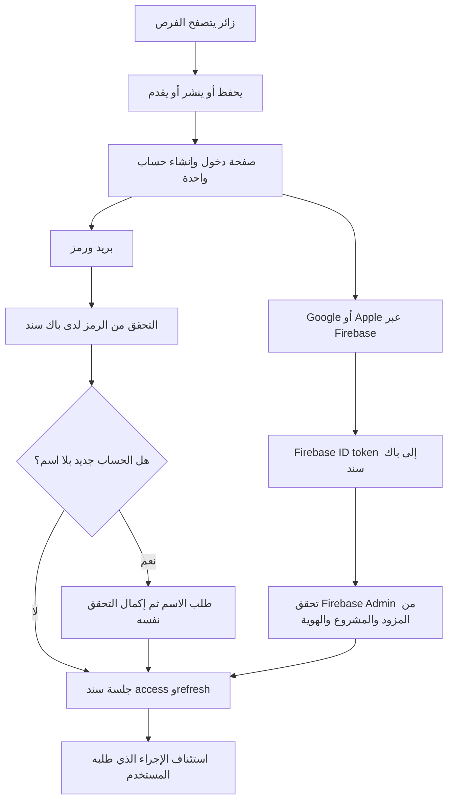
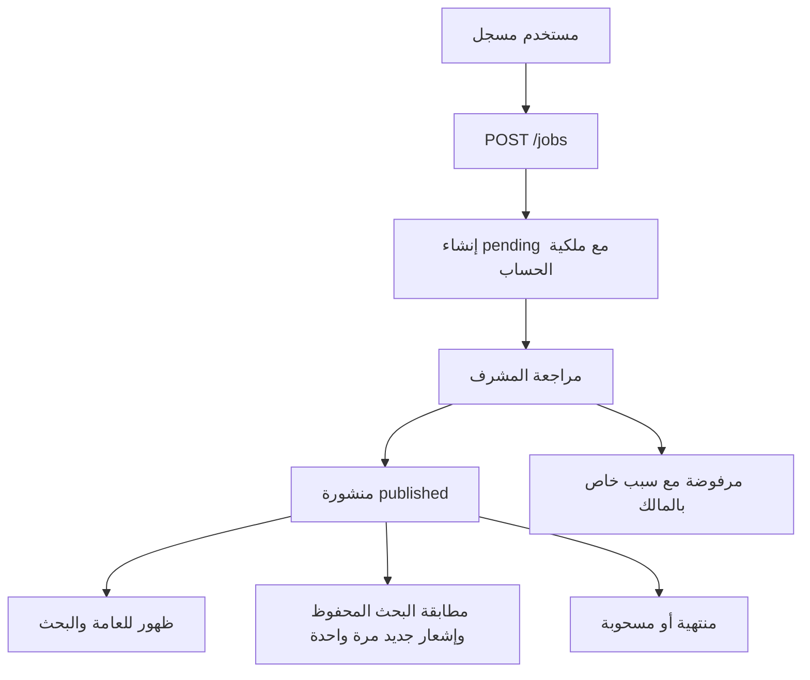
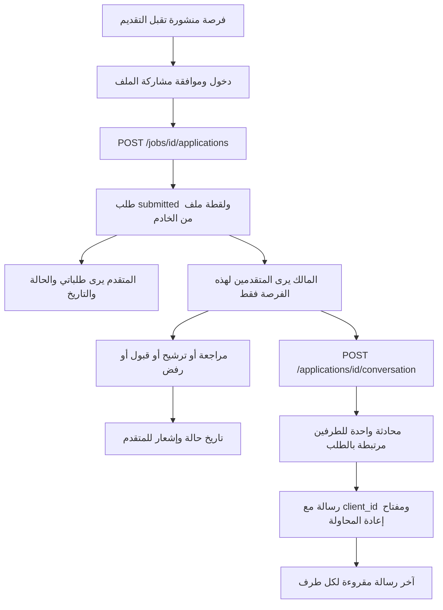

# رحلات التطبيق التي ينفذ الباك خلفها

شرح مختصر للعقد2026-11-03.5. المسارات أدناه على `/api/v2`، باستثناء التصفح العام الحالي على `/api`. التفاصيل والحدود والصلاحيات في PLATFORM.md وOpenAPI؛ لا تنشئ endpoints أخرى اعتماداً على رسم فقط.

## الدخول واستئناف الإجراء

البريد: challenge ثم verify؛ لا كشف وجود الحساب قبل إثبات الرمز. name_required بعد الإثبات لا يستهلك challenge، حتى يضيف المستخدم الاسم ويعيد نفس التحقق. الدخول الاجتماعي يرسل Firebase ID token وليس Google token خاماً أو access token لسند. الحساب الواحد متقدم ومعلن، بلا اختيار دور أو كلمة مرور أو CV.

## إضافة الفرصة ومراجعتها

لا تنشر الفرصة فور POST. أرجع للمالك الوصف والمكان والراتب والتواصل والحالة والسبب عند الرفض؛ لا card فارغاً. تاريخ النشر والمدة من الخادم. jobs القديمة بلا owner_user_id لا تُنسب لحساب بمعرّف جهاز؛ تبقى متوافقة مع نسخ المتجر وتقبل التواصل الخارجي حسب حالتها وموافقة المعلن.

## التقديم والمتقدمون والمحادثة

التقديم فريد `(member_id,job_id)`؛ إعادة الطلب تعيد الموجود. لا يبدأ المتقدم شات عشوائياً، ويسترجع المحادثة الموجودة عندما يبدأها المعلن. حالة الطلب لا تتغير عند قراءة الملف أو بدء المحادثة. PATCH الحالة يتحقق من الدور وexpected_version ويكتب الحدث والإشعار في transaction/outbox. q/status/sort تُطبق قبل cursor pagination؛ تغيير الحالة ينعكس في نتائج التصفية. الحظر يمنع الرسائل بالاتجاهين، ولا يكشف حسابات أخرى.

## الدعم والإشعارات والبيانات

- الشكوى نص وصورة اختيارية: upload خاص مؤقت → POST /complaints → مراجعة دعم → رد وحالة وإشعار لصاحبها. الرفع وحده ليس شكوى؛ نظّف غير المرتبط بعد24 ساعة.
- الأحداث التي ترسل إشعاراً والمستلم والوجهة والتفضيل ومنع التكرار موثقة بالكامل في NOTIFICATION-EVENTS.md. لا إشعار عند الفرز أو البحث أو rebuild أو إعادة إرسال الطلب بالمفتاح نفسه.
- واجهة التطبيق تقرأ آخر نسخة آمنة بسرعة، ثم تحدثها من الخادم. لا تعتبر الكاش إثبات ملكية أو صلاحية إعلان، ولا تغيّر الحساب اعتماداً على device_id.
- عند ضياع جواب كتابة: المفتاح نفسه لإعادة المحاولة؛ لا إنشاء عنصر جديد آلياً. الرسالة الفاشلة تبقى واضحة ويمكن إعادة إرسالها بنفس client_id. لا يوضع رد خاص في CDN عام.

## رحلة القبول المشتركة

نفّذ على staging، أنشئ حسابَي مستخدم ومشرف، ثم جرّب: نشر ومراجعة، حفظ وبحث، تقديم ومراجعة ومراسلة وحظر، شكوى ورد، دخول على جهاز ثانٍ، وخروج وحذف. سلّم النتائج في DELIVERY-REPORT.md. بعدها يربط فريق Flutter البيئة ويختبر الأجهزة والتوقيع والخدمات الخارجية، ثم يبني نسخة المتجر بطلب المالك.
